Beginner·Pipeline Architecture · 25 min · 10 challenges

# Idempotent Reruns: Beginner

Early Sunday morning at Airbnb, the 01:00 job that loads Saturday's bookings into the warehouse dies partway through with a connection reset. The on-call engineer shrugs at the error and clicks retry. Monday's revenue dashboard shows the best Saturday in company history. Nobody made a booking twice; the retry loaded most of them a second time. The write pattern this lesson teaches is the difference between those 2 Mondays.


<br>

---

## The Retry That Doubled the Rows

Every night at 01:00 a loader copies the previous day's orders from the orders database into the warehouse table `orders`. For 2026-04-25 the source holds 250,000 rows. The loader reads them in chunks of 10,000, and after each chunk it runs an `INSERT INTO` and commits, so a crash never loses more than one chunk of progress. That sounds careful, and it's exactly the design that doubles the rows.


<br>

### The night of 2026-04-25

At chunk 19 the network connection to the warehouse resets. The loader raises an error and exits. Chunks 1 through 18 are already committed: 180,000 rows for 2026-04-25 sit in the warehouse table. The orchestrator marks the task failed and pages the on-call engineer, who sees a dropped connection that won't happen again and clicks retry 5 minutes later.

The retry starts from the beginning. It reads all 250,000 source rows, because nothing tells it that 180,000 of them have already arrived. It appends every one of them. The task finishes green. The warehouse now holds 430,000 rows for a day that had 250,000 orders, and 180,000 of those rows are exact copies of rows above them.

| Event | Rows in source | Rows written this attempt | Rows in warehouse for 2026-04-25 |
| --- | --- | --- | --- |
| Run 1 starts | 250,000 | 0 | 0 |
| Run 1 crashes at chunk 19 | 250,000 | 180,000 | 180,000 |
| Retry starts 5 minutes later | 250,000 | 0 | 180,000 |
| Retry completes | 250,000 | 250,000 | 430,000 |


<br>

### Why nobody notices until Monday

The retry succeeded, so no alert fires. Every one of the 430,000 rows is a real order with a real customer and a real amount; the problem is that 180,000 of them appear twice. The day's row count is 1.72 times the true figure. Revenue summed from `amount` for 2026-04-25 is inflated by about as much, since the doubled chunks are ordinary orders with ordinary amounts, and a sales lead spends Monday morning asking why Saturday was the best day of the year.

The query that exposes the damage compares the number of rows to the number of distinct order ids. A day loaded once shows the 2 numbers equal. A day loaded one and a bit times shows the gap.

```sql
SELECT
  order_date,
  COUNT(*) AS row_count,
  COUNT(DISTINCT order_id) AS distinct_orders,
  COUNT(*) - COUNT(DISTINCT order_id) AS duplicate_rows
FROM orders
WHERE order_date = DATE '2026-04-25'
GROUP BY order_date
```

| order_date | row_count | distinct_orders | duplicate_rows |
| --- | --- | --- | --- |
| 2026-04-25 | 430,000 | 250,000 | 180,000 |


<br>

### Naming the failure mode

> Three ingredients of the doubled day
>
> - A partial failure: the run crashed after some of its writes were committed and before the rest.
> - An append write: `INSERT INTO` adds rows and never asks what's already there.
> - A retry: a person or the orchestrator started the whole run again from the first row.
> - Remove any one of the 3 and the duplicates vanish.

The first ingredient can't be removed; networks drop and processes die. The third is something you want, because a retry is how a failed night becomes a finished night without anyone rewriting data by hand. That leaves the write. The rest of this lesson changes the write so that the other 2 ingredients become harmless.

> **TIP**
>
> The row count against distinct order ids is a 1-line check you can run on any table that has a unique id. Run it on the last 7 days of every daily table you own and you will learn which loaders append.

**The same loader runs the next night for 2026-04-26, which has 300,000 source rows. It crashes after committing 3 chunks, and the on-call engineer retries once. The retry completes. How many rows does the warehouse hold for 2026-04-26?**

- **A.** 300,000, because the retry notices the 30,000 existing rows and starts from chunk 4.
- **B.** 330,000, because the 30,000 committed before the crash stay and the retry appends all 300,000.
- **C.** 600,000, because a retry always writes the whole day a second time on top of a whole first copy.
- **D.** 270,000, because the retry deletes the 30,000 partial rows and inserts the remaining chunks.

<details>
<summary>Solution</summary>

**B.** 330,000, because the 30,000 committed before the crash stay and the retry appends all 300,000.

Three chunks of 10,000 were committed before the crash. The retry appends the full 300,000 on top, so 30,000 rows are doubled.

**Why the others are wrong**

- **A.** The retry has no record of what the first attempt wrote. It reads the source from the first row and appends everything.
- **C.** The first attempt wrote 3 chunks, not the whole day. The duplicate count equals the rows committed before the crash.
- **D.** This loader never deletes. A write that clears the partial rows first is the fix, and this loader does not have it.

</details>


<br>

---

## Pipeline Architecture

### Exercise 1 of 1

**● TASK**

A daily Python job appends 250,000 Postgres orders into a plain Snowflake table feeding the revenue dashboard, and a crashed run that was retried loaded every order twice. Replace that destination with a lakehouse table format (Delta Lake or Iceberg) that atomically overwrites a day's data, so re-running a day's load lands the same rows no matter how often it repeats.

**Starting canvas** (already placed for you):

- Postgres orders source (250k rows/day) (source, PostgreSQL)
- Daily Python ETL: INSERT INTO orders, append-only (transform, Pandas)
- Plain Snowflake orders (430k rows after Tuesday's retry, 250k expected) (storage, Snowflake)
- Revenue dashboard (41% inflated, undetected) (consumer, Looker)

<details>
<summary><strong>Solution</strong></summary>

#### Idempotency by keyed upsert, not by append

The concept this challenge is built on is **idempotency**: running the same day's load once or 5 times should leave the table in the exact same state. The old job wasn't idempotent because it used `INSERT INTO orders` in append mode, and an append has memory of nothing. Each run blindly adds rows, so a crash-and-retry writes Tuesday's 250,000 orders twice and you get 430,000 rows with no error to warn you. The fix has two halves that work together: land the data on a table format that supports transactional writes (Delta Lake or Iceberg), then load it with a `MERGE` keyed on the natural business key, `order_id`, instead of a blind append.

| Pitfall: Append plus retry silently double-counts |
| --- |
| The trap is that `INSERT INTO orders` succeeds perfectly on the retry. There is no primary-key violation on a plain Snowflake table, no duplicate error, nothing. The pipeline stays green while the dashboard inflates 41 percent, and revenue is exactly the kind of metric nobody double-checks until finance does. A load that can run twice must be written so the second run is a no-op, not so it's fast. |

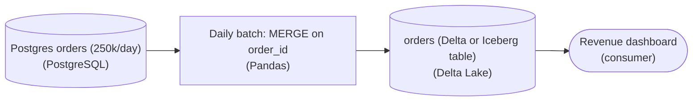

*Same shape as before, but the destination is a table format and the write is a keyed merge, so a repeated run converges instead of accumulating.*

**The idempotent load**

```sql
MERGE INTO orders AS target
USING daily_batch AS source
  ON target.order_id = source.order_id
WHEN MATCHED THEN UPDATE SET
  amount     = source.amount,
  status     = source.status,
  updated_at = source.updated_at
WHEN NOT MATCHED THEN INSERT
  (order_id, amount, status, updated_at)
  VALUES (source.order_id, source.amount, source.status, source.updated_at);
```

*Run this once or 10 times: rows that already exist get overwritten in place, new rows get inserted, and the row count converges to the true set of orders.*

Why the table format is load-bearing: rewriting a day has to be all-or-nothing, or a crash mid-write leaves you half-applied. Delta Lake and Iceberg wrap each write in a transaction backed by a commit log or manifest, so the `MERGE` either commits as a whole or not at all, and a reader never sees a partial batch. That guarantee is what makes 'just re-run it' a safe operational answer instead of a gamble.

| Real world: This is why re-running is the normal recovery path |
| --- |
| In production, jobs crash constantly: a spot node dies, a network blip kills a connection, someone deploys mid-run. On idempotent, keyed-merge pipelines the on-call fix is simply to re-run the day, because a second run converges. On append pipelines every failure becomes a manual archaeology dig to find and delete the partial rows before retrying. Idempotency is what lets you automate retries at all. |

**Follow-up questions**

1. What if `daily_batch` itself contains 2 rows for the same `order_id`?\
   *MERGE errors on a non-deterministic match; you have to dedupe the source to one row per key first, e.g. keep the latest `updated_at`.*
2. How would you make the load restartable at the partition level rather than reloading a whole day?\
   *Tests whether they reach for partition overwrite / replaceWhere as a coarser form of the same idempotency guarantee.*

</details>


<br>

---

## Idempotency in One Sentence

An operation is idempotent when running it once and running it again leave the system in the same state. The number of runs does not change the result; 50 runs end in the same place as 1. The definition ignores what the second run costs in time and money, and it does not care whether that run does any work. It only compares end states.


<br>

### The two-run test

- Start from a known state and run the operation once. Record what the system looks like.
- Run the exact same operation again with the same input. Record the state again.
- Compare the 2 records. Identical means idempotent. Any difference means it is not.

The test is mechanical, which is its value. You don't need to understand what a piece of code intends; you run it twice and diff the results. Point it at a whole pipeline or at a single SQL statement inside one task, and it gives the same kind of answer.


<br>

### Everyday operations under the test

| Operation | After run 1 | After run 2 | Idempotent? |
| --- | --- | --- | --- |
| Set the thermostat to 20 degrees | 20 | 20 | Yes |
| Raise the thermostat by 2 degrees | 22 | 24 | No |
| Create the folder `reports` if it is missing | folder exists | folder exists | Yes |
| `INSERT INTO orders` the day's 250,000 rows | 250,000 rows | 500,000 rows | No |
| Delete the day's rows, then insert the day's 250,000 rows | 250,000 rows | 250,000 rows | Yes |
| `UPDATE accounts SET balance = balance + 10` | 110 | 120 | No |
| `UPDATE accounts SET balance = 110` | 110 | 110 | Yes |

A pattern runs through the table. Operations that state the end result (set to 20, make the folder exist, the day's rows are exactly these) pass. Operations that describe a change relative to what is already there (raise by 2, add these rows, add 10) fail, because the second run starts from a different place than the first did.

> **TIP**
>
> When you cannot tell whether a step is idempotent, ask what it would do if you pressed the button twice by accident. If the answer contains the word 'more', it fails the test.


<br>

### Same operation, same input

The test says the exact same operation with the same input. A loader that reads `WHERE order_date = CURRENT_DATE` is a different operation on Thursday than it was on Tuesday, because its input moved under it. Idempotency is judged for a fixed input: the run for 2026-04-25, with the source rows for 2026-04-25. Two runs of that are the comparison. A run for a different day is a different operation, and it is supposed to produce different rows.

```sql
def record_total_append(totals, day, amount):
    totals.append((day, amount))


def record_total_set(totals, day, amount):
    totals[day] = amount


log = []
record_total_append(log, '2026-04-25', 1_250_000)
record_total_append(log, '2026-04-25', 1_250_000)
print(len(log))

book = {}
record_total_set(book, '2026-04-25', 1_250_000)
record_total_set(book, '2026-04-25', 1_250_000)
print(len(book))
```

Both functions receive the same input twice. The first grows the list by one entry per call, so the second run is visible in the result. The second writes to a key named by the input, so the second call lands on the same key and the dictionary looks exactly as it did after the first call. The key makes the difference: the write is addressed by the day, and the day is part of the input.


**Apply the two-run test. Which statement leaves the table in the same state whether it runs once or twice?**

- **A.** UPDATE orders SET attempts = attempts + 1 WHERE order_id = 7
- **B.** INSERT INTO shipments (order_id) VALUES (7)
- **C.** UPDATE orders SET shipped_at = NOW() WHERE order_id = 7
- **D.** UPDATE orders SET status = 'shipped' WHERE order_id = 7

<details>
<summary>Solution</summary>

**D.** UPDATE orders SET status = 'shipped' WHERE order_id = 7

The statement names the end state. After the first run status is shipped; the second run sets it to shipped again and nothing changes.

**Why the others are wrong**

- **A.** The second run reads the value the first run wrote and adds 1 again, so attempts ends 1 higher after each run.
- **B.** Each run adds one more row for order 7. After 2 runs the table holds 2 shipments for an order that shipped once.
- **C.** The input changes between runs because NOW() moves. The second run overwrites the timestamp with a later one, so the states differ.

</details>


<br>

---

## Pipeline Architecture

### Exercise 1 of 2

**● TASK**

Two candidate destinations sit on the canvas. The plain Snowflake table accumulates rows on every run; the Iceberg table sets the partition's state regardless of prior content. Apply the section's two-run test (run the pipeline twice on the same date) and route the dashboard through the destination that passes.

**Starting canvas** (already placed for you):

- Postgres orders (source, Postgres)
- Daily transform (transform, Python)
- Plain Snowflake orders (INSERT INTO append; ACCUMULATE) (storage, Snowflake)
- Iceberg orders (ACID partition overwrite; SET state) (storage, Iceberg)
- Revenue dashboard (currently reads inconsistent numbers from both) (consumer, Looker)

<details>
<summary><strong>Solution</strong></summary>

#### Idempotency: run it twice, get the same answer

The concept this challenge asked you to apply is **idempotency**: a pipeline step is idempotent when running it again for the same date leaves the destination in the same state as running it once. Pipelines re-run all the time (a retry after a timeout, a manual backfill, a scheduler double-fire), so the destination has to treat a re-run as a correction, not as more data. That is the whole reason the section gave you the two-run test: run the pipeline twice on the same date and check whether the numbers move.

| ✕ Plain Snowflake table (append) | ✓ Iceberg table (partition overwrite) |
| --- | --- |
| The transform ends in `INSERT INTO orders ...`, so every run ACCUMULATES rows. Run day '2026-09-17' once and you get that day's orders. Run it again and those same orders land a second time. Revenue for the day now reads double, and a third retry triples it. The row count is a function of how many times the job fired, not of what happened that day. | The transform SETS the partition's state: it ACID-overwrites the whole '2026-09-17' partition with the current computed rows. Run once, run again, run 10 times, and the partition holds exactly one copy of the day's orders every time. The destination is a function of the DATA, not of the number of runs, so it passes the two-run test. |

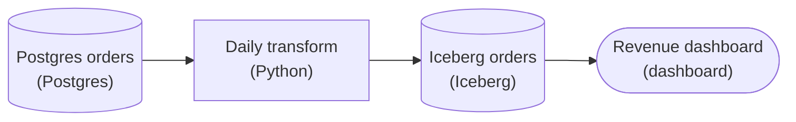

*The route that passes the two-run test: the dashboard reads the partition-overwrite destination, and the append table is left off the path.*

| Pitfall: "It worked the first time" hides the bug |
| --- |
| The append table looks correct on a single clean run, which is exactly why it is dangerous. The `INSERT INTO` only misbehaves on the SECOND run, and by then the wrong number is already on the dashboard. Do not confirm a destination by running the pipeline once. The two-run test exists because this failure mode is invisible until a re-run happens, and in production a re-run always happens eventually. |

| Key insight: Why the table format is doing the work |
| --- |
| The append side would need a full-vs-incremental strategy plus a dedup or a delete-before-insert to become safe. The Iceberg side gets there for free because the format supports an ACID partition overwrite: it replaces the '2026-09-17' partition atomically, so readers never see a half-written or doubled state. That is the difference between a plain table and a table FORMAT, and it is why picking the destination here is an idempotency decision, not just a storage-engine preference. |

In real work this is the shape of most "the numbers are off by 2x on Tuesdays" incidents: a job retried, an append destination double-counted, and nobody noticed until a total looked wrong. Designing the destination to SET state per partition instead of ADD rows means retries and backfills are safe by construction, which is what lets you re-run history without writing a cleanup script first.

**Follow-up questions**

1. The transform is genuinely incremental and only ever produces NEW order ids that never change. Is the append table safe now?\
   *Tests whether append-only is idempotent ONLY when the key is guaranteed new-and-immutable, since a retry re-emitting the same id still doubles it.*
2. A late correction arrives for an order dated 3 days ago. How does the partition-overwrite destination handle it versus the append one?\
   *Tests that overwriting the old partition applies the correction cleanly, while append leaves both the wrong and the right row.*

</details>


<br>

### Exercise 2 of 2

**● TASK**

Retries on this pipeline double the day's numbers because the hourly job appends its rows into a daily-partitioned table. Rebuild it with partition overwrite: land each hourly run in a staging table, then write the daily table from that staging table. Both tables must use a table format that replaces a partition atomically, so rerunning any step leaves the same state as a clean first run.

**Starting canvas** (already placed for you):

- Postgres orders source (rows arrive hourly) (source, PostgreSQL)
- Hourly Spark transform: INSERT INTO daily partition (cadence/grain mismatch) (transform, Spark)
- Plain Snowflake orders (daily partition; INSERT INTO appends; no atomic OVERWRITE) (storage, Snowflake)
- Daily report dashboard (numbers drift across hourly retries) (consumer, Looker)

<details>
<summary><strong>Solution</strong></summary>

#### Why a retry doubled the day

The property you built toward has a name: **idempotency**, a write that leaves the table in the same state whether it runs once or 5 times. The append job never had it. Each `INSERT INTO` adds this run's rows to whatever the day's partition already holds, so the result depends on how many times the run fired. The rebuild makes every write declare the full contents of the slice it owns and replace that slice, so a rerun overwrites instead of piling up.

| Pitfall: Append makes the row count depend on the retry count |
| --- |
| `INSERT INTO` is additive by definition: the daily partition gains one copy of the hour's rows per run. A retry after a partial failure is the worst case, some rows already landed and the rerun adds them again, so the dashboard reads a day that never happened. A downstream dedup or `MERGE` only papers over a write that should have been a replace. |

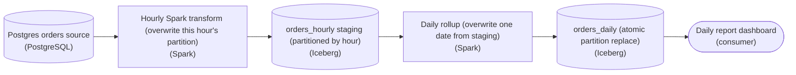

*The hourly writer owns `orders_hourly`; `orders_daily` is derived from it, so each write replaces a full partition.*

1. **Stage the hourly output at its own grain**

   Land each Spark run in `orders_hourly`, partitioned by hour, not by day. The run now owns exactly one partition and replaces it outright. Cadence and grain finally match, which is what the original got wrong: an hourly writer reached into a daily partition it shared with 23 other runs.

2. **Rebuild `orders_daily` from staging**

   Make the daily table derived: overwrite `orders_daily` for a date by selecting every staged hour of that date. Because the read is the whole day, the write is complete by construction, rerun it after any hour changes and the day is recomputed from scratch, never added to.

3. **Pick a format that replaces a partition atomically**

   Both tables need a format like `Iceberg` or `Delta` where swapping a partition is one atomic commit. Plain `INSERT INTO` on an unmanaged table has no all-or-nothing replace, so a partial failure leaves half-written rows. Atomic overwrite means a crashed rerun either fully lands or leaves the prior partition untouched.

**Follow-up questions**

1. Beyond the write mode, what must be true of the Spark transform for a rerun to be safe?\
   *Deterministic transforms: non-deterministic logic breaks idempotency even with an atomic overwrite.*
2. How would you overwrite only the hours that changed instead of the whole date?\
   *Dynamic partition overwrite versus a static full-day replace, and the cost trade-off.*

</details>


<br>

---

## Replace, Do Not Append

The replace pattern needs one idea about how the warehouse table is organized. The `orders` table is split by `order_date`: every row for 2026-04-25 is stored together under that date, and every row for 2026-04-26 under its own. One date's slice is called a partition. A query that filters on a single date touches one partition, and a write that targets a single date can replace that partition without reading or touching any other day.

The daily loader's unit of work is one day. The partition's unit of storage is one day. When those 2 units match, the idempotent write is 2 statements: remove whatever the partition holds, then insert the day's rows computed fresh from the source.

```sql
DELETE FROM orders
WHERE order_date = DATE '2026-04-25'
```

```sql
INSERT INTO orders
SELECT
  order_id,
  customer_id,
  amount,
  order_date
FROM source_orders
WHERE order_date = DATE '2026-04-25'
```

Some engines offer one statement that performs both steps at once, often written `INSERT OVERWRITE`. Written out, that statement is the pair above: clear the partition, fill the partition. The end state is the same either way. The partition holds exactly the day's rows from the source, and nothing from any previous run survives.


<br>

### The two-run test on the replace

| Scenario | Partition before | DELETE removes | INSERT adds | Partition after |
| --- | --- | --- | --- | --- |
| Clean first run | 0 | 0 | 250,000 | 250,000 |
| Rerun after a clean run | 250,000 | 250,000 | 250,000 | 250,000 |
| Retry after a crash at chunk 19 | 180,000 | 180,000 | 250,000 | 250,000 |
| Third rerun, for no reason | 250,000 | 250,000 | 250,000 | 250,000 |

Every row of the table ends at 250,000. The partial 180,000 from the crashed run are exactly what the DELETE removes, so the retry cleans up the mess the first attempt left without knowing the mess exists. The replace produces the correct end state whatever the previous state was, and no step in it detects or repairs the failure.


<br>

### The partition must match the run

The DELETE and the INSERT must describe the same set of rows. If the run reads one day from the source, it clears one day in the target. A loader that deleted the whole table and inserted one day would wipe 2 years of history on every run. A loader that deleted one day and inserted a week would leave 6 days doubled. Match the scope of the delete to the scope of the insert, and make both come from the same value.


<br>

### Where the date comes from

That value is the run's date, and it must come from the orchestrator rather than from the clock. The orchestrator schedules a run for 2026-04-25 and hands that date to the task. If the task computed `CURRENT_DATE - INTERVAL '1' DAY` instead, a rerun on Thursday for Tuesday's failed run would delete and insert Wednesday, leaving Tuesday still broken and Wednesday rewritten for nothing. Every statement in the run for a given day is scoped to that day, however many days later the run happens to execute.

```sql
def load_orders(conn, run_date):
    conn.execute('DELETE FROM orders WHERE order_date = ?', [run_date])
    conn.execute(
        'INSERT INTO orders '
        'SELECT order_id, customer_id, amount, order_date '
        'FROM source_orders WHERE order_date = ?',
        [run_date],
    )
```

| ✓ Append with INSERT INTO | ✗ Replace the partition |
| --- | --- |
| • A second run doubles the day<br><br>• A partial failure leaves rows the retry can't see<br><br>• Correct only if the run happens exactly once<br><br>• One statement to write, a long cleanup afterwards | • A second run equals the first<br><br>• A partial failure is erased by the next DELETE<br><br>• Correct for any number of runs<br><br>• Two statements, both scoped by the run date |

| ✓ Do | ✗ Don't |
| --- | --- |
| • Scope the DELETE and the INSERT by the same run date<br><br>• Take the run date from the orchestrator, never from the clock<br><br>• Partition the target by the same unit the loader processes | • Append daily loads with a bare INSERT INTO<br><br>• Filter on CURRENT_DATE inside a scheduled task<br><br>• Delete a wider range than the run inserts |

*Between the DELETE and the INSERT the partition is empty for a few seconds, and a query during that window sees no rows for the day. A single overwrite statement closes that gap, which is one reason engines offer it. The end state is identical.*

**A loader deletes WHERE order_date = CURRENT_DATE - INTERVAL '1' DAY and then inserts the rows for the run_date the orchestrator passed. Tuesday's run failed partway. On Thursday the on-call engineer reruns it for Tuesday. What happens to the table?**

- **A.** Tuesday's partition is deleted and rewritten, because the INSERT decides which partition the DELETE targets.
- **B.** Wednesday's rows are deleted, and Tuesday's rows are appended on top of whatever Tuesday's failed run left behind.
- **C.** Nothing is deleted, because Thursday minus 1 day is a date the table does not hold, and Tuesday is rewritten correctly.
- **D.** Both Tuesday and Wednesday are deleted and both are rewritten, so the table ends correct after a few seconds.

<details>
<summary>Solution</summary>

**B.** Wednesday's rows are deleted, and Tuesday's rows are appended on top of whatever Tuesday's failed run left behind.

On Thursday the clock says Wednesday, so Wednesday is cleared. The inserted rows carry Tuesday's date and land in Tuesday's partition, doubling the partial rows already there.

**Why the others are wrong**

- **A.** The DELETE has its own filter and it says Wednesday. Nothing links the 2 statements except the value you give each one.
- **C.** Thursday minus 1 day is Wednesday. Wednesday loaded correctly, and its full day of rows is what gets deleted.
- **D.** The single DELETE is scoped to Wednesday, while the INSERT brings in Tuesday's rows. Wednesday ends empty and Tuesday ends doubled.

</details>


<br>

---

## Pipeline Architecture

### Exercise 1 of 2

**● TASK**

A duplicate-row incident from append-only writes spooked the team into turning retries off entirely, so now every transient blip pages someone at 3 a.m. to rerun the job by hand. The lesson's fix is a two-way contract: a destination whose writes are safe to repeat, plus an orchestrator that owns the schedule and retry policy. Wire up both halves on the canvas so transient failures self-heal.

**Starting canvas** (already placed for you):

- Postgres orders source (source, PostgreSQL)
- Daily Python ETL (retries disabled after duplicate incident; manual 3am page on every blip) (transform, Pandas)
- Plain Snowflake orders (non-idempotent; INSERT INTO append) (storage, Snowflake)
- Daily report dashboard (consumer, Looker)

<details>
<summary><strong>Solution</strong></summary>

#### Why the pager goes quiet

The repair pairs 2 ideas the lesson named: **idempotency** and orchestrated retries. A write is idempotent when running it twice leaves the table exactly as running it once would. A `MERGE` keyed on `order_id` into an Iceberg table has that property; a bare `INSERT INTO` does not. Once repeating a write is safe, the orchestrator can absorb a transient blip on its own instead of paging a human.

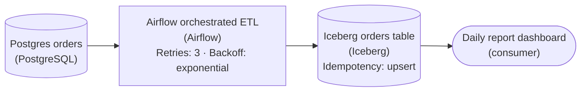

*Airflow owns the schedule and retry policy; the Iceberg table's `MERGE` on `order_id` makes each rerun safe. Neither half works alone.*

| Pitfall: Killing retries treated the symptom, not the bug |
| --- |
| The duplicate rows came from re-running an append-only `INSERT INTO`, so the team switched retries off. That fixed nothing; it moved the failure onto a person at 3 a.m. The append was the defect, not the retry. Make the write idempotent and retries become safe to turn back on. |

| Key insight: An idempotent write is what makes a retry free |
| --- |
| `MERGE INTO orders USING staging ON orders.order_id = staging.order_id` updates the row that exists and inserts the one that does not, so a second run converges to the same table. That is the precondition for automated recovery: the orchestrator may safely rerun a step only when rerunning it cannot corrupt the destination. |

The other half is ownership. The orchestrator, not a cron line or a person, holds the schedule and the retry policy: run daily, retry a failed task up to 3 times with exponential backoff, and page only after the retries are exhausted. A dropped connection now self-heals on the next attempt, and the alert that does reach a human is a real failure worth waking up for.

**Follow-up questions**

1. What natural key would you `MERGE` on if a single `order_id` can legitimately appear in more than one nightly batch?\
   *Tests whether the idempotency key is truly unique per target row, or needs a composite like `(order_id, updated_at)`.*
2. How would you keep the retries bounded so a genuinely broken upstream does not retry forever?\
   *Checks understanding of max attempts plus backoff, and when a failure should escalate rather than retry.*

</details>


<br>

### Exercise 2 of 2

**● TASK**

Pipeline A reads the day's orders, groups by customer, and row-by-row INSERTs into a plain Snowflake daily_customer_summary. Each rerun multiplies the rows. The aggregation logic is correct; the bug lives entirely in the write semantics. Convert Pipeline A to Pipeline B by applying the section's named fix at the destination, leaving the aggregation untouched.

**Starting canvas** (already placed for you):

- Postgres orders source (source, Postgres)
- Pipeline A: aggregate by customer_id, then row-by-row INSERT INTO (no transaction) (transform, Python)
- Plain Snowflake daily_customer_summary (3x rows after 3 runs; no atomic OVERWRITE) (storage, Snowflake)
- Customer summary dashboard (numbers multiply with every retry) (consumer, Looker)

<details>
<summary><strong>Solution</strong></summary>

#### The property lives in three changed lines

Idempotency means a second run leaves the destination exactly as the first one did. Put Pipeline A beside Pipeline B and the aggregation is identical: grouping the day's orders by `customer_id` gives the same numbers every time. What differs is the write. A's row-by-row `INSERT INTO` only appends, so three runs stack three copies of each customer and the dashboard sums them all.

| Pitfall: Moving the aggregation never fixes an append |
| --- |
| Rewriting the grouping in Spark or dbt, or making it faster, leaves the bug in place. A bare `INSERT INTO daily_customer_summary` cannot tell a retry from new data, so it appends a second full set of rows wherever it runs. |

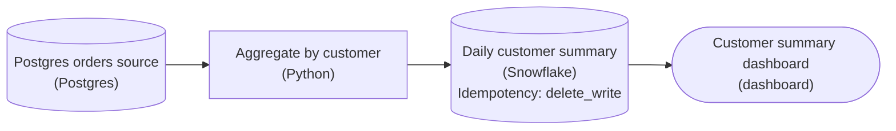

*Pipeline B: the same aggregation feeds a destination whose write deletes the run's date and inserts the batch in one transaction.*

**Pipeline B's write**

```sql
BEGIN;

DELETE FROM daily_customer_summary
WHERE order_date = :run_date;

INSERT INTO daily_customer_summary
    (order_date, customer_id, order_count, total_amount)
SELECT order_date, customer_id, order_count, total_amount
FROM todays_summary;

COMMIT;
```

*`BEGIN` and `COMMIT` make the pair atomic, the `DELETE` clears the run's date, and one `INSERT` loads the whole batch; `todays_summary` is the unchanged aggregation's output.*

| ✕ Pipeline A | ✓ Pipeline B |
| --- | --- |
| One `INSERT INTO` per customer, no transaction, nothing removed first. Each run adds its rows on top of the last, and a crash halfway leaves a partial day behind. | `DELETE ... WHERE order_date = :run_date`, then one `INSERT`, both inside `BEGIN` and `COMMIT`. A rerun removes exactly what the last run wrote, so the final state depends on the data, not on the run count. |

| Real world: Every warehouse table should survive a double write |
| --- |
| Schedulers replay, workers crash mid-write and backfills rerun whole date ranges, so a second run is routine. Delete-then-insert per date is the usual pattern for daily summaries; a keyed `MERGE` and an atomic partition overwrite are its siblings. |

**Follow-up questions**

1. A late correction removes a customer's only order for the day. Does the rerun clear their row, and would a keyed `MERGE` do the same?\
   *Replacing the whole date drops rows that vanished from the source; an upsert only touches keys it sees.*
2. If the `DELETE` succeeds and the `INSERT` fails, what does the dashboard show with and without the transaction?\
   *Ties atomicity to idempotency: the transaction keeps a failed run from leaving an empty day.*

</details>


<br>

---

## Why Retries Need Idempotency

An orchestrator retries a failed task on its own. You set `retries: 3` on the loader so that a dropped connection at 01:00 does not need a human at 01:05. The orchestrator waits and runs the task again, and it repeats that after each failure for up to 3 extra attempts. That behaviour is the orchestrator doing its job; the trouble comes from what each attempt does to the table.


<br>

### Tracing 3 retries on an append

Take a bad night. Attempt 1 crashes after 180,000 rows, attempt 2 after 60,000 and attempt 3 after 240,000; attempt 4 completes all 250,000. The task's final status is success, and the orchestrator's run page shows 1 green box. Trace the partition through the 4 attempts under both write modes.

| Attempt | Rows committed in this attempt | Partition after (append) | Partition after (replace) |
| --- | --- | --- | --- |
| 1 | 180,000 | 180,000 | 180,000 |
| 2 | 60,000 | 240,000 | 60,000 |
| 3 | 240,000 | 480,000 | 240,000 |
| 4 | 250,000 | 730,000 | 250,000 |

Under append, every attempt's partial progress survives into the next, and the finished partition holds 730,000 rows for 250,000 orders. Under replace, each attempt begins by clearing whatever the previous one left, so only the last attempt's rows remain, and the last attempt is the one that completed. The replace column passes through 3 wrong states on its way, but the state the retries settle on is right.

- **480,000** — phantom rows after 3 retries
- **2.9x** — warehouse rows per real order


<br>

### Retries multiply whatever the write does

The retry repeats the write, and the write creates the duplicates. A retry is a multiplier on the write's behaviour. An idempotent write run 4 times still leaves one day's rows. An append run 4 times leaves the full day from the attempt that succeeded plus the partial fragment from every attempt that failed before it, up to nearly 4 days' worth of rows. The retry count is the wrong dial to turn. Setting `retries: 0` on an append loader doesn't protect the table: the on-call engineer retries by hand, the manual run appends the same way, and the day doubles exactly as before.

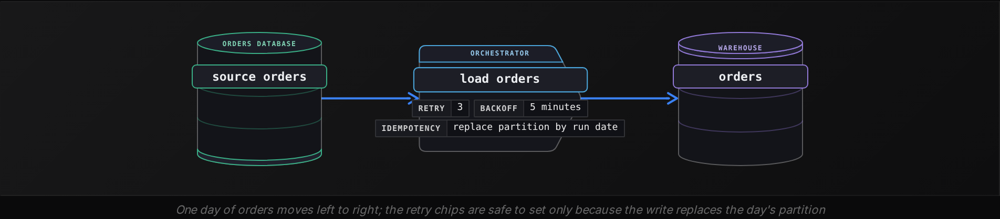


<br>

### Anything that can run twice, will

The orchestrator's retry is the most visible second run, and far from the only one. A scheduler that fires twice after a restart, an engineer who clicks run on the wrong day, a deploy that restarts a task mid-flight, a backlog of failed nights all rerun on one afternoon: each is a second run of the same operation on the same input. With an idempotent write, every one of them leaves the partition as a single run would; with an append, each one doubles a day.

> What idempotency buys the on-call engineer
>
> - Retry without reading the logs first, because the worst case of a retry is wasted compute.
> - Rerun a week of failed nights in any order, because each run owns its own partition.
> - Stop asking whether the first attempt wrote anything before pressing the button.

**An append loader has retries: 2. One night attempt 1 commits 100,000 rows and fails, attempt 2 commits 50,000 and fails, and attempt 3 completes all 250,000. What does the partition hold, and what would it hold if the write replaced the partition instead?**

- **A.** 400,000 under append, and 400,000 under replace, because 3 attempts wrote rows either way.
- **B.** 400,000 under append, and 250,000 under replace, because replace keeps only the last attempt.
- **C.** 250,000 under append, and 250,000 under replace, because failed attempts roll back their rows.
- **D.** 500,000 under append, and 250,000 under replace, because each failed attempt counts as a full day.

<details>
<summary>Solution</summary>

**B.** 400,000 under append, and 250,000 under replace, because replace keeps only the last attempt.

Append keeps 100,000 plus 50,000 plus 250,000. Replace deletes the partial rows at the start of each attempt and ends with the completed 250,000.

**Why the others are wrong**

- **A.** Under replace each attempt clears the partition before writing, so attempt 3's 250,000 rows are the only ones left.
- **C.** The loader commits after every chunk, so failed attempts leave their committed rows behind, and no rollback removes them.
- **D.** A failed attempt leaves exactly the rows it committed, 100,000 and then 50,000, so the append total is 400,000.

</details>


<br>

---

## Pipeline Architecture

### Exercise 1 of 1

**● TASK**

Our first nightly pipeline appends each night's orders straight into the orders_daily table, so when last night's run crashed partway through and the scheduler retried it, the day's rows landed twice and revenue jumped 41 percent. The CTO wants retries to be safe by construction: rework the write so reprocessing a date replaces that date's rows instead of adding to them, which needs a destination table format that can overwrite a date partition atomically. Put a real orchestrator in charge of the nightly schedule and its retry policy, and point the finance dashboard at the new idempotent table instead of the old append-only one.

**Starting canvas** (already placed for you):

- Postgres orders source (250k rows/night) (source, PostgreSQL)
- Nightly Python ETL: INSERT INTO append (crashed at row 180,001 last night, retried) (transform, Pandas)
- Plain Snowflake orders_daily (430k rows after retry; revenue inflated 41%) (storage, Snowflake)
- Finance revenue dashboard (CFO sees inflated number) (consumer, Looker)

<details>
<summary><strong>Solution</strong></summary>

#### The property the append was missing

The write you reworked is now **idempotent**: running it twice for the same date leaves the table in exactly the same state as running it once. The old `INSERT INTO orders_daily` gave no such guarantee. Appending is a pure add, so a second run for '2026-09-16' stacks another copy of that day's rows on top of the first. That is why the retry after the crash at row 180,001 pushed revenue up 41 percent: the scheduler did its job, but the write had no memory that the date was already loaded.

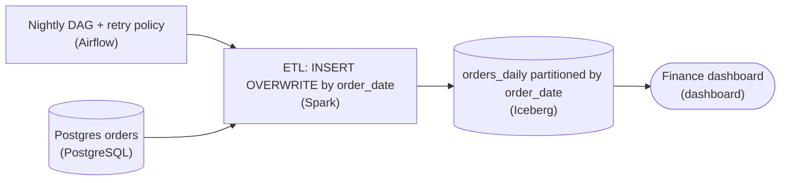

*The `order_date` partition is the unit of both reprocessing and overwrite, so a retry rewrites exactly one day.*

| Pitfall: Delete-then-insert is 2 commits, not one |
| --- |
| The tempting first fix is `DELETE FROM orders_daily WHERE order_date = '2026-09-16'` then `INSERT`. It reads as idempotent, but it is 2 separate commits: a crash in between leaves the date empty, and any dashboard query that lands in that gap sees a day of zero revenue. You have only traded double-counting for a visible hole. Atomic partition overwrite closes that window entirely. |

| Trick: Overwrite the same grain you reprocess |
| --- |
| The real fix is a table format that swaps a whole partition in a single commit: `INSERT OVERWRITE` on an Iceberg or Delta table partitioned by `order_date` (Delta spells the scoped form `replaceWhere`). Because the format uses snapshot isolation, a reader sees either the old day or the new day, never a blend and never a doubled count. Scope the overwrite to the exact partition you reload so one bad date never rewrites its neighbors. |

| Real world: Retries become safe by construction, not by luck |
| --- |
| Once the write is idempotent, the orchestrator's retry policy stops being dangerous. Airflow's `retries=3` with an exponential `retry_delay` can replay the failed task freely, because a re-run of '2026-09-16' overwrites rather than appends. Before this change every retry was a fresh way to corrupt the total, which is why the CTO wanted the orchestrator and the idempotent write shipped together, not one without the other. |

**Follow-up questions**

1. How would you reload a week of corrected data at once without a separate manual step per `order_date`?\
   *Tests whether the partition overwrite scales to backfills, not just last night's run.*
2. What happens to a late-arriving order whose `order_date` partition you already overwrote?\
   *Pushes on the full-vs-incremental boundary and how merge semantics handle stragglers.*

</details>


<br>

---

## Side by Side: Idempotent vs Not

Here is the loader as it ran on the night of 2026-04-25, followed by the version that replaced it. The 2 differ in 3 places. In both, `chunks` splits the rows into lists of 10,000 and `log` is the task's logger. Read both, then the table that lists each difference and what it contributes to idempotency.

```sql
from datetime import date, timedelta


def load_orders(source, target):
    yesterday = date.today() - timedelta(days=1)
    rows = source.query(
        'SELECT order_id, customer_id, amount, order_date '
        'FROM orders WHERE order_date = ?',
        [yesterday],
    )
    for chunk in chunks(rows, 10_000):
        target.execute('INSERT INTO orders VALUES (?, ?, ?, ?)', chunk)
        target.commit()
    log.info('loaded %d rows', len(rows))
```

```sql
def load_orders(source, target, run_date):
    rows = source.query(
        'SELECT order_id, customer_id, amount, order_date '
        'FROM orders WHERE order_date = ?',
        [run_date],
    )
    target.execute('DELETE FROM orders WHERE order_date = ?', [run_date])
    target.commit()
    for chunk in chunks(rows, 10_000):
        target.execute('INSERT INTO orders VALUES (?, ?, ?, ?)', chunk)
        target.commit()
    log.info('loaded %d rows for %s', len(rows), run_date)
```

| Line | Before | After | Carries the property? |
| --- | --- | --- | --- |
| Function signature | `load_orders(source, target)` | `load_orders(source, target, run_date)` | Yes: the caller fixes the input, so 2 runs can receive the same day |
| Date used for the read | `date.today() - 1 day` | `run_date` | Yes: the same run reads the same rows on Thursday as on Tuesday |
| Write preamble | none | `DELETE ... WHERE order_date = run_date` | Yes: clears every row a previous attempt wrote for this day |
| Insert loop | `INSERT INTO` per chunk | `INSERT INTO` per chunk | No: unchanged, an append is fine once the partition is cleared |
| Commit per chunk | after each chunk | after each chunk | No: decides how much a crash leaves behind, and the DELETE handles any amount |
| Log line | row count | row count and run date | No: logging has no effect on the table |

The property depends on 3 lines working together. The `run_date` parameter makes 2 runs comparable. The read filtered by `run_date` makes both runs fetch the same rows. The DELETE filtered by `run_date` makes the second write land on a cleared partition. Remove any one and the two-run test fails, at the latest when a run executes on a different day from the one it is for. Without the parameter the day drifts with the clock; without the read filter the loader clears one day but reads every day in the source, so every other day is reloaded on top of itself; and if the DELETE goes, the rows pile up.


<br>

### Lines that look important and are not

The `INSERT INTO` is unchanged between the 2 versions. An append is a fine statement; an append without a preceding clear is what fails the test. The chunk size and the commit per chunk decide how much a crash leaves behind, 180,000 rows or 10,000 or none, and the next DELETE erases any amount, so they don't change the end state once a rerun succeeds. They do change what a reader of the table sees during the load. The DELETE commits first and every chunk commits as it lands, so for the whole load, far longer than the few seconds of the second section's pair of statements, a query sees an empty day and then a partial one. If every retry fails, the partial day stays. Running the DELETE and all the inserts in one transaction, or using a single overwrite statement, closes that window. The log line is the one most often mistaken for a safeguard. It records that something happened; it can't stop it from happening twice.


<br>

### Running the test against both

| Run sequence | Before (append, clock) | After (replace, run_date) |
| --- | --- | --- |
| Run once on 2026-04-26 for the 25th | 250,000 on the 25th | 250,000 on the 25th |
| Crash at chunk 19, retry the same night | 430,000 on the 25th | 250,000 on the 25th |
| Rerun on 2026-04-28 for the 25th | 25th unchanged, 27th doubled | 250,000 on the 25th, no other day touched |

The before column fails on the second line and produces something stranger on the third: a rerun meant to fix the 25th instead loads the 27th a second time, because the clock chose the day. The after column is one number repeated, which is what the two-run test looks for.

> **TIP**
>
> When reviewing a loader, find the 3 places: where the run's date is fixed, where the read is bounded by it, and where the write clears by it. If any of the 3 is missing, the code is one retry away from a doubled day.

**A colleague edits the fixed loader so the DELETE reads DELETE FROM orders WHERE order_date = CURRENT_DATE - INTERVAL '1' DAY, and leaves the read on run_date. Which run sequence still passes the two-run test?**

- **A.** A rerun on 2026-04-28 for the 25th: the DELETE clears the 27th and the INSERT refills the 25th, ending at 250,000.
- **B.** Every sequence, because the read still uses run_date and the read is the line that carries the property.
- **C.** Two runs on the night of 2026-04-26 for the 25th: both runs clear and refill the 25th, so the partition ends at 250,000.
- **D.** No sequence, because a DELETE that depends on the clock fails the test even when the clock agrees with the run.

<details>
<summary>Solution</summary>

**C.** Two runs on the night of 2026-04-26 for the 25th: both runs clear and refill the 25th, so the partition ends at 250,000.

On the 26th, the clock minus 1 day gives the 25th, which matches the date the read uses. The test passes only while that agreement holds.

**Why the others are wrong**

- **A.** The 25th is never cleared, so its rows are appended on top of what it already held, and the 27th is wiped for nothing.
- **B.** The property needs all 3 lines. A read bounded by the run date with a DELETE bounded by the clock drifts apart as soon as the 2 disagree.
- **D.** The test compares end states. If the clock and the run date agree, each run clears the same partition before refilling it, so the end states match.

</details>


<br>

---

## Pipeline Architecture

### Exercise 1 of 2

**● TASK**

A nightly batch job reads the day's page-view log files and adds each page's view count to a running total in a warehouse table, so a rerun doubles the numbers. Make the pipeline idempotent: running it twice for the same day must leave the table exactly as one run does, with the job setting each page's count for that day instead of adding to it. A reporting dashboard reads the table.

<details>
<summary><strong>Solution</strong></summary>

#### Set the count, do not add to it

Idempotency fits in one sentence: running the pipeline twice leaves the same end state as running it once. This job broke that rule because its write added. Adding a page's views to a running total behaves like an HTTP POST: every call changes the result again, so a retry or a manual rerun stacks another night of views on top. **Setting the count behaves like a PUT**: write 'this page had 1,200 views on this date' and a second run writes the identical fact over itself.

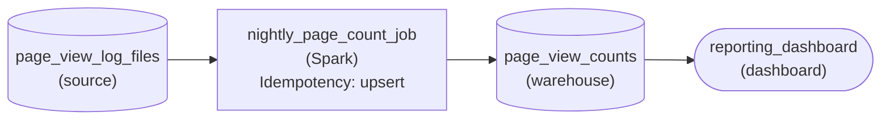

*The nightly job upserts one count per page per day into the warehouse, so a rerun rewrites the same values; the dashboard reads them.*

| Pitfall: A running total remembers every run |
| --- |
| Keeping one cumulative number per page and doing `total = total + todays_views` looks tidy, but the table now records how many times the job ran, not what the logs say. Once a rerun has doubled a night, nothing left in the table tells you which views were real. |

| Key insight: Set versus add decides it, not the tool |
| --- |
| A Spark job, a SQL script or a Python loop is idempotent when it writes each page's count for a day as a keyed value, and not idempotent when it appends or increments. On the canvas that choice lives in the write's idempotency setting; the one-count-per-page-per-day key is what makes setting possible. |

**Follow-up questions**

1. Late log files mean the job now reprocesses the previous 2 days every night. What changes?\
   *Whether you see reprocessing as just another rerun that a set-based write already absorbs.*
2. The dashboard also wants an all-time total per page. Where should that number come from?\
   *Deriving a cumulative figure by summing the set daily counts instead of incrementing a stored total.*

</details>


<br>

### Exercise 2 of 2

**● TASK**

A nightly batch job pulls one day of freezer temperature readings for 1,200 refrigerated trucks from the telematics API, summarizes them per truck, and appends the result to a warehouse summary table partitioned by reading date. A compliance dashboard reads that table, and every rerun of a failed night shows that day's trucks twice. Design the pipeline so each run replaces its reading date's partition instead of appending to it.

<details>
<summary><strong>Solution</strong></summary>

#### Set the partition, do not add to it

Partition overwrite changes a write from 'add these rows' into 'this date now holds exactly these rows.' For the freezer summaries, each nightly run computes about 1,200 rows, one per truck, for its reading date and swaps them in as a unit. Whatever the partition held before, from a half-finished run or a clean one, is gone, so running the same night once or 5 times leaves the same 1,200 rows.

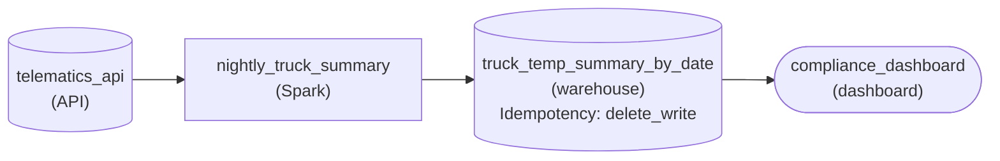

*One run, one reading date: the Spark job replaces that date's partition in `truck_temp_summary_by_date`, with `idempotencyStrategy` set to `delete_write`.*

1. **Key the partition on the reading date**

   The partition a run replaces has to be the slice of time its data describes. The April 25 run reads April 25 readings and owns the April 25 partition, whether it runs that night or a week later. That ownership is what makes a replace safe: nothing else ever writes into that slice.

2. **Swap the partition in as a unit**

   On the summary table, set the write to delete the date's rows and write the new set in one operation. The old append contributed rows; this write defines what the date contains. A rerun after a timeout simply defines it again, and the dashboard never sees a truck twice.

| Pitfall: Keying on the run date breaks every rerun |
| --- |
| If the partition key is the day the job ran, rerunning April 25 on April 27 replaces April 27 and leaves the doubled April 25 rows untouched. Replace only works when the slice the run overwrites is the slice its data belongs to. |

| Real world: A backfill becomes a loop of ordinary runs |
| --- |
| Once each run owns one date, reprocessing a month is 30 runs, one per date, in any order. No cleanup script and no manual delete before the reload: the write already does it. |

**Follow-up questions**

1. What changes if the table held a running total of minutes above the safe temperature across all days instead of a per-day summary?\
   *Whether a cumulative value can still be replaced one partition at a time, or has to be recomputed from the per-day rows.*
2. The API was down and a run produced zero rows. Should the replace still run?\
   *Whether an empty result should be allowed to wipe a date that already held good rows.*

</details>


<br>

---

## Putting It All Together

A food delivery company loads each day's completed deliveries into a warehouse partition at 02:00, and the courier payout team sums that partition every Friday to pay riders. The loader fails on Tuesday night with a dropped connection after 140,000 of 310,000 rows. The orchestrator retries with retries: 3, the first 2 retries also fail partway, and the third retry completes all 310,000 rows. On Friday the payout query runs.

- With an append loader, the 140,000 partial rows plus every later attempt's partial rows plus the full 310,000 land in Tuesday's partition, and riders are paid for deliveries that never happened.
- With a replace loader scoped by the orchestrator's run date, each retry begins by clearing Tuesday's partition, so the completed attempt is the only one whose rows survive and the payout is exact.
- The two-run test is how the team proves it before Friday: run the loader twice for Tuesday in a test schema and compare the row count against distinct delivery ids.
- Because every statement in the loader is scoped by run_date rather than by the clock, a rerun on Thursday for Tuesday repairs Tuesday and leaves Wednesday untouched.


<br>

---

## Pipeline Architecture

### Exercise 1 of 2

**● TASK**

A nightly batch job reads one day of fitness-tracker step logs (about 2 million records), sums steps per user, and writes one row per user per day to a warehouse table that a leaderboard dashboard reads. Its write appends, so a retried night lists every user twice. Draw the same pipeline with only the write changed, so running it two or three times for one date leaves exactly one row per user for that date.

<details>
<summary><strong>Solution</strong></summary>

#### Same job, one changed write

Idempotency is easiest to see side by side. The original job and the fixed one share the same source, the same per-user sum and the same table; only the write mode differs. Appending adds a fresh set of rows on every run, so two runs for one date leave two rows per user. Replacing first clears that date's rows and then writes, so one run, two runs or 5 all end in the same table.

| ✕ Append (original) | ✓ Delete then write (fixed) |
| --- | --- |
| Each run inserts one row per user for the date. A retry after a crash inserts them again, and the leaderboard sums the copies: a 9,000-step day shows up as 18,000. | Each run deletes the rows for its date, then inserts one row per user. A retry removes what the first attempt wrote and writes the same rows back, so the table matches a single clean run. |

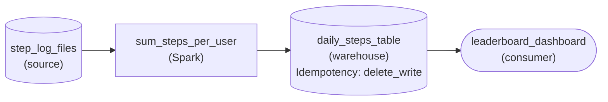

*The original flow, unchanged except for `daily_steps_table`, which now uses `delete_write` for each run's date.*

| Pitfall: The sum was never the bug |
| --- |
| It is tempting to hunt for the problem in `sum_steps_per_user`, but the per-user sum is correct on every run. Rewriting the aggregation or moving it to another engine leaves the copies in place, because the duplicates come from how the table is written, not from the math. |

| Key insight: Run it twice, then count the rows |
| --- |
| The quickest check on any pipeline: run it twice for the same date and count rows per user. One means the write is rerun-safe; two means it appends. An upsert keyed on user and date passes the same check. |

**Follow-up questions**

1. A bug fix means rerunning the last 30 nights. Does replacing by date still leave one row per user per date?\
   *Whether rerun safety for one date carries over to a multi-day backfill.*
2. What goes wrong if a run cleared the whole table before writing, instead of only its own date?\
   *Scoping the replace to exactly the data the run recomputes.*

</details>


<br>

### Exercise 2 of 2

**● TASK**

A nightly batch job loads one day of email events (about 3 million sends, opens and clicks) from the email provider's API and writes two tables: event counts per campaign per day, and one row per customer holding their latest open and click times. An orchestrator retries any failed task up to 3 times. Design the pipeline so both writes pass the two-run test: running the same day twice must leave each table exactly as one run does, with no doubled counts and no duplicate customers.

<details>
<summary><strong>Solution</strong></summary>

#### Set the result, never add to it

Idempotency is the property this whole design hangs on: running the same night twice must leave both tables exactly as one run does. The orchestrator's 3 retries turn that second run from an edge case into a regular event, so each write has to say 'set the day to this' instead of 'add this to the day'.

1. **Assume every task runs twice**

   A task can fail after its write already landed, and the retry then reruns the whole day. Treat the retry policy as a promise that some nights execute twice, and put each write through the two-run test.

2. **Replace the day's campaign counts**

   The counts table holds one slice per campaign per day. Delete that day's rows and write the fresh counts as one step (`delete_write`), so a second run swaps the slice for an identical one instead of stacking another copy on top.

3. **Upsert the customer row**

   The customer table holds one row per customer with their latest open and click times. An `upsert` keyed on the customer sets those values; a rerun computes the same times and sets them again, so neither the row count nor the values move.

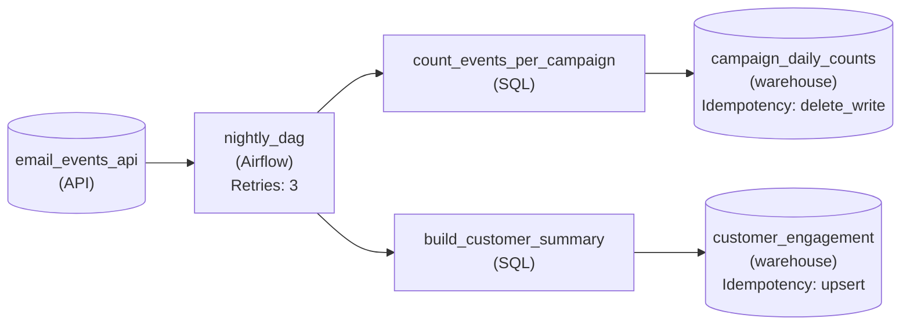

*Airflow runs both jobs and retries a failed task up to 3 times; the counts table replaces the day (`delete_write`) and the customer table sets each row by key (`upsert`).*

| Pitfall: Retries turn every append into a duplicate |
| --- |
| The first draft is usually a plain `INSERT` into both tables. One clean run looks perfect; the first retry doubles every campaign's opens and gives each retried customer a second row. Switching retries off hides the bug and leaves failed nights empty instead. |

**Follow-up questions**

1. What breaks if the customer table kept lifetime open counts and each run added the day's opens to them?\
   *Spotting an add hiding inside a keyed write.*
2. The provider resends last Tuesday's events late and you rerun that day. Which table stays correct, and why might the other drift?\
   *Applying the two-run test to an older day, not just tonight's.*

</details>


<br>

---

## Key Takeaways

- A partial failure plus an append plus a retry produces duplicate rows, and the retry succeeds, so nothing alerts.
- An operation is idempotent when 1 run and 2 runs leave the same end state; the two-run test checks it mechanically.
- Replace the partition instead of appending to it: DELETE the run's day, then INSERT the run's day from the source.
- The run date comes from the orchestrator, and every statement in the load is scoped by that one value.
- Retries multiply whatever the write does, so automatic retries are safe only on an idempotent write.
