Intermediate·Pipeline Architecture · 32 min · 10 challenges

# Idempotent Reruns: Intermediate

Take a fix to the currency conversion in Airbnb's nightly booking revenue. Every day from January 1 to March 31 is wrong by a few percent, and finance wants all 90 days corrected before the quarter closes. Rerunning 90 nights of a pipeline that writes 3 tables works only if every write, every read and every key choice gives the same answer twice.


<br>

---

## Three Idempotent Write Patterns

The beginner lesson closed on a single rule: replace, don't append. Which way to replace depends on the destination table's shape: is it partitioned by the column that scopes the run, keyed by an entity ID, or neither? It also depends on a single run's unit of work, which is either a complete day of data or a batch of rows that changed since the previous run.


<br>

### Partition overwrite

Use it when the destination is partitioned by the same column that scopes the run, usually a date column `ds`, and each run computes the full contents of a single partition. The write swaps the old partition for the new one as a unit. The run for `ds = '2026-03-14'` produces 41,200 rows. A retry produces the same 41,200 rows and installs them in place of the first attempt's. Every other partition stays as it was.

```sql
INSERT INTO fact_bookings
SELECT
    booking_code,
    listing_id,
    guest_id,
    amount_usd,
    ds
FROM staging_bookings
WHERE ds = '2026-03-14'
```

It is safe only when the run holds the whole partition. Suppose a run carries only the 300 bookings that changed since yesterday. Overwriting with those 300 erases the other 40,900. The price is rewriting all 41,200 rows even when 3 of them changed. That's fine for a daily fact table and wasteful for a large table where a handful of rows move each hour.


<br>

### MERGE on a key

Use it when the destination holds a row per entity and those rows change over time, such as `dim_listing` with a row per `listing_id`. The run's unit is the set of listings that changed. MERGE joins incoming rows to the table on the key. A matched key updates its row, and an unmatched key inserts a new row. Replaying the same 500 changes leaves the table identical, for 2 reasons. Setting a column to the value it already holds changes nothing. And every key now exists, so no insert fires.

```sql
MERGE INTO dim_listing AS t
USING listing_changes AS s
ON t.listing_id = s.listing_id
WHEN MATCHED THEN
    UPDATE SET
        nightly_price = s.nightly_price,
        status = s.status
WHEN NOT MATCHED THEN
    INSERT (listing_id, nightly_price, status)
    VALUES (s.listing_id, s.nightly_price, s.status)
```

It is safe only when the key is unique in both the table and the incoming batch, which is the subject of the next section. The price is a join between the batch and the target on every run, even when the batch is small.

**An hourly job reads the bookings that changed in the last hour. It writes them to fact_bookings, which is partitioned by ds, using partition overwrite. What does each run do to the partitions it touches?**

- **A.** Replaces each partition with the changed rows and deletes the unchanged bookings
- **B.** Adds the changed rows to each partition, so every change is stored twice
- **C.** Leaves the partitions correct, since partition overwrite is always idempotent
- **D.** Fails, since a partition cannot be replaced before its day ends

<details>
<summary>Solution</summary>

**A.** Replaces each partition with the changed rows and deletes the unchanged bookings

Overwrite installs whatever the run supplies, and changed rows are a fraction of each partition. MERGE fits this unit of work.

**Why the others are wrong**

- **B.** Overwrite never appends. The partition shrinks to the changed rows.
- **C.** A second run repeats the first run's result, and that result had already lost rows.
- **D.** The engine accepts the write. Nothing checks that the run supplied a whole partition.

</details>


<br>

### DELETE-then-INSERT

Use it when a run owns a set of rows you can name with a predicate, but that set does not line up with a partition. `fact_payouts` is partitioned by `payout_month` because readers query by month, while the pipeline runs daily. Overwriting the March partition from a daily run would erase the other 30 days of March. Instead, the run deletes the rows it owns, those whose `payout_date` is its day, and inserts the recomputed rows. A retry deletes the same set, including anything the failed attempt left behind, and inserts it again.

```sql
DELETE FROM fact_payouts
WHERE payout_date = DATE '2026-03-14'
```

```sql
INSERT INTO fact_payouts
SELECT
    payout_id,
    host_id,
    amount_usd,
    payout_date,
    payout_month
FROM staging_payouts
WHERE payout_date = DATE '2026-03-14'
```

Two conditions keep it safe. First, the DELETE predicate and the INSERT filter must name the same rows. Say the delete matches on `payout_date`, the insert on `created_at`, and a payout is created March 14, dated March 15. Every run of March 14 inserts another copy its delete never matches. The March 15 run deletes every copy, inserts none back, and the payout vanishes. Second, a failure between the 2 statements leaves March 14 empty until the rerun, which the last section addresses.

| Pattern | Destination shape | Unit of work | Cost per run | Breaks when |
| --- | --- | --- | --- | --- |
| Partition overwrite | Partitioned by the run's date | A complete partition | Rewrites the whole partition | The run holds part of a partition |
| MERGE | A row per entity key | Changed rows | Joins batch to target | The key repeats in source or target |
| DELETE-then-INSERT | Partitioned coarser than the run, or not at all | Rows matching a predicate | Delete scan plus insert | Delete and insert filters disagree |

**A daily run computes a day's host earnings. host_earnings holds a row per host per day and is partitioned by earnings_month. Which write keeps a rerun of a single day idempotent?**

- **A.** Overwrite the month partition that the run's day falls in
- **B.** MERGE on host_id, which appears once in each run's output
- **C.** DELETE rows whose earnings_date is the run's day, then INSERT them
- **D.** INSERT the day's rows and let a weekly job drop duplicates

<details>
<summary>Solution</summary>

**C.** DELETE rows whose earnings_date is the run's day, then INSERT them

The run owns a set named by a predicate. Deleting and reinserting that set repeats identically.

**Why the others are wrong**

- **A.** The run holds a single day, so replacing the month erases every other day in it.
- **B.** The table has a row per host per day, so this match overwrites other days' rows.
- **D.** Readers see doubled earnings until the cleanup runs, and the cleanup must guess which copy is right.

</details>


<br>

---

## Pipeline Architecture

### Exercise 1 of 2

**● TASK**

Three transforms write to three differently-shaped destinations: a time-partitioned daily_orders fact, a current-state dim_customer table, and an operational daily_customer_summary an internal app reads sub-millisecond. All three currently use plain Snowflake INSERT INTO. Apply the section's quick decision rule per destination so each lands on the pattern that fits its access shape.

**Starting canvas** (already placed for you):

- Postgres orders source (source, PostgreSQL)
- Stripe customer_changes source (source, API)
- transform_fact_orders (transform, SQL)
- transform_dim_customer (transform, SQL)
- transform_summary (transform, SQL)
- Plain Snowflake daily_orders (non-idempotent) (storage, Snowflake)
- Plain Snowflake dim_customer (non-idempotent) (storage, Snowflake)
- Plain Snowflake daily_customer_summary (non-idempotent) (storage, Snowflake)


<br>

### Solution

#### Match the write to the access shape

The fix you just applied is idempotency: a transform you can rerun, after a retry or a backfill, without changing the result. Plain `INSERT INTO` fails that test because a second run appends the same rows again. The section's rule is to read each destination's shape and the run's unit of work first, then pick the write pattern that makes a rerun a no-op.

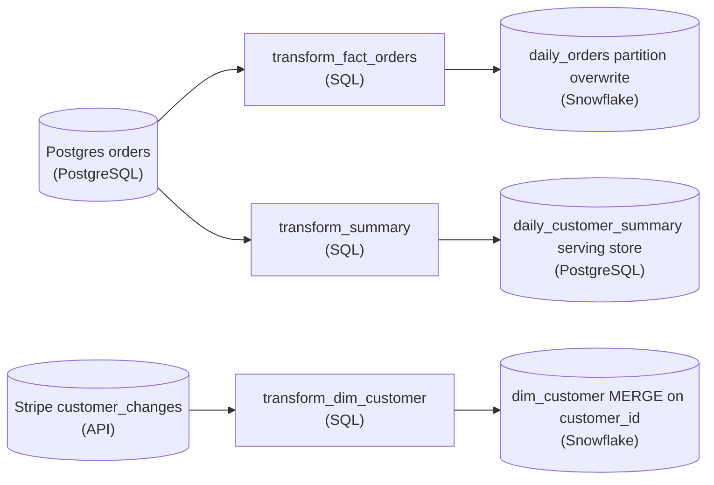

*One pattern per lane: partition overwrite for the daily fact, keyed `MERGE` for the dimension, transactional DELETE-then-INSERT in a serving store for the app's summary.*

1. **Overwrite the partition for `daily_orders`**

   This fact is time-partitioned, and each run owns exactly one day. Write it with `INSERT OVERWRITE` scoped to that day's partition. The partition is the unit of replacement: rerun the same day and it lands identical, with every other day untouched.

2. **`MERGE` into `dim_customer` on the key**

   A current-state dimension keeps one row per customer, and a run's changes touch customers scattered across the table, so no partition lines up with the unit of work. Match on `customer_id` with `MERGE`: existing customers update in place, new ones insert, and replaying the same changes leaves the same rows.

3. **DELETE-then-INSERT for `daily_customer_summary`**

   The app reads this summary sub-millisecond, so it lives in a serving store rather than the warehouse. Each run owns one day's slice: inside one transaction, delete that day's rows and insert the recomputed ones. Readers never see a half-written day, and a rerun replaces the slice exactly.

| Pitfall: A rerun should not double the rows |
| --- |
| Leave any lane on plain `INSERT INTO` and the first retry or backfill silently doubles its rows. The failure surfaces days later as inflated totals, not as an error. Each pattern above makes the rerun a no-op instead. |

**Follow-up questions**

1. What if `daily_orders` arrives late and spans 2 partitions?\
   *Tests whether you overwrite every affected partition, not just today's.*


<br>

### Exercise 2 of 2

**● TASK**

A MERGE pipeline keys dim_customer on email. A customer updated their email, the MERGE missed the match, and a duplicate row was inserted; historical lineage broke because the natural key changed. The section frames the fix in two halves: a stable surrogate key and a uniqueness assertion at write time. Apply both halves on the canvas; warehouses do not enforce primary keys for you.

**Starting canvas** (already placed for you):

- customer_changes CDC source (source, CDC)
- transform_dim_customer (MERGE) (transform, SQL)
- Plain Snowflake dim_customer (no ACID, MERGE on email) (storage, Snowflake)
- CRM dashboard (consumer, Looker)


<br>

### Solution

#### The natural key moved

A dimension needs a key that never changes for a given entity across its entire life. `email` feels like that key, but it is a **natural key**, and natural keys mutate. The moment the customer edited their address, your `MERGE ... ON email` went looking for a row that no longer existed, matched nothing, and inserted a second row for the same person. Every downstream join and the whole history for that customer forked in two. The fix has 2 independent halves: key the table on a stable surrogate instead of the mutable natural key, and assert uniqueness at write time, because the table will not do it for you. Both sit on a destination with ACID transactions, so a MERGE that fails halfway never leaves a half-applied batch behind.

| Pitfall: Keying the MERGE on the column that changes |
| --- |
| `MERGE ... ON target.email = source.email` matches an existing row only while the email is the same in both. When the change event carries a new address, the `WHEN MATCHED` branch never fires, the `WHEN NOT MATCHED` branch does, and you get a duplicate `dim_customer` row that shares nothing with the old one. The MERGE was never wrong about the join it was told to do; it was told to join on a value that moves. |

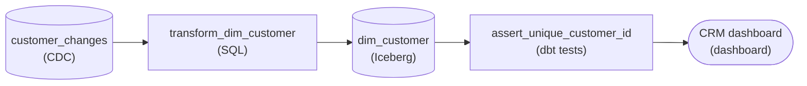

*The corrected shape: the MERGE keys on the immutable `customer_id`, `dim_customer` is an ACID Iceberg table carrying a minted `customer_sk`, and a uniqueness check sits between the table and the dashboard.*

1. **Key the MERGE on the immutable business id, not the attribute**

   The CDC feed carries a `customer_id` that is stable for the life of the account; the `email` is just one attribute hanging off it. Point the MERGE at `MERGE ... ON target.customer_id = source.customer_id`. Mint a surrogate `customer_sk` exactly once, on the first insert of a given `customer_id`, and never re-derive it from `email`. Now an email change lands in the `WHEN MATCHED` branch and becomes an in-place UPDATE of the `email` column on the existing row, not a new row. The surrogate `customer_sk` that your fact tables already reference stays put, so lineage survives the rename. Running that MERGE against an Iceberg table means each batch commits atomically or not at all.

2. **Assert the key is unique after every write**

   Declaring `PRIMARY KEY (customer_sk)` does not enforce it: neither the old warehouse nor an Iceberg table rejects a duplicate key, so the constraint is documentation, not a guarantee. Add a uniqueness check that runs after the MERGE and gates the publish: `SELECT customer_id FROM dim_customer GROUP BY customer_id HAVING COUNT(*) > 1`. If that query returns even one row, fail the run and hold the load. That gate stops a duplicate from ever reaching the dashboard, even if a future keying bug slips past review, and it is the half people forget because relational databases trained them to assume the engine checks.

| Real world: The stable key is also what makes CDC replay safe |
| --- |
| Keyed on `customer_id`, the `MERGE` is idempotent: replay the same change event, or reprocess a whole day of the feed, and you land on the same row every time. Keyed on `email`, a replayed event that arrives after an address change forks a new row all over again. In production, CDC feeds get replayed constantly, after outages, schema changes, and late-arriving data, so idempotency is not a nice-to-have; the immutable key is what buys it, and the uniqueness assertion is what tells you the day the assumption finally breaks. |

**Follow-up questions**

1. What if the business wants to keep the customer's old email visible as history rather than overwriting it in place?\
   *Pushes from a Type 1 overwrite toward an SCD Type 2 design: the `customer_sk` still keys each version, but `customer_id` plus a validity window becomes the natural key, and the uniqueness assertion changes to 'one current row per `customer_id`'.*
2. The upstream system occasionally reissues a `customer_id` after merging 2 accounts on its side. How does your uniqueness check behave, and what would you add?\
   *Tests whether the learner treats even the upstream id as fallible and reaches for a reconciliation or remap step rather than trusting any single upstream id forever.*


<br>

---

## Choosing a Business Key

A MERGE is idempotent only when each incoming row finds the target row that stands for the same real-world thing, or finds nothing. The columns that do the finding are the business key. These are the values that identify a booking, a listing or a guest night, whatever the table's grain is.

| Key kind | Example | Origin | Safe for MERGE when |
| --- | --- | --- | --- |
| Natural | `booking_code` | Assigned by the booking app | The source never reuses or reassigns it |
| Surrogate | `booking_key` | Generated by the pipeline | It is computed from the natural key the same way on every run |
| Composite | (`booking_code`, `night_date`) | Several source columns together | The set names a single row at the table's grain |

#### Natural keys

A natural key comes from the source system, so a rerun sees the same value the first run saw. The risk sits in the source: a key that can change or be reused. An email address fails both ways. Guests change their emails, and someone else can register a closed account's address.

#### Surrogate keys

A surrogate key is a value the pipeline assigns. Pipelines often use one to replace a long string or to join several sources under a single ID. It goes wrong when the pipeline generates it fresh on each run. If the job calls `uuid()` and merges on the result, every retry produces keys the table has never seen. Nothing matches, and every row is inserted again.

After the first run

| booking_key | booking_code | amount_usd |
| --- | --- | --- |
| 9f2c41 | HMX41 | 212.00 |
| c71a08 | HMX42 | 95.50 |

After a retry with uuid() keys

| booking_key | booking_code | amount_usd |
| --- | --- | --- |
| 9f2c41 | HMX41 | 212.00 |
| c71a08 | HMX42 | 95.50 |
| 3be9d2 | HMX41 | 212.00 |
| e0457f | HMX42 | 95.50 |

The fix is a deterministic surrogate: a hash of the natural key. The same `booking_code` hashes to the same value on every run, so retries and later recomputations land on the rows they already wrote.

```sql
SELECT
  TO_HEX(SHA256(TO_UTF8(booking_code))) AS booking_key,
  booking_code,
  amount_usd
FROM staging_bookings
```

#### Composite keys

When a single column cannot name a row, combine several. A table of booked nights holds a row per booking per night. A 3-night stay therefore has 3 rows sharing `booking_code`, and the key is (`booking_code`, `night_date`). Getting the set wrong in either direction makes reruns misbehave. With too few columns, distinct rows collapse onto a single row, and each one overwrites the last. With too many, such as adding `updated_at`, every change to a booking looks like a new row, and the table grows with every edit.


<br>

### Enforcing uniqueness

Uniqueness has to hold on both sides of the MERGE. If the target stores a key twice, a single incoming row updates 2 rows. A key can also appear twice in the incoming batch, because the source emitted an update twice or ingestion delivered a file twice. Then the MERGE has 2 candidates for a single target row. Most engines reject the statement. An engine that accepts it has to pick a source row, and a retry may pick the other. Deduplicate the batch before merging, keeping a row per key by a fixed order.

```sql
WITH ranked AS (
  SELECT
    booking_code,
    listing_id,
    amount_usd,
    updated_at,
    ROW_NUMBER() OVER (
      PARTITION BY booking_code
      ORDER BY updated_at DESC, ingest_offset DESC
    ) AS rn
  FROM staging_bookings
)

SELECT
  booking_code,
  listing_id,
  amount_usd,
  updated_at
FROM ranked
WHERE rn = 1
```

The second sort column matters. If 2 copies share an `updated_at`, ordering by that column alone leaves the choice to the engine, and the winner can differ between runs. `ingest_offset` differs between the copies, so the same row wins every time.

**The staging batch holds 2 rows for booking HMX42. They were emitted within the same second, with equal updated_at and different amount_usd. The dedupe orders by updated_at DESC only. What can a rerun do?**

- **A.** Insert HMX42 twice, since both rows are new to the target
- **B.** Keep the other amount, since the engine may break the tie differently
- **C.** Fail, since window functions reject equal sort values
- **D.** Keep both rows, since row_number() gives ties the same number

<details>
<summary>Solution</summary>

**B.** Keep the other amount, since the engine may break the tie differently

With a tie, the engine can pick either row. Add a second sort column such as ingest_offset.

**Why the others are wrong**

- **A.** The dedupe still keeps a single row per key. The risk is which row survives.
- **C.** Ties are allowed. row_number() numbers them in an arbitrary order.
- **D.** That describes rank(). row_number() gives distinct numbers, so a single row survives.

</details>

```sql
SELECT
  booking_code,
  COUNT(*) AS row_count
FROM dim_booking
GROUP BY booking_code
HAVING COUNT(*) > 1
```

✓Do

- Merge on a key that exists in the source before the pipeline touches it
- Hash the natural key when a surrogate is needed
- Deduplicate the batch with a tie-breaking second sort column

✗Don't

- Merge on a uuid() or sequence generated during the run
- Put changing columns like updated_at in the key
- Key on values a person can edit, such as email

**dim_booking should hold a row per booking. Its MERGE matches on (booking_code, updated_at). A booking is created on Monday and edited 3 times later that week. How many rows does that booking have by Sunday?**

- **A.** 1, because the MERGE updates the matching row on every edit
- **B.** 2: the first version and the latest version
- **C.** 0, because the edits conflict and the MERGE rejects them
- **D.** 4, because each edit has a new key and inserts a row

<details>
<summary>Solution</summary>

**D.** 4, because each edit has a new key and inserts a row

A changing column in the key turns every edit into a new key. Key on booking_code alone.

**Why the others are wrong**

- **A.** Each edit carries a new updated_at, so no existing row matches it.
- **B.** Nothing removes the middle versions. Each edit inserted its own row.
- **C.** Each edit's key is distinct, so the MERGE has no conflict to reject.

</details>


<br>

---

## Pipeline Architecture

### Exercise 1 of 2

**● TASK**

The daily_active_users SQL transform filters with WHERE event_ts >= NOW() - 1 day and runs from a manual cron. Reading the same logical date twice produces different results, and next month's backfill is impossible because NOW() will have advanced. Apply the section's fix: replace the wall clock with a parameter supplied by an orchestrator at bind time.

**Starting canvas** (already placed for you):

- Postgres events source (source, PostgreSQL)
- daily_active_users (WHERE event_ts >= NOW() - 1 day; processing time, not event time) (transform, SQL)
- daily_active_users storage (storage, warehouse)
- DAU dashboard (numbers shift between 11:30 and 2:15 runs) (consumer, dashboard)


<br>

### Solution

#### Binding the window to a logical date

What fixes this transform is **event-time parameterization**: the day the query processes is a value the orchestrator hands in at bind time, not the clock the moment the query fires. `NOW()` asks "what time is it right now?"; a logical-date parameter asks "which day am I computing?" Those 2 agree only when the job runs exactly on schedule, exactly once, which no pipeline can assume.

| Pitfall: `NOW()` reads run time, not data time |
| --- |
| `WHERE event_ts >= NOW() - 1 day` ties the output to the wall clock at execution. Run the same logical date at 11:30 and again at 2:15 and the window slides 3 hours, so the 2 runs disagree: that is the dashboard flicker. Next month's backfill fails too: `NOW()` has advanced, so re-running for June returns September's rows. The predicate never names the day it actually means. |

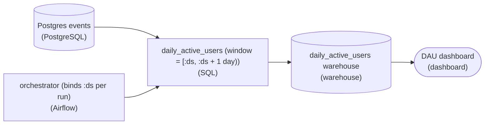

*The orchestrator owns the schedule and supplies `:ds`; the transform only consumes it, so run time no longer leaks into the result.*

**Parameterized transform**

```sql
-- :ds is the data interval start the orchestrator binds per run
SELECT
  :ds::date               AS activity_date,
  COUNT(DISTINCT user_id) AS daily_active_users
FROM events
WHERE event_ts >= :ds
  AND event_ts <  :ds + INTERVAL '1 day'
GROUP BY 1;
```

*A half-open window `[:ds, :ds + 1 day)` bound at run time; nothing in the body reads the clock.*

Now the query is a pure function of `:ds`. Re-run it 10 times for '2026-06-01' and every run returns the same rows, so the write can safely overwrite that one day's partition: that is idempotency. A backfill becomes the orchestrator sweeping `:ds` across last month's dates. Each run recomputes its own day from `event_ts`, regardless of when the sweep actually happens.

| Real world: The orchestrator owns time, the query owns logic |
| --- |
| In Airflow this parameter is the `ds` value of the data interval; Dagster calls it the partition key. The scheduler decides which interval a run covers and passes it down, and the SQL just consumes it. That split is what lets one DAG serve both the nightly run and a six-month replay with identical, unedited code. |

**Follow-up questions**

1. A row lands in `events` with an `event_ts` from 3 days ago. Does the parameterized `daily_active_users` pick it up, and when?\
   *Late-arriving data is handled by re-running the partition that owns that `event_ts`, not by a sliding clock window.*
2. How do you make the write step itself idempotent so a re-run for `:ds` never double-counts `activity_date`?\
   *Delete-insert or partition overwrite keyed on `activity_date` rather than a blind append.*


<br>

### Exercise 2 of 2

**● TASK**

Finance found a rounding bug in daily_revenue covering the last 30 days, and each of those days must be backfilled. The transform reads NOW() and INSERTs into Snowflake, so it can only compute today and a rerun appends. Redesign it so an orchestrator runs the transform for any given date and each run overwrites that date's partition, keeping the finance dashboard fed from the same table.

**Starting canvas** (already placed for you):

- Postgres orders source (source, PostgreSQL)
- transform_daily_revenue (NOW() + INSERT INTO) (transform, SQL)
- Snowflake daily_revenue table (storage, Snowflake)
- Finance dashboard (consumer, Looker)


<br>

### Solution

#### What makes a pipeline backfillable

A backfill is the same pipeline run again for dates in the past, and it is **only safe when the pipeline is idempotent**. 3 things have to hold at once: a run can be pointed at one specific day, running that day twice leaves the same table as running it once, and the day lands in a slice you can replace without touching its neighbors. The starter breaks all three. It reads `NOW()`, so every run means today. It does a blind `INSERT INTO`, so a rerun appends. And `daily_revenue` has no date slice to swap. Finance's 30-day fix needs all 3 in place before an orchestrator can loop over the dates.

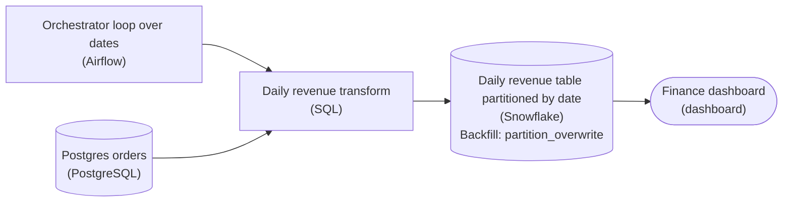

*Airflow passes each `run_date` into the daily revenue transform, which overwrites that date's partition of `daily_revenue`. The nightly run and the 30-day backfill share this one path.*

1. **Parameterize the run date**

   The transform reads `NOW()`, so it can only ever compute today, and a backfill cannot ask it for June 3rd. Replace `NOW()` with a `run_date` the orchestrator supplies (Airflow hands it in as `{{ ds }}`). Now the nightly run and a rerun of a day a month ago are the same code with a different date bound in, which is what makes a backfill possible at all.

2. **Partition by the date you replace**

   A backfill replaces days, so the table needs days as its unit of replacement. Partition `daily_revenue` by `revenue_date` so one day's rows are an isolated slice you can rewrite without touching the other 29. Without that boundary, 'replace June 3rd' has no clean target and you are back to deleting rows by hand.

3. **Overwrite the partition instead of appending**

   `INSERT INTO` appends, so rerunning June 3rd stacks a second, correct day on top of the buggy one and the dashboard sums both. Replace it with a partition overwrite: delete the rows for `:run_date` and insert the recomputed ones inside one transaction. The day is replaced whether this is the first run or the fifth, so retries and overlapping backfills stop being dangerous.

4. **Let the orchestrator drive the loop**

   With the transform parameterized and the write overwriting its partition, the orchestrator is a simple loop: iterate the 30 dates and call the transform once per date, rerunning any that fail. Each date is independent and each write replaces rather than appends, so order stops mattering: backward, forward or in parallel all end at the same table.

**`transform_daily_revenue` for one `run_date`**

```sql
/* run_date is injected by the orchestrator (Airflow {{ ds }}), never NOW() */
BEGIN;

/* replace exactly this date's partition */
DELETE FROM daily_revenue
WHERE revenue_date = :run_date;

INSERT INTO daily_revenue (revenue_date, gross_revenue)
SELECT
    o.order_date            AS revenue_date,
    ROUND(SUM(o.amount), 2) AS gross_revenue   /* the corrected rounding */
FROM orders o
WHERE o.order_date = :run_date
GROUP BY o.order_date;

COMMIT;
```

*A partition overwrite scoped to one date, in one transaction: rerunning any day replaces it and never doubles it.*

| Pitfall: Re-running silently doubles the day |
| --- |
| The starter fails a backfill twice over. `NOW()` pins every run to today, so you cannot target a past date at all. And a bare `INSERT INTO` appends, so the second run of a date leaves both the buggy rows and the fixed rows in `daily_revenue`, summed together on the finance dashboard. It looks like the backfill worked because rows appeared, but the number is now the buggy total plus the correct one. Both problems have to go before the loop is safe to run even once. |

**Follow-up questions**

1. The orchestrator retries a date whose run died halfway through the write. What guarantees the dashboard never sees a half-replaced partition?\
   *Tests why the `DELETE` and `INSERT` live in one transaction, not 2 statements.*
2. How would you backfill only the orders that actually changed, instead of fully replacing all 30 partitions?\
   *Extends full partition replacement toward incremental, change-scoped backfills.*
3. If `orders.order_date` can be `NULL`, where does the parameterized transform quietly drop rows?\
   *Checks that the learner sees the `:run_date` predicate silently excludes undated orders.*


<br>

---

## Reads Can Be Non-Idempotent Too

A partition overwrite or a MERGE guarantees that the write replaces. It says nothing about what it replaces the data with. If the query returns different rows when it runs again, the rerun faithfully installs a different answer. A run is idempotent only when its inputs are fixed, and the most common moving input is the clock.

```sql
SELECT
  booking_code,
  amount_usd,
  booked_at
FROM raw_bookings
WHERE booked_at >= CURRENT_TIMESTAMP - INTERVAL '1' DAY
```

The scheduled run starts at 02:00 on March 15 and covers the day leading up to that moment. It fails, and the on-call engineer retries it at 09:40. The retry's window slides forward with it. It drops the early morning of March 14 and picks up the morning of March 15, which belongs to the next run.

- **7h 40m** — of March 14 the retry never reads

The fix is to hand the run its time bounds. Each scheduled run has a logical date, which is the period the run is responsible for. The logical date is fixed when the run is created and is unrelated to when the run actually starts. The orchestrator passes the start and end of that period into the run, and the query filters on them. The run for March 14 then reads March 14 whether it executes at 02:00, at 09:40 or months later.

```sql
SELECT
  booking_code,
  amount_usd,
  booked_at
FROM raw_bookings
WHERE booked_at >= TIMESTAMP '2026-03-14 00:00:00'
  AND booked_at < TIMESTAMP '2026-03-15 00:00:00'
```

> Other clocks hiding in a query
>
> - `current_date`, `now()` or `current_timestamp` anywhere in a filter, join or computed column
> - Reading the newest file in a folder instead of the file for the run's date
> - Joining a dimension as it looks today when the run describes a past day
> - A `processed_at` column stamped by the run, if any reader depends on its value

**This job writes yesterday's bookings per listing into a ds partition. It always reads whole days, yet a recomputation of last month comes out wrong. Which change fixes it?**

```sql
SELECT
    listing_id,
    count(*) AS bookings
FROM raw_bookings
WHERE booked_at >= date_trunc('day', current_timestamp - INTERVAL '1' DAY)
    AND booked_at < date_trunc('day', current_timestamp)
GROUP BY listing_id
```

- **A.** Replace both current_timestamp bounds with the run's logical-date bounds
- **B.** Truncate to the hour instead of the day for finer windows
- **C.** Filter on landed_at instead of booked_at
- **D.** Switch the write from partition overwrite to MERGE

<details>
<summary>Solution</summary>

**A.** Replace both current_timestamp bounds with the run's logical-date bounds

Truncating to whole days still follows the clock, so every past run read the same yesterday.

**Why the others are wrong**

- **B.** Finer truncation still tracks the clock, so every past run reads recent hours.
- **C.** This keeps the clock in the filter and changes what the report means.
- **D.** The write was correct. The read returns the wrong day for every past run.

</details>


<br>

### Event time and processing time

A booking row usually carries 2 timestamps. Event time is when the thing happened in the world: the guest pressed Book at 23:58 on March 14. Processing time is when the pipeline received or handled the row: it landed in the raw table at 00:07 on March 15. The 2 timestamps differ by seconds on a good day. They differ by hours when a phone was offline or an upstream export ran late.

| booking_code | booked_at (event) | landed_at (processing) | Day by event time | Day by processing time |
| --- | --- | --- | --- | --- |
| HMX41 | 2026-03-14 10:12 | 2026-03-14 10:12 | March 14 | March 14 |
| HMX57 | 2026-03-14 23:58 | 2026-03-15 00:07 | March 14 | March 15 |
| HMX63 | 2026-03-14 18:30 | 2026-03-15 06:45 | March 14 | March 15 |

A report of bookings made on March 14 means event time, so it groups on `booked_at`. Grouping on `landed_at` would credit HMX57 and HMX63 to March 15, and the totals would shift with every slow export. Selecting rows is a second choice. Event-time bounds, as in the query above, read March 14's raw rows, late arrivals included. `landed_at` bounds read only rows new since the last run, but those can span several event days, so the run must rewrite each event-time partition they touch.

Rerun the March 14 event-time partition a week later, and it may hold 3 more bookings, because rows that landed late are now in the raw table. That is correct, because idempotency means the same inputs give the same output. When more facts about March 14 exist, the rerun reflects them, and running it twice more changes nothing further.

> **TIP**
>
> Name time columns by what they record, such as `booked_at` and `landed_at`, and never use a bare `ts` or `timestamp`. A reader of the query should see which kind of time each filter uses without opening the source documentation.

**Finance asks for the number of bookings made per day. A transform groups by date(landed_at). On the night an upstream export runs 6 hours late, what happens to the totals?**

- **A.** Nothing changes, since every booking lands eventually
- **B.** Both days come up short, since late rows are dropped
- **C.** One day is low and the next day is high by the same bookings
- **D.** The run fails, since landed_at is later than booked_at

<details>
<summary>Solution</summary>

**C.** One day is low and the next day is high by the same bookings

Late rows count under their landing day. Group by date(booked_at) to match the request.

**Why the others are wrong**

- **A.** The rows do land, but on the next day by landed_at, so the totals move.
- **B.** No row is dropped. Each late row is credited to the day it landed.
- **D.** Nothing compares the 2 columns. The grouping silently uses processing time.

</details>


<br>

---

## Pipeline Architecture

### Exercise 1 of 1

**● TASK**

Make this daily payments ETL idempotent: it pulls Stripe charges with a NOW() minus one day window and appends into a Snowflake table with no payment_date. Put an orchestrator in charge so each run pulls Stripe for an explicit run_date, not wall-clock time. Land the data in an ACID lakehouse table partitioned by payment_date that the finance dashboard reads. Each run replaces only its own day, so a re-run and an old-day backfill both land correct numbers.

**Starting canvas** (already placed for you):

- Stripe API payments source (list_payments uses created_after = NOW() - 1 day) (source, API)
- Postgres customers source (SCD type 1; current state is correct) (source, PostgreSQL)
- transform_payments_etl: NOW() window + row-by-row INSERT INTO (3 bugs in 24 lines) (transform, Pandas)
- Plain Snowflake fct_payments (no payment_date partition; no ACID; INSERT-only) (storage, Snowflake)
- Finance dashboard (consumer, Looker)


<br>

### Solution

#### Idempotency: the same run, the same answer

The property you were asked to build has a name: **idempotency**. A pipeline is idempotent when running the same logical unit of work twice leaves the table in the same state as running it once. Here the logical unit is one day of payments, keyed by `payment_date`. The starter breaks idempotency in the most common way there is: it lets the machine's clock decide what data a run covers (`created_after = NOW() - 1 day`) and it only ever appends. So the run isn't a function of a date you control, it's a function of when you happen to press go. Re-run it and you append a second copy; run it for last month and `NOW()` still pulls this month. The fix is to make the day an explicit input and make the write replace that day's slice instead of adding to it.

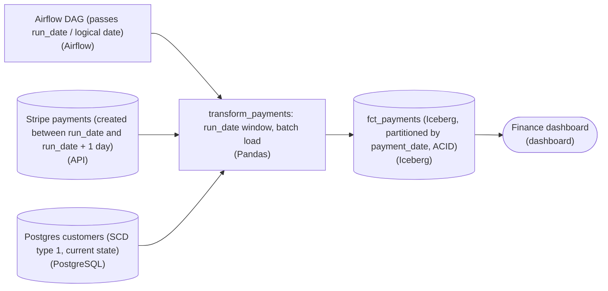

*The orchestrator owns the clock: it hands each task a `run_date`, the pull is bounded by that date, and the write overwrites exactly one `payment_date` partition.*

| Pitfall: Three bugs that all trace back to one missing idea |
| --- |
| The starter's `transform_payments_etl` fails three ways, and they're the same failure wearing different hats. `created_after = NOW() - 1 day` means the window is undated, so a backfill for an old day silently pulls today. The row-by-row `INSERT INTO` means the table only grows, so a second run of the same day doubles the numbers. And the plain Snowflake table has no `payment_date` column and no way to atomically replace a slice, so there's nothing to overwrite even if you wanted to. Each bug on its own looks minor; together they mean the table's contents depend on run history, which is the exact opposite of idempotent. |

1. **Give the clock to the orchestrator, not the task**

   Let the DAG pass a `run_date` (Airflow's logical or execution date) into the task, and derive the pull window from it: pull Stripe payments where the charge falls in `[run_date, run_date + 1 day)`. Now the task is a pure function of its argument. Running it today for `run_date = '2026-08-01'` and running it next month for that same date pull the identical set of charges, because `NOW()` never enters the logic. This is also what makes a backfill trivial: a backfill is just the same task called with older `run_date` values.

2. **Land in an ACID table partitioned by `payment_date`, and overwrite the day**

   Swap the plain append-only table for a lakehouse table format (`Iceberg` or `Delta`) partitioned by `payment_date`, and stamp every row with the run's `payment_date`. The write is no longer 'append'; it's 'replace this one partition'. Because the format is ACID, that replacement is a single atomic commit: finance never sees a half-deleted day. Replacing only the `payment_date = run_date` partition is what closes the loop, a re-run wipes and rewrites just that day, and a backfill touches only the old day it targets, leaving every other partition untouched.

**The idempotent write (Iceberg)**

```sql
/* run_date is supplied by the orchestrator, e.g. '2026-08-01' */
INSERT OVERWRITE fct_payments
PARTITION (payment_date = DATE '2026-08-01')
SELECT
    p.payment_id,
    p.customer_id,
    p.amount,
    c.customer_segment,
    DATE(p.created_at) AS payment_date
FROM stg_stripe_payments p          /* already bounded to the run_date window */
JOIN customers c USING (customer_id);

/* Delta equivalent:
   df.write.mode("overwrite")
     .option("replaceWhere", "payment_date = '2026-08-01'") */
```

*Static partition overwrite: this replaces exactly the `run_date` partition in one atomic commit, so re-runs and backfills converge to the same numbers.*

| ✕ Append-only (the starter) | ✓ Partition overwrite (idempotent) |
| --- | --- |
| Row-by-row `INSERT INTO fct_payments` adds whatever the current run produced. Second run of the same day = 2 copies of every payment. There's no `payment_date` to scope a cleanup, so the only 'fix' is a manual dedupe after the fact. | `INSERT OVERWRITE ... PARTITION (payment_date = run_date)` deletes and rewrites exactly one day atomically. Run it once, twice, or a hundred times, the day holds the same rows. Backfilling `2026-07-15` rewrites only that partition and never disturbs the rest. |

| Real world: This is why backfills stop being scary |
| --- |
| On the job, the payoff shows up the day someone finds Stripe was under-reporting refunds for a week. With the fixed design you loop the DAG over those 7 `run_date` values and each one overwrites its own `payment_date` partition, the numbers self-heal and nothing else moves. With the starter you'd be writing one-off dedupe SQL and praying you scoped the `DELETE` correctly. Idempotent, date-partitioned writes turn 'reprocess history' from an incident into a routine command. |

**Follow-up questions**

1. The customers table is SCD type 1 (only current state). If finance later needs the `customer_segment` a payment had on `payment_date`, what breaks and what would you change?\
   *Tests whether the learner sees that joining current customer state into a historical fact is itself a non-idempotent, point-in-time correctness problem, pushing toward SCD type 2.*
2. What happens to idempotency if the same Stripe payment can appear in 2 daily pulls near midnight? How does partitioning by `payment_date` help or not?\
   *Probes late-arriving and boundary data and whether overwrite-by-partition still guarantees exactly-once per day.*
3. Would a `MERGE` on `payment_id` give you the same guarantee as `INSERT OVERWRITE` on the partition? When would you pick each?\
   *Distinguishes row-level upsert from partition replacement, and the cost and correctness trade-off between them.*


<br>

---

## The Backfill Operation

A backfill runs the pipeline for a range of past logical dates. Two reasons start most backfills: a gap where runs never happened, and a logic fix that makes past output wrong. Take the second. A currency conversion bug inflated `agg_daily_revenue` for every day from 2026-01-01 through 2026-03-31. After the fix ships, those 90 logical dates have to run again with the corrected code.

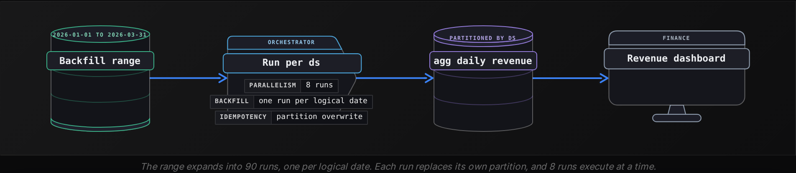

```sql
from datetime import date, timedelta

start = date(2026, 1, 1)
end = date(2026, 3, 31)

ds = start
while ds <= end:
    run_pipeline(ds=ds.isoformat())
    ds += timedelta(days=1)
```


<br>

### Why only idempotent pipelines survive it

All 90 partitions already hold data from runs that succeeded. A backfill is therefore 90 reruns at once, and every flaw a single retry would expose shows up 90 times. Each earlier section of this lesson predicts a failure.

| Flaw in the pipeline | What the 90-day backfill leaves behind |
| --- | --- |
| Appends instead of replacing | Every day holds the old inflated rows plus the corrected rows, more than twice the true revenue |
| Filters relative to the clock | Each run reads the 24 hours before its start, so 90 partitions hold overlapping recent slices |
| Merges on a `uuid()` key | Every row is inserted again under a new key, next to its old copy |
| DELETE and INSERT filters disagree | Rows the delete misses survive, so old values linger beside new values |
| Idempotent writes, explicit time bounds, unique keys | Each partition is replaced with its corrected contents, and nothing else changes |

**A pipeline reads the 24 hours before current_timestamp and writes into its run's ds partition by partition overwrite. In June, it backfills 2026-01-01 to 2026-03-31. What do the 90 partitions hold afterwards?**

- **A.** Corrected data, since partition overwrite makes reruns safe
- **B.** Recent June bookings in overlapping slices, under 90 dates
- **C.** Their old data with the June bookings appended
- **D.** No rows, since a June run finds no January bookings

<details>
<summary>Solution</summary>

**B.** Recent June bookings in overlapping slices, under 90 dates

Each run reads the 24 hours before its start and files them under its date.

**Why the others are wrong**

- **A.** The write replaces correctly, but the rows it writes come from the wrong day.
- **C.** Overwrite replaces the partition, so the old rows are gone.
- **D.** The filter finds June bookings, because nothing ties it to the run's date.

</details>


<br>

### Order and parallelism

When each run reads only its own day's inputs and writes only its own partition, the 90 runs are independent. They can run in any order and several at once, limited by the cluster and by the source systems they read. Some runs read the previous day's output, as a running total, a cumulative guest count or a first-booking flag does. Then day N needs day N-1 finished and corrected first. Those runs go one at a time, oldest first, and a single failure stops everything after it.

At 12 minutes per run, the 2 approaches finish at very different times:

- **18 h** — wall clock, a run at a time
- **2 h 24 m** — wall clock, 8 runs at a time


<br>

### Before starting the range

> A backfill checklist
>
> - Confirm every table the run writes uses one of the 3 replace patterns
> - Search the code for `current_date`, `now()` and `current_timestamp`
> - Check that the raw data for the whole range still exists and has not aged out
> - Run a single day, compare it with the old output, then launch the rest
> - List the tables built from `agg_daily_revenue`, because they need the same range rerun afterwards
> - Tell the dashboard's readers which dates will change and when

**guest_lifetime_value for day N adds day N's spend to the value stored for day N-1. You backfill January after a fix. How should the 31 runs execute?**

- **A.** 8 at a time in any order, since each run writes its own partition
- **B.** Newest first, so that recent values are corrected soonest
- **C.** All 31 at once, then a second pass to repair any mistakes
- **D.** A run at a time from January 1, each after the previous one succeeds

<details>
<summary>Solution</summary>

**D.** A run at a time from January 1, each after the previous one succeeds

Each day needs the corrected day before it, so the chain runs oldest first.

**Why the others are wrong**

- **A.** Separate partitions don't make the runs independent, because each run reads the previous day's result.
- **B.** January 31 would build on the old January 30 value, which is still wrong.
- **C.** The first pass builds on wrong values, and the second pass repairs them only if it runs in order.

</details>


<br>

---

## Pipeline Architecture

### Exercise 1 of 1

**● TASK**

Nightly transforms that stamp their window from NOW() and append with plain INSERT left duplicate rows in two Snowflake fact tables and the customer dimension, and finance needs a corrected Q1 revenue figure. Keep the three Snowflake destinations and give every transform explicit run_date bounds: each fact overwrites its daily partition, and the dimension MERGEs on a stable surrogate key, not the mutable email. Add an Airflow orchestrator that owns run_date and drives a 60-day backfill across all three. Add a dbt tests uniqueness check on the dimension key right after the MERGE so the Q1 audit reads only corrected tables.

**Starting canvas** (already placed for you):

- Postgres app source (Q1 revenue events) (source, PostgreSQL)
- Stripe billing source (post-migration; rate-card correction window) (source, API)
- Salesforce CRM source (customer dimension) (source, API)
- transform_fct_revenue_daily (window from NOW(); plain INSERT, no partition overwrite) (transform, SQL)
- transform_fct_arr_snapshot (window from NOW(); plain INSERT, no partition overwrite) (transform, SQL)
- transform_dim_customer (MERGE on mutable email natural key) (transform, SQL)
- Snowflake fct_revenue_daily (duplicates in 3 of last 90 partitions) (storage, Snowflake)
- Snowflake fct_arr_snapshot (duplicates in 3 of last 90 partitions) (storage, Snowflake)
- Snowflake dim_customer (duplicate rows from email-key MERGE) (storage, Snowflake)
- Q1 audit consumer (10-Q file due in two weeks) (consumer, Jupyter)


<br>

### Solution

Every transform here has to become **idempotent**: run twice for the same day, it leaves the warehouse exactly as if it ran once. The broken transforms stamped their window from `NOW()` and appended with a plain `INSERT`, so every rerun read a different slice of time and stacked fresh rows on top of the old ones. That is why three of the last 90 partitions carry duplicates, and why a naive backfill would only deepen the mess.

| Pitfall: A rerun must not depend on wall-clock time |
| --- |
| `NOW()` makes the output a function of when you run, not of what you run for. Pair it with `INSERT` and there is no key to overwrite: the second run cannot find the first run's rows to replace. Bound every transform by an explicit `run_date` the orchestrator passes in, so the same date always selects the same source slice. |

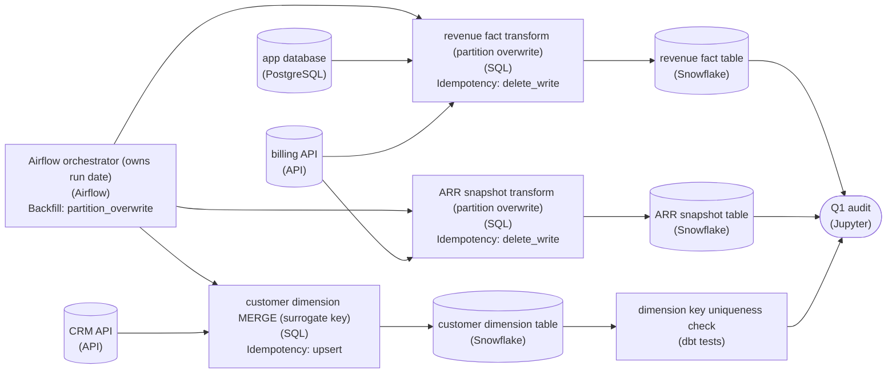

*The same three Snowflake tables, now written idempotently under a `run_date` that Airflow owns, with the dimension checked before the audit reads it.*

| ✕ Facts: overwrite the partition | ✓ Dimension: MERGE on a stable key |
| --- | --- |
| `fct_revenue_daily` and `fct_arr_snapshot` are keyed by day. Delete the `run_date` partition and then `INSERT` it, in one transaction. Rerunning replaces that day's rows instead of adding a second copy. | `dim_customer` MERGEs on a surrogate `customer_id`, not the mutable email. When a customer's email changes, the same key updates in place; the email-keyed MERGE treated a new email as a new customer and duplicated the row. |

| Key insight: One idempotent unit, replayed across 60 dates |
| --- |
| Once `run_date` is an input the orchestrator owns, the 60-day backfill is just the same transform run for 60 values, in any order, as many times as needed. The dbt uniqueness test on `customer_id` runs right after the MERGE, so the Q1 audit only ever reads a dimension that has already passed the check. |

**Follow-up questions**

1. The billing source has a rate-card correction window that restates old amounts. Why does a partition overwrite keyed by `run_date` absorb a restated day cleanly?\
   *Tests seeing idempotent overwrite as the mechanism for late-arriving corrections, not just for reruns.*
2. If two backfill runs for different `run_date` values overlap in time, why is the result still correct?\
   *Checks that each partition write is independent of the others.*


<br>

---

## Idempotency Across Several Tables

The nightly run for `ds = '2026-03-14'` writes 3 tables in order: `fact_bookings`, then `agg_daily_revenue` built from it, then `host_payout_summary` built from both. At 02:31 the third task fails on a lost connection. The first 2 tables hold fresh March 14 data. The third still holds whatever an earlier attempt for that day left, or nothing.

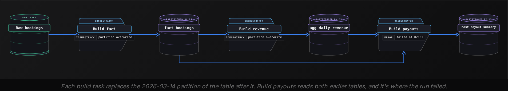

| Table | After the failure at 02:31 | After the rerun at 06:10 |
| --- | --- | --- |
| fact_bookings | March 14 replaced, 41,200 rows | Replaced again with the same 41,200 rows |
| agg_daily_revenue | March 14 replaced | Replaced again with identical totals |
| host_payout_summary | Earlier contents for March 14 | March 14 replaced for the first time this run |

The rerun converges if each table's write is idempotent by itself and scoped to the run's logical date: tables 1 and 2 are replaced with identical contents, and table 3 catches up. Retrying only the failed task also works, provided the tables it reads still hold this run's output. Rerunning the whole run is the safer default whenever an upstream table might have changed in between.


<br>

### The window between failure and rerun

Convergence fixes the end state. It does nothing for readers between 02:31 and 06:10. A dashboard that joins `agg_daily_revenue` to `host_payout_summary` shows corrected revenue next to stale payouts, and an analyst who exports it at 05:00 ships numbers that never existed together. Publishing last or writing a completion marker closes that window.

#### Publish last

Each task writes to a staging copy of its table, scoped to the run's date, and readers never query staging. A final publish task copies each staging partition into the table readers use, by partition overwrite. A failure in any build task leaves the reader tables on the previous complete version of March 14. The publish task still writes 3 tables. But it runs in seconds and holds no business logic, so the window shrinks from hours to moments. Like every other write, the publish is idempotent.

#### A completion marker

The run's last task writes a row to `run_status` saying March 14 is `complete`. It uses MERGE on `ds`, so a rerun updates that row instead of adding a second one. Downstream jobs wait for the row, and readers filter on it. On a rerun or backfill, the marker already says `complete` from the earlier success, so the rerun's first task must set it to `running` before touching any table. Otherwise readers trust March 14 while its tables change underneath them.

```sql
SELECT
  r.ds,
  r.revenue_usd,
  p.total_payout_usd
FROM agg_daily_revenue AS r
JOIN host_payout_summary AS p
  ON p.ds = r.ds
JOIN run_status AS s
  ON s.ds = r.ds
WHERE s.status = 'complete'
```

**A run builds 3 tables in staging, publishes them by partition overwrite, and then writes the complete marker. On the day's first run, the publish succeeds for 2 tables and fails on the third. What do readers who filter on the marker see for that day?**

- **A.** No data for the day until a rerun publishes all 3 tables and writes the marker
- **B.** The 2 published tables, with the third table missing from the join
- **C.** The staging contents of the third table in place of its reader table
- **D.** An error, since the published tables and the marker disagree

<details>
<summary>Solution</summary>

**A.** No data for the day until a rerun publishes all 3 tables and writes the marker

Readers join on the marker, and only the last task writes it, so a partial publish stays hidden.

**Why the others are wrong**

- **B.** The join to run_status drops the whole day, because no complete row exists yet.
- **C.** Readers never query staging, and the third reader table keeps its old partition.
- **D.** Nothing compares them. The missing marker filters the day out without any error.

</details>


<br>

### A single appending write breaks the run

The run is idempotent only if every write in it is. A step that appends a row to `payout_events` on each run, or calls the payments service to pay hosts, turns a safe rerun into duplicate events or double payouts. Key each such write on the logical date and the step, and MERGE on that key. Send that key with each payment call so the service skips repeats. A local log of sent keys leaves a gap: a crash between payment and log write pays the host twice. The advanced lesson builds this out.

**A run writes fact_bookings by partition overwrite. It then MERGEs dim_guest on a uuid() generated each run, and finally marks the day complete in run_status. The marker task fails, and the whole run is retried. What is true after the retry succeeds?**

- **A.** Every table is correct, since the first attempt never wrote the marker
- **B.** fact_bookings holds duplicates, since it was written twice
- **C.** dim_guest holds every guest twice, under 2 different keys
- **D.** run_status holds 2 complete rows for the day

<details>
<summary>Solution</summary>

**C.** dim_guest holds every guest twice, under 2 different keys

Fresh uuid() keys never match, so the retry inserted every guest again. Hash the natural key instead.

**Why the others are wrong**

- **A.** The marker controls what readers see. It cannot remove the rows the first attempt already merged.
- **B.** Partition overwrite replaced it with identical rows. It is the safe table here.
- **D.** Only the retry wrote the marker, and MERGE on ds keeps it to a single row.

</details>


<br>

---

## Pipeline Architecture

### Exercise 1 of 2

**● TASK**

A nightly batch job reads settled card payments from PostgreSQL, computes one row per merchant for a single business day, and writes them to a warehouse table that is not partitioned by date. Runs are repeated after failures and corrections, and a correction can remove a merchant from that day entirely. Design the pipeline so any rerun leaves exactly the recomputed rows for its day, using the idempotent write pattern that fits.


<br>

### Solution

#### Replacing a slice that is not a partition

Delete-then-insert is the pattern for a slice the table cannot address as a partition. Here the slice is one business day, but the table is organized by merchant, so there is no day partition to overwrite. The write deletes every row for the run's day and inserts the freshly computed rows, both inside one transaction. A rerun of the same day lands on exactly the same rows, however many times it fires.

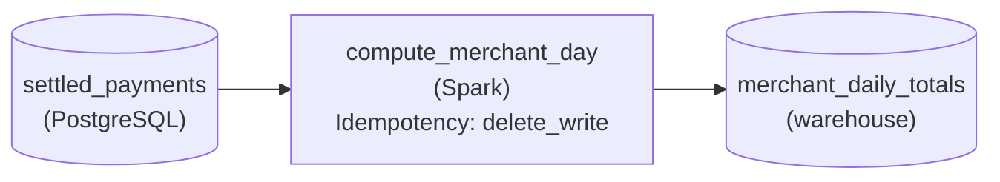

*`compute_merchant_day` owns one business day and replaces it in `merchant_daily_totals` with `delete_write`.*

| Pitfall: An upsert never removes a row |
| --- |
| MERGE matches incoming rows by merchant and day, then updates or inserts. Rerunning it adds no duplicates, so it looks idempotent. But when a correction drops a merchant from the day, the recompute has no row for that merchant, MERGE has nothing to match, and the old total survives. Only clearing the whole day first makes the rerun's output the table's contents. |

| Key insight: The transaction hides the empty moment |
| --- |
| Between the delete and the insert the day has no rows. Committing both as one transaction means a reader sees either the old day or the new one, never the gap, and a crash halfway rolls back to the old day. |

| Real world: Any named slice works, not just a day |
| --- |
| The same shape rebuilds one tenant's rows in a shared table, or one invoice's line items when the invoice is reissued: name the slice, delete it, insert its replacement, commit. When the table is partitioned by that exact slice, partition overwrite does the same job more cheaply. |

**Follow-up questions**

1. What changes if the warehouse table is re-created partitioned by business day?\
   *Recognising when partition overwrite becomes the cleaner choice for the same slice.*
2. A typical correction touches only a handful of the 40,000 merchants. Is rewriting the whole day still right?\
   *Trading write volume against the guarantee that removed merchants disappear.*


<br>

### Exercise 2 of 2

**● TASK**

A nightly batch job merges orders from two systems into one warehouse orders table: a web store's PostgreSQL database and an in-store point-of-sale API. Both systems number orders from 1, so order 1042 exists in each, and the POS API re-sends the last 3 days of orders on every pull. Design the pipeline so each real order lands exactly once and a rerun leaves the table unchanged, choosing a business key that keeps the two systems' orders apart.


<br>

### Solution

#### A key has to name one sale in one system

Choosing a business key comes down to one question here: which facts together name exactly one sale? `order_id` alone does not, because the web store and the registers both count from 1. The composite key `(source_system, order_id)` does. The dedup stage collapses the three-day re-sends on it, and the `MERGE` into the orders table matches on it, so a rerun updates the same rows instead of adding new ones. Neither stage is clever; the key is what makes the whole pipeline idempotent.

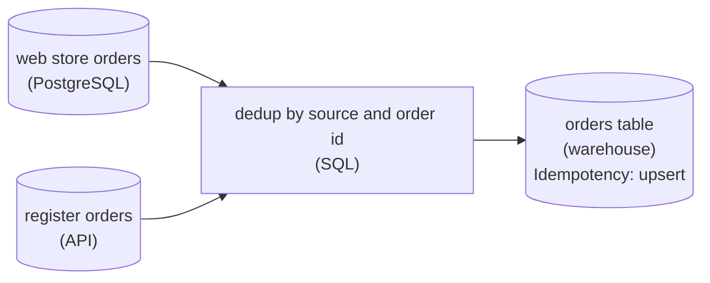

*Both sources are tagged with `source_system`, collapsed on `(source_system, order_id)`, then upserted on the same key.*

| Pitfall: `order_id` alone fuses two different sales |
| --- |
| Keying on `order_id` passes every test that loads one source at a time. The first night both systems ship order 1042, the `MERGE` matches the register sale to the web sale and overwrites it: no duplicate, no error, one sale silently gone. Deduping on `order_id` loses it one stage earlier. |

| Key insight: Ask where each key column comes from |
| --- |
| A `source_system` tag is stamped at ingest and never changes; an `order_id` is only unique inside the system that issued it. The same question settles a CDC feed, where the before and after images share a primary key and the change sequence decides which one survives. |

| Real world: Customer columns make poor order keys |
| --- |
| It is tempting to key on `customer_id` plus a timestamp. Guest checkouts arrive with a null `customer_id`, and two register sales can share a second, so that key both drops rows and merges them. |

**Follow-up questions**

1. The register vendor starts reusing order numbers after 90 days. What does the key need now?\
   *Key stability over time: adding `order_date` so a recycled number is a new sale.*
2. A marketplace becomes a third order source with its own ids. What changes in the design?\
   *Whether the key holds at a new seam: only a new `source_system` value, no new logic.*


<br>

---

## Putting It All Together

Picture the Airbnb currency fix from the opening. Ninety days, 2026-01-01 through 2026-03-31, of fact_bookings, agg_daily_revenue and host_payout_summary must be recomputed before finance closes the quarter. The engineer first audits each table's write pattern. The audit turns up a uuid() key on a guest table and a current_date in the revenue filter, and the engineer fixes both. Next, they rerun March 14 alone and compare it with the old output. Then they launch the range 8 runs at a time, with publish-last staging and a run_status marker keeping half-finished days off the finance dashboard.

- The write pattern decides what a rerun replaces. The key and the time bounds decide what it replaces that data with.
- Hashing the natural key lets a MERGE target survive the backfill, because every rerun lands on the rows it wrote before.
- Explicit logical-date bounds make 90 parallel runs read 90 different days instead of the same recent day.
- Event-time partitions explain why the backfill picks up late bookings: the bounds are the same, but more facts exist, so the answer is corrected.
- The completion marker makes the 3-table run visible as a single unit. Resetting the marker first keeps the backfill from exposing half-replaced days.


<br>

---

## Pipeline Architecture

### Exercise 1 of 2

**● TASK**

A nightly scheduled job appends every smart-meter reading file that landed in the last 24 hours of wall-clock time to a readings fact table in the warehouse. A rerun after a failure double-counts readings, and a rerun weeks later loads the wrong day. Refactor it so a run for a given date reads only that date's files and running that date twice leaves the table unchanged; a meter never reports twice for the same timestamp.


<br>

### Solution

#### Bound the read, key the write

Refactoring a hurried ETL into an idempotent one came down to two edits here. The read stops asking the clock what 'yesterday' means and takes its date from the scheduler. The write stops appending and merges on the reading's business key, the meter plus its timestamp. With both in place a run is a function of its date: run 2026-09-14 once or 5 times and the readings table ends in the same state.

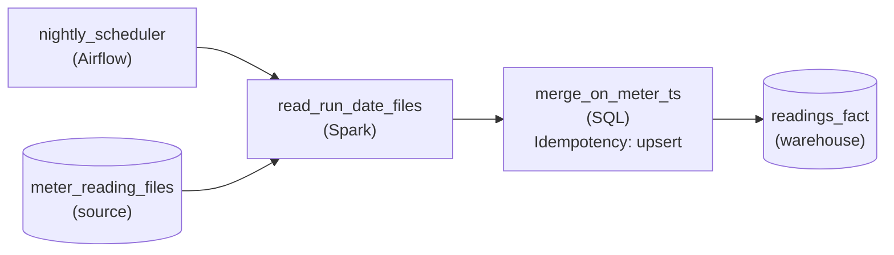

*`nightly_scheduler` hands each run its date, `read_run_date_files` reads only that date's files, and `merge_on_meter_ts` upserts into `readings_fact`.*

1. **Take the date from the scheduler**

   The old read used 'the last 24 hours', so its input depended on when it ran. Passing the run date in from the scheduler pins the input: the nightly run and a rerun next month for the same date see exactly the same files. That is also what makes the backfill loop from the previous section work here, since each iteration just calls the same run with a different date.

2. **Merge on meter and timestamp**

   A meter never reports twice for the same timestamp, so the pair is the reading's identity. Upserting on it means a reading already in the table is matched and updated, not inserted again. Resent files and failed-then-retried runs both collapse to one row per reading.

| Pitfall: Fixing only the write still loads the wrong day |
| --- |
| A merge on the business key stops duplicates, but if the read still uses a window relative to now, a rerun for a date three weeks back reads this week's files. The merge then cleanly applies the wrong data, and the day you meant to repair never reloads. Each fix covers a different bug, and the pipeline needs both. |

**Follow-up questions**

1. A resent file corrects a reading's value for a day three weeks ago. What happens on the rerun?\
   *Checks that the date-bounded read targets just that day and the upsert replaces the value in place.*
2. Could overwriting a date partition replace the merge here, and what decides it?\
   *Partition overwrite only works when the partition matches the unit a run owns; here runs own landing dates while rows are keyed by reading time.*


<br>

### Exercise 2 of 2

**● TASK**

A change data capture feed from a PostgreSQL accounts table emits a before image and an after image for every update, both carrying the same account_id, and resends events whenever the connector restarts; several changes can share one commit timestamp. Land the raw change events in object storage, then MERGE them into a current-state accounts table in the warehouse so each account ends with exactly one row holding its latest change, even after a rerun. A scheduler runs each load for one explicit change date, and the same job must backfill any past range of dates from the retained raw events.


<br>

### Solution

#### A merge is only as idempotent as its key

Choosing the business key is what makes a `MERGE` safe to rerun. Here the obvious key, `account_id`, is right for matching rows, but it cannot decide which event wins: an update arrives as a before image and an after image with the same `account_id`, a connector restart sends events again, and two changes can share a commit timestamp. The key says which row to touch; a value that never ties says which change is newest.

1. **Match on `account_id`, order by the log sequence**

   Every change carries the database's log sequence number, which only increases. Keying the `MERGE` on `account_id` and ranking changes by that sequence gives one answer no matter how many copies arrive. Ranking by commit timestamp leaves a tie the engine breaks arbitrarily, so two runs over the same input can keep different rows.

2. **Collapse to one change per account first**

   Drop the before images and exact repeats, then keep the highest-sequence after image per `account_id`. A `MERGE` fed two source rows for the same target row either fails or applies them in an unpredictable order; the `dedup` stage guarantees it sees exactly one.

3. **Bound every run by a change date**

   The scheduler passes the run's change date into the job, and the job reads only that date's slice of `raw_change_events`. Nothing resolves `NOW()` or `CURRENT_DATE`, so rerunning last Tuesday reads exactly the events it read the first time, and a backfill is the same job looped over a list of dates.

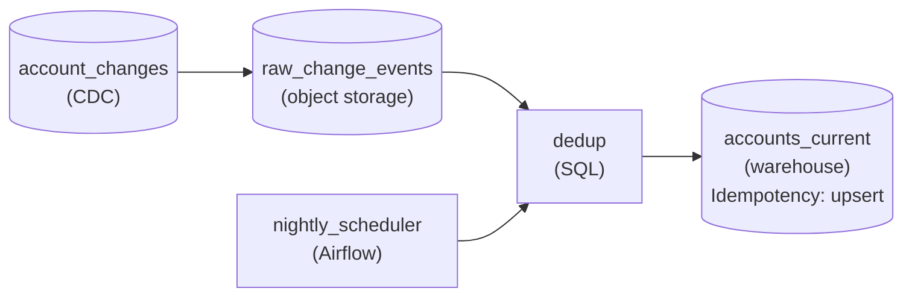

*CDC events land raw in object storage; each scheduled run dedups one change date and upserts `accounts_current` on `account_id`.*

| Pitfall: An old replay must not overwrite a newer row |
| --- |
| Dedup inside one run does not protect across runs: a restart can resend yesterday's events into today's slice, and a backfill replays old dates after newer ones loaded. Store the last applied sequence on each `accounts_current` row and let the `MERGE` update only `WHEN MATCHED AND source.lsn > target.lsn`. Arrival order stops mattering, and rerunning any range converges to the same table. |

| Key insight: Backfill falls out of the other 3 choices |
| --- |
| Retained raw events, a run bounded by its date, and a sequence-guarded upsert together turn a backfill into a plain rerun: pick the dates, run them, and the table ends where it would have if the bad loads never happened. |

**Follow-up questions**

1. Finance now wants every account's daily change history, not only current state. Which write pattern fits that table?\
   *Partition overwrite on a change-date partitioned history table versus `MERGE` on current state.*
2. A second source recycles account numbers after two years of inactivity. What does the business key become?\
   *Composing a key from the ID plus something that separates its lifetimes, such as the account's creation date.*


<br>

---

## Key Takeaways

- Pick the write pattern from the destination's shape and the run's unit of work: a whole partition, keyed changes, or a slice named by a predicate.
- A MERGE is only as idempotent as its key, which must stay stable across runs and be unique in both the target and the incoming batch.
- A deterministic surrogate comes from hashing the natural key. A uuid ( ) generated per run duplicates every row on retry.
- Feed every run explicit time bounds from its logical date. In each transform, decide whether event time or processing time drives each filter.
- A backfill is many reruns at once. Independent days can run in parallel, while days that read yesterday's output must run in order.
- Across several tables, make each write idempotent first. Then hide partial states with publish-last or a completion marker that each rerun resets before it starts.
