Beginner·Pipeline Architecture · 25 min · 12 challenges

# Ingestion Patterns: Beginner

Black Friday weekend at Shopify. Orders flood the storefront database, a payment partner fires a webhook for every charge, a shipping carrier drops a settlement file at 02:00, and the marketing team wants yesterday's ad spend from a vendor's API before the morning standup. Four sources, 4 ways the data shows up. The ingestion job written for each one decides whether Monday's dashboards are right or quietly short.


<br>

---

## The Four Shapes of Ingestion

Ingestion is the first role in any pipeline: the step that copies data out of a system you do not control into storage you do. What changes from source to source is how the data arrives, and that decides how the job is written, how it fails, and how you rerun it.


<br>

### Who moves first, and what arrives

Two questions sort every source: who initiates the transfer, your job or the source, and what unit shows up. The answers give 4 shapes, and each carries its own way of remembering where it stopped.

| Shape | Who initiates | Unit that arrives | Typical source | How you track progress |
| --- | --- | --- | --- | --- |
| Pull from a database | Your job | Rows matching a query | Your company's orders database | The largest timestamp you have loaded |
| Push from a queue or webhook | The source | One event at a time | A payment provider sending charge events | The offset you last committed |
| File drop | The source, on its schedule | A whole file or a batch of files | A partner uploading a nightly CSV | The list of files already processed |
| API pull | Your job | A page of records per request | A vendor's web endpoint | The cursor of the last page fetched |

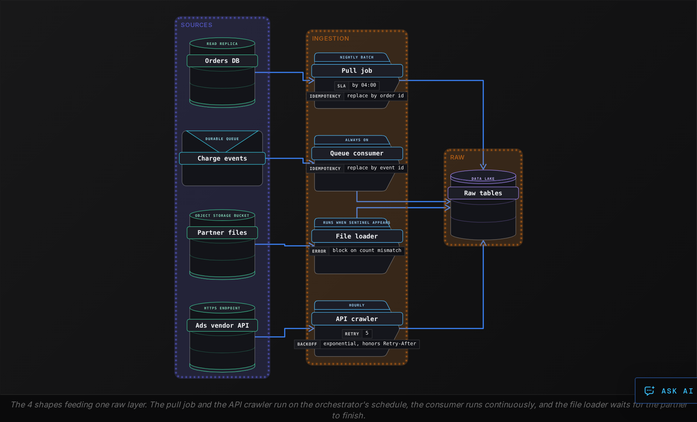


<br>

### Picking a shape for a new source

The source makes most of the choice. If you can run SQL against the system, pull from it. If it emits events or offers webhooks, let it push, and each event arrives seconds after it happened. If a partner can only hand you files, you have a file drop. If a vendor exposes a web endpoint and nothing else, you are writing an API job. The real decision comes when a source offers 2 shapes, such as webhooks plus an API: webhooks give freshness, the API fetches what the webhooks missed, and mature setups run both.

> Four questions every ingestion job answers
>
> - Where did I stop last time? The marker in the table's last column.
> - What if the same data arrives twice? Replace by key, so the second landing changes nothing.
> - How do I know the batch is complete? A frozen time window, a sentinel file, or a last page with no cursor.
> - What happens to a record that fails a check? Warn or block, decided before the first run.

> **TIP**
>
> Store the progress marker in the same place you write the data, and move it only after the write succeeds. Every shape in this lesson comes back to that one rule.

**A marketing vendor holds your campaign spend. It offers a web endpoint returning 100 campaigns per request and, on your enterprise plan, a nightly CSV in a bucket you own. The spend feeds a daily report. Which shape do you start with?**

- **A.** API pull. A web endpoint is always fresher than a nightly file, and 100 campaigns per request means the whole dataset arrives in 1 request.
- **B.** Push from a webhook. The vendor sends spend changes as they happen, so you never need to store a progress marker or validate a batch.
- **C.** File drop. The vendor already produces a complete nightly snapshot in storage you own, which can be validated whole and reloaded in 1 step.
- **D.** Pull from the database. Enterprise plans usually include read access to the vendor's database, and a direct query is the most reliable shape.

<details>
<summary>Solution</summary>

**C.** File drop. The vendor already produces a complete nightly snapshot in storage you own, which can be validated whole and reloaded in 1 step.

The file matches the report's daily rhythm, can be checked against a manifest, and is replaced as 1 partition on rerun. Keep the API for backfills.

**Why the others are wrong**

- **A.** A daily report needs no hourly freshness, and a large account takes hundreds of requests, each a chance to drift or be rate limited.
- **B.** The vendor offers no webhooks, and even a push source needs a progress marker: the committed offset.
- **D.** Vendors do not hand customers a connection to their production database. The 2 shapes on offer are the file and the endpoint.

</details>


<br>

---

## Pipeline Architecture

### Exercise 1 of 2

**● TASK**

Clicks on the Kafka clickstream topic must reach the live traffic dashboard within a minute, while the PostgreSQL orders database feeds a revenue report finance opens once each morning. Add a processing stage on each path, choosing streaming or batch so each meets its latency at the lowest cost, and set each stage's freshness SLA. Orders must land in the revenue warehouse before the report reads them.

**Starting canvas** (already placed for you):

- clickstream topic (source, Kafka)
- orders database (source, PostgreSQL)
- live traffic dashboard (consumer, Grafana)
- revenue warehouse (storage, warehouse)
- morning revenue report (consumer, Metabase)

<details>
<summary><strong>Solution</strong></summary>

#### 2 latencies, 2 processing modes

Batch versus streaming is settled by how fresh the reader needs the data, weighed against what it costs to keep a job running. The ingestion shape tells you how data arrives: the push topic hands you events as they happen, the pull database waits until you ask. The consumer's deadline then tells you how often you must process it. Here the 2 deadlines are a minute and a day, so the 2 paths get opposite answers.

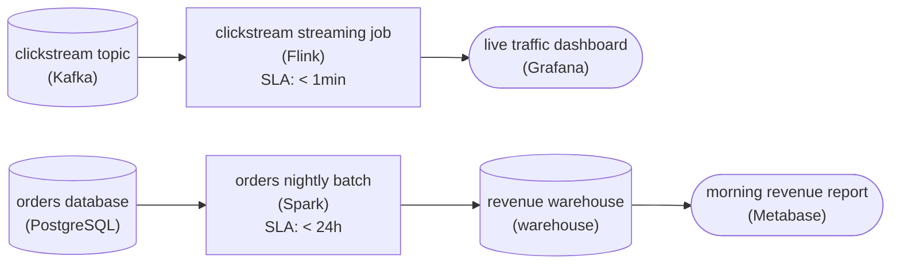

*The push clickstream is processed continuously under a minute; the pull orders path runs once a day into the warehouse.*

1. **Stream the clickstream**

   The dashboard has to show a click within a minute of it happening. Even a batch job every 15 minutes would leave the dashboard up to 15 minutes stale, so the only path that meets the deadline is a stream processor reading the topic continuously, with a `< 1min` SLA.

2. **Batch the orders once a day**

   Finance reads the revenue report once each morning. A streaming job would hold compute open all day to refresh numbers nobody looks at until the next morning. One scheduled run overnight with a `< 24h` SLA meets the deadline at a fraction of the cost, and lands the rows in the warehouse before the report opens.

| Pitfall: Streaming everything pays for freshness nobody reads |
| --- |
| Choosing streaming for both paths feels safe because fresher sounds better. It is not free: an always-on job, its state and its monitoring cost money every hour. Match each path to the slowest latency its reader will tolerate, and only pay for streaming where a deadline demands it. |

**Follow-up questions**

1. If finance later wants revenue refreshed every hour, does the orders path need to become streaming?\
   *An hourly deadline is still a batch band: a more frequent schedule, not a different mode.*
2. What if the dashboard only needed clicks within the hour?\
   *Relaxing the deadline moves the clickstream path into the batch band and changes the cost picture.*

</details>


<br>

### Exercise 2 of 2

**● TASK**

The nightly pull of the 200M-row Postgres orders table scans every row for 4 hours and collides with 6am app traffic, though only about 1M orders change a day, each stamped with updated_at. The job must also start pulling the 10k-row stores table, which has no reliable change column. Choose a full or incremental load for each table, land both in the Iceberg raw zone, and make a crashed run resume without dropping or duplicating any order.

**Starting canvas** (already placed for you):

- Postgres orders (200M rows, +1M/day; full-table scan fights 6am app traffic) (source, PostgreSQL)
- extract_orders_full: SELECT * (4-hour scan every night) (transform, SQL)
- Iceberg raw_orders landing (storage, Iceberg)

<details>
<summary><strong>Solution</strong></summary>

#### Full or incremental, decided per table

Choosing between a full and an incremental load is a per-table call, and this job makes it twice. `orders` holds 200M rows, and only about 1M of them change a day, each with a trustworthy `updated_at`. Reading the whole table spends 4 hours on rows that never moved, so it gets an **incremental load** bounded by a high-water mark. The stores table is 10k rows with no reliable change column. Reading it whole takes seconds, so a full reload that replaces the raw copy is both simpler and guaranteed correct.

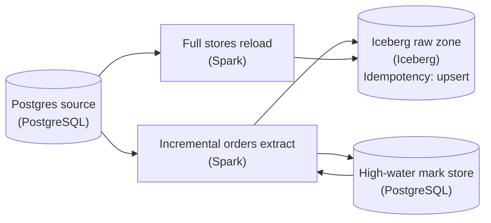

*The orders extract reads its mark before it runs and writes the new mark back only after the Iceberg commit. The stores table is reloaded whole every night.*

1. **Bound the orders read with a watermark**

   Replace `SELECT *` with `SELECT ... FROM orders WHERE updated_at > :last_mark`. Read `:last_mark` from the high-water mark store and extract only the rows past it. Once the raw-zone write commits, record the largest `updated_at` you saw as the new mark. The four-hour scan shrinks to a read sized to the roughly 1M rows that moved.

2. **Overwrite the stores copy whole**

   With no column to filter on, an incremental read of stores would silently miss edits made in place. Read all 10k rows and replace the raw table each night. The run is short, and rerunning it produces the same result.

| Pitfall: Advance the mark only after the data lands |
| --- |
| If you save the new mark first and the run crashes before the Iceberg commit, those orders are skipped for good. If you land the rows but never save the mark, the next run reads them again. Commit the data first, then the mark, and make the landing an upsert on the order key so a rerun of the same window adds no duplicates. |

**Follow-up questions**

1. What happens to the watermark if `orders` rows are hard-deleted?\
   *A deleted row never carries a newer `updated_at`, so a column-based mark cannot see it.*
2. 2 orders share the exact `updated_at` stored as the mark, and only one was loaded before a crash. Should the filter be `>` or `>=`?\
   *This tests boundary handling: `>=` re-reads the tie, and the upsert absorbs it.*

</details>


<br>

---

## Pull Ingestion from a Database

Pull ingestion is a query your job runs against a source database on a schedule. You decide when it runs and how much it asks for, which makes pull the most controllable shape, and asking for too much slows the application that shares the database.


<br>

### Full load: ask for everything

A full load reads every row and replaces the destination table. For a `product_categories` table of 3,000 rows this is the right answer: the query takes under a second, there is no marker to maintain, and a row deleted at the source vanishes on the next run. The job empties `raw.product_categories`, then runs the insert below.

```sql
INSERT INTO raw.product_categories
SELECT
    category_id,
    category_name,
    parent_category_id,
    updated_at
FROM source.product_categories
```


<br>

### Incremental load: ask for what changed

An `orders` table with 400 million rows cannot be reread nightly. An incremental load asks only for rows changed since the last run. It needs a column that moves whenever a row changes, almost always `updated_at`, and a stored high-water mark: the largest `updated_at` the previous run loaded, kept in a small state table next to the raw data.

| source_table | high_water_mark | last_run |
| --- | --- | --- |
| orders | 2026-10-22 03:00:00 | 2026-10-22 nightly |
| customers | 2026-10-22 03:00:00 | 2026-10-22 nightly |
| refunds | 2026-10-21 03:00:00 | 2026-10-21 nightly (failed on 10-22) |

```sql
SELECT
  order_id,
  customer_id,
  status,
  total_cents,
  updated_at
FROM source.orders
WHERE updated_at > TIMESTAMP '2026-10-22 03:00:00'
  AND updated_at <= TIMESTAMP '2026-10-23 03:00:00'
ORDER BY updated_at
```

The upper bound matters. Without it, the query captures rows written while it runs, and the mark you record may not match what you loaded. Freezing both bounds at the start makes the run repeatable: the same 2 timestamps return the same rows, which a rerun after a failure needs.


<br>

### Write first, then move the mark

```sql
def run_incremental(conn, state, run_started_at):
    low = state.read_mark("orders")
    high = run_started_at
    rows = conn.query(ORDERS_SQL, low=low, high=high)
    write_replace_by_key(rows, table="raw.orders", key="order_id")
    state.write_mark("orders", high)
```

The order of the last 2 lines is the whole design. If the mark moved first and the write failed, the next run would start above rows that never landed. With the write first, a failure leaves the mark in place, the retry re-pulls the same window, and `write_replace_by_key` makes the second landing identical to the first. The `refunds` row above shows this: its 10-22 run failed, so its mark stayed at 10-21 and tonight's run covers 2 days.


<br>

### Two rows an incremental load misses

The first is the slow transaction. An application opens a transaction at 02:59:40, sets `updated_at` to that moment, and commits at 03:00:20. Your run's high bound was 03:00:00 and the row was not yet committed, so the query missed it. Tomorrow's run starts above 03:00:00, and the row's 02:59:40 sits below that, so it is skipped forever. The fix is an overlap: pull from the mark minus 10 minutes, and let the replace-by-key write absorb the rows that arrive twice.

The second is the hard delete. A removed row has no `updated_at` left to move, so no incremental query sees it and the destination keeps a ghost. Until the source flags deletions instead of removing rows, the usual answer is a weekly pull of the primary keys alone, compared against the destination to remove the ghosts.

| ✓ Full load | ✗ Incremental load |
| --- | --- |
| • Replaces the whole table each run<br><br>• No progress marker to maintain<br><br>• Picks up deletes for free<br><br>• Cost grows with table size | • Reads only the changed window<br><br>• Needs an updated_at column and a stored mark<br><br>• Blind to hard deletes<br><br>• Cost grows with change volume |

**A nightly job loads raw.orders incrementally in this order: advance the high-water mark to the run start time, run the query, write the rows with replace by order_id. On Tuesday the write failed halfway and the orchestrator's retry on Wednesday succeeded. Which rows are at risk?**

- **A.** No rows. The retry re-pulled the same window because the write replaces by key, so whatever Tuesday half wrote was overwritten with the full set.
- **B.** The rows changed between Monday's mark and Tuesday's run start. The mark moved before the write, so the retry pulled from Tuesday's mark onward and never revisited them.
- **C.** The rows changed during the retry itself. The mark was set before the retry started, so anything changed while it ran was captured twice.
- **D.** Every row in the table. A failed write leaves the destination half replaced, and the retry cannot know which half landed and which did not.

<details>
<summary>Solution</summary>

**B.** The rows changed between Monday's mark and Tuesday's run start. The mark moved before the write, so the retry pulled from Tuesday's mark onward and never revisited them.

Advancing the mark first means a failed write leaves a window nobody will pull again. Writing first and moving the mark last is the fix.

**Why the others are wrong**

- **A.** Replace by key absorbs duplicates; it cannot recover a window nobody pulled. The retry read a mark already past Tuesday's rows.
- **C.** A frozen upper bound leaves rows changed during a run to the next window, and a second copy would be harmless under replace by key.
- **D.** Replace by key rewrites whatever it pulls, so the half that landed does not matter. The damage is the window the mark skipped.

</details>


<br>

---

## Pipeline Architecture

### Exercise 1 of 2

**● TASK**

Replace the click_events consumer, which commits its Kafka offset before writing to raw_clicks, with a streaming consumer whose name states write-first, commit-after and that lands every event in raw_clicks within a minute. The SaaS partner's webhook currently writes straight to the writer and spikes knock it over: route its events through a queue the same consumer reads, so the handler can return 2xx once the queue accepts an event.

**Starting canvas** (already placed for you):

- Kafka click_events topic (source, Kafka)
- SaaS partner webhook (source, API)
- raw_zone_writer (commits offset before write) (transform)
- Iceberg raw_clicks landing (storage, Iceberg)

<details>
<summary><strong>Solution</strong></summary>

#### Write first, commit after

A Kafka topic is an unbounded log, so a streaming consumer never reaches the end of it. It reads continuously and records how far it has got as a committed offset. That offset is a durable promise: 'everything up to here is safely landed, never send it again.' Ordering is the only way to keep that promise. Land the event in `raw_clicks`, and commit the offset only after that write returns. The consumer's name says write-first, commit-after out loud because that order is the whole design.

| Pitfall: Commit-before-write drops messages silently |
| --- |
| The starter consumer committed the offset the moment it read a message, and only then wrote to the raw zone. If it crashes in that gap, after the commit but before the write to `raw_clicks` returns, the message is gone. On restart Kafka hands over the next offset, because you already promised the old one was landed. No error is raised and nothing is retried; the data simply never arrives. Swapping the 2 steps is the entire fix. |

Reversing the order trades a silent loss for a recoverable duplicate. A crash after the write but before the commit means the restarted consumer reads that event again and writes it again. That is the bargain of at-least-once delivery: nothing is lost, so the same event can arrive twice. Keying rows in `raw_clicks` on the event id lets a replay overwrite the row instead of double-counting it.

#### A queue so the webhook can say yes

Wiring the partner's webhook straight into the writer tied the partner's send rate to your write throughput. During a spike the writer fell behind, the handler blocked, and the partner's calls timed out. A queue in between turns the webhook into one more log. The handler's only job is to append the event and return 2xx. The same streaming consumer reads that queue with its own offsets and the same write-first rule. Under load the backlog grows, and nothing falls over.

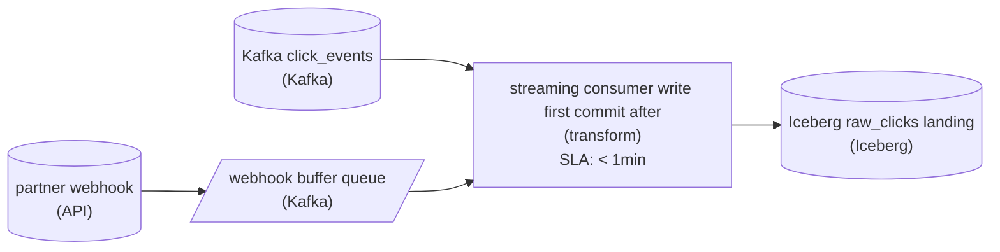

*2 logs, one streaming consumer: it writes each event to the raw landing within a minute and commits the offset only after the write returns.*

| Real world: The 2xx is a receipt, not a completion |
| --- |
| Reliable webhook receivers enqueue the event and acknowledge it; they never do the real work inside the request. The 2xx means 'I have durably taken responsibility for this event,' not 'I have finished processing it.' The queue is what lets the handler make that promise honestly under load. |

**Follow-up questions**

1. The write to `raw_clicks` succeeds, the commit fails and the consumer restarts. What must the row be keyed on so the replay changes nothing?\
   *Extends at-least-once delivery to a sink that tolerates the replayed event.*
2. The webhook queue fills faster than the consumer drains it for an hour. What should the handler do, and what does the partner see?\
   *Extends the buffer idea to a bounded queue that pushes back instead of dropping events.*

</details>


<br>

### Exercise 2 of 2

**● TASK**

A partner drops daily CSVs into an SFTP inbox, sometimes re-uploading a file under the same name with changed contents, writing half-files the pipeline starts reading, or switching encoding without notice. Today the pipeline reprocesses every file every run. Add a manifest of processed files, a validation transform named for its checks (pattern, size, encoding, header, sentinel skip), and a processed prefix so the inbox holds only new files.

**Starting canvas** (already placed for you):

- SFTP partner_drops/inbox (re-uploads, half-files, encoding switches) (source)
- process_files (lists prefix, processes every file every run) (transform)
- Iceberg raw_partner_data landing (storage, Iceberg)

<details>
<summary><strong>Solution</strong></summary>

#### The pattern: a manifest turns full re-processing into incremental

The section called this the manifest pattern, and it is the answer to a pipeline that lists a directory and processes every file every run. A **manifest** is a small store that records which inputs you have already consumed. Before you read a file, you ask the manifest "have I done this one?"; after you finish, you write a row saying you have. That single lookup is what makes the pipeline incremental instead of full: yesterday's files are already in the manifest, so today's run touches only what is genuinely new.

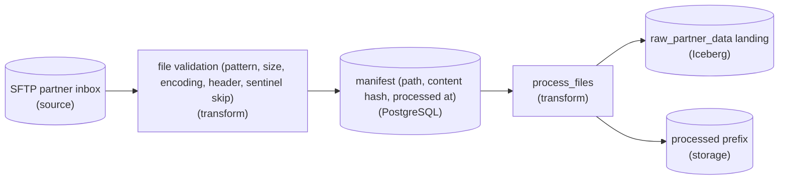

*Validate first, consult the manifest to skip what is done, land the new rows, then move the file out of the inbox.*

1. **Validate before you read, not while you read**

   Put a transform whose name states its checks between the source and everything else: the filename matches the expected pattern, the size is above the sentinel threshold, the encoding decodes cleanly, and the header row is present. A half-file written by the partner mid-upload fails the size and header checks and is skipped, so `process_files` never starts parsing a truncated stream. Naming the transform for its checks is the point of the exercise: the next engineer reads the validation stage's name and knows the guarantees the landing table can rely on.

2. **Key the manifest on path AND content, then move the file out**

   Record each processed file as `(path, content_hash, processed_at)`. On the next run, a file is new work only if its path is unseen OR its `content_hash` differs from what you stored. Finally, move the file to the `processed/` prefix so the inbox holds only unprocessed work. The manifest and the move are belt-and-suspenders: the manifest is the source of truth for idempotency, the prefix move keeps the listing small and cheap.

| Pitfall: Keying the manifest on filename alone |
| --- |
| The obvious first cut is a set of processed paths: `if path in seen: skip`. It handles the re-run case, but it silently drops the partner's re-upload, the same name with different contents, because the path is already in the set. That is the exact failure this partner causes. Comparing a `content_hash` (or size plus mtime) alongside the path is what tells a real re-upload apart from a duplicate run. |

| ✕ Full (what you inherited) | ✓ Incremental (the manifest) |
| --- | --- |
| List the prefix, process every file every run. Yesterday's 90 files re-process today, cost grows with the whole inbox, and a mid-quarter encoding switch corrupts rows with no record of which files were affected. | Consult the manifest, process only unseen or changed files, move them to `processed/`. Cost tracks new arrivals, and the `(path, content_hash, processed_at)` rows are an audit trail of exactly what landed and when. |

| Real world: In production, this is most partner ingestion |
| --- |
| Any inbound feed you do not control (an SFTP drop, a vendor bucket, an email attachment) lands with these exact quirks: re-uploads, partial writes, silent format drift. The manifest plus a validation stage plus a processed-prefix move is the standard shape, and the manifest doubles as the answer to "did we ever process the file the partner swears they sent?" |

**Follow-up questions**

1. The partner switches encoding again next quarter. Does the validation stage reject the file or adapt to it?\
   *Tests whether validation is a hard gate or should detect and record the encoding per file.*
2. 2 scheduler runs overlap and both see the same new file. What stops it from being processed twice?\
   *Tests whether the manifest write is atomic enough to be the real idempotency boundary, not just the prefix move.*

</details>


<br>

---

## Push from Queues and Webhooks

In push ingestion the source does the moving. An event happens, the source hands it to a queue or sends it to an endpoint you run, and your consumer sees it seconds later. You gain freshness and give up control: events arrive whether or not your consumer is healthy, in bursts the source decides, and sometimes more than once.


<br>

### Reading from a queue: the offset

A queue keeps events in order and numbers them. Your consumer reads from a position called the offset, processes what it read, and commits a new offset so a restart resumes from the right place. Where that commit sits relative to the storage write is the question the pull section asked about its mark, and the answer is the same.

| Order of operations | Crash between the 2 steps | After restart |
| --- | --- | --- |
| Commit offset, then write to storage | Offset moved, write never happened | Events lost, and nothing records that they existed |
| Write to storage, then commit offset | Write landed, offset did not move | Events replayed and land a second time |

Replay is the one you can live with. The consumer writes each event under its `event_id` with a replace, so a replayed event overwrites itself and the table ends up identical. Loss leaves a hole only the source can fill, and a source that pushed an event once may have no way to send it again.

```sql
def consume(queue, sink, batch_size=500):
    while True:
        batch = queue.poll(max_records=batch_size)
        if not batch:
            continue
        rows = [to_row(event) for event in batch]
        sink.replace_by_key(rows, table="raw.charge_events", key="event_id")
        queue.commit(batch[-1].offset + 1)
```


<br>

### Webhooks: a push with no queue in it

A webhook is a push over plain HTTP. The vendor sends a POST to a URL you own each time something happens, waits a few seconds for a `200`, and retries if it does not get one. The retry schedule is the vendor's: some give up after a few attempts over minutes, others keep trying for days. Either way the vendor keeps no offset for you, so you cannot ask it to resend from a position. Design as if events can be lost, and keep a backfill path such as the vendor's API.

The trap is doing real work inside the endpoint. An endpoint that parses the payload, looks up the customer and writes to the warehouse before replying takes 4 seconds on a normal day and 30 seconds when the warehouse is busy. Against a 10-second timeout, the vendor declares failure on the busy day and retries, and 2 copies of every event pile onto the same slow warehouse. The way out is a queue between the endpoint and the work.

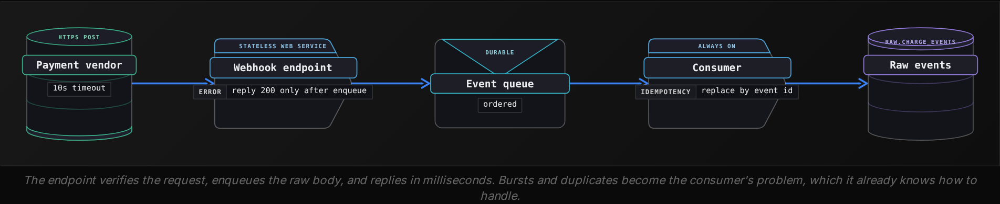

What the endpoint does, and nothing more

- Check the vendor's signature header, so a forged request cannot reach the queue.
- Write the raw body and a received_at timestamp, which shows how late each event arrived, to the queue unparsed.
- Return 200. Parsing, validation and warehouse writes happen in the consumer, where a slow night costs lag rather than duplicates.

**Your webhook endpoint for a shipping vendor parses each payload and appends it straight into raw.shipments. Monitoring shows 3% of shipment events appear twice, and the share rises on nights when the warehouse is busy. What is the most likely cause, and the fix?**

- **A.** The warehouse insert sometimes exceeds the vendor's timeout, so the vendor retries. Enqueue the raw payload, return 200 at once, and have a consumer write with replace by the event id.
- **B.** The vendor sends each event twice by design, so filter the second copy at the endpoint by remembering the last 1,000 event ids in memory.
- **C.** The queue commits offsets before the write, so events replay on restart. Move the commit after the write and the duplicates stop.
- **D.** The orchestrator retried the ingestion DAG after a transient failure. Set its retry count to 0 so each payload is processed once.

<details>
<summary>Solution</summary>

**A.** The warehouse insert sometimes exceeds the vendor's timeout, so the vendor retries. Enqueue the raw payload, return 200 at once, and have a consumer write with replace by the event id.

Duplicates that track warehouse load point at timeouts. The queue makes the reply fast, and the replace makes any remaining retry harmless.

**Why the others are wrong**

- **B.** A duplicate rate that moves with warehouse load is a timeout symptom, and in-memory ids vanish on every restart.
- **C.** This design has no queue; the endpoint writes directly. Committing before the write would cause loss.
- **D.** A webhook endpoint is a web service that no orchestrator retries, and removing retries elsewhere would only add failures.

</details>


<br>

---

## Pipeline Architecture

### Exercise 1 of 2

**● TASK**

A Stripe REST API ingest job stops at the first empty page, spends its rate budget in 5 minutes, and lets its OAuth token expire mid-run, so 5xx outages land as silent partial loads. Replace it with an ingest transform, named for what it does, that uses cursor-based pagination, honors Retry-After, refreshes the token before expiry, and retries 429 and 5xx with backoff before landing pages in the raw Iceberg table.

**Starting canvas** (already placed for you):

- Stripe REST API source (rate limited; OAuth token; occasional 5xx) (source, API)
- ingest_stripe (page-based pagination, no rate limiter, no refresh, no backoff) (transform)
- Iceberg raw_stripe landing (storage, Iceberg)

<details>
<summary><strong>Solution</strong></summary>

#### The four concerns of API ingestion

Pulling rows from a REST API is not one problem. It is four, and a job is only as reliable as its weakest one. The section named them: **pagination** (how you walk the full result set), rate limits (how you stay inside the API's budget), auth (how you keep a valid token for the whole run), and reliability (what you do when a request fails anyway). The `ingest_stripe` transform you replaced handled none of them well. The fix is a single ingest transform whose name states all four: cursor pagination, a rate limit that honors `Retry-After`, an OAuth refresh before expiry, and backoff on `429` and `5xx`.

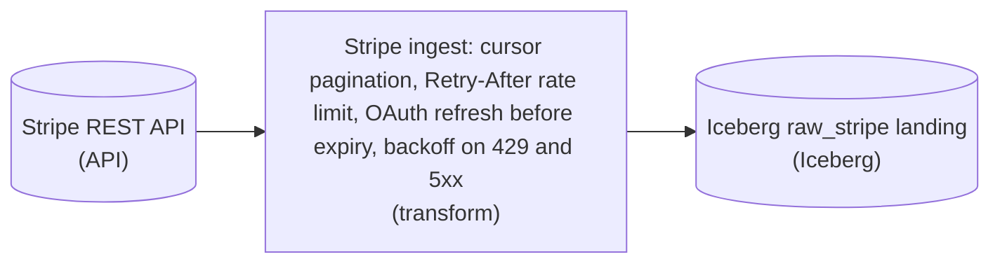

*One ingest transform runs all four concerns inside its request loop, then lands every page in the raw Iceberg table.*

| Pitfall: An empty response is not an end condition |
| --- |
| The old job stopped paginating when a page came back empty. An empty page is ambiguous, though. It happens at the true end of the data, and it also happens when a transient `5xx` or a rate-limited `429` returns nothing. A single hiccup mid-run therefore looks exactly like 'done', the loop exits early, and you get a silent partial load, which is precisely what each Stripe outage produced. The end of the data has an unambiguous signal: Stripe's list endpoints return `has_more`. Loop while `has_more` is true, pass the last object's id as `starting_after`, and stop only when Stripe says there is no more. |

| ✕ Page-based (what failed) | ✓ Cursor-based (what to ship) |
| --- | --- |
| Ask for page 1, 2, 3 and stop at the first empty page. If rows are inserted or deleted between requests, the offsets shift, so you skip or double-count rows. Worse, an empty page from a transient error is read as the end. Correctness depends on the data holding still and on every request succeeding. | Anchor each request to the last id you saw with `starting_after`, and treat `has_more` as the stop signal. New rows arriving mid-run do not shift your position, and an error page is retried rather than mistaken for the end. This is why the section calls cursor-based pagination the strongest option. |

1. **Keep the token alive for the whole run**

   A long paginated pull can outlast the OAuth token's lifetime, and the old job let it expire mid-pagination with no recovery. A refresh policy checks the token's expiry before each request and refreshes ahead of time. A run that walks thousands of pages then never dies halfway with only half the data landed.

2. **Spend the rate budget over the whole run**

   Firing requests as fast as the loop allows drains the budget immediately, and every later call then gets a `429`. A rate limiter paces requests so the budget lasts the full run. When Stripe does return `429`, treat the `Retry-After` header as an instruction: sleep exactly that long before retrying instead of guessing.

3. **Treat 429 and 5xx as retryable, everything else as a real error**

   Retry with backoff is the backstop for the other 3 concerns. On `429`, honor `Retry-After`. On `5xx`, back off exponentially with jitter and try again a bounded number of times. A `4xx` other than `429` (a bad request, a revoked scope) is not transient, so fail loudly instead of retrying forever. This is what turns an outage from a silent partial load into a run that pauses, recovers and completes.

| Real world: Every third-party ingest has this shape |
| --- |
| Swap Stripe for Shopify or GitHub and the four concerns stay the same; only the header names change. The reusable move is to make cursor state durable. Checkpoint the last `starting_after` so a job that dies on page 900 resumes from there instead of replaying from page 1 and burning the rate budget again. Landing into `raw_stripe` as append-only means resumed, occasionally overlapping pulls can be deduplicated downstream on the object id without corrupting the table. |

**Follow-up questions**

1. If the token refresh itself returns a 5xx, does it go through the same retry-with-backoff path or a separate one?\
   *Checks that auth is treated as another request that can fail, not a step outside the retry logic.*
2. How would you make the cursor checkpoint survive a crash so a resumed run does not re-scan pages it already landed?\
   *Extends cursor-based pagination into durable, resumable state.*
3. Stripe sends Retry-After in seconds, but some APIs send an absolute timestamp. How does your rate limiter stay correct for both?\
   *Checks that honoring Retry-After means reading the API's actual signal, not hardcoding a unit.*

</details>


<br>

### Exercise 2 of 2

**● TASK**

Build the ingestion for a new analytics platform that lands four sources in one Iceberg raw zone: a Postgres orders database, a Kafka clickstream topic, an SFTP partner directory and the Stripe API. Pull Postgres incrementally in batches with a bookmark advanced only after the write commits. Consume Kafka as a stream, writing before committing offsets. Validate each partner file against its manifest before a batch loader lands it and moves it to a processed prefix. Page Stripe with a cursor behind a rate limiter and OAuth refresh, retrying 429 and 5xx responses with exponential backoff.

**Starting canvas** (already placed for you):

- Postgres orders database (source, PostgreSQL)
- Kafka clickstream topic (source, Kafka)
- SFTP partner_drops directory (source)
- Stripe REST API (source, API)
- Iceberg raw landing zone (single landing for all four sources) (storage, Iceberg)

<details>
<summary><strong>Solution</strong></summary>

#### Four intake shapes, one landing zone

This is multi-source ingestion: four sources whose delivery shapes are genuinely different, all converging on a single Iceberg raw zone. The lesson named the four shapes for a reason. A **pull** source (Postgres) you go and fetch on a schedule. A push source (Kafka) arrives whether you asked or not. A file drop (the SFTP `partner_drops` directory) shows up as whole files on someone else's clock. And an API (Stripe) hands you rows a page at a time behind a rate limit. The trap is thinking one ingestion loop can serve all four. It can't, because each shape stores its resume state differently. But underneath, every one of them is solving the same problem: land the data, then durably record how far you got, so a crash replays instead of losing or duplicating rows.

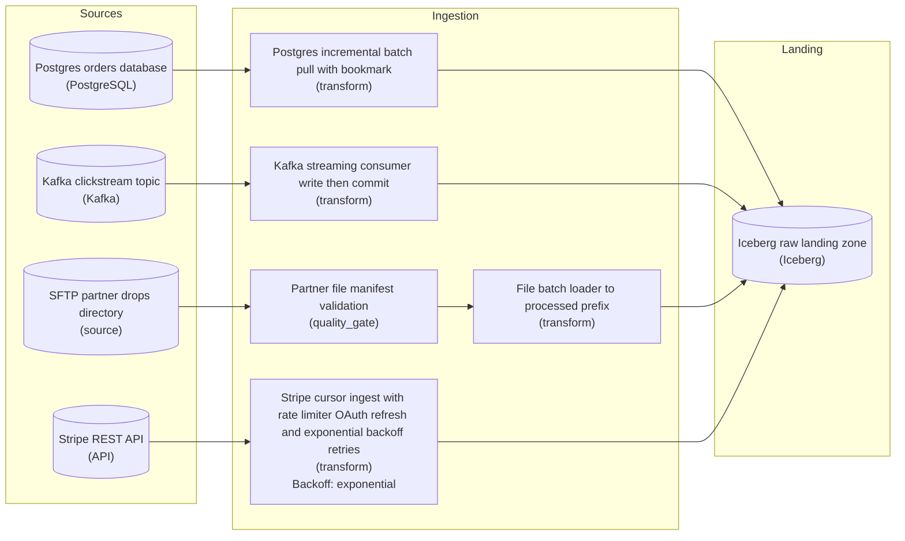

*Each source keeps its own resume state; all four commit into one Iceberg raw zone, and the Stripe ingest retries 429 and 5xx with exponential backoff.*

1. **Pull Postgres incrementally with a bookmark**

   You don't re-read the whole `orders` table each run. You keep a bookmark, the high-water mark of the last row you pulled (an `updated_at` timestamp or a monotonic `id`), and each run selects `WHERE updated_at > :bookmark`. The decision that bites: advance the bookmark only AFTER the batch has committed to Iceberg, not when the query returns. If you move it first and the write dies, those rows are gone forever, no source of truth will hand them back. Bookmark-after-commit is what makes the pull idempotent under a crash.

2. **Consume Kafka write-first, commit-after**

   Kafka is the one push source here, so its consumer is a streaming job with no query you control, only an offset you advance. The ordering is the whole game: write the records to Iceberg FIRST, then commit the consumer offset. Do it the other way and a crash between commit and write silently drops a batch, because Kafka thinks you already have it. If vendor webhooks join later, the same rule holds: route them into a queue like this topic rather than writing them straight to the lake.

3. **Validate SFTP files by manifest, then move to processed/**

   A file drop gives you no offset and no cursor, just files appearing in `partner_drops`. So you make the filesystem itself the state. Read the manifest to know which files and how many rows to expect, validate each file against it (row counts, checksums, schema) before the loader trusts a byte, land the good ones, then MOVE each processed file to a 'processed/' prefix. The move is the idempotency key: next run only sees what's still in the inbox, so a re-run after a partial failure never double-loads a file that already landed.

4. **Page the Stripe API with a cursor and defend the connection**

   The API hands you rows a page at a time, so the cursor Stripe returns is your resume state: you follow `has_more` and the next cursor until it's exhausted. But an API is a shared, throttled, authenticated resource, so the ingest is mostly defense: a rate limiter to stay under the quota, OAuth token refresh so a mid-run expiry doesn't abort the pull, and exponential backoff retries on 429 (rate-limited) and 5xx (server) responses. Persist the cursor after each page commits, same rule as the bookmark, so a backoff that eventually gives up resumes from the last good page.

| Key insight: One rule wearing four costumes |
| --- |
| The bookmark, the offset commit, the move to 'processed/', and the saved cursor are the same idea in four dialects: record durable progress only AFTER the data is safely in Iceberg. That ordering is what idempotency and resumability actually mean in ingestion. Get it right and every source becomes replay-safe; get the order backwards on any one of them and that source leaks data on the next crash. |

| Pitfall: Committing before you land |
| --- |
| The mistake that shows up on every one of these: advancing the resume marker first because it feels like 'starting' the batch. Committing the Kafka offset before the write, bumping the `updated_at` bookmark when the query returns, deleting the SFTP file on read, saving the cursor before the page lands. Each one turns a routine restart into silent data loss. The marker is a receipt for work finished, never a ticket for work started. |

| Real world: Why one Iceberg raw zone, not four |
| --- |
| Four writers landing concurrently is exactly why the raw zone is a table format like Iceberg rather than loose files. Its atomic snapshot commits mean a half-written batch never becomes visible, snapshot isolation lets the four ingestors commit without stepping on each other, and schema evolution absorbs a new Stripe field or partner column without a rewrite. A folder of Parquet gives you none of that, and readers would catch partial batches mid-write. |

**Follow-up questions**

1. The SFTP partner sends the same file twice with a new name. How does the 'processed/' move protect you, and what would you add if it didn't?\
   *Tests whether idempotency is understood as content-level, not just filename-level (checksum dedupe in the manifest step).*
2. Stripe backoff exhausts its retries mid-run. On the next run, what guarantees you resume without gaps or duplicates?\
   *Tests that the cursor is persisted per-committed-page, not per-run.*
3. Why can't the Kafka consumer use the same schedule-and-bookmark loop as Postgres?\
   *Tests the batch-vs-streaming distinction: push has no queryable high-water mark you control, only an offset to commit.*

</details>


<br>

---

## File Drop Ingestion

A file drop is a push with the slowest rhythm. A partner, a bank or another team writes files to a bucket or shared folder you can read, on a schedule they control. Your job notices the files, checks them, loads them, and remembers that it did. Each step can go wrong, and the fixes are conventions you agree with the partner before the first file lands.


<br>

### The half-written file

Uploading a 2GB file takes minutes. A job that lists the folder at 02:03 and finds `settlements_2026-10-22.csv` cannot tell whether the upload finished or whether the file holds the first 1.3GB of 2. Loading it produces a row count that passes any loose check and a daily total short by a third.

Two conventions solve this; ask the partner for at least 1. With write-then-rename, the partner uploads to `settlements_2026-10-22.csv.tmp` and renames it when the upload ends, and your job ignores anything ending in `.tmp`. With a sentinel, an empty file named `_SUCCESS` by convention is written only after every data file in the batch has landed; if it is missing, your job exits and tries again on its next schedule.


<br>

### The manifest

A sentinel says the batch is complete. A manifest says what complete means: a small file listing every data file in the batch with its row count and a checksum. With a manifest your job can prove it received the batch the partner sent, rather than whatever happened to be in the folder when it looked.

```sql
{
  "batch_date": "2026-10-22",
  "generated_at": "2026-10-23T01:47:12Z",
  "files": [
    {
      "name": "settlements_2026-10-22_part1.csv",
      "rows": 184220,
      "sha256": "9f2c7a..."
    },
    {
      "name": "settlements_2026-10-22_part2.csv",
      "rows": 184301,
      "sha256": "41be03..."
    }
  ],
  "total_rows": 368521
}
```

```sql
def load_batch(folder, store):
    if not folder.exists("_SUCCESS"):
        return "waiting"
    manifest = folder.read_json("manifest.json")
    checksums = [f["sha256"] for f in manifest["files"]]
    if store.already_loaded(manifest["batch_date"], checksums):
        return "already loaded"
    all_rows = []
    for entry in manifest["files"]:
        name = entry["name"]
        if not folder.exists(name):
            raise ValueError(f"missing file: {name}")
        if folder.sha256(name) != entry["sha256"]:
            raise ValueError(f"{name}: checksum does not match manifest")
        rows = folder.read_csv(name)
        if len(rows) != entry["rows"]:
            raise ValueError(f"{name}: expected {entry['rows']} rows, got {len(rows)}")
        all_rows.extend(rows)
    store.replace_partition("raw.settlements", manifest["batch_date"], all_rows)
    store.record_loaded(manifest["batch_date"], checksums)
    return "loaded"
```

A missing file, a checksum that differs from the manifest, or a row count that differs from it raises and blocks the load: the manifest and the data disagree, and loading either version in silence would be wrong. Replacing the whole `batch_date` partition makes a rerun safe. Recording the checksums means a partner who re-uploads yesterday's batch, sentinel and all, triggers a run that reads the manifest and stops.


<br>

### Defensive validation

| Check | What it catches | Action |
| --- | --- | --- |
| Sentinel present | A batch still uploading | Wait, retry next schedule |
| Every manifest file exists in the folder | A file lost in transfer | Block, alert the partner |
| Row count equals the manifest | A truncated or half-written file | Block |
| Header matches expected columns | A renamed or reordered column | Block on rename, warn on an added column |
| File is not empty | The partner's export produced nothing | Block |
| Checksums not seen before | A re-upload of an old batch | Skip and log |

The header check is the schema drift lesson applied to files. A CSV carries its column names in line 1. A partner who adds `currency` at the end has made a backward-compatible change you accept with a warning; one who renames `amount` to `amount_cents` has broken the contract, and you stop and talk before loading a row of the new shape.

> **TIP**
>
> Ask for the manifest and the sentinel before the first file arrives. A partner who has shipped 6 months of files without them will resist changing a process that works for them.

**A bank drops 3 settlement files nightly plus _SUCCESS. On Thursday the sentinel appears and the manifest lists 3 files, but only 2 are in the folder, and the row counts of those 2 match the manifest. What should the loader do?**

- **A.** Load the 2 files that match and leave the partition short, since the sentinel proves the bank considers the batch finished.
- **B.** Wait for the third file, because the bank's transfer is still in progress and the file will appear within the next schedule.
- **C.** Load the 2 files and record the batch as loaded, so Friday's run picks up the third file as part of Friday's batch.
- **D.** Block the load and alert: the sentinel says the batch is complete, but the manifest and the folder disagree, so a file was lost after the bank's export finished.

<details>
<summary>Solution</summary>

**D.** Block the load and alert: the sentinel says the batch is complete, but the manifest and the folder disagree, so a file was lost after the bank's export finished.

The manifest lets you distinguish a late upload from a lost file. Here the evidence points at loss, which needs the bank, so the run stops and says so.

**Why the others are wrong**

- **A.** The sentinel claims completeness, and the folder contradicts it. Loading a partial batch hides a lost file inside a total that looks finished.
- **B.** The sentinel is written after every data file, so the bank's side is done. Waiting would never resolve a file lost in transfer.
- **C.** Friday's manifest lists Friday's files. The missing file belongs to Thursday, and marking Thursday loaded hides the gap.

</details>


<br>

---

## Pipeline Architecture

### Exercise 1 of 2

**● TASK**

A delivery fleet's trucks push GPS pings as events into a Kafka topic, and a fuel vendor drops one CSV of the day's fuel purchases into a landing folder each night. Dispatchers need each truck's position on a live map within one minute of its ping, while finance reads fuel spend only in a morning report. Name each source's ingestion shape, then design both paths, choosing batch or streaming for each.

<details>
<summary><strong>Solution</strong></summary>

#### Shape tells you how data arrives; the deadline picks batch or streaming

Ingestion shape comes from 2 questions: who decides when the data moves, and whether it arrives as discrete events or as one bulk artifact. The GPS pings are source-initiated events, which makes them **push ingestion**. The fuel CSV is source-initiated too, but it is a single bulk file, which makes it a file drop. Once each shape is named, the reader's freshness need settles the processing: a stream for the map, a nightly batch for finance.

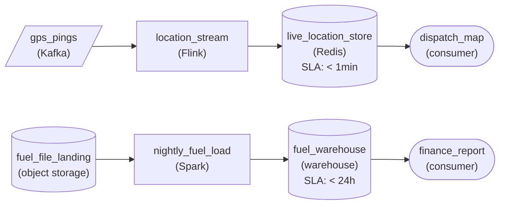

*Push path: `gps_pings` streams through `location_stream` to the map within a minute. File drop path: `fuel_file_landing` loads nightly into `fuel_warehouse` for the morning report.*

1. **Name each source's shape**

   Neither source waits to be polled: both push. What differs is the artifact. Thousands of small pings arrive all day, while one CSV arrives once a night. So the ping topic feeds a processor that reads continuously, and the landing folder feeds a job that runs once the file exists.

2. **Let each reader's deadline choose batch or streaming**

   A dispatcher rerouting a truck needs its position within a minute, so `location_stream` consumes events as they arrive and writes to a store held to '< 1min'. Finance reads once each morning, so `nightly_fuel_load` runs as a batch after the file lands and fills a warehouse held to '< 24h'.

| Pitfall: One cadence for both paths fails a reader |
| --- |
| Putting both sources on the same nightly job leaves the map hours stale. Putting the fuel file on a stream buys nothing: the file arrives once, the processor idles all day waiting for it, and finance still reads it in the morning. |

**Follow-up questions**

1. What changes if the vendor starts sending each fuel purchase as an event the moment it happens?\
   *How a change of shape at the source changes the ingestion path even when the reader's deadline stays the same.*
2. Would you still stream the pings if dispatchers could live with a 30-minute-old position?\
   *Where the line between streaming and a frequent batch sits once the deadline relaxes.*

</details>


<br>

### Exercise 2 of 2

**● TASK**

A clinic-booking MySQL database has two tables to pull nightly into a raw landing zone: clinics, 3,000 rows with no change-tracking column, and appointments, 900 million rows with a reliable updated_at column and about 2 million changes a day. A full scan of appointments takes seven hours, longer than the nightly window. Design the pull for each table, choosing full or incremental for each.

<details>
<summary><strong>Solution</strong></summary>

#### Pick the flavor per table, not per database

Full versus incremental is a decision you make per table, and these two tables land on opposite sides of it. `clinics` is 3,000 rows with no change-tracking column: reading it whole costs seconds, and it is the only way to be sure every admin edit arrives. `appointments` is 900 million rows, and its full scan blows the window. Because it has a reliable `updated_at`, the pull reads only rows past the last successful watermark, about 2 million a night, so its cost follows the change rate instead of the table size.

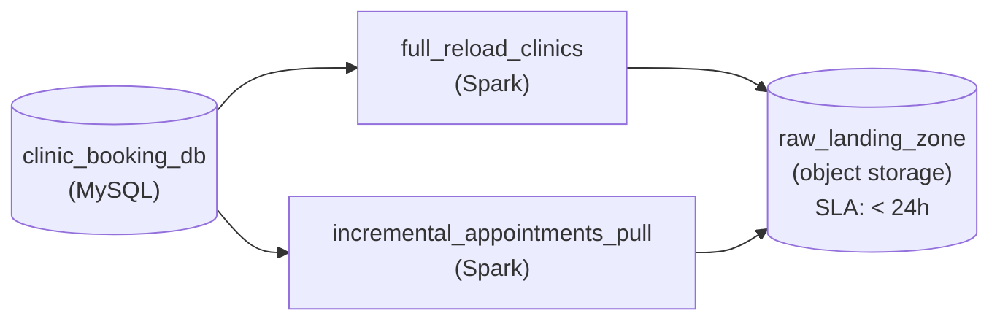

*Both pulls read `clinic_booking_db` and land nightly in `raw_landing_zone`: `clinics` in full, `appointments` past its `updated_at` watermark.*

| Pitfall: One flavor for the whole database fails one of the tables |
| --- |
| Making everything incremental breaks `clinics`: with no change column there is no watermark, and admin edits silently never arrive. Making everything full brings back the seven-hour scan on `appointments`. Two tables in one MySQL database are still two decisions. |

| Key insight: Advance the watermark only after the write lands |
| --- |
| The incremental pull filters on `updated_at` greater than the stored watermark and records the new high-water mark only once the batch is safely in the landing zone. If a night fails, the next run starts from the old mark and picks up both nights of changes. |

| Performance: Two million rows, not nine hundred million |
| --- |
| About 2 million changed rows a night is roughly 0.2 percent of `appointments`, so the incremental pull reads a sliver of the table and stays flat as history grows. The full read of `clinics` is cheap enough that its simplicity wins. |

**Follow-up questions**

1. What changes if `clinics` grows to 50 million rows and still has no change-tracking column?\
   *When full reload stops being cheap, and why the fix starts at the source table.*
2. What if `appointments` rows could be hard-deleted?\
   *Why an `updated_at` watermark cannot see a row that no longer exists.*

</details>


<br>

---

## API Ingestion: The Bug Magnet

An API pull looks like a database pull with a web request in place of a query, and the differences are what break it. A vendor's endpoint answers 1 page at a time, against data that changes between pages, behind a limit on how often you may ask, maintained by a team that does not know your job exists.


<br>

### Pagination: offsets drift, cursors do not

A vendor with 23,000 campaigns returns 100 per request, newest first. Offset pagination asks for `offset=0`, then `offset=100`, and so on for 230 requests. A campaign created while you are on page 40 lands on page 1 and pushes every later record down 1 position, so the last record of page 40 becomes the first of page 41 and you load it twice. A deletion above your page shifts records up and you skip 1. With an oldest-first sort, a new campaign lands at the end and repeats nothing.

Cursor pagination returns an opaque token with each page that means continue after this record, so inserts and deletes elsewhere cannot move your position. When a vendor offers both, use the cursor, and store it after each page's write, so a job that dies on page 180 resumes there.

Offset pagination

| Request | Returns |
| --- | --- |
| ?offset=0&limit=100 | records 1 to 100 |
| ?offset=100&limit=100 | records 101 to 200, shifted if an insert landed |
| ?offset=200&limit=100 | records 201 to 300, 1 may repeat or be skipped |

Cursor pagination

| Request | Returns |
| --- | --- |
| ?limit=100 | 100 records and cursor c1 |
| ?limit=100&after=c1 | the 100 after c1 and cursor c2 |
| ?limit=100&after=c2 | the 100 after c2 and cursor c3 |


<br>

### Rate limits: the vendor's 429

Vendors commonly cap requests, say 600 per minute per account. The 601st gets status `429` and often a `Retry-After` header saying how many seconds to wait. A `429` is a transient failure: retry with exponential backoff, and when the header is present use its number instead of your own. Hammering a vendor that has told you to wait can get API keys suspended.

```sql
import time


def fetch_all(client, state):
    cursor = state.read_cursor("campaigns")
    delay = 1
    while True:
        response = client.get("/campaigns", params={"limit": 100, "after": cursor})
        if response.status == 429:
            wait = int(response.headers.get("Retry-After", delay))
            time.sleep(wait)
            delay = min(delay * 2, 60)
            continue
        response.raise_for_status()
        page = response.json()
        if not page.get("ok", True):
            raise RuntimeError(f"vendor returned 200 with error: {page.get('error')}")
        write_replace_by_key(page["data"], table="raw.campaigns", key="campaign_id")
        delay = 1
        cursor = page.get("next_cursor")
        if cursor is None:
            state.write_cursor("campaigns", None)
            return
        state.write_cursor("campaigns", cursor)
```

Four things keep the loop honest. The `429` branch sleeps for the vendor's number when present and doubles its own otherwise, capped at 60 seconds. The `ok` check reads the body, because some vendors return `200` with an error inside. The cursor is written only after the page's rows land, so a crash resumes on the failed page. On the last page the stored cursor is cleared, because it exists to resume one crawl: left in place, it would start the next hourly run at the final page, and the other 22,900 campaigns would never be re-read.


<br>

### The failure modes vendors create

What vendors change underneath you

- A page cap: the endpoint returns an empty page for any offset of 10,000 or more, so a 23,000-record pull stops at record 10,000 with no error.
- A field that turns nullable: budget_cents was always present, then 1 campaign returns null and the integer cast fails on page 77.
- A timeout on page 230 with no cursor stored, so the retry re-crawls from page 1 and spends the rate limit on pages it already loaded.

| ✓ Do | ✗ Don't |
| --- | --- |
| • Pull by updated_since when offered, with a few minutes of overlap<br><br>• Honor Retry-After before applying your own backoff | • Retry a 401 or 403: the credential is wrong and waiting cannot fix it<br><br>• Parse timestamps without confirming the vendor's timezone in writing |


<br>

### Practice: the drifting count

**Your hourly campaign pull uses offset pagination over a newest-first list and appends rows to raw.campaigns. Row counts run 2 to 5 higher than the vendor's dashboard most hours, never lower. What explains it?**

- **A.** The rate limit makes retried pages load twice. Honor Retry-After before backing off and the counts will match.
- **B.** Campaigns created during the pull push later records down 1, so a boundary record repeats, and the append keeps both copies.
- **C.** Deleted campaigns shift records the other way, so each deletion causes a skipped record and the count drifts upward.
- **D.** The high-water mark advanced before the write, so each run re-pulls the previous hour and loads it twice.

<details>
<summary>Solution</summary>

**B.** Campaigns created during the pull push later records down 1, so a boundary record repeats, and the append keeps both copies.

Inserts at the top of a newest-first list cause repeats, and an append cannot collapse them. Switch to the cursor and replace by campaign_id.

**Why the others are wrong**

- **A.** A 429 response carries no data, so a retried page loads once. The limit slows the job without duplicating rows.
- **C.** A skipped record lowers the count, so deletions would leave the table short, and the symptom is a surplus.
- **D.** This job has no high-water mark, and re-pulling a whole hour would add far more than 2 to 5 rows.

</details>


<br>

### Capstone: the webhook outage

**A payments vendor offers webhooks and an events API that returns the same events under the same event_id, with cursor pagination and an updated_since filter. Your webhook endpoint, which enqueues to a queue, was down for 40 minutes on Monday from 14:00, and the vendor's retries for that window are exhausted. Which approach restores Monday's data?**

- **A.** Ask the vendor to replay the webhooks from 14:00 onward, since it keeps a per-customer offset and can resend from any position.
- **B.** Rerun the queue consumer from the offset it held at 14:00, because the queue retained every event from the outage.
- **C.** Pull the events API with updated_since set to 13:50 and write with replace by event_id, so lost events arrive and landed ones are overwritten with identical copies.
- **D.** Wait for the vendor's nightly settlement file and load it over the webhook table, since it holds every event of the day.

<details>
<summary>Solution</summary>

**C.** Pull the events API with updated_since set to 13:50 and write with replace by event_id, so lost events arrive and landed ones are overwritten with identical copies.

The API is the backfill path webhooks lack. It returns the webhook's own events and ids, so the replace lines up, and the 10-minute overlap guards the boundary.

**Why the others are wrong**

- **A.** A webhook vendor keeps no offset for you, and its retries for this window have run out, so there is no position to resend from.
- **B.** The endpoint was down, so nothing reached the queue. Replaying it reprocesses events that already landed and recovers none.
- **D.** This design has no file drop, and a settlement file carries settled amounts rather than the event stream.

</details>


<br>

### Capstone: 4 sources, 4 markers

**Four sources feed a new raw layer: the orders database, a payment event queue, a bank's nightly files, and an ads vendor's cursor-paginated API. Which set of progress markers is right for all 4?**

- **A.** Orders: high-water mark on updated_at. Queue: the committed offset. Files: checksums of each loaded batch. API: the cursor written after each page's rows land.
- **B.** Orders: the committed offset. Queue: high-water mark on updated_at. Files: the last cursor returned. API: checksums of each loaded batch.
- **C.** Orders: high-water mark on updated_at. Queue: high-water mark on the event timestamp. Files: the presence of the sentinel. API: the page number last fetched.
- **D.** Orders: a hash of the whole table. Queue: the committed offset. Files: checksums of each loaded batch. API: the offset value last fetched.

<details>
<summary>Solution</summary>

**A.** Orders: high-water mark on updated_at. Queue: the committed offset. Files: checksums of each loaded batch. API: the cursor written after each page's rows land.

Each marker matches its shape and moves only after its write, the rule every section repeated.

**Why the others are wrong**

- **B.** Every marker sits on the wrong shape: a database has no offsets, a queue has no updated_at you control, and files have no cursor.
- **C.** Event timestamps arrive out of order, so a timestamp mark skips late events; a sentinel records nothing about loading; page numbers drift.
- **D.** A table hash says something changed but not which rows, so it cannot drive an incremental pull, and an offset marker inherits offset drift.

</details>


<br>

---

## Pipeline Architecture

### Exercise 1 of 2

**● TASK**

A support-ticketing SaaS vendor pushes ticket events to our webhook at whatever rate it likes, up to 2,000 per second during its outages, and redelivers any event we do not acknowledge within 5 seconds. Design push ingestion that accepts each webhook into a queue first, then has a consumer group land the events in a raw event store, with duplicate redeliveries removed before landing.

<details>
<summary><strong>Solution</strong></summary>

#### Webhooks push, so a queue absorbs the rate

A webhook is push ingestion at its most direct: the vendor decides when events arrive and how many, and your pipeline has no say in the cadence. The handler's only job is to append each event to a Kafka topic and return success inside the vendor's 5-second window. A consumer group then reads that topic at its own pace, tracking its offset, so a burst of 2,000 events per second simply piles up in the log instead of timing out the endpoint.

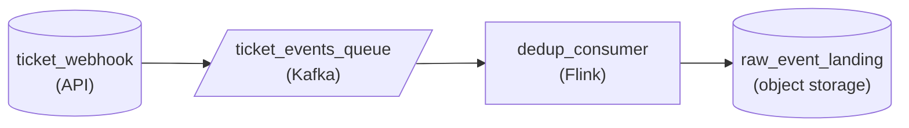

*`ticket_webhook` appends to `ticket_events_queue`; `dedup_consumer` drops repeated event ids and lands the rest in `raw_event_landing`.*

1. **Acknowledge by appending, not by processing**

   Appending to a topic takes milliseconds no matter how busy the rest of the pipeline is. That is what keeps you inside the 5-second window, and the broker's retention means nothing is lost while the consumer catches up after a burst.

2. **Drop redeliveries by event id before landing**

   The vendor resends anything it thinks failed, so the topic will hold the same event more than once. The consumer remembers the event ids it has already landed and skips repeats, which keeps one row per ticket event in the raw store.

| Pitfall: Work inside the handler times out under bursts |
| --- |
| Writing straight from the webhook handler into storage looks simpler, but during an outage burst the writes slow down, acknowledgements miss the window, and the vendor floods you with redeliveries of events you already stored. |

| Key insight: Write first, commit the offset second |
| --- |
| The consumer lands each event before committing its offset. A crash between the two replays a few events on restart, and the deduplication step absorbs them. The reverse order would silently skip events instead. |

**Follow-up questions**

1. A second vendor starts pushing webhooks into the same raw store. What changes in deduplication?\
   *Whether event ids are only unique per vendor.*
2. The consumer is down for 9 days. What happens to the events?\
   *How the topic's retention period bounds recovery.*

</details>


<br>

### Exercise 2 of 2

**● TASK**

A shipping carrier drops hourly CSV files of parcel scans into an object storage landing prefix; some files are still half-written when listed, and the column layout occasionally changes. Design the file drop ingestion: keep a manifest so each file loads once, check every file's schema before loading, route rejected files to a quarantine store, and land good files in the warehouse within two hours.

<details>
<summary><strong>Solution</strong></summary>

#### The manifest decides what gets loaded

File drop ingestion makes a partner's habits into your pipeline's input. The part that keeps it trustworthy is the **manifest**: a durable record of which files have already loaded. Each hourly run lists the landing prefix, subtracts what the manifest says is done, and only touches what remains. Two other problems arrive with the files themselves. A file can be listed while it is still uploading, and a file's columns can stop matching the hour before.

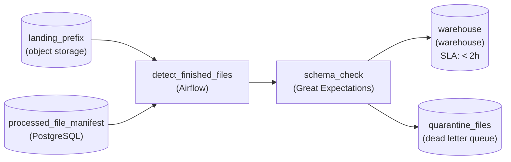

*Each hourly run diffs `landing_prefix` against `processed_file_manifest`, takes only finished files, checks each file's schema, and splits it to `warehouse` or `quarantine_files`.*

1. **Consult the manifest before reading anything**

   The run's first job is a set difference: files in the prefix minus paths in `processed_file_manifest`. That is what turns an hourly listing into incremental pickup. Moving each loaded file to a `raw/processed/` prefix is the same idea in another form, because the folder itself becomes the record of what is done.

2. **Take only files that finished uploading**

   A listing cannot tell a complete 40 MB file from one that is halfway through its upload. Wait for the partner's completion marker, or for a size that stays the same across two listings, before reading a file. Then write its manifest entry only after the load commits. A failed run leaves the file unrecorded, and the next hour picks it up again.

3. **Check the schema per file, not per run**

   Every file can carry its own layout, so `schema_check` compares each file's header against the expected columns on its own. A mismatch sends that one file to `quarantine_files` for review while the rest of the hour loads normally. One renamed column does not stall the warehouse, and the bad file does not disappear either.

| Pitfall: Recording a file before it loads loses it for good |
| --- |
| If the manifest entry is written when a file is picked up and the load then fails, every later run treats it as done. That is the silent-loss half of a buggy manifest, and nothing alerts on it. Record the path only after the warehouse write succeeds. |

**Follow-up questions**

1. What happens if the run crashes after the warehouse write but before the manifest entry is recorded?\
   *Tests whether the learner sees the duplicate half of a buggy manifest and how an idempotent load would absorb a reload.*
2. How would the design change if the partner moved from an object storage prefix to an SFTP directory?\
   *Tests whether manifest pickup and the per-file check stay the same when only the landing location changes.*

</details>


<br>

---

## Putting It All Together

A ride-hailing company launches in a new country. Trips come from its own trips database on a read replica, driver payouts arrive as webhooks from a local payments provider, the tax authority receives a nightly fares file and drops a nightly file of adjustments back into a shared bucket, and the mapping vendor exposes an hourly API of road closures. One raw layer, all 4 shapes, and a launch-day dashboard that has to be right by 07:00 on the first morning.

- The trips pull uses a high-water mark on updated_at with a 10-minute overlap, writing with replace by trip_id , so a failed night is rerun by leaving the mark where it was.
- The payout webhooks go through an endpoint that only verifies and enqueues; the consumer behind the queue writes with replace by event_id and commits its offset last, and the provider's API with updated_since backfills any outage.
- The adjustments file is loaded only when _SUCCESS is present, checked row by row against the manifest, blocked on a count mismatch, and replaced as one partition per batch date.
- The road closures pull follows the cursor, stores it after each page lands, sleeps for the vendor's Retry-After on a 429, and reads the body for an error before trusting a 200.
- All 4 jobs answer the same questions from the first section: where did I stop, what if it arrives twice, how do I know it is complete, and what do I do with a record that fails a check.


<br>

---

## Pipeline Architecture

### Exercise 1 of 2

**● TASK**

Design an API ingestion pipeline that pulls contacts from a CRM's REST API every hour into a raw landing zone. The API pages results with an opaque cursor and returns HTTP 429 above 10 requests per second. Contacts are edited constantly, so each run pulls only records updated since the last successful run, and rerunning an hour must not duplicate rows in the raw zone.

<details>
<summary><strong>Solution</strong></summary>

#### Cursors, backoff and an hour you can pull twice

API ingestion is a pull, the same idea as reading a database incrementally, except every request travels over HTTP through a rate limit the vendor controls. That is why the design lives in a few settings on 2 stages: how the pull pages, what it does when the API says slow down, and how the landing store behaves when the same hour arrives twice.

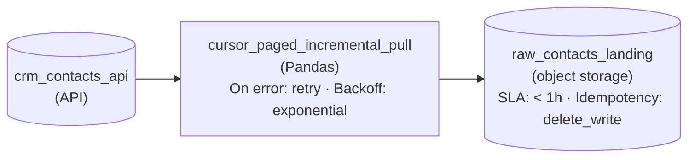

*The pull walks the cursor and retries 429s with backoff; the landing rewrites each hour it receives.*

1. **Page with the cursor the API hands back**

   Each response carries an opaque cursor, and the next request submits it. The cursor encodes the position, so a contact edited mid-run cannot shift which records sit on which page. The updated-since bound is a second, separate cursor: it scopes the run, while the page cursor walks inside it.

2. **Treat HTTP 429 as a wait, not a failure**

   At 10 requests per second the API pushes back well before the job runs out of work. Setting the pull's error action to `retry` with `exponential` backoff turns a 429 into a short pause. Failing on the first one throws away every page already fetched.

3. **Make the hour safe to pull twice**

   The starting point advances only after a run lands cleanly, so a failed run is retried from the same place and re-fetches contacts it already wrote. `delete_write` on `raw_contacts_landing` clears that hour and rewrites it, so 2 runs leave one copy.

| Pitfall: Page numbers drift while contacts are being edited |
| --- |
| With `page=1`, `page=2` ordered by update time, a contact edited during the run jumps to the end, and everything behind it slides back a slot: one contact is skipped and the edited one shows up twice. Paging by since and until on update time breaks the same way. The opaque cursor is the style that holds still. |

**Follow-up questions**

1. The CRM adds an endpoint for deleted contacts. How do deletes reach the raw zone?\
   *Extends the incremental pull to a second endpoint with the same paging, retry and rerun behavior.*
2. A one-time backfill needs every contact ever created. What does the rate limit do to that run?\
   *Sizing a full pull against 10 requests per second and 100 contacts per page.*

</details>


<br>

### Exercise 2 of 2

**● TASK**

Design a nightly batch pipeline that lands three inputs in a raw landing zone, read once each morning. A PostgreSQL rentals table holds 90M rows, gains about 400K new or changed rows a day and carries a last-updated timestamp: pull it incrementally, reading only rows changed since the last run. The same database's 600-row branches table has no change column, so reload it in full every night. An insurance partner drops a daily CSV of damage claims into an object storage prefix, and some files are still uploading when the run starts: land only complete files.

<details>
<summary><strong>Solution</strong></summary>

#### Match the load to how the data changes

Choosing between a full and an incremental load is a question about how each table changes, not about which pattern is more advanced. The rentals table is 90M rows and moves by about 400K a day, so a nightly rescan reads 225 times more than changed. The branches table is 600 rows with nothing to track changes on, so a **full reload** is both the simplest and the only correct option. The partner file is the third shape in the same run, and its risk is different: a half-uploaded file looks exactly like a finished one.

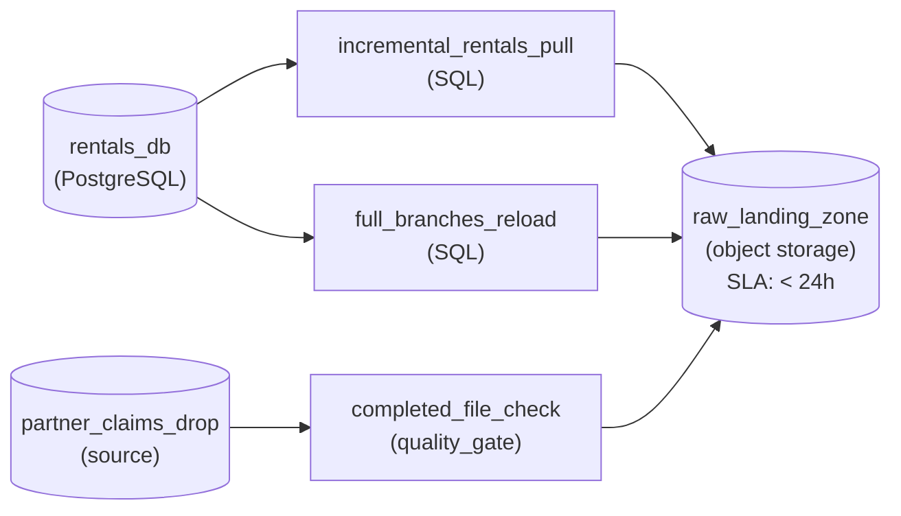

*2 pulls from one database, one incremental and one full, plus a checked file drop, all landing nightly in `raw_landing_zone`.*

1. **Watermark the rentals pull on `updated_at`**

   Each run selects rows whose `updated_at` is later than the stored watermark, lands them, then records the largest `updated_at` it saw as the next watermark. Advance the watermark only after the landing write succeeds: a run that dies halfway re-reads the same window the next night instead of skipping it. That is about 400K rows a night instead of 90M.

2. **Reload `branches` in full**

   With no change column there is no way to ask what changed, and at 600 rows there is no reason to. Overwrite the whole snapshot each night: a renamed or closed branch is simply correct in tomorrow's copy.

3. **Land only finished claim files**

   The run starts while some partner uploads are still in flight. A completeness check between the drop and the landing zone accepts a file only once its upload has finished (the partner's done marker), and leaves unfinished files for the next run.

| Pitfall: Watermarking on insert time misses every update |
| --- |
| A watermark on `created_at` looks right on day one and quietly goes stale: a rental that is returned or re-billed keeps its old creation time, so the change never reaches the raw zone. The column you watermark on must move whenever the row does. |

**Follow-up questions**

1. What changes if rentals start being hard-deleted instead of marked cancelled?\
   *An incremental pull only sees rows that still exist, so deletes need another signal or a periodic full comparison.*
2. The `branches` table grows to 50M rows but still has no change column. Now what?\
   *Whether a full reload still fits the nightly window, and what you would ask the source team to add.*

</details>


<br>

---

## Key Takeaways

- Ingestion comes in 4 shapes, sorted by who initiates and what unit arrives: database pull, queue or webhook push, file drop, and API pull.
- Every shape stores a progress marker, and the marker moves only after the write succeeds: high-water mark, committed offset, loaded checksums, cursor.
- Duplicates are the price of a safe progress marker. Replace by key absorbs them; append keeps every copy.
- Completeness needs a signal the data cannot give by itself: a frozen upper bound, a sentinel plus a manifest, or a page with no next cursor.
- A webhook endpoint verifies, enqueues and replies. The parsing and writing belong to a consumer behind a queue.
- Cursors beat offsets, Retry-After beats your own backoff, and a 200 whose body says error is still a failure.
