Intermediate·Pipeline Architecture · 32 min · 12 challenges

# Ingestion Patterns: Intermediate

Netflix keeps search indexes in sync with production databases. When a title is pulled from the catalog, a poller asking for recently changed rows never learns the row was deleted, so the title stays searchable. Re-dumping the table under a lock would stall writes. Netflix engineers published a framework that reads the database's change log and dumps existing rows without locks. This lesson builds that design for an `orders` table.


<br>

---

## Full, Incremental, and Bookmarks

Every ingestion run against a database first decides which rows to read. A full load reads every row and replaces the target copy. An incremental load reads only rows changed since the previous run and merges them into the target by primary key, which depends on a small piece of saved state.


<br>

### Full load: read everything, replace everything

A full load runs a `SELECT` over the whole table and overwrites the target. Correctness comes built in. Every change shows up, hard deletes included, because the target becomes an exact copy as of the read, and the next run repairs a bad one. The cost grows with the size of the table, whatever the amount of change. The `stores` table has 1,800 rows; the `orders` table has 40 million, and a nightly full load reads all of them even on a day when only 300,000 changed.


<br>

### Incremental load: read only what changed

An incremental load needs a column that moves forward every time a row changes: usually `updated_at`, set by the application on each write, or an ever-growing `id` for tables that only receive inserts. Each run reads rows past the point the previous run reached and upserts them by primary key. The column needs an index on the source, or every small run still scans the whole table to find its rows.

- **25 min** — nightly full load of orders
- **4 s** — hourly incremental run on orders

Incremental loads have 2 blind spots. A hard delete removes the row, so its `updated_at` never moves again and the target keeps the order forever. A write that skips `updated_at`, such as a bulk fix run by hand, is invisible too. Teams cover both with a periodic full comparison, or by moving to change data capture, the next section's subject.

| ✓ Full load | ✗ Incremental load |
| --- | --- |
| • Reads every row on every run<br><br>• Catches every change, hard deletes included<br><br>• Needs no change-tracking column<br><br>• The next run repairs a bad run<br><br>• Cost grows with table size | • Reads rows changed since the bookmark<br><br>• Misses hard deletes and untracked writes<br><br>• Needs a reliable updated_at or growing id<br><br>• Needs a bookmark store and a keyed upsert<br><br>• Cost grows with change volume |


<br>

### The bookmark store

The point an incremental load has reached is its bookmark, also called its high-water mark. It is the only state carried between runs, so where it lives and when it is written decide whether rows get lost. A bookmark in a file on the worker vanishes when the worker is replaced. Keep it in a small table in a durable database.


Each run inserts a row holding both bounds of its window. The history buys 2 things over a single overwritten value: a backfill of a bad hour replays exactly that run's window, and gaps between consecutive windows show up in a query. The next run starts from the latest row.

```sql
SELECT
  high_bound
FROM ingest_bookmarks
WHERE source_table = 'orders'
ORDER BY run_id DESC
LIMIT 1
```

#### Write the bookmark last

The run loads and commits its window first, and only after that commit does it insert its bookmark row. If the worker dies between the data commit and the bookmark insert, the next run reads the old bookmark and loads the same window again; the upsert by primary key makes that replay harmless. Reverse the order, and a crash after the bookmark insert skips the window forever, with no error anywhere.


<br>

### The bounded query

The tempting query filters `WHERE updated_at > :bookmark` and saves the largest `updated_at` it saw as the next bookmark. That loses rows. The application stamps `updated_at` when the statement runs, but other sessions see the row only once its transaction commits. A transaction that stamps 09:59:58 and commits at 10:00:03 is invisible to a query running at 10:00:01. That query saves a bookmark about 10:00:00, and every later run starts after the late row.

The fix is a window whose ends are both fixed before the read starts. The lower bound is the stored bookmark. The upper bound is the run's start time minus a safety lag longer than the source's longest transaction. With a 5-minute lag, the 10:00 run stops at 09:55, and the row stamped 09:59:58 lands in the 11:00 run's window, long after its commit. An `id` bookmark has the same gap, because id 5001 can commit after id 5002; for insert-only tables, bound a `created_at` timestamp with the same lag instead.

```sql
SELECT
  order_id,
  total,
  updated_at
FROM orders
WHERE updated_at > TIMESTAMP '2026-03-14 08:55:00'
  AND updated_at <= TIMESTAMP '2026-03-14 09:55:00'
```

| Run starts | Lower bound (excluded) | Upper bound (included) | Bookmark saved |
| --- | --- | --- | --- |
| 10:00 | 08:55 | 09:55 | 09:55 |
| 11:00 | 09:55 | 10:55 | 10:55 |
| 12:00 | 10:55 | 11:55 | 11:55 |

The strict `>` on the lower bound and `<=` on the upper make consecutive windows meet with no gap and no overlap, so a row stamped exactly 09:55:00 belongs to the 10:00 run alone. The lag costs freshness: a row reaches the warehouse 5 to roughly 65 minutes after it is stamped, the lag plus up to one hourly interval.


<br>

---

## Pipeline Architecture

### Exercise 1 of 2

**● TASK**

`customers` has 2 million slowly updating rows; `orders` has 500 million rows growing 10 million a day, and its full load now takes 4 hours. Replace each extract transform with one whose name states its strategy: full reload or bookmark-driven incremental. Add a bookmark store node that the incremental extract reads before extracting and writes back to only after its rows land.

**Starting canvas** (already placed for you):

- Postgres customers (2M rows, slow updates) (source, PostgreSQL)
- Postgres orders (500M rows, +10M/day) (source, PostgreSQL)
- extract_customers (full load; fine) (transform, SQL)
- extract_orders (full load; 4-hour scan; unworkable) (transform, SQL)
- Iceberg raw landing zone (storage, Iceberg)

<details>
<summary><strong>Solution</strong></summary>

#### Full load vs. bookmark-driven incremental

The section gave you a spectrum, not a single right answer. A **full load** re-reads every row in the source table each run; a bookmark-driven incremental reads only the rows that changed since the last successful run, using a stored high-water mark. The whole exercise was picking the correct point on that spectrum per table, and the two tables here sit at opposite ends on purpose. `customers` is 2 million slow-moving rows, so a full re-read is cheap and stays correct with zero moving parts. `orders` is 500 million rows growing by 10 million a day, so re-reading the whole thing is the 4-hour scan you were asked to kill.

The tell is the ratio of new-or-changed rows to total rows. When almost every row is unchanged between runs, a full load spends nearly all its time re-copying data that already landed. `orders` changes about 2% of its volume per day (10M of 500M), so an incremental extract keyed on a monotonic column like `order_id` or `updated_at` does roughly 2% of the work. `customers` has no such pressure, so you spend the extra engineering on it only if you have to.

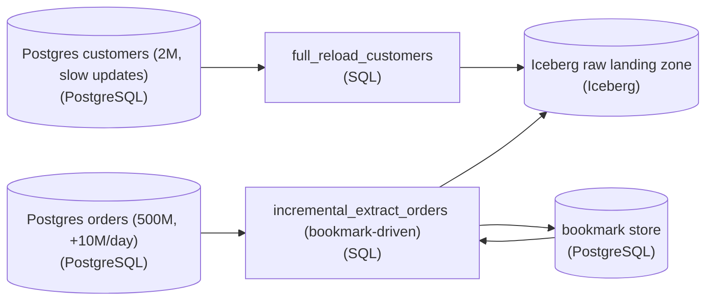

*Same source DB, two strategies. Only the orders extract reads and writes the bookmark store; customers stays a plain full reload.*

1. **Leave the small table alone**

   Replace the `customers` extract with a `full_reload_customers` transform that truncates its landing target and re-copies all 2M rows. No bookmark, no delta logic. A full reload is inherently self-correcting: any prior partial run is overwritten wholesale, so it is the simplest thing that stays correct. You add complexity only where volume forces it.

2. **Make the large table read a bookmark before it extracts**

   Replace the `orders` extract with an `incremental_extract_orders` transform that first reads the stored high-water mark from the bookmark store, then pulls only `WHERE order_id > :last_bookmark` (or `updated_at > :last_ts`). That single predicate turns the 4-hour full scan into a read of one day's worth of new rows. The bookmark store is a shared node, not a local variable, precisely so the value survives across runs and process restarts.

3. **Advance the bookmark only after the run succeeds**

   The incremental extract writes the new high-water mark to the bookmark store as its last action, after the rows have safely landed in Iceberg. Order matters: land the data, then advance the bookmark. This is what the edge from `incremental_extract_orders` back to the bookmark store represents, and it is the difference between a pipeline you can rerun safely and one that loses data on failure.

| Pitfall: Advancing the bookmark too early |
| --- |
| The mistake that looks fine until the first failure: reading the bookmark, updating it to the new max, then extracting. If the extract or the write to Iceberg crashes after the bookmark moved, those rows are now below the high-water mark forever and the next run skips them. Silent data loss. Always advance the bookmark **after** a confirmed successful land, never before. |

| Key insight: Why the bookmark makes reruns safe |
| --- |
| Because the bookmark only moves on success, a failed run leaves it untouched, so rerunning simply re-reads the same `order_id > :last_bookmark` window. As long as the land step overwrites or de-duplicates that window rather than blindly appending, running the pipeline twice produces the same result as running it once. That is what lets an on-call engineer safely retry a 2am failure instead of hand-reconciling 500M rows. |

| ✕ Full reload (customers) | ✓ Incremental (orders) |
| --- | --- |
| Re-reads all rows every run. No state to manage. Self-correcting because each run overwrites the last. Cost scales with total size, so it is fine at 2M rows and unworkable at 500M. | Reads only rows past `:last_bookmark`. Needs a durable bookmark store and a monotonic column. Cost scales with the daily delta (~10M), not the total. Correctness now depends on advancing the bookmark only after a successful land. |

**Follow-up questions**

1. What breaks if you key the bookmark on `order_id` but rows can be updated in place after insert?\
   *An append-only key misses late updates; `updated_at` is the safer high-water column when rows mutate.*
2. How would you handle the very first run, when the bookmark store has no value yet?\
   *The cold-start case: seed the bookmark to a floor value so the first incremental behaves like a bounded backfill.*

</details>


<br>

### Exercise 2 of 2

**● TASK**

Choose a CDC family for each of three Postgres sources: orders takes 10M writes/day and cannot afford trigger write doubling; shopping_cart must capture deletes, which its current query-based load misses; legacy_events sits on a hosted Postgres with no WAL access. Replace each source's ingest transform with one whose name states its CDC family (trigger-based, query-based or log-based) and the deal-breaker that ruled out the others, landing in the Iceberg raw zone.

**Starting canvas** (already placed for you):

- Postgres orders (10M writes/day; cannot afford write doubling) (source, PostgreSQL)
- Postgres shopping_cart (deletes critical; query-based misses them) (source, PostgreSQL)
- Postgres legacy_events (hosted; no WAL access) (source, PostgreSQL)
- ingest_orders (no CDC family chosen) (transform, SQL)
- ingest_shopping_cart (no CDC family chosen) (transform, SQL)
- ingest_legacy (no CDC family chosen) (transform, SQL)
- Iceberg raw landing zone (storage, Iceberg)

<details>
<summary><strong>Solution</strong></summary>

#### Matching a CDC family to each source's constraint

Change Data Capture (CDC) turns a database's ongoing inserts, updates and deletes into a change stream you can land somewhere else. The section named three families and the price each one pays. **Trigger-based** fires a database trigger on every write, so it sees deletes, but it doubles the write load. Query-based re-polls rows by a timestamp or id watermark, so it is cheap, but a row that is hard-deleted between polls vanishes with no trace to catch. Log-based reads the write-ahead log, so its overhead is near zero and it sees every change including deletes, but it needs `WAL` access. Each source here hands you one deal-breaker, and each deal-breaker is the signature weakness of a different family. No family is best everywhere; you pick the one whose weakness this source can live with.

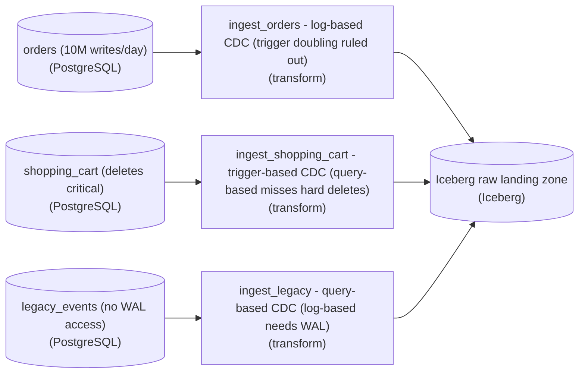

*One family per source: the deal-breaker on each source rules out a different family, and each ingest names its choice and why.*

1. **orders at 10M writes/day picks log-based**

   The constraint on `orders` is volume: 10M writes a day and no budget to double them. Trigger-based CDC is the family that doubles writes, so it would force a bigger instance and it is out. Query-based would miss hard deletes on a table this important. Log-based CDC reads the `WAL` that Postgres already writes, so it adds almost no write load however hot the table is. `ingest_orders` becomes log-based, and its name says that trigger doubling ruled out the alternative.

2. **`shopping_cart` deletes rule out query-based**

   The constraint on `shopping_cart` is that deletes are critical and the current query-based load misses them. That is query-based CDC's built-in blind spot: a row deleted between 2 polls leaves nothing to read. Trigger-based CDC fires on the `DELETE` itself and records the removal. `ingest_shopping_cart` becomes trigger-based, and you accept the write doubling because this table is far quieter than `orders`. Log-based would also work if `WAL` access is available.

3. **`legacy_events` without WAL falls back to query-based**

   The constraint on `legacy_events` is environmental: a hosted Postgres with no `WAL` access, which is exactly what log-based CDC needs. Event rows are appended rather than deleted, so query-based polling by a timestamp or id watermark is the cheap fallback that needs no special privileges. Triggers would also capture the changes here, at the cost of doubled writes.

| Pitfall: One family for every source breaks one of them |
| --- |
| The tempting shortcut is one family for all three sources, usually triggers everywhere 'to be safe about deletes.' That quietly breaks `orders`: at 10M writes/day the doubled write load is a capacity incident. The opposite shortcut, query-based everywhere because it is cheapest, is what already lost the `shopping_cart` deletes. |

| Real world: Real pipelines pick a family per source |
| --- |
| Real ingestion layers mix families. Hot transactional tables get log-based capture, a few small tables on hosts that forbid replication get triggers, and append-only logs get watermark polls. The choice is made per source and revisited when a source changes hosts or write pattern. |

**Follow-up questions**

1. If `legacy_events` starts issuing hard deletes and the host still offers no `WAL`, which family is left?\
   *Trigger-based is the delete-capturing family that needs no WAL.*
2. If `orders` moved to a hosted Postgres without `WAL` access, which family would you pick and what would you accept?\
   *Forces a trade between write doubling and missed deletes.*
3. If `shopping_cart` grew to `orders`-level write volume, would trigger-based still be the right call?\
   *Re-examines the write-doubling trade once the volume assumption changes.*

</details>


<br>

---

## CDC: The Three Families

Change data capture (CDC) turns each write to a source table, deletes included, into a change record the pipeline can apply downstream. The bounded pull from the previous section is already a crude form of it. The 3 families of CDC differ in where they find the changes: in a side table the database fills, in the table itself, or in the database's own log.


<br>

### Trigger-based: the database copies each change

A trigger is a function the database runs inside the same transaction as a write. A CDC trigger on `orders` inserts a row into `orders_changes` for every write to it, deletes included. Each of those rows records which operation ran and when, along with the key and the new values. Ingestion reads `orders_changes` with a bounded window and prunes what it has loaded. Deletes are captured, and so is every intermediate value.

The source pays for it. Every write to `orders` now performs a second write, which adds write latency and storage. Every column change to `orders` also needs a matching change to the trigger and the side table. Trigger-based CDC fits databases that expose no change log, or tables with modest write rates where nobody can get log access.


<br>

### Query-based: poll the table for changes

Query-based CDC is the bounded incremental pull run on a timer of 10 minutes, or as little as 1 minute. It needs only a read-only login and an `updated_at` column. It sees each row as it stands at poll time, so 2 updates between polls arrive as a single change, and a hard-deleted row never arrives at all. Every poll is also a query on the source, so a shorter interval means more load.


<br>

### Log-based: read the replication log

Every relational database records each change in a log before applying it to the table, so it can recover after a crash and feed replicas. Postgres calls this the write-ahead log (WAL); other engines call theirs a binlog or redo log. A log-based connector reads that log the way a replica would and emits a record per change, in commit order, deletes included. The source does no extra writes, and changes arrive seconds after commit. The cost moves to operations, the subject of the next section.

The animation runs 4 changes to `orders` between 10:00 and 10:11: order 1001's total rises to 13000 at 10:03, order 1003 is inserted at 10:05, order 1002 is deleted at 10:06, and 1001 rises again to 13500 at 10:08. Play both variants and compare the replica at the end.

**Query-based**

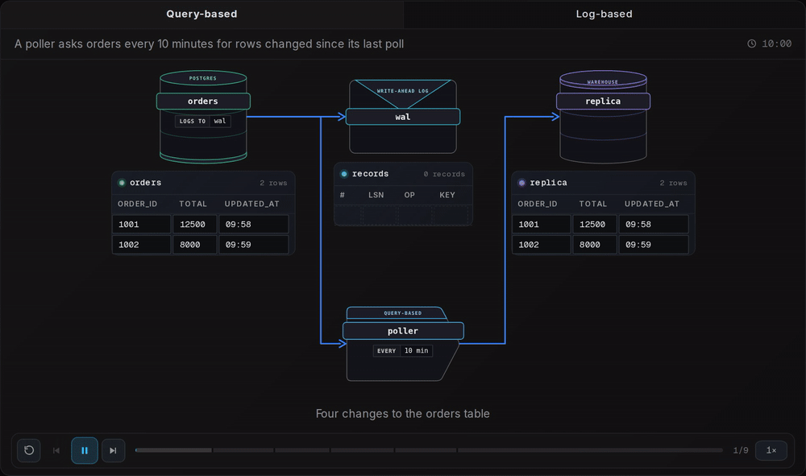

**Log-based**

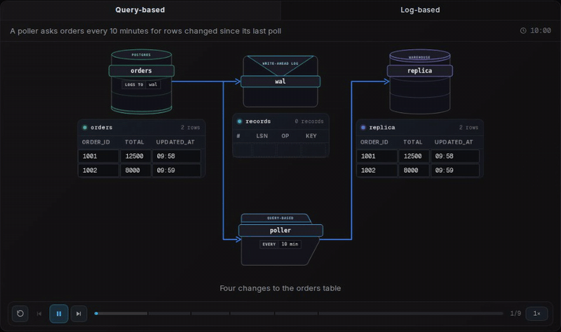

The query-based poller fires at 10:10 with its bookmark at 10:00. It copies 1001 at 13500 and the new 1003, and never learns that 1001 passed through 13000 or that 1002 was deleted, so the replica still shows order 1002 at 8000. The log-based connector applies each change around 2 seconds after it is written, and the replica ends identical to the source.

| Family | Hard deletes | Intermediate states | Extra source writes | Access needed | Latency |
| --- | --- | --- | --- | --- | --- |
| Trigger-based | Captured | Captured | A second write per change | Create triggers and tables | Poll interval of the side table |
| Query-based | Missed | Collapsed to the latest | None | Read-only login | Poll interval |
| Log-based | Captured | Captured | None | Replication privilege, log config | Seconds |

#### Choosing a family

When deletes or every intermediate state matter and you can get replication access, log-based wins. When the source is a vendor-hosted database that grants a read-only login, query-based is the only family on offer, and you ask the owners for soft deletes, a `deleted_at` column, so a delete becomes an update the poll can see. Trigger-based is the fallback for when deletes matter but log access is impossible, provided the write rate can absorb a second write.


<br>

---

## Pipeline Architecture

### Exercise 1 of 2

**● TASK**

A Debezium connector on a Postgres logical replication slot has twice filled the orders database disk after restarting without reattaching. Redesign the change-capture path: name the connector's initial-snapshot-then-stream phase, and put a schema-evolution policy ahead of the Kafka topic that passes additive changes and blocks destructive ones. Add a monitor that checks replication slot lag against a WAL budget and feeds a dashboard on-call watches.

**Starting canvas** (already placed for you):

- Postgres orders operational DB (logical replication slot filled the disk twice in 6 months) (source, PostgreSQL)
- Change-capture connector (no initial-snapshot phase named, no slot lag monitor; restart-and-never-reattach incidents) (source, CDC)
- Kafka cdc.orders topic (queue, Kafka)

<details>
<summary><strong>Solution</strong></summary>

#### Change data capture, and why the slot is the whole risk

Change data capture (CDC) turns every insert, update and delete in the `orders` database into an event stream by reading Postgres's write-ahead log through a logical replication slot. The slot is the part that bites: Postgres cannot recycle WAL segments past the slot's `restart_lsn` until the consumer confirms it has read them. So a connector that stalls or restarts without reattaching stops advancing that pointer, and retained WAL grows on the **source** disk until on-call intervenes. The disk filling twice was never a Kafka problem. It was a slot-retention problem sitting on the operational database.

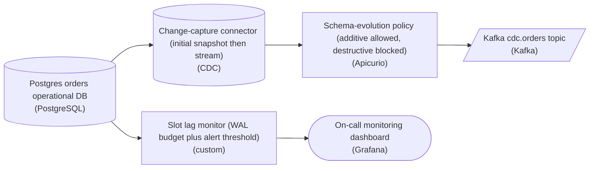

*The change-capture path: a two-phase connector, a schema gate before the topic, and a slot lag check watching the source.*

The connector node has to name its phase because the 2 phases behave differently. On first start it runs an initial snapshot, a consistent full read of the rows that already exist, so downstream isn't missing history. Then it switches to streaming the WAL forward from the snapshot's exact log position. Naming the phase ('initial snapshot then stream', Debezium's `snapshot.mode`) makes the reattach contract explicit: on restart the connector resumes streaming from the last confirmed position. It does not re-snapshot the whole table and it does not skip ahead. This is the full-versus-incremental distinction made concrete on one node.

| Pitfall: Restart that starts a fresh slot instead of reattaching |
| --- |
| The incident wasn't the snapshot. It was a restart that failed to resume from the slot's `confirmed_flush_lsn`, so the slot never advanced and WAL kept accruing. A connector that opens a fresh slot on restart leaves the old one behind, still pinning WAL nobody will ever read. Reattaching to the existing slot is what turns a connector restart into a non-event instead of a disk-filling one. |

The schema-evolution policy is a gate, not a note. Upstream DDL flows into the event schema, and the 2 directions are not equal. Additive changes, such as a new nullable column from `ADD COLUMN`, are backward-compatible: old consumers of `cdc.orders` simply ignore the field they don't know about, so those pass. Destructive changes, such as `DROP COLUMN`, a rename or a type narrowing, break every consumer still parsing the old shape, so the gate rejects them and forces a coordinated migration first. Standing this compatibility check between the connector and the topic stops one careless migration from poisoning every downstream reader at once.

| Real world: The monitor is the piece that had to exist |
| --- |
| The slot lag check queries `pg_replication_slots` for the byte distance between the slot's `restart_lsn` and the current WAL position. It compares that distance to a WAL budget (a safe fraction of free disk) and fires an alert threshold onto a dashboard on-call watches, well before the disk is full. In production you often also set `max_slot_wal_keep_size` as a Postgres-side backstop, but that trades the slot for the database: past the cap Postgres drops the slot, and the connector then needs a fresh snapshot. The dashboard exists so a human acts before either bad outcome. |

**Follow-up questions**

1. If the slot is dropped after breaching `max_slot_wal_keep_size`, what does the connector have to do on its next start, and what does that cost downstream?\
   *A lost slot forces a full re-snapshot, not a resume.*
2. How would you let a `DROP COLUMN` through safely instead of just blocking it forever?\
   *The coordinated-migration path: deprecate, dual-write, drain old consumers, then remove.*

</details>


<br>

### Exercise 2 of 2

**● TASK**

Kafka rebalances, Stripe webhook retries and SFTP partner re-uploads all redeliver messages, so the append-only `raw_events` sink collects duplicates. Make ingestion idempotent at the sink: replace it with a storage node whose name says it dedupes, names the key taken from each message (scoped by source, such as `dedupe_key`), and names the uniqueness mechanism (UNIQUE constraint, MERGE on key, or partition overwrite). Keep all three sources and the writer.

**Starting canvas** (already placed for you):

- Kafka order_events source (consumer rebalance reprocesses) (source, Kafka)
- Stripe webhook (retries until 2xx) (source, API)
- SFTP partner files (cron re-uploads) (source, S3)
- ingest_writer (writes everything it receives) (transform, Pandas)
- raw_events (plain append, duplicates accumulate) (storage, PostgreSQL)

<details>
<summary><strong>Solution</strong></summary>

#### At-least-once is the world, so dedupe at the sink

Every source in this pipeline redelivers. A Kafka consumer rebalance replays the last uncommitted batch, Stripe retries the webhook until it sees a 2xx, and the SFTP partner's cron re-uploads the same file when it retries. None of that is a bug to fix upstream: it is the delivery guarantee you were handed, **at-least-once**. Idempotent ingestion answers it at the sink. You draw a stable key out of the message, put a uniqueness mechanism on that key, and let the second copy of a row land as a no-op.

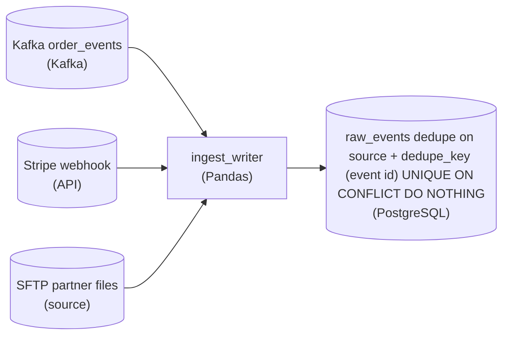

*The writer is unchanged; the sink names its key (`source` plus the message's own id as `dedupe_key`) and its mechanism, so a redelivered message collapses to a no-op.*

The one decision that makes or breaks this is the key. It has to come from the message, be identical across redeliveries, and be unique per real event. Each source hands you one: Kafka's producer-assigned UUID in the record, Stripe's `evt_id`, and the file row's natural business key. Compute that into a single `dedupe_key` column inside `ingest_writer`, scope it by `source` so ids from different senders never collide, and hang the constraint on the pair.

| Pitfall: Arrival time and whole-row hashes are not keys |
| --- |
| The tempting shortcut is to dedupe on something the pipeline sees without understanding the message, like an ingest timestamp or an `md5(payload)` of the full body. Both break under redelivery. A rebalance replays the same event with a fresh receive time, so a time window lets it through; and a retried webhook or re-uploaded file can carry a byte-different envelope for the same logical event, so a whole-row hash treats it as new. The key must be the identifier the source means. |

**The dedupe sink**

```sql
CREATE TABLE raw_events (
    event_id     bigint GENERATED ALWAYS AS IDENTITY PRIMARY KEY,
    source       text        NOT NULL,
    dedupe_key   text        NOT NULL,
    payload      jsonb       NOT NULL,
    ingested_at  timestamptz NOT NULL DEFAULT now(),
    CONSTRAINT raw_events_dedupe_key UNIQUE (source, dedupe_key)
);

INSERT INTO raw_events (source, dedupe_key, payload)
VALUES ($1, $2, $3)
ON CONFLICT (source, dedupe_key) DO NOTHING;
```

*`ingest_writer` computes `dedupe_key` from the message and passes it as $2. The `UNIQUE (source, dedupe_key)` constraint is the mechanism; `ON CONFLICT DO NOTHING` makes the second delivery a silent no-op.*

| Real world: The key travels with the sink's name |
| --- |
| The sink node is named for its key and mechanism, not just its storage, so the next engineer knows the table dedupes, and on what, without reading the loader. The same shape reappears with a different uniqueness primitive per engine: `MERGE` on the key in a warehouse, a partition overwrite by key window in a lake, `ON CONFLICT DO NOTHING` in Postgres. Pick the one your sink supports; the design is identical. |

**Follow-up questions**

1. The same `evt_id` arrives twice but the second copy has a corrected `amount`. Do you want `DO NOTHING`, or an upsert?\
   *Separates first-write-wins dedupe from a last-write-wins upsert as a deliberate choice.*
2. How would you dedupe when the sink is an append-only lake with no `UNIQUE` constraint?\
   *Pushes the pattern onto partition overwrite, the mechanism for engines without constraints.*

</details>


<br>

---

## Operating Log-Based CDC

A log-based pipeline on Postgres needs ongoing care in 3 places: the first copy of rows that existed before it started, the replication slot that holds its place in the log, and table definitions that change while it runs.

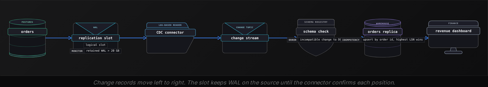


<br>

### The initial snapshot

The WAL keeps recent history, usually hours to days, and never the whole life of a table. A connector started today on `orders` would see today's changes and none of the 40 million rows already there. So every log-based pipeline begins with a snapshot: a full copy of the table, stitched to a position in the log.

Postgres makes that stitch exact. Creating a logical replication slot fixes its starting position, an LSN (log sequence number), and can export a transaction snapshot that sees the database as of that LSN. The connector copies the table through that snapshot, then streams from the slot. Everything committed before the LSN arrives in the copy, and everything after it arrives through the log.

The catch is duration. Copying 40 million rows in a single transaction can take hours, and a transaction open that long stops Postgres from cleaning up dead rows on the source. Chunked snapshots, the approach in the Netflix framework from the intro, copy primary-key ranges and reconcile each chunk with the live stream, so no transaction stays open for long. Either way, a connector that restarts mid-snapshot copies some rows twice, so the sink upserts by key.


<br>

### Replication slot lag

A replication slot remembers the last LSN the connector confirmed, and Postgres keeps every WAL file after that point, because the connector may still need it. While the connector keeps up, retained WAL stays small. When it stops (a crashed worker, an expired credential, a deploy paused halfway), WAL accumulates on the source's own disk.

The slot retains WAL for the whole database cluster, every table, even when the pipeline reads only `orders`. Suppose the cluster writes 6 GB of WAL an hour and its disk has 150 GB free. A connector that dies on Friday evening fills that disk by Saturday night, and a Postgres primary that cannot write WAL shuts down, taking the application with it.

- **25 h** — until a stalled slot fills that disk

```sql
SELECT
  slot_name,
  active,
  PG_WAL_LSN_DIFF(PG_CURRENT_WAL_LSN(), restart_lsn) AS retained_bytes
FROM pg_replication_slots
WHERE slot_type = 'logical'
```

> 3 defenses against slot lag
>
> - Alert when `retained_bytes` passes 20 GB and page at 50 GB, so someone acts with hours to spare.
> - Set `max_slot_wal_keep_size` (Postgres 13 and later) well below free disk, such as 100 GB, so Postgres invalidates the slot before the disk fills.
> - Drop the slot when its pipeline is retired. An inactive slot retains WAL exactly like a stalled one.

The cap trades a large incident for a smaller one. An invalidated slot cannot stream again, and the changes between its last LSN and now are gone from the log, so the pipeline takes a new snapshot. That costs hours of copying; a full disk costs the application its database.


<br>

### When the table's definition changes

Postgres logical decoding carries row changes and no DDL. After someone runs `ALTER TABLE orders ADD COLUMN currency text`, the connector finds out from the next change to `orders`, which arrives with a relation message describing the new column list. Records from then on carry the extra field, and records already in the stream keep the old shape.

| Change on the source | What the stream shows | Who breaks |
| --- | --- | --- |
| Add a nullable column | A new field from the next change on | Nobody, if readers ignore unknown fields |
| Rename a column | Old field gone, new field present | Every reader of the old name |
| Drop a column | Field missing from new records | Readers that require it |
| Widen `integer` to `bigint` | Same field, larger values possible | Sinks typed to the narrow type |

Treat the change stream like any other event stream. Register its schema and let backward-compatible changes through. Renames and type changes go through expand-contract on the source. A change the registry rejects goes to the dead letter queue instead of corrupting the replica.


<br>

---

## Pipeline Architecture

### Exercise 1 of 2

**● TASK**

A Postgres database holds customers (~2M rows, slowly changing, hourly freshness) and orders (~500M rows, +10M/day, five-minute freshness, deletes must reach Snowflake). Orders is too big to reload, so it needs change data capture. Between the database and the Snowflake warehouse, add one loading stage per table, each named for its strategy and the trade-off that drove it: scale, deletes, latency, or team capacity.

**Starting canvas** (already placed for you):

- Postgres operational database (source, PostgreSQL)
- Snowflake analytics warehouse (storage, Snowflake)

<details>
<summary><strong>Solution</strong></summary>

#### Matching an ingestion strategy to each table

Choosing between a reload and change data capture is a per-table decision, not a per-database one. You weigh how big the table is and how fast it grows, how fresh the copy must be, and whether deletes have to arrive downstream. `customers` and `orders` pull in opposite directions on all three, so the same Postgres database ends up with **two different strategies**, each named for the trade-off that chose it.

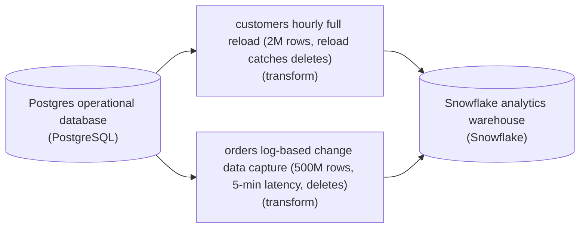

*One source, one loading stage per table: each stage name carries the strategy and the trade-off that drove it.*

1. **Give `customers` the cheapest robust option**

   At ~2M slowly changing rows with an hourly target, a full reload is trivial to run. Because it replaces the whole table, it picks up deletes for free. An incremental pull on a modified-at column would be cheaper, but it never sees a deleted row: a deleted row has no new timestamp to catch.

2. **Give `orders` log-based change data capture**

   500M rows growing 10M a day rules out reloading, and five-minute freshness rules out anything batchy. Cancellations and deletes must land too. Log-based capture tails the write-ahead log through a replication slot, so every insert, update and delete streams out while adding almost no load to the source.

| Pitfall: Triggers double the write load on `orders` |
| --- |
| Trigger-based capture also catches deletes, which makes it tempting. But a row-level trigger writes a second row for each of 10M daily changes on your hottest table. Reading the log the database already writes avoids that. The price shifts to operations: logical replication access, and someone watching the slot so unconsumed log does not fill the disk. |

**Follow-up questions**

1. If `customers` grew to 200M rows but still only needed hourly freshness, would a full reload still be the right call?\
   *Scale alone can flip the choice even when latency stays the same.*
2. How would you load the existing history of `orders` before the log stream takes over?\
   *Log-based capture needs a snapshot-then-stream handoff so rows written before the slot existed are not missed.*

</details>


<br>

### Exercise 2 of 2

**● TASK**

Design ingestion from a Postgres database into Snowflake for three tables. customers holds 2M slowly changing rows and must be fresh within the hour. orders holds 500M rows growing 10M a day; its changes, deletes included, must stream into Snowflake within five minutes. legacy_events lives on a hosted Postgres with no log access and refreshes once a day. Pick a full, incremental or change-capture load for each table, and make every landing a merge on the table's key so re-applying a load updates rows in place.

**Starting canvas** (already placed for you):

- Postgres customers table (2M rows, slow) (source, PostgreSQL)
- Postgres orders table (500M rows, +10M/day, deletes critical) (source, PostgreSQL)
- Postgres legacy_events (hosted; no WAL access) (source, PostgreSQL)
- Snowflake analytics warehouse (storage, Snowflake)

<details>
<summary><strong>Solution</strong></summary>

Choosing between a full reload, an incremental pull and change data capture is a per-table decision. What the source lets you read, how big the table is and how fresh its warehouse copy must be settle it. Here `orders` earns log-based change capture, while `customers` and `legacy_events` take incremental pulls on their own cadences. Every lane lands through a `MERGE` on the table's key, so a replayed load does no harm.

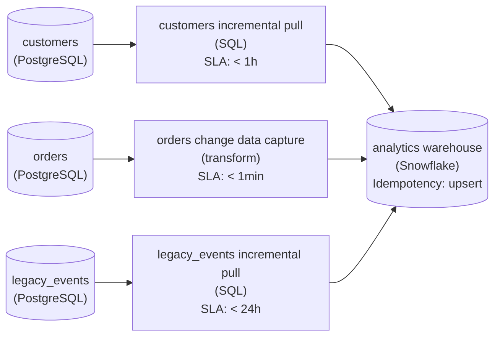

*Each lane's freshness chip follows its table's target, and the warehouse merges every load on the key ('upsert'), so any load can be re-applied.*

1. **Stream `orders` changes into the warehouse**

   500M rows growing 10M a day rules out re-reading the table, and a five-minute target rules out any batch cadence. Read the Postgres write-ahead log so inserts, updates and **deletes** all arrive as change events, then push them straight into the warehouse. A timestamp pull would silently miss the deletes, because a deleted row never shows a newer `updated_at`.

2. **Pull `customers` incrementally each hour**

   2M slowly changing rows that may lag an hour do not need change capture. An hourly pull of the rows whose `updated_at` passed the stored bookmark keeps each run small. A full reload of 2M rows would also fit inside the hour, at more cost per run.

3. **Pull `legacy_events` once a day by query**

   The hosted Postgres exposes no log, so log-based capture is off the table no matter how much you would prefer it. A query-based pull once a day, bounded by a bookmark on an ever-growing column such as the event id, meets the daily target. Access limits decide this lane, not taste.

| Trick: One `MERGE` makes every lane replay-safe |
| --- |
| Hourly, daily and streaming loads all get retried, so the warehouse applies each one as a `MERGE` on the table's primary key: matching rows update and the rest insert. Re-applying the same load changes nothing. That is what lets you rerun a failed pull or replay a change-capture offset without doubling rows. |

**Follow-up questions**

1. If `legacy_events` started deleting rows, what would the daily query-based pull miss, and what could catch the deletes without log access?\
   *Points to trigger-based capture as the fallback when the log is out of reach.*
2. How would you load the existing `orders` history before the change-capture stream took over?\
   *Tests the one-time initial snapshot and the cutover to the stream.*

</details>


<br>

---

## Idempotent At-Least-Once Ingest

Every ingestion consumer does 2 things per batch, whatever it reads from: it writes the records to the sink, and it saves its position (an offset for a queue, an LSN for a replication slot, a file name when it reads a folder of files) so it can resume after a restart. A crash can land between the 2 steps, and their order decides what that crash costs.

| ✓ Write, then save position | ✗ Save position, then write |
| --- | --- |
| • Crash in between: the batch is read again<br><br>• Cost: duplicate records in the sink<br><br>• Called at-least-once delivery | • Crash in between: the batch is never written<br><br>• Cost: records silently missing<br><br>• Called at-most-once delivery |

Ingestion picks at-least-once, because a duplicate can be found and removed while a missing record leaves no trace. A restarted CDC connector rereads changes after its last confirmed LSN, a queue redelivers anything unacknowledged, and a retried API page returns rows already loaded. The sink can turn each of these repeats into a no-op in 3 ways.


<br>

### Dedupe by key

When each record carries a stable id, keep a single row per id. A queue event usually has a producer-assigned `event_id`. A CDC change is identified by its primary key plus its LSN: a replay repeats both, while 2 real updates to order 1001 have different LSNs. Dedupe each staged batch before it touches the target.

Staged batch, with a redelivery

| order_id | lsn | op | total |
| --- | --- | --- | --- |
| 1001 | 41210 | update | 13000 |
| 1003 | 41388 | insert | 4200 |
| 1001 | 41210 | update | 13000 |
| 1002 | 41502 | delete | null |
| 1001 | 41640 | update | 13500 |

After dedupe on order_id and lsn

| order_id | lsn | op | total |
| --- | --- | --- | --- |
| 1001 | 41210 | update | 13000 |
| 1003 | 41388 | insert | 4200 |
| 1002 | 41502 | delete | null |
| 1001 | 41640 | update | 13500 |

*LSNs appear here as small integers. Real ones are 64-bit log positions that Postgres prints as 2 hex numbers, such as 0/16B3748.*

```sql
SELECT
  order_id,
  lsn,
  op,
  total
FROM (
  SELECT
    order_id,
    lsn,
    op,
    total,
    ROW_NUMBER() OVER (
      PARTITION BY order_id, lsn
      ORDER BY received_at
    ) AS rn
  FROM staged_order_changes
) AS ranked
WHERE rn = 1
```


<br>

### Uniqueness enforced at the sink

Staging dedupe only catches repeats inside a batch. A replay that arrives tomorrow lands in a different batch, so the lasting guarantee has to live in the target: a uniqueness rule on the record id that rejects or skips a second copy. An operational database enforces it with a primary key or unique index. Many warehouses accept a primary key declaration without enforcing it, so the load enforces it with an anti-join against rows already stored.

```sql
INSERT INTO order_changes
SELECT
  s.order_id,
  s.lsn,
  s.op,
  s.total
FROM deduped_order_changes AS s
LEFT JOIN order_changes AS t
  ON s.order_id = t.order_id
  AND s.lsn = t.lsn
WHERE t.order_id IS NULL
```

A current-state table, with a row per order, also needs a version rule: upsert by `order_id`, and apply a change only when its LSN is higher than the stored one. A replay of the 10:03 change (total 13000) arriving after the 10:08 change (total 13500) compares lower and is skipped, so the replica keeps 13500 instead of rolling back. Apply a delete as a tombstone, a row flagged deleted that keeps the delete's LSN; otherwise a late replay of an older update to 1002 finds no stored row and revives the order. Purge tombstones once replays can no longer arrive.


<br>

### Content-hash ids

Some sources give you no id: a partner's daily CSV, an API that returns rows without keys. Build one by hashing the fields that make a record what it is. The same input then always produces the same id, on the first load and on every retry, and the sink's uniqueness rule does the rest.

```sql
SELECT
  TO_HEX(
    SHA256(
      TO_UTF8(
        CONCAT(
          file_name,
          '|',
          CAST(line_number AS VARCHAR),
          '|',
          raw_line
        )
      )
    )
  ) AS row_id,
  file_name,
  line_number,
  raw_line
FROM staged_partner_files
```

Include whatever differs between 2 genuinely different records, and nothing that differs between 2 deliveries of the same record.

| Hash input | Same file retried | 2 identical purchases on different lines | Verdict |
| --- | --- | --- | --- |
| `raw_line` | Same id | Same id, a purchase lost | Too few inputs |
| `raw_line` + `ingested_at` | New id, duplicate loaded | Different ids | Too many inputs |
| `file_name` + `line_number` + `raw_line` | Same id | Different ids | Right |

> **TIP**
>
> Put a separator between hashed fields. Without one, `ab` followed by `c` and `a` followed by `bc` build the same string and the same id.

*The third row holds while the partner never resends a file under the same name with its lines reordered. If they do, ask them for a row id.*


<br>

---

## Pipeline Architecture

### Exercise 1 of 2

**● TASK**

An append-only MySQL table, meter_readings, holds 3 billion rows keyed by an auto-increment id and gains 40 million rows a day; reading it in full takes 9 hours. Design the hourly pull into a warehouse that feeds a usage dashboard, choosing between a full reload and an incremental load. Keep any bookmark in a metadata table the pipeline owns, not in the source, and advance it only after the warehouse load succeeds.

<details>
<summary><strong>Solution</strong></summary>

#### A 9-hour read cannot feed an hourly dashboard

Full versus incremental is a cost question, and the table's own numbers settle it. A full reload rereads all 3 billion rows of `meter_readings` every run: 9 hours of source load for a job that has to finish inside an hour. An **incremental load** reads only what arrived since the last good run. 40 million rows a day is roughly 1.7 million an hour, a slice the source serves quickly through its `id` index. The bookmark is what turns 'since the last good run' into a precise query.

1. **Use the bookmark the table already gives you**

   Rows are only ever inserted and `id` only grows, so the highest `id` already loaded is a complete position. Each run asks for `id > bookmark` and records the max it saw. No timestamp is needed, because no row can change behind the bookmark.

2. **Store it where the pipeline owns it**

   The bookmark is one row in a metadata table beside the pipeline: the source name, the value as text, and a kind of 'integer' that says how to compare it. Writing it into MySQL would give a read-only source a write path it does not need.

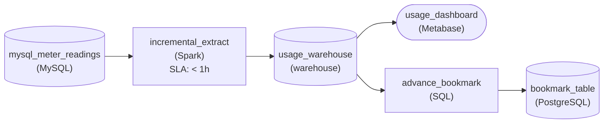

*Each hourly run of `incremental_extract` reads the last `id` from `bookmark_table` and pulls rows above it; `advance_bookmark` writes the new max only after `usage_warehouse` commits.*

| Pitfall: Moving the bookmark first silently drops rows |
| --- |
| If the run writes the new max `id` before the warehouse load commits, a failed load leaves the bookmark past rows that never landed, and the next run starts after them. Advance it last: a failed run leaves the bookmark where it was, so the rerun reads the same range and nothing is lost. |

**Follow-up questions**

1. What changes if readings can be corrected after they land, setting an `updated_at` column?\
   *Switching the bookmark kind from an integer `id` to a timestamp, and what that comparison has to handle.*
2. A 50,000-row `meters` lookup table also feeds the dashboard. Does it need a bookmark?\
   *When a full reload is the simpler, correct end of the spectrum.*

</details>


<br>

### Exercise 2 of 2

**● TASK**

A MySQL `inventory` table takes 2 million writes a day, and its nightly incremental load filtered on `updated_at` never sees hard-deleted rows, so the warehouse still lists discontinued items. Replace it with change data capture that publishes every insert, update and delete to a message queue in commit order. Land the changes in a warehouse fresh within 15 minutes for the stock dashboard.

<details>
<summary><strong>Solution</strong></summary>

#### A deleted row leaves no timestamp behind

Change data capture records every row change as it commits in the source database, deletes included, and hands the changes downstream in commit order. A bookmark on `updated_at` cannot do that. The filter asks the table which rows look new, and a hard-deleted row is no longer there to answer. Trigger-based and log-based capture both see the delete at the moment it commits, so either family clears the ghost items out of the warehouse.

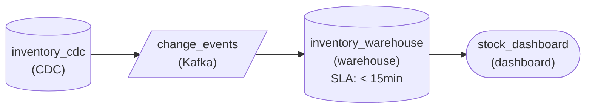

*`inventory_cdc` publishes inserts, updates and deletes in commit order to `change_events`, which lands them in `inventory_warehouse` within 15 minutes for `stock_dashboard`.*

| Pitfall: A faster bookmark still misses deletes |
| --- |
| Running the `updated_at` load every 10 minutes meets the freshness target and fixes nothing else: deleted rows still never show up in its result, so discontinued items stay in the warehouse. How often you poll is a full-versus-incremental choice; seeing deletes is a capture-family choice. |

| Key insight: Pick the family by where it costs you |
| --- |
| A trigger writes a second row to a side table for every business write, so 2 million writes a day become 4 million on the same instance. Log-based capture reads changes the database already records and adds no table writes. With headroom on this instance either family works; on a hotter table the doubled writes would decide it. |

**Follow-up questions**

1. What changes if the database team forbids triggers on the `inventory` table?\
   *Whether you can name the family that captures deletes without touching the table's write path.*
2. The `suppliers` table marks removals with an `is_active` flag instead of deleting. Does a bookmark on `updated_at` stay correct there?\
   *Whether you can tell when an incremental bookmark is enough and when only change capture is.*

</details>


<br>

---

## Three Ways to Ingest from Postgres

Postgres supports all 3 strategies from this lesson, and a single database often uses all 3, table by table. The choice for each table comes down to 4 questions: how big is the table and how fast does it change, are rows hard-deleted, how fresh must the copy be, and who will be on call for it.

| Strategy | How it reads | Scale | Hard deletes | Freshness | Team cost |
| --- | --- | --- | --- | --- | --- |
| Nightly full snapshot | `SELECT` the whole table, replace the target | Up to a few million rows | Caught | Once a day | A scheduled job |
| Incremental pull | Bounded window on `updated_at`, keyed upsert | Large tables with an indexed change column | Missed | Run interval plus safety lag | Bookmark store and idempotent sink |
| Log-based CDC | Logical replication slot, snapshot then stream | Any size, high change rates | Caught | Seconds | Slot monitoring, re-snapshot runbook, DBA access |


<br>

### Three tables in a single database

`stores` has 1,800 rows and changes a few times a week. A nightly full snapshot copies it in under a second, catches the occasional closed store that someone deletes, and has no bookmark to corrupt.

`products` has 2 million rows and about 50,000 updates a day, and is never hard-deleted: a discontinued product gets `discontinued_at` set, which also moves `updated_at`. The catalog team reads it hourly. An hourly incremental pull with a 5-minute lag meets every requirement, and it can run against a read replica so the primary never sees the query.

`orders` has 40 million rows and 300,000 changes a day, and the application hard-deletes orders that customers cancel within 10 minutes of placing them. Finance wants revenue within 5 minutes. An incremental pull would keep every cancelled order in revenue forever, and the nightly full copy takes 25 minutes and leaves the warehouse a day behind. Log-based CDC meets both needs, and that is why the team takes on its slot monitoring and re-snapshot runbook.


<br>

### When the team cannot run CDC

Team capacity can overrule the table. Log-based CDC needs `wal_level = logical` on the source, a setting that takes a database restart, plus a role with replication privilege and an on-call engineer who knows what a stalled slot does to the primary's disk. A 2-person team without DBA access can serve `orders` with a hybrid: an incremental pull every 15 minutes, and a nightly job that lists every `order_id` in the source, compares the list with the replica, and deletes the orders that are gone.

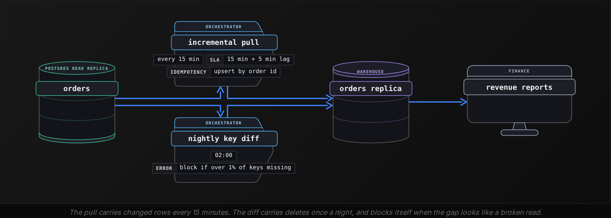

The hybrid has a price. Revenue can trail the source by 20 minutes instead of 5, since the pull interval stacks on top of the lag. A cancelled order also stays in revenue until the 02:00 diff removes it. Agree on both with finance before launch, or ask the application team for soft deletes so cancellations become updates the pull already sees.

| ✓ Do | ✗ Don't |
| --- | --- |
| • Decide per table, weighing size and change rate against delete and freshness needs and who will run it<br><br>• Keep full snapshots for small tables even when big ones move to CDC<br><br>• Save the bookmark only after the data commits<br><br>• Make every sink absorb repeats, whether by dedupe or by a uniqueness or version check<br><br>• Alert on retained WAL long before it threatens the source disk | • Run CDC on a 1,800-row table that a full copy refreshes in a second<br><br>• Trust updated_at before confirming every writer sets it<br><br>• Leave a replication slot behind when its pipeline is retired<br><br>• Let a key diff delete a large share of rows without a threshold check |


<br>

---

## Pipeline Architecture

### Exercise 1 of 2

**● TASK**

Capture every insert, update and delete on a Postgres `subscriptions` table by reading its write-ahead log into a Kafka topic, and load those changes into a warehouse refreshed within 15 minutes. The app team ships a migration about once a week that adds or drops columns. Register each change event's schema so a migration is checked for compatibility before the warehouse loader reads it, rather than breaking the load.

<details>
<summary><strong>Solution</strong></summary>

#### A migration is a log event too

Log-based CDC decodes the write-ahead log, so every change event carries the table's shape at the moment of the write. When a migration adds a column, the events in the topic change shape mid-stream. Nothing upstream asks permission: without a schema registry, the warehouse loader is the first thing to notice, and it notices by failing.

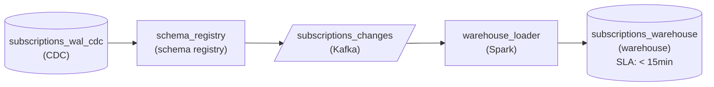

*Log-based capture registers each event schema before it reaches the Kafka topic the loader reads.*

1. **Read the log, not the table**

   The WAL already records every insert, update and delete for crash recovery, so the CDC stage decodes it instead of querying `subscriptions`. That is what makes a hard delete visible at all, and it adds no write load to a busy primary.

2. **Register the schema on the way in**

   Each event is serialized against a registered schema before it lands in `subscriptions_changes`. An added nullable column passes a compatibility check; an incompatible change is rejected at the registry, where the platform team sees it, instead of inside the loader at 3am.

| Pitfall: A rejected schema stalls the slot too |
| --- |
| If the connector halts on an incompatible event, it stops confirming WAL positions. The replication slot keeps retaining WAL until someone fixes it, so a schema break becomes a disk problem on the source. Treat registry rejections as urgent, not as noise. |

| Real world: Added columns pass, dropped columns need a plan |
| --- |
| Under backward compatibility, a new optional field is fine for old readers. A dropped column is only safe if downstream models stop selecting it first, so drops usually ship as a two-step migration. |

**Follow-up questions**

1. A fraud model wants the same changes: a second connector or a second consumer on the topic?\
   *Each connector holds its own replication slot, and each slot retains WAL on the source.*
2. A migration renames `plan_id` to `plan_code`. What does the compatibility check do, and how would you ship it?\
   *Whether a rename is seen as a drop plus an add.*

</details>


<br>

### Exercise 2 of 2

**● TASK**

A nightly job pulls the previous day's shipment events from a carrier's REST API, about 2 million records, into a warehouse table a delivery dashboard reads. When the job crashes mid-write the scheduler reruns the whole day, and the API can return the same event on two pages. Each event carries a stable shipment_event_id. Design the ingest so a rerun leaves exactly one row per event.

<details>
<summary><strong>Solution</strong></summary>

#### Dedupe at the sink, on the key the event carries

An idempotent ingest sink makes the delivery count stop mattering: it keys every write on an identifier the event itself carries, so the second or tenth copy lands on the row the first one created. This pull is at-least-once twice over. The API can repeat an event across pages, and a crash mid-write sends the scheduler back over the whole day with part of it already loaded. Every copy shares `shipment_event_id`, which is why that column is the key.

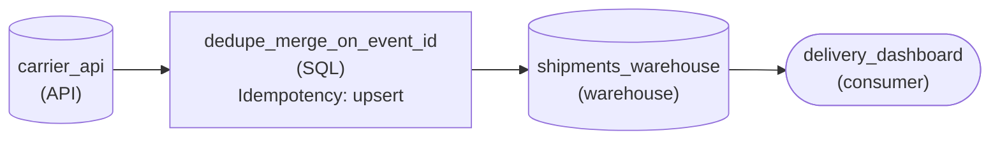

*Pull the day, collapse and upsert on `shipment_event_id`, and the dashboard reads the result.*

1. **Key on `shipment_event_id`**

   The carrier assigns it once per event, so it is identical on every page and every rerun. A surrogate the job mints at load time, or the run's timestamp, changes on each attempt and dedupes nothing.

2. **Upsert into the table instead of appending**

   Collapse the pulled batch to one row per `shipment_event_id`, then upsert into the warehouse table on that key. The collapse handles repeated pages, and a merge needs it anyway because it rejects two source rows for one key. The upsert handles rows the crashed attempt already wrote.

| Pitfall: Deduping the batch alone misses the crashed run |
| --- |
| Dropping repeats inside tonight's pull feels finished, but the rows the failed attempt wrote are not in that batch. An append of a clean batch still doubles them. Only a write keyed against what the table already holds catches those rows, which is why the dedupe belongs at the sink. |

**Follow-up questions**

1. The carrier starts pushing the same events by webhook too, retrying until it gets a 2xx. What must stay true for both paths to share one table?\
   *Whether one dedupe key is shared by every delivery path into the sink.*
2. A redelivered event arrives with a corrected status but the same `shipment_event_id`. Does the upsert still do the right thing?\
   *Choosing between insert-if-absent and update-on-match when copies differ.*

</details>


<br>

---

## Putting It All Together

A food-delivery marketplace feeds its warehouse from a single Postgres cluster. stores reloads in full each night, products arrives through an hourly bounded pull, and orders streams through a logical replication slot so finance sees revenue within 5 minutes, cancellations included. One Saturday the connector's credential expires. Retained WAL climbs past the 20 GB alert, the on-call renews the credential, and the connector drains 4 hours of backlog, some of it applied once already before the stall.

- The per-table choices are the decision from the last section. Size and change rate pick full or incremental, and hard deletes plus the 5-minute need are what put a table on CDC.
- The products pull is the bounded window: lower bound from the bookmark store, upper bound fixed at start minus 5 minutes, bookmark saved after the commit.
- Orders uses the log-based family because only the log reports hard deletes and every intermediate total.
- The stall is slot lag: WAL for every table piles up until the connector confirms, and the 20 GB alert fires hours before the disk is at risk.
- The replayed changes are harmless because the sink dedupes on order_id plus LSN, applies an upsert only when the LSN is higher, and keeps deleted orders as tombstones.


<br>

---

## Pipeline Architecture

### Exercise 1 of 2

**● TASK**

A clinic-scheduling Postgres database holds a 3M-row appointments table taking about 400K inserts, updates and hard deletes a day, and its managed host does not allow logical replication slots. The primary runs at 30% of write capacity, so it can absorb one extra write per change. Choose the ingestion strategy that captures every row change, deletes included, and lands it in the analytics warehouse fresh within 15 minutes.

<details>
<summary><strong>Solution</strong></summary>

#### Let the constraints pick the strategy

Trigger-based CDC earns its place when the log is off-limits. Here the 2 other strategies from the section each break on one constraint. An incremental pull on `updated_at` never sees a hard-deleted appointment, because a deleted row leaves no timestamp behind. Log-based CDC needs a logical replication slot the managed host will not grant. **Triggers sidestep both**: every insert, update or delete also writes one row to a change table inside Postgres, so a delete becomes a row a worker can read.

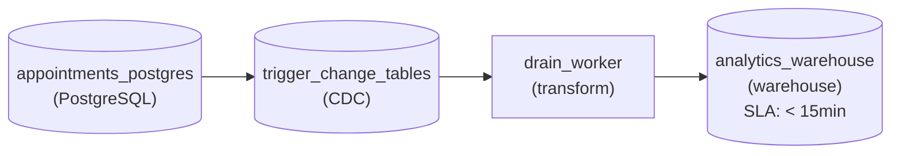

*Triggers on `appointments` record every insert, update and delete in a change table; a worker drains it each minute into the warehouse.*

| Performance: One extra write per change is affordable here |
| --- |
| 400K changes a day averages about 5 per second and peaks near 40. With the primary at 30% of write capacity, doubling those writes still leaves plenty of headroom. On a 10M-a-day `orders` table the same doubling would force a bigger instance, and that is the scale where log-based CDC wins. |

| Pitfall: A watermark cannot see a missing row |
| --- |
| Polling `updated_at` every few minutes looks fresh enough, but a cancelled appointment simply vanishes from `appointments`, and the warehouse keeps counting it. A soft-delete flag would fix that, but this application hard-deletes, so the change has to be caught at write time. |

| Key insight: The change table is a queue you own |
| --- |
| The worker reads change rows in the order they were written, applies them to the warehouse, then prunes what it loaded so the side table stays small. Draining every minute leaves room inside the 15-minute target for a failed run to retry before anyone notices. |

**Follow-up questions**

1. What happens if the worker crashes after applying a batch but before pruning it?\
   *Applying at-least-once delivery idempotently, keyed on each change row's sequence number.*
2. If the host later allows replication slots and writes grow to 10M a day, what would you change?\
   *Recognising the scale and operational context where log-based CDC replaces triggers.*

</details>


<br>

### Exercise 2 of 2

**● TASK**

A MySQL `listings` table holds 40M rows and takes 6M writes a day, about 300K of them hard deletes when sellers pull a listing. Its primary runs near its CPU limit, so adding per-row write work there is not an option, and a filter on `updated_at` never sees a deleted row. Choose the CDC family that captures the deletes without loading the primary, and publish every change to a topic. The warehouse copy reads that topic at least once, so redelivered changes must not duplicate or resurrect rows, and pulled listings must be gone from it within 15 minutes.

<details>
<summary><strong>Solution</strong></summary>

#### Deletes and headroom decide the CDC family

Picking a CDC family comes down to 2 questions about the source: does a delete leave evidence behind, and can the database afford extra work on every write? For `listings` both answers are no. A hard delete leaves no row for a query to find, and a primary near its CPU ceiling cannot carry a trigger per write. Log-based capture is the family left standing, because the database already writes every change, deletes included, to its log for crash recovery.

1. **Rule out query-based capture**

   A bookmark on `updated_at` finds inserts and updates, but a pulled listing is simply absent: no row moved its timestamp. With 300K deletes a day, the warehouse keeps showing listings sellers removed weeks ago, and only a full reload would ever notice.

2. **Rule out trigger-based capture**

   A trigger does catch deletes, by writing to a change table inside the same transaction. That adds a second write to each of the 6M daily writes, on the one machine with no room for it. The capture is correct; the cost lands in the wrong place.

3. **Apply changes idempotently on `listing_id`**

   The topic delivers at least once, so a consumer restart replays changes the warehouse already applied. Apply each change as an upsert or a delete keyed on `listing_id`, keeping only the latest change per key: a replayed insert rewrites the same row, and a replayed delete removes a row that is already gone instead of adding it back.

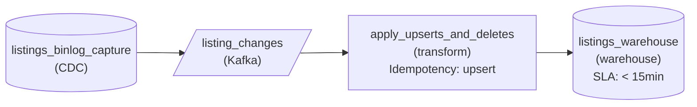

*Log-based capture publishes every change to `listing_changes`; `apply_upserts_and_deletes` keys on `listing_id` so replays are harmless.*

| Performance: Log capture moves the cost to retention |
| --- |
| Reading the log adds almost no write work, but the database must keep log segments until the reader has consumed them. If capture stalls, those segments pile up on the primary's disk, and once the three-day retention window passes the missed changes are gone for good. Watch reader lag well inside that window. |

**Follow-up questions**

1. The search team also needs pulled listings dropped from its index. Where does it read from?\
   *Fan-out from the one change topic instead of a second capture against the primary.*
2. Capture was down for 4 days and the log kept only three. How do you recover?\
   *When a full snapshot reload must replace incremental capture, and why the idempotent apply makes that reload safe to merge.*

</details>


<br>

---

## Key Takeaways

- A full load is correct by construction and costs the table's size; an incremental load costs the change volume and misses hard deletes.
- Fix both ends of an incremental window before reading, lag the upper bound past the longest transaction, and save the bookmark after the data commits.
- Each CDC family finds changes in a different place: trigger-based in a side table, query-based in the table itself, log-based in the database's log. Where it looks decides whether deletes and intermediate states arrive, and how much load the source carries.
- Log-based CDC starts with a snapshot stitched to an LSN, and its slot retains WAL for the whole cluster until the connector confirms.
- Ingestion delivers at least once, so sinks absorb repeats, usually by deduping on a key or enforcing uniqueness, or else with LSN version checks or content-hash ids.
- Choose per table, from its size and its delete and freshness needs, and from which team will operate the pipeline.
