Advanced·Pipeline Architecture · 40 min · 11 challenges

# Orchestration: Advanced

Take the Airbnb team that owns nightly booking revenue. A bug fix lands at 16:00 that changes how cleaning fees are counted, and the last 30 days need recomputing before finance reads them at 07:00 tomorrow. The same warehouse runs the 01:00 loads behind host payouts. How the orchestrator schedules, limits and watches those 30 reruns decides whether anyone gets paged tonight.


<br>

---

## Asset vs Task Orchestration

Every DAG you have built so far is task-based. The orchestrator stores tasks, the edges between them, and runs: `build_revenue` ran for logical date 2026-02-09 and succeeded at 01:22. It stores nothing about the table that task wrote. The only record of which task feeds which table is the SQL and the memory of whoever wrote it.

An asset-based orchestrator keeps the books the other way round. You declare assets, the tables, files or models a pipeline produces, and for each one the assets it is computed from. The orchestrator then records materializations: asset `orders`, partition 2026-02-09, written at 00:40 by code version a91f. Tasks still execute underneath, but the graph the orchestrator reasons about connects data, and it keeps state per partition.


<br>

### The same pipeline, stored 2 ways

Task-based: what is stored

| Record | Value |
| --- | --- |
| DAG | revenue_pipeline |
| Run | 2026-02-09, success |
| Task | wait_for_orders, success at 01:00 |
| Task | build_revenue, success at 01:22 |
| Edge | wait_for_orders to build_revenue |

Asset-based: what is stored

| Record | Value |
| --- | --- |
| Asset | orders, daily partitions |
| Asset | revenue_daily, daily partitions |
| Dependency | revenue_daily reads orders |
| Materialization | orders 2026-02-09 at 00:40 |
| Materialization | revenue_daily 2026-02-09 at 01:22 |

```sql
with DAG("revenue_pipeline", schedule="0 1 * * *") as dag:
    wait_for_orders = PartitionSensor("wait_for_orders", table="orders", partition="yesterday")
    build_revenue = SqlTask("build_revenue", sql="build_revenue.sql")
    wait_for_orders >> build_revenue
```

```sql
daily = DailyPartitions(start="2026-01-01")


@asset(partitions=daily)
def orders(partition):
    run_sql("load_orders.sql", ds=partition)


@asset(partitions=daily, deps=[orders])
def revenue_daily(partition):
    run_sql("build_revenue.sql", ds=partition)
```

The SQL inside both versions is identical. What differs is which questions the orchestrator can answer without a person reading code.


<br>

### What changes for the person on call

| Question | Task-based | Asset-based |
| --- | --- | --- |
| Is revenue_daily for February 9 current? | Find the DAG that writes it, then inspect its February 9 run | Read the latest materialization of that partition |
| The orders logic changed. What is stale now? | Search the code for everything that reads orders | List downstream partitions built from an older orders version |
| Another team needs orders | They add a sensor on your DAG's runs, tied to your schedule | They depend on the orders asset, whichever run produces it |
| Rebuild Q1 | Rerun 90 DAG runs with every task in each | Materialize 90 partitions of only the assets named |

The third row matters most once several teams share tables. In the intermediate lesson, a downstream DAG waited on an upstream DAG's run through a sensor, which silently encodes the upstream schedule and what a successful run used to mean. An asset dependency names the data instead, so the upstream team can change when and how often `orders` is built without breaking the consumer. Section 4 takes apart an incident that turned on this difference.


<br>

### What asset orchestration costs

> The price of tracking data
>
> - Every write must be declared. A task that writes 2 tables but declares 1 leaves the graph wrong, and people trust a wrong graph.
> - Work that produces no table fits poorly: emailing a report, calling a partner API, rotating a credential.
> - Partitions must be mapped. Hourly orders feeding a daily rollup needs an explicit rule tying 24 hourly partitions to 1 day.
> - Migration costs real effort: every existing task is reworked into 1 or more assets, and every sensor into a dependency.


<br>

### Picking a model

| ✓ Task-based fits when | ✗ Asset-based fits when |
| --- | --- |
| • The pipeline is a sequence of actions: export, upload, notify<br><br>• A single team owns the whole graph end to end<br><br>• Outputs are effects in other systems rather than tables anyone queries<br><br>• The graph is small and rarely changes shape | • Many teams build tables on top of each other's tables<br><br>• People keep asking whether a table is current<br><br>• Backfills of specific partitions are routine work<br><br>• Upstream cadences change and consumers should not need to care |

> **TIP**
>
> Many platforms run both: assets for the shared table graph, and task DAGs for operational jobs such as exports and notifications, with a task DAG triggered whenever a given asset materializes.

**A team owns a nightly job that exports yesterday's invoices to a partner's file server, then emails a confirmation, and no other job reads the export. The team also owns 40 shared tables used by 5 other teams, who keep asking whether those tables are current. Which arrangement fits?**

- **A.** Assets for both, so the export gets the same partition tracking as the 40 tables
- **B.** Assets for the 40 shared tables, and a task DAG for the export and email
- **C.** Task DAGs for both, with sensors so the 5 teams can wait on the right runs
- **D.** Task DAGs for the tables, and an asset for the export because the partner has a deadline

<details>
<summary>Solution</summary>

**B.** Assets for the 40 shared tables, and a task DAG for the export and email

Many consumers ask whether the tables are current, which assets answer directly. The export is a chain of actions, which a task DAG models well.

**Why the others are wrong**

- **A.** The export produces no table anyone queries, so wrapping it as an asset adds bookkeeping that answers nothing.
- **C.** Sensors tie each consuming team to the producer's schedule and still cannot say whether a partition is current.
- **D.** This inverts the fit. Either model can watch a deadline; what decides is whether the output is a shared table.

</details>


<br>

---

## Pipeline Architecture

### Exercise 1 of 2

**● TASK**

Airflow runs compute_fct_orders, which loads Postgres orders into fct_orders, then compute_mart_revenue, which reads fct_orders and writes the Snowflake mart_revenue for the executive dashboard. Wire the task dependency graph so Airflow runs them in that order, with a retry policy on each task. Go asset-aware: store both tables in a lakehouse format such as Iceberg, and add a lineage catalog such as OpenLineage that records which asset each task reads and writes.

**Starting canvas** (already placed for you):

- Postgres orders source (source, PostgreSQL)
- Airflow orchestrator (transform, Airflow)
- compute_fct_orders (lineage implicit) (transform, Spark)
- compute_mart_revenue (reads fct_orders, lineage implicit) (transform, Spark)
- Plain Snowflake mart_revenue (storage, Snowflake)
- Executive dashboard (consumer, dashboard)

<details>
<summary><strong>Solution</strong></summary>

#### Tasks run the work; assets are the data

Task-based orchestration makes the work the object. Airflow schedules `compute_fct_orders` and `compute_mart_revenue`, runs them along the edges you draw, and retries each one under its own policy. What it never learns is why the order matters: `compute_mart_revenue` reads the `fct_orders` table the first task wrote. Asset-based orchestration makes that table the object. Here you keep the task graph and add the asset view beside it.

| Pitfall: Task order is not lineage |
| --- |
| A `compute_fct_orders >> compute_mart_revenue` edge encodes execution order, not data flow. Rename a table, split a task, or add a third reader of `fct_orders`, and the ordering still looks right while the lineage rots. Nothing fails loudly: the dashboard just goes stale and no one can trace which upstream produced the numbers. |

1. **Wire the task graph and its retries**

   Draw the orchestrator into each task it schedules, and put an ordering edge from `compute_fct_orders` to `compute_mart_revenue`. Set the retry policy on each task, not on the whole run. A flaky write to `fct_orders` then retries that task alone, and the downstream task waits instead of reading half a table.

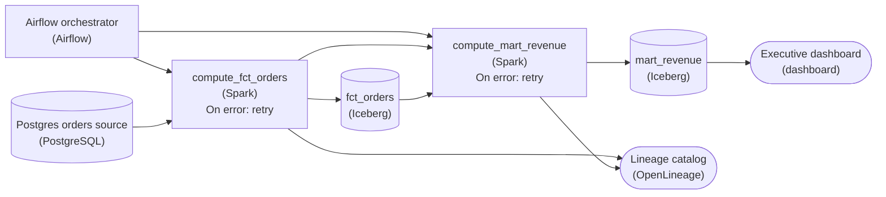

*Airflow schedules both tasks in order with task-level retries. Each run reports its reads and writes to the catalog, and `fct_orders` and `mart_revenue` are `Iceberg` tables the catalog pins lineage to.*

2. **Register each task's assets in a catalog**

   Add a lineage catalog such as `OpenLineage` and connect both tasks to it. Each run reports what it read and wrote: `compute_fct_orders` produces `fct_orders`; `compute_mart_revenue` consumes it and produces `mart_revenue`. The dependency that lived in the code becomes metadata anyone can query.

3. **Move the tables to a lakehouse format**

   Store `fct_orders` and `mart_revenue` as `Iceberg` tables instead of the plain Snowflake mart. Each write becomes a versioned snapshot, so the catalog pins lineage to the exact version a run produced, and 'which run made these numbers' has an answer.

| Key insight: Hybrid keeps the task graph and adds the asset view |
| --- |
| Airflow still decides when work runs and what retries. The catalog and the lakehouse tables say what data exists and where it came from. You made the dependency Airflow already relied on visible without ripping out the task graph. |

**Follow-up questions**

1. A third task starts reading `fct_orders`. What does the catalog show that the `>>` edge never could?\
   *Lineage as a queryable graph of consumers, not a hand-kept ordering.*
2. `compute_mart_revenue` reruns on corrected input. How does snapshot identity on the `Iceberg` table let you name exactly which dashboard reads are affected?\
   *Connects snapshot versioning to impact analysis across a rerun.*

</details>


<br>

### Exercise 2 of 2

**● TASK**

The daily aggregation hardcodes CURRENT_DATE, and history is filled by a custom Python loop firing 365 append queries at once into plain Snowflake. Make it backfillable: replace the loop with an orchestrator (Airflow, Dagster, or Prefect) that runs the task once per logical date as a scheduled backfill job. Replace Snowflake with an ACID lakehouse format (Iceberg, Delta, or Hudi) so each day's run overwrites only its own partition.

**Starting canvas** (already placed for you):

- Postgres orders source (source, Postgres)
- Daily aggregation: CURRENT_DATE hardcoded, INSERT INTO (transform, Python)
- Custom Python backfill loop (no orchestrator) (transform, Python)
- Plain Snowflake mart.daily_orders (storage, Snowflake)
- Morning dashboard (consumer, Looker)

<details>
<summary><strong>Solution</strong></summary>

#### Making the pipeline backfillable by design

Backfilling is treating the re-computation of any past day as a normal, repeatable operation rather than a one-off rescue script. 2 structural pieces make that true here: an orchestrator that owns each run keyed to a logical date, and a table format whose ACID writes let a run replace only its own day's partition.

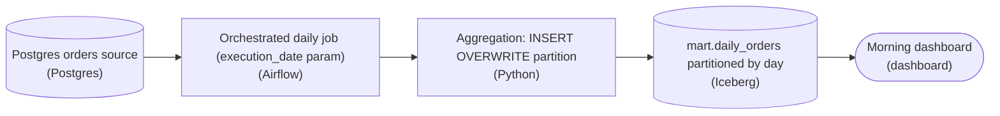

*The orchestrator passes the run's date in; the aggregation overwrites that day's partition in `mart.daily_orders`.*

| Pitfall: A hardcoded date can only ever run today |
| --- |
| The daily task pinned `CURRENT_DATE` inside its SQL, so it only knew about the wall-clock day. To fill history the author bolted on a custom loop that fired 365 `INSERT INTO` appends at once: no retries, no per-day isolation, and any re-run double-appends rows. The date a run computes must be a parameter the orchestrator passes in, never read from the clock. |

| Trick: Idempotency comes from overwriting a partition |
| --- |
| Partition the target by day and have each run do a partition overwrite (`INSERT OVERWRITE` scoped to its date) instead of an append. Iceberg, Delta and Hudi make that write atomic, so re-running any historical day replaces exactly that day's rows and nothing else. Backfilling a year becomes 365 independent, idempotent tasks the orchestrator schedules and retries. |

| Real world: Backfills are routine, not emergencies |
| --- |
| In production you re-run history constantly: a bug in the aggregation, a late-arriving source, a new column. When the orchestrator owns backfill as a scheduled job over a date range and each day overwrites its own partition, a backfill is one command over a window, safe to interrupt and resume. |

**Follow-up questions**

1. What breaks if 2 backfill runs for the same day overlap on a plain append destination?\
   *Tests why partition-level atomicity, not just parameterization, is what makes re-runs safe.*
2. How would you backfill after adding a column to the aggregation?\
   *Tests table-format schema evolution alongside partition overwrite.*

</details>


<br>

---

## Backfills as First-Class Operations

A backfill recomputes past partitions: a bug fix changes how revenue is summed, a new column needs history, or a source resends February. Whether a 90-day backfill takes an afternoon or a week of cleanup depends on 3 properties of the task, all set when it was first written.

A backfillable task

- **Reads its date from the run** *Parameterized*\
  Every date in the query comes from the run's logical date. Launched for February 9 in October, it computes February 9.
- **Writes only its own partition** *Partition-scoped*\
  A run for February 9 replaces February 9 and touches no other date, so many dates can be rebuilt side by side.
- **Runs as an orchestrator backfill** *Managed*\
  The orchestrator expands a date range into dated runs, caps how many run at once, and lists the dates that failed.


<br>

### The clock inside the query

```sql
INSERT INTO revenue_daily
SELECT
  ds,
  sum(amount_usd) AS revenue_usd,
  count(*) AS order_count
FROM orders
WHERE ds = current_date - INTERVAL '1' DAY
GROUP BY ds
```

On schedule, `current_date - INTERVAL '1' DAY` equals the logical date, so the bug can hide for months. Launch a 30-day backfill ending February 9 on February 20 and every run in it computes February 19 and appends it: `revenue_daily` gains 30 more February 19 rows, and the 30 dates you meant to fix stay as they were.

The fix takes the date from the run instead of the clock, and clears the target partition before writing it:

```sql
DELETE FROM revenue_daily
WHERE ds = DATE '2026-02-09'
```

```sql
INSERT INTO revenue_daily
SELECT
  ds,
  sum(amount_usd) AS revenue_usd,
  count(*) AS order_count
FROM orders
WHERE ds = DATE '2026-02-09'
GROUP BY ds
```

Both statements name the run's date and no other. Because `revenue_daily` is partitioned by `ds`, the delete drops 1 partition and the insert fills it, so each run's work scales with 1 day of data. A run for February 10 never touches February 9, which lets several dates run at once. Between the 2 statements a reader sees February 9 empty; tables that can overwrite a partition in a single commit close that gap.


<br>

### Let the orchestrator own the range

A shell loop that calls the job 90 times works until day 47 fails at 03:00 and nobody knows which days finished. An orchestrator backfill takes a DAG and a date range, creates 1 run per logical date, runs them under the DAG's limits, and records each outcome, so 2 failed dates mean rerunning 2 dates.

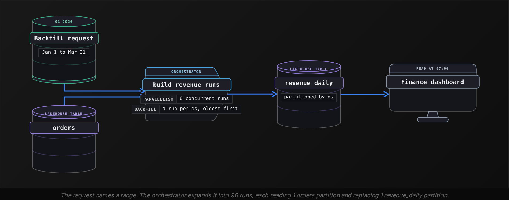


<br>

### Choosing concurrency

Each `build_revenue` run takes around 12 minutes on a quiet warehouse, and Q1 2026 holds 90 dates. Concurrency trades wall-clock time against the load you add beside production:

- **18 h** — Q1 at 1 run at a time
- **3 h** — Q1 at 6 runs at a time

Past the point where the warehouse saturates, more concurrent runs stop shortening the backfill: each query slows, and the nightly jobs on the same warehouse slow with them. Size concurrency from the headroom the warehouse has beside production, the number section 3 turns into a pool.

#### Tables that must run oldest date first

Some tables read their own previous partition. `customer_lifetime_value` for February 9 is the February 8 value plus February 9's orders. Backfill such a table at concurrency 1, oldest date first. At 6, the February 9 run can read a February 8 partition the backfill has not rebuilt yet and carry the old logic forward.

| ✓ Do | ✗ Don't |
| --- | --- |
| • Read every date from the run's logical date<br><br>• Clear or overwrite exactly the partition the run owns<br><br>• Launch backfills through the orchestrator so failed dates are listed<br><br>• Run tables that read their own prior partition at concurrency 1 | • Call current_date or now() inside a transform<br><br>• Append rows without clearing the target date first<br><br>• Loop over dates in a shell script<br><br>• Backfill a table before the inputs it reads are rebuilt |

**The orchestrator substitutes each run's logical date wherever 2026-02-09 appears in this query. A 30-day backfill of it runs at concurrency 6. What does daily_active_users hold for those 30 dates afterwards?**

```sql
INSERT INTO daily_active_users
SELECT
  DATE '2026-02-09' AS ds,
  count(DISTINCT user_id) AS dau
FROM events
WHERE event_ts >= current_timestamp - INTERVAL '24' HOUR
```

- **A.** A correct row per date, since each run labels its output with its own ds
- **B.** Only the old rows, because INSERT fails when a row for that ds already exists
- **C.** Correct counts, but only once concurrency is lowered to 1 so runs stop overlapping
- **D.** An extra row on each date, every new one counting the 24 hours before the backfill ran

<details>
<summary>Solution</summary>

**D.** An extra row on each date, every new one counting the 24 hours before the backfill ran

The ds comes from the run, but the WHERE clause reads the clock and nothing clears the old row, so each date keeps its old row and gains a copy of the same recent count.

**Why the others are wrong**

- **A.** The label is right, but the filter reads the 24 hours before the backfill ran, so every row counts the same recent day.
- **B.** Nothing in this table rejects a second row for a ds. The insert succeeds and adds a row beside the old one.
- **C.** Lowering concurrency changes nothing here: at 1, every run still filters on the time the backfill ran.

</details>


<br>

---

## Pipeline Architecture

### Exercise 1 of 2

**● TASK**

The daily revenue DAG promises that mart.daily_revenue is fresh for the previous day by 6am Pacific, but that SLA lives only in a runbook, so on-call learns of a miss when an executive opens a stale dashboard. Declare the SLA on the asset: add a monitor that watches mart.daily_revenue's freshness against the 6am deadline, and an alert destination that routes each miss to on-call.

**Starting canvas** (already placed for you):

- Postgres orders source (source, PostgreSQL)
- Airflow daily DAG (transform, Airflow)
- aggregate_revenue task (transform, SQL)
- mart.daily_revenue (storage, warehouse)
- Executive dashboard (6am Pacific read) (consumer, dashboard)

<details>
<summary><strong>Solution</strong></summary>

#### Moving the SLA out of the runbook

An orchestrator-level SLA is a promise about one asset: `mart.daily_revenue` is fresh for the previous day by 6am Pacific. Declaring it turns that promise into a live check on the asset instead of a line a human must remember. It takes 2 stages. A freshness monitor owns the 6am threshold and decides when a miss has happened. An alert destination carries that miss to on-call with the asset and the deadline attached.

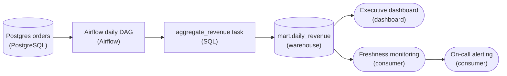

*The monitor reads `mart.daily_revenue`, the same asset the dashboard reads, so a miss pages on-call before the 6am read.*

| Pitfall: A runbook that says 6am checks nothing |
| --- |
| The old pipeline had an SLA only because someone wrote 6am in a runbook. Nothing measured it, so the first sign of a miss was an executive opening a stale dashboard. A commitment that nothing monitors is a hope, not an SLA. |

| ✕ Freshness monitor | ✓ Alert destination |
| --- | --- |
| Watches `mart.daily_revenue` and owns the threshold: fresh by 6am Pacific. It decides that a miss happened, so tuning the deadline against past run times happens here. | Receives the miss and wakes on-call with the asset name and the deadline attached. It owns routing and escalation, not the definition, so changing who gets paged never changes what counts as late. |

| Key insight: Watch the asset, not the task exit code |
| --- |
| Watching the freshness of `mart.daily_revenue` catches every way the pipeline can fail: the DAG never ran, `aggregate_revenue` silently wrote zero rows, or the upstream orders were empty. It asks whether the data is fresh, not whether a task exited 0, and a green Airflow run can still breach the SLA. |

**Follow-up questions**

1. The DAG usually lands at 4:30am but ran past 5:50am twice last month. Where do you set the warning threshold so that it fires early without paging every night?\
   *Tuning an SLA threshold against the historical runtime distribution.*
2. A finance export also reads `mart.daily_revenue`, but its deadline is noon. How do you express both deadlines?\
   *Whether the SLA lives on the asset or on each consumer's expectation of it.*

</details>


<br>

### Exercise 2 of 2

**● TASK**

A 6am-SLA customer dashboard DAG, a 365-day backfill DAG and an experimental ML feature DAG share one Snowflake XL warehouse and collide on Mondays. Draw the dashboard DAG as tasks in dependency order, each retrying on failure, on its own high-priority orchestrator, and put the backfill and ML DAGs on a separate lower-priority orchestrator. Give the lower-priority path its own warehouse so it cannot starve the dashboard, and monitor the dashboard's 6am SLA.

**Starting canvas** (already placed for you):

- Customer-facing daily dashboard DAG (SLA 6am) (transform, Airflow)
- Backfill DAG (365-day reload) (transform, Airflow)
- ML experimental feature build DAG (transform, Airflow)
- Snowflake XL warehouse (shared) (storage, Snowflake)
- Executive dashboard (consumer, Looker)

<details>
<summary><strong>Solution</strong></summary>

Priority isolation starts with the DAG itself. The orchestrator runs **tasks in dependency order** and retries each task on its own, so a failed aggregate reruns without reloading the tables before it. Pools and `priority_weight` then decide which task starts next, but neither takes compute back from a query already running. On one shared Snowflake XL warehouse, a 365-day backfill query mid-flight keeps its compute while the dashboard waits, and on Monday that wait pushes it past 6am. The fix is structural: separate orchestrators and separate warehouses.

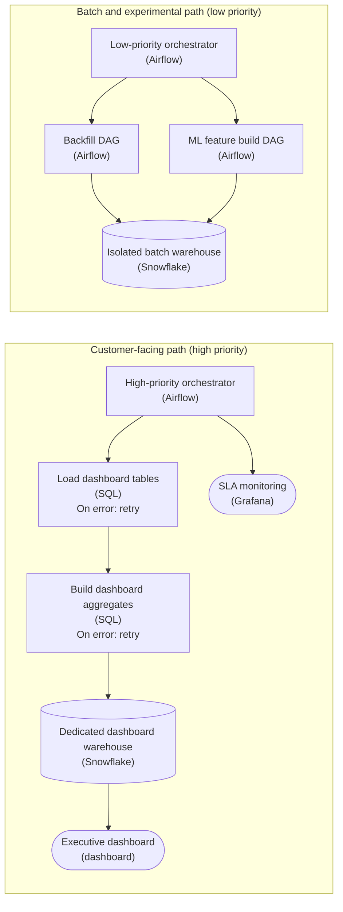

*The dashboard DAG runs as ordered, retrying tasks on its own orchestrator and warehouse; the backfill and ML DAGs share a lower-priority orchestrator and warehouse, and SLA monitoring watches the 6am target.*

| Pitfall: Raising `priority_weight` only reorders the queue |
| --- |
| Keeping one warehouse and bumping the dashboard's `priority_weight` wins the scheduler race, but the backfill query already running holds its compute until it finishes. Priority orders the next slot. It never preempts running work, so the collision moves instead of disappearing. |

1. **Split orchestration by criticality**

   One orchestrator runs only the customer-facing dashboard DAG at high priority. A second runs the backfill and ML experimental DAGs at lower priority. A runaway experiment can no longer take a slot the dashboard depends on.

2. **Draw the dashboard DAG as ordered tasks**

   Load the dashboard tables, then build the aggregates. The edge between them is the dependency the orchestrator enforces. Each task has its own retry, so a transient warehouse error on the aggregate step reruns only that step and the 6am window survives.

3. **Give each path its own compute**

   Each path writes to its own Snowflake warehouse. The backfill and the feature build can saturate the batch warehouse for hours while the dashboard's warehouse stays idle and ready at 6am. Priority alone could not buy this.

4. **Alert on lateness, not only failure**

   A run that succeeds at 6:40am is green and still a missed SLA. The monitor watches completion time against the target, so you can prove the isolation actually holds.

**Follow-up questions**

1. The backfill runs only a few days a month. Should its warehouse stay on, or start on demand?\
   *Isolation as a cost lever: auto-suspend for bursty batch compute.*
2. If the aggregate task exhausts its retries at 5:50am, what should the dashboard show?\
   *Task-level retries versus the SLA they are meant to protect.*
3. How do you stop 2 orchestrators from becoming 5 as new low-priority DAGs arrive?\
   *Criticality tiers as the rule, not one orchestrator per workload.*

</details>


<br>

---

## SLAs at the Orchestrator Level

An orchestrator-level SLA is a condition the orchestrator checks against every run: a task finishes within so many minutes of starting, or a partition exists by a set time. When it fails, the orchestrator alerts while the run is still in progress, so the first person to hear about a late table is an engineer who can still fix it.


<br>

### Duration SLAs and deadline SLAs

| SLA type | Declared on | Fires when | Catches |
| --- | --- | --- | --- |
| Duration | A task | A run is still going N minutes after the task started | A slow query: a bad plan, skewed data, a busy warehouse |
| Deadline | A DAG run or an asset partition | The output is not complete by a clock time | Any cause of lateness, including steps that never started |

A duration SLA starts its clock when the task starts, so a task that never starts never breaches it. A deadline SLA is pinned to the wall clock and catches every cause of lateness at once: a slow query, a failing upstream step, a run stuck in a queue. Declare deadlines on what consumers read, and durations where you want an early hint.


<br>

### Thresholds from run history

A threshold picked by feel is usually wrong in 1 of 2 directions. Orchestrators keep a table of every task run, so the real distribution is a query away. This one reads 60 days of successful runs:

```sql
SELECT
  task_id,
  COUNT(*) AS runs,
  APPROX_PERCENTILE(DATE_DIFF('minute', start_ts, end_ts), 0.5) AS p50_min,
  APPROX_PERCENTILE(DATE_DIFF('minute', start_ts, end_ts), 0.95) AS p95_min,
  APPROX_PERCENTILE(DATE_DIFF('minute', start_ts, end_ts), 0.99) AS p99_min
FROM task_runs
WHERE task_id IN ('load_orders', 'build_revenue')
  AND state = 'success'
  AND logical_date BETWEEN DATE '2026-01-01'
  AND DATE '2026-03-01'
GROUP BY task_id
```

| task_id | runs | p50_min | p95_min | p99_min |
| --- | --- | --- | --- | --- |
| load_orders | 60 | 24 | 33 | 52 |
| build_revenue | 60 | 22 | 31 | 48 |

Half the `build_revenue` runs finish within 22 minutes, 1 in 20 runs past 31, and the p99 night took 48. The slow nights cluster on the 1st of each month, when the query also rebuilds month-to-date totals. A 25-minute threshold sits between p50 and p95, so it fires on ordinary nights and gets muted. A 90-minute threshold sits above every night in the history and fires after the damage is done.

Set the duration SLA a margin above p95, 25 percent here. When the history is bimodal, add a second, higher threshold for month-start runs rather than 1 number that is too tight for them and too loose for every other night. For the deadline, work back from the consumer: finance reads `revenue_daily` at 07:00, and on-call needs enough time to rerun a failed step and its downstream.

- **40 min** — duration SLA on build_revenue
- **05:00** — deadline SLA on revenue_daily
- **2 h** — on-call window before 07:00


<br>

### Alerts that say what to do next

Route each alert to the team that owns the step that is late or blocking, which is often upstream of the asset that missed. The revenue team gets a notice, and the orders-platform team gets the page when `orders` is what holds everything up. Then put into the alert what the responder would otherwise spend 20 minutes finding:

```sql
{
  "alert": "deadline_sla_missed",
  "asset": "revenue_daily",
  "partition": "2026-04-14",
  "deadline": "2026-04-15T05:00:00Z",
  "consumer_reads_at": "2026-04-15T07:00:00Z",
  "state": "waiting on upstream",
  "blocked_on": {
    "asset": "orders",
    "partition": "2026-04-14, hr 23",
    "state": "failed 3 attempts: source connection refused",
    "owner": "orders-platform"
  },
  "route_to": "orders-platform on-call",
  "notify": "revenue team channel",
  "deadlines_missed_last_60_days": 0,
  "logs": "https://orchestrator.internal/runs/orders/2026-04-14"
}
```

> Every SLA alert carries
>
> - The asset or task and partition that is late
> - Its deadline, and when the consumer actually reads it
> - What it waits on now: queued, running, failed or never started
> - The owner of the blocking step, who receives the page

**build_revenue carries a 40-minute duration SLA, and revenue_pipeline has no deadline SLA. On February 12, load_orders fails at 00:35 and keeps failing until 06:40, so wait_for_orders waits. What does the orchestrator report about build_revenue before finance reads at 07:00?**

- **A.** Nothing, because the task has not started and its 40-minute clock has not begun
- **B.** A duration breach at 01:40, 40 minutes after the DAG run began at 01:00
- **C.** A deadline breach at 07:00, since finance reads revenue_daily at that time
- **D.** A duration breach on load_orders, since it has been failing for over 40 minutes

<details>
<summary>Solution</summary>

**A.** Nothing, because the task has not started and its 40-minute clock has not begun

A duration SLA measures from the task's own start. An upstream failure keeps the task waiting, and no duration rule can see that.

**Why the others are wrong**

- **B.** The SLA is declared on the task, so its clock starts when build_revenue starts, which has not happened by 07:00.
- **C.** No deadline SLA is declared. The orchestrator checks the conditions it was given, and nobody gave it 07:00.
- **D.** The 40-minute SLA belongs to build_revenue alone, and load_orders has no SLA of its own to breach.

</details>


<br>

---

## Pipeline Architecture

### Exercise 1 of 2

**● TASK**

Redesign the seam between stripe_to_raw (now every 5 minutes) and daily_finance_close (6am SLA) so it no longer relies on a time offset. Replace Snowflake raw.payments with an Iceberg, Delta, or Hudi asset and trigger finance close on its snapshot freshness, not the clock. Add an observability_tool on that asset's freshness with an alert_destination paging on-call, and use two orchestrators to isolate finance close from backfills.

**Starting canvas** (already placed for you):

- stripe_to_raw DAG (every 5 min) (transform, Airflow)
- Plain Snowflake raw.payments (mid-batch writes) (storage, Snowflake)
- daily_finance_close DAG (cron 0 5 * * *, BRITTLE) (transform, Airflow)
- Snowflake mart.daily_close (SLA 6am, missing 2x/week) (storage, Snowflake)
- Executive finance dashboard (consumer, Looker)

<details>
<summary><strong>Solution</strong></summary>

#### The seam was a clock, not a contract

This postmortem is a case for **data-aware scheduling**: a downstream job fires when the asset it depends on is actually fresh, not at a wall-clock time you hope is late enough. Here `daily_finance_close` ran on `0 5 * * *` and just assumed `stripe_to_raw` had finished the previous day's writes by then. That assumption was a hidden time offset. When `stripe_to_raw` moved from a 30-minute cadence to 5 minutes, the write pattern shifted and the 5am read started landing mid-batch, so the close missed its 6am SLA about twice a week. Nobody changed `daily_finance_close`; the implicit contract just quietly broke.

| Pitfall: The fix that breaks again next quarter |
| --- |
| The tempting patch is to push the cron to `0 6 * * *` or drop a `sleep` in front of the close. That is still a time offset, just a bigger one. It papers over this cadence change and re-breaks the moment `stripe_to_raw` retimes again, gets slower, or backfills. You have not removed the fragile coupling, you have re-tuned it. The postmortem framing says redesign the seam structurally, not re-guess the delay. |

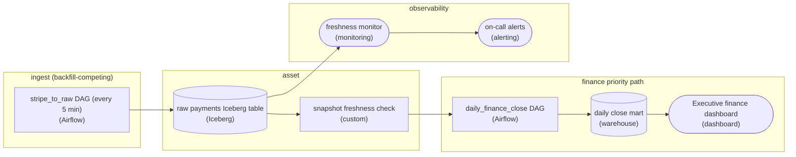

*The seam is now the asset's snapshot, not a shared clock: the close waits on freshness, a monitor watches the same asset, and finance runs on its own orchestrator.*

1. **Give the asset snapshot semantics, then trigger on freshness**

   Swap plain `raw.payments` for a lakehouse table format (Iceberg here, Delta or Hudi work too). A plain table has no notion of "the batch is complete", so a reader can only guess with a clock. An Iceberg table commits atomic snapshots, so `raw.payments` can answer "what is my newest committed snapshot and when did it land". Now `daily_finance_close` fires on that snapshot freshness instead of `0 5 * * *`: it waits for the day's data to actually be committed, whether that is 4:50 or 5:20, and it never reads mid-batch.

2. **Watch the asset, not the job**

   Point a monitoring tool at the freshness of `raw.payments` and route breaches to on-call through an alerting destination. The signal you care about is "the asset the close depends on has gone stale", which is upstream of the close ever starting. That catches a stalled `stripe_to_raw` before the SLA burns, instead of finding out at 6am when the executive dashboard is blank. The alert is about the contract's freshness guarantee, so it fires on the cause, not the symptom.

3. **Isolate finance-close onto its own priority path**

   Split into two orchestrators so `daily_finance_close` no longer shares scheduling and warehouse contention with the backfill and ingest workloads. Even with a correct freshness trigger, a heavy backfill hammering the same warehouse can starve the close and blow the 6am SLA. A dedicated finance orchestrator with its own priority means the close's compute is not competing with best-effort backfills. This is the difference between the seam being logically correct and the SLA being physically defensible.

| Key insight: The 4 pieces make the contract explicit |
| --- |
| Snapshot semantics + freshness trigger say what "ready" means; the freshness monitor + alert say who finds out when "ready" is late; the orchestrator split guarantees the compute to act on it. Together they replace "I assume you finished by 5am" with "I start when your snapshot commits, I alert if it does not, and I have my own lane to run". A cadence change upstream is now invisible to the close instead of a silent outage. |

**Follow-up questions**

1. What if `stripe_to_raw` legitimately has no new payments some days? How does the freshness check tell "stale" from "nothing to commit"?\
   *Freshness-based triggers need a heartbeat or an empty-commit convention so a quiet day does not look like a stall.*
2. How would you set the freshness threshold on the monitor so it alerts before the 6am SLA rather than at it?\
   *Tests working backward from the SLA to an upstream freshness budget.*
3. If two downstream marts both consume `raw.payments`, should they share one freshness check or each own theirs?\
   *Extends the asset-as-contract idea to fan-out consumers with different SLAs.*

</details>


<br>

### Exercise 2 of 2

**● TASK**

Redesign a fintech data platform of 412 production DAGs where an upstream cadence change broke a downstream close. Add a catalog so asset lineage is queryable. Replace plain warehouse destinations with lakehouse tables (Iceberg, Delta, or Hudi) as asset boundaries between upstream and downstream DAGs, instead of cross-DAG time offsets, so every transform is backfill-ready. Run at least 2 orchestrators to isolate customer-facing from backfill workloads, and put an observability tool plus an alert destination on the customer-facing pipelines.

**Starting canvas** (already placed for you):

- Postgres app (source, PostgreSQL)
- Payments API (source, API)
- CRM API (source, API)
- Kafka events (source, Kafka)
- Executive dashboard (consumer, Metabase)
- Finance dashboard (consumer, Metabase)
- ML feature store (consumer)

<details>
<summary><strong>Solution</strong></summary>

#### Depend on assets, not on clocks

Asset-based orchestration is the move this platform was missing. The broken close came from a downstream DAG that assumed its input was ready at a fixed time. When the upstream moved to a faster cadence, that assumption quietly became false. Once the dependency is a **lakehouse table instead of a clock**, the mart runs when its input is actually fresh, and a backfill can rebuild any date range in place. The rest of the redesign (2 orchestrators, one lineage catalog, alerting on the path that matters) then has something solid to hang on.

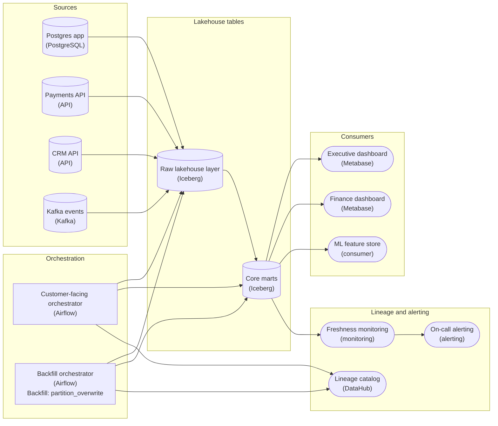

*Iceberg tables are the boundary between the ingestion and mart DAGs; 2 Airflow orchestrators keep backfills off the customer-facing path, and only that path is monitored and paged.*

1. **Make the lakehouse table the boundary**

   Ingestion writes the Raw lakehouse layer. The mart DAG declares that table as its upstream asset and runs when a new partition lands. With no `schedule_interval` offset there is no guess about when the upstream finishes, so a cadence change upstream can no longer break the close.

2. **Overwrite partitions so every rerun is a backfill**

   Iceberg gives ACID overwrite by partition. A transform parameterized on a date range writes only its target partitions, so rerunning last March replaces last March and duplicates nothing. The Backfill orchestrator carries `partition_overwrite` for exactly that reason: the code that runs tonight is the code that rebuilds history.

3. **Give backfills their own orchestrator**

   With 412 DAGs in one scheduler, a six-hour backfill competes for the same workers and warehouse slots as the customer-facing close. A second orchestrator dedicated to backfills and heavy reprocessing is pool isolation at its coarsest grain: the close never queues behind history.

4. **Watch and page only the customer-facing path**

   Freshness monitoring reads Core marts and routes misses to On-call alerting, so the SLA that matters is checked and a backfill's noise never wakes anyone. Both orchestrators report lineage to one catalog, so you can answer 'what breaks if I change this table' before you change it.

| Pitfall: Moving the offset only moves the bug |
| --- |
| Pushing the downstream job from '02:00' to '03:00' fixes this week, fails again at the next cadence change, and adds an hour of idle time to every run. The offset itself is the defect. A dependency on the upstream table replaces it. |

**Follow-up questions**

1. Finance needs the exact numbers behind a quarter-old board deck. What does the lakehouse table give you that makes this a single query?\
   *Table snapshots and `AS OF` time-travel reads.*
2. A new column arrives on the payments events. How does the asset-based design backfill it without rerunning unrelated marts?\
   *Schema evolution plus rematerializing only the downstream assets.*
3. Both orchestrators write to the same tables. How do you keep one lineage graph across 2 schedulers?\
   *Lineage is emitted per asset, so both schedulers report into the same graph.*

</details>


<br>

---

## Concurrency, Pools, and Priority

One warehouse serves the 01:00 production loads, a year-long backfill and analysts' scheduled notebooks. It runs roughly 20 queries at once before every query starts to slow. The orchestrator will launch 200 tasks at once if they are ready, so something in its configuration has to decide which 20 run and which wait.


<br>

### Four limits and their scopes

| Setting | Scope | Answers |
| --- | --- | --- |
| Max active runs | 1 DAG | How many dated runs of this DAG may be in progress at once, such as backfill runs |
| Max active tasks | 1 DAG | How many of this DAG's tasks may run at once, across all its runs |
| Pool | Every task assigned to it, in any DAG | How many slots a shared resource offers, whoever asks |
| Priority weight | 1 task | Which queued task takes the next free slot in its pool |

The first 2 settings are DAG-level and know nothing about other DAGs: 10 DAGs each capped at 4 tasks still send 40 queries. A pool is the only limit that counts across DAGs for 1 named resource; an instance-wide task cap spans DAGs too, but cannot tell warehouse queries from anything else. Name a pool after the resource it protects, give it as many slots as the resource tolerates, and assign it to every task that uses the resource. A task that is ready but finds its pool full waits in that pool's queue.


<br>

### Splitting 20 slots across 3 pools

```sql
pools:
  wh_prod:
    slots: 11
  wh_backfill:
    slots: 6
  wh_adhoc:
    slots: 3
```

A single pool of 20 would let an uncapped backfill take all 20. Split 3 ways, the backfill never holds more than 6 slots, and production always has 11 that nothing else can take. The price is idle capacity: at 04:00 production has finished and its 11 slots sit empty while backfill tasks wait, which many teams accept as the cost of the guarantee.

```sql
tasks:
  load_orders:
    pool: wh_prod
    priority_weight: 10
  build_revenue:
    pool: wh_prod
    pool_slots: 2
    priority_weight: 10
  refresh_marketing_attribution:
    pool: wh_prod
    priority_weight: 3
  sessions_daily_backfill:
    pool: wh_backfill
    priority_weight: 1
```

Setting `pool_slots: 2` makes `build_revenue` count double, because a slot counts a task and a 22-minute rollup weighs more on the warehouse than a 2-second lookup. Priority weight orders the queue: when `wh_prod` is full, the waiting task with the highest weight takes the next free slot. Some orchestrators give each task an effective weight equal to its own weight plus the weights of every task downstream of it, so a load that 8 tables wait on outranks a report nobody waits on.


<br>

### Priority orders a queue, pools reserve capacity

Priority acts only when a slot frees up. A backfill task that is already running keeps its slot for its full 12 minutes, whatever its weight. Under a steady stream of high-weight work, low-weight tasks can wait indefinitely. Use pools to guarantee capacity to a workload, and priority to order tasks that share 1 pool.

| ✓ Shared pool of 20 slots | ✗ Pools of 11, 6 and 3 |
| --- | --- |
| • At 23:30, an uncapped 365-day backfill fills all 20 slots<br><br>• At 01:00, build_revenue queues behind backfill tasks of 12 minutes each<br><br>• Priority 10 wins each slot that frees, but slots free slowly<br><br>• Analyst notebooks stand in the same queue as finance's loads | • At 23:30, the backfill holds 6 slots and its other runs wait<br><br>• At 01:00, build_revenue starts at once in wh_prod<br><br>• Analyst notebooks wait in wh_adhoc and slow nothing else<br><br>• The backfill finishes later; production finishes at its usual time |

> **TIP**
>
> Size each pool below the point where the warehouse starts queuing queries internally, then watch how long tasks wait in each pool. Long waits in `wh_prod` while `wh_backfill` idles mean the split is wrong; long waits everywhere mean the warehouse is too small.

**Production DAGs and a 365-day backfill share 1 pool of 20 slots. Production tasks carry priority 10 and backfill tasks priority 1, yet nightly loads finish 2 hours late while the backfill runs. Which change fixes it?**

- **A.** Raise production priority to 100 so it outranks the backfill by a wider margin
- **B.** Grow the pool to 40 slots so both workloads fit at the same time
- **C.** Move the backfill to its own 6-slot pool and production to its own 11-slot pool
- **D.** Set production's max active runs to 1 so its own runs stop competing

<details>
<summary>Solution</summary>

**C.** Move the backfill to its own 6-slot pool and production to its own 11-slot pool

Production gets 11 slots nothing else can hold, and the backfill can never exceed 6, so the queue that delayed the loads disappears.

**Why the others are wrong**

- **A.** Only the order of weights matters, and production already comes first. Running backfill tasks still hold their slots.
- **B.** The warehouse slows past about 20 concurrent queries. Forty slots sends it 40, and every query, production included, slows down.
- **D.** The delay comes from backfill tasks in the shared pool, and this setting only limits production's own runs.

</details>


<br>

---

## Pipeline Architecture

### Exercise 1 of 2

**● TASK**

Draw this nightly sensor pipeline asset-first: device reading files land in a raw object-storage table, a cleaning step builds a cleaned readings warehouse table, and an aggregation step builds a daily device health warehouse table that a fleet dashboard reads. Make each table its own stage wired by its data dependency, so lineage is visible on the graph. An orchestrator schedules both steps nightly and retries each one up to 3 times on failure.

<details>
<summary><strong>Solution</strong></summary>

#### Draw the tables, not just the jobs

Asset-based orchestration starts from the data: you name each table the pipeline produces and the table it is built from, and the work falls out of those dependencies. Task-based orchestration starts from the jobs and leaves the tables implicit. On a two-step nightly pipeline both run fine, but only the asset-first drawing shows that `device_health_daily` is built from `cleaned_readings`, which is built from `raw_readings_landing`. That chain is the lineage you need the morning a dashboard number looks wrong.

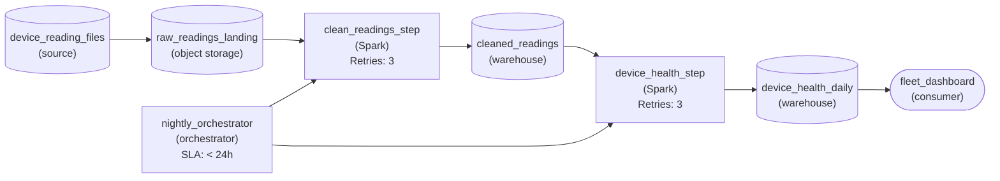

*Asset-first: each table sits between the step that writes it and the step that reads it, and the orchestrator schedules both steps nightly.*

1. **Give every table its own stage**

   Put `raw_readings_landing`, `cleaned_readings` and `device_health_daily` on the canvas as storage stages, each between the step that writes it and the step that reads it. The cleaned table is the one most drawings drop, because the dashboard never reads it directly. Keeping it visible is what lets you trace a health row back to the night of cleaned data it came from.

2. **Let the orchestrator own order and retries**

   `nightly_orchestrator` connects to both steps and carries the nightly `< 24h` cadence. Retries live on each step (`retryCount` of 3) rather than on the pipeline as a whole, so a dropped connection during aggregation reruns only the aggregation, not the cleaning that already succeeded.

| Pitfall: Chaining jobs directly hides the cleaned table |
| --- |
| Drawing `clean_readings_step` straight into `device_health_step` gives a working schedule and a blank lineage: the graph says one job follows another, but not what passes between them. That is the task-first habit this exercise is about breaking. Whenever 2 steps touch with no table between them, ask which table the first one writes. |

| Real world: An asset graph makes a partial refresh obvious |
| --- |
| When only the health logic changes, the asset graph shows that rebuilding `device_health_daily` from the existing `cleaned_readings` is enough. A task graph only tells you 2 jobs ran in order, so teams tend to rerun everything to be safe. |

**Follow-up questions**

1. A second team wants a weekly anomaly table built from `cleaned_readings`. Where does it attach, and what changes for the orchestrator?\
   *Whether a new asset hangs off the existing table instead of duplicating the cleaning step.*
2. Redraw the same pipeline task-first. Which question about the dashboard numbers can it no longer answer?\
   *The lineage difference between the 2 orchestration models.*

</details>


<br>

### Exercise 2 of 2

**● TASK**

A currency bug wrote wrong amounts into 45 days of a date-partitioned revenue table built nightly from an orders database. Design the pipeline so an orchestrator runs one load per logical date, for the nightly run and as a backfill over those 45 days. Each run must replace only its own date's partition in the warehouse, so rerunning a day never duplicates rows.

<details>
<summary><strong>Solution</strong></summary>

#### One load, any date, one partition

A backfill is the nightly load run again for dates it already covered, and a pipeline survives it only when two things hold: the load takes its date as a parameter, and its write is scoped to that date's partition. Repairing the 45 bad days is then just asking the orchestrator for 45 logical dates; nothing about the job differs between tonight's run and the repair.

1. **Hand the date to the load**

   `daily_revenue_load` runs on Airflow and receives its logical date from the orchestrator instead of computing 'yesterday' itself. The nightly schedule asks for one date, the backfill asks for each of the 45 affected dates, and both go through the same task.

2. **Scope the write to that date**

   With the backfill strategy set to partition overwrite, a run for one date deletes and rewrites only that date's partition of `revenue_warehouse`. Run it twice and the second run produces the same partition, so a retried day cannot double its revenue and the days outside the range are never touched.

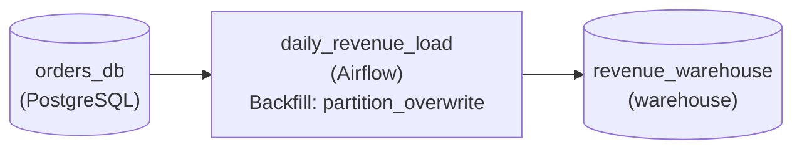

*`daily_revenue_load` runs once per logical date and overwrites only that date's partition in `revenue_warehouse`.*

| Pitfall: Appending a backfilled day doubles it |
| --- |
| A backfill that appends leaves the wrong rows in place and adds the corrected ones beside them, so each repaired day reports roughly twice its revenue. Truncating the whole table and reloading avoids the duplicates but rewrites every correct day too, which the repair never needed. |

| Real world: Every backfill reason uses the same path |
| --- |
| A bug fix, a newly added column and the initial history of a new pipeline are all the same request: run this load for these dates. Build the date parameter and the partition-scoped write once, and the one-off backfill script stops existing. |

**Follow-up questions**

1. A new `tax_amount` column must be filled for two years of history: what changes in this design?\
   *Whether the same per-date backfill path covers a column-add backfill without a separate job.*
2. What if an order's amount could be edited weeks after it was placed?\
   *Whether partitioning by date still bounds which partitions a correction must rewrite when late changes land in old dates.*

</details>


<br>

---

## Postmortem: Cadence Change Bug

At 07:00 on March 10, finance read $4.1M of revenue for March 9. The correct figure, recomputed after 10:30, was $4.6M. Every task in every DAG had succeeded and no alert had fired. The causes sat in 4 separate layers, and none of them alone would have produced the wrong number.


<br>

### The setup

The orders-platform team owns `orders_ingest`, which loads the orders database into `orders`. Until March 2 it ran daily at 00:15 and committed all of yesterday in 1 write around 00:40. The revenue team owns `revenue_pipeline`, which starts at 01:00: its sensor `wait_for_orders` passes once an `orders` partition exists for yesterday's `ds`, then `build_revenue` writes `revenue_daily` from the revenue team's own small pool. Its 40-minute duration SLA is the only SLA in the system.

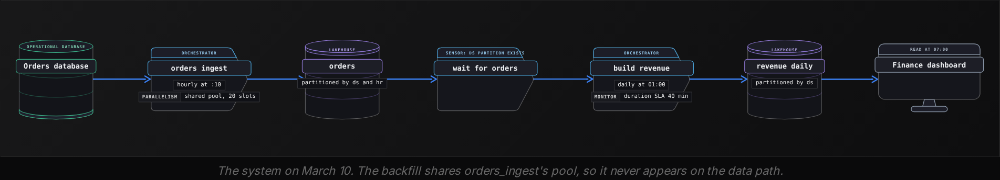


<br>

### Timeline

| When | What happened |
| --- | --- |
| March 2 | orders_ingest switches to hourly runs at :10, each loading the previous hour into orders, now partitioned by ds and hr |
| March 9, 21:30 | An uncapped 365-day backfill of sessions_daily starts in the shared 20-slot warehouse pool, queuing over 300 tasks |
| March 9, 22:10 | The run loading hour 21 queues behind them at equal priority; the 23:10 and 00:10 runs join it |
| March 10, 01:00 | wait_for_orders finds ds=2026-03-09 present and passes at once |
| March 10, 01:22 | build_revenue succeeds inside its SLA and writes $4.1M for March 9 |
| March 10, 03:40 | Hours 21 to 23 land in orders, and nothing reruns build_revenue |
| March 10, 07:00 | Finance reads $4.1M while every orchestrator view shows green |
| March 10, 10:30 | Finance escalates, and a manual rerun of build_revenue writes $4.6M |


<br>

### Layer by layer

#### The seam: a sensor that encoded a cadence

Under the daily schedule, the whole day landed in 1 commit, so a partition existing meant the day was complete. Hourly loading made `ds=2026-03-09` appear at about 01:10 on March 9, nearly a full day before it was complete. Nothing in the sensor's code mentioned cadence, so it kept passing. For a week the hour-23 load happened to finish by about 00:25, before 01:00, which hid the bug.

#### The contract: completeness nobody owned

Nobody had written down when a day of `orders` is complete. The revenue team inferred it from the old schedule, and orders-platform announced the change as 'orders is now hourly and fresher' without knowing who relied on the daily boundary. In freshness-tier terms the node moved from a daily tier to an hourly one, and the promise its consumer used, that day D is whole before 01:00 on D+1, vanished with no owner to notice.

#### The pool: a cadence that multiplied exposure

`orders_ingest` ran in the shared 20-slot `warehouse` pool at the same priority as everything else in it. A single load at 00:15 rarely met evening work. Twenty-four loads a day meant several always overlapped whatever ran in the evening, and on March 9 that was a backfill whose queued tasks stood ahead of the 22:10, 23:10 and 00:10 loads.

#### The SLA: green on a partial day

`build_revenue` ran for 22 minutes, well inside its 40-minute duration SLA, so the 1 signal that existed was green. No SLA anywhere watched `orders`, the asset that was actually late, and no check compared what `build_revenue` read with what a full day holds.

**Which single signal would have reached a human before finance read the wrong number at 07:00?**

- **A.** A tighter duration SLA on build_revenue, such as 25 minutes
- **B.** A deadline SLA on orders for March 9 at 00:45, routed to orders-platform
- **C.** A deadline SLA on revenue_daily at 05:00, routed to the revenue team
- **D.** A longer timeout on wait_for_orders so the sensor waits for more data

<details>
<summary>Solution</summary>

**B.** A deadline SLA on orders for March 9 at 00:45, routed to orders-platform

At 00:45 hours 21 to 23 were still queued, so orders-platform would have been paged with over 6 hours to act.

**Why the others are wrong**

- **A.** build_revenue ran for 22 minutes, so 25 stays green. The task was fast; its inputs were incomplete.
- **C.** revenue_daily was written at 01:22, so this deadline passes green. It checks when the table was written and ignores what went into it.
- **D.** The sensor passed at once because its condition was already true, and a longer timeout never changes a condition that passes.

</details>


<br>

### The redesign

| Layer | Before | After |
| --- | --- | --- |
| Seam | Sensor passes when any orders partition for the day exists | revenue_daily for day D depends on all 24 hourly orders partitions for D |
| Contract | Unwritten, inferred from the old daily schedule | Published by orders-platform: day D complete by 00:45 on D+1, with cadence changes reviewed against it |
| Pool | Hourly loads share an uncapped 20-slot pool with backfills at equal priority | wh_prod 11, wh_backfill 6, wh_adhoc 3, with production loads at priority 10 |
| SLA | Duration SLA on build_revenue only | Deadline SLAs: orders at 00:45 paging orders-platform, revenue_daily at 05:00 paging the revenue team |

The pool fix removes this night's trigger. The seam and contract fixes turn any future delay into a late number instead of a wrong one, and the SLA fix tells a person before finance notices. On assets, the dependency also marks `revenue_daily` for day D stale when hours of D land after it was built, and with an automatic-rebuild policy on `revenue_daily` the orchestrator rebuilds it: on March 10 that alone would have replaced the wrong figure with a correct one at roughly 04:05.

**Suppose the team had fixed only the pool layer. Which failure can still reach finance?**

- **A.** None, because hourly loads can no longer queue behind a backfill in a shared pool
- **B.** The backfill, now capped, starves build_revenue at 01:00 instead of the hourly loads
- **C.** Revenue arrives correct but after 07:00, because production now has fewer slots than before
- **D.** A source export runs 2 hours late, the sensor passes on a partial day, and SLAs stay green

<details>
<summary>Solution</summary>

**D.** A source export runs 2 hours late, the sensor passes on a partial day, and SLAs stay green

The seam, contract and SLA layers are untouched, so any late hour, whatever its cause, still flows into revenue_daily unnoticed.

**Why the others are wrong**

- **A.** Queuing was 1 cause of a late hour. A slow source or a failing load still causes one, and nothing else changed.
- **B.** The backfill is held to 6 slots in wh_backfill, so it cannot take capacity from any production task.
- **C.** Production now holds 11 slots it never shares, which is more than the hourly loads could get on March 9.

</details>


<br>

---

## Pipeline Architecture

### Exercise 1 of 1

**● TASK**

Design a nightly pipeline that carries the day's shipment scans from an operations database through an orchestrated batch job into a stock-levels table in a warehouse that feeds a replenishment dashboard. Declare the 7am SLA in the orchestrator so a miss pages the on-call engineer, and add DAG-level monitoring so a stalled upstream step alerts too, not only a late final task.

<details>
<summary><strong>Solution</strong></summary>

#### A deadline the scheduler enforces, plus a watcher for the middle

An orchestrator-level SLA turns '7am fresh' from a line in a runbook into a deadline the scheduler checks and pages on. Declaring it is only half the job. Airflow attaches its `sla` to a task, and the natural home is the final publish step, so an extract that hangs at 1:30am stays silent until 7:01am, when nothing can be rebuilt before planners open the dashboard. **DAG-level monitoring closes that gap** by watching every step of the run, not just the last one.

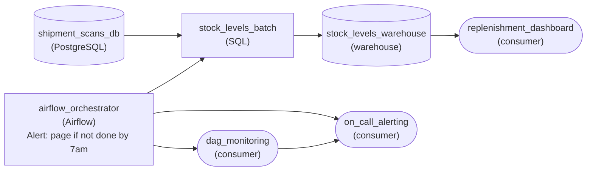

*The orchestrator carries the 7am SLA and pages on a miss; a separate monitor reads every run and pages on a stalled step.*

1. **Put the deadline on the orchestrator**

   The SLA belongs on the thing that schedules the run, because only the scheduler knows when a run started, where it is and whether it finished. Wiring the orchestrator to the paging destination is what makes 7:01am a page instead of a planner's complaint at 9:40.

2. **Give the middle of the DAG its own watcher**

   A healthy run ends by 3:30am, so a step still running at 4am is already a signal. A monitor fed by the orchestrator's run state can flag that stall hours before the deadline, which is the window in which a rerun still lands on time.

| Pitfall: A deadline on the last task is blind to the first |
| --- |
| Putting `sla` only on the publish task looks complete, but a hung extract never fails, so nothing fires until the deadline itself has passed. The miss is reported, yet the time to fix it is gone. |

| Real world: Layer the checks by when they can still help |
| --- |
| Teams usually keep the orchestrator SLA as the contract of record and add an external run monitor for early warning. The SLA answers 'did we keep the promise'; the monitor answers 'are we about to break it'. |

**Follow-up questions**

1. A second reader needs the same table by 9am. What deadline should page, and on what?\
   *Tests treating the SLA as a commitment on the published table, with the earliest consumer driving the alert.*
2. How would you tell a slow-but-healthy night from a truly stalled extract?\
   *Tests choosing a stall threshold from the normal run time rather than from the deadline.*

</details>


<br>

---

## Putting It All Together

At 16:00 the Airbnb revenue team merges its cleaning-fee fix. Thirty days of revenue_daily must be rebuilt before finance reads at 07:00, on the warehouse that also runs the 01:00 production loads, while orders arrives hourly from another team.

- revenue_daily is an asset with daily partitions, so the code change flags every partition the old code version built as stale; the orchestrator names exactly which ones, and the team materializes the last 30 from that list now.
- Each run takes its ds from the run and replaces only that partition, so the 30 runs can overlap.
- The backfill runs in wh_backfill at 6 slots: 30 runs of 12 minutes finish in about an hour, while the 01:00 loads keep their 11 slots in wh_prod.
- Deadline SLAs, 00:45 on orders and 05:00 on revenue_daily, page the owner of whichever step stalls, with the blocking partition named in the alert.
- Because revenue_daily depends on all 24 hourly orders partitions under a published contract, an upstream cadence change cannot hand it a partial day.


<br>

---

## Pipeline Architecture

### Exercise 1 of 2

**● TASK**

Thirty nightly ingestion DAGs each copy tables from one PostgreSQL read replica that serves at most 8 analytics connections. Design the ingestion from the replica into a warehouse, scheduled by an orchestrator, so that every extract across all thirty DAGs shares one pool sized to that limit and the finance extracts claim free slots first.

<details>
<summary><strong>Solution</strong></summary>

#### One budget for every DAG that touches the replica

A pool is how an orchestrator rations a resource that many DAGs share. Here the resource is the replica's 8 analytics connections, so the pool gets 8 slots, and every extract task, whichever of the thirty DAGs owns it, must hold a slot while it runs. The ninth task waits in the scheduler instead of opening a ninth connection, which is exactly the load the replica could not absorb.

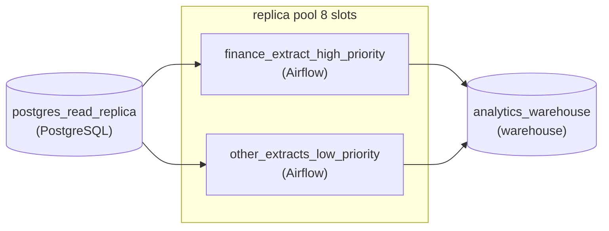

*Both extract stages draw from one 8-slot replica pool; finance extracts outrank the rest for each freed slot.*

| Pitfall: Per-DAG caps multiply across DAGs |
| --- |
| Setting each DAG's task concurrency to 1 feels safe, but it caps one DAG at a time: thirty DAGs at 1 each still open 30 connections. Concurrency is the single-DAG lever; only a pool sees every DAG at once, which is why the 8 belongs on the pool and nowhere else. |

| Key insight: Priority orders the line, it adds no slots |
| --- |
| Giving finance extracts a higher `priority_weight` changes who gets the next free slot, not how many slots exist. The replica still sees at most 8 connections; finance simply stops waiting behind lower-value tables. Priority without a pool does little, because with no cap there is no line to jump. |

| Real world: Size the pool to the system, not the DAG |
| --- |
| The same shape guards any capacity-limited system: a Spark cluster's executors or a partner API's rate limit gets one named pool sized to that system's real limit, shared by every DAG that calls it. When the limit changes, you change one number. |

**Follow-up questions**

1. What changes if each finance extract opens 2 connections instead of one?\
   *Whether the learner lets a task claim more than one slot so the pool still matches real connections.*
2. How would you stop a slow night's run of one DAG from overlapping its next run?\
   *Separating the per-DAG run concurrency lever from the cross-DAG pool.*

</details>


<br>

### Exercise 2 of 2

**● TASK**

A fare bug wrote wrong driver payouts into the last 90 days of a date-partitioned payouts table that an orchestrated nightly task builds from a trips PostgreSQL database into a shared warehouse. Design it so the same date-parameterized task backfills the corrected range, and rerunning any day overwrites that day's partition instead of adding rows. The backfill shares the warehouse with the nightly run, so cap it at 4 concurrent task runs through a pool. Page on-call if the nightly payout run is not finished by its 6am SLA.

<details>
<summary><strong>Solution</strong></summary>

#### One task rebuilds history, a pool keeps it polite

This capstone is a backfill run the way the lesson argues it should be: the corrected range goes through the same date-parameterized task that builds the table every night, so payouts have exactly one code path. 3 other ideas from the lesson make that safe. The task writes by partition overwrite, so a day rebuilt twice still holds one set of payouts. The backfill draws from a pool capped at 4 runs, so 90 days of rebuilds cannot crowd the nightly run off the warehouse. And the orchestrator watches the 6am SLA and pages on-call when it slips.

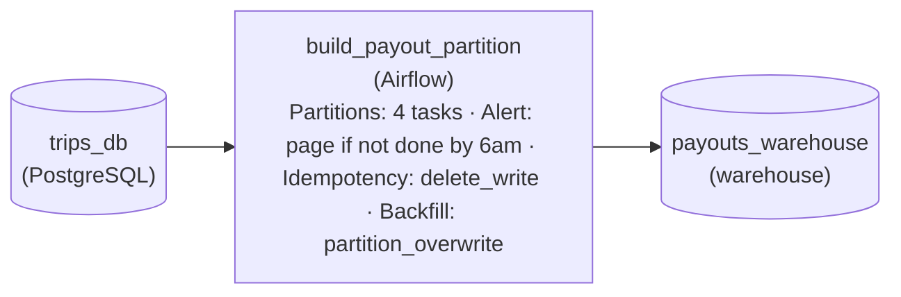

*`trips_db` feeds one Airflow task, `build_payout_partition`, that takes a date, overwrites that day's partition in `payouts_warehouse`, runs at most 4 at once, and pages if the nightly run misses 6am.*

1. **Parameterize the task by date**

   The task reads its date from the run rather than from `CURRENT_DATE`, so asking for one historical day rebuilds exactly that day. The nightly schedule and the backfill become the same task called with different dates: the fare fix ships once and applies to both.

2. **Make the write replace the partition**

   Each run deletes the target day's partition and writes it fresh (`delete_write`), with `partition_overwrite` as the backfill strategy. A day that fails halfway and is retried, or a day rerun next week, ends with one copy of each payout, never two.

3. **Cap the backfill with a pool**

   Put the task in a warehouse pool of 4 slots. The warehouse fits about six heavy runs and the nightly build needs two, so the backfill only ever takes what is left. Give the nightly run a higher priority weight so it claims a free slot first; at 20 minutes a day, 90 days finish in about 8 hours.

| Pitfall: A backfill script is a second pipeline |
| --- |
| The tempting fix is a one-off loop that fires 90 warehouse queries in parallel. It bypasses the pool, so it saturates the warehouse and the nightly run misses 6am; and it carries its own copy of the fare logic, which drifts from the task the next time that logic changes. |

**Follow-up questions**

1. The rebuild now has to cover a full year instead of 90 days. What changes?\
   *Whether the pool cap, not the range, sets the run time, and how you track progress across hundreds of dated runs.*
2. A summary table downstream reads `payouts_warehouse`. How do its rows get corrected too?\
   *Propagating a backfill to dependent tasks through the dependency graph instead of by hand.*

</details>


<br>

---

## Key Takeaways

- Task-based orchestrators record runs; asset-based ones record which data partitions exist and how current they are, so freshness, staleness and cross-team dependencies become questions the orchestrator answers.
- A backfillable task takes its date from the run, replaces only its own partition, and runs as an orchestrator backfill at a concurrency the warehouse can absorb beside production.
- Deadline SLAs on what consumers read catch every cause of lateness; set duration thresholds a margin above p95 of run history, and page the owner of the blocking step with its state in the alert.
- Pools are the only limit that spans DAGs for 1 named resource: give each workload its own pool on a shared resource, and use priority to order tasks inside a pool.
- A dependency on a run, or on a partition merely existing, encodes the producer's cadence; when the cadence changes, it can keep passing on incomplete data.
