Beginner·Pipeline Architecture · 25 min · 11 challenges

# Orchestration: Beginner

At Airbnb, a nightly cron chain turns yesterday's bookings into the host payouts report finance reads at 8am. Tonight the bookings extract runs 50 minutes long. Every downstream job still fires on its clock time and reads a bookings table the extract has not refreshed. The report lands on time and looks complete, and it is wrong. Whether anyone notices depends on one design choice: clock or dependency.


<br>

---

## Why Cron Is Not an Orchestrator

### A schedule is a list of start times

Cron is a program that lives on a server and starts a command at a clock time. A cron entry has 2 parts: when, written as 5 time fields, and what, the command to run. That is the whole contract. Cron does not read the command's output, does not wait for it to finish, and does not know that the entry on the next line depends on the one above.

A nightly orders pipeline built on cron looks like 5 entries in 1 file. Each entry starts an hour after the previous one, because an hour is longer than any of these jobs has ever taken.

| Clock time | Cron fields | Job | Usual duration |
| --- | --- | --- | --- |
| 01:00 | 0 1 \* \* \* | extract_orders | 40 min |
| 02:00 | 0 2 \* \* \* | clean_orders | 20 min |
| 03:00 | 0 3 \* \* \* | join_orders | 15 min |
| 04:00 | 0 4 \* \* \* | aggregate_orders | 10 min |
| 05:00 | 0 5 \* \* \* | publish_orders | 5 min |

The hour-long gaps are a guess about durations, and the guess holds until the first night it does not.

Each job starts at its own clock time and trusts that the job before it has finished00:50

01:0002:0003:0004:0005:00

yesterday

yesterday

yesterday

yesterday

yesterday

cron

extract_orders

CRON01:00

cron

clean_orders

CRON02:00

cron

join_orders

CRON03:00

cron

aggregate_orders

CRON04:00

cron

publish_orders

CRON05:00

Looker

revenue_dashboard

yesterday

The night the extract ran long

1/13


<br>

### Reading the night step by step

Play the cron chain variant. extract_orders starts at 01:00 as always, but a slow source database stretches it to 1h47m, so it finishes at 02:47. At 02:00, clean_orders starts on schedule and reads the extract table, which still holds yesterday's rows because tonight's have not been written yet. It cleans yesterday's data and writes the result with tonight's timestamp. At 03:00 join_orders reads that fresh-looking table, at 04:00 aggregate_orders rolls it up, and at 05:05 publish_orders hands the revenue dashboard yesterday's revenue under today's date.

Every job exited with status 0, and no log line says error. The number on the dashboard is plausible, because yesterday's revenue looks a lot like today's. This is the canonical cron failure: the chain runs to completion on stale input, and the first sign of it is a question from finance 3 days later.

Now play the orchestrator variant. clean_orders has no clock time of its own; its trigger is the success of extract_orders. It waits until 02:47, runs for 20 minutes, and join_orders starts at 03:07. The chain finishes at 03:37, 1h28m earlier than the cron chain managed, and every table it wrote holds today's rows.


<br>

### Failure modes of a cron chain

> The cron chain fails in 3 shapes
>
> - Late: an upstream job overruns its slot, and every downstream job processes the previous run's output as if it were new.
> - Failed: an upstream job crashes at 01:10 without alerting anyone, and the 4 jobs after it run anyway on whatever the table held.
> - Invisible: when the dashboard is questioned, the evidence is 5 log files on 1 server with no record of which run fed which.


<br>

### What an orchestrator adds

An orchestrator keeps the clock time and adds a graph. Its jobs are now called tasks, and it stores the edges between them under 1 rule: a task starts when the tasks it depends on have all succeeded. It retries a task that fails, and it keeps a record of every run, so the question of what fed the 2026-10-22 dashboard has an answer. Cron supplies the clock and none of the rest.

✓Cron knows

- The current time
- The command on this line
- Nothing about the line above or below

✗An orchestrator knows

- The current time and the schedule
- Which tasks this task depends on
- Whether those tasks succeeded, and when
- How many times to retry a failure
- The history of every run

*Cron is still the right tool for 1 job with no dependents, such as rotating a log file. The trouble starts at the second line that reads what the first line wrote.*

> **TIP**
>
> A quick test for whether a set of cron entries is secretly a pipeline: if deleting the first entry would make the second one produce garbage, they depend on each other, and the clock is pretending to be an edge.

**On the cron chain above, extract_orders crashes at 01:10 with a database connection error and writes nothing. What does clean_orders do at 02:00?**

- **A.** It waits until someone reruns the extract, because cron queues entries behind a failed one.
- **B.** It starts at 02:00 and reads the extract table, which still holds yesterday's rows, so the chain publishes stale data with a fresh timestamp.
- **C.** It fails immediately because its input table is empty after the crash.
- **D.** It is skipped because cron saw the non-zero exit code of the extract.

<details>
<summary>Solution</summary>

**B.** It starts at 02:00 and reads the extract table, which still holds yesterday's rows, so the chain publishes stale data with a fresh timestamp.

The crashed extract wrote nothing, so the table kept the previous night's rows. The 4 jobs after it run on time anyway and carry those rows from clean through publish to the dashboard.

**Why the others are wrong**

- **A.** Cron holds no queue. Each entry fires at its own time regardless of what happened to any other entry.
- **C.** The table is far from empty. A crash before any write leaves the previous run's rows in place, which is what makes the failure silent.
- **D.** Cron writes an exit code to its own log at most. It never uses one to decide whether a different entry runs.

</details>


<br>

---

## Pipeline Architecture

### Exercise 1 of 2

**● TASK**

A daily orders pipeline runs 5 bash scripts by cron at 1am, 2am, 3am, 4am and 5am, so when the 1am extract runs long, the 2am clean step reads stale data and the dashboard shows wrong numbers. Replace the cron timers with an orchestrator: each step starts only after the one it depends on has succeeded, the whole chain runs on one daily trigger with automatic retries, and the daily mart still lands in the Snowflake warehouse that the Looker dashboard reads.

**Starting canvas** (already placed for you):

- Postgres orders source (source, PostgreSQL)
- extract_orders.sh (cron 1:00am, runs 30-90 min) (transform, SQL)
- clean_orders.sh (cron 2:00am) (transform, SQL)
- join_orders.sh (cron 3:00am) (transform, SQL)
- aggregate_orders.sh (cron 4:00am) (transform, SQL)
- publish_orders.sh (cron 5:00am) (transform, SQL)
- Snowflake daily_orders mart (storage, Snowflake)
- Morning dashboard (consumer, Looker)


<br>

### Solution

Dependency-driven orchestration is the fix here: model the pipeline as a directed acyclic graph where each task starts only after the task it depends on has actually **succeeded**. The orchestrator watches run state, not the wall clock. That one shift turns 5 hopeful `cron` timers into a chain that either produces correct numbers or fails loudly.

| Pitfall: A timestamp is not a promise of completion |
| --- |
| The starter fires `clean_orders.sh` at 2am on the assumption the 1am extract is done. When the extract runs 90 minutes, clean fires anyway, reads yesterday's rows, and every downstream step succeeds on stale data. Nothing throws, so the dashboard is green and wrong. Spacing the crons further apart only widens the gap; it never closes it. |

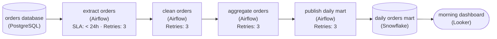

*One daily schedule on the root of the DAG, 4 orchestrated tasks chained by dependency edges and retried on failure, landing in the daily orders mart the morning dashboard reads.*

1. **Collapse the 5 timers into one trigger**

   The whole graph gets a single `@daily` schedule; the individual steps get none. `clean orders` has no time of its own to fire on, so there is no clock left for it to race against.

2. **Turn each arrow into a real dependency**

   Each task declares its upstream: `clean orders` depends on `extract orders`, `aggregate orders` on `clean orders`, `publish daily mart` on `aggregate orders`. A task starts only after its parent reports success, so a slow extract just delays clean instead of letting it read stale rows.

3. **Give each task automatic retries**

   A warehouse timeout shouldn't cost the whole day. Set a retry count on each task so a transient failure re-runs itself; only a genuine, repeated failure stops the downstream tasks and leaves the run visibly failed. `cron` could never do this because it never knew whether a step even ran.

| Key insight: The destination never changed, only what controls timing |
| --- |
| The cleaned mart still lands in the Snowflake warehouse and the Looker dashboard still reads it. You didn't rebuild the transforms or move the warehouse; you replaced time-based coupling with state-based coupling and got correctness and retries for free. |

**Follow-up questions**

1. If cleaning splits into 2 independent branches that both feed `aggregate orders`, how does the DAG change?\
   *Tests whether dependency edges and fan-in, not a single line of steps, are the mental model.*
2. The 1am run failed and you notice at 9am. How do you re-run just that day without disturbing today's schedule?\
   *Re-running a single day's DAG run on its own.*


<br>

### Exercise 2 of 2

**● TASK**

Wire three Airflow tasks, extract_orders, clean_orders and aggregate_orders, into a DAG that loads the PostgreSQL orders source into the daily_orders mart in the warehouse. Draw directed edges from upstream to downstream so each task starts only after the one before it finishes, with aggregate_orders writing to the mart and the morning dashboard reading from it. No edge may point back to an earlier task: the graph must stay acyclic.

**Starting canvas** (already placed for you):

- PostgreSQL orders source (source, PostgreSQL)
- extract_orders (transform, Airflow)
- clean_orders (transform, Airflow)
- aggregate_orders (transform, Airflow)
- daily_orders mart (storage, warehouse)
- Morning dashboard (consumer, dashboard)


<br>

### Solution

#### A DAG is the schedule, drawn as a graph

A **directed acyclic graph** turns a schedule into something you draw instead of something you write: each arrow says "this finishes before that starts", and Airflow reads the whole shape to decide what runs when. The edges from `extract_orders` to `clean_orders` to `aggregate_orders` ARE the schedule. Airflow sorts the graph topologically, starts a task as soon as all its upstream arrows report done, and refuses to start one whose parents have not. Order lives in the structure, not in sleep timers or cron offsets.

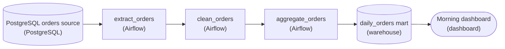

*Every arrow points upstream to downstream; `aggregate_orders` cannot start until `clean_orders` reports done.*

| Pitfall: A back-edge makes the graph unschedulable |
| --- |
| Draw an arrow from a later task back to an earlier one, such as `aggregate_orders` back to `extract_orders`, and the graph has a cycle. A topological sort then has no valid answer, so Airflow rejects the DAG instead of deadlocking at run time. The quieter failure is a MISSING edge: drop the edge from `clean_orders` to `aggregate_orders` and Airflow treats the 2 tasks as independent, running both at once on stale rows. |

| Key insight: Edge direction means depends-on |
| --- |
| The arrow points from `extract_orders` to `clean_orders` because cleaning DEPENDS ON extraction finishing. Data flows the same way here, so the 2 directions coincide, but the scheduler only tracks the dependency. That is why the arrow from the `daily_orders` mart to the dashboard sits outside the Airflow tasks: the dashboard reads the mart on its own cadence. |

| ✕ The cron chain you replaced | ✓ The DAG |
| --- | --- |
| `clean_orders` ran at a fixed 02:15 and hoped `extract_orders` had finished by then. A slow extract overlapped the clean; a failed one left the later steps running on missing data. | `clean_orders` starts on the EVENT of `extract_orders` succeeding. A slow extract just delays its children; a failed one stops them. Order is structural, so there is no timing to tune. |

**Follow-up questions**

1. If `aggregate_orders` needed both `clean_orders` and a separate `clean_refunds` done first, how many incoming edges would it have, and what would Airflow wait for?\
   *Tests seeing a task's parents as an AND-join: every incoming edge must complete before the task starts.*
2. Why is the arrow from the `daily_orders` mart to the dashboard not something Airflow schedules?\
   *Checks the boundary between orchestrated tasks and downstream readers that run on their own cadence.*


<br>

---

## The DAG: Tasks, Edges, No Cycles

The graph an orchestrator holds has a name: a directed acyclic graph, DAG for short. Each of the 3 words rules out one thing, and the things ruled out are what make the graph runnable.

| Word | Meaning | What it rules out |
| --- | --- | --- |
| Directed | Every edge is an arrow from an upstream task to a downstream task | An edge that says 2 tasks are related without saying which runs first |
| Acyclic | No path of arrows returns to the node it started from | A task that waits, through any chain of edges, for itself |
| Graph | Nodes joined by edges, any number of edges per node | A plain list, which can only say one after another |


<br>

### Nodes are tasks, edges are must-finish-before

A node is a task: a named unit of work with 1 command, such as clean_orders running python clean.py. An edge is a promise about order. The edge from extract_orders to clean_orders says that clean_orders may not start until extract_orders has succeeded. Succeeded means the command exited cleanly; a task that exits with an error does not release the edges leaving it, and a task that is still running has not released them either.

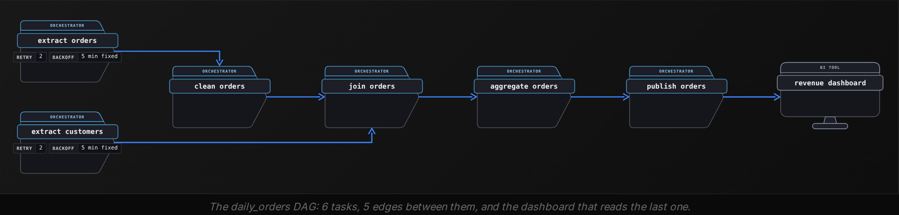

The diagram adds a second root, extract_customers, which depends on nothing. Tasks with no upstream edges become ready at the same moment, so the orchestrator runs the 2 roots side by side when it has 2 workers free. join_orders has 2 upstream edges, so it is released only after both extracts have succeeded; a customer extract that finishes in 4 minutes does not let the join start early.


<br>

### Reading a DAG declaration

Orchestrators build the graph from a declaration. The one below uses the shape they share: a name and a schedule, then a list of tasks in which each task names the ones it depends on. No arrow is written anywhere; every edge is implied by a depends_on entry.

```sql
dag: daily_orders
schedule: "0 1 * * *"
tasks:
  - name: extract_orders
    depends_on: []
  - name: extract_customers
    depends_on: []
  - name: clean_orders
    depends_on: [extract_orders]
  - name: join_orders
    depends_on: [clean_orders, extract_customers]
  - name: aggregate_orders
    depends_on: [join_orders]
  - name: publish_orders
    depends_on: [aggregate_orders]
```

Count nodes and edges before running anything. There are 6 tasks. Each name inside a depends_on list is 1 edge pointing into that task. The 2 extracts have 0 and join_orders has 2; clean_orders has 1, as do aggregate_orders and publish_orders. That makes 5 edges. The 2 tasks with empty lists are the roots, and from the lists alone the orchestrator works out the waves in which tasks become ready.

| Wave | Tasks that become ready | Waiting on |
| --- | --- | --- |
| 1 | extract_orders, extract_customers | nothing |
| 2 | clean_orders | extract_orders |
| 3 | join_orders | clean_orders and extract_customers |
| 4 | aggregate_orders | join_orders |
| 5 | publish_orders | aggregate_orders |

A wave is a convenience for reading, and the orchestrator does not wait for a whole wave. clean_orders starts the moment extract_orders succeeds, even while extract_customers is still running, because clean_orders has 1 upstream edge and that edge is satisfied.


<br>

### Why no cycles

Suppose publish_orders writes a summary table and someone adds publish_orders to the depends_on list of aggregate_orders to read it. Now aggregate_orders waits for publish_orders, which waits for aggregate_orders. Neither can become ready, so the rule that starts a task once its upstream tasks have succeeded finds nothing to start. An orchestrator that reads a declared graph, like the file above, checks for cycles when it parses the declaration and refuses the file before the first night, since a graph with a cycle has no order to run in.

> **TIP**
>
> If a task needs the output of a task downstream of it, that need is about the previous run, not this one. Point it at yesterday's output, or split the work into a task of its own, rather than drawing an arrow backward.

**An engineer wants tonight's extract_orders to wait until tonight's publish_orders has finished, so the dashboard is never mid-update while the next extract runs. They add publish_orders to the depends_on list of extract_orders. What happens?**

- **A.** The orchestrator refuses to load the DAG, because the new edge closes a cycle: extract waits on publish, which waits, through 4 tasks, on extract.
- **B.** The DAG loads, and tonight's extract waits until tonight's publish finishes, exactly as intended.
- **C.** The orchestrator loads the DAG and runs publish_orders first, since it now has an outgoing edge to the root.
- **D.** The DAG loads, but extract_orders runs twice per night, once before publish and once after it.

<details>
<summary>Solution</summary>

**A.** The orchestrator refuses to load the DAG, because the new edge closes a cycle: extract waits on publish, which waits, through 4 tasks, on extract.

Within 1 run each task exists once. Extract now has an upstream edge from publish, and publish has a chain of edges back to extract, so no task in the loop can ever become ready. The load-time check catches it.

**Why the others are wrong**

- **B.** Tonight's publish cannot start until tonight's extract succeeds, and tonight's extract now waits for publish. The intention describes 2 different runs, which a single run cannot express.
- **C.** An outgoing edge never makes a task ready. publish_orders still has aggregate_orders upstream, and aggregate_orders traces back to extract_orders.
- **D.** A task appears once per run. The declaration has no way to schedule the same task twice, and the orchestrator does not invent a second copy to escape a cycle.

</details>


<br>

---

## Pipeline Architecture

### Exercise 1 of 2

**● TASK**

A daily orders pipeline runs its twelve-hour aggregation inside an Airflow operator, in the scheduler's own process, so other DAGs queue behind it and the UI lags. Redraw the flow so Airflow keeps owning scheduling, ordering, retries, and the on-call view, while a separate worker runs the aggregation, reading orders from Postgres and landing the daily mart in Snowflake for the morning dashboard.

**Starting canvas** (already placed for you):

- Postgres orders source (source, PostgreSQL)
- Airflow orchestrator (transform, Airflow)
- Airflow operator: heavy aggregation (12-hour, in-process) (transform, Airflow)
- Snowflake daily_orders mart (storage, Snowflake)
- Morning dashboard (consumer, Looker)


<br>

### Solution

#### The scheduler keeps time; it should not do the lifting

Airflow exists to keep time: hand out work, order DAGs, retry failures, and show on-call what is running. When an operator runs the twelve-hour aggregation itself, that work executes in an Airflow worker slot and the scheduler becomes the executor. For half a day the slot is pinned crunching orders, every other DAG queues behind it, and the UI lags, because the **control plane and the data plane are now the same process**. The redraw separates them: Airflow submits and monitors, and a worker reads `orders` and lands the `daily_orders` mart.

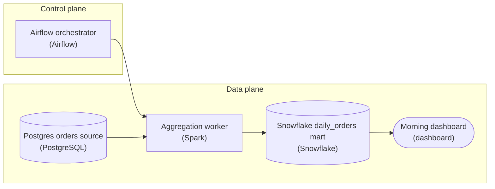

*Airflow submits and watches; the `Aggregation worker` reads `orders` and writes `daily_orders`. The heavy edge never touches the scheduler process.*

| Pitfall: A `PythonOperator` doing the work is the trap |
| --- |
| The natural first draft is a `PythonOperator` whose callable runs the whole aggregation. It reads cleanly in the DAG, but the compute executes in-process on an Airflow worker, so one task pins a slot for twelve hours and starves every other pipeline. The answer is not a bigger scheduler; it is an operator that dispatches the job elsewhere. |

1. **Make Airflow submit and poll, not compute**

   Swap the in-process operator for one that hands the job to a worker and watches it: a `KubernetesPodOperator`, an `EcsRunTaskOperator`, or a deferrable operator that submits and then releases the slot while it waits. Airflow still owns the edges, the schedule, and the retry policy; a deferrable operator is strongest because it frees the slot during the long wait, so the scheduler stays responsive even while the job runs.

2. **Make the worker idempotent, partitioned by day**

   Because Airflow owns retries, a re-run must not double-count. Write `daily_orders` partitioned by order date and replace the target partition each run (delete-and-insert or `MERGE` on the day key) instead of appending. That makes a retry safe and turns a full recompute into an incremental build: aggregate only the day in question rather than re-scanning all of `orders`.

**Follow-up questions**

1. If the `Aggregation worker` dies halfway, how do you keep an Airflow retry from double-counting?\
   *Idempotency lives in the worker as a partition replace on the day key, not in append-only writes.*
2. What changes to build only the latest day instead of recomputing all of `daily_orders`?\
   *Incremental vs full loads, partitioning by `order_date`.*


<br>

### Exercise 2 of 2

**● TASK**

Three cron jobs build a daily orders-by-region summary: extract the day's orders from Postgres, clean the rows, aggregate to one row per region. When the extract ran long, the aggregate still fired on the clock and summarized half-loaded data. Rebuild them as one daily DAG owned by Airflow: tag all three steps Airflow and wire extract, then clean, then aggregate so each starts only after its upstream succeeds, ending in the Snowflake mart the dashboard reads.

**Starting canvas** (already placed for you):

- Orders app DB (source, PostgreSQL)
- Extract day's orders (transform, SQL)
- Clean and standardize rows (transform, SQL)
- Aggregate orders by region (transform, SQL)
- Snowflake mart_orders_by_region (storage, Snowflake)
- Regional orders dashboard (consumer, Looker)


<br>

### Solution

#### Order by dependency, not by the clock

A DAG lets one orchestrator decide run order from what each step reads, not from a wall-clock time you guessed at. You took three jobs that used to fire independently and made them one graph: extract runs, and only when it **succeeds** does clean start, and only when clean succeeds does aggregate start, landing in the `mart_orders_by_region` table the dashboard reads. That single ownership under `Airflow` is the whole point, the schedule now lives in one place, and the edges, not the clock, sequence the work.

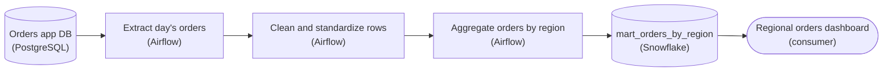

*One daily DAG: each Airflow task starts only after its upstream succeeds, ending in `mart_orders_by_region`.*

| Pitfall: A fixed fire time assumes the last step already finished |
| --- |
| The old design gave each step its own cron time and hoped the gaps were wide enough. On a normal night they were; on the night the pull ran long, the aggregate step fired at its scheduled minute anyway and summarized half-loaded rows. Cron answers "is it 3:15 yet?", it never answers "did the clean step finish?" That is the gap a DAG closes. |

| Key insight: Success is the trigger, not the timestamp |
| --- |
| In a DAG the edge from clean to aggregate means "aggregate may run once clean reports success." If extract runs long, everything downstream simply waits, and if a step fails the ones after it never start rather than running on stale data. You schedule the DAG once, daily; the dependency edges handle ordering for you. |

This is how late or slow-arriving data is handled in practice. Real DAGs push it further, a sensor that blocks the first task until the source is actually ready, an SLA that alerts when a run drifts past its window, but they all rest on the same move you just made: express the pipeline as dependencies so a slow upstream delays the answer instead of corrupting it.

**Follow-up questions**

1. If the extract step fails three days running, what should the dashboard show, yesterday's numbers or nothing?\
   *Extends the idea to failure semantics: a DAG stops downstream work, but the consumer still needs a defined behavior for a missing run.*
2. How would you change the graph if the clean step could start on partial data as each `region` finishes loading?\
   *Probes when a strict succeed-then-start edge is too coarse and finer-grained dependencies are worth the complexity.*


<br>

---

## What an Orchestrator Does

Strip an orchestrator down to its duties and 4 remain. Each answers a question cron left open, and each concerns control of the work; other systems handle the data itself.

| Responsibility | Question it answers | In the orders pipeline |
| --- | --- | --- |
| Scheduling | When does a run begin? | A run starts at 01:00 every day |
| Dependency resolution | Which task may start now? | join_orders starts when clean_orders and extract_customers have both succeeded |
| Failure handling | What happens when a task exits with an error? | Retry twice, 5 minutes apart; then mark it failed and hold everything downstream |
| State and visibility | What ran, when, for how long, with what result? | The 2026-10-22 run page shows extract_orders took 1h47m and the rest waited |


<br>

### Scheduling and dependency resolution

Scheduling creates a run: at 01:00 the orchestrator records that the daily_orders run for 2026-10-22 exists and that none of its tasks have started. Dependency resolution then runs in a loop for the life of the run. Every few seconds the orchestrator asks, for each task not yet started, whether all of its upstream tasks have succeeded, and starts the ones where the answer is yes. The 2 roots pass on the first check; clean_orders passes the moment extract_orders reports success, whether that is 01:40 or 02:47.


<br>

### Failure handling

A task fails when its command exits with a non-zero code or runs past its timeout. The orchestrator then applies the task's retry policy: wait the retry delay, run the same command again, up to the retry count. During the retries every downstream task keeps waiting, which cron could never do. When the last retry fails, the task is marked failed and every task downstream of it is marked upstream-failed without running. An alert goes out only if the DAG declares a target for it, such as an email address or a chat channel.

A retry starts the command from the beginning, because the orchestrator has no idea what the first attempt wrote before it died. A task that appended 10,000 rows and then crashed will append them again on the retry. Writing tasks so that a second run produces the same result as a first run is its own subject, covered in a later lesson; for now, know that the orchestrator provides the retry and the task has to be written so that a rerun does no harm.


<br>

### State and visibility

Every task attempt gets a row in the orchestrator's database. The row carries the task name with its run date and attempt number, when the attempt started and ended, its final state, and a pointer to its log. The web interface colours each node of the DAG by state, and the run history shows 30 nights of durations. With that record, a question about a bad night has an answer: open the 2026-10-15 run, see extract_orders red with 3 attempts, and read the connection error in the first attempt's log.


<br>

### What it hands to other systems

The orchestrator issues commands and reads exit codes; the work inside each command happens elsewhere. extract_orders runs a query against the operational database and lands files in the lake. join_orders sends a SQL statement to the warehouse and waits while the warehouse engine runs the join and stores the result. Keep that boundary sharp. A task that pulls 200GB through a worker holds the slot for hours while ready tasks queue behind it, and the worker can run out of memory or disk.

| Work | Owner |
| --- | --- |
| Deciding that a run starts at 01:00 | Orchestrator |
| Deciding that join_orders may start | Orchestrator |
| Running the SELECT that joins orders to customers | Warehouse engine |
| Holding the joined table between runs | Warehouse storage |
| Moving bytes from the operational database into the lake | The extract program |
| Running the extract a second time after a timeout | Orchestrator |
| Recording that attempt 2 succeeded at 01:57 | Orchestrator |

> Owns versus delegates
>
> - Owns: when a run begins, in what order tasks start, what to do on failure, and the record of what happened.
> - Delegates: all work on the data itself, from the first read to the stored result.

**Which of these is the orchestrator's own job, rather than work it delegates to another system?**

- **A.** Executing the join between the cleaned orders and the customers table.
- **B.** Compressing the extracted files before they land in the lake.
- **C.** Deciding that join_orders may start because clean_orders and extract_customers have both succeeded.
- **D.** Keeping the joined table on disk so that aggregate_orders can read it.

<details>
<summary>Solution</summary>

**C.** Deciding that join_orders may start because clean_orders and extract_customers have both succeeded.

Dependency resolution is the second of the 4 responsibilities. The orchestrator checks the upstream states on each loop and releases the task when both report success.

**Why the others are wrong**

- **A.** The warehouse engine executes the join. The orchestrator sends the statement and records the exit code when the engine finishes.
- **B.** The extract program compresses and writes the files. The orchestrator started that program and will learn only whether it exited cleanly.
- **D.** Storage belongs to the warehouse or the lake. The orchestrator's database holds metadata about runs and attempts, never the pipeline's data.

</details>


<br>

---

## Pipeline Architecture

### Exercise 1 of 2

**● TASK**

Build a three-task Airflow DAG from Postgres production.orders to the Snowflake mart.orders_by_region. Add extract_orders (production.orders to raw.orders), clean_orders (raw.orders to stg.orders) and aggregate_orders (stg.orders to mart.orders_by_region), naming each node with its read and write tables, chained in that order with the dashboard reading the mart. Name the orchestrator with its daily 2am schedule and 3 retries with exponential backoff from 2 minutes.

**Starting canvas** (already placed for you):

- Postgres production.orders (source, PostgreSQL)
- Airflow orchestrator (set schedule and retry policy) (transform, Airflow)
- Snowflake mart.orders_by_region (storage, Snowflake)
- Morning regional dashboard (consumer, Looker)


<br>

### Solution

#### Let the data decide when a task runs, not the clock

With **DAG orchestration** the pipeline becomes a directed acyclic graph: each task declares the one before it as its upstream dependency, and the orchestrator starts a task only when that upstream has actually finished. That is the whole fix for a stale read. `clean_orders` does not run at a fixed wall-clock time and hope `extract_orders` is done; it runs because `extract_orders` reported success. The chain `extract_orders` then `clean_orders` then `aggregate_orders` is a dependency order, and the edges you drew ARE that order made explicit.

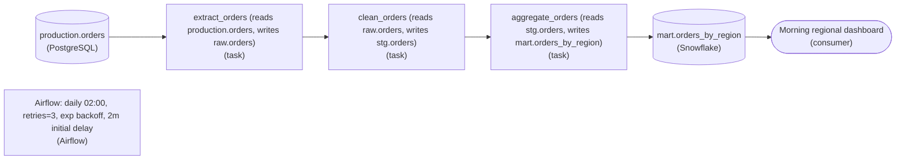

*Each task names the table it reads and the table it writes, so the `raw` to `stg` to `mart` flow is legible straight from the graph.*

| Pitfall: Clock offsets assume a duration that will not hold |
| --- |
| The version that pages on-call is three tasks each on their own clock trigger: `extract_orders` at 02:00, `clean_orders` at 02:10, `aggregate_orders` at 02:20. It works right up until `extract_orders` runs long. Now `clean_orders` fires at 02:10 and reads a half-written `raw.orders`, and the dashboard shows numbers that are quietly wrong rather than obviously broken. Clock-chaining assumes a duration; a dependency edge assumes nothing. Make `clean_orders` depend on `extract_orders` finishing and the race disappears. |

The three-table hop is the other half of the design: **batch processing through staging layers**. `raw.orders` is the untouched extract, `stg.orders` is the cleaned intermediate, and `mart.orders_by_region` is the aggregate the dashboard reads. Splitting it this way means a failure in `clean_orders` never corrupts the raw landing zone, and you can re-run one stage without re-pulling from `production.orders`. Recording each read and write table in the node name lets anyone reading the diagram trace where a bad number came from without opening the code.

| Key insight: One retry policy on the DAG, not three in the tasks |
| --- |
| You put `retries=3`, exponential backoff, and a 2-minute initial delay on the Airflow orchestrator so every task inherits it, rather than hand-coding retry logic inside `extract_orders`, `clean_orders`, and `aggregate_orders`. Exponential backoff (2m, then 4m, then 8m) is deliberate: a transient Postgres blip or a warehouse cold-start usually clears on its own if you wait a little longer each attempt, and backing off avoids hammering a source that is already struggling. Setting it once on the DAG keeps the policy uniform and in one place to change. |

**Follow-up questions**

1. If `aggregate_orders` keeps failing after all 3 retries, should the dashboard show yesterday's mart or nothing?\
   *Tests whether the learner sees that retry exhaustion needs a failure policy, not just more retries.*
2. How would you add a check that `raw.orders` actually landed rows before `clean_orders` starts?\
   *Extends the dependency idea from task-success to a data-quality gate between stages.*
3. What changes if a second dashboard needs the data hourly instead of at 2am?\
   *Probes whether the DAG's schedule is separable from its task dependencies.*


<br>

### Exercise 2 of 2

**● TASK**

Replace a six-job cron chain with one orchestrator (Airflow, Dagster, or Prefect) that owns the daily schedule, retries, and dependency resolution. Wire a DAG with explicit edges: extract_orders to clean_orders, extract_payments to clean_payments, both into join_orders_payments, then publish_fact. Delegate the clean, join, and publish compute to a worker engine (dbt, Spark, PySpark, Databricks, Snowflake, or BigQuery) rather than running it inside the orchestrator, and publish the fact table to a warehouse (Snowflake, BigQuery, Redshift, or Databricks) that the dashboard reads.

**Starting canvas** (already placed for you):

- Postgres app (source, PostgreSQL)
- Stripe API (source, API)
- Dashboard (consumer, Metabase)


<br>

### Solution

#### From six cron jobs to one DAG

The concept you applied here is **DAG orchestration**: describe the work as a directed acyclic graph, one node per task, and let an orchestrator resolve run order from the edges. `clean_orders` starts not because it is 3:15 AM but because `extract_orders` finished. That shift from time-coupling to dependency-coupling is the whole point.

| Pitfall: Why the dashboard showed yesterday's numbers |
| --- |
| Each cron job was pinned to a fixed time. When the Postgres pull ran 2 hours long, `clean_orders` fired on schedule anyway, cleaned stale rows, and `publish_fact` published them. Nothing failed loudly, the chain just ran on old data. Real edges would have held `clean_orders` until `extract_orders` actually completed. |

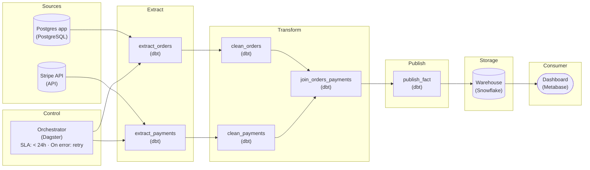

*A daily orchestrator with task retries resolves run order from explicit edges, a worker engine (`dbt`) does the heavy compute, and the fact table lands in the warehouse the dashboard reads.*

1. **Let the edges encode the dependencies, not the clock**

   The 2 extracts are independent, so they run in parallel. `join_orders_payments` needs both cleans done, so it takes 2 inbound edges, the fan-in a cron chain can never express. The orchestrator runs what it can and blocks what it cannot.

| Key insight: A daily schedule plus per-task retries is the safety net |
| --- |
| One orchestrator (`Dagster` or `Prefect` suits a small new build) attaches a daily schedule to the DAG and a retry policy to each task. The clean and join steps delegate to a worker engine like `dbt`, so the orchestrator only triggers, watches, and retries. Now a slow extract holds downstream instead of poisoning the fact table. |

**Follow-up questions**

1. If `extract_orders` keeps timing out, should its retry policy back off, alert, or both, without blocking `extract_payments`?\
   *Tests per-task retries and that independent branches stay independent.*
2. The team wants orders refreshed hourly but payments only daily. How would you express 2 cadences in one graph?\
   *Scheduling granularity beyond one DAG-level daily trigger.*


<br>

---

## The Major Orchestrators by Name

Most open source orchestration runs on 3 tools, and each gives a different answer to the question of what a pipeline author should write down first. All 3 run the model from the previous section underneath.


<br>

### Airflow: tasks and operators

Airflow came out of Airbnb's data team, where a nightly set of cron jobs had grown past what anyone could reason about, and it has been an Apache project since. Its unit is the task, declared in Python inside a DAG object, and its main draw is a library of operators: prebuilt task types, such as one that runs a SQL statement and one that waits for a file to appear, with others that call APIs. Airflow emphasizes breadth. If a system exists, there is probably an operator for it. Most engineers have also already seen its scheduler and web interface.

- **2015** — Airflow open sourced
- **2019** — Airflow top-level Apache project


<br>

### Dagster: assets first

Dagster starts from the tables a pipeline produces rather than the steps that produce them. You declare an asset, such as clean_orders, as a function that returns the data, and name the assets it reads in its arguments; the edges come from those arguments. The emphasis is on knowing which code and inputs produced each table, and when. Dagster also puts weight on running a pipeline on a laptop with typed inputs and outputs before it runs on a schedule, so a broken declaration fails at development time instead of at 01:00.


<br>

### Prefect: plain Python functions

Prefect treats a workflow as a Python function, called a flow, that calls other functions, called tasks. The graph is whatever the function does when it runs, so a flow can loop over a list of 40 regions and create 40 tasks at run time without declaring each in advance. The emphasis is on writing the pipeline as ordinary code and letting the orchestrator wrap it with retries and state records as it runs.


<br>

### The shared model

Side by side, the 3 use different words for the same nouns. Each has a container for a graph, a node that does work, a schedule that creates runs, a retry policy per node, and a run history behind a web interface. Learn the model once and the first week on any of the 3 is vocabulary.

| Concept | Airflow calls it | Dagster calls it | Prefect calls it |
| --- | --- | --- | --- |
| Graph container | DAG | job, or the asset graph | flow |
| Unit of work | task | op, or asset | task |
| One execution | DAG run | run | flow run |
| When runs begin | schedule on the DAG | schedule on the job | schedule on the deployment |

Under the declarations the 3 ship the same moving parts. A scheduler process creates runs and resolves dependencies, a pool of workers executes commands, and a metadata database holds every state change; the web interface is a window onto that database. On any of the 3, if the metadata database is down, no run starts.

What differs is the thing you write first. Airflow asks for the task and its order, Dagster asks for the table and its inputs, Prefect asks for the function. A pipeline designed as a graph of tasks with a schedule and retry counts moves between them with its design intact; what changes is the file that declares it.

If your company already runs one of them, use that one; a second orchestrator doubles the number of places a run can hide. For a team starting fresh, Airflow's operator library covers the most systems out of the box, Dagster's asset view answers the question of what made a table without extra work, and Prefect keeps the declaration closest to the Python the team already writes.


*Cloud providers sell managed versions of all 3. The model is unchanged; what changes is who runs the scheduler and the metadata database.*

**Your team moves the daily_orders pipeline from one of the 3 orchestrators to another. Which part of the design can you keep without a redesign?**

- **A.** Only the SQL inside each task; the graph, schedule and retries must be rethought from scratch for the new system.
- **B.** Nothing, because each orchestrator runs a different model and the pipeline must be rebuilt as a new kind of object.
- **C.** Only the schedule, since every orchestrator reads the same cron expression and nothing else is shared.
- **D.** The graph of 6 tasks and 5 edges, the 01:00 schedule and the retry count per task, each re-declared in the new orchestrator's vocabulary.

<details>
<summary>Solution</summary>

**D.** The graph of 6 tasks and 5 edges, the 01:00 schedule and the retry count per task, each re-declared in the new orchestrator's vocabulary.

Those are the shared model. The new declaration spells them differently, but tasks still run in the same order on the same schedule, and failures are handled the way they were.

**Why the others are wrong**

- **A.** Those parts are the shared model. They are rewritten in the new orchestrator's words, which is a translation and not a redesign.
- **B.** All 3 run a graph, a schedule, per-node retries and a run history. They differ in the unit you write first, which is a task in Airflow and an asset in Dagster, while Prefect starts from a function.
- **C.** The schedule does carry over, and so do the graph of tasks and edges and the retry counts on each task.

</details>


<br>

---

## Pipeline Architecture

### Exercise 1 of 1

**● TASK**

A daily report joins yesterday's ad spend from an ad platform API with yesterday's conversions from a Postgres orders database, landing the result in a warehouse table that a return-on-ad-spend dashboard reads. Cron runs both pulls at midnight and the join at 3am, so a slow pull leaves the join reading stale data. Design it with an orchestrator that starts the join only after both pulls finish and retries the API pull when it times out.


<br>

### Solution

#### Completion, not clock time, starts the join

Swapping cron for an orchestrator changes where a task's start signal comes from. Cron fires the join at 3am because someone guessed the pulls would be done by then; an orchestrator fires it when both pulls report success. On the night the API pull crawls until 3:40, the join simply waits, and the dashboard shows a **late but correct** number instead of an on-time wrong one.

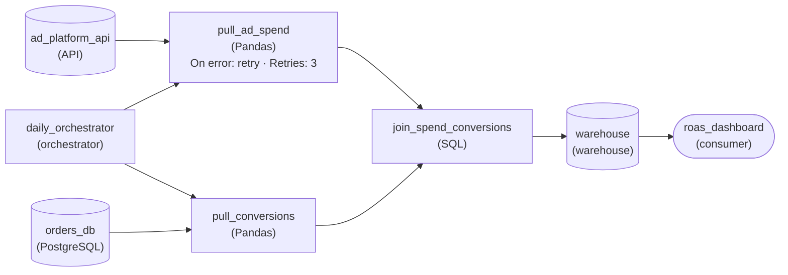

*`daily_orchestrator` starts both pulls once a day; `join_spend_conversions` runs only after `pull_ad_spend` and `pull_conversions` both succeed.*

1. **Turn each clock time into an edge**

   Every place the cron schedule encoded a guess about when work would be done, the design now has an edge. Both pulls feed `join_spend_conversions`, so the join has two upstream tasks and starts when the slower one finishes, whichever that is tonight.

2. **Put the retry on the task that fails**

   Only the API pull times out, so the retry lives on `pull_ad_spend`. Under cron a retry was risky: a second attempt could still be running at 3am when the join fired. With the join waiting on completion, a retry just delays it a few minutes.

| Pitfall: A later clock time only moves the bug |
| --- |
| The tempting fix is pushing the join to 5am. That buys slack on normal nights, fails the same way the night the API stays slow past 5, and makes every normal night's report two hours later than it needs to be. |

| Real world: Silent staleness is worse than a failure |
| --- |
| A join that reads yesterday's spend beside today's conversions still succeeds, writes rows and turns nothing red. Depending on completion converts that silent wrong answer into a visible delay someone can see and fix. |

**Follow-up questions**

1. Refunds from the payments database now have to be pulled before the join too. What changes?\
   *Whether a new upstream task is one more edge rather than one more clock time.*
2. The API pull fails all 3 of its retries. What should happen to the join and the dashboard?\
   *What a dependency means when an upstream task never succeeds.*


<br>

---

## First DAG: 3 Tasks, 1 Schedule

The pipeline is the smallest version of the orders chain: extract, clean, publish, started at 01:00 with 1 retry policy for every task. The code below is illustrative. It has a name and a schedule, the retry policy, and 3 tasks joined by 2 edges, which is the shared shape; each orchestrator spells those same parts in its own syntax.

```sql
from orchestrator import DAG, task

with DAG(
    dag_id="daily_orders",
    schedule="0 1 * * *",
    retries=2,
    retry_delay_minutes=5,
) as dag:
    extract = task("extract_orders", command="python extract.py")
    clean = task("clean_orders", command="python clean.py")
    publish = task("publish_orders", command="python publish.py")

    extract >> clean >> publish
```


<br>

### Reading it line by line

What each line declares

- schedule="0 1 \* \* \*": the 5 cron fields. Minute 0 of hour 1, on every day of every month, whatever the weekday. One run per night at 01:00.
- retries=2: each task gets 3 attempts in total, the first run plus 2 retries, and the policy on the DAG applies to every task in it.
- retry_delay_minutes=5: the orchestrator waits 5 minutes between a failed attempt and the next one.
- task(...): a named node with 1 command. The name is what the run page and the alert will show, so it names the output.
- extract >> clean >> publish: 2 edges. Read >> as 'must succeed before': the task on the left must succeed before the task on the right may start.

| Cron field | Value | Meaning |
| --- | --- | --- |
| minute | 0 | at minute 0 |
| hour | 1 | of hour 1, so 01:00 |
| day of month | \* | every day |
| month | \* | every month |
| day of week | \* | every day of the week |


<br>

### The order of execution

The orchestrator reads the edges, and the order the tasks were written in plays no part. extract has no upstream edge, so it is the only task ready at 01:00. clean has 1 upstream edge from extract, so it becomes ready when extract succeeds. publish has 1 upstream edge from clean. With 3 tasks and 2 edges there is 1 possible order, and the orchestrator finds it by asking on each loop which task has nothing unfinished above it.

| Time | Event on a normal night |
| --- | --- |
| 01:00 | Run created; extract_orders attempt 1 starts |
| 01:40 | extract_orders succeeds; clean_orders starts |
| 02:00 | clean_orders succeeds; publish_orders starts |
| 02:05 | publish_orders succeeds; run marked success |

**You add a fourth task, extract_customers. publish_orders reads its output, but clean_orders does not. Which single change starts every task as soon as its inputs exist?**

- **A.** Add extract_customers >> clean, so customer data lands before cleaning starts.
- **B.** Add publish >> extract_customers, so the customer extract follows the publish.
- **C.** Add extract_customers >> publish, so publish waits on both clean and the customer extract.
- **D.** Give extract_customers a cron entry at 00:30, so it finishes before the 01:00 run.

<details>
<summary>Solution</summary>

**C.** Add extract_customers >> publish, so publish waits on both clean and the customer extract.

publish gets 2 upstream edges, and extract_customers becomes a second root that starts at 01:00.

**Why the others are wrong**

- **A.** Publish still waits for customers, through clean, but cleaning now waits on data it never reads.
- **B.** The arrow is backward: publish would run before the customer data it reads exists.
- **D.** A clock time is a guess about duration; one slow night brings back the cron chain failure.

</details>


<br>

### A night with a failure

Now the source database drops the connection 12 minutes in. The orchestrator marks attempt 1 failed, waits the 5 minute delay, and starts attempt 2 at 01:17. The whole extract runs again from the first row, succeeds at 01:57, and clean becomes ready. The dashboard is 17 minutes later than usual and correct. Nobody was paged, and the run page shows 2 attempts on extract_orders with the error sitting in the first attempt's log.

| Time | Event on the failure night |
| --- | --- |
| 01:00 | extract_orders attempt 1 starts |
| 01:12 | attempt 1 fails: connection reset |
| 01:17 | attempt 2 starts after the 5 minute delay |
| 01:57 | attempt 2 succeeds; clean_orders starts |
| 02:17 | clean_orders succeeds; publish_orders starts |
| 02:22 | publish_orders succeeds; run marked success |

If attempts 2 and 3 fail as well, the sequence ends differently. After the third failure the orchestrator marks extract_orders failed and sets clean_orders and publish_orders to upstream-failed without starting either. It then fails the run and sends the alert. The published table keeps yesterday's rows, which is the right outcome: a stale table that everyone knows is stale beats a fresh-looking table built from the wrong night.

✓Do

- Name tasks after what they produce, so the run page reads as the pipeline
- Give every task a retry count, even 1, so a flaky connection does not page anyone
- Let the edges decide order; never encode order in start times
- Read the run page after the first night and note each task's duration

✗Don't

- Chain tasks by giving each its own clock time inside one DAG
- Set so many retries that a broken source gets queried again and again for hours
- Move data through the orchestrator's own workers
- Put 2 unrelated pipelines in 1 DAG because they share a schedule


<br>

### Capstone

**extract_orders succeeds at 01:40. clean_orders then fails on all 3 attempts because a column it expects is missing. At 02:30, what is the state of publish_orders, and what does the dashboard show?**

- **A.** publish_orders ran at 02:30 as scheduled and published the uncleaned extract, so the dashboard shows raw rows.
- **B.** publish_orders is marked upstream-failed and never ran; the dashboard shows the previous night's published table, and the run page is red at clean_orders.
- **C.** publish_orders is retrying, because the retry policy on the DAG applies to the run as a whole.
- **D.** publish_orders succeeded, because the orchestrator skips a failed upstream task once its retries are spent.

<details>
<summary>Solution</summary>

**B.** publish_orders is marked upstream-failed and never ran; the dashboard shows the previous night's published table, and the run page is red at clean_orders.

A task whose retries are spent is marked failed, and everything downstream of it is held. The dashboard is stale, the run is visibly failed, and the missing column is in the log of each attempt.

**Why the others are wrong**

- **A.** publish_orders has no clock time of its own. Its only trigger is clean_orders succeeding, which never happened.
- **C.** Retries attach to each task's own attempts. publish_orders never started, so it has no attempt to retry.
- **D.** A spent retry policy marks the task failed and holds its downstream. Skipping would publish bad data silently, which is the cron failure the DAG exists to prevent.

</details>


<br>

---

## Pipeline Architecture

### Exercise 1 of 2

**● TASK**

Each night a job loads the day's clickstream files, then two tasks aggregate the loaded clicks: one sessionizes visits, one counts page views. A report task joins both aggregates into a daily report table. Draw it as a DAG run by an orchestrator: both aggregations run in parallel after the load, and the report waits for both to succeed. No edge may point back upstream.


<br>

### Solution

#### The edges are the schedule

A DAG is the shape an orchestrator can compute an order from: tasks are nodes, each edge says which task must succeed before the next may start, and no path leads back to where it began. Here the 4 tasks form a diamond. The load is the single root, the two aggregations fan out from it, and the report fans them back in. The orchestrator reads those edges and nothing else to decide what runs when.

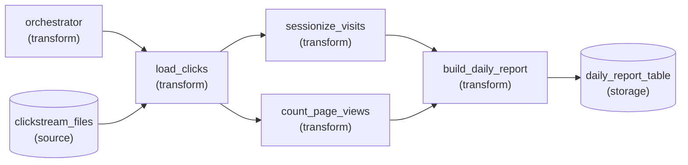

*The orchestrator triggers `load_clicks`; the two aggregations fan out from it and fan back into `build_daily_report`.*

1. **Point each edge from producer to consumer**

   An edge runs from the task that writes data to the task that reads it. `load_clicks` writes the clicks both aggregations read, so it points at `sessionize_visits` and `count_page_views`, and each of those points at `build_daily_report`. Because the report has two incoming edges, the orchestrator holds it until both have succeeded, which is exactly the rule the report needs.

2. **Draw no edge between the aggregations**

   Neither aggregation reads the other's output, so there is nothing to order between them. With no edge, both can start the moment the load succeeds, and a failure in one does not stop the other from finishing.

| Pitfall: A straight chain invents a dependency |
| --- |
| The common draft lines everything up: load, sessionize, count, report. It runs, but `count_page_views` now waits on `sessionize_visits` for no reason, the night takes the sum of both durations instead of the longer one, and a sessionizing failure blocks page counts that never needed it. Draw only the edges the data demands. |

| Key insight: One back edge makes the graph unschedulable |
| --- |
| Suppose `build_daily_report` wrote a 'done' marker that `load_clicks` checks before starting. The load now waits on the report, which waits on the aggregations, which wait on the load: every task is waiting, and there is no valid order to compute. Whatever tomorrow needs from tonight stays outside this night's graph. |

**Follow-up questions**

1. A new bot-filter task must run on the loaded clicks before page counting. Where do its edges go?\
   *Inserting a task into a fan-out without adding a dependency sessionizing does not have.*
2. If the report also read yesterday's `daily_report_table`, would that create a cycle?\
   *Telling apart reading an earlier run's output from a back edge inside the same run.*


<br>

### Exercise 2 of 2

**● TASK**

Each night, shipment scans from a carrier API are pulled, cleaned and loaded into a warehouse table that a delivery-times dashboard reads every morning. Design the pipeline so an orchestrator owns all four of its responsibilities: it starts the run on a nightly schedule, runs pull, clean and load in dependency order, retries the pull up to 3 times because the API often times out, and alerts the on-call engineer when a run still fails.


<br>

### Solution

#### Four jobs, one owner

An orchestrator earns its name by owning four things at once: when a run starts, the order its tasks run in, what happens when one fails, and who finds out. In the shipment-scans design each one lands on a specific part of the canvas, and each leans on the others. The retry on `pull_scans` only works because `clean_scans` waits on it, and the alert only means something because the failure is recorded as a run event instead of an exit code nobody reads.

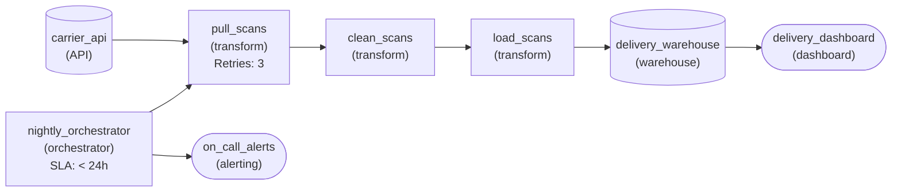

*One nightly run: the orchestrator starts `pull_scans`, the tasks follow in dependency order, and a final failure pages on-call.*

1. **Schedule the DAG, not each task**

   `nightly_orchestrator` fires once a night and creates the run. The three tasks have no clock of their own: `clean_scans` starts when `pull_scans` finishes, and `load_scans` when `clean_scans` finishes. A slow pull just delays everything behind it instead of letting cleaning start on a half-pulled night.

2. **Retry the task that actually fails**

   Only the carrier API times out, so the retry policy sits on `pull_scans` with up to 3 attempts. Because the orchestrator tracks dependencies, a retried pull still holds cleaning back until it succeeds, and a timeout that clears on the second try costs a few minutes instead of the morning numbers.

| Pitfall: A retry loop inside the script is invisible |
| --- |
| The tempting fix is a loop in the pull code that tries three times. It works until the third attempt fails: the orchestrator sees one long task, no attempt is recorded, and nobody is told. A task-level retry policy makes each attempt an event the run can count, show and react to. |

| Key insight: Visibility means a failure reaches a person |
| --- |
| A red box in a UI only helps whoever happens to look. The edge from `nightly_orchestrator` to `on_call_alerts` turns a final failure into a page before the dashboard is opened, which is the point of the fourth responsibility. |

**Follow-up questions**

1. Finance also wants a carrier-cost table built from the cleaned scans. Where does that task hang in the DAG?\
   *Fanning out from a shared upstream task under one schedule instead of adding a second clock.*
2. What would make a retried pull load the same scans twice?\
   *Why retries depend on the work being safe to run more than once.*


<br>

---

## Putting It All Together

Return to the Airbnb host payouts chain from the intro, rebuilt as a DAG with the same 01:00 schedule. The bookings extract runs 50 minutes long, and the payouts task waits on its edge instead of its clock, so it reads a complete table. A connection dropped 12 minutes in costs 1 retry and 17 minutes, because the extract reruns from the first row after the 5 minute delay. If every attempt fails, finance opens a run page that is red at the extract and reads the error, instead of a report that arrived on time and wrong.

- The cron chain from Section 0 and the rebuilt DAG differ in 1 thing: whether the payouts task is triggered by a clock time or by the extract's success.
- The edges from Section 1 are what let the payouts task wait 50 extra minutes; the orchestrator's dependency loop from Section 2 is what releases it the moment the extract reports success.
- The retry policy from Section 4 turns a connection dropped 12 minutes in into a 17 minute delay; the failure handling from Section 2 turns 3 dropped connections into a held downstream and an alert.
- Whichever orchestrator from Section 3 runs the payouts DAG, the data work happens in the extract program and the warehouse. The orchestrator records which task ran and when.


<br>

---

## Pipeline Architecture

### Exercise 1 of 2

**● TASK**

A subscription business needs revenue by plan per day, built nightly from the payments table in its MySQL billing database. Design it as an orchestrated DAG of three tasks: extract the day's payments, clean and standardize them, then aggregate them into a warehouse summary table with one row per plan per day. The DAG runs once a day at 3:00 UTC, each task waits for the one before it, and every task retries twice before the run fails.


<br>

### Solution

#### One schedule on the DAG, order on the edges

What you drew is a DAG in its simplest useful form: a straight chain. Each edge exists because the downstream task reads what the upstream one wrote, so clean depends on extract and aggregate depends on clean. The schedule belongs to the DAG, not to the tasks: at 3:00 UTC the orchestrator creates a run, sees that extract is the only task with nothing upstream, and starts it. Everything after that is triggered by completion, not by the clock.

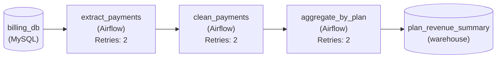

*`billing_db` feeds `extract_payments`, then `clean_payments`, then `aggregate_by_plan`, which writes `plan_revenue_summary`. Each task retries twice.*

1. **Draw each edge from what a task reads**

   Ask of every task: whose output does it read? `clean_payments` reads only what `extract_payments` wrote, and `aggregate_by_plan` reads only what `clean_payments` wrote. That gives two edges, three tasks and no cycle. A task with no edge into it may start the moment the run begins, so a missing edge is a race.

2. **Give every task the same retry setting**

   In code the section used `default_args` so one retry policy applies to all three tasks at once. On the canvas that is the same retry count on each task node. A retry reruns one task, not the whole chain: if the database blips during extract, extract tries again and clean simply waits.

| Pitfall: A clock time per task is cron with extra steps |
| --- |
| The tempting version schedules extract at 3:00, clean at 3:20 and aggregate at 3:40. That guesses durations instead of declaring order, and on a slow night clean reads a half-written extract. One schedule on the DAG plus edges between tasks removes the guess. |

**Follow-up questions**

1. Finance also wants the summary by country. Where does a second aggregate task attach?\
   *Fan-out: both aggregates read the cleaned rows and can run side by side.*
2. Extract fails all three attempts. What do clean and aggregate do on that run?\
   *Downstream tasks never start when the task they depend on has failed.*


<br>

### Exercise 2 of 2

**● TASK**

Each night a mobile game's match logs are pulled from the game API and cleaned, then joined with player accounts from PostgreSQL to compute day-one retention into a warehouse table the retention dashboard reads. The draft DAG also draws an edge from the retention task back to the cleaning task so cleaning can drop flagged bots, which forms a cycle. Redraw it as a valid DAG run by one orchestrator that starts it daily at 3am, retries a failed task, and alerts on-call when a run fails.


<br>

### Solution

#### A DAG has a first task and a last task

A directed acyclic graph means the arrows only go forward. The draft edge from `compute_retention` back to `clean_matches` broke that rule: cleaning waited on retention, and retention waited on cleaning, so neither could start. An orchestrator rejects a graph like that before it ever schedules a run. Once the loop is gone, the 4 orchestrator jobs from the lesson each have one clear place on the canvas.

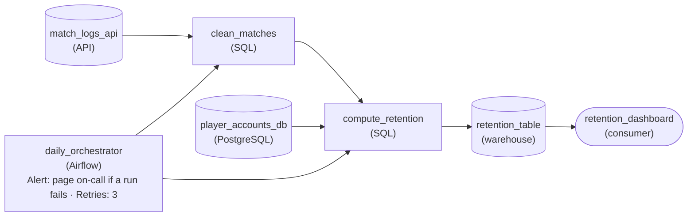

*Every arrow points forward. `daily_orchestrator` starts the run at 3am, triggers `clean_matches` and then `compute_retention`, retries a failed task, and pages on-call.*

1. **Delete the back edge, move the filter**

   Bot flags only matter for the retention numbers, so `compute_retention` drops flagged players itself. Cleaning no longer needs anything from a later task, and the edge from `compute_retention` to `clean_matches` simply goes away.

2. **Give each orchestrator job a home**

   When: Airflow starts the run daily. In what order: the edges, so `clean_matches` finishes before `compute_retention` begins. Retries: `retryCount` set to 3 on the orchestrator. Showing what happened: the `monitorAlert` that pages on-call when a run fails.

| Pitfall: A feedback arrow is not a dependency |
| --- |
| Drawing retention back into cleaning feels natural because the information really does flow that way. But a dependency edge means 'must finish first', and 2 tasks cannot each finish before the other. If cleaning truly needed bot flags, it would read the flags a previous night's run already stored, never today's unfinished task. |

| Key insight: Yesterday's output is an input, not an edge |
| --- |
| Loops across days are fine; loops inside one run are not. Last night's `retention_table` can be read like any other source, because it already exists before tonight's run starts. That is how recommendation models, bot lists and running totals feed themselves without a cycle. |

**Follow-up questions**

1. A geo-IP lookup file now has to feed retention by country. Where does it attach?\
   *Adding a new upstream dependency without creating a cycle or a second schedule.*
2. Cleaning fails three times in a row. What does the orchestrator do with `compute_retention` that night?\
   *How retries and dependency tracking work together: a downstream task never runs on a failed upstream.*


<br>

---

## Key Takeaways

- Cron starts a command at a clock time and knows nothing about the entry above or below it; a gap between start times is a guess about duration.
- A DAG is tasks joined by must-succeed-before edges with no path leading back to its start, and the orchestrator derives the running order from the edges alone.
- An orchestrator owns 4 things: when a run begins, which task may start, what to do when a task fails, and the record of what happened.
- Other systems do the data work: rows are read from the source, and the warehouse or the lake computes and holds the result. The orchestrator sends commands and reads exit codes.
- Airflow and Dagster share a model with Prefect: a graph on a schedule, with retries and a run history. They differ in what you write first, which is a task in Airflow and an asset in Dagster, while Prefect starts from a function.
- A task that fails its last retry holds every downstream task and alerts the target the DAG declares; a stale table everyone knows about beats a fresh-looking wrong one.
