Intermediate·Pipeline Architecture · 30 min · 11 challenges

# Orchestration: Intermediate

One of the most widely used workflow orchestrators began as an internal project at Airbnb. Say a revenue job there is set for 03:00 because the exchange-rate load usually finishes by 02:40. Tonight that load finishes at 03:25. The revenue job runs anyway, prices a day of bookings at stale rates, and reports success. What should have told it to wait?


<br>

---

## Schedules: Cron, Interval, Event

A schedule tells the orchestrator when to start a new run of a DAG. Nearly every pipeline uses one of 3 kinds: a cron schedule names moments on the wall clock, an interval schedule names a fixed gap between runs, and an event schedule names a signal, such as a file landing, and starts a run each time the signal arrives.

| Schedule | Written as | Starts runs at | A run starts because |
| --- | --- | --- | --- |
| Cron | `0 6 \* \* \*` | 06:00 every day | the clock reached a named minute |
| Cron | `\*/15 \* \* \* \*` | :00, :15, :30 and :45 | the clock reached a named minute |
| Interval | every 15 minutes from 10:07 | 10:07, 10:22, 10:37 | a fixed gap passed since the anchor |
| Event | on file `rates_2026-10-23.csv` | whenever the file lands | a signal arrived |


<br>

### Cron: when the clock is the contract

A cron expression has 5 fields: minute, hour, day of month, month and day of week, so `0 6 * * 1-5` means 06:00, Monday to Friday. Cron fits when the data is complete by a known time and the consumer reads at a known time. A finance report opened at 09:00, built from a ledger that closes at midnight, belongs on cron at 02:00, leaving hours of slack for a slow night.

Cron trusts the clock and never looks at the data. If the ledger closes late, the 02:00 run reads a half-written day and still finishes green. Cron also inherits the calendar's oddities. On 8 March 2026, New York clocks jumped from 02:00 to 03:00, so a job set for 02:30 local time had no 02:30 to fire at; on 1 November 2026, 01:30 happens twice. Depending on the scheduler, such a run is skipped, shifted or doubled. Writing every schedule in UTC removes both cases.


<br>

### Interval: an even rhythm, anchored to a start

An interval schedule says "every 15 minutes" and counts from an anchor, usually the moment the DAG was switched on. Anchored at 10:07, it starts runs at 10:07, 10:22 and 10:37, where `*/15` would start them at 10:15, 10:30 and 10:45. Both give equal windows. Pick interval when the gap matters and the clock positions do not, or when cron cannot express the gap: every 90 minutes takes 2 cron lines, because the minute alternates between :00 and :30.

The gap also caps freshness. A row that lands a second after a run reads its source waits a full gap for the next run, then waits for that run to finish. With a 15-minute gap and a 5-minute load, the dashboard can show data up to 20 minutes old. Gap plus run time must stay within the consumer's age limit.

**A dashboard must show orders no older than 20 minutes, and each load takes 6 minutes. What is the longest gap that meets the limit?**

- **A.** Every 20 minutes
- **B.** Every 10 minutes
- **C.** Every 26 minutes
- **D.** Every 14 minutes

<details>
<summary>Solution</summary>

**D.** Every 14 minutes

A 14-minute gap plus 6 minutes of load is exactly 20.

**Why the others are wrong**

- **A.** Gap plus load makes a worst-case age of 26 minutes.
- **B.** Worst-case age is 16 minutes, within the limit, but a longer gap also fits.
- **C.** This adds the load time to the limit, giving a worst-case age of 32 minutes.

</details>


<br>

### Event: when arrival time is unpredictable

Some data arrives on its own clock. A partner uploads a file sometime between 22:00 and 05:00. A cron at 05:30 is safe, but on a 22:00 night the consumer waits 7.5 hours for data that was ready. An event schedule starts the run when the file lands, so the data reaches the consumer within minutes and no run reads a missing file. The cost is predictability: run times move every night, and if the signal never comes, nothing runs and nothing fails. Event schedules need a separate check that notices silence, covered with sensors and external triggers below.

| Data arrives | Consumer expects data | Choose |
| --- | --- | --- |
| complete by a known time | ready at a fixed reading time | cron, after the usual arrival plus slack |
| continuously, all day | no older than a stated age | interval or cron, with gap plus run time within that age |
| at unpredictable times | soon after it lands | event trigger, plus an alert for silence |
| at unpredictable times | ready at a fixed reading time | cron after the latest arrival, or event plus deadline alert |

**A bank sends a settlement file. Over the last 30 days it landed between 01:10 and 04:50 UTC. Treasury wants each file's totals within 30 minutes of landing. Which schedule fits?**

- **A.** Cron at 05:00 UTC, after every arrival in the last 30 days
- **B.** Event trigger on the file landing, plus an alert if none by 06:00
- **C.** Interval every 30 minutes, loading any new file present when it fires
- **D.** Cron at 01:10 UTC, the earliest arrival in the last 30 days

<details>
<summary>Solution</summary>

**B.** Event trigger on the file landing, plus an alert if none by 06:00

Each run starts minutes after the file lands, whatever the night, and the alert turns a missing file into a page.

**Why the others are wrong**

- **A.** No observed night reads a missing file, but a 01:10 file waits almost 4 hours, far past the 30-minute target.
- **C.** A file landing right after a run waits 30 minutes plus the load, which overshoots the target.
- **D.** On almost every night the file has not landed by 01:10, so the run finds nothing to load.

</details>


<br>

---

## Pipeline Architecture

### Exercise 1 of 2

**● TASK**

Design the pipeline that builds mart.daily_revenue_by_account, ready by 6am Pacific, from three distinct feeds each on its own cadence: a continuous Kafka clickstream, a Stripe payments API pulled hourly, and a Salesforce account file that lands once a day. Start the daily table only once every feed it needs has actually landed, triggered by upstream arrival rather than a fixed clock offset.

**Starting canvas** (already placed for you):

- Clickstream events (never stops) (source, Kafka)
- Stripe payments (refreshes hourly) (source, API)
- Salesforce account export (one file a day) (source, S3)

<details>
<summary><strong>Solution</strong></summary>

#### One clock was never going to fit three rhythms

This design comes down to picking a schedule for each feed **from how its data arrives**. A stream that never stops needs no schedule at all. An API that refreshes hourly fits an interval. A file that lands once a day at an unpredictable minute fits an event trigger. Forcing all three onto one nightly cron is how `mart.daily_revenue_by_account` ends up serving yesterday's numbers behind a fresh timestamp.

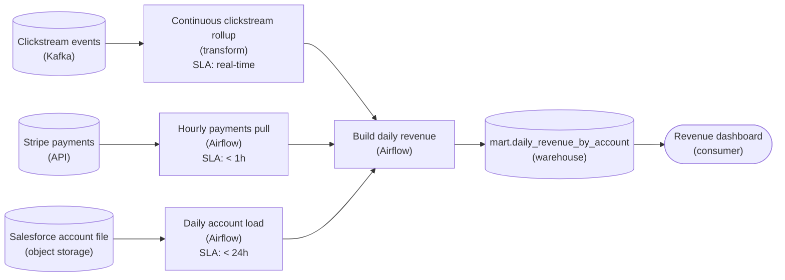

*Each feed runs on the schedule its arrival pattern calls for. The daily build starts when the account file lands and its upstream loads finish, never at a fixed time.*

The clickstream rollup runs continuously, so it is already current whenever the daily build reads it. The Stripe pull uses an interval schedule, `@hourly`, because only the gap between pulls matters, not the wall-clock minute. The Salesforce file gets an event trigger: its arrival starts the daily run. The account load runs first, then the build, in dependency order, with the latest completed hourly pull and the stream rollup as the other 2 inputs.

| Pitfall: Moving the cron later is not the fix |
| --- |
| The tempting patch is a cron like `0 5 * * *`: run at 5am and hope every feed is in. That is still a wall clock guessing when data arrives. The morning the Salesforce file lands 40 minutes late, 5am comes anyway, the build reads stale accounts, and the dashboard is wrong at 6am with nothing flagged. |

| Trick: Let the arrival pattern pick the schedule |
| --- |
| Ask one question of each source: does it arrive at a fixed time, at a fixed gap, or whenever something upstream happens? A fixed gap means an interval, and an unpredictable arrival means an event trigger. Only a truly time-anchored source earns a cron. The daily file is the slowest and least predictable input, so triggering on it lets the build start early on a good morning and correctly on a bad one. |

| Real world: A cron deadline needs its timezone |
| --- |
| The 6am Pacific deadline is the one genuinely wall-clock fact in this design. If you ever schedule against it, write the timezone and a comment next to the cron. Read in UTC, `0 6 * * *` fires at 10pm Pacific in winter and 11pm in summer, both on the night before. |

**Follow-up questions**

1. If the Salesforce file has not landed by 6am, should the build ship with yesterday's accounts joined to today's payments, or wait for the file?\
   *Forces a late-data policy: partial but timely versus complete but late.*
2. Salesforce switches to delivering a fresh file every 4 hours. Does the account feed keep its event trigger or move to an interval?\
   *Re-picks the schedule when the arrival pattern changes.*
3. The clickstream job restarts and replays 2 hours of events. What keeps the daily table from double-counting them?\
   *Tests idempotency in the rollup the daily build reads.*
4. Stripe posts a refund against a payment from three days ago. Does an hourly incremental pull catch it?\
   *Tests full versus incremental loads and late-arriving corrections.*

</details>


<br>

### Exercise 2 of 2

**● TASK**

Replace the monolithic Python task that extracts, cleans and aggregates orders with three separate task nodes (extract_orders, clean_orders, aggregate_orders), so a failure retries only its own task instance instead of re-running the whole DAG. Keep the orchestrator in the production path to own the per-task retry policy, alongside the source, storage and consumer.

**Starting canvas** (already placed for you):

- Postgres orders source (source, Postgres)
- Airflow orchestrator (transform, Airflow)
- Monolithic ETL: extract+clean+aggregate (one task) (transform, Python)
- Snowflake mart_orders (storage, Snowflake)
- Morning dashboard (consumer, Looker)

<details>
<summary><strong>Solution</strong></summary>

#### Task, DAG, run: where a retry actually lives

The section gave you three precise words, and the whole answer turns on keeping them apart. A **DAG** is the graph of work: the boxes and the arrows. A run is one execution of that graph for a given schedule interval (today's 6am run, yesterday's). A task instance is one single box inside one single run, for example `clean_orders` in today's run. A `retries` policy attaches to that smallest unit, the task instance. When `clean_orders` fails, the orchestrator re-runs `clean_orders` for that one run, and nothing else.

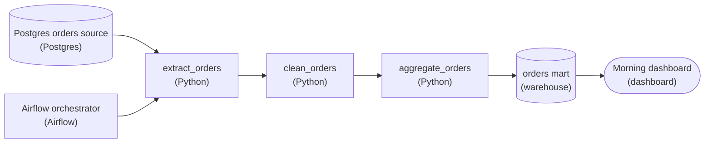

*The monolith split into three retryable task instances. Airflow owns the schedule and the per-task `retries` policy; the arrows are the dependency edges that let a downstream task wait for a healthy upstream.*

| Pitfall: A DAG-level retry re-runs the successful work too |
| --- |
| The tempting shortcut is one `retries` on the whole DAG: on any failure, re-run everything. But retries do not operate on DAGs, they operate on task instances. If `aggregate_orders` fails, a DAG-level retry drags `extract_orders` and `clean_orders` back through the source and the cleaning pass a second time, even though they already succeeded. That is wasted compute, a longer time-to-recover, and re-reading Postgres for rows you already pulled. With the monolith it is worse still: extract, clean, and aggregate are one box, so there is no seam to retry at all, and a fail in aggregate forces a full re-extract by construction. |

| ✕ One DAG-level retry on the monolith | ✓ Per-task retries on the split |
| --- | --- |
| A single `retries` re-runs the entire graph. `extract_orders` and `clean_orders` repeat their successful work on every failure. Recovery cost scales with the whole pipeline, not the broken step, and a transient hiccup in aggregate pays the full extract bill again. | Each of `extract_orders`, `clean_orders`, `aggregate_orders` carries its own `retries`. A fail retries only that task instance; the completed upstream stays completed and the dependency edge holds the downstream until it is healthy. Recovery cost scales with the broken step alone. |

Notice the division of labor the diagram makes explicit: the orchestrator was already on the canvas, and it stays. It owns the schedule and the per-task `retries` policy. What you added is purely structural, the split into three nodes joined by dependency edges. That structural split is what makes per-task retry meaningful, because there is now a boundary for a retry to act on. Orchestration and retry handling are 2 concepts doing one job together: the graph defines the units, the policy decides how each unit recovers.

| Real world: The seams are where you fight fires |
| --- |
| Real ETL fails unevenly. The source database times out during extract, an upstream schema change breaks cleaning, a warehouse credit runs dry mid-aggregate. When each stage is its own task instance you re-run just the one that broke, often with a task-specific backoff, and your morning dashboard is still on time. A monolith with one blunt retry turns every one of those small failures into a full, expensive replay, which is exactly what pages people at 6am. |

**Follow-up questions**

1. If `extract_orders` writes to a staging table, what makes its retry safe to run twice?\
   *Tests whether the learner sees idempotency as the property that makes per-task retry trustworthy.*
2. Where would you set a different `retries` count or backoff for `aggregate_orders` than for `extract_orders`, and why might they differ?\
   *Checks that retry policy is understood as per-task-instance, not one global knob.*
3. The 6am run fails at clean but you fix the bug at 9am. How do you re-run just the failed and downstream tasks for that one run without touching other runs?\
   *Tests the task-instance-within-a-run mental model against clear-and-rerun semantics.*

</details>


<br>

---

## Task vs DAG vs Run for Retries

When something breaks at 04:00, people use 5 words loosely, and the right fix depends on which one you mean. Take a DAG named `daily_revenue` with 3 tasks in a line: `extract_bookings`, then `convert_currency`, then `publish_report`.

| Term | What it is | In daily_revenue | How many |
| --- | --- | --- | --- |
| DAG | the definition: tasks, edges, schedule | `daily_revenue` as written in code | 1 |
| Task | a single node in the definition | `convert_currency` | 3 |
| DAG run | a single execution of the DAG for a single data interval | the run for 2026-10-23 | 1 per interval |
| Task instance | a task inside a specific run | `convert_currency` in the 2026-10-23 run | 3 per run |
| Attempt | a single try at a task instance | try 2 of that task instance | the retry count plus 1 |

Daily runs over 30 days produce 30 DAG runs and 90 task instances from 1 DAG and 3 tasks. Every state the orchestrator shows (queued, running, success, failed, up for retry) belongs to a task instance or a run. Each run is identified by its data interval, which the schedule cuts: at 03:00, the 2026-10-23 run covers 03:00 on the 23rd to 03:00 on the 24th and starts as it closes. A task needing calendar 23 October filters on the run's date.

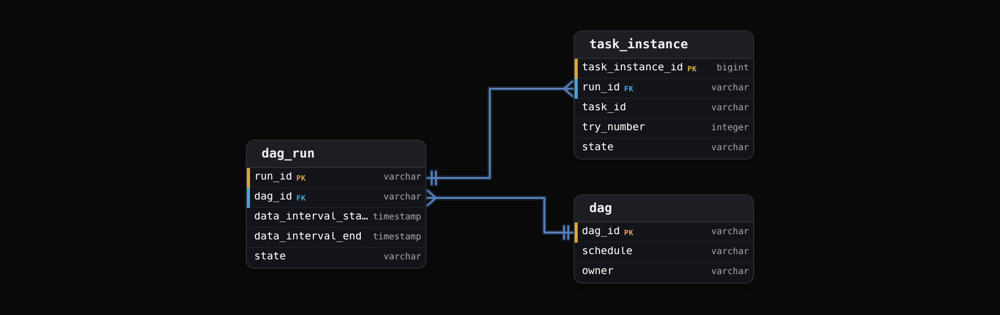

Success and failure live on `task_instance` rows, so every fix below acts on runs and task instances.


<br>

### Automatic retries act on a single task instance

Say `convert_currency` fails in the 2026-10-23 run with a retry count of 2. The orchestrator leaves the rest of the run alone: it moves that task instance to up for retry, waits the configured delay, and starts attempt 2. `extract_bookings` keeps its success and doesn't execute again, and `publish_report` keeps waiting. A retry count of 2 allows 3 attempts. Only when attempt 3 fails does the task instance become failed, and only then does the run fail.

```sql
dag_id: daily_revenue
schedule: "0 3 * * *"
timezone: UTC
default_retries: 2
retry_delay_minutes: 5
tasks:
  - id: extract_bookings
    retries: 4
  - id: convert_currency
    depends_on: [extract_bookings]
  - id: publish_report
    depends_on: [convert_currency]
    retries: 0
```

**An hourly DAG has 4 tasks, each with a retry count of 1. After 7 days, how many task instances exist, and how many attempts did a task instance that ended failed use?**

- **A.** Task instances: 672; attempts on the failed one: 2
- **B.** Task instances: 168; attempts on the failed one: 2
- **C.** Task instances: 672; attempts on the failed one: 3
- **D.** Task instances: 4; attempts on the failed one: 2

<details>
<summary>Solution</summary>

**A.** Task instances: 672; attempts on the failed one: 2

Each of 168 hourly runs holds 4 task instances, and 1 retry allows 2 attempts.

**Why the others are wrong**

- **B.** That counts runs; each run holds its own instance of all 4 tasks.
- **C.** The instance count is right, but 1 retry after the first try makes 2 attempts.
- **D.** The definition has 4 tasks; every run creates its own instance of each task.

</details>


<br>

### Choosing the scope of a manual rerun

Automatic retries suit a task that may succeed a few minutes later on the same inputs. When a person steps in after fixing something, there are 4 scopes, and each re-executes a different set of task instances.

| Action | Re-executes | Use it when |
| --- | --- | --- |
| Clear a single task instance | that task instance only | it failed and nothing downstream has run yet |
| Clear with downstream | that task instance and every later one in the same run | its output changed after later tasks read it |
| Clear the whole run | every task instance in the run | the run's inputs were wrong from the first task |
| Trigger a new run | a fresh run with a new run id | you want an extra execution that leaves existing runs untouched |

The common mistake is clearing too little. Suppose `extract_bookings` for 2026-10-23 succeeded while its source was still filling in. You wait for the source to finish and clear only `extract_bookings`. It reruns and succeeds, while `convert_currency` and `publish_report` keep their earlier success, so the report still shows partial numbers. Once a task's output changes, every task that read it must run again in the same run, which is what clearing with downstream does.

The other mistake is triggering a new run to repair an old one. A manual run gets its own run id and, depending on how it is started, its own data interval. A report task that filters on its run's interval then builds numbers for 24 October and leaves 23 October broken. To repair an interval, act on that interval's run.

**In the 2026-10-23 run of daily_revenue, all 3 tasks succeeded. Then you learn the rates table that convert_currency read was missing 2 currencies, and the table is now fixed. What should you do?**

- **A.** Clear convert_currency only, so the conversion reruns on fixed rates
- **B.** Trigger a new run of daily_revenue so every task runs again
- **C.** Clear convert_currency with downstream in the 2026-10-23 run
- **D.** Clear the whole 2026-10-23 run, starting from extract_bookings

<details>
<summary>Solution</summary>

**C.** Clear convert_currency with downstream in the 2026-10-23 run

Conversion reruns on the fixed rates, publish_report rebuilds from the new output, and extract_bookings keeps its correct result.

**Why the others are wrong**

- **A.** The conversion reruns, but publish_report keeps its earlier success and the report still carries the wrong totals.
- **B.** The new run has its own id and may cover a different interval, so the 2026-10-23 report stays wrong.
- **D.** This repairs the report too, but it re-extracts bookings that were already correct and pays for a full run.

</details>


<br>

---

## Pipeline Architecture

### Exercise 1 of 2

**● TASK**

The orders DAG starts at 2am and usually finishes by 2:45am, so the marketing DAG is scheduled at 3am; on a slow night orders finishes at 3:15am and marketing reads stale data. Replace this time offset with a real cross-DAG dependency. Swap the plain Snowflake mart for a lakehouse-format table (Iceberg, Delta, or Hudi) whose snapshot commits an asset-aware orchestrator can observe, and have the marketing DAG fire when that asset is fresh instead of at a clock time.

**Starting canvas** (already placed for you):

- Orders source (source, PostgreSQL)
- Orders Airflow DAG (cron 0 2 * * *) (transform, Airflow)
- aggregate_orders task (transform, Pandas)
- Plain Snowflake mart.orders_by_region (no snapshot) (storage, Snowflake)
- Marketing Airflow DAG (cron 0 3 * * *, BRITTLE time-offset) (transform, Airflow)
- compute_attribution task (transform, Pandas)
- Marketing dashboard (consumer, Looker)

<details>
<summary><strong>Solution</strong></summary>

#### Wire DAGs to data, not to the clock

Swapping a clock for an asset trigger is **data-aware scheduling**: the producing task declares that it wrote an asset, and the downstream DAG's schedule becomes that asset. Airflow calls these Datasets (Assets in newer releases); Dagster calls them asset materializations. The marketing run no longer starts at a wall-clock time it hopes is late enough. It starts the moment `mart.orders_by_region` has a fresh commit, and never before.

| Pitfall: A time offset is a guess, not a dependency |
| --- |
| The starter wires the two DAGs with `cron 0 3 * * *`, an offset chosen because orders 'usually' finishes by 2:45. But `compute_attribution` has no idea whether the data is fresh; it reads whatever `mart.orders_by_region` holds at 3am. On a slow night orders is still running at 3:15, so attribution reads yesterday's numbers and nothing errors. The failure is silent, which is the worst kind: the dashboard is confidently wrong. |

1. **Give the mart snapshot semantics**

   Swap the plain Snowflake `mart.orders_by_region` for a lakehouse-format table (Iceberg, Delta, or Hudi). The point isn't the storage engine: every write from `aggregate_orders` becomes a new immutable, atomically committed snapshot. A plain table is just its current contents, so 'is it fresh?' is unanswerable. A snapshot table carries a commit the orchestrator can observe.

2. **Emit the asset only when the commit lands**

   Mark the `aggregate_orders` task with an outlet, e.g. `outlets=[Dataset("iceberg://mart.orders_by_region")]`. The orchestrator records an asset update only after the snapshot commit succeeds, so the freshness signal is tied to the data being durably written, not to the task merely starting. If the run fails or is still running, no asset update fires.

3. **Schedule marketing on the asset, not the clock**

   Change the marketing DAG from `schedule="0 3 * * *"` to `schedule=[Dataset("iceberg://mart.orders_by_region")]`. Now it triggers whenever the mart is refreshed, whether that's 2:45 on a fast night or 3:15 on a slow one. The brittle 15-minute race is gone because there is no assumed gap left to lose.

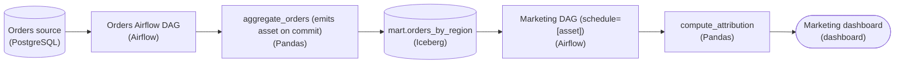

*The snapshot commit on the Iceberg mart is the event the marketing DAG subscribes to. The clock coupling is replaced by a real data edge.*

| ✕ Time offset (brittle) | ✓ Asset trigger (fresh) |
| --- | --- |
| Marketing runs at `0 3 * * *` and reads `mart.orders_by_region` blind. Correctness depends on orders always finishing before 3am. Any slowdown, a bigger day, or a retry breaks it silently. | Marketing runs on `schedule=[Dataset(...)]`, fired by the snapshot commit. Correctness depends only on the data existing. The run self-adjusts to whenever `aggregate_orders` actually finishes. |

| Real world: Why the table format is load-bearing |
| --- |
| A plain warehouse table can't tell you 'a new version just landed', so you fall back to timing. Lakehouse formats give you an atomic, observable commit per write, exactly the event an asset-aware orchestrator subscribes to. In production this is how you kill the whole family of 'DAG B assumes DAG A is done by X' bugs across teams that don't share a schedule. |

**Follow-up questions**

1. What if `aggregate_orders` writes several partitions and marketing only needs one region refreshed?\
   *Tests whether the learner scopes the asset to a partition-level dataset rather than the whole table.*
2. How would you backfill a week of history without the asset trigger firing the marketing DAG 7 times mid-backfill?\
   *Tests decoupling manual or backfill runs from data-driven scheduling.*
3. If the orders DAG commits a snapshot but the data is empty or partial, should the asset still fire?\
   *Tests data-quality gating on the emit step, not just commit success.*

</details>


<br>

### Exercise 2 of 2

**● TASK**

A vendor drops a daily file on SFTP at any time between 01:00 and 05:00, so the Spark transform that loads the warehouse behind the daily dashboard must not start on a fixed clock. Add a sensor task, run by the orchestrator, that waits for the file without holding a worker slot and times out and pages on-call if nothing has landed by 08:00. Once it succeeds, a non-empty check on the file must pass before the Spark transform runs.

**Starting canvas** (already placed for you):

- Vendor SFTP file drop (source)
- Daily Spark transform (transform, Spark)
- Reporting warehouse (storage, warehouse)
- Daily dashboard (consumer, dashboard)

<details>
<summary><strong>Solution</strong></summary>

#### Wait for the world, then run

A **sensor** turns something outside your control into a task the DAG can depend on. Here the outside event is the vendor's file. The orchestrator runs a file sensor at the head of the daily DAG, and everything after it depends on that task, so the Spark load starts when the file lands rather than when the clock says. The non-empty check comes right after the sensor, because a sensor only proves that a file exists, not that it holds data.

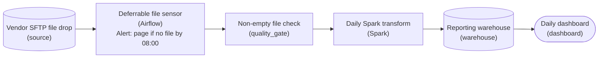

*The sensor and the check sit on the one edge the orchestrator cannot see past: the hand-off from the vendor.*

| Pitfall: A poking sensor holds a slot for hours |
| --- |
| In poke mode the sensor keeps its worker slot for the whole wait. A file that lands at 05:00 means 4 hours of a slot doing nothing, and a handful of such sensors can starve the pool. Reschedule mode, or a deferrable sensor (`deferrable=True` in Airflow), gives the slot back between checks. |

| Key insight: A timeout turns a silent wait into a page |
| --- |
| Without a `timeout`, a sensor waiting on a vendor that never delivers just sits in the running state. The dashboard goes stale and nothing errors. Bounding the wait at 08:00 makes the sensor fail, and that failure pages on-call while there is still time to chase the vendor. |

Notice where the sensor does not go. There is none between Spark and the warehouse: inside the DAG, the orchestrator already knows whether the upstream task succeeded, and an ordinary dependency covers it. Sensors belong only at the boundary, where the condition lives in a system the orchestrator does not run.

**Follow-up questions**

1. The file lands but holds only a header row. Should the check pass?\
   *Whether non-empty means bytes or data rows.*
2. The vendor starts calling a webhook when the file is ready. Do you still need the sensor?\
   *An external trigger can start the DAG directly, so nothing has to poll.*
3. The vendor is sometimes a day late. Should the 08:00 timeout fail the run, or should a later run pick the file up?\
   *Timeout semantics versus catching up on the next schedule.*

</details>


<br>

---

## Cross-DAG Dependencies

Once 2 teams own 2 DAGs, one DAG's output becomes another's input, and the link between them sits outside both graphs. `fx_rates_daily` belongs to the finance data team and loads each day's exchange rates into `warehouse.fx_rates`. `daily_revenue` belongs to analytics and reads that table. The orchestrator links them only if you build the link, with a time offset, a sensor or an asset trigger.

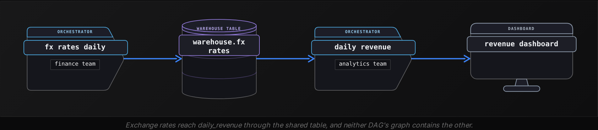


<br>

### Time offset: a dependency nobody wrote down

Schedule `fx_rates_daily` at 01:00 and `daily_revenue` at 03:00, because the rates load has finished by 02:40 on every night anyone checked. Neither DAG records the dependency. It costs nothing to build and fails silently: on a night when the load takes 2 hours 25 minutes, `daily_revenue` reads the previous day's rates at 03:00, succeeds, and publishes. Offsets also decay, since the upstream grows slower month by month and nobody downstream hears when it crosses 03:00.


<br>

### Sensor: wait for the upstream task

A sensor is a task whose only job is to check a condition on a timer; it succeeds once the condition holds. Put one first in `daily_revenue`, waiting for `load_rates` in `fx_rates_daily` to succeed for the matching data interval. A slow night now delays revenue instead of corrupting it, and a missed night fails the sensor at its timeout. The cost is coupling. The sensor names another team's DAG id and task id, and it finds the matching upstream run from a fixed time difference between the 2 schedules. If finance renames `load_rates`, or moves the DAG from 01:00 to 01:30, the sensor waits for a task instance that will never exist.


<br>

### Asset trigger: depend on the table itself

An asset trigger moves the contract from the DAG to the data. The `load_rates` task declares that it updates the asset `warehouse.fx_rates`, and when that task instance succeeds, the orchestrator records an update event. `daily_revenue` names the asset as its schedule, so each update event creates a run. Downstream now knows a table name and nothing about who writes it or when: finance can rename tasks, split the DAG or move it to 01:30 without telling analytics. Revenue also starts seconds after the rates land, on slow nights and fast ones.

```sql
- dag_id: fx_rates_daily
  schedule: "0 1 * * *"
  tasks:
    - id: load_rates
      produces: [warehouse.fx_rates]
- dag_id: daily_revenue
  schedule:
    on_assets: [warehouse.fx_rates]
  tasks:
    - id: extract_bookings
    - id: convert_currency
      depends_on: [extract_bookings]
```

Asset triggers have 2 limits. An update event says the asset changed and says nothing about which slice of data changed, so a downstream that cares must check the content, which the last section of this lesson builds. And the event exists only if the write happened inside the same orchestrator, or the outside writer reports it through the orchestrator's API.

| Approach | Downstream must know | Upstream runs slow | Upstream changes schedule |
| --- | --- | --- | --- |
| Time offset | the usual finish time | runs on stale data and succeeds | breaks with no error |
| Sensor on the upstream task | DAG id, task id, schedule difference | waits, then runs | waits until timeout, then fails |
| Asset trigger | the asset name | runs when the update lands | keeps working |

**Which failure can a time offset produce that a sensor and an asset trigger both prevent?**

- **A.** The downstream waits until a timeout and then fails
- **B.** The downstream breaks when the upstream renames a task
- **C.** The downstream starts once for every upstream update
- **D.** The downstream succeeds on stale input with no error

<details>
<summary>Solution</summary>

**D.** The downstream succeeds on stale input with no error

An offset starts on the clock; the other 2 wait for evidence the upstream finished.

**Why the others are wrong**

- **A.** That is a sensor's behavior when the upstream is missing, and someone sees it.
- **B.** That's the sensor's weakness; an offset never references task names.
- **C.** Starting on every update is how an asset trigger behaves by design.

</details>

> **TIP**
>
> Keep a time offset only where reading the previous day's data is acceptable, and write that reason into the DAG's description. When both DAGs live in the same orchestrator, prefer an asset trigger. Use a sensor where the upstream lives outside the orchestrator, the subject of the next section.

**orders_load runs hourly in your orchestrator and writes warehouse.orders. Its owners reorganize its tasks every quarter. Your DAG must start within minutes of each load. Which dependency fits?**

- **A.** An asset trigger on the warehouse.orders table
- **B.** A sensor on the final task of orders_load
- **C.** A schedule 20 minutes after every hour
- **D.** A sensor on the first task of orders_load

<details>
<summary>Solution</summary>

**A.** An asset trigger on the warehouse.orders table

It depends only on the table name, survives every reorganization, and starts a run as each load succeeds.

**Why the others are wrong**

- **B.** It starts promptly, but a quarterly reorganization can rename that task and leave the sensor waiting until timeout.
- **C.** It ignores whether the load finished, so a slow hour runs on the previous hour's data with no error.
- **D.** The first task succeeding says nothing about the table being written, and it still depends on task names.

</details>


<br>

---

## Pipeline Architecture

### Exercise 1 of 2

**● TASK**

Split the daily mega-DAG into three upstream DAGs, each on its source's natural cadence (Kafka events every 5 minutes, Stripe payments hourly, Salesforce CRM daily), plus one downstream daily DAG that joins their three raw outputs into the table the 6am dashboard reads. Give the upstream cadences and the daily join separate orchestrated DAGs. Set each source's freshness to its own tier: < 15min for Kafka, < 1h for Stripe, < 24h for Salesforce.

**Starting canvas** (already placed for you):

- Mobile events Kafka (continuous) (source, Kafka)
- Stripe payments REST API (source, Stripe)
- Salesforce CRM REST API (source, Salesforce)
- One mega-DAG (daily, forces all cadences to daily) (transform, Airflow)
- Executive daily revenue dashboard (6am SLA) (consumer, Looker)

<details>
<summary><strong>Solution</strong></summary>

#### One DAG per cadence

Multi-cadence ingestion gives each source a DAG on the schedule it naturally arrives on, and lets a separate downstream DAG assemble whatever those DAGs land. The starter's mega-DAG did the opposite. Its single daily trigger pinned the five-minute event feed and the hourly payments pull to the pace of the slowest source, so events sat unread for most of a day before the dashboard saw them.

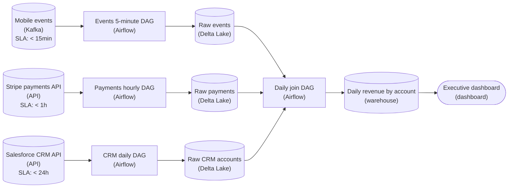

*Three cadence-specific DAGs each land a raw table; one daily DAG joins those tables into the table the 6am dashboard reads.*

1. **Land each source on its own schedule**

   The events DAG runs every 5 minutes, the payments DAG hourly and the CRM DAG once a day, and each one writes its own raw table. The three no longer share a trigger, so a slow CRM pull can never hold back the event feed. Each source's freshness chip (< 15min, < 1h, < 24h) now describes one real feed instead of a single global number.

2. **Join on data, not on clock offsets**

   The daily join DAG never assumes the upstreams finished by a fixed hour. It reads the three raw tables once the day's data is in them and builds the account-level revenue table before the 6am read. The raw tables are the handoff: no producer calls the join, and the join waits on data being present, not on another DAG's run.

| Pitfall: A faster trigger does not rescue one DAG |
| --- |
| Running the mega-DAG every 5 minutes helps the events, but it also re-pulls the CRM 288 times a day for nothing and hammers its API. The cadences are incompatible, so they belong in separate graphs. |

**Follow-up questions**

1. The CRM pull has not landed when the daily join is due. Should the join block, or run against yesterday's CRM accounts?\
   *Weighs a missed dashboard deadline against serving slightly stale account metadata.*
2. Stakeholders now want an intraday revenue view. What would you add without touching the daily join?\
   *The raw events table can feed a second, faster path on its own schedule.*

</details>


<br>

### Exercise 2 of 2

**● TASK**

A logistics company feeds a daily Looker dashboard from three sources on different cadences: shipments hourly, inventory every 6 hours, and a Kafka event stream. Today the upstream pipelines and the analytics pipeline are glued together by wall-clock offsets, and on Black Friday a slow upstream run left the dashboard reading stale data. Redesign it so each cadence runs under its own orchestration and the analytics pipeline starts from the freshness of a lakehouse-format table (Iceberg or Delta Lake) instead of a fixed clock time, and so that a missed freshness target on the analytics output is detected and paged to on-call.

**Starting canvas** (already placed for you):

- Postgres shipments (source, PostgreSQL)
- Postgres inventory (source, PostgreSQL)
- Kafka events (source, Kafka)
- Looker analytics dashboard (consumer, Looker)

<details>
<summary><strong>Solution</strong></summary>

#### Trigger on data, not on the clock

**Data-aware triggering** replaces a clock with a fact. The analytics run starts when the upstream tables actually hold new data, not when a cron offset guesses they probably do. Each cadence keeps its own orchestration: shipments hourly, inventory every 6 hours, and the Kafka stream continuously. All three land in `Iceberg` tables, and those tables' committed snapshots become the readiness signal the analytics DAG waits on.

| Pitfall: A clock offset is a dependency nobody enforces |
| --- |
| Scheduling analytics at 02:00 because shipments usually finish by 01:30 works until the upstream slips. When it does, the downstream runs anyway, reads a partition that was never written, and finishes green. Time is only a proxy for readiness. A committed snapshot is readiness itself. |

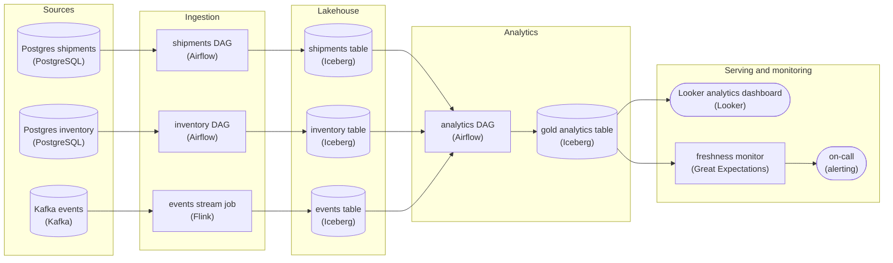

*Each cadence runs under its own orchestration and lands in an Iceberg table. The analytics DAG starts from those snapshots, and a freshness monitor on the gold output pages on-call.*

| Key insight: The table format is the readiness signal |
| --- |
| `Iceberg` and `Delta Lake` commit atomically and timestamp every snapshot. That lets the analytics DAG open with a sensor task that proceeds only once all three tables have committed data newer than its last build. A folder of plain Parquet files gives you neither the atomic commit nor a timestamp to wait on. |

| Trick: Waiting fixes stale, the monitor fixes silent |
| --- |
| On its own, a sensor turns stale-and-silent into late-and-silent. The freshness monitor compares the gold table's snapshot age against its freshness target and routes any miss to the on-call alert. A stuck upstream now pages someone instead of waiting for a user to notice old numbers. |

**Follow-up questions**

1. Inventory is down for a full day. Should the sensor block the analytics run indefinitely, or publish partial output?\
   *Sensor timeouts: blocking keeps the output correct but breaches freshness; publishing partial output needs a visible staleness flag.*
2. A Kafka event lands inside a day partition of the `events` table that analytics already read. How does it reach the dashboard?\
   *Late data: an idempotent partition overwrite and a recompute of the touched day.*

</details>


<br>

---

## Sensors and External Triggers

Asset triggers need the write to happen where the orchestrator can see it. Many inputs are produced elsewhere: a bank drops a file on a server, a vendor's API marks a report ready, a partner writes into your storage bucket. For those, the orchestrator has 2 ways to learn that data exists: it asks, with a sensor, or it is told, with an external trigger.


<br>

### Where a sensor belongs

A sensor belongs at the boundary: the first task of the DAG that consumes the outside data, waiting on the exact object that run needs. For the 2026-10-23 run, that is `landing/rates/2026-10-23.csv`, a path built from the run's data interval. A sensor waiting for any file in `landing/rates/` succeeds on yesterday's file, and a sensor in the middle of a DAG lets earlier tasks run before the input exists, then holds the run open for hours.

#### Timeouts decide what silence means

A sensor without a timeout waits forever, and a run that waits forever alerts nobody. Work the timeout back from the consumer's deadline. Treasury reads the rates report at 07:00 and the load plus report take 40 minutes, so the latest useful arrival is 06:20. A sensor starting at 22:00 gets a timeout of 8 hours 20 minutes and fails at 06:20, early enough for someone to call the bank. Check every few minutes, since each check interval adds at most that much delay and faster polling loads the partner's server for nothing the consumer sees.


<br>

### Sensor execution modes and worker slots

A worker slot is a task attempt's place on a worker, so a cluster with 32 slots runs 32 attempts at once. A sensor's execution mode decides how long it holds a slot while it waits.

| Mode | Slot held while waiting | Each check is | Fits |
| --- | --- | --- | --- |
| Blocking (poke) | yes, for the whole wait | a loop inside a single attempt | waits of a few minutes with frequent checks |
| Reschedule | only during each check | a short attempt started on a timer | waits of hours, checked every few minutes |
| Deferred | none; an async process holds the wait | a callback from that process | hundreds of long waits at the same time |

Suppose 40 partner files each get a blocking sensor that starts at 22:00 and waits around 6 hours, on a cluster of 32 slots. By 22:01 the sensors hold every slot and the rest queue. When a file lands, its sensor frees a slot, and the transform for that file competes for it with the sensors still queued. The same sensors in reschedule mode, checking every 5 minutes, hold a slot for a few seconds per check and leave the cluster to real work.

- **8** — sensors queued at 22:01
- **72** — reschedule checks per sensor each night


<br>

### External triggers: let the source call in

An external trigger reverses the direction, and it lets finance drop the 01:00 cron from `fx_rates_daily`. The storage bucket emits an event when `landing/rates/2026-10-23.csv` is written, and a small function receives it and calls the orchestrator's API to start `fx_rates_daily`, passing the file path in the run's configuration. Nothing polls, and the run starts seconds after the write. Events can also be lost or duplicated. A lost event means no run and no error, so back every external trigger with a deadline check that alerts if no run has started by the consumer's cutoff. A duplicated event means 2 runs for 1 file, and using the file name as the run id makes the orchestrator reject the second as a run that already exists.

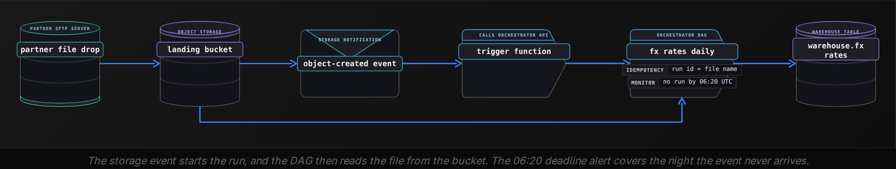

**fx_rates_daily starts from an external trigger and has no deadline check. One night the storage event is lost. What does the team see?**

- **A.** The sensor in fx_rates_daily times out and pages the on-call engineer
- **B.** No run starts and nothing fails, so no alert reaches anyone
- **C.** The orchestrator retries the trigger until the event gets delivered
- **D.** A failed run appears in the UI with an error about the event

<details>
<summary>Solution</summary>

**B.** No run starts and nothing fails, so no alert reaches anyone

The orchestrator never learns the file exists; only a deadline check turns this silence into an alert.

**Why the others are wrong**

- **A.** An externally triggered DAG has no sensor waiting, so no timeout exists to fire.
- **C.** Retries apply to task instances that ran and failed; a run that never started has none.
- **D.** A run must start before it can fail, and the lost event means it never started.

</details>

| ✓ Do | ✗ Don't |
| --- | --- |
| • Wait on the exact file or partition named for this run's interval<br><br>• Derive the timeout from the consumer's deadline<br><br>• Back every external trigger with a deadline alert | • Sense another DAG where an asset trigger fits<br><br>• Hold a worker slot through a wait of hours<br><br>• Poll a partner's server every few seconds |

**A vendor posts a report between 23:00 and 03:00. The consumer reads at 08:00, and the downstream load takes 1 hour. You run 200 such sensors each night on a 64-slot cluster. Which sensor setup fits?**

- **A.** Blocking mode, timeout at 07:00, checking every 10 minutes
- **B.** Reschedule mode, no timeout, checking every 10 seconds
- **C.** Deferred mode, timeout at 07:00, checking every 10 minutes
- **D.** Deferred mode, timeout at 08:00, checking every 10 minutes

<details>
<summary>Solution</summary>

**C.** Deferred mode, timeout at 07:00, checking every 10 minutes

Deferred waits hold no slots, 07:00 leaves the 1-hour load time to finish by 08:00, and 10-minute checks keep delay small.

**Why the others are wrong**

- **A.** The timeout is right, but 200 blocking sensors would hold all 64 slots for hours and starve every transform.
- **B.** Without a timeout a missing report never alerts, and 10-second checks add load the consumer gains nothing from.
- **D.** The mode fits, but a report landing at 07:59 passes the sensor and can't be loaded by 08:00.

</details>


<br>

---

## Pipeline Architecture

### Exercise 1 of 2

**● TASK**

A card processor's API publishes the previous day's settlement file only after 3am UTC, and finance reviews the settled totals in the warehouse at 7am UTC. A fraud dashboard reads authorization counts from that warehouse, pulled from the processor's auth API every 15 minutes, at no particular clock time. Give each feed its own orchestrated DAG with a cron or interval schedule that fits its source, and write that schedule into the DAG's name.

<details>
<summary><strong>Solution</strong></summary>

#### Let the source pick the schedule

Picking between cron and interval is a question about the source, not about taste. The settlement file comes with a wall-clock fact: it exists only after 3am UTC and has to be in the warehouse by 7am. A cron expression is exactly the tool that names a recurring clock time. The auth API carries no such fact: any 15-minute window is as good as another, so only the gap between runs matters, and that is what an interval expresses.

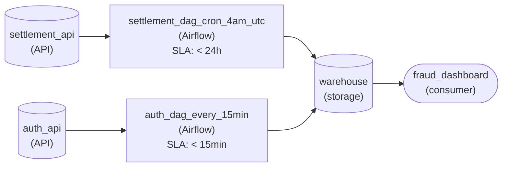

*2 DAGs, 2 schedules: a cron at 4am UTC for settlements and a 15-minute interval for authorizations, both landing in one warehouse.*

1. **Anchor the settlement load with cron**

   `0 4 * * *` reads minute zero, hour four, every day: 4am UTC. That clears the file's latest arrival of 3:15am with margin and lets a 40-minute load finish long before the 7am review. Cron is easy to misread, so state its meaning where people look: on the canvas, that is the DAG's name.

2. **Put the auth pull on a 15-minute interval**

   The first run starts when the DAG is deployed, and each later run starts 15 minutes after the previous one. Nothing downstream cares whether a run lands at :00 or :07, so pinning it to the clock adds a constraint nobody asked for. One DAG holds one schedule, which is why each feed gets its own.

| Pitfall: A 24-hour interval drifts with the deploy |
| --- |
| Scheduling the settlement load as every 24 hours looks like a nightly cron, but an interval's first run happens at deploy time. Ship it at 1pm and the load runs at 1pm every day, hours after finance's 7am review. Redeploy and the time moves again. When the clock matters, the schedule must name the clock. |

**Follow-up questions**

1. Finance adds a month-end reconciliation on the first of every month at 5am UTC. Which schedule, and what expression?\
   *Reading the day-of-month field: `0 5 1 * *` fires only on day 1.*
2. If fraud ops later need each refresh to land on the quarter hour, does the authorization schedule change?\
   *Once the absolute time matters, the interval becomes a cron such as `*/15 * * * *`.*

</details>


<br>

### Exercise 2 of 2

**● TASK**

A daily DAG extracts orders from PostgreSQL, fetches exchange rates from a currency API that times out a few nights a week, converts the orders to USD and loads them into a warehouse table. Set a retry policy on the rates task instance alone: exponential backoff and at most 3 retries, never re-running the whole DAG run. When the retries run out, alert the on-call engineer. Make the warehouse load overwrite its date partition so a retried load writes the same rows.

<details>
<summary><strong>Solution</strong></summary>

#### Retry the task instance, not the run

A retry is aimed at one task instance: this task, in this run, for this date, with these inputs. When the rates call times out at 1:20am, the orders extract in the same run has already finished, so only `fetch_fx_rates` for that date should go again. Because the retry sees the same inputs as the failed attempt, a correct task produces the same output, and the rest of the run carries on as if nothing happened.

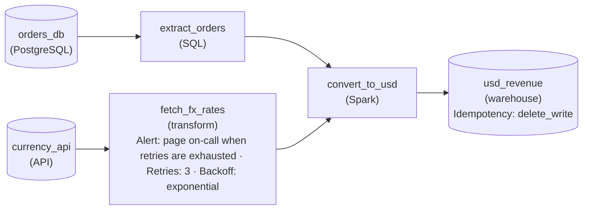

*Retries, backoff and the exhaustion alert live on `fetch_fx_rates`; the write to `usd_revenue` deletes and rewrites its date partition.*

1. **Put the retry policy on the flaky task**

   Set the retry count and an exponential backoff on `fetch_fx_rates` alone. The API recovers within minutes, so growing the wait between attempts gives it room, and three retries bound how long a dead API can hold the run before anyone hears about it.

2. **Decide what exhaustion means**

   Once the last retry fails, the task instance is failed and `convert_to_usd` never starts. That failure has to reach a person, which is why the alert hangs off the same task: missing rates must not quietly become wrong revenue.

3. **Make the write safe to repeat**

   Any task instance can be retried, including the one that writes. Overwriting the run's date partition means a load that died halfway and ran again leaves exactly one copy of the day's rows. Retry semantics and idempotent writes are one decision, not two: a bounded retry in front of an append is still a duplicate generator.

| Pitfall: Re-running the run repeats work that already succeeded |
| --- |
| Clearing the whole DAG run after a rates timeout re-extracts 40 minutes of orders that were fine, and if the load appends, a run that had already written part of the day doubles it. The run is the unit you inspect; the task instance is the unit you retry. |

**Follow-up questions**

1. What should change if the currency API starts returning a `400` for an unknown currency code?\
   *Separating transient failures, which retries fix, from permanent ones, which retries only delay.*
2. The orders extract starts timing out on some nights too. Where does its retry policy go, and does anything else in the run change?\
   *Applying task-level retries to a second task without touching the rest of the run.*

</details>


<br>

---

## Three Cadences, One Output

A revenue team wants hourly revenue in USD, and each hour should appear on the dashboard only once all of its inputs are in. Those inputs arrive on 3 cadences, from 3 DAGs owned by 3 teams.

| Upstream DAG | Writes | Schedule | Loaded through, at finish |
| --- | --- | --- | --- |
| `orders_15min` | `warehouse.orders` | interval, every 15 minutes from :01 | the quarter hour that ended |
| `payments_hourly` | `warehouse.payments` | cron `5 \* \* \* \*` | the top of the current hour |
| `fx_rates_daily` | `warehouse.fx_rates` | event, when the bank's file lands | midnight ending the day that is starting, whose rates the overnight file carries |


<br>

### The offset design and where it breaks

A first draft schedules `revenue_by_currency` at :30 past every hour, reasoning that orders finish by :06, payments by :15 and rates by 06:20. That stacks 3 time offsets, each failing silently: a payments file 40 minutes late means the 14:30 run builds 13:00 to 14:00 without payments and publishes it as final. Sensors fit badly too: the event-triggered rates DAG has no schedule from which to compute the run to wait for, and mapping each hourly run to 4 orders runs works but hard-codes both teams' cadences.


<br>

### Join on freshness instead

In the design that holds up, every upstream DAG ends with a task that records how far its table is loaded, as a row in `pipeline_freshness`, and that task declares the table as an asset. Then `revenue_by_currency` runs whenever any of the 3 assets updates, and its first task asks the freshness table a single question: up to which hour are all 3 inputs complete?

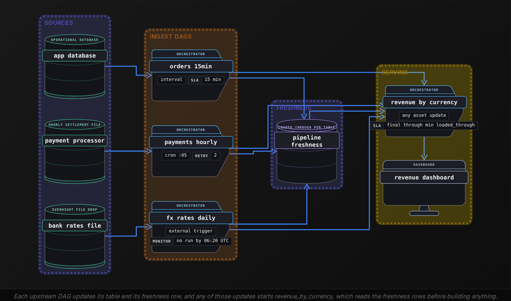

#### pipeline_freshness at 14:40 UTC on 2026-10-24

| table_name | loaded_through | updated_at |
| --- | --- | --- |
| warehouse.orders | 2026-10-24 14:30 | 2026-10-24 14:36 |
| warehouse.payments | 2026-10-24 14:00 | 2026-10-24 14:12 |
| warehouse.fx_rates | 2026-10-25 00:00 | 2026-10-24 03:25 |

```sql
SELECT
  DATE_TRUNC('hour', MIN(loaded_through)) AS build_through,
  MIN_BY(table_name, loaded_through) AS slowest_input,
  COUNT(*) AS inputs_reporting
FROM pipeline_freshness
WHERE table_name IN (
  'warehouse.orders',
  'warehouse.payments',
  'warehouse.fx_rates'
)
```

The run then builds every hour that ends by `build_through` and has not been built yet, and it writes `build_through` beside the output so the dashboard can label its numbers final through 14:00. If `inputs_reporting` is below 3, an upstream has never reported, and the run fails loudly. The slowest input sets the line, whichever input that happens to be.

**At 09:50 UTC on 2026-10-24, pipeline_freshness shows orders loaded through 2026-10-24 09:45, payments through 2026-10-24 09:00 and fx_rates through 2026-10-24 00:00. What does the freshness query return?**

- **A.** build_through 09:00, slowest input warehouse.payments
- **B.** build_through 09:00, slowest input warehouse.orders
- **C.** build_through 09:45, slowest input warehouse.orders
- **D.** build_through 2026-10-24 00:00, slowest input warehouse.fx_rates

<details>
<summary>Solution</summary>

**D.** build_through 2026-10-24 00:00, slowest input warehouse.fx_rates

Rates for 24 October haven't landed, so no hour of that day can convert to USD, and the dashboard holds at midnight.

**Why the others are wrong**

- **A.** Payments trails orders, but the rates table trails both: it covers no hour of 24 October yet.
- **B.** Orders is the freshest input, and truncating 09:45 doesn't make it the slowest.
- **C.** The query takes the minimum across inputs; the maximum plays no part.

</details>

| Time (UTC) | Update that starts the run | build_through | Hours built |
| --- | --- | --- | --- |
| 14:06 | orders loaded through 14:00 | 13:00 | none new |
| 14:12 | payments loaded through 14:00 | 14:00 | 13:00 to 14:00 |
| 14:21 | orders loaded through 14:15 | 14:00 | none new |
| 14:36 | orders loaded through 14:30 | 14:00 | none new |
| 15:06 | orders loaded through 15:00 | 14:00 | none new |
| 15:12 | payments loaded through 15:00 | 15:00 | 14:00 to 15:00 |

When a payments file is 2 hours late, orders updates keep starting runs that find `build_through` stuck at 14:00, so the dashboard keeps saying final through 14:00 rather than publishing the hour ending 15:00 with no payments. The alert pages the owner of `slowest_input`, with a threshold per input: orders or payments at 90 minutes behind the clock, rates only if still slowest after 06:20, since until the bank's file lands they hold `build_through` at midnight every night.

**A teammate proposes running revenue_by_currency only when all 3 assets have updated since its last run. What happens to the dashboard?**

- **A.** Hourly revenue arrives about once a day, after the rates file lands
- **B.** Hourly revenue arrives every 15 minutes, after each orders load
- **C.** Hourly revenue arrives every hour, after each payments load
- **D.** Hourly revenue stops entirely, since the 3 assets never align

<details>
<summary>Solution</summary>

**A.** Hourly revenue arrives about once a day, after the rates file lands

The condition waits for the slowest cadence, and fx_rates_daily updates once a day, so a day of hours lands together.

**Why the others are wrong**

- **B.** That is what running on any update does; the all-assets condition also waits for payments and rates.
- **C.** A payments update alone does not meet the condition; the rates asset must update too, once a day.
- **D.** The condition counts updates since the last run, so it is met once a day when the rates land.

</details>


<br>

---

## Pipeline Architecture

### Exercise 1 of 1

**● TASK**

An events DAG owned by the platform team writes the day's sessionized events table, usually done by 1:30am but sometimes past 4am. Two DAGs owned by other teams read that table: the ML team's feature DAG and the product team's analytics DAG, each currently cron-scheduled at 2am. Draw the design so each downstream DAG starts only once the events DAG has finished that day's table, modeled as a cross-DAG dependency rather than a time offset.

<details>
<summary><strong>Solution</strong></summary>

#### Encode the dependency, not the clock

A cross-DAG dependency makes a downstream DAG wait on an event, the upstream DAG finishing its table, instead of a wall-clock guess about when that usually happens. Here the events DAG is upstream of two teams, so it carries two such edges: one into the feature DAG, one into the analytics DAG. When the events run finishes at 1:30am both consumers start at 1:30am; when it drags past 4am they start past 4am, and neither one ever reads a half-written table.

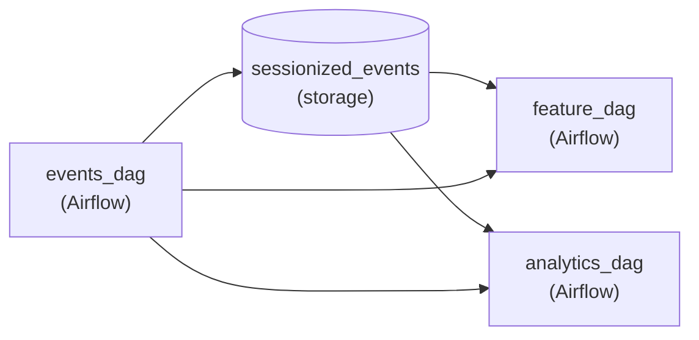

*`events_dag` writes `sessionized_events`; two `cross_dag` edges start `feature_dag` and `analytics_dag` when it completes, with no clock offset.*

| Pitfall: A later cron time is still a guess |
| --- |
| Moving both 2am schedules to 5am feels safe until the night the events run finishes at 5:20am. It also wastes every early night: features that could start at 1:30am sit idle for hours. Worse, the dependency now lives only in two schedules that two different teams can edit without telling the platform team. |

| Key insight: One edge per consumer scales across teams |
| --- |
| Each reader of the table gets its own cross-DAG edge, so a third team joining means one new edge and no schedule negotiation. The events DAG keeps its own cadence untouched; the consumers simply follow it, and a failed upstream run holds them back instead of letting them build on a partial day. |

**Follow-up questions**

1. What changes if the analytics DAG must also wait for an orders DAG owned by a fourth team?\
   *A downstream with two upstream cross-DAG edges, which should start only when both have finished the same day.*
2. If the events DAG is rerun for last Tuesday, should the feature DAG rerun for last Tuesday too?\
   *Whether the dependency is tied to the logical date, so an upstream backfill reaches the consumers it fed.*

</details>


<br>

---

## Putting It All Together

Picture the finance analytics team at Airbnb rebuilding the revenue job from the opening. Bookings land every 15 minutes, payment settlements land hourly, and the exchange-rate file arrives whenever the rates provider sends it overnight. The team retires the 03:00 offset and has to decide, for each piece, which schedule, which cross-DAG link, which way of waiting on the outside world and which rerun scope applies.

- Each upstream keeps the schedule its source calls for: an interval for bookings, cron at :05 for hourly settlements, an external trigger for the rates file.
- A failed settlement load retries as a single task instance, and its freshness row advances only when that load succeeds.
- Revenue links to all 3 inputs through asset triggers, so a rename or reschedule on another team's DAG leaves it working.
- Both outside inputs are guarded at the boundary: payments_hourly opens with a reschedule-mode sensor on that hour's settlement file, timed out before the next hour, and the rates file enters through an external trigger backed by the 06:20 deadline alert.
- The revenue DAG builds only through the minimum loaded_through, so the slowest input decides what the dashboard calls final.


<br>

---

## Pipeline Architecture

### Exercise 1 of 2

**● TASK**

A clickstream Kafka topic receives about 20 million events a day, and a Spark batch job should load them into the warehouse each time 2 million new messages accumulate, not on a fixed clock. Design the DAG with a sensor that watches the topic's offset and triggers the batch job once the threshold is crossed. If the threshold is not reached within 6 hours, the sensor must time out and page on-call.

<details>
<summary><strong>Solution</strong></summary>

#### Let the offset, not the clock, start the load

A sensor turns an outside condition into a task the DAG can wait on. Here the condition is a Kafka offset: the topic gains about 20 million events a day, and the Spark load should start each time 2 million new messages have landed. The sensor sits between the topic and the batch job, checks the offset on an interval, and succeeds once it has advanced 2 million past the last load. Only then does the orchestrator release the job downstream.

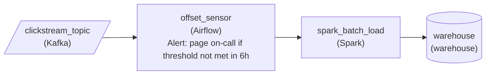

*The Kafka topic feeds an Airflow offset sensor with a 6-hour timeout that pages on-call; the Spark load runs only after the sensor succeeds.*

1. **Put the sensor in the dependency line**

   The batch job's only upstream is the sensor. That ordering is the whole point: the load cannot start until the condition is true, and it starts as soon as it is, whether that happens at 3am or 9pm.

2. **Give the wait an end**

   A sensor with no timeout can wait forever on a stalled producer, and nobody notices until the warehouse is stale. At 20 million a day, 2 million messages normally arrive in about 2 and a half hours, so a 6-hour timeout marks a real stall and pages on-call.

| Pitfall: A cron time is a guess about the data |
| --- |
| Scheduling the load every 2 hours looks equivalent, but traffic is uneven: a quiet night loads a sliver, a busy evening loads far more than 2 million, and the run never knows which. The sensor makes the threshold itself the trigger. |

| Performance: Deferrable mode frees the slot while waiting |
| --- |
| A poking sensor holds a worker slot for the whole wait, up to 6 hours here. In deferrable mode the check is handed off and the slot goes back to the pool until the offset crosses the line. |

**Follow-up questions**

1. What changes if the load must also run at least once every 6 hours, even when fewer than 2 million messages arrived?\
   *Combining a sensor condition with a time-based fallback instead of a hard failure.*
2. How does the sensor know where the last load stopped?\
   *Recording the committed offset so each run's threshold is measured from the previous load.*

</details>


<br>

### Exercise 2 of 2

**● TASK**

A grocery chain's replenishment DAG runs at 4am because the inventory snapshot DAG, owned by another team, usually finishes by 3:30am; on late nights it reads a half-written snapshot. Replace the time offset with an encoded cross-DAG dependency, a sensor or an event trigger, so the replenishment run starts only once the day's snapshot is complete. The run also calls a supplier lead-time API that times out a few nights a week: retry that task with backoff, and alert on-call when retries run out. Land the forecast in a warehouse that feeds the buyers' dashboard by 7am.

<details>
<summary><strong>Solution</strong></summary>

#### Encode the wait instead of guessing it

A time offset is a cross-DAG dependency written in invisible ink: the 4am start only works because someone once watched the snapshot finish by 3:30am. Encoding the dependency makes the wait explicit. A sensor, or an event the upstream DAG emits when it succeeds, holds the replenishment run until the day's snapshot is marked complete, so a slow night delays the forecast instead of corrupting it. The capstone stacks that on the lesson's other two habits: a schedule that states the business deadline, and retries scoped to the one task that actually fails.

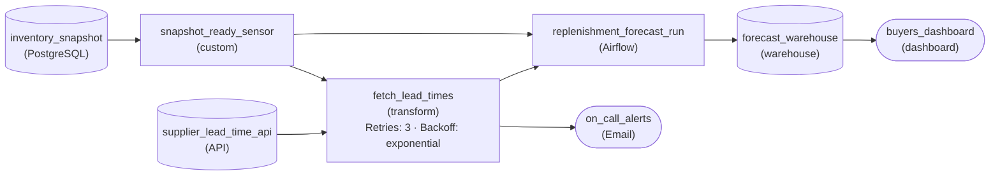

*`snapshot_ready_sensor` releases the whole run, `fetch_lead_times` and `replenishment_forecast_run` alike; only `fetch_lead_times` retries, and its exhausted retries reach `on_call_alerts`.*

1. **Wait on completion, not on 4am**

   The sensor checks the upstream team's done marker for the day's snapshot. The run keeps its daily schedule as the earliest possible start, but both the lead-time fetch and `replenishment_forecast_run` wait behind `snapshot_ready_sensor`, so a 5am finish simply means a 5am start.

2. **Retry the task that times out**

   Retries belong on `fetch_lead_times` with exponential backoff, because the timeout lives in one HTTP call. Retrying the whole run would reread the snapshot and rebuild the forecast to recover from a failure that never touched them.

3. **Make exhausted retries loud**

   When the backoff runs out, the failure path to `on_call_alerts` turns a silent miss into a page hours before 7am, instead of buyers ordering from yesterday's numbers.

| Pitfall: A wider offset only moves the bad night |
| --- |
| Pushing the start to 5:30am adds margin on most nights, still reads a half-written snapshot on the worst one, and delays every good night for nothing. Only a dependency on the completion signal is right on both. |

**Follow-up questions**

1. The snapshot still has not landed by 6:30am. What should the sensor do so buyers are not left guessing?\
   *Sensor timeouts and failing loudly against a business deadline.*
2. A markdown-pricing DAG also needs the same snapshot. How do you avoid encoding its dependency a second, different way?\
   *Reusing one completion signal across several downstream DAGs.*

</details>


<br>

---

## Key Takeaways

- Pick a schedule from how data arrives and how fresh the consumer needs it: cron for known times, interval for steady flow, event for unpredictable arrival.
- Worst-case staleness on a schedule is the gap plus the run time.
- Retries and reruns act on task instances inside a run; after a task's output changes, clear it with downstream in that same run.
- Time offsets fail silently, sensors couple you to another team's ids and schedule, and asset triggers couple you only to a table name.
- Sensors belong first in the consuming DAG at the orchestrator's boundary, with a timeout worked back from the deadline and a mode that frees slots during long waits.
- External triggers need a deadline alert, because a lost event produces no run and no error.
- When inputs arrive on different cadences, run on any update and build only through the minimum loaded_through across inputs.
