Advanced·Pipeline Architecture · 40 min · 11 challenges

# Pipeline Operations: Advanced

At a quarterly review at Airbnb, finance asks the data platform team one question: why did the warehouse bill grow 3 times faster than the team that runs it? Somewhere in hundreds of pipelines, an hourly job feeds a dashboard nobody has opened since spring, and its owner left in June. Your answer decides whether next quarter's budget funds new work or old waste.


<br>

---

## Cost Optimization as Ongoing Work

A pipeline's cost moves every month without anyone deciding to move it. Source tables grow, a new dashboard queries the output every 15 minutes, a backfill leaves a full copy behind, and a cluster sized for last year's peak keeps running at that size. A one-time cleanup removes this month's waste and leaves those forces in place, so cost work has to recur on a schedule.


<br>

### The line spend should stay under

Spend and headcount both grow, and the number worth watching is their ratio. Track **spend per data engineer** every month. If the team grows 20% and spend grows 20%, each engineer's pipelines cost what they did a year ago. If spend grows 60% over the same year, new work is paying for old waste, and the gap compounds.

| Metric | Last October | This October | Growth |
| --- | --- | --- | --- |
| Data engineers | 40 | 48 | 20% |
| Monthly data spend | $100,000 | $160,000 | 60% |
| Spend per engineer | $2,500 | $3,333 | 33% |

**Last October the team had 40 engineers and spent $100,000 a month on data. This October it has 50 engineers. What is the highest monthly spend that stays at or under the headcount-growth trend?**

- **A.** Spend of $140,000, keeping spend growth below 50%
- **B.** Spend of $130,000, keeping spend per engineer nearly flat
- **C.** Spend of $150,000, funding each of 50 engineers at $3,000
- **D.** Spend of $125,000, holding spend per engineer at $2,500

<details>
<summary>Solution</summary>

**D.** Spend of $125,000, holding spend per engineer at $2,500

Headcount grew 25%, so spend may grow 25%: $100,000 times 1.25 is $125,000.

**Why the others are wrong**

- **A.** Headcount grew 25%. Spend growing 40% lifts spend per engineer from $2,500 to $2,800.
- **B.** Nearly flat is above the line: $130,000 across 50 engineers is $2,600 each.
- **C.** That raises spend per engineer by 20%. The trend line holds it at $2,500.

</details>


<br>

### The 5 levers and their order

A pipeline's monthly bill is runs per month, times data processed per run, times the price of processing each unit of data, plus any work nobody reads. Each lever shrinks 1 of those terms.

| Lever | Term it shrinks | Typical move | What can break |
| --- | --- | --- | --- |
| Stop doing it | The whole term | Retire tables and refreshes with no reads in 90 days | A hidden reader that lineage missed |
| Run less often | Runs per month | Hourly to daily where every reader looks daily | A reader with a real freshness SLA |
| Recompute less | Data per run | Full rebuild to incremental with a late-data window | Late rows outside the window |
| Scan less | Data per run | Partition filters, fewer columns, sampled dev data | A query that loses its partition filter |
| Pay less per unit | Price per unit | Right-sized clusters, cheaper compute for retryable batch | Slower runs that miss an SLA |

The order matters because the first levers remove work and the last one discounts whatever work remains. Stop doing it removes a whole term and needs nothing but lineage and query logs. Pay less per unit goes last: right-size a cluster before converting its job to incremental and you've sized it for a job about to shrink, so you size it twice.


<br>

### The monthly cost rhythm

One cycle, 4 weeks

- **Week 1: Rank** *Cost-by-pipeline rollup*\
  Pull spend by pipeline tag. List the top 10 by dollars and the top 10 by month-over-month growth.
- **Week 2: Assign** *Owner teams*\
  Each listed pipeline's owner team names 1 lever and an expected saving, or records why the spend is worth it.
- **Week 3: Ship** *Normal review and CI*\
  Make 1 change at a time, so a number that regresses has 1 cause to look at.
- **Week 4: Verify** *Against the baseline*\
  Compare cost per run with the baseline, confirm last cycle's savings still hold, and plot spend per engineer.

```sql
SELECT
  pipeline,
  owner_team,
  SUM(IF(cost_month = DATE '2026-10-01', cost_usd, 0)) AS oct_cost,
  SUM(IF(cost_month = DATE '2026-09-01', cost_usd, 0)) AS sep_cost,
  SUM(
    IF(cost_month = DATE '2026-10-01', cost_usd, - cost_usd)
  ) AS growth_usd
FROM ops.pipeline_cost_monthly
WHERE cost_month IN (DATE '2026-09-01', DATE '2026-10-01')
GROUP BY pipeline, owner_team
ORDER BY growth_usd DESC
LIMIT 10
```

Ranking by growth_usd puts a pipeline that jumped from $500 to $9,000 above a steady $20,000 one. The growth list catches new waste while its author still remembers why it exists. The dollar list catches the old giants nobody has questioned in a year, and a saving from last cycle that has crept back shows up in both.

**A pipeline costs $18,000 a month. It rebuilds 4 years of order history every hour on a 32-node cluster. Its 3 consumers each read once a day, and 1 has had no queries in 120 days. Which change comes first?**

- **A.** Shrink the cluster to 8 nodes, since most of the bill is compute time.
- **B.** Retire the unread consumer, then move the build from hourly to daily.
- **C.** Convert the build to incremental and keep the hourly schedule as it is.
- **D.** Add partition filters to the 3 consumers' queries before touching the build.

<details>
<summary>Solution</summary>

**B.** Retire the unread consumer, then move the build from hourly to daily.

Stop doing it removes a whole term, and daily runs cut runs per month 24 times without starving any reader.

**Why the others are wrong**

- **A.** Pay less per unit goes last. This sizes the cluster for a job about to shrink.
- **C.** Incremental helps, but 720 runs a month still serve readers who look once a day.
- **D.** The 3 daily readers are a small share of the bill. The hourly 4-year rebuild is the cost.

</details>


<br>

---

## Pipeline Architecture

### Exercise 1 of 2

**● TASK**

50-plus pipelines share one warehouse bill that climbs monthly. Build a monthly scheduled job that reads the warehouse query history and applies one cost lever per cycle (storage tiering, partition pruning, materialized-view ROI, warehouse right-sizing or query rewriting) to those pipelines. Feed each run into an automated audit that flags any pipeline tier without a named cost owner, and alert the owners when a run fails or a tier is flagged.

**Starting canvas** (already placed for you):

- Warehouse query history (source, API)
- Pipeline materializations (transform, dbt)
- Warehouse (storage, warehouse)


<br>

### Solution

#### Cost as a monitored loop

Monitoring cost as a rhythm means treating your own bill like any other pipeline signal. You measure it on a schedule, act on it one lever at a time, and give it a named owner. Here an Airflow DAG wakes once a month, reads the warehouse query history, pulls one lever on the pipeline materializations, and then hands off to an automated ownership audit. What keeps the loop proactive is **monitoring the rhythm itself**. If a run fails silently, or an audit flag reaches nobody, you are back to reactive cost work the moment the bill spikes.

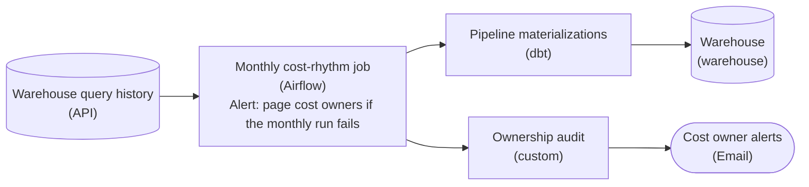

*The monthly job reads query-history telemetry and applies one lever to the pipelines. It then drives the ownership audit, whose flags go to the owners. A monitor alert on the job pages them if a run fails.*

1. **Rank levers from telemetry**

   The query history already shows which of the 50-plus pipelines dominate compute and stored bytes, so start the job there. If you skip it, you end up tuning the pipeline you only assume is expensive.

2. **Pull exactly one lever per cycle**

   Change one thing per cycle so you can attribute the result. If partition pruning and a warehouse resize ship in the same month, a 20% drop can't be credited to either one, and a regression in one hides behind the win from the other.

3. **Alert on the audit and on the job**

   Draw the ownership audit as a quality gate downstream of the job, and route its flags to an alerts consumer so an ownerless tier lands with a person. Put a monitor alert on the job too, because a rhythm that stopped running 3 months ago looks exactly like one with nothing to report.

| Pitfall: A report nobody opens is not an alert |
| --- |
| Writing audit flags to a table feels like accountability, but nobody checks that table until finance escalates. The flag has to reach a person, and the job's own failures have to page someone. Otherwise the rhythm decays back into the quarterly firefight. |

**Follow-up questions**

1. How would the job choose which lever to pull in a given month?\
   *Ranking levers by measured spend and effort rather than habit.*
2. What should happen when a tier stays flagged ownerless for 2 cycles running?\
   *Adding an escalation path to the audit's alert.*


<br>

### Exercise 2 of 2

**● TASK**

Build a pipeline from the production source to dev, CI, and staging stores. Add a masking step whose name states how the PII columns (email, name, address, phone) are hashed or redacted, then a data-quality check confirming no raw PII survives before any store. Name each store for its data shape: dev a small sample committed to the repo, CI a slim recent-prod subset of modified models plus descendants, staging a last-7-days subset or masked full prod.

**Starting canvas** (already placed for you):

- Production data (PII columns include email, name, address, phone) (source, PostgreSQL)
- Masking pipeline (currently absent; define PII handling per column) (transform, Pandas)
- Data quality check (verify masked output, no raw PII) (quality_gate, Great Expectations)
- Dev environment (no formal data shape) (storage, PostgreSQL)
- CI environment (no formal data shape) (storage, PostgreSQL)
- Staging environment (no formal data shape) (storage, PostgreSQL)


<br>

### Solution

#### Match the data shape to the bug you're hunting

This challenge is about **environment-appropriate data provisioning**: you don't feed dev, CI, and staging the same dataset, because each one exists to catch a different class of failure. Dev catches typos and broken references, so it wants the smallest dataset that still runs, a tiny fixture committed to the repo. CI catches schema regressions on the models you just touched, so it wants a slim subset scoped to the modified models plus their descendants. Staging catches integration and scale problems that a slim CI run structurally cannot, so it wants a large, realistic slice, the last 7 days or a masked full copy of prod. The data shape IS the design decision here; naming each store by its shape is how the pipeline documents which failure it is built to surface.

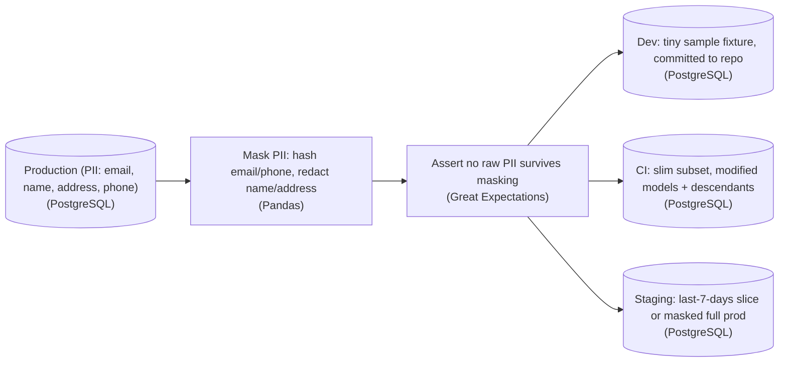

*One masking transform and one quality gate feed three differently-shaped stores. The gate is shared; only the downstream shape changes per environment.*

Notice the masking step and the quality gate sit ONCE, upstream of all three stores. You transform PII out of the data as it leaves production, then every environment reads from the cleaned stream, so no raw `email`, `name`, `address`, or `phone` ever lands in a non-prod box. The step name states the per-column policy (hash the identifiers you still need to join on, redact the free text you don't) so the policy is legible from the diagram instead of buried in code. The quality check right after it is a hard gate, not a hope: it asserts no raw PII made it through before anything downstream is allowed to load. That is data quality used as a barrier, the one place you fail the run rather than warn.

| Pitfall: Copying full prod into every environment |
| --- |
| The tempting shortcut is one masked dump loaded identically into dev, CI, and staging. It looks uniform and safe, but it makes dev slow to seed and heavy to commit, makes every CI run drag a full dataset through tests that only touch a handful of models, and hides nothing the shapes were meant to expose. Uniform data means each environment catches the SAME bugs, and the cheap, fast feedback dev and CI are supposed to give evaporates. |

| Key insight: Slim vs. full is a state question, not a size dial |
| --- |
| CI's 'modified models + descendants' is state-based selection, the same idea as dbt's `state:modified+`: build only what your change could have broken. Staging's 'last-7-days or masked full prod' is a volume/recency slice chosen so integration and scale behavior actually show up. Same source, same mask, but one subset is scoped by the DAG of what changed and the other by how much recent data you need, because they answer different questions. |

**Follow-up questions**

1. If 2 rows share an `email`, should the hash collide so joins still work across the masked stores?\
   *Tests that hashing preserves referential joins while redaction destroys them, the reason the policy differs per column.*
2. What has to change if a new model in CI depends on a model that was NOT modified?\
   *Probes the 'plus descendants' half of state selection versus 'plus ancestors'.*


<br>

---

## Environment Management

Each environment exists to catch 1 class of failure, and only the failures its data can produce will show up there. A fixture of 12 hand-written rows catches a wrong join condition in seconds and can never show that 1 customer key holds 40% of the rows. A full copy of prod shows that skew and costs as much as prod to run. Choose each environment's data from the failure it is there to catch.

| Environment | Data shape | Catches | Misses |
| --- | --- | --- | --- |
| Dev | A 1% key sample of prod, last 30 days, PII masked | Logic errors and wrong joins on realistic values | Skew, rare values, full-volume runtime |
| CI | Repo fixtures; slim CI builds only changed models, on small inputs | Regressions, contract breaks, edge cases someone wrote down | Any case nobody wrote a fixture for |
| Staging | Snapshot clone of prod at full volume | Runtime, memory, skew, migration behaviour | Data that lands after the snapshot |
| Prod | Live data | Everything, after consumers are exposed | Nothing |


<br>

### Sampling dev data by key

Sampling each table at random breaks joins. Take 1% of orders and, separately, 1% of customers: only 1% of the sampled orders find their customer, so every dev join comes back nearly empty and looks like a bug. Sample by a shared key instead. Keep every row for customers in a fixed bucket, in every table that carries `customer_id`, and the same customers exist everywhere.

```sql
CREATE TABLE dev.orders AS
SELECT
  o.order_id,
  o.customer_id,
  o.order_date,
  o.amount,
  to_hex(hmac_sha256(to_utf8(o.email), k.secret)) AS email_hash
FROM prod.orders AS o
CROSS JOIN prod_secrets.masking_key AS k
WHERE mod(o.customer_id, 100) = 7
  AND o.order_date >= current_date - INTERVAL '30' DAY
```

Bucket 7 is arbitrary. What matters is that dev.customers, dev.payments and every other table keyed on customer_id filter on mod(customer_id, 100) = 7. The email goes through hmac_sha256 with a key only prod can read. The same address always yields the same hash, so the column stays unique and joinable, and without the key nobody can hash a list of known emails to match it. A plain sha256 would let them.

> **TIP**
>
> Mask in the copy job, before rows land in dev. A dev table that holds raw emails for even 1 day has widened who could read them, and deleting it later doesn't narrow that.

**A team builds dev by keeping 1% of rows from each table with an independent random filter. Their dev join of orders to customers returns around 1% of the sampled orders. What fixes it?**

- **A.** Raise each table's sample to 10% so more of the join keys overlap.
- **B.** Replace dev tables with full prod copies so every join finds its key.
- **C.** Keep every row whose customer_id falls in 1 bucket, in every table.
- **D.** Switch to a LEFT JOIN so the unmatched orders still appear in results.

<details>
<summary>Solution</summary>

**C.** Keep every row whose customer_id falls in 1 bucket, in every table.

The same customers survive everywhere, so each sampled order finds its customer, as in prod.

**Why the others are wrong**

- **A.** Independent 10% samples match about 10% of orders, at 10 times the cost.
- **B.** That fixes the join at prod cost and puts unmasked PII in dev.
- **D.** Unmatched orders arrive with null customer columns, which hides the sampling bug.

</details>


<br>

### Staging at full volume

Staging runs at prod volume because performance failures only appear there. A join on a key where 1 value holds 40% of rows finishes on a 1% slice and spills to disk on the full table. A snapshot clone gives full volume for the price of metadata: the staging table points at prod's immutable files as of 1 snapshot, and staging writes create new files without touching prod. Staging pays for the compute it runs and the storage of what it changes.

✓Dev and CI data

- Runs in seconds to minutes
- Shaped by fixtures or key sampling
- Answers: is the logic right?
- Cheap to rebuild nightly

✗Staging data

- Same volume and distribution as prod
- Cloned from a prod snapshot
- Answers: will it run at scale?
- Pays a full run each release

> Signs the data shapes are wrong
>
> - Dev queries take 20 minutes: the slice is too large to iterate on.
> - Prod incidents are mostly skew or timeouts: staging is below full volume.
> - CI passes and prod fails on a null: no fixture has nulls in that column.
> - Staging costs as much as prod: it runs on a schedule instead of per release.

**A change adds a join on merchant_id. In prod, 1 merchant accounts for 35% of transactions, and the new join runs out of memory on that key. Which environment is set up to catch this before release?**

- **A.** Staging, because its full-volume clone holds the same 35% skew on that key.
- **B.** Dev, because the 1% key sample contains real merchant IDs from prod.
- **C.** CI, because slim CI runs every modified model on each pull request.
- **D.** Prod, because skew of this kind only shows up under live traffic.

<details>
<summary>Solution</summary>

**A.** Staging, because its full-volume clone holds the same 35% skew on that key.

The clone has prod's rows, so the skewed key and its memory pressure appear before release.

**Why the others are wrong**

- **B.** Real IDs at 1% of the volume: the skewed key fits in memory and the join passes.
- **C.** Slim CI builds only the changed model on small inputs, never a full-volume run, so the skewed key fits in memory.
- **D.** The skew already sits in prod data, so a full-volume clone reproduces it without live traffic.

</details>


<br>

---

## Pipeline Architecture

### Exercise 1 of 2

**● TASK**

Two orders workloads need pipeline-as-code. Nightly, export yesterday's orders from the orders database and push them to a partner API, retrying the push when the partner is down. Separately, keep raw_orders, fct_orders and the revenue mart within an hour of the database, rebuilding downstream when a raw partition is corrected. Build each with the model, declarative or imperative, that fits its workload, and name each orchestrator for its model.

**Starting canvas** (already placed for you):

- orders database (source, PostgreSQL)


<br>

### Solution

#### One source, two models

Imperative and declarative pipelines both end up as a dependency graph run by an orchestrator; what differs is what a node in that graph means. In the **imperative** model the nodes are tasks. The partner delivery is `export_orders_task` then `push_to_partner_task`, ordered by explicit edges and fired by a nightly schedule, with retries on the step that talks to the partner. In the declarative model the nodes are data assets. `raw_orders`, `fct_orders` and `revenue_mart` are stored tables, the edges are lineage, and the one-hour target on the mart decides when anything runs.

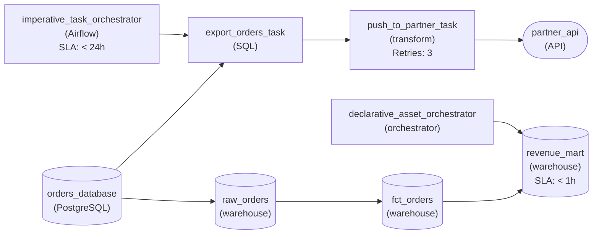

*A nightly task graph for the partner push; an asset graph that keeps `revenue_mart` within an hour.*

| ✕ Imperative: partner delivery | ✓ Declarative: orders tables |
| --- | --- |
| The work is a procedure with a side effect: calling the partner's API. There is no table to declare, only steps to run in order, so the graph is `export_orders_task` then `push_to_partner_task` on a nightly schedule. The retry sits on the push because that is the step that fails when the partner is down. | The work is a set of tables that must exist and stay fresh. You declare `fct_orders` from `raw_orders` and `revenue_mart` from `fct_orders`. The order falls out of lineage, and the orchestrator works back from the mart's one-hour target instead of a clock. |

| Key insight: A corrected partition is the deciding tell |
| --- |
| When a `raw_orders` partition is fixed, an asset graph already knows that `fct_orders` and `revenue_mart` depend on it and rebuilds exactly those. A task graph makes you rerun task instances for a date range and remember yourself what sits downstream. |

| Pitfall: One tool for both is the wrong fit for one of them |
| --- |
| Forcing both workloads into the model the team already runs gives you one of two bad pipelines. The first is a partner push modelled as an asset with nothing to store. The second is a mart rebuilt on a cron that drifts out of its one-hour window. Each pipeline works, and each resists every later change. |

**Follow-up questions**

1. The partner now wants the file only after `revenue_mart` is fresh. Which graph owns that dependency, and how does it cross from one model to the other?\
   *Extends the choice to a handoff between the two models.*
2. If the mart's target loosened to once a day, would a nightly task graph fit it just as well?\
   *Checks that the workload's facts, not the tool, drive the choice.*


<br>

### Exercise 2 of 2

**● TASK**

Half of the catalog's thousands of pipelines belong to engineers who left, and their cold partitions keep billing on the warehouse. Have the orchestrator run the ownership audit quarterly, reading the catalog and flagging every pipeline with no current owning team. Feed those flags directly into a cold-storage tier that takes the orphaned tables' cold partitions off the warehouse. Alert the platform team when a quarterly run fails.

**Starting canvas** (already placed for you):

- Pipeline catalog + active-team registry (source, PostgreSQL)
- Quarterly rhythm orchestration (schedules the audit and tiering) (transform, Airflow)
- Ownership audit (flags pipelines with no current owning team) (quality_gate, custom)
- legacy_orders_table (cold partitions still billing) (storage, warehouse)
- Existing consumers (consumer, API)


<br>

### Solution

#### Let the audit flags be the work order

An ownership audit only pays off when its output becomes the input to the next step. When the gate flags a pipeline as having no current owning team, that same flag tells the cold-storage step which tables to move. The gate produces one list once, and the mover consumes it downstream. That is why the edge runs straight from the audit into the cold-storage node, instead of the tiering step going back to the catalog to decide again what counts as orphaned.

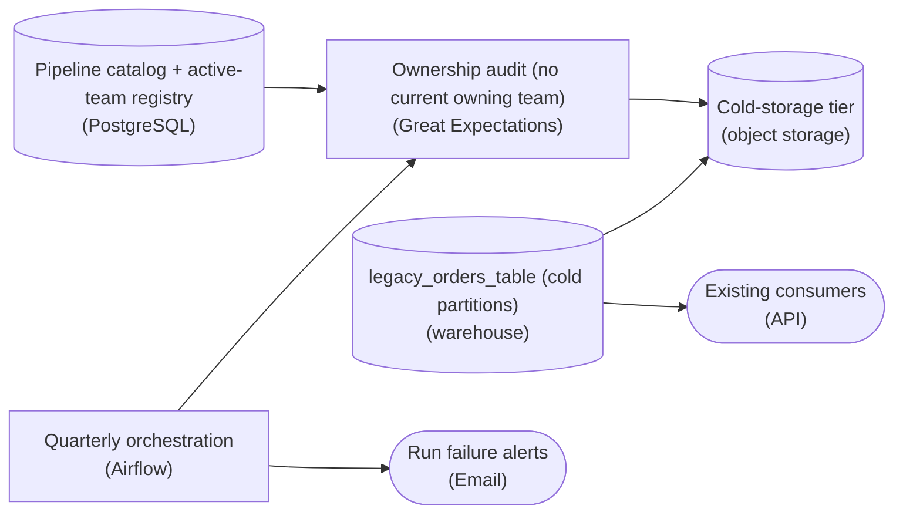

*The orchestrator fires the audit and alerts on a failed run; the orphan flags drive the tiering edge into object storage directly.*

| Pitfall: 2 paths that re-derive the same orphans |
| --- |
| The version most people try first runs tiering as its own step that queries the catalog again for unowned pipelines, sitting beside the audit rather than downstream of it. Now 'orphaned' has 2 definitions that drift apart as soon as the 2 queries differ by one line: you tier a table the audit never flagged, or you leave a flagged one billing on the warehouse. Feed the gate's output into the mover so there is exactly one list. |

| Pitfall: A silent quarterly job loses a whole quarter |
| --- |
| This rhythm runs 4 times a year, so a failed run that nobody notices lets a full quarter of orphans pile up before anyone looks. Monitoring applies to the audit itself: wire the orchestrator to an alert destination so a failed run reaches the platform team the same day. The audit makes sure every other pipeline has an owner, and the alert makes sure the audit has one too. |

| Key insight: Move cold partitions, not whole tables |
| --- |
| The cost saving comes from partitioning. You do not evict `legacy_orders_table` wholesale. You move only its cold partitions to object storage, so the hot partitions stay on the warehouse and existing consumers keep working. An orphaned table is usually mostly cold, which is why it keeps billing for storage nobody reads. |

| Real world: Quarterly batch carrying an event-shaped trigger |
| --- |
| Ownership changes slowly, so the orchestrator runs this quarterly as a batch job, not a live stream. Inside that batch the flags behave like events: each flag triggers a tiering action for its table. You get the simplicity of a scheduled `DAG` and the decoupling of an event-driven design, without standing up streaming for something that runs once a quarter. |

**Follow-up questions**

1. What has to happen when a new team adopts a pipeline whose cold partitions were already moved to cold storage?\
   *Tests whether the audit stays the single source of truth when data moves back, not just when it moves out.*
2. How does the tiering step behave if a flagged table's cold partitions are still receiving late-arriving writes?\
   *Probes the boundary between cold and hot partitions and whether the mover is safe to run again.*
3. How would you catch a quarterly run that never started, rather than one that started and failed?\
   *Extends the failure alert into a freshness check on the rhythm itself.*


<br>

---

## Declarative vs Imperative Pipeline

Pipeline-as-code comes in 2 models. Imperative code lists the steps: fetch a page, loop until the cursor is empty, delete a partition, insert the rows. Declarative code describes the end state: this table equals this query, depends on those tables, and is fresh by 06:00. An engine compares the description with what exists and works out the steps.


<br>

### 2 workloads, 2 models

```sql
asset: analytics.daily_revenue
owner: finance-data
depends_on:
  - curated.orders
  - curated.refunds
materialization: incremental
partition_by: order_date
lookback_days: 3
freshness_sla: "06:00 UTC"
query: sql/daily_revenue.sql
```

```sql
def ingest_invoices(client, warehouse, run_date):
    rows = []
    cursor = None
    while True:
        page = client.get_invoices(updated_on=run_date, cursor=cursor)
        rows.extend(page["items"])
        cursor = page.get("next_cursor")
        if cursor is None:
            break
    warehouse.delete_partition("raw.invoices", run_date)
    warehouse.insert("raw.invoices", rows)
```

The YAML never says what order to build in or which partitions to rewrite. The engine reads the order from depends_on, rewrites the last 3 partitions because of lookback_days, and can print a plan before it runs. The Python owns each of those decisions: the page loop, the stop condition, and delete_partition before insert so a rerun replaces the partition instead of doubling it.


<br>

### Trade-offs of each model

✓Declarative

- Plan before apply: the engine lists what will rebuild
- Drift detection when prod stops matching the code
- Build order inferred from references
- Reruns replace by default
- Control flow the format cannot express needs an escape hatch

✗Imperative

- Any control flow: loops, retries, branches on runtime data
- Fits APIs, pagination, per-tenant fan-out, model training
- Debuggable line by line in a general-purpose language
- Idempotency, ordering and cleanup are the author's job
- No plan: the only preview is a run

| Workload | Fits | Why |
| --- | --- | --- |
| Set-based SQL transforms in a curated layer | Declarative | Output is a function of inputs, so the engine can plan and order it |
| Ingesting a paginated API | Imperative | The stop condition depends on each response |
| Per-tenant jobs over a tenant list that changes daily | Either, with dynamic partitions on the declarative side | Fan-out depends on runtime data |
| Buckets, permissions, schedules | Declarative | Desired state is stable and drift matters |
| Training a model with early stopping | Imperative | Branches on intermediate results |
| A shared layer where 200 analysts add tables | Declarative | Reviewers read a diff of end states |

**An ingestion node pulls from a partner API that returns 500 records per page with a next-page cursor, and it must stop when the cursor is empty. Which model fits the node?**

- **A.** Declarative, because the engine infers page order from depends_on.
- **B.** Imperative, because the stop condition depends on each response at run time.
- **C.** Declarative, because drift detection catches pages missing after the run.
- **D.** Imperative, because declarative engines cannot write to the raw layer.

<details>
<summary>Solution</summary>

**B.** Imperative, because the stop condition depends on each response at run time.

The loop ends when a response has no cursor, a run-time decision imperative code states directly.

**Why the others are wrong**

- **A.** depends_on orders tables relative to each other and knows nothing about pages.
- **C.** Drift detection compares declared and actual state afterwards. It cannot fetch the next page.
- **D.** The model is right and the reason is wrong: the runtime stop condition decides it.

</details>

Many teams settle on a hybrid: a declarative graph of assets in which a few nodes are imperative functions. The graph keeps planning, lineage and ordering for every node, and the function handles the API loop. The failure on either side is forcing the wrong model: 400 lines of templated YAML conditionals to express a loop, or a script that builds 60 tables in a hand-kept order and breaks when someone adds the 61st.

> **TIP**
>
> When declarative config grows its own if-statements and loops, it has become an imperative language without a debugger. Move that node into a function and let the graph call it.

**A team builds 140 curated tables with a Python script that runs CREATE TABLE statements in a hand-kept order. Last month a new table was placed before its parent and read yesterday's data. Which change prevents this class of bug?**

- **A.** Add a CI step that diffs the script against the previous release.
- **B.** Retry the new table once after the rest of the script finishes.
- **C.** Split the script into 1 script per table and run them in parallel.
- **D.** Declare each table with its query and let the engine infer order.

<details>
<summary>Solution</summary>

**D.** Declare each table with its query and let the engine infer order.

References become the dependency graph, so no table builds before its parent, however many are added.

**Why the others are wrong**

- **A.** A diff shows the change, but a reviewer still has to spot the ordering mistake.
- **B.** That patches 1 table and leaves the hand-kept order wrong for the next addition.
- **C.** With no dependency information, parallel children can start before their parents finish.

</details>


<br>

---

## Pipeline Architecture

### Exercise 1 of 2

**● TASK**

The hourly_subscription_metrics pipeline rebuilds its whole Snowflake table every hour from a Postgres replica and a full Stripe pull, though its 3 consumers only need data within two hours. Redraw it keeping every stage, with a batch transform loading Snowflake incrementally on a cadence matched to that need, a data-quality check verifying each load before consumers read it, and an alert that pages on-call when the table goes stale past two hours.

**Starting canvas** (already placed for you):

- Postgres replica (subscription state) (source, PostgreSQL)
- Stripe API (billing events; full pull every hour) (source, API)
- hourly_subscription_metrics (full rebuild every hour, partitioned on ingest_time) (transform, dbt)
- Snowflake hourly_subscription_metrics (storage, Snowflake)
- Finance dashboard, churn ML, ad-hoc analytics (consumer, Tableau)


<br>

### Solution

#### Why it costs ten times too much

The lever here is **incremental refresh**: instead of rebuilding `hourly_subscription_metrics` from scratch each run, you extract only the rows that changed since the last watermark and `MERGE` them into the table that already exists. A full rebuild's cost tracks the size of the table, not how much actually changed, so most of every run re-derives rows that were already correct. That is the ten-times gap. The second lever is cadence: the dashboard only needs data within two hours, so an hourly schedule does double the work freshness asks for.

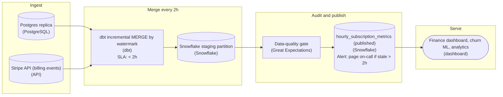

*Merge only what changed every two hours into a staging partition, gate on a quality check, publish, and page on-call if the published table goes stale.*

| Pitfall: The half-fix that still overpays |
| --- |
| The tempting shortcut is to keep the full rebuild but run it every two hours. That halves the bill, it does not tenth it, because each run still rescans and rewrites the whole table. Cadence alone buys 2x; the other 5x comes only from an incremental `MERGE` that touches just the changed rows. You need both. |

| Key insight: Stage, audit, then publish |
| --- |
| Land changed rows with a `MERGE` keyed on subscription id into a staging partition, run the quality check against it (row count in range, no null keys, watermark advanced), and publish into the table the dashboard reads only if it passes. Consumers never see a half-loaded slice, and a bad load stalls on the last good data. |

| Real world: A cheaper pipeline needs a louder alarm |
| --- |
| Moving to a two-hour cadence spends the slack the SLA used to have: one failed run now puts the dashboard past its promise. A freshness alert on the published table that pages on-call once it falls more than two hours behind fires whether the `MERGE` failed, the quality gate held a bad load back, or a scheduled run never started. That alert is how you prove the cost cut did not quietly break the SLA. |

**Follow-up questions**

1. A Stripe event arrives late, stamped inside a window you already published. What keeps the row correct?\
   *Idempotent `MERGE` plus watermark handling for late-arriving data.*
2. You need to correct 6 months of history after a mapping bug. How does partitioning let you backfill without a full rebuild?\
   *Reprocess partition by partition, reusing the same idempotent `MERGE`.*


<br>

### Exercise 2 of 2

**● TASK**

Wire the full operations program onto the representative pipeline on the canvas so the rest of the portfolio can copy it, with the dashboards still reading the serving warehouse. Schedule the declarative dbt models from an imperative orchestrator, and record their lineage in a column-level lineage catalog. Watch the curated warehouse table with five-pillar monitoring that pages the owning team, and roll query-tagged spend up into a cost dashboard for the monthly cost review. Build a masked staging copy through a PII-hashing step, and run the slim-CI tests against it.

**Starting canvas** (already placed for you):

- Postgres source (source, PostgreSQL)
- dbt build (transform, dbt)
- Serving warehouse (storage, warehouse)
- Downstream dashboards (consumer, dashboard)


<br>

### Solution

#### One pipeline, every plane wired

Treating operations as a template is what makes a year-end pass tractable. You hang every operational plane on one representative pipeline and stamp the rest of the portfolio from it. The tension is reach versus reproducibility: a plane added by hand to one pipeline is a fix, while the same planes wired the same way on a model pipeline are a program. Only the program survives the next 50 pipelines.

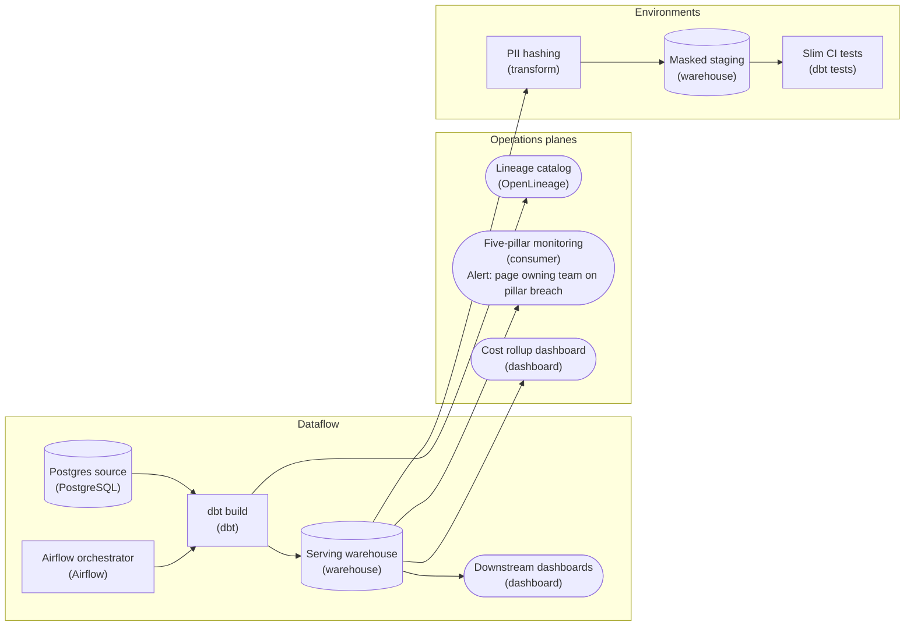

*The dataflow stays 4 stages. The program is what hangs off the dbt build and the serving warehouse.*

| Key insight: Declarative models, imperative schedule |
| --- |
| The dbt models declare what each table should be. The orchestrator decides when the build runs and which upstream loads it waits on. Drawing that split makes the declarative-versus-imperative choice explicit, and the build is where column-level lineage is sent to the catalog. |

| Pitfall: One hashing rule across every shape |
| --- |
| Masked staging is the prod schema with PII hashed on the way in. Hash `user_id` with a different salt than prod and rows that join in prod stop joining in staging. The slim-CI tests then pass on data that cannot reproduce prod. Keep the hashing deterministic and shared by every non-prod shape. |

| Performance: Spend needs a tag and an owner |
| --- |
| Query tags attribute each warehouse query to its pipeline. The cost dashboard rolls those tags up for the monthly review, where the 5 levers get pulled. The monitor pages the owning team for the same reason: a breach or a cost spike with no named owner goes unread. |

**Follow-up questions**

1. If masked staging is rehashed with a rotated salt mid-quarter, which pillar fires first, and is that a real incident?\
   *Tests whether hashing consistency reads as an environment invariant rather than a data-quality failure.*
2. A pipeline is in phase 3 of deprecation but its query tag shows rising cost. Who owns removing the last consumer?\
   *Ties deprecation to the cost rollup and the owning team.*


<br>

---

## Deprecation and Ownership

A pipeline without an owner keeps running and keeps costing, and nobody has the authority to change or stop it. Ownership by a named person ends the day that person changes teams. Assign each pipeline to a team, and record it where tooling can read it, so lineage, alert routing and the cost rollup all point at the same name.


<br>

### An ownership record tooling can read

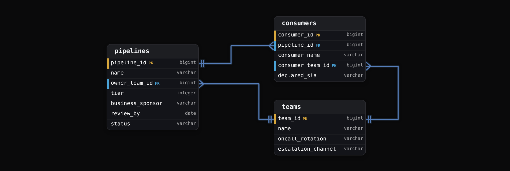

What each field decides

- Owner team: a team, so the record survives people moving.
- On-call rotation: who gets paged. A team without one cannot own a tier 1 pipeline.
- Tier: 1 pages at night, 2 pages in working hours, 3 opens a ticket.
- Business sponsor: the person who can say the output is still worth its cost.
- Review-by date: yearly, the owner confirms or starts deprecation. A lapsed date flags the pipeline.
- Consumers: who to tell before a change. Lineage and query logs fill the gaps.

When a team dissolves, its pipelines move to the team that owns the largest consumer. With no consumer team to take them, they go to the platform team with 90 days to find an owner or start deprecation. A pipeline with neither an owner nor a consumer goes straight to phase 1.

**A tier 2 pipeline's owner team was dissolved last week. Its output has 2 registered consumers, and the larger one belongs to the growth team. What does the ownership model do?**

- **A.** Move ownership to the growth team, owner of the largest consumer.
- **B.** Assign it to the engineer who last committed to its code.
- **C.** Start phase 5 and delete it, since it has no owner team.
- **D.** Leave it running unowned until its review-by date lapses.

<details>
<summary>Solution</summary>

**A.** Move ownership to the growth team, owner of the largest consumer.

The largest consumer has the most at stake and the context to run or retire it.

**Why the others are wrong**

- **B.** That records an individual, and the record breaks again when they move.
- **C.** It has 2 live consumers. Deleting skips the announce, freeze, migrate and brownout phases.
- **D.** Unowned pipelines keep costing with nobody able to change them, which the model exists to prevent.

</details>


<br>

### Deprecation in 5 phases

| Phase | When | What happens | Exit condition |
| --- | --- | --- | --- |
| Phase 1: Announce | Week 1 | Find every reader from lineage and 90 days of query logs; publish the removal date and the replacement | Every reader notified by name |
| Phase 2: Freeze | Week 1 to deletion | No new consumers or columns; metadata marks the table deprecated | Freeze enforced in access rules |
| Phase 3: Migrate | Weeks 2 to 10 | Owner helps each reader move and tracks who remains | Remaining list empty or escalated |
| Phase 4: Brownout | Weeks 10 to 12 | Revoke read access for set windows: 1 hour, then 1 day | No new complaints in the last window |
| Phase 5: Delete | Week 13 | Stop the schedule, keep a final snapshot for the retention period, remove the code, drop the data | Schedule, code and storage gone |

```sql
SELECT
  user_name,
  COUNT(*) AS queries,
  MAX(query_start) AS last_read
FROM ops.query_log
WHERE CONTAINS(referenced_tables, 'analytics.legacy_sessions')
  AND query_start >= CURRENT_TIMESTAMP - INTERVAL '90' DAY
GROUP BY user_name
ORDER BY last_read DESC
```

Lineage shows declared dependencies, and the query log shows people. A notebook export, a spreadsheet connector and a colleague's ad hoc query appear in the log and in no lineage graph. Run the query in phase 1 and again before phase 4: a name in the second result that was missing from the first is a consumer the freeze failed to stop.

**Brownouts** exist because some readers never see announcements. A 1-hour revocation on a Tuesday afternoon makes a hidden reader's job fail while the table still exists and restoring access takes a minute. Found during a brownout, a hidden reader costs an hour. Found after deletion, it costs a restore from the final snapshot, if the retention period has not run out.

✓Do

- Name the replacement in the announcement, or say why there is none
- Count readers from query logs as well as lineage
- Brown out in growing windows before deleting
- Keep a final snapshot through the retention period

✗Don't

- Delete on the announced date while readers remain
- Record an individual as the owner
- Let a deprecated table pick up new consumers
- Skip the brownout because lineage shows no readers

**The phase 1 query-log check found 4 readers. The rerun before brownout finds 5, and the fifth started reading in week 6. Which phase failed?**

- **A.** Announce, because the fifth reader was missing from the notified list.
- **B.** Brownout, because it should have started before migration began.
- **C.** Freeze, because a new consumer began reading a deprecated table.
- **D.** Lineage, because the fifth reader should have appeared in the graph.

<details>
<summary>Solution</summary>

**C.** Freeze, because a new consumer began reading a deprecated table.

Freeze exists to block new consumers, and one got through in week 6.

**Why the others are wrong**

- **A.** The fifth reader did not exist in week 1, so no announcement could have named them.
- **B.** The brownout has not run yet. The rerun before it is what caught the new reader.
- **D.** Lineage misses ad hoc readers by design. The query log is the check for them.

</details>


<br>

---

## Pipeline Architecture

### Exercise 1 of 2

**● TASK**

Build a daily cost job that reads the billing and access logs, attributes spend and partition reads to each owning team, and lands the results in a cost warehouse. A tiering job reads those read counts from the warehouse and moves data lake partitions unread for 90 days into cold object storage. When a team's daily spend runs 20% over its trailing 30-day average, alert that team's owner from the warehouse figures.


<br>

### Solution

#### Measurement only pays off when it drives a lever

Cost monitoring is the measurement part of the proactive rhythm, and it earns its keep only when its output reaches a lever and a person. Your design has one measured fact (spend and reads per partition, per owner, per day) feeding 2 readers: the storage tiering lever and the owner alert. Without the daily job, both run on guesses: tiering by age, and alerts nobody owns.

1. **Attribute spend once a day, per owner**

   The logs arrive daily, so `daily_cost_attribution` runs on a `< 24h` cadence and writes one row per team, partition and day into `cost_warehouse`. That table is the measurement: every later decision reads it instead of the raw bill.

2. **Let read counts pick the tier**

   `tier_partitions_unread_90d` joins the lake's partitions to the access counts and moves only those with zero reads in 90 days to `cold_partition_archive`. Access frequency is the decision rule, so an old partition a quarterly report still reads stays hot.

3. **Send the alert to the team that owns the spend**

   `team_owner_alerting` compares each team's daily spend to its trailing 30-day average and fires at 1.2x. Routing it to the owner rather than a shared platform channel is the accountability part: the person who can change the pipeline is the one who hears.

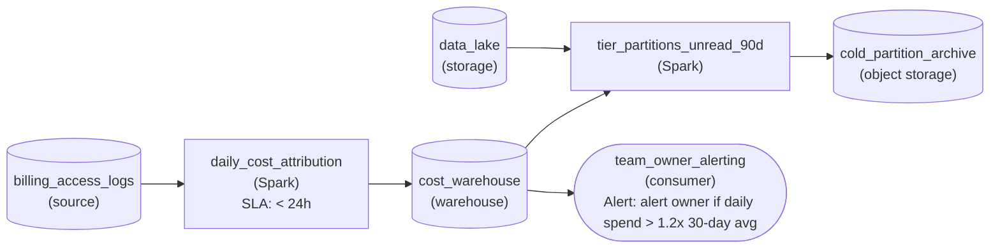

*Daily attribution fills one `cost_warehouse` that drives both the tiering lever and the owner alert.*

| Pitfall: Tiering by age alone moves partitions people still read |
| --- |
| A rule like 'archive everything older than a year' is easier to write, but it skips measurement. A partition a compliance report reads monthly lands in a cold class with retrieval fees and hours of latency, and the next read costs more than the storage saved. Drive the move from the read counts in `cost_warehouse`, not from partition dates. |

**Follow-up questions**

1. Finance wants each team's monthly cost trend on a dashboard. What do you add?\
   *Reusing the measured table for a second reader instead of building a second job.*
2. A team's spend doubles because a planned backfill runs for 2 weeks. How do you keep the alert credible?\
   *Tuning the trailing baseline so accountability alerts are not ignored.*
3. Reads start hitting a partition already in `cold_partition_archive`. What tells you to move it back?\
   *The same access counts driving tiering in both directions.*


<br>

### Exercise 2 of 2

**● TASK**

Design the refresh that seeds staging from the production orders database (200 million rows). Staging receives a 10 percent sample, and every column the data catalog tags as PII is masked before it leaves production. The masked sample passes a validation check before landing in a staging store isolated from production, which the staging run of the orders pipeline reads instead of production.


<br>

### Solution

#### Staging gets a shape, not a copy

Environment management means choosing a data shape for each environment on purpose. Staging exists to run the real pipeline against realistic data. It needs production's structure and skew, but not its 200 million rows or its customers' identities. A 10 percent sample keeps the distributions honest at a tenth of the cost. Masking the catalog-tagged PII columns keeps the copy legal. An isolated store means a staging run cannot read or write production, even by mistake.

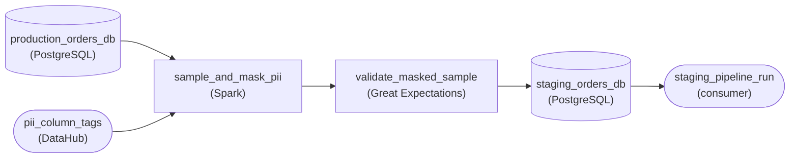

*Production orders are sampled and masked using the catalog's PII tags, then validated. They land in an isolated staging store, which is the only thing the staging run reads.*

| Pitfall: Masking inside staging is already too late |
| --- |
| The tempting design copies production into staging and runs the mask there. Between the copy and the mask, real emails sit in an environment with broader access. If the mask job fails, they stay there. Mask inside the refresh, ahead of `validate_masked_sample`, so unmasked rows never cross production's boundary. |

| Key insight: Tags, not a column list, decide what gets masked |
| --- |
| `sample_and_mask_pii` reads the PII tags from the catalog instead of carrying a hardcoded list of columns. When someone adds a `billing_phone` column and tags it, the next refresh masks it with no code change. A hardcoded list would leak that column until someone remembered to edit the job. |

**Follow-up questions**

1. Developers want a laptop-sized slice of the same data. Where does dev branch off, and what changes?\
   *Reusing one masking path to serve a second, smaller environment shape.*
2. Tests join orders to customers by email. What breaks if masking turns the same email into a different value in each table?\
   *Deterministic masking that keeps the masked data joinable.*


<br>

---

## Worked Example: 10x Cost Cut

`analytics.sessions_enriched` builds user sessions from raw click events. At $40,000 a month it tops the cost rollup, and its spend grew 40% in 6 months while the team grew 10%. The owner team runs a cost pass in 3 stages: read lineage, pull the levers in order, and verify each change against the observability pillars before the next.

| Component | How it runs | Monthly cost |
| --- | --- | --- |
| Transform | Full rebuild of 36 months, hourly: 720 runs at $40 | $28,800 |
| Consumer queries | Six readers query a 140-column unpartitioned table | $7,200 |
| Storage | Raw events for 36 months plus 30 kept copies of the output | $2,800 |
| Dev and CI | Full-volume clones rebuilt nightly | $1,200 |
| Total |  | $40,000 |


<br>

### Stage 1: read lineage before changing anything

| Reader | Reads | Needs data by | Queries in 90 days, excluding auto-refresh |
| --- | --- | --- | --- |
| Exec revenue dashboard | Daily | 06:00 UTC | 2,100 |
| Marketing attribution job | Daily | 06:00 UTC | 90 |
| ML feature job | Daily | 05:00 UTC | 90 |
| Ops live dashboard | Hourly | Today, within 1 hour | 8,400 |
| Legacy funnel dashboard | Every 15 minutes | No SLA | 0 |
| Retention test dashboard | Every 15 minutes | No SLA | 0 |

Of the 6 readers, 2 dashboards refresh every 15 minutes and have had no human queries in 90 days, and 3 readers look once a day. Only the ops dashboard needs data within the hour, and only for today. An hourly rebuild of 36 months exists to serve 1 reader's need for 1 day of data.


<br>

### Stage 2: pull the levers in order

| Lever | Change | Monthly total after |
| --- | --- | --- |
| Stop doing it | Retire the 2 unread dashboards, saving $4,800 in queries; delete the 30 output copies, saving $1,200, since snapshots already keep 7 days | $34,000 |
| Run less often | Full build moves to daily at 04:00 UTC; a small hourly job writes only today's partition, at $1.50 a run | $7,480 |
| Recompute less | The daily build rewrites the last 3 days, the late-data window, instead of 36 months: $40 a run becomes $12 | $6,640 |
| Scan less | Output partitioned by event date; builds and readers select 22 of 140 columns; dev and CI use a 1% key sample | $4,020 |
| Pay less per unit | Cluster shrinks from 32 to 8 nodes; runs take longer but cost $8 daily and $0.75 hourly | $3,780 |

Run less often removed $26,520, the largest share, because no reader needed what hourly full rebuilds produced. Scan less shrank each daily run from $12 to $10 and each hourly run from $1.50 to $1.00, halved the readers' query bill to $1,200, and cut dev and CI to $200. Storage settled at $1,600 because raw events stay for 36 months under the retention policy. Pay less per unit came last because it tunes a job every earlier lever had already shrunk.

**Another team copies this pass for a pipeline whose only reader is a fraud model that scores each payment within 2 minutes of the event. Which lever is ruled out by the reader's needs before any cost data is pulled?**

- **A.** Scan less, because a fraud model reads every column on each score.
- **B.** Stop doing it, because a single reader means nobody depends on it.
- **C.** Pay less per unit, because a smaller cluster always misses 2 minutes.
- **D.** Run less often, because a 2-minute freshness need sets the cadence floor.

<details>
<summary>Solution</summary>

**D.** Run less often, because a 2-minute freshness need sets the cadence floor.

The reader's freshness need fixes how often data must land, so cadence can't drop.

**Why the others are wrong**

- **A.** The reader's only stated need is freshness, so column and partition pruning still apply.
- **B.** One reader scoring every payment is a live dependency, the opposite of unused.
- **C.** Smaller clusters miss tight targets only sometimes. Measure before ruling it out.

</details>

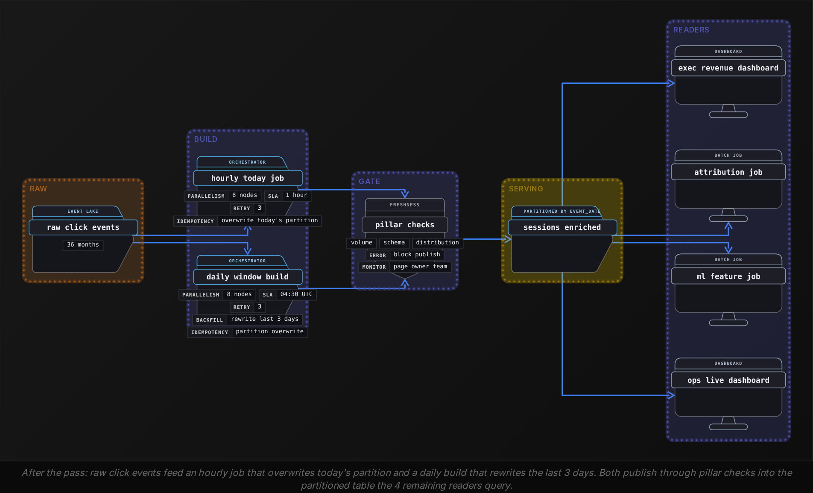


<br>

### Stage 3: verify with the 5 pillars

Each lever shipped as a shadow build first: the new logic wrote `analytics.sessions_enriched_v2` for 7 days beside the old table, and readers switched only after the comparison passed. A cost cut that changes the numbers is a data incident with a smaller bill.

| Pillar | What was checked | Pass condition |
| --- | --- | --- |
| Freshness | Daily build finish time; lag of today's partition | Daily done by 04:30 UTC; today under 1 hour behind |
| Volume | Sessions per event date, old versus v2 | Exact match for days older than 3 days |
| Schema | Names and types of the 22 columns readers select | No change |
| Distribution | Median session length, null rate of `user_id`, sessions by country | Within 1% of the old table each day |
| Lineage | Query log on retired tables; reader job status | Zero reads of retired tables, zero reader failures |

```sql
WITH before_cut AS (
  SELECT
    event_date,
    COUNT(*) AS sessions
  FROM analytics.sessions_enriched
  WHERE event_date >= DATE '2026-10-01'
  GROUP BY event_date
),
after_cut AS (
  SELECT
    event_date,
    COUNT(*) AS sessions
  FROM analytics.sessions_enriched_v2
  WHERE event_date >= DATE '2026-10-01'
  GROUP BY event_date
)

SELECT
  COALESCE(b.event_date, a.event_date) AS event_date,
  b.sessions AS old_sessions,
  a.sessions AS v2_sessions
FROM before_cut AS b
FULL OUTER JOIN after_cut AS a
  ON b.event_date = a.event_date
WHERE b.sessions IS DISTINCT FROM a.sessions
ORDER BY event_date
```

On the last shadow day the query returned 2 rows, the 2 most recent days. That is expected: the old table rebuilt every hour and had already absorbed late events that v2 picks up at its next 04:00 run. A mismatch on any day older than 3 days would mean events arriving outside the late-data window, and the switch would have waited until the window was widened and the run cost recalculated.

- **10.6x** — monthly cost reduction
- **$36,220** — saved every month
- **0** — reader failures after the switch

**The rollup shows sessions_enriched at $9,300 a month, 6 weeks after the switch. It ran 1,440 times last month, and each kind of run costs what it did after the pass. What happened, and where does it surface first?**

- **A.** Reader queries grew, and the volume pillar flags it on the next check.
- **B.** The daily build was rescheduled hourly, and week 1's growth ranking flags it.
- **C.** The cluster went back to 32 nodes, and the freshness pillar catches it.
- **D.** Late events widened the window, and the distribution pillar catches it.

<details>
<summary>Solution</summary>

**B.** The daily build was rescheduled hourly, and week 1's growth ranking flags it.

Run count rose from 750 to 1,440: 690 extra builds at $8 add $5,520, which tops the growth ranking, and week 4 confirms a past win crept back.

**Why the others are wrong**

- **A.** Reader queries leave run count untouched. The extra runs are builds.
- **C.** Cost per run is unchanged, so cluster size is too. A bigger cluster would raise no freshness alarm.
- **D.** A wider window raises cost per run, which stayed flat. Run count is what moved.

</details>


<br>

---

## Pipeline Architecture

### Exercise 1 of 1

**● TASK**

Each night a partner's settlement file must be pulled from a flaky API, retried up to 3 times on failure, and loaded into a raw warehouse table before anything downstream runs. Three reporting tables are derived from that raw table and must be fresh within 24 hours. Express the procedural pull-and-load imperatively as an Airflow task, and the derived reporting tables declaratively as dbt models.


<br>

### Solution

#### Steps for side effects, assets for derived data

This workload sits on both sides of the declarative versus imperative line, and the design splits it right there. Pulling a file from a flaky API is a procedure: call, wait, retry, load, in that order, with side effects an orchestrator has to sequence. The three reporting tables are not steps at all. They are assets that should exist, derived from the raw table, at a stated freshness, which is exactly what a dbt model declares.

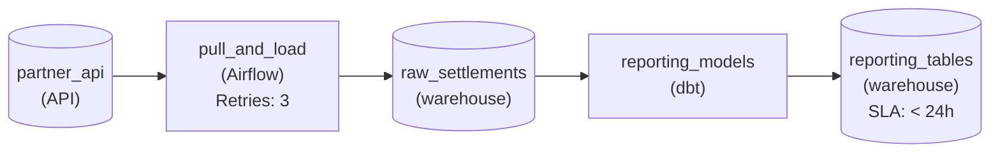

*The Airflow `pull_and_load` task retries the flaky API and lands `raw_settlements`; the dbt `reporting_models` declare the reporting tables from it.*

1. **Keep the side-effecting pull imperative**

   The pull is an Airflow task with `retryCount` set to 3, so a timeout retries that one task instead of failing the night. Its edge into the raw warehouse table is the ordering guarantee: nothing downstream reads until the load lands.

2. **Declare the derived tables as dbt models**

   Each reporting table is a model that selects from the raw table. dbt reads those references and builds the dependency graph itself, so you never hand-wire which table runs before which. The `< 24h` freshness sits on the asset, which is where a declarative pipeline says how fresh something must be.

| Pitfall: One operator per table is the brittle version |
| --- |
| The tempting design adds an Airflow operator for each reporting table and chains them with explicit dependencies. It runs, but every new table means editing the task graph, and the order you wired by hand slowly drifts from the data dependencies the SQL already states. |

| Key insight: Adding a table is the test of the split |
| --- |
| When finance asks for a fourth table, the declarative side absorbs it as one new model reading the raw table. The orchestrated pull does not change at all, and that is the leverage choosing by workload fit buys you. |

**Follow-up questions**

1. The partner starts publishing a correction file later the same morning. Which side of the design owns rebuilding the affected night, and what changes?\
   *Whether a replay is a procedural step for the orchestrator or a rebuild of declared assets.*
2. One reporting table now needs hourly freshness while the other 2 stay daily. Where does that difference live?\
   *Freshness as a property declared per asset rather than a schedule wired per task.*


<br>

---

## Putting It All Together

A food-delivery marketplace closes its annual plan: the data team grows from 30 to 36 engineers, and finance holds data spend growth to the same 20%. The cost rollup shows 3 pipelines carrying 45% of spend. The largest is a legacy order-events table whose owner team was folded into another group. A pricing notebook still reads it nightly, and a script rebuilds it in full every hour by running 60 statements in a hand-kept order.

- The 20% headcount growth draws the line spend must stay under, and week 1 of the monthly rhythm puts the 3 pipelines carrying 45% at the top of both lists.
- Before any lever moves, the ownership record assigns the orphaned table to the team owning its largest consumer, since only an owner can approve retiring work.
- The pricing notebook shows up only in the query log, so the announce phase names it and the brownout confirms no other reader was missed.
- Readers who look nightly make run less often the first lever after retiring unread work, and incremental rebuilds of a late-data window follow.
- The rebuilt table becomes a declarative asset: set-based logic, inferred build order, and a plan that lists what changes before it applies.
- Key-sampled dev catches logic errors, a full-volume staging clone catches skew, and a shadow build checked on the 5 pillars proves the cut changed cost and nothing else.


<br>

---

## Pipeline Architecture

### Exercise 1 of 2

**● TASK**

A legacy nightly pipeline still writes an old revenue table that a replacement has superseded, and its author has left the company. Design the deprecation monitor for the table's 30-day sunset window: a daily scheduled job reads the warehouse query log and the lineage catalog to find every remaining reader, and lands each reader's read count in a usage table. Each day the job alerts the owning team of every reader still querying the old table.


<br>

### Solution

#### Deprecation is a monitoring job with an end date

A defined deprecation process exists because a pipeline whose author left has nobody who can list its readers from memory. So the readers get measured: every day of the sunset window, the design asks who still touched the old table, records the answer, and tells each owning team directly. That is **monitoring pointed at usage** instead of failures, and it lets the shutoff happen on evidence rather than on a calendar date.

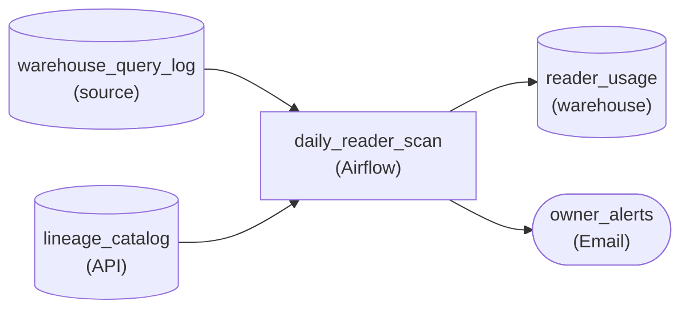

*The query log and lineage catalog feed `daily_reader_scan`, which lands per-reader counts in `reader_usage` and emails owning teams.*

1. **Read both reader signals**

   The query log catches analysts and dashboards running ad hoc SQL; the lineage catalog catches scheduled jobs that read the table on their own cadence. Either alone misses a whole class of reader, so `daily_reader_scan` reads both.

2. **Land a count per reader, every day**

   Writing each reader's daily read count to `reader_usage` turns the window into a trend: the reader list shrinks, and the day it stays empty is the day the pipeline can go. The same run sends `owner_alerts` to every team still on the list.

| Pitfall: An announcement is not a migration |
| --- |
| The common version posts a deprecation notice and switches the pipeline off on day 30. Readers whose owners left never see the notice, and the first signal is a failed downstream job. Alerting from measured reads reaches exactly the teams still depending on the table. |

| Real world: Zero reads are the shutoff evidence |
| --- |
| The platform team holds the switch, and the usage table is what they bring to review: reads at zero after the alerts went out. The same pattern retires a column or a Kafka topic: measure consumers, notify their owners, retire on evidence. |

**Follow-up questions**

1. A reader's owning team was dissolved last quarter. Where should its alert go?\
   *Ties deprecation back to the ownership audit: an orphan reader needs a claim or transfer before shutoff.*
2. Some readers run only at month end. How does the sunset window need to change?\
   *Tests whether the window covers the slowest reader's cadence before zero reads mean anything.*


<br>

### Exercise 2 of 2

**● TASK**

A payments pipeline lands 40 million card transactions a day in a production warehouse, with the cardholder name, email and card number columns tagged as PII. Build its non-prod side: an orchestrated weekly refresh that masks every tagged column before any copy leaves production, a dev store holding a 1 percent sample, and a staging store holding the most recent month at full volume. Non-prod must cost a fraction of prod, so add a daily cost check over both stores that alerts the owning team when either runs over budget.


<br>

### Solution

#### Masking sits upstream of every non-prod copy

Environment management for a pipeline with PII is three choices made together: what shape of data each environment holds, where the sensitive columns get masked, and who notices when the copies start costing real money. At 40 million transactions a day, the most recent month is about 1.2 billion rows. Staging takes that month so release tests see real volume; dev takes a 1 percent sample, about 12 million rows, so queries return in seconds and cost almost nothing.

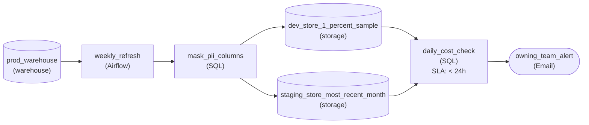

*`weekly_refresh` pulls the month, `mask_pii_columns` writes the 1 percent dev sample and the full staging month, and `daily_cost_check` alerts the owning team.*

1. **Give each environment the shape its tests need**

   Dev is for writing and debugging transforms, so it needs realistic rows, not realistic volume: a 1 percent sample is enough and keeps every query cheap. Staging is where a release proves it holds at production scale, so it gets the most recent month at full volume. An empty dev tests nothing; a full-history staging costs as much as prod.

2. **Mask once, before anything leaves production**

   `mask_pii_columns` sits between the refresh and both stores, so the only way into dev or staging runs through it. Masking deterministically (the same card number always becomes the same token) keeps joins and distinct counts behaving like production while no raw value ever lands outside it.

3. **Orchestrate the refresh, watch the bill daily**

   `weekly_refresh` is an Airflow DAG: extract the month, mask it, then load staging and sample dev, each task waiting on the one before. `daily_cost_check` reads the spend of both stores every day and notifies `owning_team_alert` when either crosses its budget, so drift shows up within a day instead of on the monthly invoice.

| Pitfall: Masking after the copy lands is already a leak |
| --- |
| Copying production into staging and then masking there means raw card numbers sit in a less-guarded environment for as long as the job takes, and indefinitely if it fails. Masking belongs upstream of every non-prod write. The other common miss is loading a new staging month without dropping the old one: copies pile up and staging quietly becomes a second production bill. |

**Follow-up questions**

1. A data science sandbox now needs the same masked month as staging. What changes?\
   *Adding a third environment fed from the same masking stage and covered by the same cost check.*
2. Legal adds date of birth to the PII tags. How does the design keep up without a code change per column?\
   *Whether masking is driven by column tags rather than a hard-coded column list.*
3. Staging spend doubles after a schema change widens the table. How do you find out, and what do you cut first?\
   *Treating the daily cost check as an ongoing cost rhythm rather than a one-off audit.*


<br>

---

## Key Takeaways

- A pipeline's bill is runs, times data per run, times price per unit, plus work nobody reads. Pull the 5 levers in the order that removes work before discounting it.
- A 4-week rhythm of rank, assign, ship and verify keeps spend per engineer flat while the team grows, and catches old wins that crept back.
- Give each environment the data that exposes its failure class: key-sampled dev, fixture CI, full-volume snapshot staging.
- Declare set-based transforms and infrastructure, write imperative code where control flow depends on run-time data, and let a declarative graph call imperative functions.
- Teams own pipelines in a record tooling can read, and every deprecation runs announce, freeze, migrate, brownout, delete.
- A cost cut ships as a shadow build verified on all 5 pillars, because changed numbers are an incident whatever the bill says.
