Intermediate·Pipeline Architecture · 32 min · 12 challenges

# Pipeline Operations: Intermediate

Say a pull request at Netflix changes `watch_time` in a playback table from seconds to minutes on a Monday. A forward lineage walk names the 140 downstream tables and dashboards and their owners, and a data diff in CI shows every row's `watch_time` divided by 60 before merge. Those steps keep Tuesday's Top 10 built on real viewing numbers, and this lesson works them on a small orders pipeline.


<br>

---

## What Telemetry Is Worth Keeping

Every log line is paid for in 3 places, and so is every metric series and trace span. Ingest and storage are the first 2; the third is each query that reads it. It is paid for again in attention, because a dashboard of 60 panels hides the 3 that matter during an incident. Telemetry is worth keeping when it answers a question that someone acts on, and the table below applies that test to each signal.


<br>

### Start from the question, then pick the signal

| Question | Signal that answers it | Who acts on it |
| --- | --- | --- |
| Is the output late or wrong right now? | Freshness and row-count checks on the final tables | On-call engineer, from an alert |
| Which task in which run failed, and why? | Task logs that carry `run_id`, plus task status | On-call engineer, while debugging |
| Is this pipeline getting slower or more expensive? | Daily rollups of duration and cost per task | Owning team, at a monthly review |
| What did row 8,812,004 look like inside step 3? | No telemetry; query the table or the dead letter queue | Almost nobody, almost never |

The last row is where budgets leak. A task that logs every row of a 200-million-row load writes 200 million lines per run; at 300 bytes a line, that is 60GB of logs a day from 1 task, and the line for row 8,812,004 will never be read. Log once per batch instead: the `run_id` and the duration, and how many rows came in and went out, with rejected rows counted separately. Those few lines per run answer the second question in the table.


<br>

### Cardinality decides the metric bill

A metrics store keeps 1 time series per unique combination of label values. Storage cost grows with the series count, and so does query cost. With pipeline and task as its labels, the metric rows_written makes 480 series over 40 pipelines of 12 tasks each. That is cheap, and it is enough to see which pipeline and task slowed down or shrank. Add a customer_id label, which has 50,000 distinct values, and each of those series splits 50,000 ways.

- **24M** — rows_written series with customer_id

A label belongs on a metric when its set of values grows with the platform, such as pipeline and task, or env and status. Values that grow with the data go into log lines, where they leave no permanent series behind; customer_id and order_id are examples, as are run_id and partition_date. run_id looks harmless, but as a label it mints a new series every run, each holding the points of a single run.


<br>

### Keep detail briefly, keep summaries for 13 months

Questions about raw detail come within days of an incident. Questions about trends, such as whether `orders_daily` has slowed since spring, come months later. Retention is therefore tiered: full detail for a short window, then downsampled rollups for a long one.

| Signal | Full detail kept | After that | Why this window |
| --- | --- | --- | --- |
| Task logs | 14 days | Error lines kept 90 days, the rest deleted | Incidents are debugged within a week; repeat errors show up over a quarter |
| Task metrics at 10-second points | 15 days | 5-minute rollups kept 13 months | 13 months lets you compare a month with the same month last year |
| Run traces | Every failed run and 5% of successful runs, for 7 days | Deleted | Failures need the full path; latency trends need only a sample |
| Query cost records | 13 months | Deleted | Small rows that feed the monthly cost review |

> **TIP**
>
> Before adding a signal, name the thing that will read it. That can be an alert or a dashboard panel, or a step in a runbook. A signal nothing reads is cost with no return, and it buries the signals that matter.

**A teammate proposes adding order_id as a label on the rows_rejected metric so on-call can see which orders failed validation. The pipeline rejects roughly 2,000 of its 400,000 daily orders, each with a new order_id. What should the review say?**

- **A.** Ship it: 2,000 rejected orders a day is a small number of series, well within what a metrics store handles.
- **B.** Keep rows_rejected labelled by pipeline and task, and write each rejected order_id and its reason to a log line or the dead letter queue.
- **C.** Add the label, and cut metric retention from 13 months to 15 days so the old order_id series age out quickly.
- **D.** Remove the rows_rejected metric, because every rejected order already sits in the dead letter queue with its reason.

<details>
<summary>Solution</summary>

**B.** Keep rows_rejected labelled by pipeline and task, and write each rejected order_id and its reason to a log line or the dead letter queue.

The metric stays at a bounded series count and still drives an alert on rejection rate. The per-order detail lives where per-row detail belongs, with retention measured in days.

**Why the others are wrong**

- **A.** The daily count is small, but every day adds 2,000 new series. After a year that is over 700,000, each created for 1 order and never useful again, and the count keeps growing.
- **C.** Shorter retention caps storage, but it throws away the 13-month trend for every other series, and the store still creates 2,000 new series each day.
- **D.** The queue holds the records, but an alert on rejection rate needs a metric. Without it, a jump from 2,000 to 40,000 rejections a day goes unnoticed until someone opens the queue.

</details>


<br>

---

## Pipeline Architecture

### Exercise 1 of 2

**● TASK**

Bring fct_orders to full observability coverage: wire the curated table into data-quality monitors that check freshness, volume, schema, and distribution, so a regression in any of those pillars fires the same day. Route the fifth pillar, lineage, into a data catalog that records column-to-column provenance, so you can tell which downstream reports a change breaks before it ships.

**Starting canvas** (already placed for you):

- order_events (source, Kafka)
- transform_curate_orders (transform, dbt)
- fct_orders curated table (storage, warehouse)
- downstream reports (consumer, dashboard)


<br>

### Solution

#### The 5 pillars of data observability

Data observability is the practice of watching a table the way you'd watch a running service, across 5 distinct signals: **freshness** (did it update on time), volume (did the right number of rows arrive), schema (did the columns and their types stay the same), distribution (do the values still look normal), and lineage (what upstream produced this, and what downstream depends on it). `fct_orders` already had freshness and volume covered, so it could tell you a load was late or thin. But those 2 checks are blind to a column being retyped, to a value quietly drifting, and to the question of which report breaks when something changes. A table can pass every check it has and still be wrong in a way nothing is looking for.

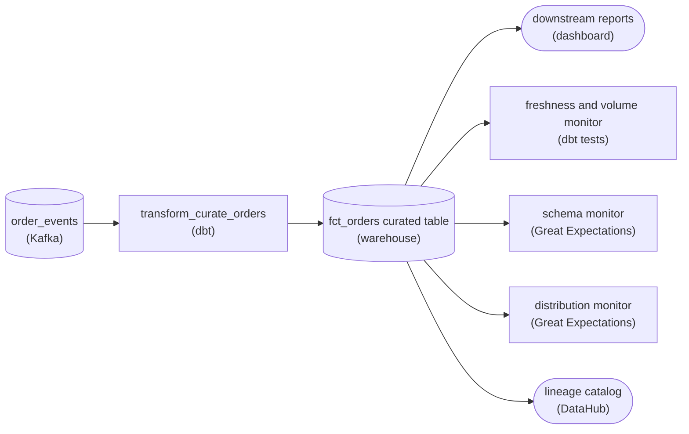

*Full-coverage observability: one curated table read by a monitor for each pillar, with lineage flowing into a catalog.*

1. **Add a schema monitor for the retype**

   Point a schema check at `fct_orders` that snapshots each column's name and type and alerts when they change. This is the pillar that catches an upstream `order_total` going from a numeric to a string, or a column being dropped or renamed in `transform_curate_orders`. A validation tool like Great Expectations fits because the check is structural and deterministic: assert the columns and types you expect, and fail loudly when they differ. Freshness and volume never see this: the load can be perfectly on time and full of correctly-typed garbage.

2. **Add a distribution monitor for the quiet drift**

   Point a statistical check at the values themselves: the mean and spread of `order_total`, the null rate of a key, the share of each category. Distribution is the pillar that catches a bug where every order suddenly logs at half its real amount, on time, in the right volume, with the right schema. The check is about the shape of the data, not its structure, so it can use the same expectations tooling but reads the value profile rather than the column list.

3. **Send lineage into a catalog, not a dashboard**

   Lineage is different from the other four: it is not a pass/fail alarm, it is a queryable map. Emit lineage for `fct_orders` (via OpenLineage) into a catalog like DataHub, so someone can start at a number in a downstream report and trace it back through the columns and the `transform_curate_orders` job that produced it. That is why the target is a catalog node and not just another monitor: its consumer is a person asking 'if this column changes, what breaks?'

| Pitfall: Freshness is the pillar people stop at |
| --- |
| The most common mistake is treating 'the monitor is green' as 'the data is right'. Freshness and volume are the easiest 2 to wire up, so pipelines often ship with only those and are declared observed. They answer 'did data arrive?', never 'is the data correct?'. The retype and the drift both sail past a green freshness check, which is exactly the blind spot `fct_orders` had before you added the other 3 pillars. |

| Real world: Each pillar tends to get its own tool |
| --- |
| You rarely find all 5 pillars on one platform. Freshness and volume often ride `dbt source freshness` and row-count tests or an anomaly-detection product; schema and distribution live in assertion frameworks run alongside the transform (Great Expectations, dbt tests); lineage is owned by the catalog (DataHub, Marquez, OpenLineage). The point isn't the specific tools. What matters is that each pillar reads the same curated table for a different kind of failure, and lineage ends in something a person can browse. |

**Follow-up questions**

1. Where in the medallion flow should these monitors sit: on `fct_orders` (gold) or back at the bronze `order_events` landing?\
   *Tests whether the learner sees that catching a bad value at the curated layer is late, and which pillars belong at ingest versus at the serving table.*
2. A schema change is sometimes intended, not a bug. How does the schema monitor tell a planned column add from an accidental retype?\
   *Pushes on schema evolution: additive versus breaking changes, and gating alerts on compatibility rather than on any diff.*


<br>

### Exercise 2 of 2

**● TASK**

An engineer must rename a column on fct_orders, the Snowflake mart read by 17 dbt models, 4 dashboards and 2 ML feature definitions, and a wrong dashboard number must be traceable to the pipeline that produced it. Feed the dbt build's column-level provenance into a lineage catalog (DataHub) that traces forward to the blast radius and backward to the root cause. Add checks on fct_orders for freshness, volume, schema and value distribution before consumers read it.

**Starting canvas** (already placed for you):

- Postgres source (source, PostgreSQL)
- dbt build (produces manifest.json) (transform, dbt)
- Snowflake serving mart: fct_orders (storage, Snowflake)
- downstream consumers: 17 dbt models, 4 dashboards, 2 ML features (consumer, Looker)
- lineage catalog (consumer, DataHub)
- data quality checks on fct_orders (quality_gate, dbt tests)


<br>

### Solution

#### Lineage turns "who breaks?" into a query

The thing this challenge asks for has a name: **column-level lineage**. When `dbt build` compiles the project it writes `manifest.json`, a graph of which model reads which column from which upstream. Load that into a lineage catalog like DataHub and the graph becomes queryable both ways: forward from a column to every model, dashboard, and feature that reads it (the blast radius), and backward from a wrong number to the transform that produced it (the root cause).

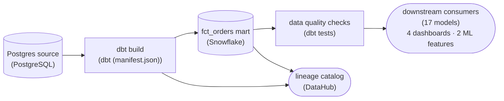

*`manifest.json` feeds the catalog; the gate sits between `fct_orders` and its readers.*

| Pitfall: Table-level lineage hides the blast radius |
| --- |
| Knowing 17 models read `fct_orders` doesn't tell you which ones touch the column you're renaming. Only column-level provenance from `manifest.json` narrows the blast radius from 'everything downstream' to the exact consumers that break, so the rename ships with a known, small change set instead of a guess. |

Lineage tells you what breaks on a schema change; the checks on `fct_orders` catch a bad load before anyone reads it. 4 dimensions, 4 failure modes: freshness (did the load run on time), volume (row count in an expected band), schema (columns and types are what consumers expect), and value distribution (revenue isn't suddenly negative or 100x). Put the gate between the mart and its consumers so a failure stops the read instead of surfacing as a wrong dashboard.

| Real world: The rename rides on the graph |
| --- |
| On the job this goes out behind the catalog: query the column's downstream, open PRs on exactly those models, migrate them, then drop the old name. Without the graph, teams ship the rename and wait for Slack to tell them what broke. |

**Follow-up questions**

1. Which check catches a silent upstream join that quietly doubled every order's revenue?\
   *Tests that volume and distribution checks catch semantic corruption a schema check passes clean.*


<br>

---

## Lineage and Blast Radius

Lineage is the graph of which datasets are built from which. The nodes are tables and models, plus the dashboards that read them, and each edge records that 1 node reads another. The same graph answers 2 different questions depending on the direction you walk it.

✓Backward lineage (upstream)

- From a node to everything it reads, then everything those read
- Answers: where could this bad number have come from?
- Used during an incident to find the origin

✗Forward lineage (downstream)

- From a node to everything that reads it, and onward
- Answers: what breaks if this node changes or goes bad?
- Used before a change and during an incident to size the damage


<br>

### The orders_daily graph

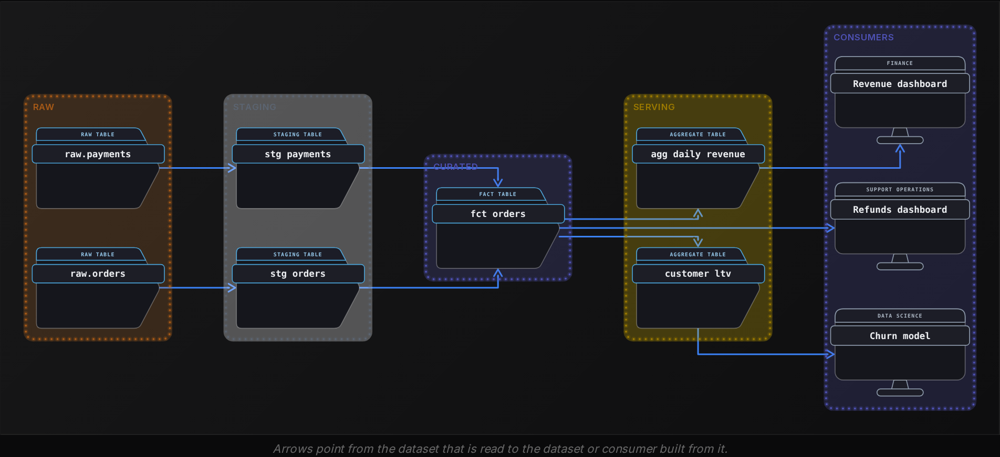

Blast radius is the set of nodes forward of a change or a failure, together with the people who own them. Walking forward from `stg_payments` reaches 6 nodes. Half of them are the revenue and refunds dashboards and the churn model; the rest are the internal tables `fct_orders` and `agg_daily_revenue`, plus `customer_ltv`. The count alone misleads, so weight each node by who depends on it: the revenue dashboard that Finance closes the month with outranks 3 internal tables.


<br>

### Column-level lineage narrows the radius

Table-level lineage says fct_orders reads stg_payments. Column-level lineage says which columns feed which: fct_orders.net_revenue is computed from stg_payments.fee_usd, and of the nodes after fct_orders only agg_daily_revenue reads net_revenue. A change to how fee_usd is rounded therefore alters values in fct_orders and agg_daily_revenue and on the revenue dashboard, 3 nodes in all, and the refunds and churn owners need no warning. Renaming or dropping fee_usd is different, because the build of fct_orders fails, everything after it goes stale, and the radius is back to all 6.


<br>

### Where lineage comes from

| Capture method | How it works | What it misses |
| --- | --- | --- |
| Parse pipeline code | Read each task's SQL and record the tables in its `FROM` and `JOIN` clauses | Dashboards, notebooks and ad hoc queries that read tables directly |
| Parse query logs | Read every query the warehouse ran over a window, from any client | Readers that did not run during the window |
| Declared task inputs and outputs | Each orchestrator task lists what it reads and writes | Anything someone forgot to declare |

Code parsing alone never sees the analyst whose notebook reads `fct_orders` every Monday, and that analyst is the person who gets surprised. Merging code lineage with 30 days of query logs covers most real readers; declared inputs fill the gaps where SQL is assembled at runtime and cannot be parsed.


<br>

### Root cause: walk back until the inputs are healthy

On the morning of 2026-10-21, Finance reports the revenue dashboard showing 2026-10-20 revenue 38% below its 7-day average. Backward lineage from the dashboard lists the nodes to check; a row count on each for that date shows its health.

| Node | Rows for 2026-10-20 | 7-day average | Status |
| --- | --- | --- | --- |
| fct_orders | 255,000 | 410,000 | Low |
| stg_payments | 254,600 | 408,900 | Low |
| stg_orders | 411,200 | 409,800 | Normal |
| raw.payments | 409,700 | 408,300 | Normal |
| raw.orders | 411,500 | 410,100 | Normal |

The origin is the most upstream node that is unhealthy while every node it reads is healthy. fct_orders is low, but stg_payments, one of its inputs, is also low, so the fault entered earlier. stg_payments is low while its only input, raw.payments, is normal: the rows disappeared inside stg_payments. Its last deploy on 2026-10-19 added WHERE currency = 'USD'. A payment processor onboarded that week sends 'usd' in lowercase. The fix lands in stg_payments, and the backfill rebuilds it and every node forward of it, in lineage order.

**A Monday alert says customer_ltv has 0 rows for 2026-10-25. Every node upstream of it, from fct_orders back to both raw tables, has normal row counts for that date. Which reading of the lineage is correct?**

- **A.** The fault originated in the customer_ltv build, and its blast radius is the churn model.
- **B.** The fault originated in raw.payments, since the most upstream table is where data incidents begin.
- **C.** The fault originated in customer_ltv, and its blast radius includes the revenue and refunds dashboards.
- **D.** The origin is unknown without column-level lineage, so check every column of fct_orders for nulls first.

<details>
<summary>Solution</summary>

**A.** The fault originated in the customer_ltv build, and its blast radius is the churn model.

customer_ltv is unhealthy and its only input, fct_orders, is healthy, so it is the origin. Forward lineage from customer_ltv reaches only the churn model.

**Why the others are wrong**

- **B.** The origin is the highest unhealthy node whose inputs are healthy. raw.payments is healthy, so walking back past customer_ltv finds nothing broken.
- **C.** The origin is right, but those dashboards read agg_daily_revenue and fct_orders, which are healthy. They sit on other branches from fct_orders and never read customer_ltv.
- **D.** Table-level health already isolates the origin: the only unhealthy node has healthy inputs. Column-level lineage helps size a change to values, and this incident is a missing build output.

</details>


<br>

---

## Pipeline Architecture

### Exercise 1 of 2

**● TASK**

Our Snowflake bill is $48,000 a month with no breakdown by pipeline. Replace the dbt build with one named for the QUERY_TAG it sets on every query (pipeline_id, run_id, team). Add a rollup that reads the warehouse query history and sums credits by pipeline into a cost-by-pipeline dashboard. Alert the platform team when any pipeline's daily credits jump more than 50% over its trailing-week average.

**Starting canvas** (already placed for you):

- Postgres orders source (source, PostgreSQL)
- dbt build (no QUERY_TAG; spend untagged) (transform, dbt)
- Snowflake serving mart (storage, Snowflake)
- Finance dashboard (consumer, Metabase)


<br>

### Solution

#### Tagging the query is what makes spend attributable

The warehouse already knows what every query cost. What it does not know is which pipeline ran it, so the $48,000 arrives as one undifferentiated number. The fix you placed is **query tagging**: thread a stable identifier through every query a pipeline runs, then read the warehouse's own execution log back and group cost by it. On Snowflake that identifier is `QUERY_TAG`; BigQuery job labels, Databricks tags and Redshift query groups do the same job. The minimum is `pipeline_id` and `run_id`; add `team` for chargeback.

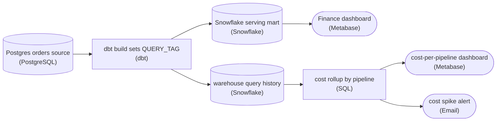

*The serving path is unchanged. Every query the `dbt` build runs carries a `QUERY_TAG`, so the rollup groups credits by `pipeline_id` into a cost dashboard and a spike alert without touching the mart.*

| Pitfall: Untagged spend cannot be split after the fact |
| --- |
| The starter's `dbt` build ran real queries that cost real credits, but with no `QUERY_TAG` set, every one lands in the query history with a blank tag. You cannot work out later which pipeline owned them, because the warehouse never recorded the link. Tagging happens at write time: if the identifier is not on the query when it runs, that cost can never be attributed. |

**Set the tag at session start, then roll up from history**

```sql
/* In the dbt build, set once per session before any model runs */
ALTER SESSION SET QUERY_TAG = '{"pipeline_id":"orders_mart","run_id":"2026-09-17T02:00Z","team":"platform"}';

/* The rollup reads the warehouse's own log */
SELECT
  PARSE_JSON(query_tag):pipeline_id::string AS pipeline_id,
  SUM(credits_attributed_compute)        AS credits
FROM snowflake.account_usage.query_attribution_history
WHERE query_tag IS NOT NULL
GROUP BY 1
ORDER BY credits DESC;
```

*A JSON `QUERY_TAG` stays parseable, so the rollup can group credits by `pipeline_id`.*

3 things changed. The transform is renamed to state the tag it sets, so a reviewer sees the `QUERY_TAG` on the canvas instead of digging through session config. The rollup is a **new branch off the warehouse's own execution log**, so attributing cost adds no risk to the mart finance already reads. And the rollup feeds an alert as well as a dashboard. A pipeline whose daily credits run 50% over its trailing-week average is a health signal, just like a stale table, and nobody should first hear about it from next month's bill.

| Real world: `run_id` turns a total into a trend |
| --- |
| `pipeline_id` alone tells you which pipeline is expensive. Adding `run_id` tells you whether it is getting worse, and on which run. With per-run credits you can tie a spend spike to the deploy that caused it, and decide whether to retire or optimize a pipeline from a growth curve instead of one month's number. |

**Follow-up questions**

1. How would you tag ad-hoc queries a data scientist runs by hand, not just scheduled `dbt` runs?\
   *Checks that tagging is applied to every query source, not fixed for one pipeline.*
2. What should the alert do when the share of credits with a blank `QUERY_TAG` starts climbing?\
   *Checks that the cost alert stays useful as untagged spend grows.*


<br>

### Exercise 2 of 2

**● TASK**

CI on our dbt project rebuilds every model on every pull request, so engineers skip it and run pipelines locally before pushing. Design a slim CI pipeline in which a pull request builds only the models it changed plus their downstream models into an isolated CI environment in the warehouse, tests run against that build, and only a change that passes is promoted to the production warehouse on merge.

**Starting canvas** (already placed for you):

- Production warehouse (storage)


<br>

### Solution

#### Slim CI: build what changed, test it, then promote

Slim CI fixes a CI run so slow that engineers route around it. Rebuilding every model on every pull request is thorough, but it takes long enough that people run pipelines locally instead, and a check nobody waits for catches nothing. The design keeps what full CI does well (an isolated environment, real tests, a gate before production) and drops the one thing that made it slow: **building models the change never touched**.

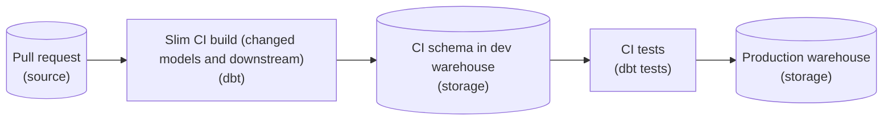

*A pull request builds only the changed models and their descendants into an isolated CI schema; only a change whose tests pass is promoted to the production warehouse on merge.*

1. **Build the changed models and their downstream**

   Select the models the pull request modified plus every model downstream of them. In dbt that is the `state:modified+` selector, compared against the production manifest. The downstream half matters: a change to a staging model can break a mart 3 hops away, and building only the edited file would miss it.

2. **Land the build in its own CI environment**

   Write the build into a CI schema in the dev warehouse, one per pull request, never into production. Unchanged parents are not rebuilt: the build reads them from production with `--defer`. The CI schema then holds only what the change touched, and it is dropped when the pull request closes.

3. **Put the tests on the path to production**

   The tests run against the CI schema. The edge from the test stage to the production warehouse is the promotion: merging deploys the change only when every test has passed. Unit tests on committed sample data catch logic errors in seconds, and the dev warehouse build catches what only real-shaped data reveals.

| Pitfall: Tests beside the deploy do not gate it |
| --- |
| A common shape runs the tests and the production deploy as parallel steps, or lets a red test merge with a warning. Either way the change reaches production, and you are back to finding bad numbers after consumers read them. The test stage has to sit between the CI build and production, so that a failure stops the promotion. |

**Follow-up questions**

1. How would you roll back a promoted change that passed CI but produced wrong numbers in production?\
   *Extends promotion to rollback: redeploying the previous commit versus rebuilding the affected tables.*
2. What changes when the edited model sits upstream of 200 others, so the downstream selection is no longer slim?\
   *Tests how far the downstream selection should reach before CI time grows back.*


<br>

---

## Cost Attribution

A warehouse bill reports daily spend for each account and compute cluster. It cannot say that `orders_daily` cost $4,200 last month, because the warehouse has no idea what a pipeline is. Cost attribution supplies that idea: every query a pipeline sends carries a tag naming who sent it, and the warehouse's query log turns into a ledger you can group by pipeline and then break down by task or by run.


<br>

### What goes in a query tag

```sql
{
  "pipeline": "orders_daily",
  "task": "build_fct_orders",
  "run_id": "orders_daily__2026-10-20T06:00",
  "owner": "payments-data",
  "env": "prod"
}
```

Each field has a job. pipeline and task are the grouping keys for the rollup. run_id ties a query's cost to 1 run and to that run's logs; it is safe here because the query log stores 1 row per query and mints no metric series. owner says whom to talk to. env keeps CI and development spend out of the production numbers.

Many warehouses let a client attach a tag or label to its session and record it on each query in the log. Set the tag in 1 place, the orchestrator's task wrapper or the shared database client, so every task inherits it. A hand-typed tag is missing from the first query someone writes in a hurry, which lands in the untagged bucket.


<br>

### The rollup

```sql
SELECT
  COALESCE(
    JSON_EXTRACT_SCALAR(query_tag, '$.pipeline'),
    'untagged'
  ) AS pipeline,
  COUNT(DISTINCT JSON_EXTRACT_SCALAR(query_tag, '$.run_id')) AS runs,
  SUM(cost_usd) AS total_cost_usd
FROM query_history
WHERE start_time >= CURRENT_TIMESTAMP - INTERVAL '30' DAY
  AND COALESCE(JSON_EXTRACT_SCALAR(query_tag, '$.env'), 'prod') = 'prod'
GROUP BY 1
ORDER BY total_cost_usd DESC
```

Joined with lineage, the rollup gains its most useful column: how many distinct users and dashboards queried the pipeline's output tables in the same 30 days, from the query-log lineage of the previous section.

| pipeline | 30-day cost | runs | cost per run | prior 30 days, cost per run | readers in 30 days |
| --- | --- | --- | --- | --- | --- |
| clickstream_sessions | $11,800 | 720 | $16.39 | $16.10 | 3 |
| marketing_attribution | $6,900 | 30 | $230 | $228 | 0 |
| orders_daily | $4,200 | 30 | $140 | $60 | 9 |
| untagged | $3,000 | 0 | n/a | n/a | n/a |
| inventory_snapshot | $2,100 | 30 | $70 | $69 | 5 |

- **$28,000** — total 30-day warehouse spend
- **10.7%** — of 30-day spend carries no tag


<br>

### Reading it for savings

Patterns worth a closer look

- **No readers** *marketing_attribution*\
  It spends $6,900 a month on tables nobody queried in 30 days. Ask the owner what still depends on them before pausing the schedule.
- **Cost per run jumped** *orders_daily*\
  Same cadence, cost per run up from $60 to $140. Something in the code changed, often a deploy that swapped an incremental load for a full rebuild.
- **Cadence above need** *clickstream_sessions*\
  It makes 720 hourly runs for 3 readers. If each run reprocesses the whole day so far and readers look once each morning, a daily run removes most of the repeated work.
- **Untagged spend** *the untagged row*\
  Find who sends untagged queries first. The $3,000 here exceeds inventory_snapshot's whole month, enough to hide a pipeline that size; a working threshold, such as 5% of spend, says when to chase it.

Rank these by expected saving, then by the risk of acting. Pausing an unread pipeline saves the most here and comes undone in a minute. The `orders_daily` jump is smaller in dollars, but it is a defect that keeps billing until someone finds it, and the `run_id` in every tag leads to the first expensive run. The steady pipelines can wait.

> **TIP**
>
> Report cost per run alongside monthly cost. A pipeline whose monthly cost doubles because it now runs twice as often reflects a cadence decision; one whose cost per run doubles hides a code change to find.

**The team has 1 afternoon for orders_daily, whose cost per run rose from $60 to $140 starting with the first run after a deploy on 2026-09-24. Which next step uses the attribution data most directly?**

- **A.** Move orders_daily to a smaller compute cluster so each run costs less, and check the bill again next month.
- **B.** Run orders_daily every other day, which halves the monthly cost while the cause is investigated.
- **C.** Ask the 9 readers whether they still need the output, and pause the pipeline if fewer than half reply.
- **D.** Group query_history for orders_daily by task, before and after 2026-09-24, and read the deploy's diff for the task whose cost moved.

<details>
<summary>Solution</summary>

**D.** Group query_history for orders_daily by task, before and after 2026-09-24, and read the deploy's diff for the task whose cost moved.

The tag's task field turns a pipeline-level jump into a task-level one, and the date ties it to a specific deploy. That narrows the search to 1 task and 1 change.

**Why the others are wrong**

- **A.** A smaller cluster may lower the price per run but leaves whatever the deploy changed in place, and runs may slow down or fail. The cause stays unknown.
- **B.** Halving the cadence halves the bill and ships stale data to 9 readers. Cost per run, the number that moved, is unchanged.
- **C.** That is the move for a pipeline with no readers. Here readers exist, and the rollup points at a regression in the code.

</details>


<br>

---

## Pipeline Architecture

### Exercise 1 of 2

**● TASK**

Downstream of the curated Snowflake fct_orders table, add an output quality gate checking freshness, volume, schema, and distribution, and route its failures to an on-call destination that carries a runbook. Publish the table's lineage to a shared catalog so the Looker dashboard, revenue email, and feature store can trace what they read. Also off that table, add a cost rollup attributing warehouse spend to this pipeline and run.

**Starting canvas** (already placed for you):

- Postgres replica (orders source) (source, PostgreSQL)
- dbt build (transforms fct_orders) (transform, dbt)
- Snowflake fct_orders curated (storage, Snowflake)
- Looker dashboard (consumer, Looker)
- Daily revenue email (consumer, Email)
- ML feature store (storage, Feast)


<br>

### Solution

#### Green means the job ran, not that the data is right

The orchestrator's checkmark proves one thing: the `dbt build` task exited 0. It says nothing about whether `fct_orders` is fresh, whether the row count is sane, whether a column silently changed type, or whether `order_total` suddenly went half-null. That gap is what **data observability** closes. You built four things and hung each off the curated table: an output check that reads the table the consumers read, an alert route that turns a failure into a page with instructions, a lineage entry so every reader can trace what feeds them, and a cost rollup so spend has an owner. The task can go green while the data is wrong, stale, or quietly expensive; each artifact watches a dimension the checkmark cannot see.

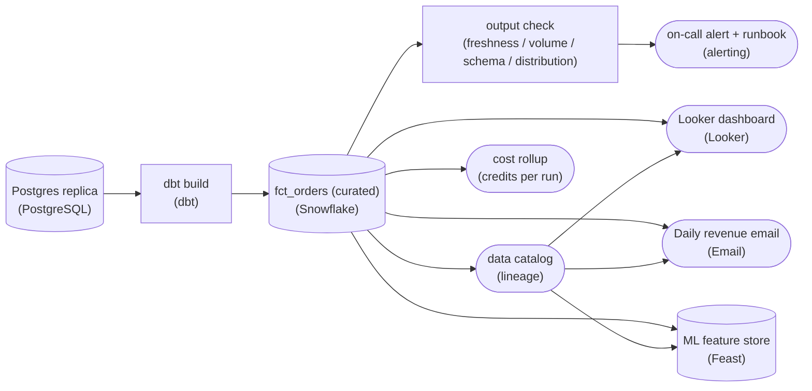

*The four observability artifacts hang off the curated table itself, not the transform task.*

1. **Check the output, and cover four distinct failure modes**

   The check reads `fct_orders` after `dbt build` writes it, so it validates what consumers actually query, not an intermediate. The four dimensions catch different failures: freshness (`max(order_updated_at)` inside the SLA) catches an upstream that stalled or arrived late; volume (row count inside an expected band) catches a partial or doubled load; schema (expected columns and types present) catches a silent rename or type drift; distribution (null rate and range on `order_total`) catches data that loaded but is garbage. A row count alone would pass all 3 of the other failures.

2. **Route the failure to a human who can act, with the fix attached**

   A check that only logs is a check nobody reads. The failure edge goes to an on-call destination, and the alert carries a runbook link so whoever gets paged at 3am knows which upstream to inspect and how to backfill. The point is not the alerting tool; it is that a failed check produces an owned, actionable page instead of a red mark on a dashboard nobody is watching.

3. **Publish lineage so every reader can trace what it consumes**

   The catalog entry for `fct_orders` records its upstreams (the Postgres source through `dbt build`) and its downstreams (Looker, the revenue email, the feature store). When the check fails, the catalog answers 'who is now serving stale data?' in one lookup instead of tribal knowledge. Lineage is what makes the blast radius of a bad load visible before a stakeholder finds it first.

4. **Attribute cost to this pipeline and this run**

   Tag the warehouse work so credits roll up per pipeline and per run, then join `SNOWFLAKE.ACCOUNT_USAGE.QUERY_HISTORY` on the `query_tag` to `WAREHOUSE_METERING_HISTORY`. Now 'what does this pipeline cost' has an answer, and a run that suddenly costs 5x is itself a signal, often the same partial-load or full-rescan that a volume check would flag. Cost per run turns spend from a monthly surprise into a per-run metric.

| Pitfall: Testing the inputs instead of the output |
| --- |
| The common miss is putting checks on the source or inside the transform and trusting the green checkmark for the rest. But `dbt build` can succeed while writing zero rows, or write into a table whose schema drifted. The check has to read `fct_orders` as it sits, the same object the consumers read, or it is verifying something other than what ships. |

| Real world: This is the difference between a job and a data product |
| --- |
| In production, the curated table has 3 consumers who each assume it is correct. Freshness, volume, schema, and distribution checks plus lineage and cost attribution are what let you promise an SLA on `fct_orders` rather than just promising the job runs. The checkmark is table stakes; these four artifacts are what an on-call rotation actually trusts. |

**Follow-up questions**

1. If the freshness check fails because data is late but will still arrive, should it page or wait?\
   *Distinguishing a hard failure from expected late-arriving data, and whether the check needs a grace window before it alerts.*
2. How would you keep the distribution check from firing on a legitimate seasonal spike in `order_total`?\
   *Static thresholds vs. bands learned from history; avoiding alert fatigue that trains on-call to ignore the page.*
3. If the cost rollup shows this run cost 5x the median, what would you check first?\
   *Connecting a cost anomaly back to volume and freshness, since a full rescan or duplicated load often shows up in credits before anywhere else.*


<br>

### Exercise 2 of 2

**● TASK**

A growth team's curated marts are built by dbt into Snowflake and feed three Looker dashboards, yet on-call cannot say whether the data is healthy without opening a Slack thread. Stand up the operational layer over this pipeline: monitoring that covers the observability pillars on the curated tables, plus a lineage catalog that records where each mart column came from. Keep the three dashboards reading from the existing Snowflake serving marts.

**Starting canvas** (already placed for you):

- Postgres source (source, PostgreSQL)
- dbt build (transform, dbt)
- Snowflake serving marts (storage, Snowflake)
- Three dashboards (consumer, Looker)


<br>

### Solution

#### The observability plane

You just wired an **observability plane**: stages that watch a pipeline from the side instead of living inside it. The serving path already works, `Postgres source` to `dbt build` to `Snowflake serving marts` to the `Three dashboards`. What was missing is the layer that tells on-call whether the data is healthy and where a number came from, without a Slack thread. Both new stages read off the marts; neither writes back into the serving path.

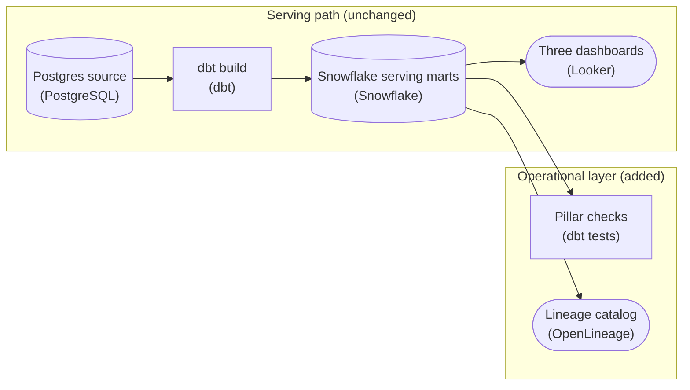

*The `Three dashboards` still read straight from `Snowflake serving marts`; the pillar checks and the lineage catalog only read off the marts.*

1. **Record lineage in a catalog off the marts**

   You do not re-parse SQL to find where a mart column came from. The `Lineage catalog` ingests the metadata `dbt build` already writes (`manifest.json` records each model's column-level sources back to `Postgres source`) and attaches it to the `Snowflake serving marts`. Read backward, it answers which pipeline produced a wrong number; read forward, which dashboards break when a column changes.

2. **Cover the pillars against the curated tables**

   Run `Pillar checks` against the `Snowflake serving marts` after each build: freshness, volume, schema and distribution (null rates and ranges that flag silent corruption). Those four, plus the lineage from step 1, are the 5 pillars on-call was missing.

3. **Run the checks on a finished mart**

   The checks are a downstream stage that runs on a finished mart, not a cron that races `dbt build`, so they never grade a half-written table. A failing check never blocks the dashboards: it tells on-call which table and which pillar broke, so the answer to 'is the data good' is a check result, not a thread.

| Pitfall: A dashboard should never depend on the monitor |
| --- |
| The tempting shortcut is to surface health by pointing a Looker tile at the check results. That pulls the `Three dashboards` off the existing marts and couples reporting to your monitoring output. Health lives in `Pillar checks` and the `Lineage catalog`, beside the serving path, not inside it. |

**Follow-up questions**

1. How would you route a failing `Pillar checks` result to an alert so on-call is paged instead of having to look?\
   *Extends monitoring from a check result someone reads to a notification that reaches on-call.*
2. Where would you store the pillar metrics so freshness and volume can be trended over time, not just pass or fail?\
   *Treats monitoring as a time series, not a single assertion.*


<br>

---

## CI/CD for Pipelines

A pipeline change can pass every compile check and still double the rows or drop a filter. It can also change what a column means. CI for pipelines therefore tests the data a change produces as well as the code. The constraint is time: a CI run that takes most of an hour gets skipped, batched into pull requests too large to review, or merged around.


<br>

### 4 layers, cheapest first

| Layer | What runs | What it catches | Rough time |
| --- | --- | --- | --- |
| 1. Static | Parse every SQL file, load every DAG, lint, check for cycles and missing references | Syntax errors, broken imports, a task reading a table that no longer exists | Under 1 minute |
| 2. Unit | Transform logic on hand-written fixture rows with expected outputs | Wrong dedupe or join logic, mishandled nulls and edge cases | 1 to 2 minutes |
| 3. Integration | Build changed tables in a CI schema from 1 recent day of prod inputs, then run the quality checks prod runs | Row explosions, failed uniqueness, nulls in required columns | 3 to 10 minutes |
| 4. Data diff | Compare the CI output with prod output for the same day | Silent changes: rows gained or lost, amounts that moved | 1 to 5 minutes |

Each layer catches failures the one before it cannot see. Static checks know nothing about data. Unit tests prove logic on a few hand-written rows, never on 400,000 real ones. An integration build can pass every check and still shift a revenue total; the data diff turns 'the build passed' into 'here is what changes in prod'.

#### Layer 2: a unit test on fixture rows

```sql
def dedupe_latest(rows):
    latest = {}
    for row in rows:
        key = row["order_id"]
        if key not in latest or row["updated_at"] > latest[key]["updated_at"]:
            latest[key] = row
    return sorted(latest.values(), key=lambda r: r["order_id"])


def test_dedupe_keeps_latest_version():
    rows = [
        {"order_id": 7, "status": "placed", "updated_at": 1},
        {"order_id": 7, "status": "shipped", "updated_at": 2},
        {"order_id": 9, "status": "placed", "updated_at": 1},
    ]
    result = dedupe_latest(rows)
    assert [r["status"] for r in result] == ["shipped", "placed"]
```

The fixture holds 3 rows built around the case that matters: 2 versions of order 7. A useful next fixture is 2 versions with the same `updated_at`, which the function resolves by keeping whichever arrived first. The test needs no warehouse and runs in milliseconds, so it runs on every push.

#### Layer 4: a data diff against prod

```sql
SELECT
  COUNT_IF(c.order_id IS NULL) AS missing_in_ci,
  COUNT_IF(p.order_id IS NULL) AS new_in_ci,
  COUNT_IF(p.amount_usd <> c.amount_usd) AS amount_changed
FROM prod.fct_orders AS p
FULL OUTER JOIN ci_pr_412.fct_orders AS c
  ON p.order_id = c.order_id
WHERE COALESCE(p.order_date, c.order_date) = DATE '2026-10-20'
```

For a pure refactor, every count should be 0. For the lowercase `'usd'` fix from the lineage example, diffing 2026-10-20 against the broken prod output should show around 155,000 rows in `new_in_ci` and nothing missing or changed. That number is the evidence the fix restores the lost payments and touches nothing else.


<br>

### Slim CI: build only what the change touches

Slim CI uses lineage to choose the build set, which is the tables a pull request modified plus every table downstream of them. Unmodified upstream tables are read from prod instead of rebuilt. In a project of 600 tables, a pull request that edits stg_payments builds 4 tables, stg_payments and fct_orders as well as agg_daily_revenue and customer_ltv; the dashboards and the churn model sit outside the project and stay as they are.

- **52 min** — CI time when building all 600 tables
- **6 min** — slim CI time for the stg_payments change

> Where slim CI can miss
>
> - Reading upstream tables from a stale prod state tests against old data; refresh that state before each CI run.
> - A change to shared code or config, such as a common SQL snippet or a currency list, must mark every table that uses it as modified.
> - A full build on the main branch each night catches whatever slim selection skipped during the day.


<br>

### CD: ship the artifact you tested

Deployment promotes the exact code that passed CI to prod on merge, with no rebuild in between. A backfill for changed values runs in forward-lineage order, so each table is rebuilt only from inputs already on the new logic. Order alone leaves a window: until `agg_daily_revenue` is rebuilt, the refunds dashboard shows new values and the revenue dashboard old ones. Building the affected partitions in a separate schema and swapping them in together closes it.

**A pull request that edits fct_orders is described as 'refactor, no behavior change'. Its data diff reports missing_in_ci = 0, new_in_ci = 0 and amount_changed = 18,400. What should the reviewer conclude?**

- **A.** The change is safe: no rows were gained or lost, and the amount differences are rounding noise to ignore.
- **B.** The diff layer is too noisy for refactors, so the reviewer should rely on layers 1 to 3 for this change.
- **C.** The refactor changed behavior: 18,400 orders now carry a different amount, and the merge waits until those rows are explained.
- **D.** Merge it, then backfill fct_orders so prod matches the new amounts and the diff returns to zero.

<details>
<summary>Solution</summary>

**C.** The refactor changed behavior: 18,400 orders now carry a different amount, and the merge waits until those rows are explained.

A true refactor diffs to all zeros. Pull a few changed orders, compare the 2 amounts, and either fix the code or rewrite the description and plan a backfill.

**Why the others are wrong**

- **A.** Matching row counts say nothing about values. A refactor should leave every amount identical, and 18,400 changed amounts is a behavior change until shown otherwise.
- **B.** Layers 1 to 3 passed and missed this. The diff is the only layer that compares values with prod, which is why it runs on refactors.
- **D.** That ships an unexplained change to the revenue dashboard and every other reader. A backfill follows a change that is understood and approved.

</details>


<br>

---

## Pipeline Architecture

### Exercise 1 of 2

**● TASK**

Smart meters upload about 960,000 readings a day as files, and a nightly batch loads them into a warehouse the billing job reads. Only freshness and volume are monitored, so a firmware update that renamed a column and switched readings from kWh to Wh reached billing on time and at full count. Design the pipeline with schema and distribution checks before billing reads the data, and alert on-call when a check fails.


<br>

### Solution

#### 2 pillars dark, 2 pillars green

The five pillars give each failure a name: freshness (did it arrive on time), volume (did the right amount arrive), schema (is the shape what we expect), distribution (are the values plausible) and lineage (what feeds what). The firmware update broke **schema and distribution at once**, while the 2 pillars that were watched stayed green. Covering a pillar means putting a check where that kind of failure can still be stopped. Adding more of the monitors you already have does not cover it.

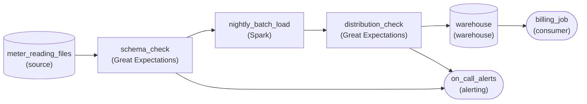

*Schema checked on arrival, distribution checked before publish, and both failures routed to `on_call_alerts`.*

1. **Check the shape on arrival**

   `schema_check` reads each night's files before `nightly_batch_load` touches them. It checks for the expected column names and types, with nothing missing. A renamed column fails here and the load never starts, which is cheaper than unwinding a bad warehouse partition later.

2. **Check the values before billing sees them**

   `distribution_check` compares the night's readings with what normal looks like: hourly values between 0 and 15 kWh and a stable daily mean. Readings in Wh are a thousand times larger, so the mean jumps and the check fails before anything lands in the `warehouse` that `billing_job` reads.

| Pitfall: A row count cannot see a unit change |
| --- |
| The tempting fix is another volume or freshness monitor, because those are the cheapest to add. But the bad night had every row, and it arrived on time. Only a check on the values themselves can tell that the numbers now mean something different. |

| Real world: Upstream changes rarely come with notice |
| --- |
| Device firmware, partner file formats and vendor APIs change on their own schedule. Schema and distribution checks are how a pipeline notices a change nobody announced. The alert edge makes sure an engineer hears about it before a customer does. |

**Follow-up questions**

1. A usage dashboard starts reading the same `warehouse` table. Where must the checks sit so it is covered too?\
   *Whether the checks protect the shared table rather than a single consumer.*
2. For a week, some meters run old firmware and some run new. How would a distribution check tell a real shift from a mixed fleet?\
   *Using a separate baseline for each segment instead of one global threshold.*


<br>

### Exercise 2 of 2

**● TASK**

Nightly Airflow jobs load billing events from a PostgreSQL database into an MRR model in a warehouse that the finance dashboard reads. The build must run only after an upstream readiness check confirms the night's billing export is complete. On-call traces a wrong MRR to its job and source, and engineers check a column's blast radius before changing it. Capture lineage from the scheduled jobs into a lineage store so the graph reads both ways.


<br>

### Solution

#### Lineage is collected where dependencies are already declared

Lineage is a dependency graph, and the cheapest place to collect it is the scheduler, because every run already knows what it read and what it wrote. When `nightly_mrr_build` reports that pair to `lineage_store` on each run, the graph stays current with no diagram to maintain. Read backward from the MRR data, it lands on the build job, its readiness check and then `billing_db`. Read forward from the same data, it lists every reader: that list is the blast radius of a column change.

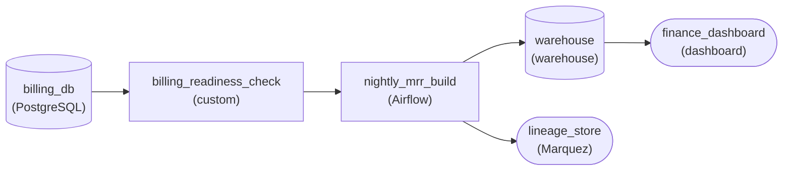

*Data flows from `billing_db` through `billing_readiness_check` to `finance_dashboard`; the build job also reports what it read and wrote to `lineage_store`.*

1. **Gate the build on upstream readiness**

   `billing_readiness_check` sits between `billing_db` and `nightly_mrr_build`, so the build starts only once the night's export is complete. It is the same upstream dependency the lineage graph records, but here it is enforced rather than just observed. A build that runs on half an export produces a wrong MRR, and lineage would then have to explain it.

2. **Capture lineage at run time**

   The edge from `nightly_mrr_build` to `lineage_store` is what keeps the graph current. Every billing job runs on the scheduler, so capturing lineage from the scheduler covers every dependency, including the ones nobody remembers adding. A new reader that runs on the scheduler appears in the graph the first night it runs.

3. **Keep the lineage store beside the data path**

   The dashboard reads `warehouse` directly, and lineage hangs off the build job as a side branch. Routing data through the lineage store would let a metadata outage block the morning MRR number, which is a worse failure than briefly missing lineage.

| Pitfall: A hand-drawn map goes stale by the next deploy |
| --- |
| Documenting lineage in a wiki diagram feels equivalent, but it records what someone believed on the day they drew it. The first job added afterwards is invisible, and that missing reader is exactly the one a column rename breaks. |

| Real world: Root cause starts at the nearest upstream job |
| --- |
| When MRR looks wrong, backward lineage turns a search across every pipeline into an ordered list: inspect `nightly_mrr_build` first, then the readiness check, then the `billing_db` tables it read. That ordering is what turns a five-hour hunt into a five-minute fix. |

**Follow-up questions**

1. A churn model owned by another team starts reading the MRR data. How does it end up in the blast radius of an MRR column change?\
   *Whether forward lineage stays complete because new readers report through the same run-time capture.*
2. Finance asks which billing column a single MRR figure came from. What would table-level lineage miss?\
   *The difference between table-level and column-level lineage for backward tracing.*


<br>

---

## Instrumenting a Pipeline E2E

Take `orders_daily` as it stood before this lesson: 6 tasks on a daily schedule, failure emails to a shared inbox, no metrics or lineage, and no tags or CI. Instrumenting all of it in 1 project takes a quarter and pays nothing until the end. Sequencing it so each step works on its own gives the team a better pipeline every week, and a point to stop at whenever priorities shift.


<br>

### 7 steps, each useful alone

| Week | Step | Value on its own | Builds on |
| --- | --- | --- | --- |
| 1 | Freshness and row-count check on `agg_daily_revenue` at 07:00 UTC, paging the owner | The team hears about a late or short load before Finance's 08:00 UTC review | Nothing |
| 2 | `run_id` on every log line from every task | A single search returns a failed run's whole story | The week 1 page links to the run |
| 3 | Duration and row metrics per task, labelled `pipeline` and `task` | Shows which task slowed down or shrank, and since when | `run_id` links a metric spike to the run's logs |
| 4 | Quality gates at the `stg_payments` and `stg_orders` boundaries | Bad batches stop before they reach `fct_orders` | Week 3 metrics: block below 50% of the trailing average, tighten after a few weeks |
| 5 | Lineage from parsed code and 30 days of query logs | Every page names the downstream nodes and their owners | Week 1 pages now carry the blast radius |
| 6 | Query tags on every task | Cost per run and per task on the monthly rollup | Week 2 `run_id` joins a costly query to its run's logs |
| 7 | Slim CI with the 4 test layers | Broken changes stop at the pull request | Week 5 lineage picks the build set; week 4 gates run in layer 3 |

The order follows the questions an incident raises: is something wrong, where, who is affected, what is it costing, and how do we stop the next one. Detection goes first because every later step assumes the team knows a failure happened. CI comes last here even though it prevents incidents, because slim selection needs lineage and layer 3 needs the gates.

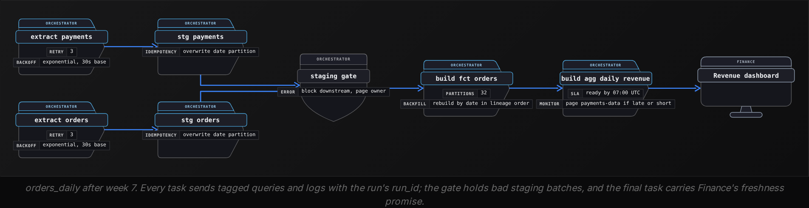

✓Do

- Ship each step to prod before starting the next
- Alert on the output table first and on task failures second
- Reuse run_id as the key that joins logs to tags, and to pages too
- Set gate thresholds from the metric history you already collect

✗Don't

- Start with CI on a pipeline whose failures nobody sees
- Label metrics with run_id or order_id, or with partition_date
- Rely on engineers to type query tags by hand in each task
- Roll out all 7 steps as 1 change at the end of the quarter

> When the order should change
>
> - If the bill is the complaint, start with query tags: `pipeline` and `task` work alone, and `run_id` can join later.
> - When detection already works and deploys cause most incidents, CI moves earlier: start with layers 1 and 2.
> - If lineage shows the pipeline has no readers, ask whether it should run at all before instrumenting it.

**Another team asks for help instrumenting clickstream_sessions, the $11,800-a-month hourly pipeline with 3 readers. Failures are rare; the bill is the complaint. Which first 2 steps fit?**

- **A.** Tag every query with pipeline and task, then register lineage from query logs to see who the 3 readers are and how often they read.
- **B.** Build slim CI with all 4 layers, since preventing bad merges protects every step that comes after it.
- **C.** Add a session_id label to the duration and row metrics, then set gate thresholds from their history.
- **D.** Copy the orders_daily plan step for step, starting with the freshness page and run_id logging in weeks 1 and 2.

<details>
<summary>Solution</summary>

**A.** Tag every query with pipeline and task, then register lineage from query logs to see who the 3 readers are and how often they read.

Tags turn the bill into cost per task, and lineage shows whether the 3 readers need hourly data.

**Why the others are wrong**

- **B.** Slim CI prevents breakage and needs lineage first. This team's problem is spend, which CI does not measure.
- **C.** session_id grows with the data, so every value mints a series. The metrics bill would climb while the warehouse bill stays where it is.
- **D.** That order suits a pipeline whose failures go unseen. Here cost is the question, so tags come first, as the callout above describes.

</details>


<br>

### Practice across all 5 sections

**In week 9 the 07:00 UTC check pages: agg_daily_revenue has no partition for 2026-10-23. The page links run orders_daily__2026-10-23T06:00. The staging gate passed, and logs show build_fct_orders still running at 50 minutes, against the 12 its duration metric shows on a normal day. Its tagged queries have already cost 3 times a normal run, and the only change since the last good run is a merge on 2026-10-22. Which response uses the instrumentation best?**

- **A.** Raise build_fct_orders to 5 retries with backoff so the task recovers on its own, and check the dashboard after lunch.
- **B.** Walk backward lineage to raw.payments and raw.orders first, since an incident's origin is always a source table.
- **C.** Add run_id as a label on the duration metric so the next slow run appears as its own series on the dashboard.
- **D.** Revert the 2026-10-22 merge, rerun from build_fct_orders forward, and warn the owners the page lists that revenue will be late.

<details>
<summary>Solution</summary>

**D.** Revert the 2026-10-22 merge, rerun from build_fct_orders forward, and warn the owners the page lists that revenue will be late.

The tags isolate cost to 1 task, the merge date names the change, the gate clears staging, and lineage on the page names whom to warn. After reverting, check why the pull request's CI did not flag it.

**Why the others are wrong**

- **A.** Nothing has failed, so retries never trigger, and a slow, costly run is the merged code's behavior. Retrying would repeat it at the same cost.
- **B.** The origin is the highest unhealthy node whose inputs are healthy. The gate cleared staging, and the only change sits in build_fct_orders.
- **C.** That mints a new series every run. run_id belongs in logs and tags, where it is already doing this job.

</details>


<br>

---

## Pipeline Architecture

### Exercise 1 of 2

**● TASK**

Sixty scheduled pipelines owned by three teams share one cloud warehouse, and its spend grew 40% last quarter with no way to say which pipelines caused it. Design query tagging so every query an orchestrated run sends carries its pipeline, run and team, then roll the warehouse's query history up into a daily per-pipeline cost table behind a dashboard. Alert the owning team when a pipeline's daily cost doubles its trailing average.


<br>

### Solution

#### Tag once, roll up after

Query tagging is a discipline more than a feature. The warehouse already records every query and what it burned; what it cannot know is which of your 60 pipelines sent it. Set a stable pipeline, run and team identifier once, at the point every run passes through, and the 40% jump becomes a ranked list instead of a shrug. Snowflake calls the field `QUERY_TAG`, BigQuery a job label, Redshift a query group: the design is the same.

1. **Tag at the scheduler, not in the SQL**

   The scheduler knows the pipeline, the run and the owning team before any query fires, so `query_tagging` sets them on the session and every statement inherits them. Tags hand-written into each model drift within a month, and one untagged pipeline pushes its cost back into the unexplained pile.

2. **Roll up from query history**

   `cost_rollup` reads the warehouse's own query history, groups by pipeline, run and team per day, and lands `pipeline_cost_daily`. The dashboard reads that small table, never raw history, so looking at cost does not add to it.

3. **Alert on growth, not on totals**

   `cost_spike_check` compares each pipeline's day to its own trailing average and routes a breach to `cost_alerts` for the owning team. A fixed dollar threshold fires forever on the big pipelines and never on a small one that quietly doubled.

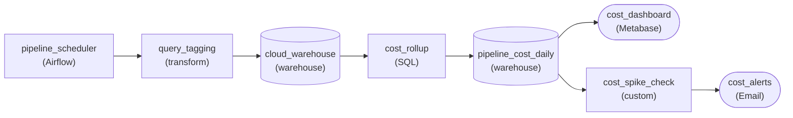

*Tags set once per run ride every query into the warehouse; query history rolls up into `pipeline_cost_daily`, which feeds the dashboard and the spike alert.*

| Pitfall: An untagged query is cost nobody can explain |
| --- |
| Tagging only the main transform misses the retries, tests and backfills the same run triggers. Show the share of spend with an empty tag beside the per-pipeline numbers; when it grows, some pipeline is bypassing the scheduler. |

**Follow-up questions**

1. Three pipelines read a table that only one of them builds. Who pays for it?\
   *Whether attribution follows the query that ran or the table it touched.*
2. A pipeline moves to another team. Should last month's cost move with it?\
   *Why the team is captured in the tag at run time instead of looked up during the rollup.*


<br>

### Exercise 2 of 2

**● TASK**

Engineers on a subscription-billing team run every dbt change locally before pushing because CI never sees realistic data. Design CI/CD for the dbt project: each pull request triggers a Jenkins build that runs the models on a sample of production data and writes them into a dev warehouse, where dbt tests read the built models and block the merge if they fail. Only a merged, passing change is promoted by Airflow into the production warehouse.


<br>

### Solution

#### CI that sees production-shaped data

Pipeline CI earns trust only when it tests against data shaped like production. A pull request build that runs dbt models on a few committed fixtures waves through changes that break on the first real null or duplicate, and that is exactly why engineers keep running pipelines on their laptops before pushing. Running the CI build on a recent sample of production data, and landing its output in a dev warehouse, lets CI see the shapes production will, so the local habit stops being necessary.

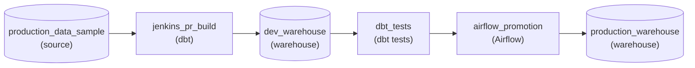

*Each pull request's Jenkins build runs the models on sampled production data and writes them into a dev warehouse; the dbt tests gate the Airflow promotion into production.*

Read the design as 2 environments joined by one gate. The Jenkins build writes only to the dev warehouse, the dbt tests read what it built there, and the only route into the production warehouse is the Airflow promotion that runs after a merge whose tests passed. Nothing a pull request does can touch production directly.

| Pitfall: Fixtures alone bring the laptop habit back |
| --- |
| Committed sample files are the right tool for unit tests on one transform, but they contain only the cases someone thought to write. If CI stops there, joins against real dimensions, real null rates and real duplicates go untested, and engineers quietly return to running the pipeline locally. |

| Real world: Merge is the promotion trigger, not the test |
| --- |
| On most teams the pull request build is disposable: it builds into a per-branch schema in dev that is dropped afterward. Production only ever runs code from the main branch, which also makes rollback a matter of reverting a commit and letting the next deploy run. |

**Follow-up questions**

1. Production grows to 30 TB. How do you keep the dev sample representative without copying it all?\
   *Tests choosing a sampling strategy that still covers the shapes that break models.*
2. A promoted change passes CI but breaks a nightly model. How do you get the previous version back?\
   *Tests rolling back through the same deploy path instead of editing production by hand.*


<br>

---

## Putting It All Together

On a Monday at a ride-hailing company, the driver payouts dashboard shows weekend earnings 12% below normal, and the same week Finance asks why warehouse spend rose by a fifth. The payouts pipeline already has a freshness page, run_id on every log line, task metrics labelled by pipeline and task, lineage from code and query logs, query tags and slim CI.

- Backward lineage from the dashboard, with a row count per node, finds the first short table whose inputs are normal, and that is where the payout rows were lost.
- The run_id of that table's run leads to its logs and, through the query tags, to what the same run cost.
- The cost rollup grouped by task shows whether the spend rise and the short table trace back to the same deploy.
- Forward lineage from the origin lists every payout report and owner to warn, and sets the order of the backfill.
- The fix goes through slim CI, where the data diff should show the missing weekend rows returning and no other values moving.
- Tiered retention keeps the weekend's full logs for 14 days, long enough for this investigation, and 13 months of rollups to show when the spend began to climb.


<br>

---

## Pipeline Architecture

### Exercise 1 of 2

**● TASK**

A nightly dbt build reads viewing sessions from a PostgreSQL replica into a daily watch-time table in a warehouse that feeds a content dashboard, and its only health signal today is the run status. Instrument it end to end: check the output table for freshness, volume, schema and distribution on every run, send the results to a monitoring tool, and page on-call when a check fails. Capture lineage so on-call can see what a failure affects.


<br>

### Solution

#### Instrument from the output backward

End-to-end instrumentation starts where the consumers are. A green run status only proves the dbt build exited; it says nothing about whether last night's watch-time numbers are complete, on time, or shaped the way the dashboard expects. So you check the output table first, then make every result observable, then make a failure reach a person, and finally record lineage so that person knows what broke downstream. Each step is useful on its own, which is why the order matters.

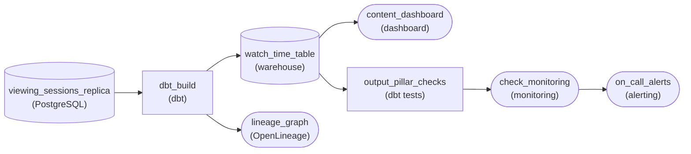

*The nightly `dbt_build` writes `watch_time_table`; checks on that output feed monitoring, which pages on-call, while the build emits lineage.*

1. **Check the table consumers read**

   Freshness, volume, schema and distribution all go on the output table, not the replica. A replica that loaded cleanly can still produce a half-empty table if a join drops rows, and only a check on the output sees that. Running them as dbt tests inside the build means they fire on every run with no extra scheduling.

2. **Turn results into a signal someone hears**

   Emit each check result to a monitoring stage so it becomes a metric with history, then route a failing metric to an on-call alert. Now a 3am failure is a page at 3am, not a complaint when the content team opens the dashboard at 8am.

3. **Record lineage from the build**

   The dbt build already knows its inputs and outputs; capture that as lineage. When the volume check fires, on-call opens the lineage graph and sees at once that the content dashboard reads this table, so they know exactly who to warn.

| Pitfall: A failing test nobody hears is not monitoring |
| --- |
| The most common miss is stopping at step one: dbt tests on the output, results left in the run log. The run turns red with no history and no page, so the design gains checks without gaining observability. The path from check to monitoring to alert is the part that changes how fast anyone reacts. |

**Follow-up questions**

1. How would you put the nightly build's warehouse cost next to its health metrics?\
   *Extends the instrumentation sequence with cost attribution from the earlier section.*
2. If viewing genuinely drops on a holiday, how do you keep the volume check from paging every year?\
   *Tests tuning a volume threshold against a trailing baseline instead of a fixed band.*


<br>

### Exercise 2 of 2

**● TASK**

A grocery chain's nightly dbt build turns store stock movements from a MySQL database into inventory models in a warehouse, which feed a replenishment dashboard and a demand forecasting job. Capture lineage so an engineer can list everything downstream of the stock-on-hand column before changing its unit, and on-call can trace a wrong dashboard figure back to the table that produced it. Gate every change with a pull-request build that runs the changed models and the tests of their downstream consumers on sample data, blocking the deploy if any test fails.


<br>

### Solution

#### One lineage graph, read in 2 directions

Lineage earns its keep when you read it both ways. Forward from the stock-on-hand column, it lists every model, the replenishment dashboard and the forecasting job that would see a unit change. Backward from a wrong dashboard figure, it walks model by model to the MySQL table that produced it. The pull-request build then turns that forward list into tests that run before anything ships, so the blast radius is checked rather than guessed.

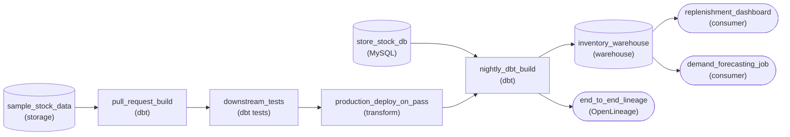

*Production: `store_stock_db` through `nightly_dbt_build` into the warehouse and its 2 readers, emitting lineage on every run. CI: `pull_request_build` on sampled data, then `downstream_tests`, and only a passing run reaches `production_deploy_on_pass`.*

1. **Emit lineage from the production run**

   The nightly dbt run is where the model graph lives, so it feeds `end_to_end_lineage` on every build. The graph only answers the blast-radius question if it reaches past dbt to the dashboard and the forecasting job. Those are the readers that break silently when a column's unit changes.

2. **Walk the graph backward from a wrong number**

   When planners report a bad on-hand figure, start at the dashboard tile and follow parents: the mart, the intermediate model, the staging model, the source table. Each hop gives you one place to inspect instead of the whole project.

3. **Make the deploy wait on the tests**

   `pull_request_build` runs the changed models plus everything downstream of them against `sample_stock_data`. Only when `downstream_tests` passes does `production_deploy_on_pass` ship the change into `nightly_dbt_build`. A red check stops the deploy, so the change never reaches production.

| Pitfall: Testing only the changed model misses the break |
| --- |
| Switching stock on hand from units to cases passes every test on the model that owns the column. What actually breaks is the forecast's input range and the dashboard's reorder threshold. Select the changed models and their descendants, which is exactly the forward-lineage set. |

| Key insight: A sample has to keep the rows that break things |
| --- |
| A sample with no zero-stock rows or no multi-pack items will pass a change that fails on real stores. Draw the sample so these edge cases survive, and refresh it so its shape tracks production. |

**Follow-up questions**

1. What changes if the forecasting job lives in a separate repository that dbt does not know about?\
   *Extending lineage and the CI test set across a boundary the dbt project does not own.*
2. How would you notice if the nightly run stopped emitting lineage events?\
   *Monitoring the lineage feed itself for freshness.*


<br>

---

## Key Takeaways

- Keep a signal only when a named alert or panel reads it, or a step in a runbook does; keep detail for days and rollups for 13 months.
- Metric labels take values that grow with the platform; values that grow with the data, run_id included, belong in logs.
- The origin of an incident is the most upstream unhealthy node whose inputs are healthy; forward lineage from a change or failure is its blast radius.
- Tag every query from the orchestrator, then read the cost rollup for unread outputs, cost-per-run jumps and cadence above need.
- Test pipeline changes in 4 layers, and let lineage limit CI to changed tables and their descendants so it runs on every push.
- Instrument an existing pipeline detection first and prevention last, shipping each step before starting the next.
