Advanced·Pipeline Architecture · 40 min · 11 challenges

# Schema Drift: Advanced

This lesson follows a busy Thursday afternoon at Robinhood. At 2:12 p.m., a database migration renames a column on the trades table, and buying power for 1,900 customers stops updating. The app must stay live for everyone else, and the settlement ledger, closed once those trades settle the next business day, must be exact to the cent. Which pipeline choices let both hold?


<br>

---

## Schema Enforcement in CDC

Change data capture (CDC) reads a database's own change log and turns each insert, update and delete into an event. An event carries the row's columns after the change, the operation, and the change's position in the source log, a number that only grows. Downstream, the pipeline rebuilds the table by applying those events in position order.

That makes a CDC feed the most drift-prone source a pipeline reads. Its producer is an application team running migrations against its own database, often unaware a feed exists. Each migration lands mid-stream: rows written before and after it sit side by side in the same partition, and the pipeline meets the new shape on the first row committed afterward.


<br>

### Each DDL change as it arrives downstream

| Change at the source | What the event stream shows | Safe for readers? |
| --- | --- | --- |
| Add nullable `promo_code` | New field, absent on older events | Yes |
| Widen `qty` INT to BIGINT | Same field, larger values | Yes, if the target widens |
| Rename `qty` to `quantity` | `qty` vanishes, `quantity` appears | No: a drop plus an add |
| Drop `fee` | Field missing from new events | No, for readers of `fee` |
| `price` VARCHAR to DECIMAL(18,6) | Same name, new type | No: 2 types in one column |
| New `status` value `PARTIAL_FILL` | Same type, unseen value | Schema yes, meaning no |

The rename row causes the worst incidents. Row events carry no rename marker: the old name stops appearing and a new one starts. A pipeline that accepts every change writes nulls into qty from the migration onward, and every report summing qty loses the volume traded after it, with no error anywhere.


<br>

### Additive, block-breaking and quarantine policies

- **Additive** *Evolve the target, never stop*\
  Compatible changes are applied to the target automatically, and breaking ones are absorbed as additions: a renamed column becomes a new column beside an old one that fills with nulls.
- **Block-breaking** *Stop at the first incompatible event*\
  Compatible changes flow through. The first breaking event halts that table's stream and pages its owner, and nothing after it applies until someone decides.
- **Quarantine** *Divert the bad, keep the rest moving*\
  Compatible events flow. Breaking ones land in a quarantine table with their raw payload and schema version, and the rest of the stream keeps applying.

| Property | Additive | Block-breaking | Quarantine |
| --- | --- | --- | --- |
| Freshness during a breaking change | Unaffected | Whole table stalls | Affected keys stall |
| How it fails | Silent nulls and mixed types | Source log expires before restart | Keys applied out of order |
| Who notices | A consumer, days later | On-call, within minutes | A quarantine-volume alert |
| Fits | Exploration and sandbox tables | Ledgers, billing, audited tables | High-volume operational tables |

Block-breaking carries a deadline. The source keeps its change log for a window its operators size in hours or days to cap disk use. A table blocked past that window loses its place in the log, and recovery turns from a resume at the last applied position into a full re-read of the table.

**One CDC feed carries invoices (monthly billing), user_sandbox (an analyst playground) and positions (40,000 changes a minute behind a live dashboard). Which assignment fits?**

- **A.** invoices additive, user_sandbox block-breaking, positions quarantine
- **B.** All 3 block-breaking, so no table can ever hold wrong data
- **C.** invoices quarantine, user_sandbox additive, positions block-breaking
- **D.** invoices block-breaking, user_sandbox additive, positions quarantine

<details>
<summary>Solution</summary>

**D.** invoices block-breaking, user_sandbox additive, positions quarantine

Billing stops rather than goes wrong, the sandbox absorbs change, and unaffected positions stay fresh.

**Why the others are wrong**

- **A.** Additive on billing risks silent nulls; blocking a sandbox wastes on-call time.
- **B.** Correct, but one rename stalls the live dashboard for every account.
- **C.** Quarantine applies some invoices while others wait, and blocking positions stalls the dashboard.

</details>


<br>

### Quarantine must respect order within a key

For a CDC table, quarantine can corrupt state, because events for one key are only correct when applied in source order. Below, the event at position 1002 is quarantined because `price` arrived as a DECIMAL, and 1003 applies. When the fix ships and 1002 is replayed as an upsert by `order_id`, the older state lands on top.

| Source position | order_id | status | Outcome |
| --- | --- | --- | --- |
| 1001 | 42 | NEW | Applied |
| 1002 | 42 | PARTIAL_FILL | Quarantined |
| 1003 | 42 | FILLED | Applied: target says FILLED |
| 1002 (replay) | 42 | PARTIAL_FILL | Upsert: target says PARTIAL_FILL |

Key-sticky quarantine parks every later event for a key once one of its events is parked, so the key goes stale instead of wrong. A version guard makes the write order-proof: the target stores the source position of the state it holds, and an incoming event applies only when its position is higher. Replaying 1002 against a row already at 1003 then changes nothing, and a rebuild from history uses the same rule. Careful pipelines run both.

```sql
SELECT
  order_id,
  status,
  price,
  source_position
FROM (
  SELECT
    order_id,
    status,
    price,
    source_position,
    ROW_NUMBER() OVER (
      PARTITION BY order_id
      ORDER BY source_position DESC
    ) AS rn
  FROM order_changes
) AS ranked
WHERE rn = 1
```

**A trades table runs quarantine with no key-sticky parking. Event 1002 for order 42 is quarantined and 1003 (FILLED) applies. After the fix, the replay upserts by order_id with no position check. What does order 42 show, and what makes the replay safe?**

- **A.** FILLED, since an upsert keeps the first row it wrote; no change is needed
- **B.** PARTIAL_FILL, since the replay wrote last; a source-position check on write fixes it
- **C.** PARTIAL_FILL, since the replay wrote last; running the replay a second time fixes it
- **D.** FILLED, since quarantined events are discarded; a full re-read of the table is needed

<details>
<summary>Solution</summary>

**B.** PARTIAL_FILL, since the replay wrote last; a source-position check on write fixes it

The replay is the latest write. A version guard rejects it because 1002 is lower than the stored 1003.

**Why the others are wrong**

- **A.** An upsert by key overwrites, so the last write wins, and the replay writes last.
- **C.** The diagnosis is right, but a second replay writes the same stale state again.
- **D.** Quarantine keeps the payload so it can be replayed, so nothing was discarded.

</details>


<br>

---

## Pipeline Architecture

### Exercise 1 of 2

**● TASK**

Capture row-level changes from the payments database with log-based CDC (Debezium) and land them in the lakehouse that feeds regulatory reporting. A DBA just added merchant_country and dropped legacy_clearing_code, and that drop would corrupt the filings. Put a schema policy step between capture and the lakehouse, named for the policy it applies (allow-additive, block-breaking, or quarantine), and route the changes it holds back to an explicit quarantine destination.

**Starting canvas** (already placed for you):

- Payments database (source, PostgreSQL)
- Payments lakehouse (storage, Iceberg)
- Regulatory reporting (consumer, API)


<br>

### Solution

#### Capture the log, then decide what a schema change may do

Log-based change data capture reads the payments database's write-ahead log, so every insert, update and delete arrives as a row-level event and nothing re-queries the tables. The catch is that the DBA's `ALTER TABLE` rides the same log. The capture gets no vote, so adding `merchant_country` and dropping `legacy_clearing_code` both reach the stream. **The schema policy step is where that vote comes back**, and it has to sit on the stream before the first write into the lakehouse.

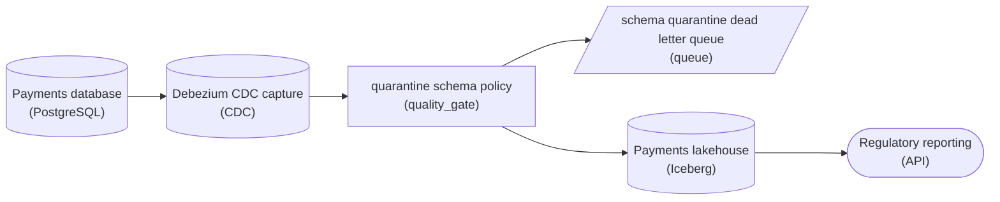

*Debezium reads the log. The quarantine policy lets the added column through, parks the column drop in a dead letter queue, and only then does anything reach the lakehouse.*

| ✕ Block-breaking | ✓ Quarantine |
| --- | --- |
| The drop of `legacy_clearing_code` stops the stream. The filings are safe, but every payment row behind that event waits until someone ships a fix. | The drop is parked in the dead letter queue while `merchant_country` and the row events keep flowing. The filings are safe and nothing stalls; the cost is a queue that someone has to own. Allow-additive alone protects nothing here, because the change at stake is not additive. |

| Pitfall: A check behind the lakehouse is too late |
| --- |
| If the policy reads from the lakehouse, the drop has already rewritten the canonical table before it is judged, and regulatory reporting queries a column that no longer exists. The policy belongs between the capture and the first write. |

| Real world: A quarantine nobody owns is a silent drop |
| --- |
| Every held change needs an owner who either approves a coordinated migration or rejects it. A parked `DROP COLUMN` that sits unread for a week has the same effect as one that was thrown away. |

**Follow-up questions**

1. What changes if the DBA renames `amount` to `amount_cents` instead of dropping a column?\
   *Whether a rename counts as breaking even though no value is lost.*
2. A metrics dashboard that tolerates a missing column also reads this stream. Does it need the same policy?\
   *Matching the policy to each consumer's tolerance.*


<br>

### Exercise 2 of 2

**● TASK**

Three streams feed one Flink aggregator behind a risk dashboard: mobile events with a 4-hour lateness tail at the 99.9th percentile, IoT sensors whose partitions go idle for hours, and a market-data feed whose producer emits end-of-session markers. Add one watermark generator transform between each source and the aggregator. Name each for its watermark strategy and the parameter its source needs, plus idle-partition detection where a source goes quiet.

**Starting canvas** (already placed for you):

- Source A: mobile events Kafka topic (99.9th percentile lateness 4 hours) (source, Kafka)
- Source B: IoT sensor Kafka topic (partitions go idle for hours) (source, Kafka)
- Source C: market-data feed (producer emits explicit end-of-session markers) (source, Kafka)
- Flink unified streaming aggregator (transform, Flink)
- Risk dashboard (consumer, Grafana)


<br>

### Solution

#### Match the watermark to the lateness, not to the source

A watermark is the pipeline's promise about event-time progress: "I believe I have now seen every event up to time T." Every window and every event-time timer fires against that promise, so the strategy that generates it sets a balance between completeness and latency. Hold the watermark back and you catch more late events, but the risk dashboard lags. Push it forward and windows close quickly, but stragglers are dropped. These three sources have **different lateness shapes**, so a single global setting is wrong for all of them. Read each source's profile and pick the generator that fits it. That gives three separate watermark transforms feeding one aggregator, not one shared setting.

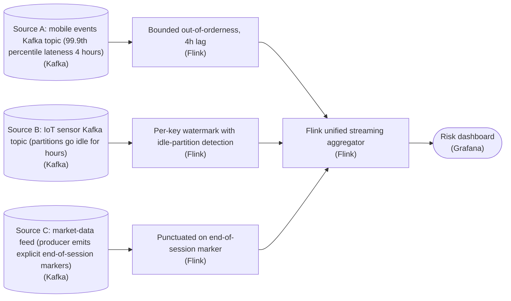

*One watermark generator per source, each tuned to that source's lateness profile, then merged. The aggregator's watermark becomes the minimum across the three inputs.*

1. **Source A: bounded out-of-orderness with a 4-hour bound**

   The mobile stream has a long retry tail, and its profile gives you the number that matters: a 99.9th-percentile lateness of 4 hours. That is the input `forBoundedOutOfOrderness` was built for. Set `maxOutOfOrderness` to 4 hours and the watermark trails the newest event by 4 hours. Windows then stay open long enough to catch essentially all of the tail, and they still close. The parameter is not a guess: it is the source's own lateness statistic applied directly. A smaller bound silently drops retried events. A much larger one leaves the dashboard needlessly stale.

2. **Source B: per-key watermarks plus idle-partition detection**

   IoT sensors report at very different rates, so a single stream-wide watermark gets held back to the slowest sensor. Per-key watermarks let each sensor's windows advance on its own event time instead. Idle partitions are a second, separate problem. A partition that emits nothing never advances its watermark, and because the merged watermark is the **minimum** across inputs, one idle partition freezes the entire aggregator. `withIdleness` fixes this by marking a quiet partition idle so it drops out of the minimum. That is why this is the one generator whose name must carry idle-partition detection.

3. **Source C: punctuated watermarks on the end-of-session marker**

   The market-data producer already signals when a session is complete by emitting an explicit marker event. You do not have to estimate lateness at all. Emit a watermark when, and only when, you see a marker. That is a punctuated strategy, driven by the data rather than by a time bound. It is both the most accurate option here and the lowest-latency one, because completeness is signalled directly instead of inferred. A fixed bound on this source would ignore information the producer already provides.

| Pitfall: The idle partition that freezes everything |
| --- |
| The most common miss is not choosing the wrong strategy name. It is forgetting that a merged watermark is the **minimum** of its inputs. If Source B has an idle partition and you leave off `withIdleness`, the aggregator's watermark stops advancing, no windows fire, and the dashboard flatlines while data keeps arriving. It looks as if the pipeline hung. The second miss is choosing ascending timestamps (`forMonotonousTimestamps`) for any of these sources. That strategy assumes events arrive in perfect event-time order, which none of these three do, so it silently drops every out-of-order event. |

**Follow-up questions**

1. Source A's tail widens to a 99.99th-percentile lateness of 9 hours during a retry storm. Do you raise `maxOutOfOrderness` to 9 hours?\
   *Tests whether you weigh completeness against dashboard freshness rather than always widening the bound to cover the tail.*
2. What happens to the merged watermark if Source C's producer crashes and stops emitting session markers?\
   *Tests whether you see that a purely punctuated source can stall the minimum-based merge, the same failure mode `withIdleness` solves for Source B.*


<br>

---

## Watermarks for Irregular Streams

Every watermark strategy assumes something about how late events arrive. The common default, bounded out-of-orderness, sets the watermark to the newest event time seen minus a fixed delay D. It works when lateness is steady and capped, as on a feed of order fills from a trading engine. Real sources break that assumption in 3 ways: a long tail of stragglers, partitions that fall silent, and clocks that run fast.


<br>

### Profile the source before picking a strategy

| Source | Lateness profile | Idleness profile | Strategy that fits |
| --- | --- | --- | --- |
| Order fills from the trading engine | p99 under 5 minutes, steady | Quiet overnight | Fixed delay plus idle timeout |
| Mobile app events | Long tail: offline phones replay hours later | Rarely idle | Percentile delay plus late-event handling |
| Clearing-house settlement messages | Arrive in batches per cycle | Silent for hours between cycles | Producer markers |
| Field sensors | Small, but some clocks drift ahead | Devices drop off for days | Future-time cap plus idle timeout |


<br>

### The 4 strategies and the late data each one misses

- **Fixed delay** *W = max event time - D*\
  Predictable and cheap. Fails on a tail longer than D: those events arrive behind the watermark and miss their window.
- **Percentile delay** *D tracks observed lateness*\
  D is recomputed from a trailing percentile, such as p99 lateness over the last hour. A watermark may never move backward, so a sudden rise in D freezes it, and a sudden fall lets it race ahead of stragglers.
- **Idle timeout** *Ignore quiet partitions*\
  A partition with no events for T is dropped from the minimum. When it wakes, its first events may sit behind a watermark that moved on without it.
- **Producer markers** *The source says when it is done*\
  The producer sends a marker meaning nothing older than time X is coming. Exact for sparse batch sources, and useless when the producer cannot make that promise.

**Settlement messages arrive in batches up to 3 hours long, with hours of silence between cycles. Which watermark strategy fits?**

- **A.** Fixed delay of 30 seconds with a 2-minute idle timeout
- **B.** Percentile delay set from the trailing hour's p99 lateness
- **C.** A marker from the producer at the end of each cycle
- **D.** Fixed delay of 3 hours with no idle timeout

<details>
<summary>Solution</summary>

**C.** A marker from the producer at the end of each cycle

The producer knows when a cycle is complete; no delay estimate can.

**Why the others are wrong**

- **A.** Most of each batch lands behind the watermark and counts as late.
- **B.** Hours of silence leave nothing current to measure, and spikes freeze it.
- **D.** It covers the lateness, but every result trails by at least 3 hours.

</details>


<br>

### One quiet partition stalls the whole job

An engine reading several partitions takes the minimum of the per-partition watermarks, because the slowest partition bounds what it can promise. A partition that stops receiving events stops its own watermark, and the job's watermark stops with it. No window closes and no result is emitted, while every other partition keeps filling state. The table below is the trades job at 10:05:00, with D = 30 seconds.

| Partition | Newest event time | Last event received | Partition watermark |
| --- | --- | --- | --- |
| p0 | 10:04:58 | 10:05:00 | 10:04:28 |
| p1 | 10:04:51 | 10:04:59 | 10:04:21 |
| p2 | 09:58:10 | 09:58:12 | 09:57:40 |

Without an idle timeout the job watermark is 09:57:40, and no window after 09:57 can close. With a 2-minute idle timeout, p2 has been silent for nearly 7 minutes, so it drops out and the job watermark becomes 10:04:21. The price comes later: if p2 resumes with events stamped 09:58:30, they arrive nearly 6 minutes behind the watermark. They are late, and whether they still count depends on the allowed-lateness budget the next section sizes.


<br>

### A fast clock is worse than a slow partition

A sender whose clock runs 3 hours ahead stamps an event 13:05 when real time is 10:05. Its partition's newest event time leaps to 13:05 and that partition's watermark to 13:04:30. The minimum across partitions hides this only while the others stay active. Once idle timeouts drop them, the fast partition sets the job watermark alone, it jumps 3 hours, and every honest event after it is late. The defense is a cap: clamp event time to processing time plus 5 seconds, and quarantine anything stamped beyond that.

```sql
from datetime import timedelta

DELAY = timedelta(seconds=30)
IDLE_TIMEOUT = timedelta(minutes=2)
FUTURE_TOLERANCE = timedelta(seconds=5)


def job_watermark(partitions, now, previous):
    candidates = []
    for p in partitions:
        if now - p["last_received"] > IDLE_TIMEOUT:
            continue
        newest = min(p["newest_event_time"], now + FUTURE_TOLERANCE)
        candidates.append(newest - DELAY)
    if not candidates:
        return previous
    if previous is None:
        return min(candidates)
    return max(previous, min(candidates))
```

**Start from the partition table above at 10:05:00 with a 2-minute idle timeout. p2 sends nothing more, and p1 goes silent after 10:04:59. At 10:07:30, p0's newest event time is 10:07:28. What is the job watermark?**

- **A.** 10:06:58, from p0 alone, because p1 and p2 are both past the idle timeout
- **B.** 10:04:21, from p1, because a silent partition holds its last watermark
- **C.** 09:57:40, from p2, because the minimum includes every partition ever seen
- **D.** 10:07:28, from p0, because idle partitions also remove the 30-second delay

<details>
<summary>Solution</summary>

**A.** 10:06:58, from p0 alone, because p1 and p2 are both past the idle timeout

p1 has been quiet for 2 minutes 31 seconds, so only p0 counts: 10:07:28 minus 30 seconds.

**Why the others are wrong**

- **B.** That holds with no idle timeout. At 10:07:30, p1 is past the 2-minute limit.
- **C.** An idle timeout exists to drop p2 from the minimum, and it has.
- **D.** The delay applies to every active partition; idleness only changes which ones count.

</details>


<br>

---

## Pipeline Architecture

### Exercise 1 of 2

**● TASK**

Set an allowed-lateness budget on the Flink aggregation that writes the metrics store behind a sub-minute dashboard, reading the lateness profile on the source node; engine state grows linearly with the budget, so a 4-hour budget covering the far tail is unaffordable. Write the budget and the percentile it targets into the aggregation's name. Add a reconciliation pass that reads the event stream and corrects the stored metrics for events past the budget.

**Starting canvas** (already placed for you):

- Kafka mobile events (lateness profile: p50=2s, p95=30s, p99=8min, p99.9=4hr) (source, Kafka)
- Flink aggregation (no allowed-lateness budget yet; 5-min tumbling on event_time) (transform, Flink)
- Iceberg minute_metrics (streaming output target) (storage, Iceberg)
- Real-time metrics dashboard (consumer, Grafana)


<br>

### Solution

#### Bounded lateness with a reconciliation backstop

Think of **allowed lateness** as a budget paid in engine state: you tell the streaming engine how long to keep a window open after its watermark passes, and you accept that anything later is fixed by a separate pass. It is not a correctness knob you crank to 'never miss anything'. Every extra second of lateness keeps every `5-min tumbling on event_time` window resident in state that much longer, so cost grows linearly with the budget. That is why the '4hr' p99.9 number is unaffordable: it is not wrong, just expensive.

| Trick: Pick the percentile first, then read the budget off the profile |
| --- |
| You don't invent the lateness number, you read it off the profile. For a consumer dashboard with sub-minute freshness the target is the 95th percentile, and the profile says p95 is '30s'. So allowed lateness = '30s'. That catches 95% of events in the live path, and the remaining tail ('8min' and '4hr') is handled off to the side. Match the budget to the percentile you chose; don't average, don't round up to the tail. |

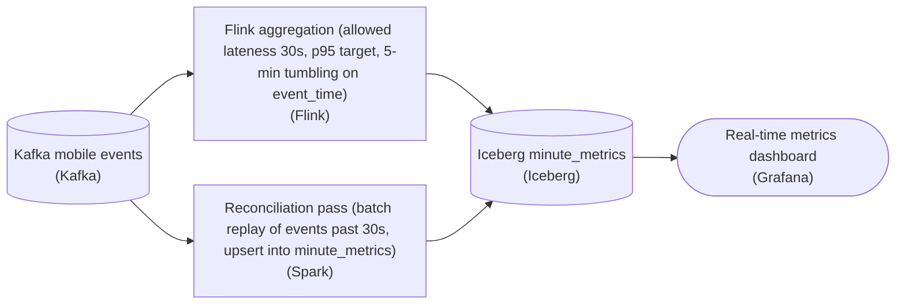

*The live path stays cheap at a 30s (p95) budget; a separate batch pass replays the late tail from Kafka and corrects the aggregates in `minute_metrics`.*

1. **Set the live budget to the 95th percentile**

   In the aggregation, set `allowed lateness` to '30s' and say 'p95' in the name. The watermark closes each `5-min` window, then the engine holds it open '30s' longer to fold in stragglers before finalizing. The dashboard keeps sub-minute freshness, and the live path catches the p95 of real lateness without paying for the tail.

2. **Give the events past the budget a second home**

   Anything later than '30s' is dropped by the live job, so it needs a second home. Add a batch node that reads the same `Kafka` events, recomputes the windows that late events touched, and writes the corrected rows into `minute_metrics`. The dashboard converges to the true value once that pass runs.

| ✕ Budget = 30s (p95) | ✓ Budget = 4hr (p99.9) |
| --- | --- |
| Each `5-min` window lives about 5.5 min in state, so roughly one generation of windows is resident at a time. State cost is bounded and the cluster holds. The tail is handled by the batch pass, so nothing is lost, only corrected later. | Each window is held open 4 hours past close, so about 48 window generations (4hr / 5min) sit in state at once. Linear growth means roughly 48x the memory, and it buys only the last 0.1% of events. |

| Pitfall: Don't set the budget to the tail, and don't skip the backstop |
| --- |
| 2 mistakes show up here. One is setting `allowed lateness` to '4hr' so nothing is ever late, which blows up state on the profile's own numbers. The other is setting it to '30s' with no reconciliation node, which silently drops the tail and leaves the dashboard permanently undercounting. A bounded budget is only correct because something else makes the output eventually complete. |

| Real world: Cheap live numbers, corrected later |
| --- |
| Consumer telemetry has exactly this fat-tailed lateness: a phone offline on a plane produces the '4hr' straggler. Teams rarely make the live engine wait for it. They run a fast approximate path at p95 for the dashboard and a periodic pass over the raw log for the numbers reporting trusts. Moving the target to the 99th percentile ('8min') is the knob for important reports that need the live number closer before the backstop catches up. |

**Follow-up questions**

1. If this fed an important financial report instead of a consumer dashboard, which percentile and budget would you pick?\
   *Maps the 99th percentile to the '8min' budget and weighs the extra state against coverage.*
2. How often should the reconciliation pass run, given the profile's '4hr' p99.9?\
   *The pass has to run often enough to correct the tail before anyone downstream relies on the numbers.*
3. How does the reconciliation pass avoid double-counting windows the live job already wrote?\
   *Rewriting the affected window keys in `minute_metrics`, rather than appending, is what keeps the correction from double-counting.*


<br>

### Exercise 2 of 2

**● TASK**

Add a daily reconciliation pass so the audit consumer gets correct revenue for each closed day, including events past the stream's 60-minute allowed lateness. Schedule it with an orchestrator whose name states its cadence and window. A batch transform named for its atomic partition overwrite reads the canonical source and replaces that window's partitions in the shared target. Wire it to a delta log named for the streaming-versus-reconciliation gap.

**Starting canvas** (already placed for you):

- Kafka events topic (real-time stream) (source, Kafka)
- Operational source of truth (canonical settlement system) (source, PostgreSQL)
- Flink streaming aggregation: 1-min event-time tumbling, allowed lateness 60min (transform, Flink)
- Iceberg minute_revenue (shared target; streaming and reconciliation both write here) (storage, Iceberg)
- Real-time dashboard (consumer, Grafana)
- Audit-grade consumer (regulatory reports) (consumer, API)


<br>

### Solution

#### The reconciliation pass

You built the batch layer that sits behind the speed layer and makes it eventually correct. The stream (`Kafka` to `Flink` to the `Iceberg` table `minute_revenue`) is fast but bounded: its 1-minute tumbling window tolerates only 60 minutes of lateness, so a settlement that lands hours late never reaches the bucket the dashboard already showed. Your pass recomputes each closed day from the canonical source and atomically replaces those partitions in the table both layers serve from. That is the batch, speed and serving split of a Lambda architecture.

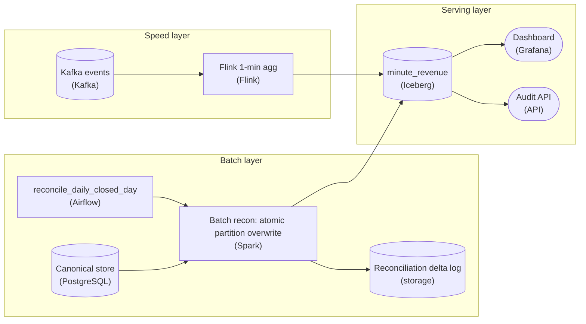

*2 writers into one `minute_revenue` table, reconciled after the day closes.*

1. **Put the cadence and window in the orchestrator's name**

   The orchestrator is `reconcile_daily_closed_day` rather than a bare `reconcile`, because the decisions that make it correct live in the name. Daily is the cadence and a closed day is the boundary. You never reconcile today: it still accepts late events, and recomputing it would race the stream.

2. **Recompute from the canonical source, not the stream**

   The batch transform reads the `PostgreSQL` source of truth, not the `Kafka` topic or the current `minute_revenue` rows. The stream already missed the late events, so re-reading it repeats the same wrong answer. Only the settlement store holds every long-tail event.

3. **Overwrite the partition atomically, then log the gap**

   The transform does a partition-level `INSERT OVERWRITE` on `minute_revenue` for the closed window. The latest writer wins, and consumers never see a half-replaced day. Before the swap, it diffs the old streaming numbers against the recomputed ones and writes the result to the reconciliation delta log.

| Pitfall: Appending double-counts the day |
| --- |
| The tempting wrong version has the batch job `INSERT` its rows beside the streaming rows, so every minute appears twice and revenue doubles. Reconciliation is a replace: `INSERT OVERWRITE` (or an Iceberg `replacePartitions` commit) swaps the partition in one atomic commit. It also means re-running the pass produces the identical table. |

**Follow-up questions**

1. If a correction lands in `PostgreSQL` a week after a day was reconciled, how do you re-settle just that day?\
   *Extends the idempotent partition overwrite to a backfill: re-run the pass for one past window and read the spike in the delta log.*


<br>

---

## Allowed Lateness Versus Accuracy

Allowed lateness L keeps a window's state alive after the watermark passes its end. An event that arrives within L still updates the window, and the engine emits a corrected result; one that arrives later is dropped or sent to a side output. Together, D and L decide 3 things at once: how complete the streaming result is, how much state the engine holds, and how often a consumer sees a number change.


<br>

### Coverage comes from the lateness distribution

An event updates its window while the watermark, newest event time minus D, is still below the window's end plus L. Lateness is how far an event's time trails the newest one seen on arrival. Lateness up to D + L always counts, and an event stamped early in its 1-minute window gets almost a minute more. For the trades feed with D = 30 seconds, a month of measured lateness gives:

| Allowed lateness L | Counted if lateness up to | Events covered |
| --- | --- | --- |
| 0 | 30 s | 96.0% |
| 5 min | 5 min 30 s | 99.2% |
| 1 hour | 1 h 0 min 30 s | 99.93% |
| 24 hours | 24 h 0 min 30 s | 99.995% |


<br>

### State grows with the budget

With tumbling windows of size S, a key holds at most (D + L) / S open windows, rounded up, plus the one being filled. The job keys 1-minute windows by 500,000 active accounts at 400 bytes each. A window exists only once its account trades, so the table is a ceiling: every account trading every minute.

| L | Open windows per key | Engine state | Events covered |
| --- | --- | --- | --- |
| 0 | 2 | 400 MB | 96.0% |
| 5 min | 7 | 1.4 GB | 99.2% |
| 1 hour | 62 | 12.4 GB | 99.93% |
| 24 hours | 1,442 | 288.4 GB | 99.995% |

Read the table as marginal cost: 0 to 5 minutes buys 3.2 points for at most 1 GB more state, while 1 hour to 24 hours buys 0.065 points for up to 276 GB, reloaded on every restart. That flattening makes a large L poor value. No L reaches 100%, because some events arrive later than any finite budget.


<br>

### Count coverage in the unit the consumer uses

Coverage by event count can flatter a stream. On the trades feed, the 0.07% of events that land after a 1-hour budget are mostly corrections and cancellations sent from back-office systems, and each one moves far more money than a typical fill. Weighted by notional value, the same budget covers less.

- **98.6%** — of notional value counted at L = 1 hour
- **1.4%** — of notional value left to correct later


<br>

### Choosing a percentile target

- Start from the consumer: what coverage, in its own unit, makes the live number usable?
- Find the smallest L that reaches that percentile on a month of measured lateness.
- Check the state at that L against the job's memory and restart-time budget.
- Send events past L to a side output so the tail stays measured.
- Hand everything beyond L to a reconciliation pass rather than raising L further.

For the trades job that lands on L = 1 hour: 99.93% of events, 62 windows per key, 12.4 GB of state, and a tail small enough for a nightly pass to correct. Each late event inside the hour re-emits its window, so consumers upsert by account and window start, the idempotent write from earlier lessons.

**A dashboard needs 99% of events inside its live number, and the job has a 2 GB state budget. Using the tables above, which L fits?**

- **A.** 0, since 96.0% is close enough and state is smallest
- **B.** 5 minutes: 99.2% of events for at most 1.4 GB of state
- **C.** 1 hour, since a larger margin over 99% is always safer
- **D.** 24 hours, so the dashboard never needs reconciliation

<details>
<summary>Solution</summary>

**B.** 5 minutes: 99.2% of events for at most 1.4 GB of state

The smallest L that clears 99% and fits under 2 GB.

**Why the others are wrong**

- **A.** 96.0% is below the 99% target.
- **C.** Its ceiling is 12.4 GB, over 6 times the budget.
- **D.** Far over budget, and the tail still runs past 24 hours.

</details>

✓Raise L

- Live number closer to final
- State grows with every key and window
- Restarts reload more state
- More re-emissions downstream

✗Keep L, reconcile the tail

- Live number labeled provisional
- State sized to the knee of the curve
- Tail corrected in batch from raw events
- Exactness arrives on the pass's schedule

*Each re-emission replaces the window's earlier result, so a consumer that appends results counts that window twice.*

**A team raises L from 1 hour to 24 hours so finance stops reporting missing late trades. Using the tables above, what changes?**

- **A.** Coverage reaches 100%, so the nightly reconciliation can be retired
- **B.** State stays near 12.4 GB, since only late events add windows
- **C.** Coverage rises 3.2 points, matching the step from 0 to 5 minutes
- **D.** State can grow to 288.4 GB for 0.065 more points of event coverage

<details>
<summary>Solution</summary>

**D.** State can grow to 288.4 GB for 0.065 more points of event coverage

An account trading every minute holds 1,442 windows instead of 62.

**Why the others are wrong**

- **A.** It reaches 99.995%; some events arrive later than any budget.
- **B.** An account that trades keeps its windows open for the full budget, late events or not.
- **C.** That gain was the steep part of the curve; this step adds 0.065 points.

</details>


<br>

---

## Pipeline Architecture

### Exercise 1 of 2

**● TASK**

Trading desks need minute bars seconds after each minute closes; regulators need them to match settlement, but cross-border fills settle up to a day late. Keep the starter's watermarked stream and 60-minute lateness budget for the current day. Add a daily orchestrated reconciliation that reads the additive-schema settlement feed, atomically overwrites yesterday's partitions, and sends its delta to a monitor. Both writers land in minute_bars, which serves both consumers.

**Starting canvas** (already placed for you):

- Kafka trade_fills topic (real-time trade events) (source, Kafka)
- Settlement change-data feed (canonical settlement; finalizes overnight; allow-additive schema policy) (source, CDC)
- Flink streaming aggregation (event_time 1-min buckets, lag-tolerant watermark, 60-min lateness) (transform, Flink)
- Iceberg minute_bars (shared target for streaming and reconciliation) (storage, Iceberg)
- Algorithmic trading desks (sub-minute SLA real-time consumer) (consumer, API)
- Regulatory reporting consumer (audit-grade) (consumer, Tableau)


<br>

### Solution

#### 2 writers, one table: lambda architecture

The shape you just built is a **lambda architecture**: a fast speed layer and a slower correcting batch layer that both write the same result. The speed layer hands the trading desks a bar seconds after the minute closes; the batch layer comes back later and replaces that bar with the settlement-finalized truth the regulator can audit. The move that lets 2 writers share one `minute_bars` table without fighting is that they never own the same rows at the same time: streaming owns the current day, reconciliation owns every closed day, and the boundary is a partition, not a lock.

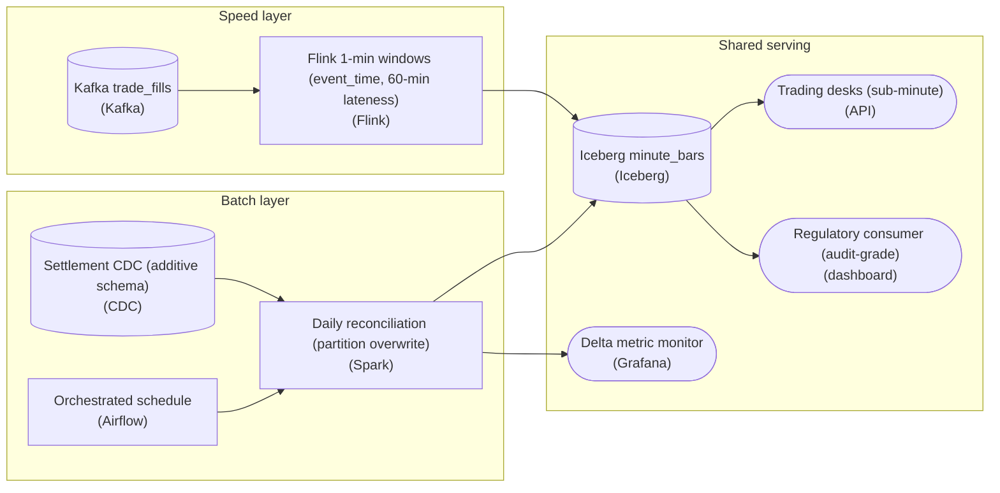

*Both writers converge on one Iceberg table; ownership is split by partition, not by table.*

1. **Let the speed layer be fast and approximate**

   Flink buckets `trade_fills` into one-minute `event_time` windows behind a lag-tolerant watermark with a 60-minute lateness budget. Event time, not arrival time, is what keeps a fill that shows up late in the minute it actually happened. The watermark is a deliberate bet: hold the window open long enough to catch stragglers, but close it in time to hit the desks' sub-minute SLA. Cross-border fills that settle back-dated by a day will blow past that 60-minute budget, and that is fine, because the speed layer is not the thing that has to be correct.

2. **Let the batch layer be slow and canonical**

   Once settlement finalizes overnight, a reconciliation job runs on an orchestrated schedule (the DAG is what guarantees it runs after the feed is complete, not while it is still landing). It reads the finalized settlement feed and atomically overwrites the prior day's `minute_bucket` partitions in `minute_bars`, then emits a delta metric to a monitor so you can see how far streaming drifted from truth. Partition-scoped overwrite is the whole game: it touches only closed days and leaves the current day streaming untouched.

3. **Serve both consumers off the one table**

   Because the boundary is a partition, both the trading desks and the regulatory consumer read the same `minute_bars` table and each gets what it needs: the desks read the current-day partitions streaming is writing, the regulator reads closed-day partitions reconciliation has finalized. No consumer has to union a speed table with a batch table or reason about which copy is authoritative; that logic lives in the partition ownership rule, not in every query.

| Trick: Atomic partition overwrite is your idempotency |
| --- |
| Iceberg's snapshot-based commit means the batch job's overwrite of a day's `minute_bucket` partitions is all-or-nothing: readers see the old snapshot until the new one commits, never a half-rewritten day. That is also what makes the reconciliation safe to re-run. If the DAG retries, the second run overwrites the same partitions with the same finalized data and lands identically. Idempotency here is not extra code you write; it is a property you get for free by making the unit of write a partition and the unit of commit a snapshot. |

| Pitfall: Don't ship 2 tables and make consumers merge |
| --- |
| The tempting wrong version keeps a `speed_bars` table and a `batch_bars` table and tells every consumer to `COALESCE` the batch value over the streaming one at query time. Now correctness lives in each consumer's SQL, the regulator and the desks can disagree about the same minute, and a schema change has to be applied twice. Converging both writers on one table with partition-level ownership pushes that decision to write time, where there is exactly one rule to get right. |

| Real world: CDC that absorbs new columns keeps the pipeline from breaking |
| --- |
| Settlement feeds grow fields over time. Bringing the changes in through a change-data source under an allow-additive schema policy means a newly added column flows into `minute_bars` (Iceberg evolves the schema by field id, no rewrite) without breaking the streaming writer or either consumer. In production this is what stops a routine upstream change from paging you at 2am: the additive contract is the seam that lets the batch and speed layers evolve on their own clocks. |

**Follow-up questions**

1. What happens to a fill that settles 2 business days back-dated, past both the 60-minute watermark and the day the reconciliation already closed?\
   *Tests whether the batch layer re-opens already-finalized `minute_bucket` partitions, and how far back reconciliation must reach.*
2. How would you prove the desks never see a partition mid-overwrite during reconciliation?\
   *Probes understanding of Iceberg snapshot isolation vs a naive in-place rewrite.*
3. If the delta metric shows streaming consistently under-counting a symbol, what does that tell you about the watermark?\
   *Connects the reconciliation delta back to how much lateness the watermark tolerates.*


<br>

### Exercise 2 of 2

**● TASK**

Trading desks need minute bars within seconds, and an audit consumer needs the same Iceberg table reconciled daily to the settlement Postgres. Put a schema registry ahead of the three Kafka feeds and give each its own watermark: multi-hour bounded out-of-orderness for retail, idle detection for institutional, punctuated for market data. Bucket by event_time with a 60-minute allowed lateness and dead-letter anything later. CDC the ledger through an allow-additive schema policy that quarantines destructive changes, then an Airflow-scheduled reconciliation atomically overwrites partitions and logs the streaming gap.

**Starting canvas** (already placed for you):

- Mobile retail trades source (long retry tail) (source, Kafka)
- Institutional order flow source (idle partitions during off-hours) (source, Kafka)
- Market-data feed (producer emits end-of-session markers) (source, Kafka)
- Postgres settlement system (canonical; finalizes overnight) (source, PostgreSQL)
- Flink unified streaming aggregator (no watermark, no lateness, no event_time) (transform, Flink)
- Iceberg minute_bars (shared target for streaming and reconciliation) (storage, Iceberg)
- Airflow orchestrator (schedules the daily reconciliation pass) (transform, Airflow)
- Algorithmic trading desks (real-time consumer) (consumer, API)
- Regulatory reporting consumer (audit-grade) (consumer, Tableau)


<br>

### Solution

#### Lambda in one table: a streaming writer and a batch writer

This is the **Lambda architecture**, and it is worth naming plainly because every choice on the canvas follows from it. Two independent writers converge on one Iceberg table, `minute_bars`. The streaming path (Flink over the three Kafka feeds) delivers per-symbol bars to the desks within seconds of a minute closing. The batch path (the nightly Spark reconciliation that Airflow schedules) delivers the audited truth by overwriting partitions from the settlement ledger. Speed layer and truth layer, same table. Everything else you placed exists to make those two writers safe to share it.

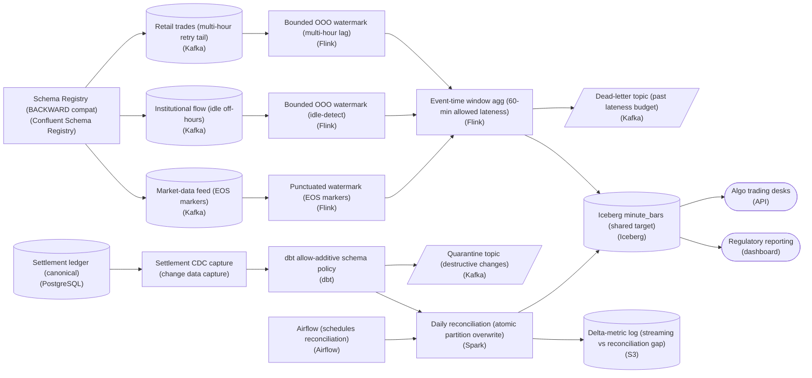

*Two writers, one Iceberg table: a Flink speed layer and a Spark reconciliation layer converge on `minute_bars`, with per-source watermarks, a dead-letter topic, and a schema-quarantine topic guarding each edge.*

#### Why each source gets its own watermark

This is the decision the challenge really turns on. A watermark is Flink's promise that no more events older than time T will arrive, and it is what lets an `event_time` window close and emit a bar. The trap is thinking one watermark serves all three feeds. It cannot, because the merged watermark is the minimum across inputs, so the slowest, laggiest feed drags the whole aggregation. Each feed has a different lateness profile, so each earns a strategy matched to it.

1. **Retail trades: bounded out-of-orderness with a multi-hour lag**

   Mobile retries dribble in for hours, so the watermark must trail real time by a lag sized to that tail. Use bounded out-of-orderness with a large `outOfOrderness` bound. It is the correct dial: wide enough that a three-hour-late retry still lands in its true minute, at the cost of bars closing later for this feed.

2. **Institutional flow: bounded out-of-orderness with idle-detection**

   Off-hours, partitions go silent. A silent partition never advances its watermark, and since the merged watermark is the minimum, one idle partition would freeze the whole window. `withIdleness(...)` tells Flink to drop an idle source out of the minimum calculation so the live feeds keep progressing.

3. **Market-data feed: punctuated watermark on end-of-session markers**

   This producer already emits explicit end-of-session markers, so you do not guess a lag at all: a punctuated watermark fires exactly when a marker arrives. When the boundary is in the data, read it instead of estimating it.

| Pitfall: The starter aggregator throws all three signals away |
| --- |
| The given transform is labelled `no watermark, no lateness, no event_time`. That is not a simplification, it is the bug: with no `event_time` it buckets by processing time, so a retail trade that retries for three hours lands in the minute bar for now, not the minute it actually traded. No error is raised and the desks see plausible-looking wrong numbers. Naming `event_time`, a per-source watermark, and an allowed-lateness budget is precisely what turns this node from wrong to correct. |

Downstream of the watermarks, the window carries a 60-minute allowed-lateness budget: it keeps state for an extra hour past the watermark so a straggler can still update its bar. Anything later than that budget is genuinely too late to fold in, so it routes to the dead-letter Kafka topic rather than vanishing silently or forcing an unbounded, ever-growing window. Allowed lateness and the dead-letter topic are two halves of one answer to late data: reconcile what you still can, capture what you cannot.

The batch side is guarded the same way. Change data capture off the settlement Postgres feeds a dbt schema policy set to allow-additive: new columns flow through, but a destructive change (a dropped or retyped column) is blocked and routed to a quarantine Kafka topic so a human decides before the audit table's shape shifts underneath the reconciliation job. On the producer side the Schema Registry enforces a compatibility mode (for an evolving audit-grade feed, 'BACKWARD' so new consumers can still read old records). Together they are schema evolution done defensively at both ends of the pipe.

| Real world: The two-writer contract lives on atomic overwrite plus a gap metric |
| --- |
| Two writers on one table only works because Iceberg gives snapshot isolation: the nightly Spark job overwrites whole partitions atomically, so the desks and the regulatory reporting dashboard always read one consistent snapshot, never a half-rewritten one. And because streaming and reconciliation will always disagree slightly, the S3 delta-metric log records the per-partition gap on every reconciliation run. That log is how you prove you stayed inside audit tolerance instead of hoping you did. In production this metric, not the bars themselves, is what gets alerted on. |

| ✕ Speed layer (Flink) | ✓ Truth layer (Spark reconciliation) |
| --- | --- |
| Reads the three Kafka feeds, buckets by `event_time` with per-source watermarks and 60-min allowed lateness, writes bars to `minute_bars` within seconds. Optimized for latency; tolerates small, eventually-corrected error. | Runs once nightly under Airflow, reads the settlement ledger via CDC, and atomically overwrites the same `minute_bars` partitions with audited values. Optimized for correctness; the delta-metric log quantifies how far the streaming bars drifted. |

**Follow-up questions**

1. If the delta-metric log shows a partition outside audit tolerance, should the reconciliation job overwrite it, alert, or both?\
   *Tests whether reconciliation is silent repair or an auditable event.*
2. How would you replay events from the dead-letter topic without double-counting bars the reconciliation pass has already corrected?\
   *Probes idempotency and the ordering between the late-data path and the batch overwrite.*
3. The market-data producer stops emitting end-of-session markers for one symbol. What does the punctuated watermark do, and how do you detect it?\
   *Extends the punctuated-watermark idea to its failure mode and monitoring.*


<br>

---

## Reconciliation Passes

Every allowed-lateness budget leaves a tail, and some consumers cannot accept one: a ledger, a regulatory report, an invoice. A reconciliation pass is a batch job that recomputes the streaming output from the complete record after the tail has arrived, compares the 2, writes the corrected version as the version of record, and publishes how far apart they were.

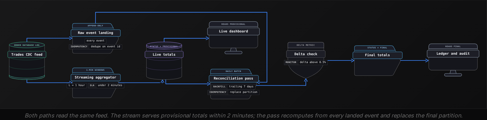


<br>

### Decisions that make the pass trustworthy

- **Source of truth** *Recompute from the full record*\
  Read raw landed events, including those the stream dropped as too late, or an authoritative outside record. The streaming output can only be compared against, never recomputed from.
- **Settle horizon** *Run after the tail arrives*\
  For the trades feed a 24-hour budget already reaches 99.995%, so a pass a day after the window closes sees nearly everything.
- **Same grain, same rules** *Match the stream exactly*\
  Compute at the stream's keys, account and window start, and dedupe on event_id. A pass that counts duplicates the stream removed reports a delta that does not exist.
- **Idempotent write** *Replace, never append*\
  Replace the partition for each recomputed day, so a rerun or the 7-day trailing backfill leaves one correct copy.
- **Explicit authority** *Provisional or final*\
  Label every row. Consumers that need audit-grade numbers read only final rows.


<br>

### Computing the delta

The pass and the comparison fit in one query: dedupe the raw events, aggregate at the stream's grain, then full-outer-join to the streaming output so a window missing on either side still shows up.

```sql
WITH latest AS (
  SELECT
    trade_id,
    account_id,
    trade_time,
    amount,
    status,
    ROW_NUMBER() OVER (
      PARTITION BY trade_id
      ORDER BY source_position DESC
    ) AS rn
  FROM raw_trade_events
  WHERE trade_date = DATE '2026-10-22'
),
recon AS (
  SELECT
    account_id,
    DATE_TRUNC('minute', trade_time) AS window_start,
    SUM(amount) AS net_amount
  FROM latest
  WHERE rn = 1
    AND status <> 'CANCELLED'
  GROUP BY account_id, DATE_TRUNC('minute', trade_time)
)

SELECT
  COALESCE(r.account_id, s.account_id) AS account_id,
  COALESCE(r.window_start, s.window_start) AS window_start,
  COALESCE(s.net_amount, 0) AS stream_amount,
  COALESCE(r.net_amount, 0) AS final_amount,
  COALESCE(r.net_amount, 0) - COALESCE(s.net_amount, 0) AS delta
FROM recon AS r
FULL OUTER JOIN stream_minute_totals AS s
  ON r.account_id = s.account_id
    AND r.window_start = s.window_start
WHERE COALESCE(s.window_start, r.window_start) >= TIMESTAMP '2026-10-22 00:00:00'
  AND COALESCE(s.window_start, r.window_start) < TIMESTAMP '2026-10-23 00:00:00'
```

Roll those rows up into the day's delta metric: the share of windows whose amounts differ, the summed absolute delta, and the share of events that only the pass counted. The last number has an expected value. With L = 1 hour, about 0.07% of trade events should appear only in the pass, so the metric gets a band, and readings outside it in either direction point to a different problem.

| Events counted only by the pass | Reading | Likely cause |
| --- | --- | --- |
| 0.06% to 0.09% | Healthy | The expected tail past 1 hour |
| 2.4%, all from 1 partition | Incident | An idle partition resumed more than L behind |
| 2.4%, starting at a migration | Incident | Key-sticky quarantine parked keys and was never replayed |
| 0.00% | Suspicious | The pass reads the streaming output instead of raw events |

> **TIP**
>
> Publish the delta as a metric with its own history and thresholds, the way the data quality lessons tuned checks against history. A delta that creeps from 0.07% to 0.3% over a month usually means the lateness tail grew, and L or D needs revisiting before it becomes an incident.

✓Do

- Recompute from raw landed events, kept in every schema version
- Match the stream's keys and dedupe rules exactly
- Give the delta an expected band and alert on both sides of it
- Replace whole partitions so reruns leave one copy

✗Don't

- Diff the stream against a copy of its own output
- Let consumers mix provisional and final rows without a status column
- Raise L to shrink the delta when the pass already corrects it
- Treat a zero delta as proof of health

**The daily pass reports 2.4% of events counted only by the pass, all stamped 09:58 to 10:26 and all from p2, which went quiet at 09:58 and resumed at 11:28. Other days sit near 0.07%. What happened?**

- **A.** p2 was dropped by the idle timeout, and its backlog resumed more than D + L behind
- **B.** p2 went idle and stalled the job watermark, so no partition's windows ever closed
- **C.** The pass double-counts p2's events because raw landing retried during that time
- **D.** A producer clock on p2 ran ahead and pushed honest events behind the watermark

<details>
<summary>Solution</summary>

**A.** p2 was dropped by the idle timeout, and its backlog resumed more than D + L behind

At 11:28 the watermark is about 11:27:30, past every one of those windows' end plus 1 hour.

**Why the others are wrong**

- **B.** A stall delays results but loses nothing, and it would not single out p2's events.
- **C.** The pass keeps one row per trade, so retried copies count once.
- **D.** A fast clock on p2 would make other partitions' events late, not p2's own.

</details>


<br>

---

## Pipeline Architecture

### Exercise 1 of 2

**● TASK**

Capture row-level changes from an order-management MySQL database with log-based CDC, not table re-reads, and carry the 2,000 change events per second through a message broker. Enforce an allow-additive policy at a schema check: added columns pass, while events with a renamed or dropped column go to a dead-letter queue instead of the warehouse. Accepted changes must land in the warehouse within 15 minutes.


<br>

### Solution

#### Where an allow-additive policy draws the line

An enforcement policy on a CDC stream decides what happens in the window between a schema-change event and the first data event under the new shape. Allow-additive is the middle policy: a new column is safe because no existing warehouse query references it yet, but a renamed or dropped column breaks every query that does. So those events are stopped before the load and kept for replay, never silently dropped.

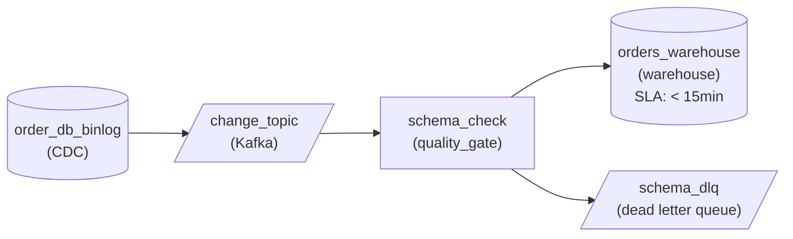

*Binlog CDC into `change_topic`; `schema_check` passes additive events to `orders_warehouse` and quarantines renames and drops in `schema_dlq`.*

1. **Capture from the log, not the table**

   Reading the MySQL binlog through `order_db_binlog` turns every insert, update, delete and `ALTER TABLE` into an ordered event, so the schema change arrives in the stream ahead of the data that uses it. Re-reading tables would only see the new shape after the fact, with nothing to enforce against.

2. **Put the policy where the stream forks**

   `schema_check` sits between `change_topic` and the warehouse and is the one stage that decides. Additive events continue to `orders_warehouse`; events with a renamed or dropped column fork to `schema_dlq`, where they wait until the warehouse model is updated and can then be replayed.

| Pitfall: Halting the connector is not enforcement |
| --- |
| Stopping the whole stream on any incompatible change protects the warehouse, but it stalls every other change behind it and blows the 15-minute target. Quarantining only the offending events keeps the 2,000 events per second flowing. |

| Key insight: A rename looks like a drop plus an add |
| --- |
| CDC tools surface a rename as the old column vanishing and a new one appearing. A check that only looks for added columns waves it through, so under allow-additive a rename is quarantined exactly like a drop. |

**Follow-up questions**

1. A second consumer, a search index, can tolerate dropped columns. How would the policies differ per consumer?\
   *Choosing an enforcement policy by consumer tolerance rather than one policy for the stream.*
2. Once the warehouse adds the renamed column, how do you replay `schema_dlq` without double-loading orders?\
   *Replaying quarantined change events idempotently.*


<br>

### Exercise 2 of 2

**● TASK**

Refrigeration sensors at 2,000 stores publish readings to a Kafka topic partitioned by store, 50,000 a second at peak; open stores' readings arrive up to 10 seconds out of order, and closed stores go silent for up to 8 hours. Compute one-minute event-time windows per store and page the on-call technician within a minute when a window's average exceeds the safe temperature. Pick the watermark strategy so silent stores never stall the open ones.


<br>

### Solution

#### One silent partition can freeze every window

An **idle-aware watermark** is bounded out-of-orderness with one extra rule: a partition that stops sending is left out of the watermark until it speaks again. That rule matters because a job's watermark is the minimum across its input partitions. When a store closes, its partition stops advancing, the minimum pins at that store's last reading, and every open store's windows wait up to 8 hours to fire. The freezer that warms at 3 a.m. pages nobody.

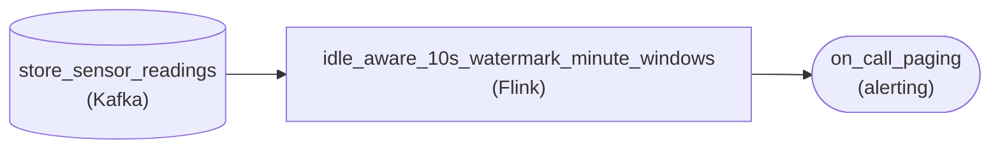

*Readings feed one Flink job with a 10-second bound and a 30-second idle timeout, which pages on-call directly.*

1. **Size the bound from the measured lateness**

   Open stores land readings at most 10 seconds late, so the bound is 10 seconds: the 03:00 window fires once the watermark passes 03:01:10. Ascending timestamps would treat that disorder as late; a bound of minutes would push every page past the one-minute budget.

2. **Set the idle timeout from the gap that means closed**

   An open store sends about 25 readings a second, so 30 seconds of silence means shut, not quiet. In Flink that is `forBoundedOutOfOrderness(Duration.ofSeconds(10))` plus `withIdleness(Duration.ofSeconds(30))`. Once a partition is marked idle, the minimum moves with the open stores again.

| Pitfall: Widening the bound does not cure idleness |
| --- |
| Stretching the bound to cover the 8-hour gap ends the stall by closing every window 8 hours late. Silence and disorder are different profiles: the bound answers how late a reading can be, the idle timeout answers how long a source may say nothing. |

| Key insight: The strategy belongs to the source, not the job |
| --- |
| A stream read from a database log in offset order needs only ascending timestamps; this sensor fleet needs a bound and an idle timeout. Profile each source's lateness and silence before you pick. |

**Follow-up questions**

1. Each partition now carries 40 stores across 4 time zones. Does the idle timeout still fire overnight?\
   *Idleness is judged per partition, so a partly quiet partition behaves differently from a silent one.*
2. Older freezers buffer readings and upload them every 5 minutes. Which strategy fits that source?\
   *Reading a new lateness profile and giving that source its own watermark.*


<br>

---

## Late Trade Settlements

Here the 4 pieces run as one system. A brokerage serves 2 consumers from the same trades. The live buying-power view shows each account's net unsettled amount and must reflect a fill within 2 minutes. The settlement ledger needs exact totals per account per trade date. US equity trades settle on the next business day (T+1), so trades from Thursday 2026-10-22 settle Friday 2026-10-23.

| Input | Shape | Lateness and idleness |
| --- | --- | --- |
| `trades` table, via CDC | Insert per fill, update per correction or cancel | p99 4 minutes; quiet overnight |
| `instruments` table, via CDC | Reference data, rare changes | Changes a few times a day |
| Clearing-house settlement messages | A batch per cycle, owned by an outside firm | Silent for hours, then up to 3 hours of messages |


<br>

### Decisions, piece by piece

| Piece | Choice | Failure it prevents |
| --- | --- | --- |
| Schema: `trades` | Quarantine, key-sticky, version-guarded writes | A single bad migration stalling every account, or replays reverting state |
| Schema: `instruments` | Additive | Stalls over new descriptive columns no money depends on |
| Schema: settlement messages | Block-breaking | A changed amount format posting wrong cash to the ledger |
| Watermark: `trades` | D = 30 s, 2-minute idle timeout, 5 s future cap | Overnight quiet stalling results; a fast clock leaping the watermark |
| Watermark: settlements | End-of-cycle marker from the producer | Guessing completeness for a source that knows it |
| Allowed lateness | L = 1 hour on 1-minute account windows | 288.4 GB of state for 0.065 points |
| Reconciliation | 06:00 the morning after settlement date, trailing 7 days | Audit numbers that depend on the streaming tail |

The settlement feed gets the strictest policy. Its volume is small, its consumer tolerates hours of delay, and its producer is an outside firm whose changes no contract in CI can catch first. A stall there costs a page; a silently misread amount column costs a ledger that disagrees with the clearing house. Cancellations that arrive days later are picked up by the trailing 7-day rerun, which replaces each partition again.

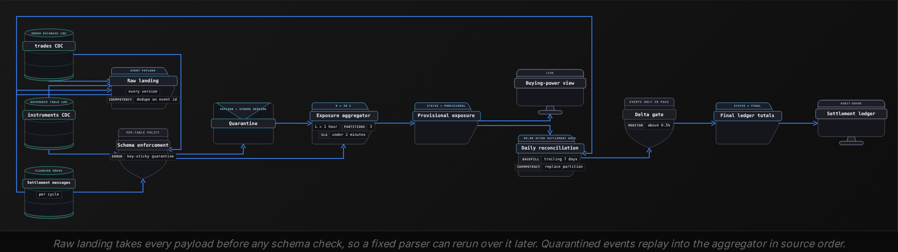

**The clearing house starts sending amount in cents instead of dollars, with the same field name and type. Which piece catches it, and when?**

- **A.** Block-breaking enforcement, at the first message in the new format
- **B.** The reconciliation delta, at the next morning's pass
- **C.** The watermark, because the cycle marker arrives in a new format
- **D.** A distributional check on amount, at the first cycle in cents

<details>
<summary>Solution</summary>

**D.** A distributional check on amount, at the first cycle in cents

Values jump 100-fold while schema and both paths agree, which only a check on the values sees.

**Why the others are wrong**

- **A.** Name and type are unchanged, so the schema check passes it.
- **B.** Both paths read the same cents, so the delta stays in band.
- **C.** Markers report completeness only, so the watermark advances normally.

</details>


<br>

### Walking the 14:12 rename through the system

| Time | What happens | What each consumer sees |
| --- | --- | --- |
| Thu 14:12 | A migration renames `qty` to `quantity` in `trades` | Nothing yet |
| 14:12 to 15:40 | Every `trades` event after the rename lacks `qty` and is quarantined, parked by account, the aggregator's state key | The view marks the 1,900 accounts with a fill since 14:12 stale; 498,100 without one stay correct |
| Thu 15:40 | The parser now maps `quantity`; quarantine replays in source order through the version guard | Flagged accounts catch up, and no state reverts |
| Thu 15:40 | Replayed events stamped 14:12 to 14:38 are past L: the watermark kept advancing on events read before the schema check | Live totals for those minutes stay short |
| Sat 06:00 | The pass recomputes 2026-10-22 from raw landing with the fixed parser | The ledger gets exact final totals; delta reads 0.10% |

The delta of 0.10% sits above the healthy band and below the 0.5% alert, and it can be explained to the decimal: the usual 0.07% tail plus roughly 0.03 points from the quarantined window. The system is auditable because every gap between the live number and the final one traces to a policy someone chose and can defend.

**In the rename incident, the 15:40 replay runs through the version guard, yet live totals for 14:12 to 14:38 stay short until the Saturday pass. Why?**

- **A.** The version guard rejected those events because their source positions were too low
- **B.** Key-sticky quarantine discards events older than the idle timeout
- **C.** They trail the newest event time by more than D + L, so their windows had closed
- **D.** The settlement feed's block-breaking policy paused every table in the pipeline

<details>
<summary>Solution</summary>

**C.** They trail the newest event time by more than D + L, so their windows had closed

At 15:40 the watermark is around 15:39:30, past the end of each of those minutes plus 1 hour.

**Why the others are wrong**

- **A.** Key-sticky parking held their later events back, so nothing newer was applied.
- **B.** Quarantine keeps every payload, and the idle timeout governs watermarks only.
- **D.** Policies apply per table, so a settlement block would leave trades untouched.

</details>


<br>

---

## Pipeline Architecture

### Exercise 1 of 1

**● TASK**

Road sensors on 20,000 segments stream 30,000 vehicle detections a second into Kafka; build per-segment 1-minute counts for a live congestion map that refreshes within a minute. Lateness is long-tailed: p99 is 4 minutes, but sensors that lose backhaul replay up to 6 hours late. The map takes corrections for one hour after a window closes and ignores them after. Size the allowed lateness to that, and keep every event past it rather than dropping it.


<br>

### Solution

#### Let the reader set the lateness budget

A closed window stays open to stragglers for exactly as long as **allowed lateness** says, and that length comes from the reader of the output, not from the lateness histogram. Here the histogram reaches 6 hours, but the congestion map stops caring after one: a correction to 9:14 that lands at 11:30 repaints a minute nobody is watching. So the budget is one hour, every event inside it merges into the map, and every event outside it goes to a separate path.

1. **Read the consumer's correction horizon**

   Ask what the output is for. A live map takes corrections while people still look at a minute; an audit ledger would want eventual completeness; a throughput alert would be fine on processing time. This map's horizon is one hour, so that is the point on the curve.

2. **Price the state at that point**

   With 1-minute windows on 20,000 segments, a one-hour hold keeps about 60 closed windows per segment alive: roughly 1.2 million window states. Holding for the 6-hour tail means 7.2 million, 6 times the state, to catch outage replays the map would ignore. One hour already sits far past the 4-minute p99, so nearly all ordinary lateness still merges.

3. **Give the events past the line somewhere to go**

   Past the budget the engine's default is to drop the event, and the requirement rules that out. Those events leave the aggregator on an error path into a dead-letter store in object storage. The map never sees them, nothing is lost, and the store's growth tells you how often sensors fall past the line.

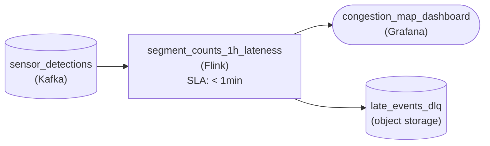

*Event-time 1-minute counts held one hour past the watermark feed the map; events past the budget take the error path to a dead-letter store.*

| Pitfall: Covering the whole tail is the wrong target |
| --- |
| The tempting move is setting allowed lateness to the worst case, 6 hours, so nothing drops. That buys 6 times the state and keeps rewriting map minutes long after anyone looked, which is the output-stability cost on the curve. The opposite slip, zero lateness, drops everything behind the watermark, including the ordinary 4-minute tail the map does want. |

**Follow-up questions**

1. What if operators only care about corrections for the last 10 minutes?\
   *Moving along the curve: coverage still clears the 4-minute p99 while held state falls about sixfold.*
2. What changes if the map switches from 1-minute to 15-minute windows with the same one-hour horizon?\
   *The budget stays a duration, but the number of held windows per segment drops from about 60 to about 4.*


<br>

---

## Putting It All Together

Picture a ride-hailing company like Uber showing drivers their earnings minutes after each trip, while the weekly payout statement must match every fare, tip and adjustment exactly. Trips arrive by CDC from the trips database, tips trail trips by hours as riders add them later, and support-team fare adjustments land days afterward.

- Schema policy: the trips table takes key-sticky quarantine with version-guarded writes, so a migration stales a few drivers instead of rewriting their earnings out of order.
- Watermarks: regional partitions that go quiet overnight need an idle timeout, and phones with fast clocks need a future-time cap.
- Allowed lateness: the live earnings view sets L at the knee of the tip-lateness curve and labels its totals provisional.
- Reconciliation: before each payout, a pass recomputes earnings from raw landed events, replaces the week's partitions, and holds the payout if the delta leaves its band.
- Together: the live view can stay lean because the pass guarantees exactness, and the pass stays small because the stream already covers almost everything.


<br>

---

## Pipeline Architecture

### Exercise 1 of 2

**● TASK**

Smart meters publish readings to Kafka, and a meter that loses its connection buffers readings for up to 72 hours before sending them. Build hourly usage per household that a grid-operations dashboard reads within a minute, and keep every raw reading. Add a reconciliation pass: a nightly batch job that recomputes each day once it is 72 hours old and overwrites that day's partitions in the same table. Billing reads that table and must never see a half-rewritten day.


<br>

### Solution

#### A late batch that overwrites the stream

A reconciliation pass is the batch half of a lambda design. The Flink job keeps the hourly table fresh for the dashboard, but it drops readings past its lateness budget. Once a day is 72 hours old nothing more can arrive for it, so a Spark job recomputes that day from the raw archive and replaces the streamed rows. The stream is fast and slightly wrong, the pass is late and exactly right, and whichever wrote a day partition last is the answer.

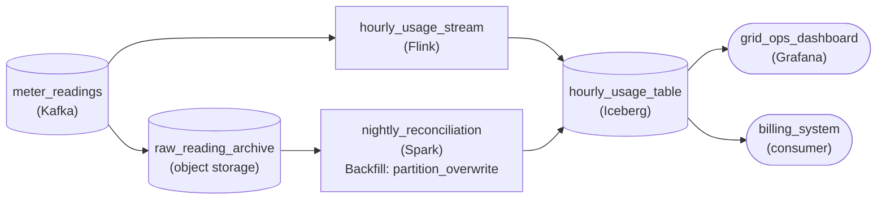

*Flink keeps `hourly_usage_table` fresh; nightly Spark rewrites each 72-hour-old day from `raw_reading_archive`.*

1. **Recompute from the raw archive**

   The pass reads `raw_reading_archive`, never `hourly_usage_table`. The streamed rows already lost the readings that arrived past the stream's lateness budget, so re-aggregating them repeats the gap. Only the raw readings hold the buffered stragglers.

2. **Replace each day partition whole**

   Both writers partition by reading day, so a closed day is one well-defined unit. The pass writes the new partition and commits it as one Iceberg snapshot with `partition_overwrite`: billing sees the streamed day or the reconciled day, never a mix.

| Pitfall: Row-by-row upserts expose half-fixed days |
| --- |
| Updating households in batches lets a billing query land mid-run and read some households corrected and others not. Swapping the partition in one commit is what makes the overwrite safe to read during the run. |

**Follow-up questions**

1. A dispute reopens one day from last month. What does rerunning the pass for just that day require?\
   *Whether the day-partition overwrite makes a single-day rerun safe to repeat.*
2. What goes wrong if the pass closes a day at hour 60 instead of hour 72?\
   *Why the pass must wait out the full lateness tail before overwriting.*


<br>

### Exercise 2 of 2

**● TASK**

Technician handhelds sync completed jobs into a PostgreSQL job database whenever they get signal, and each of 400 regions goes silent for 8 hours overnight. Capture row-level changes from that database and build per-region 15-minute completed-job counts in a table a live dashboard reads, fresh within a minute even while some regions are silent. Sync lateness is p99 6 minutes, p99.9 45 minutes and max 30 hours, and window state can be held open at most one hour. A nightly reconciliation pass rewrites each closed day's counts in that same table from a landed copy of the changes.


<br>

### Solution

#### 3 answers to when a count is final

Watermark idleness, an allowed-lateness budget and a reconciliation pass each answer the same question: when is a count final? The stream answers it for the dashboard within a minute. The 45-minute budget catches 999 of every 1,000 late syncs while the count is still live. The nightly pass settles the last one in a thousand, like the technician who synced 30 hours later from a site with no signal. Each piece covers exactly the gap the previous one leaves.

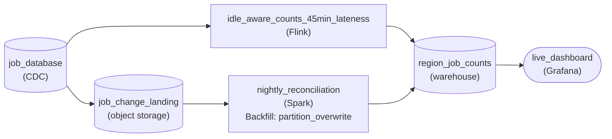

*Changes from `job_database` feed the live counts and `job_change_landing`; `nightly_reconciliation` overwrites closed days in `region_job_counts`, which `live_dashboard` reads.*

1. **Keep event time moving through silent regions**

   With the change stream split by region, the watermark is the minimum across partitions. That means a single region asleep for 8 hours would hold every region's windows open until morning. Mark a partition idle after a few minutes of silence and leave it out of that minimum, which is what `idle_aware_counts_45min_lateness` is named for. When the region wakes up, its fresh jobs arrive on time and its buffered jobs arrive late. Late arrivals are the next step's problem.

2. **Size the budget from the percentiles**

   A 15-minute window held open 45 minutes past its close keeps about 4 windows open per region, or roughly 1,600 across 400 regions. A 30-hour budget keeps about 121 per region, 30 times the state, and breaks the one-hour limit only to recover the last 0.1 percent. The p99 at 6 minutes would be cheaper, but it would drop one job in a hundred from the live view. The p99.9 is the deepest percentile the one-hour budget can afford, so that is the setting.

3. **Let the nightly pass own the tail**

   A job can land up to 30 hours after it happened, so a single night's pass cannot finalize only yesterday. Each night, reread the last 2 closed days from `job_change_landing` and overwrite those partitions in `region_job_counts`, the same table the stream writes. Because it is a partition overwrite, a rerun is harmless. Reading the landed copy also keeps full scans off the database the handhelds sync into.

| Pitfall: A 30-hour budget buys 0.1 percent with 30 times the state |
| --- |
| The tempting fix for late syncs is to raise allowed lateness until nothing is dropped. That spends 30 times the window state to rescue one job in a thousand for a live view that never needed to be exact. Payroll still gets no guarantee, because events past any budget are dropped silently. Keep the budget at the p99.9 and give exactness to the nightly pass. |

**Follow-up questions**

1. A new group of regions syncs over satellite, with a p99.9 lateness of 3 hours. Does one lateness budget still fit every region?\
   *Sizing per source: either give the slow regions their own stream and budget, or leave their tail to the reconciliation pass.*
2. The jobs table gains a nullable `job_type` column next week. Where does that change hit this design?\
   *Carrying an additive schema change through the change stream to both the live path and the nightly path.*


<br>

---

## Key Takeaways

- In CDC, a rename arrives as a drop plus an add, so a permissive pipeline turns it into silent nulls.
- Choose additive, block-breaking or quarantine per table, by whether its consumer can better tolerate staleness or wrong numbers.
- Quarantine on a CDC table needs key-sticky parking or version-guarded writes, or replays revert state.
- Pick watermarks from the source's profile: fixed delay for steady feeds, idle timeouts for quiet partitions, producer markers for batch sources, and a future-time cap everywhere.
- Allowed lateness buys coverage at a falling rate while state grows with every open window, so stop at the knee and hand the tail to reconciliation.
- A reconciliation pass recomputes from raw events at the stream's grain, replaces partitions, and publishes a delta with an expected band.
