Intermediate·Pipeline Architecture · 32 min · 12 challenges

# Schema Drift: Intermediate

At Uber, a driver's phone climbs out of an underground garage at 09:34 and uploads a fare from a trip that ended at 09:02. The earnings pipeline published its 09:00 to 09:05 revenue total 28 minutes earlier. Reopen that total, drop the fare, or park it? The same app release also renamed the fare field. Two kinds of promise settle both: one about schema, one about time.


<br>

---

## Schema Registries: Where They Live

A schema registry is a small service that stores every version of every event schema and checks each proposed version against the versions before it. In the beginner lesson, a producer changed its event shape and a consumer broke at runtime. A registry moves that failure to deploy time, where it costs a red build instead of a broken dashboard.


<br>

### What the registry stores

Schemas are grouped by **subject**, usually 1 per topic, such as trip_completed-value. Each distinct schema receives a **schema ID** that is unique across the whole registry. A subject holds an ordered list of **versions**, and each version points to one of those IDs, so an identical schema registered under 2 subjects shares 1 ID. The subject also carries a **compatibility mode**: the rule every new version must pass before the registry accepts it.

```sql
{
  "subject": "trip_completed-value",
  "compatibility": "FULL",
  "versions": [
    {
      "version": 1,
      "schema_id": 412,
      "fields": [
        {
          "name": "trip_id",
          "type": "string"
        },
        {
          "name": "driver_id",
          "type": "string"
        },
        {
          "name": "fare",
          "type": "string"
        },
        {
          "name": "ended_at",
          "type": "timestamp"
        }
      ]
    },
    {
      "version": 2,
      "schema_id": 587,
      "fields": [
        {
          "name": "trip_id",
          "type": "string"
        },
        {
          "name": "driver_id",
          "type": "string"
        },
        {
          "name": "fare",
          "type": "string"
        },
        {
          "name": "ended_at",
          "type": "timestamp"
        },
        {
          "name": "tip_cents",
          "type": "long",
          "default": 0
        }
      ]
    }
  ]
}
```

The registry also changes what travels on the topic. Each message carries a short schema ID ahead of its payload, in place of the full schema. A consumer that meets ID 587 for the first time fetches that schema from the registry once, caches it, and decodes every later message stamped 587 with it.


<br>

### Deploy time and runtime

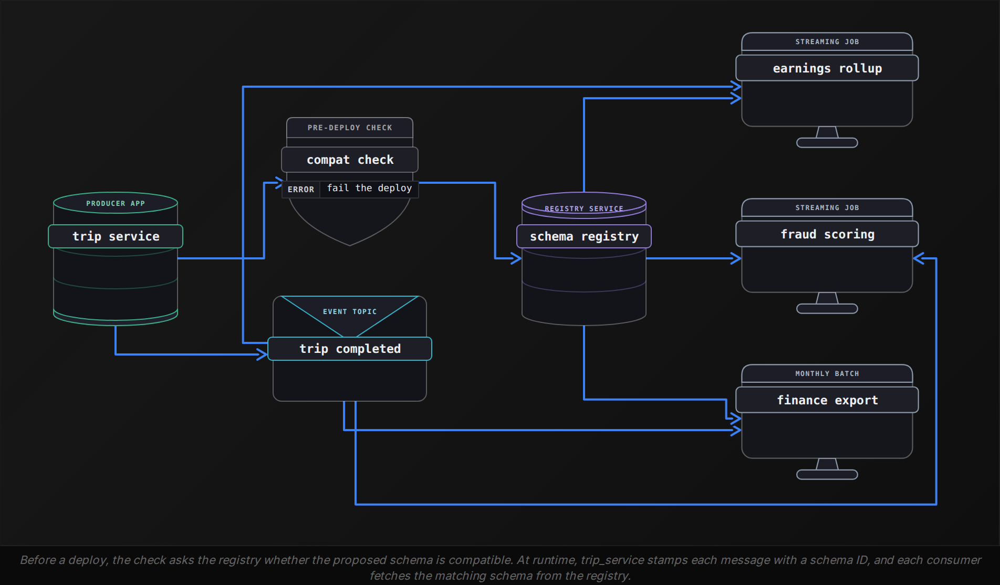

The check that matters runs before the deploy. When trip_service is about to ship a new event shape, a build step submits the proposed schema to the registry and asks whether it passes the subject's compatibility mode. A failure stops the release, so the incompatible shape never produces a message. Runtime is the backstop: a producer that skips the check and has auto-registration turned on tries to register the new version when it first serializes a message, and that send fails with a compatibility error where it expected a schema ID.


<br>

### The 4 compatibility modes

| Mode | Guarantee | Passes | Fails |
| --- | --- | --- | --- |
| BACKWARD | Readers on the new schema decode old messages | Delete a field; add a field with a default | Add a field with no default |
| FORWARD | Readers on the old schema decode new messages | Add a field; delete a field that has a default | Delete a field with no default |
| FULL | Both directions hold | Add or delete fields that have defaults | Add or delete a field with no default |
| NONE | No guarantee | Any change | Nothing |

**The trip_completed-value subject uses FORWARD compatibility. A proposed version 3 deletes driver_id, a required string with no default in version 2. What does the check return?**

- **A.** It passes, because FORWARD only inspects the fields a new version adds.
- **B.** It fails, because readers still on version 2 need driver_id and have no default.
- **C.** It passes, and readers still on version 2 get null wherever driver_id was.
- **D.** It fails, because FORWARD rejects every deletion, including fields that have defaults.

<details>
<summary>Solution</summary>

**B.** It fails, because readers still on version 2 need driver_id and have no default.

An old reader decodes the new message, finds no driver_id, and has nothing to substitute.

**Why the others are wrong**

- **A.** FORWARD asks whether old readers decode new messages, and deletions are what threaten them.
- **C.** Readers substitute only a declared default. With none declared, decoding fails, so the registry rejects it.
- **D.** Right verdict, wrong rule: deleting a field that has a default passes, since old readers fall back to it.

</details>

The mode also fixes who deploys first. Under BACKWARD, consumers upgrade first, since a new reader can decode old messages. Under FORWARD, the producer upgrades first, since old readers can decode new messages. FULL lets either side go first, which suits a topic read by several teams that ship on separate schedules.

Each mode compares a candidate with the latest version only. The transitive variants, such as FULL_TRANSITIVE, compare it with every registered version. Choose a transitive mode when consumers replay history: a topic that retains 30 days can hold messages written under 4 versions, and a replay from day 1 decodes all of them.

> A rename, as the registry sees it
>
> - Renaming `fare` to `fare_cents` deletes one field and adds another.
> - Under `FULL`, the added `fare_cents` has no default, so new readers cannot fill it in from old messages.
> - The deleted `fare` has no default either, so old readers find nothing to read in new messages.
> - The check fails on both counts. The next section makes the change anyway, in compatible steps.

**Which proposed version 3 change passes under FULL compatibility?**

- **A.** Add pickup_zone as an optional string with default 'unknown'.
- **B.** Change fare from a string to a long that holds cents.
- **C.** Add vehicle_type as a required string that has no default.
- **D.** Rename driver_id to partner_id and keep the same type.

<details>
<summary>Solution</summary>

**A.** Add pickup_zone as an optional string with default 'unknown'.

Old readers ignore the new field, and new readers fill 'unknown' into old messages.

**Why the others are wrong**

- **B.** A string reader cannot decode a long, and a long reader cannot decode a string.
- **C.** Old readers cope, but new readers have nothing to fill in for old messages.
- **D.** A rename deletes one required field and adds another, and FULL rejects both halves.

</details>


<br>

---

## Pipeline Architecture

### Exercise 1 of 2

**● TASK**

Wire the starter's schema-compatibility quality_gate between the producer and the checkout_events topic so it rejects the breaking v5 schema (amount renamed to amount_cents) at registration. Have the analytics consumer total revenue in 5-minute event-time windows with a watermark and an allowed-lateness budget so late checkouts still update their window. Route checkouts that miss the budget to a dead-letter destination instead of dropping them.

**Starting canvas** (already placed for you):

- Producer: checkout_events service (publishing v5: rename amount to amount_cents) (source, API)
- Schema Registry: compatibility check (rejects breaking v5) (quality_gate, custom)
- Kafka checkout_events topic (v1 through v4 in flight) (queue, Kafka)
- Consumer: checkout analytics (5-min event-time windows) (transform, Flink)

<details>
<summary><strong>Solution</strong></summary>

#### 2 guarantees, 2 different places

This design combines **schema evolution** and late-data handling, and the trick is that they are enforced in 2 completely different spots. The rename of `amount` to `amount_cents` is a schema problem, so it gets caught at registration time by the compatibility gate, before a single byte reaches the topic. The mobile clients replaying buffered checkouts hours late are a time problem, so they get handled downstream in the streaming job by a watermark, an allowed-lateness budget, and a dead-letter destination. Neither net helps with the other's failure, which is exactly why the canvas asks you to wire both.

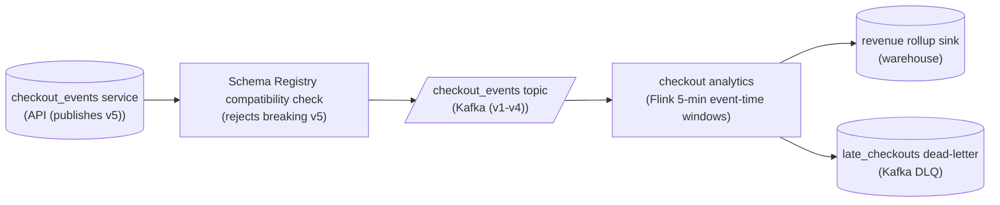

*The gate sits BEFORE the topic; the dead-letter path branches out of the windowed job as a side output.*

Notice where the `quality_gate` lives: on the edge from the producer to the topic, not after it. Registering a schema and publishing a record are 2 separate acts, and the compatibility check runs on the first. When the producer team tries to register v5, the registry sees that renaming `amount` to `amount_cents` breaks every existing reader (they look for `amount` and would find nothing) and refuses the registration outright. The producer can't publish a record it was never allowed to register, so `v5` never lands on the topic and the `v1` through `v4` consumers keep reading exactly as before.

| Pitfall: Rejecting bad data instead of bad schemas |
| --- |
| The tempting wrong version puts a validation step AFTER the topic that drops or nulls records whose `amount` field is missing. By then the damage is done: the breaking version is already committed to the log, every downstream consumer has to cope with it, and you are papering over NULLs in analytics instead of stopping the change. A compatibility gate rejects the schema at registration, which is a build-time no for the producer team, not a runtime cleanup for everyone else. |

The late-data side is about keeping a window open long enough. A 5-minute **event-time** window closes when the watermark passes the end of the window, but the watermark is deliberately held back so slightly-late checkouts still land in the right window. The allowed-lateness budget extends that grace: the job keeps each window's state around for, say, an extra hour after the watermark, so a mobile client that replays a buffered checkout 40 minutes late still updates the correct 5-minute bucket rather than being counted in the wrong window or dropped.

| Key insight: The dead-letter branch catches what the budget can't |
| --- |
| Allowed lateness has to be finite, or window state grows forever. So a checkout that arrives after its window's state has already been purged can't be folded into the total. Instead of silently discarding it, the job emits it to a `late_checkouts` dead-letter destination as a side output. Nothing is lost: those records are available for a correction job, a manual replay, or just an alert that a client's clock or buffer is badly off. |

| ✕ Inside the lateness budget | ✓ Past the lateness budget |
| --- | --- |
| Watermark plus allowed-lateness still covers the checkout's event time, so its 5-minute window state is alive. The record updates that window's revenue total and flows to the `revenue rollup sink`. | The window state has been purged, so the total can't be corrected in place. The record is routed to the `late_checkouts` dead-letter sink for out-of-band handling instead of being dropped. |

**Follow-up questions**

1. If the producer team genuinely needs to rename `amount`, how do they roll it out without the gate blocking them?\
   *Tests understanding that compatible evolution means adding `amount_cents` alongside `amount` and deprecating later, not renaming in place.*
2. What would you monitor on the `late_checkouts` dead-letter destination, and what does a sudden spike tell you?\
   *Tests treating the DLQ as an observable signal about client clocks and buffering, not a graveyard.*
3. How does raising the allowed-lateness budget trade off against the streaming job's state size?\
   *Tests the cost of keeping window state open longer versus dead-lettering more records.*

</details>


<br>

### Exercise 2 of 2

**● TASK**

The users table is renaming signup_date to created_at and changing it from DATE to TIMESTAMP, and 12 consumer teams read that column, so no single synchronized deploy is possible. Plan the change with expand-contract: add four phase-marker nodes between the producer and the consumers, in order (expand, dual-write, migrate, contract). Name each marker for its phase and for what the producer and the consumers do during it.

**Starting canvas** (already placed for you):

- Producer: users service (filing rename signup_date to created_at, DATE to TIMESTAMP) (source)
- Postgres users table (the schema being evolved) (storage, PostgreSQL)
- Consumer A: signup analytics (consumer)
- Consumer B: lifecycle email (consumer)
- Consumer C: 10 other downstream consumers (consumer)

<details>
<summary><strong>Solution</strong></summary>

Expand-contract is how you rename `signup_date` to `created_at` and widen `DATE` to `TIMESTAMP` without a flag-day: the old shape and the new shape coexist while 12 teams migrate on their own clock. The four markers you placed are an ordering constraint, not a to-do list to shuffle. Each phase only removes something once its replacement is already in place, so the system stays releasable at every step.

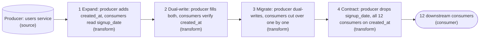

*The markers sit between producer and consumers because the rollout is sequential: `created_at` exists before it is written, both columns agree before anyone reads the new one, and `signup_date` survives until the last consumer moves.*

1. **Expand: add `created_at`, keep `signup_date`**

   Add a nullable `created_at TIMESTAMP` and change nothing else. It is purely additive, so it ships with zero coordination: nobody breaks on a column they do not read yet.

2. **Dual-write: populate both for every event**

   The producer now writes both columns on every insert and update, and you backfill history so `created_at` is complete. Do this before any consumer switches, so a reader that flips finds real data, not nulls.

3. **Migrate: cut consumers over one at a time**

   Each team swaps its read to `created_at` when ready. Both columns stay in sync, so a half-migrated world is fine, and the flag-day dissolves into 12 small, reversible deploys.

4. **Contract: drop `signup_date` after the last consumer moves**

   Only once all 12 read `created_at` do you stop dual-writing and drop the old column. This is the sole destructive phase, and it is gated on a verified fact, not a hope.

| Pitfall: Contract before everyone moved is the flag-day again |
| --- |
| The tempting shortcut is to reorder the phases: rename the column in place, or drop `signup_date` once the loud teams have migrated. Both reintroduce the exact break the pattern prevents. Never remove the old shape until its replacement is proven present everywhere. |

**Follow-up questions**

1. How do you actually confirm all 12 consumers read `created_at` before you contract?\
   *Gates the drop on evidence (access metrics, query logs, a per-team sign-off), not assumption.*
2. During dual-write, what stops `signup_date` and `created_at` from drifting if a write touches only one?\
   *Points toward a generated column, a trigger, or a single write path so the shapes cannot diverge.*

</details>


<br>

---

## The Expand-Contract Pattern

The registry blocks the rename, and the business still needs it. Today `fare` is a string such as `12.50 USD`, and each of the topic's 3 consumers parses it with code of its own. The target is a long `fare_cents` plus a string `fare_currency`. Expand-contract makes that change in 4 deploys, each compatible with the one before it, so no team waits on another team's release.

| ✓ One synchronized deploy | ✗ Expand-contract |
| --- | --- |
| • The producer and 3 consumers ship inside one release window<br><br>• A rollback has to undo all 4 deploys together<br><br>• A consumer that misses the window breaks on the first new message<br><br>• Messages already on the topic still carry the old shape | • Each team ships on its own schedule<br><br>• Each phase rolls back on its own<br><br>• Old and new fields coexist for as long as readers need<br><br>• The old field leaves only after its last reader has moved |


<br>

### The 4 phases

| Phase | Producer writes | Consumers read | Schema |
| --- | --- | --- | --- |
| 1. Expand | `fare`, `fare_cents`, `fare_currency` | `fare` | v3: adds 2 fields with null defaults, gives `fare` a default |
| 2. Migrate | all 3 fields | `fare`, while history is backfilled | v3, unchanged |
| 3. Switch | all 3 fields | each consumer moves to `fare_cents` on its own date | v3, unchanged |
| 4. Contract | `fare_cents`, `fare_currency` | `fare_cents` | v4: deletes `fare` |

#### Expand: add beside the old field

Version 3 adds `fare_cents` and `fare_currency`, both nullable with a default of null, and gives the existing `fare` a default of an empty string. Every change carries a default, so `FULL` passes. The producer now writes all 3 fields on every message. Nobody reads the new ones yet, so rolling back to version 2 breaks no reader. The default on `fare` does nothing today; it is what lets phase 4 delete the field.

#### Migrate: give history the new fields

The curated `trips` table holds 2 years of rows that only have `fare`. A backfill computes `fare_cents` and `fare_currency` for each `trip_date` partition and overwrites that partition, so a retried day produces the same rows. Before any consumer depends on the backfilled values, compare the backfill's parsing with what the producer wrote itself on recent days, where both columns exist.

```sql
SELECT
  trip_date,
  COUNT(*) AS rows_checked,
  COUNT_IF(
    fare_cents <> CAST(
      ROUND(CAST(SPLIT_PART(fare, ' ', 1) AS DOUBLE) * 100)
      AS BIGINT
    )
  ) AS mismatched_rows
FROM trips
WHERE trip_date >= DATE '2026-10-01'
GROUP BY trip_date
ORDER BY trip_date
```

**During phase 2, the backfill for partition 2025-03-14 fails after writing half its rows, and the orchestrator retries the task. What makes the retry safe?**

- **A.** The registry rejects the duplicate rows, since they carry the same schema ID.
- **B.** The backfill only writes fare_cents, so duplicates in other columns do no harm.
- **C.** FULL compatibility guarantees each message is decoded exactly once by readers.
- **D.** Each run overwrites the whole partition, so the retry replaces the partial write.

<details>
<summary>Solution</summary>

**D.** Each run overwrites the whole partition, so the retry replaces the partial write.

Overwriting a partition makes the task idempotent: after 1 run or 3, the partition holds the same rows.

**Why the others are wrong**

- **A.** The registry validates schemas and never sees rows, so duplicates pass straight through.
- **B.** A duplicated row doubles that trip's fare, whichever columns the job wrote.
- **C.** Compatibility modes govern schema shape and say nothing about how often a row is written.

</details>

#### Switch: consumers move one by one

Each consumer team changes its reads to `fare_cents`, ships, and watches its own outputs. The earnings rollup might switch in week 1 and the fraud model in week 3, with the finance export last. Keep a written list of the topic's 3 consumers with a sign-off column: the registry records schemas and keeps no record of who reads which field.

#### Contract: remove what nobody reads

When the last sign-off lands, the producer ships version 4, which stops writing `fare` and deletes it from the schema. Because `fare` gained a default in phase 1, `FULL` accepts the deletion. Dropping the `fare` column from `trips` comes last, once a week passes with no query reading it.

> **TIP**
>
> Contract is the one phase with a one-way door. Messages written under version 4 have no `fare`, so rolling the producer back restores the field for new messages only. Wait out a full release cycle of the slowest consumer before taking that step.

**Two of the 3 consumers of trip_completed read fare_cents. The third, the monthly finance export, still parses fare. The producer ships version 4, which stops writing fare. What does the finance export see on its next run?**

- **A.** A schema error, because the registry blocked version 4 for breaking an old reader.
- **B.** A decode failure on every message, because the fare field is missing.
- **C.** Messages decode, fare arrives as the empty-string default, and the parser finds no amount.
- **D.** Correct fares, because the reader rebuilds fare from fare_cents during decoding.

<details>
<summary>Solution</summary>

**C.** Messages decode, fare arrives as the empty-string default, and the parser finds no amount.

This is the cost of contracting early: the registry protects decoding, and only the sign-off list protects meaning.

**Why the others are wrong**

- **A.** fare gained a default in phase 1, so the deletion passes FULL and version 4 registers.
- **B.** Decoding succeeds. The reader's schema declares a default for fare and fills it in.
- **D.** A reader fills a missing field with its declared default and never converts one field into another.

</details>


<br>

---

## Pipeline Architecture

### Exercise 1 of 2

**● TASK**

A finance dashboard reports daily revenue and is audited monthly, so a rerun must reproduce identical history. An operations dashboard shows the events per second the engine is processing right now, to detect lag. Both read one streaming aggregation today. Split it into two transforms, each named for the time domain it buckets by, and connect each to the dashboard whose question that domain answers.

**Starting canvas** (already placed for you):

- Kafka events topic (source, Kafka)
- Single aggregation (currently uses processing_time for both consumers) (transform, Flink)
- Finance dashboard (audited; reruns must produce identical history) (consumer, Metabase)
- Operations dashboard (events-per-second; lag detection) (consumer, Grafana)

<details>
<summary><strong>Solution</strong></summary>

#### Name the consumer, then pick its clock

Every windowed aggregation buckets records by a timestamp, and the real decision is which clock supplies it. **Event time** is when the event actually happened, carried on the record itself; processing time is the wall-clock moment the engine saw it. The single aggregation you started with used one clock for both consumers, so the split was forced: finance and operations are asking about two different clocks and cannot share one bucketing transform.

Finance reports daily revenue and gets audited, so a rerun next month must reproduce today's history exactly. Only event time does that: a record's own timestamp never changes, so re-reading the topic drops each sale into the same day it always belonged to. Operations wants the events per second the engine is keeping up with, a question about the engine's own clock, so processing time there is not a compromise but the correct answer.

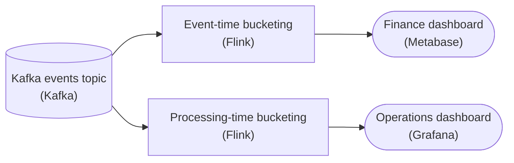

*One source, two transforms: event-time bucketing feeds finance, processing-time bucketing feeds operations.*

| Pitfall: A processing-time rerun is a different history |
| --- |
| The tempting shortcut is to leave finance on processing time because the numbers look close. They are, until you rerun. A sale from 23:58 that arrives at 00:04 lands in the wrong day when you bucket by arrival. Arrival times differ on every replay, so the audited totals shift with each reprocess. That reproducibility is exactly what the audit checks, and processing time quietly fails it. |

| Key insight: Late data is why the clocks diverge |
| --- |
| If every event were processed the instant it happened, the two clocks would agree and this split would not exist. They diverge because of late data: network delays, retries and backfills let a record's event time trail its processing time by minutes or hours. Bucketing by event time puts each late record back in the day it belongs to, while operations still reports what the engine saw just now. |

**Follow-up questions**

1. A backfill replays last week's events through both transforms. Which dashboard's history changes, and why?\
   *Only buckets keyed on the engine's clock depend on when a run happens.*
2. Operations also wants revenue per hour of the day the sales happened. Which transform should feed that chart?\
   *The domain follows the consumer's question, not the dashboard it is shown on.*

</details>


<br>

### Exercise 2 of 2

**● TASK**

Events on the Kafka topic arrive 0 to 30 seconds after their event_time, and the Flink job sums revenue in 1-minute tumbling windows on event_time. Closing a window on the wall clock drops late events silently, while never closing it emits nothing. Add a watermark generator between the source and the aggregation, named for its strategy (bounded out-of-orderness fits this source) and the lag it subtracts from the max event_time seen.

**Starting canvas** (already placed for you):

- Kafka events topic (events arrive 0-30 seconds after event_time) (source, Kafka)
- Flink streaming aggregation: 1-minute tumbling windows on event_time (transform, Flink)
- minute_revenue dashboard (consumer, Grafana)

<details>
<summary><strong>Solution</strong></summary>

#### The watermark, plainly

A **watermark** is the engine's own clock for event time. It is a timestamp the stream carries forward that means: "I do not expect to see any more events with `event_time` earlier than this." A tumbling window fires when the watermark passes the window's end, not when the wall clock does. That one substitution is the whole trick here: the wall clock reaching '09:01:25' says nothing about whether every event for [09:00, 09:01) has landed, but a watermark that has advanced past '09:01' does.

The strategy that fits this source is **bounded out-of-orderness**: the watermark is `max(event_time) - 30s`. The lag of 30 seconds is not arbitrary. The source promises events arrive 0 to 30 seconds after their `event_time`, so an event stamped at time T can show up as late as T plus 30 seconds. Subtracting exactly that bound from the highest `event_time` you have seen keeps the watermark from running ahead of the slowest event that could still be in flight.

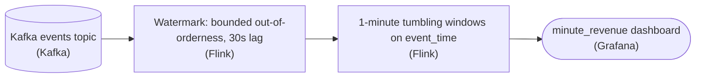

*The watermark generator sits between the source and the aggregation: it stamps event-time progress onto the stream so the window knows when it is safe to close.*

1. **Trace when the window actually closes**

   The window [09:00, 09:01) fires when the watermark reaches '09:01'. The watermark is `max(event_time) - 30s`, so it hits '09:01' only once some event with `event_time` '09:01:30' has been seen. By that point the late event stamped '09:00:46' has already arrived (it was due by '09:01:16' at the latest), so it lands inside the open window and is counted. The wall clock at '09:01:25' never entered the decision.

| Pitfall: A lag that is too small drops the late data silently |
| --- |
| Set the lag to 0 (watermark = `max(event_time)`) and the moment an event stamped '09:01:00' arrives, the watermark jumps to '09:01:00' and closes [09:00, 09:01) at once. The event at '09:00:46' is still in the broker and gets discarded with no error. That is exactly the silent drop the watermark was supposed to prevent, so the lag must cover the source's full out-of-orderness bound, 30 seconds, not a guess. |

| ✕ Lag too small | ✓ Lag too large |
| --- | --- |
| The watermark races ahead of slow events, windows close early and late rows are dropped. `minute_revenue` reads low and no one is told why. | The watermark trails reality, every window waits longer than it needs to, and the dashboard falls further behind live. The result is correct but stale. The lag is a latency-versus-completeness dial: match it to the measured skew. |

| Real world: Measure the skew before you set the lag |
| --- |
| You rarely hardcode the bound blind. Measure the real distribution of `wall_clock - event_time` at the source and set the lag to cover it, then keep watching it. If the skew grows, a watermark that was safe last month starts closing windows early, and the dashboard drifts low without any error. |

**Follow-up questions**

1. What happens to an event whose `event_time` is '09:00:59' but that arrives 40 seconds late, past the 30s bound?\
   *The watermark is a promise sized to a bound: an event beyond the bound reaches a window that has already closed.*
2. One idle Kafka partition stops sending events. Why might the watermark stall so that no window ever closes?\
   *The watermark advances only on observed events, so a silent input holds it back.*

</details>


<br>

---

## Event Time Versus Processing Time

Every trip event carries 2 timestamps that answer different questions. **Event time** is when the thing happened, stamped by the phone: the trip ended at 08:47. **Processing time** is when the pipeline handled the event: the streaming job saw it at 09:12. The gap between them is **skew**. On a good network skew is a few seconds; for a phone in a garage or on a flight it runs to hours.

| trip | ended_at (event time) | processed_at (processing time) | skew |
| --- | --- | --- | --- |
| T1 | 08:58:00 | 08:58:03 | 3s |
| T2 | 08:59:40 | 09:00:05 | 25s |
| T3 | 08:47:00 | 09:12:00 | 25m |
| T4 | 09:10:00 | 09:10:02 | 2s |
| T5 | 09:20:00 | 09:20:01 | 1s |
| T6 | 08:55:00 | 10:02:00 | 67m |

Count those 6 trips per hour and the 2 clocks disagree about every hour. T3 and T6 both ended in the 08:00 hour, yet T3 reached the pipeline at 09:12 and T6 at 10:02.

By event hour

| hour | trips |
| --- | --- |
| 08:00 | 4 |
| 09:00 | 2 |

By processing hour

| hour | trips |
| --- | --- |
| 08:00 | 1 |
| 09:00 | 4 |
| 10:00 | 1 |

The 2 queries differ only in the column inside date_trunc. This one buckets by event time; putting processed_at in place of ended_at produces the right-hand table.

```sql
SELECT
  DATE_TRUNC('hour', ended_at) AS event_hour,
  COUNT(*) AS trips
FROM trips
WHERE trip_date = DATE '2026-10-24'
GROUP BY DATE_TRUNC('hour', ended_at)
ORDER BY event_hour
```

The partition column inherits the same choice, and the query above assumes `trip_date` comes from `ended_at`. If `trip_date` comes from `processed_at`, a trip that ends at 23:50 and uploads at 00:40 lands in the next day's partition, and an event-time query for one day must scan 2 partitions to find all its trips.


<br>

### Which clock answers which question

Ask whether the question is about **the world** or about **the pipeline**. Questions about what riders and drivers did use event time. Questions about load, delay and cost inside the system use processing time.

| Consumer question | Clock | Reason |
| --- | --- | --- |
| Driver earnings for 08:00 to 09:00 | event time | Pay follows when the trip happened |
| Events ingested per minute, for capacity planning | processing time | Load lands when events arrive |
| Fraud rule: 5 trips on one card within 10 minutes | event time | The rule describes rider behaviour |
| Delay from phone to table, p95 | both | Delay is processed_at minus ended_at |
| Alert when the job falls behind | processing time | Falling behind is a property of the job |

**This query feeds the driver earnings page, which shows pay per hour of driving. What is wrong with it?**

```sql
SELECT
  driver_id,
  date_trunc('hour', processed_at) AS pay_hour,
  sum(fare_cents) AS earned_cents
FROM trips
WHERE trip_date = DATE '2026-10-24'
GROUP BY driver_id, date_trunc('hour', processed_at)
```

- **A.** Nothing, because processed_at is the more reliable of the 2 clocks for money.
- **B.** It should group by trip_date alone, since hourly pay needs no timestamp.
- **C.** It should sum fare, because fare_cents may still be null on old rows.
- **D.** It buckets by processed_at, so a trip that ended at 08:47 is paid in the 09:00 hour.

<details>
<summary>Solution</summary>

**D.** It buckets by processed_at, so a trip that ended at 08:47 is paid in the 09:00 hour.

Grouping on date_trunc('hour', ended_at) puts T3 back in the 08:00 hour, where the driver earned it.

**Why the others are wrong**

- **A.** A reliable clock measuring the wrong moment still misplaces pay, which follows when trips happened.
- **B.** The page shows hourly pay, so an hour bucket is required; the question is which clock fills it.
- **C.** Phase 2 backfilled history, so fare_cents is populated on old rows too.

</details>

> Event time can be wrong too
>
> - It is only as accurate as the clock that stamped it, and phone clocks drift or get set by hand.
> - A producer that stamps at send time records upload time under the name of event time.
> - Quarantine event times far in the future: they point to a bad clock.
> - Keep `processed_at` on every row so skew stays measurable after the fact.

**During a concert surge, the on-call engineer wants a chart showing whether the streaming job keeps up with incoming events. Which timestamp should the chart bucket by?**

- **A.** processed_at, because keeping up is about when the job handled each event.
- **B.** ended_at, because the surge is defined by when riders finished their trips.
- **C.** Either one, because both timestamps fall in the same hour for most trips.
- **D.** ended_at on the axis, with rows filtered to processed_at in the last hour.

<details>
<summary>Solution</summary>

**A.** processed_at, because keeping up is about when the job handled each event.

A backlog shows as handling falling behind arrival, and only the job's own clock shows its pace.

**Why the others are wrong**

- **B.** The surge's timing is a fact about riders, while this chart asks about the job.
- **C.** A lagging job widens the gap between the clocks, so they diverge exactly when the chart matters.
- **D.** Plotting by trip time moves late-handled events back to their trip times and hides the backlog.

</details>


<br>

---

## Pipeline Architecture

### Exercise 1 of 2

**● TASK**

A revenue aggregation tumbles in 5-minute event-time windows behind a watermark that tolerates 60 seconds of out-of-orderness. Mobile retries up to an hour late must still correct the totals; anything later must be set aside, not dropped. Name the aggregation with its 60-minute allowed-lateness budget, and wire a dead-letter destination from the aggregation that captures events past the budget for the next-day reconciliation pass.

**Starting canvas** (already placed for you):

- Kafka events topic (source, Kafka)
- Watermark generator: bounded out-of-orderness, 60s lag (transform, Flink)
- Flink aggregation: 5-minute tumbling on event_time (no allowed-lateness budget yet) (transform, Flink)
- minute_revenue dashboard (consumer, Grafana)

<details>
<summary><strong>Solution</strong></summary>

#### 2 clocks, not one: watermark vs. allowed lateness

**Allowed lateness** gives an event-time window a second tolerance for late data, separate from the watermark, and the dead-letter destination catches whatever outlives it. The watermark (bounded out-of-orderness, 60s lag) decides when a window fires its first result: it says "I believe I've seen everything up to time T minus 60 seconds, so windows that ended before that are ready to emit." Allowed lateness decides how long that window's state stays alive after it fires, so stragglers can still correct the total. The 2 are set to very different values here (60 seconds vs. 60 minutes) because they answer different questions.

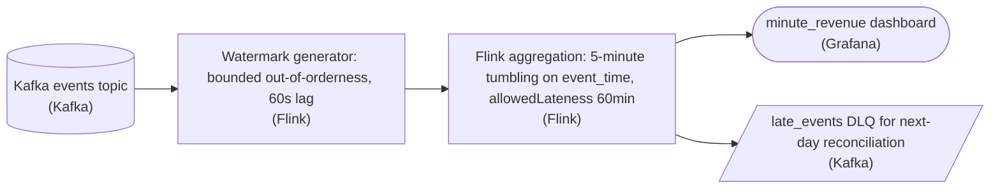

*The finished topology: a 60-minute lateness budget on the window, plus a DLQ branch off the aggregation for events past the budget.*

1. **Give the window a 60-minute lateness budget**

   On the aggregation, set `allowedLateness` to 60 minutes. Each 5-minute tumbling window keeps its state for a full hour after the watermark fires it. When a mobile retry for an already-fired window arrives within that hour, the window re-fires and emits an updated total, so the dashboard corrects itself. The watermark stays at 60 seconds: the first result still lands within about a minute, and the state is kept for an hour.

2. **Branch a dead-letter destination off the aggregation**

   Wire a second edge from the aggregation to a `late_events` DLQ. In Flink this is the side output from `.sideOutputLateData(...)`: any event older than window end plus `allowedLateness` is emitted there instead of being silently dropped. The branch comes off the aggregation, not the source, because only the window operator knows which events actually missed their budget.

| Pitfall: Widening the watermark makes every window an hour stale |
| --- |
| The tempting wrong move is to widen the watermark to 60 minutes and skip `allowedLateness`. Late data does get in, but every window's first emission is now delayed by an hour, so the dashboard is an hour stale for the events that arrived on time. Allowed lateness separates freshness (watermark) from correctness over time (state retention): a fast first result and a slower, complete final one. |

| Key insight: Past the budget, it is drop or set aside |
| --- |
| Window state has to be released eventually, because the engine cannot hold every window forever. Events past the budget can only be dropped or set aside. Without the side output they vanish with no record; with the DLQ they become a bounded, auditable backlog that a batch job reconciles the next day. |

| ✕ Watermark (60s) | ✓ Allowed lateness (60min) |
| --- | --- |
| Governs when a window fires its first result. Kept small so the `minute_revenue` dashboard stays near real time. Events behind the watermark are late but may still be accepted. | Governs how long fired window state is retained for corrections. Large enough that an hour of mobile retries can re-fire and update totals. Events past it are routed to the `late_events` DLQ. |

**Follow-up questions**

1. What would you change if the DLQ backlog had to feed corrections back into the dashboard rather than a separate report?\
   *Reconciliation as a batch re-aggregation that overwrites the same sink the streaming job writes.*
2. How does raising `allowedLateness` to 6 hours affect state size, and when would you move window state from heap to RocksDB?\
   *Links the lateness budget to how much window state the engine must hold.*

</details>


<br>

### Exercise 2 of 2

**● TASK**

Extend this live metrics pipeline so the producer can ship a breaking schema change through expand-contract while the real-time dashboard keeps serving correct numbers. Put a schema registry between the producer and the topic, and name the compatibility mode it enforces at registration. Rebucket the Flink aggregation by event_time instead of processing_time, with a bounded out-of-orderness watermark of 60 seconds and an allowed lateness of 60 minutes. Route events that arrive past that budget to a dead-letter sink instead of dropping them.

**Starting canvas** (already placed for you):

- Producer: live_metrics events (preparing breaking schema change) (source, API)
- Kafka live_metrics topic (queue, Kafka)
- Flink streaming aggregation (currently no watermark, no lateness budget, buckets by processing_time) (transform, Flink)
- Real-time metrics dashboard (consumer, Grafana)

<details>
<summary><strong>Solution</strong></summary>

#### What the capstone wired together

This capstone is 4 intermediate moves standing in one line, each guarding a different failure. **Schema evolution** puts a schema registry in front of the topic so an incompatible producer schema is rejected at registration, not discovered downstream when the dashboard breaks. Stream processing buckets the aggregation by `event_time` instead of `processing_time`, so a metric lands in the minute it actually happened. Late-data handling gives that bucketing a 60-second watermark and a 60-minute lateness budget, and a dead-letter queue catches whatever arrives past the budget. The expand-contract steps below are how the producer gets its breaking change through a FULL-compatibility registry without the dashboard noticing.

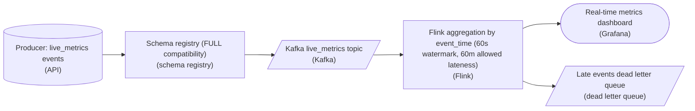

*The solved topology: the registry gates the topic, the aggregation buckets by `event_time` behind a 60-second watermark, and late events split between the window (within 60 minutes of lateness) and the dead letter queue (past it).*

| Pitfall: `processing_time` counts the wrong minute |
| --- |
| The Flink job you started from buckets by `processing_time` with no watermark. Under load or a consumer restart, events queue up and get counted whenever they are read, so a real spike at 10:00 smears across 10:05. Switching the key to `event_time` fixes placement, but `event_time` alone needs a watermark to know when a minute is done. |

| Key insight: The late-data triad is one mechanism |
| --- |
| Watermark, allowed lateness, and dead-letter are 3 parts of one decision, not 3 features. The `WatermarkStrategy` with 60 seconds of bounded out-of-orderness decides when a window fires; `allowedLateness` of 60 minutes keeps the window state alive to fold in stragglers; the dead letter queue catches anything later than that so it is quarantined, not silently dropped. Remove any one and late data either blocks the window forever or vanishes without a trace. |

1. **Expand: register the compatible superset**

   Add the new field and keep the old one. Under `FULL` compatibility the registry accepts this schema because both old readers and new readers still work; a schema that removed or retyped a field here would be rejected at registration.

2. **Dual-write from the producer**

   Producers start emitting both the old and new fields. Nothing reads the new field yet, so a bad producer rollout stays invisible to the dashboard and is trivially reversible.

3. **Migrate the consumers**

   Point the `event_time` aggregation and the dashboard at the new field and stop depending on the old one. This is the phase where the 2 schemas genuinely coexist in flight.

4. **Contract: drop the old field**

   Only now, once no reader touches the old field, register the schema that removes it. The breaking change landed with no flag day, because the registry never let an incompatible version through at any step.

**Follow-up questions**

1. If only consumers upgrade first and producers never change, would `BACKWARD` compatibility be enough instead of `FULL`?\
   *Maps a rollout direction to the minimal compatibility mode.*
2. Where should the 60-minute `allowedLateness` number come from, rather than being a guess?\
   *Tuning the budget from the observed event-delay distribution, not a round number.*
3. What happens to events in the dead letter queue once the incident is over?\
   *Replay-and-reaggregate vs alert-only handling of quarantined late events.*

</details>


<br>

---

## Watermarks: The Engine's Promise

A daily batch job knows yesterday is finished when the last file lands. A streaming job that sums revenue in 5-minute event-time windows gets no such signal, and T6 showed that a trip can surface 67 minutes after it ended. Before the job publishes a total for 09:00 to 09:05, it needs a rule for deciding it has waited long enough. A watermark is that rule.

A **watermark** is a timestamp in event time that the engine carries alongside the stream. When it reads W, the engine is asserting: no further events with event time earlier than W will arrive. A window covering [09:00, 09:05) counts as complete once the watermark reaches 09:05, and at that moment the engine emits, or **fires**, the window's total.


<br>

### Max event time seen, minus a lag

Most engines compute a heuristic watermark from the data itself: the largest event time seen so far, minus a fixed lag that absorbs ordinary out-of-order delivery. With a 60-second lag, an event stamped 09:06:01 moves the watermark to 09:05:01. It never moves backward, and it moves forward only when an event newer than every earlier one arrives.

| arrives | event | event_time | amount | watermark after | what happens |
| --- | --- | --- | --- | --- | --- |
| 09:02:18 | E1 | 09:02:14 | 100 | 09:01:14 | joins [09:00, 09:05), total 100 |
| 09:04:30 | E2 | 09:03:55 | 200 | 09:02:55 | joins [09:00, 09:05), total 300 |
| 09:06:02 | E5 | 09:06:01 | 40 | 09:05:01 | opens [09:05, 09:10); [09:00, 09:05) fires with 300 |
| 09:34:00 | E3 | 09:02:14 | 50 | 09:05:01 | event time sits behind the watermark: late |

Read the last row closely. E3 ended at 09:02:14, before the watermark of 09:05:01, so the engine's assertion turned out false. A heuristic watermark is a bet about the network, and a phone in a garage loses that bet. The watermark held at 09:05:01 as E3 arrived, since E3 is older than events the engine had already seen. What the engine does with E3 is a separate setting, the subject of the next section.

*Because this watermark is built from event times, a quiet stream holds it still. Window [09:05, 09:10) fires only when an event stamped at or after 09:11:00 arrives, however much wall-clock time passes first.*

**A job sums 5-minute windows with a 60-second watermark lag. Events arrive in this order, stamped 10:03:10, 10:05:30, 10:06:20, then 10:04:50. What happens to window [10:00, 10:05)?**

- **A.** It fires when the 10:05:30 event arrives, and the 10:04:50 event is late.
- **B.** It fires when the 10:06:20 event arrives, holding both 10:03:10 and 10:04:50.
- **C.** It fires when the 10:06:20 event arrives, holding only the 10:03:10 event.
- **D.** It fires when the 10:04:50 event arrives, because that event completes the window.

<details>
<summary>Solution</summary>

**C.** It fires when the 10:06:20 event arrives, holding only the 10:03:10 event.

The 10:06:20 event lifts the watermark to 10:05:20 and fires the window; 10:04:50 then arrives late.

**Why the others are wrong**

- **A.** That event moves the watermark only to 10:04:30, short of the window's end.
- **B.** The 10:04:50 event arrives after the firing, so the first total cannot contain it.
- **D.** Windows fire on the watermark, and an older event never moves it forward.

</details>


<br>

### Choosing the lag

| ✓ 10-second lag | ✗ 30-minute lag |
| --- | --- |
| • Totals publish about 10 seconds after a window ends<br><br>• Any event delayed past 10 seconds counts as late<br><br>• Open windows sit in memory briefly<br><br>• Suits alerting, where a fast rough answer beats a slow exact one | • Totals publish about 30 minutes after a window ends<br><br>• Only events delayed past 30 minutes count as late<br><br>• Every key holds 30 minutes of open windows in memory<br><br>• Suits billing, where completeness outranks speed |

The lag trades latency for completeness, so set it from measured skew. If the p99 of `processed_at` minus `ended_at` is 40 seconds, a 60-second lag leaves fewer than 1 event in 100 late in a steady stream, and every total waits about a minute past its window's end.

**A team raises the watermark lag on its revenue job from 60 seconds to 10 minutes. What should it expect?**

- **A.** Fewer late events and earlier totals, since the engine waits for stragglers.
- **B.** Fewer late events, totals about 9 minutes later, and more open windows in memory.
- **C.** The same late events, since lateness depends on allowed lateness alone.
- **D.** More late events, because a later watermark leaves more events behind it.

<details>
<summary>Solution</summary>

**B.** Fewer late events, totals about 9 minutes later, and more open windows in memory.

Each window stays open longer, so more stragglers make it in, results wait, and open windows pile up.

**Why the others are wrong**

- **A.** Waiting for stragglers delays every total by about 9 more minutes.
- **C.** Lateness is judged against the watermark, and the lag sets where the watermark sits.
- **D.** A larger lag puts the watermark further behind the newest events, so fewer fall behind it.

</details>


<br>

---

## Pipeline Architecture

### Exercise 1 of 2

**● TASK**

Firmware teams on a fleet of IoT devices publish readings to one Kafka topic, and a Flink job lands them in a lake table. New firmware adds fields every few weeks. Add a schema registry that producers register each new version with before publishing and that the Flink job fetches each record's version from on read, and land the readings in a table that takes added columns without a rewrite.

<details>
<summary><strong>Solution</strong></summary>

#### The registry sits beside the stream, not in it

A schema registry is a separate service the pipeline consults, not a stage the readings flow through. Producers register a version before they publish, and the registry runs its compatibility check right then, so a breaking change is refused while it is still a release candidate. Each record carries only its version ID; the reader looks that ID up and decodes with the exact schema the record was written under. Old and new firmware then share one topic without the reader guessing.

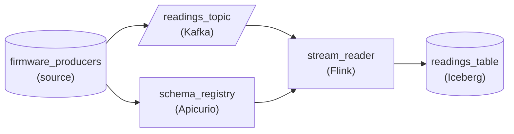

*Producers register with `schema_registry` before publishing to `readings_topic`; `stream_reader` fetches each record's version from the registry and lands readings in `readings_table`.*

1. **Hang the registry off the producers**

   Draw the producers connecting to the registry as well as to the topic. That edge is the registration call, made before the first reading under a new version is published. If the compatibility check fails, the release stops there and the topic never sees the bad shape.

2. **Point the reader at the registry**

   The Flink job needs its own edge from the registry. When a record arrives with a version ID it has not seen, it fetches that schema once, caches it and decodes. A reading from last month's firmware and one from today's decode side by side.

| Pitfall: Readings never pass through the registry |
| --- |
| Wiring producers to the registry and the registry to the topic makes every reading look like it flows through it. It does not: the registry serves a few lookups per version, while the readings go straight to Kafka. Drawn inline, it becomes a choke point carrying 2 million readings an hour. |

| Key insight: The landing table is part of the contract too |
| --- |
| The registry keeps producer and reader in agreement, but the table they write into must keep up. An Iceberg table adds a column as a metadata change, so a new firmware field lands without rewriting the history already stored. |

**Follow-up questions**

1. A second service starts reading the same topic. What does it need from the registry, and what changes for the producers?\
   *Whether one registered version serves every reader without producer changes.*
2. What goes wrong if a producer publishes under a new shape without registering it first?\
   *Why registration has to happen before publishing, not after.*

</details>


<br>

### Exercise 2 of 2

**● TASK**

A payments topic in Kafka carries a decimal `amount` that must be replaced by an integer `amount_minor` and a `currency` field. A fraud stream job, a nightly finance warehouse load and a partner export all read it, each migrating on its own schedule. Design the expand phase of expand-contract: the producer writes both shapes through a schema registry check, and the warehouse takes the new columns while the old one stays.

<details>
<summary><strong>Solution</strong></summary>

#### Add first, remove last

Expand-contract earns its keep on a change like this one, where a field is restructured rather than simply added. Swapping the decimal `amount` for `amount_minor` plus `currency` in one deploy would break every reader still parsing `amount` the moment the new events land. The expand phase only adds: the producer writes the old field and the new pair side by side, and nothing downstream has to move yet.

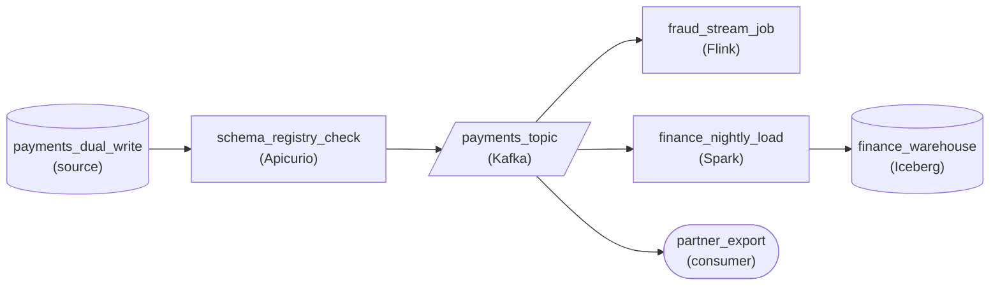

*Expand phase: the producer writes `amount` and `amount_minor` plus `currency`, the registry passes the additive version, and three readers migrate on their own schedules.*

1. **Write both shapes and let the registry vouch for it**

   The expand version adds `amount_minor` and `currency` and keeps `amount`. Because it removes nothing, the registry check in front of the topic passes it as compatible, and every existing reader keeps decoding events exactly as before. That same check is what refuses a version that drops `amount` before its readers are ready.

2. **Give each reader its own path off the topic**

   The fraud job, the nightly finance load and the partner export each read the topic directly, so each team flips from `amount` to `amount_minor` in its own deploy. The warehouse takes the new columns as an additive change: a table format with schema evolution adds them while the old column keeps its history.

| Pitfall: A one-deploy swap is a flag day |
| --- |
| The tempting design changes the field at the producer and asks every team to ship the same afternoon. The partner export cannot: it ships on someone else's calendar, so it either breaks outright or silently reads nulls where `amount` used to be. |

| Key insight: The slowest reader sets the contract date |
| --- |
| Dropping `amount` is the contract phase, and it waits until every reader uses only the new fields. The fast fraud team never waits on the partner, and the partner is never rushed; that final step is the only coordination the pattern asks for. |

**Follow-up questions**

1. A refunds job is being built now. Which field should it read on day one?\
   *Whether a new reader starts already migrated, so it never pushes back the contract phase.*
2. Older rows in the finance warehouse only have `amount`. How do they get `amount_minor` before finance switches over?\
   *Filling the new column for historical data as part of the migration.*

</details>


<br>

---

## 1-Hour Allowed Lateness

Allowed lateness is the second setting on a window. After the watermark fires a window, the engine keeps that window's state for a further stretch of event time, 60 minutes in this job. A late event that lands inside the stretch updates the total, and the window fires again with the corrected figure. An event that turns up after the stretch finds no state left to update and goes to `late_events`, a dead letter table where a person can find it.

| Class | Arrives while the watermark is | Example | Result for [09:00, 09:05) |
| --- | --- | --- | --- |
| On-time | before 09:05 | E1, E2 | In the first firing: 300 |
| Slightly late | from 09:05 up to 10:05 | E3, at 09:34 | Total becomes 350, window fires again |
| Very late | at or past 10:05 | E4, at 11:15 | State already discarded; E4 goes to late_events |

The animation replays all 6 events through the `revenue_5m` job in arrival order. Run the 60-minute variant, then the variant with no allowed lateness, and watch where E3 ends up each time.

A window that has fired still takes late events for 60 minutes09:02:00

Kafka

mobile_events

Beam

revenue_5m

LATENESS1 h

BigQuery

revenue_by_window

dead letter

late_events

records0 records

#

id

event_time

amount

event-time windows5 min

09:0009:05…10:0510:10

09:00–09:05

total

09:05–09:10

total

10:05–10:10

total

no watermark yet

revenue_by_window0 rows

window

total

fires

records0 records

#

id

event_time

amount

One window, three kinds of late

1/22


<br>

### Lateness runs on the watermark

E6 decided E4's fate. Stamped 10:06:30, E6 moved the watermark to 10:05:30, past the window's end plus 60 minutes, so the engine discarded the window's state and E4 found nothing to join at 11:15. Had E6 never arrived, the watermark would still read 09:05:01 and E4 would have been accepted, however late the wall clock said it was. With allowed lateness at 0, the state goes the moment the window fires, so E3 and E4 both land in `late_events` and the total stays at 300.


<br>

### The window logic in plain Python

The function below holds the whole policy: a 5-minute window, a 60-second lag and 60 minutes of allowed lateness. For each event it checks whether the window's lateness has run out, updates the total, re-fires a window that already fired, then advances the watermark and fires or discards windows.

```sql
from datetime import datetime, timedelta

WINDOW = timedelta(minutes=5)
WATERMARK_LAG = timedelta(seconds=60)
ALLOWED_LATENESS = timedelta(minutes=60)


def at(hms):
    return datetime.strptime(hms, "%H:%M:%S")


def window_start(event_time):
    minute = event_time.minute - event_time.minute % 5
    return event_time.replace(minute=minute, second=0)


def run(events):
    totals, fires, output, late = {}, {}, {}, []
    watermark = datetime.min
    for event_id, event_time, amount in events:
        start = window_start(event_time)
        if watermark >= start + WINDOW + ALLOWED_LATENESS:
            late.append(event_id)
            continue
        totals[start] = totals.get(start, 0) + amount
        if start in fires:
            fires[start] += 1
            output[start] = totals[start]
        watermark = max(watermark, event_time - WATERMARK_LAG)
        for open_start in list(totals):
            end = open_start + WINDOW
            if watermark >= end and open_start not in fires:
                fires[open_start] = 1
                output[open_start] = totals[open_start]
            if watermark >= end + ALLOWED_LATENESS:
                del totals[open_start]
    return output, fires, late


events = [
    ("E1", at("09:02:14"), 100),
    ("E2", at("09:03:55"), 200),
    ("E5", at("09:06:01"), 40),
    ("E3", at("09:02:14"), 50),
    ("E6", at("10:06:30"), 60),
    ("E4", at("09:02:14"), 75),
]
output, fires, late = run(events)
```

| window | total | fires |
| --- | --- | --- |
| [09:00, 09:05) | 350 | 2 |
| [09:05, 09:10) | 40 | 1 |

The function returns `late` as `['E4']`. Window [10:05, 10:10) holds E6's 60 and has not fired, because the watermark stands at 10:05:30.


<br>

### Every re-fire replaces the last one

Each firing emits the window's full current total, and a later firing supersedes an earlier one. A sink that appends keeps both rows for 09:00, and a dashboard that sums the table reports 650. The sink has to upsert on the window key: the replace-not-append rule from idempotent reruns, applied to streaming output.

Append sink

| window | total |
| --- | --- |
| 09:00-09:05 | 300 |
| 09:00-09:05 | 350 |

Upsert on window

| window | total | fires |
| --- | --- | --- |
| 09:00-09:05 | 350 | 2 |

**A team's sink appended every firing to revenue_firings, one row per firing with a fired_at timestamp. Late refunds can lower a total on re-fire. Which aggregation returns the current total per window?**

- **A.** max_by(total, fired_at) grouped by window, keeping each window's latest firing.
- **B.** max(total) grouped by window, keeping each window's largest firing.
- **C.** sum(total) grouped by window, adding every firing together.
- **D.** The row at min(fired_at) per window, keeping each window's first firing.

<details>
<summary>Solution</summary>

**A.** max_by(total, fired_at) grouped by window, keeping each window's latest firing.

Every firing replaces the last, so the newest row holds the current total, whichever way it moved.

**Why the others are wrong**

- **B.** It matches only while totals grow. A late refund leaves the newest total below an earlier one.
- **C.** Firings restate one total. Summing E3's window gives 650 where 350 is correct.
- **D.** The first firing is the on-time total and misses every late correction, such as E3's 50.

</details>


<br>

### What an hour of lateness costs

Every window's state now outlives its firing by an hour of watermark progress, so each key carries the open window plus every window that fired in the previous hour. A revenue job keyed by city across 600 cities multiplies that by 600. Readers also see a number that may still change: the 09:00 total is final only once the watermark moves an hour past 09:05.

- **12** — fired windows held per key
- **7,200** — fired windows held across 600 cities

> Where very late events go
>
> - Route them to `late_events`; a silent drop hides how often lateness runs out.
> - Chart the daily count of `late_events` next to the window totals.
> - Let the batch rerun of the last 7 days fold them into the curated `trips` table.
> - If `late_events` keeps growing, measure skew again before raising allowed lateness.

**A job uses 5-minute windows, a 60-second lag and 60 minutes of allowed lateness. The watermark reads 14:40:00. Three events then arrive, stamped 14:03:00, then 15:06:00, then 14:04:00. What happens to window [14:00, 14:05)?**

- **A.** The 14:03:00 event is dropped, because the window fired 35 minutes of watermark earlier.
- **B.** Both old events update the total, since each is within an hour of the window.
- **C.** Both old events go to late_events, because they arrived after the window fired.
- **D.** The 14:03:00 event updates and re-fires it; the 14:04:00 event goes to late_events.

<details>
<summary>Solution</summary>

**D.** The 14:03:00 event updates and re-fires it; the 14:04:00 event goes to late_events.

At 14:40 the window is inside its lateness. The 15:06:00 event pushes the watermark to 15:05:00 and the state is discarded.

**Why the others are wrong**

- **A.** The window fired, but its lateness lasts until the watermark reaches 15:05, and it reads 14:40.
- **B.** The 15:06:00 event moves the watermark to 15:05:00, which ends the lateness before 14:04:00 arrives.
- **C.** Allowed lateness exists to accept events that arrive after a firing, for an hour of watermark.

</details>


<br>

---

## Pipeline Architecture

### Exercise 1 of 2

**● TASK**

Scooters publish ride-start events to a Kafka topic at 5,000 per second, and phones that lose signal upload them up to 20 minutes late. Design a streaming pipeline that counts rides per zone in 10-minute event-time windows for a city operations dashboard that must be fresh within a minute. Keep the raw events in an archive so that replaying them through the same job after a bug fix reproduces identical counts.

<details>
<summary><strong>Solution</strong></summary>

#### Bucket by when the ride happened

Event time is the timestamp the scooter stamped when the rider unlocked it; processing time is whenever that event happened to reach the counting job. With phones uploading up to 20 minutes late, the 2 can disagree by 2 whole 10-minute windows, and only event time puts each ride in the window the city actually wants to see.

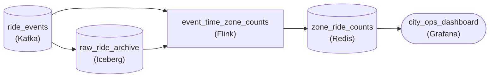

*`ride_events` feeds `event_time_zone_counts` live and `raw_ride_archive` for replay; counts land in `zone_ride_counts` for the dashboard.*

1. **Window on the unlock timestamp**

   The counting job reads the timestamp inside each event and assigns the ride to the 10-minute window it falls in, no matter when it arrives. A ride unlocked at 08:07 that uploads at 08:25 still lands in the 08:00 to 08:10 window, so the dashboard reports what happened on the street.

2. **Archive the raw stream beside the live path**

   The topic fans out twice: live into the counting job, and into `raw_ride_archive`. After a bug fix you replay the archive through the same job. Because every bucket is chosen by a timestamp carried in the data, the replay rebuilds the same counts even though it runs days later and far faster than the original.

| Pitfall: Arrival-time windows move with lag |
| --- |
| Bucketing on processing time is cheaper and looks identical on a quiet afternoon. When a cell outage holds back uploads, those rides pile into whichever window is open when they finally arrive, so a zone shows a fake dip and then a fake spike. Replay is worse: the whole archive arrives in minutes and collapses into a handful of windows. |

| Key insight: The data carries its own clock |
| --- |
| Event time makes the output a function of the input alone. That is what reproducibility means for a stream, and it is why most production aggregations accept the extra state of keeping several windows open rather than counting by arrival. |

**Follow-up questions**

1. Dispatchers also want a live gauge of events received in the last minute, to spot ingest outages. Which time domain fits that one?\
   *Tests when processing time is the right choice: the question is about the pipeline itself, not the world.*
2. A firmware bug stamps some rides with the device's boot time instead of the unlock time. What does event-time bucketing do with them, and where would you catch it?\
   *Tests that event time trusts the timestamp in the data, which makes that timestamp's quality a pipeline concern.*

</details>


<br>

### Exercise 2 of 2

**● TASK**

Smart meters publish readings to a Kafka topic at 20,000 per second, and meters that lose signal flush buffered readings up to 10 minutes late. Aggregate load per feeder in 15-minute event-time windows that close when the watermark passes them, not on the wall clock, and feed a grid dashboard that refreshes every minute. Readings that arrive behind the watermark go to a late-readings store, never dropped silently.

<details>
<summary><strong>Solution</strong></summary>

#### A window closes when the stream says so

Watermarks are how a streaming engine decides a window is finished. Each 15-minute feeder window here is keyed on the time the meter took the reading, and the engine emits a watermark that trails the event times it has observed. When the watermark passes the end of a window, that window closes and its total goes to the store the dashboard reads. Because the watermark advances only with observed readings, a meter that flushes 10 minutes of buffered data does not find its windows already shut by a clock tick. A reading that still arrives behind the watermark is not added to a closed window, so the design gives it somewhere to go instead of a silent drop.

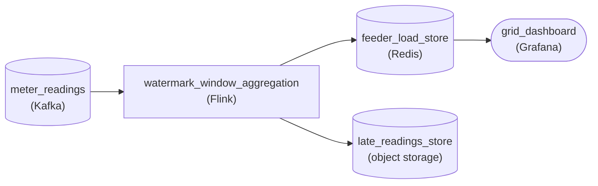

*Readings flow from Kafka into a watermark-driven Flink window; closed totals reach the dashboard, and readings behind the watermark branch to the late-readings store.*

| Pitfall: A wall-clock timer quietly loses the flushed readings |
| --- |
| Closing each window when the clock reaches its end looks the same on a healthy stream. It is not: every meter that reconnects late finds its windows already emitted, and those readings disappear without an error. The feeder totals look plausible and are quietly low, which is the worst kind of wrong for a grid operator. |

| Key insight: A quiet feeder holds the watermark back |
| --- |
| The watermark is driven by events, so when readings stop arriving it stops advancing too. During a storm outage the open windows simply wait instead of closing on a guess. The same rule governs a fraud stream counting card swipes or a game counting matches: the result can be late, but it is not built from a window that closed before its data arrived. |

**Follow-up questions**

1. What happens to every feeder's window if one region's meters fall twenty minutes behind while the rest are current?\
   *Tests that the watermark trails the slowest input, so one lagging region holds the windows open.*
2. How would you use the late-readings store to correct a feeder total the dashboard already showed?\
   *Extends the side path into a correction: recompute the affected window from the readings that were set aside.*

</details>


<br>

---

## Putting It All Together

Picture Uber's earnings pipeline during the fare rename. Version 3 of trip_completed passes the registry's FULL check because every change carries a default. While the 3 consumers switch over the following month, the streaming earnings job keeps summing 5-minute windows by ended_at, with a 60-second watermark lag and 60 minutes of allowed lateness, and upserts each firing into the earnings table. Trips uploaded after their window's lateness runs out land in late_events, and the daily rerun of the last 7 days folds them into trips.

- FULL compatibility is what lets the 4 expand-contract phases ship on separate team schedules.
- The earnings job buckets by ended_at , because driver pay follows when a trip happened.
- The watermark lag comes from measured skew between processed_at and ended_at .
- Allowed lateness re-fires windows, so the sink upserts on window key: the replace-not-append rule from idempotent reruns.
- Very late trips reach late_events like a dead letter queue, and the 7-day batch rerun repairs the curated table.


<br>

---

## Pipeline Architecture

### Exercise 1 of 2

**● TASK**

Mobile apps publish ad-click events to a Kafka topic, and phones that go offline upload their buffered clicks later. Design a pipeline that counts clicks per campaign in 5-minute event-time windows with a 60-second watermark and 60 minutes of allowed lateness. When a late click arrives inside that hour, the dashboard's count for its window must be corrected in place, and clicks later than that go to a dead-letter path instead of vanishing.

<details>
<summary><strong>Solution</strong></summary>

#### Allowed lateness is a second clock on every window

The watermark decides when a 5-minute window first fires: 60 seconds after event time passes its end. Allowed lateness decides how long the window's state is kept after that, here 60 minutes. A click that lands inside that hour is folded into its window, and the aggregator emits a new, larger count for the same campaign and window. A click that lands after the hour has no window left to join, so it leaves on the error path. 3 outcomes, one configuration: on time, corrected, dead-lettered.

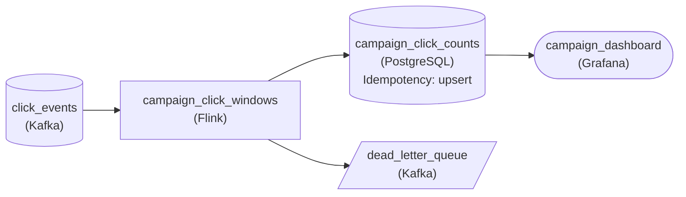

*Clicks fold into 5-minute windows; late clicks within the hour re-emit an upserted count, later ones leave on the error path.*

| Pitfall: An appended correction counts the window twice |
| --- |
| If the store inserts every emission as a new row, the dashboard sums the first firing and the correction: 50 on time plus a re-emitted 54 shows 104 when the truth is 54. Each emission is the window's full count, not a delta, so the write must replace the row keyed by campaign and window start. That is the upsert setting on the store. |

| Key insight: Both lateness numbers are measurements |
| --- |
| 60 seconds matches the 99th percentile arrival lag, so the first result is right for nearly every window. 60 minutes covers the 99.9th percentile, so corrections stop after an hour and the engine can release the window state. Raise it and more windows stay in memory; lower it and more clicks land in the dead-letter queue. |

**Follow-up questions**

1. What changes if the 99.9th percentile arrival lag grows to 3 hours?\
   *Trading longer-held window state against a larger dead-letter volume.*
2. How would you fold the dead-lettered clicks back into daily totals?\
   *Reconciling very late data with a batch backfill instead of reopening streaming windows.*

</details>


<br>

### Exercise 2 of 2

**● TASK**

Handheld scanners publish parcel scans to a Kafka topic, and the event-time field `ts` is being renamed to `scanned_at` with expand-contract. A streaming job counts scans per hub in 5-minute windows on that event time for a live dashboard, allowing 60 minutes of lateness because offline scanners upload buffered scans late. The topic also lands in a lake table read by a nightly billing job that migrates last. Design the expand phase: the scanners write both fields, and every schema version is checked against a registry before publishing.

<details>
<summary><strong>Solution</strong></summary>

Expand-contract gets harder when the column being renamed is the one your watermark reads. Here `ts` is the event time that places every scan in a 5-minute window, and scanners that sat offline keep delivering scans written before the rename for up to an hour. So the rename is not finished when the last reader switches: it is finished when no record carrying only `ts` can still arrive or be reread.

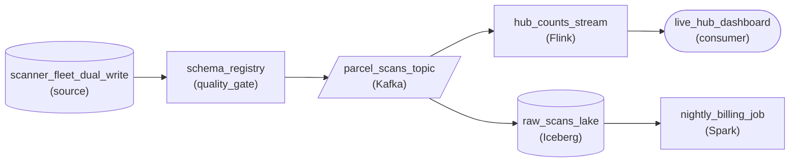

*Expand phase: dual-writing scanners pass a registry check before the topic, which feeds the event-time stream and the lake table billing reads.*

1. **Expand: write both names, guarded by the registry**

   Updated scanners emit `ts` and `scanned_at` with the same value. The registry refuses any new version that drops `ts` while a reader still needs it, so a scanner build that skips the expand phase is stopped before it reaches the topic.

2. **Migrate each reader at its own speed**

   The streaming job switches first: it takes event time from `scanned_at` and falls back to `ts` when the new field is missing, because buffered scans from scanners not yet updated carry only the old name. Billing keeps reading `ts` from the lake table until its own release next quarter; dual-writing means nobody forces it to move early.

3. **Contract only when the last old record is out of reach**

   The scanners may stop writing `ts` once billing reads `scanned_at`, every scanner runs the dual-write build, and the 60 minutes of allowed lateness have passed since the last old-only scan could arrive. Billing also reruns up to 7 days of lake partitions, so those partitions must all carry `scanned_at` before the old field goes.

| Pitfall: A missing event time silently empties windows |
| --- |
| Switching the stream to read only `scanned_at` the day scanners start dual-writing looks safe, yet a scan buffered on an offline scanner under the old build arrives with no `scanned_at`. With no event time it cannot be placed in a window, so it is dropped or miscounted, and the dashboard undercounts exactly the hubs with the worst connectivity. |

| Key insight: The slowest reader sets the contract date |
| --- |
| Each phase advance waits for the laggard, not the majority. The dashboard switching in a week moves the contract date not at all; billing next quarter does, plus the allowed lateness for old-only scans still in flight. |

**Follow-up questions**

1. A fraud model starts reading the topic and cannot switch to `scanned_at` for six months. What changes in the phase plan?\
   *Whether a new slow reader extends the expand phase and joins the conditions for contracting.*
2. If allowed lateness rose to 24 hours, how long after the last scanner update could the stream drop its `ts` fallback?\
   *Tying the contract step to the lateness bound the watermark enforces.*

</details>


<br>

---

## Key Takeaways

- A schema registry stores versions and schema IDs per subject, and its compatibility mode decides which new versions it accepts.
- BACKWARD means consumers deploy first, FORWARD means the producer deploys first, and FULL lets either side go first.
- Expand-contract turns a breaking rename into 4 compatible deploys: expand, migrate, switch, contract.
- Event time answers questions about the world; processing time answers questions about the pipeline.
- A watermark is the engine's assertion that no earlier events remain, and a window fires when the watermark reaches its end.
- Allowed lateness keeps a fired window's state for a stretch of watermark progress, so late events re-fire it and the sink must upsert.
