Advanced·Pipeline Architecture · 38 min · 12 challenges

# Storage Layers: Advanced

At Netflix, an analyst refreshes a viewing-hours dashboard at the exact second a nightly job rewrites yesterday's partition. On a plain directory of files, the chart can count some old files alongside some new ones. Netflix engineers built an open table format to make that moment impossible, and the fix lives entirely in metadata.


<br>

---

## The Lakehouse: ACID on Object

Object storage offers 4 operations that matter here: put an object, get it, list keys under a prefix, delete it. Each put is atomic, but nothing groups 2 puts into 1 change, and most object stores implement a prefix 'rename' as a copy plus a delete for every key, so moving 500 files reaches readers as 1,000 separate changes.

A plain data lake defines a table as every file under a directory. That definition fails in 4 ways once some jobs write while others read:

- Torn reads: a query that lists the directory mid-write counts some new files beside some old ones.
- Orphaned output: a job that dies after writing 30 of its 50 files leaves 30 files that every later query counts.
- Lost history: an overwrite deletes the old files, so nothing records what the table held yesterday at 09:00.
- Slow planning: listings commonly return at most 1,000 keys per request, so a table of 1 million files costs 1,000 round trips before any data is read.


<br>

### The metadata layer

A lakehouse keeps the same columnar data files and adds a second kind of file: metadata naming exactly which data files form the table. A root metadata file holds the schema and the partition spec, and it also lists the table's snapshots. Each snapshot points to manifests, and each manifest lists data files. For every file the manifest records its row count and partition values, along with a min and max per column. A catalog stores 1 thing per table: the location of the current root metadata file.

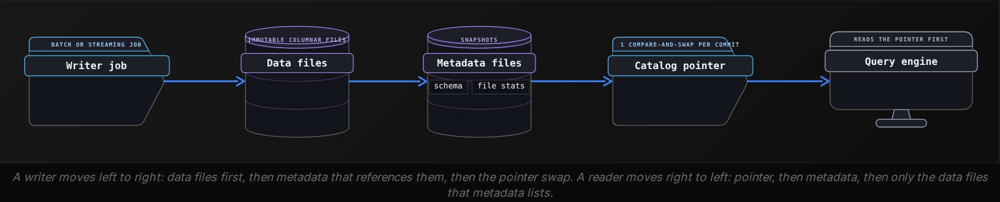


<br>

### One commit, traced

The `orders` table is partitioned by `order_date` and sits at snapshot 41, made of 3 files, f1 to f3, where f3 holds 2026-10-23. A nightly job recomputes that date and must replace f3 with 2 corrected files. The catalog accepts a new pointer only if it still holds the value the writer last read: a compare-and-swap.

| Step | What the job writes | Snapshot a reader gets |
| --- | --- | --- |
| 1 | data files f4, f5 | 41: f1, f2, f3 |
| 2 | metadata m42 listing f1, f2, f4, f5 | 41: f1, f2, f3 |
| 3 | pointer swapped from m41 to m42 | 42: f1, f2, f4, f5 |
| Crash before 3 | f4, f5 and m42, referenced by nothing | 41, unchanged |

Atomicity comes from the single swap: every reader sees snapshot 41 or snapshot 42, with no state between them. Isolation comes from immutability, since no commit edits a file another query might be reading. Durability belongs to the object store. The job never deleted f3: snapshot 41 still lists it, and a cleanup step removes it only after 41 expires.

**A job writes 40 of its 50 new data files into the orders location, then its machine dies before step 2. A dashboard queries orders a minute later. What does the dashboard read?**

- **A.** The 40 new files plus the old ones, because the files already sit inside the table's location
- **B.** Nothing until cleanup runs, because the crashed job left the table locked against readers
- **C.** Exactly the previous snapshot, while the 40 files sit unreferenced until a cleanup removes them
- **D.** The previous snapshot, but only after the engine finds and deletes the 40 partial files

<details>
<summary>Solution</summary>

**C.** Exactly the previous snapshot, while the 40 files sit unreferenced until a cleanup removes them

Without the pointer swap the commit never happened. The 40 files are orphans: they cost storage, and no query can see them.

**Why the others are wrong**

- **A.** Location no longer defines the table. The engine reads only the files the current snapshot lists, and no metadata names these 40.
- **B.** Writers take no lock on a lakehouse table. Readers keep resolving the pointer, which still names the last committed metadata.
- **D.** The previous snapshot is right, but no query inspects orphans. The engine ignores them because no manifest lists them, and deletion is a separate cleanup.

</details>


<br>

### Why the metadata is the product

✓Directory of files

- The table is whatever a listing returns right now
- A half-finished write is visible to readers
- Schema is inferred from whichever files get opened
- Pruning needs a listing, then every file's footer

✗Lakehouse table

- The table is the file list in the current snapshot
- A commit appears all at once or not at all
- Schema is stored once, with a permanent id per column
- Pruning reads min and max values from manifests

Copy every data file of a lakehouse table into a fresh bucket and leave the metadata behind: what you hold is a pile of files that has lost its schema and its version history, and nothing says which files were ever committed. Every capability in the rest of this lesson is a change to metadata. The data files are open columnar files any engine can read; the metadata turns them into a table many jobs can share.

**The orders table holds 2,000 data files across 3 years. A query filters order_date = DATE '2026-10-23'. How does the engine choose which files to open?**

- **A.** It reads partition values and min/max stats per file from the manifests, then opens only matching files
- **B.** It lists every prefix under the table location, then opens each file footer to compare min/max values
- **C.** It opens all 2,000 files and relies on predicate pushdown to discard row groups for other dates
- **D.** It asks the catalog, which keeps a per-date index of the files committed to each table

<details>
<summary>Solution</summary>

**A.** It reads partition values and min/max stats per file from the manifests, then opens only matching files

Manifests carry partition values and column bounds for every file, so planning needs no listing and no footer reads.

**Why the others are wrong**

- **B.** That is directory-of-files planning. A lakehouse engine skips listing, since a listing can include files that were never committed.
- **C.** Pushdown still runs inside every opened file, but the manifests already exclude files whose bounds miss the date, so most are never opened.
- **D.** The catalog stores 1 pointer per table. File-level detail, including per-file stats, lives in the manifests that pointer leads to.

</details>


<br>

---

## Pipeline Architecture

### Exercise 1 of 2

**● TASK**

Two Spark jobs write Kafka orders every 1 and 5 minutes into a table defined as every Parquet file under an object-storage directory, and a dashboard reads it. Readers count half-written batches, and a job that dies after 30 of its 50 files leaves those 30 behind. Add a metadata layer over the same Parquet files so each write commits all at once, and make sure a rerun of the same window adds no second copy of its rows.

**Starting canvas** (already placed for you):

- Kafka orders log (source, Kafka)
- Concurrent writer 1 (every 1min) (transform, Spark)
- Concurrent writer 2 (every 5min, overlapping partitions) (transform, Spark)
- Orders table (Parquet directory, no metadata layer) (storage, object storage)
- Analytics dashboard (consumer, dashboard)


<br>

### Solution

#### The metadata file is the table

A lakehouse table is object storage plus a metadata layer, and the metadata is what you are really buying. Under a plain directory the table is whatever a listing returns. A reader that lists mid-write counts half a batch, and a job that dies after 30 of its 50 files leaves 30 files that every later query counts. With a table format such as Iceberg, the writer puts its Parquet files first and then commits one new metadata file naming them. Until that single put lands, the new files belong to no table at all.

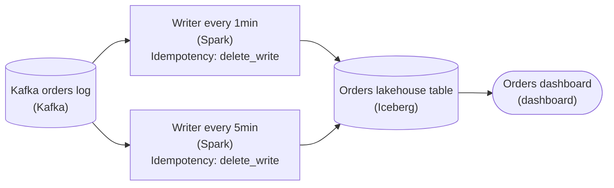

*Both Spark jobs commit into the Iceberg table, and the dashboard reads the files its metadata names, never a raw directory listing.*

1. **Commit both jobs through the table format**

   The data files stay the same columnar Parquet. What changes is how a reader finds them. Both Spark jobs write into the Iceberg table, so each 1-minute and 5-minute run becomes one atomic change. The dashboard plans from the metadata's file list instead of making 1,000 listing requests per million files.

2. **Make a window's write replaceable**

   Atomic commits stop torn reads, but the scheduler can still rerun a window that already committed. Set each writer's idempotency strategy to `delete_write`. The run deletes that window's rows and writes its new ones in the same commit, so a second run replaces the first instead of stacking on it.

| Pitfall: An atomic commit can still commit twice |
| --- |
| Atomicity means a write lands whole or not at all. It says nothing about whether the same write should land again. A plain append that commits, loses its success signal and is retried commits a second full copy of the window. Every reader then sees a clean table with doubled orders. |

| ✕ Directory of Parquet files | ✓ Metadata over Parquet files |
| --- | --- |
| The table is a listing. A half-finished batch is visible as soon as its first file lands, a failed job's files stay counted, and planning a million-file table takes 1,000 list calls. | The table is the file list the latest metadata names. New files join it in one put, a failed job's files are never named, and planning reads that list instead of the directory. |

**Follow-up questions**

1. If the 5-minute job dies after writing 30 of its 50 files, are those 30 files still in object storage, and does any query read them?\
   *Separates the files that exist from the files the table names.*
2. Both jobs commit to the same day's partitions within the same second. What has to be true for both commits to land without one erasing the other?\
   *Extends the single atomic commit to two writers racing to publish the next metadata file.*


<br>

### Exercise 2 of 2

**● TASK**

A regulator reviewed the daily revenue numbers 90 days ago, and the audit team must now reproduce those exact figures, but the curated orders table is plain Parquet on object storage and compaction has overwritten that history. Replace it with a table format that reads the table as it stood 90 days ago and keeps at least that much history. A refund job commits to the same table during the daily load, so a load that loses that commit race must retry, not fail.

**Starting canvas** (already placed for you):

- Kafka orders log (source, Kafka)
- Daily Spark transform (transform, Spark)
- Refund correction job (transform, Spark)
- Plain Parquet curated table fct_orders (no time travel) (storage, S3)
- Daily revenue dashboard (consumer, Looker)
- Regulatory audit consumer (90-day reproducibility) (consumer, Jupyter)


<br>

### Solution

#### Time travel: reading a table as it used to be

The audit needs a **table format** with time travel: Apache Iceberg, Delta Lake, or Hudi. These are not a new file type. Your data still lives as Parquet on object storage. The format adds a metadata layer that records every commit as an immutable snapshot, and each snapshot points at the exact data files that were live at that moment. Old snapshots keep referencing their own files, so you can ask for the table's state at any past point and get back the numbers that were there then. The same snapshot pointer is what lets 2 writers share the table safely.

| Pitfall: Why plain Parquet forgot |
| --- |
| A plain Parquet directory has no history. When the daily compaction job rewrites small files into big ones, it overwrites the files in place. The bytes the regulator saw 90 days ago are gone, and nothing records that they ever existed. `fct_orders` looks like a table but is really just 'whatever files happen to be in the folder right now'. Compaction is correct for cost, but on plain Parquet it destroys history. |

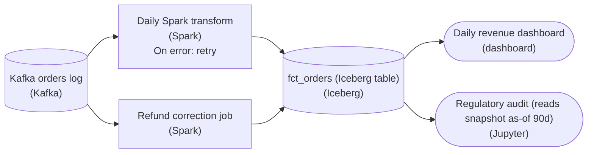

*The curated table becomes an Iceberg table on the same object storage, and the daily load retries a commit the refund job beat. The dashboard reads the latest snapshot; the audit reads an as-of snapshot of the same table.*

1. **Make the curated table a managed table format**

   Replace the plain-Parquet `fct_orders` with an Iceberg (or Delta) table. The daily Spark job stops overwriting the folder and commits a snapshot instead: it appends or `MERGE`s into the table, and the format atomically swaps in a new metadata pointer. Compaction becomes one more commit that writes new files into a new snapshot, and the old snapshot keeps its files.

2. **Set retention to cover the reproducibility window**

   Time travel only reaches back as far as your oldest retained snapshot. Default snapshot expiration is often much shorter than 90 days, so raise `history.expire.max-snapshot-age-ms` to at least the audit window. Skip this and the format is in place, but the snapshot the auditor needs has already expired, which looks exactly like the plain-Parquet failure you were fixing.

3. **Retry the load when the refund job wins the commit**

   Neither writer takes a lock. The daily load reads snapshot N, writes its data files, then tries to swap the pointer from N to its own. If the refund job committed first, that swap fails. With a retry setting on the load, it re-reads the refund job's snapshot, confirms the 2 commits touched different files, and swaps again by rewriting one small metadata file while reusing its data files. Only when both commits rewrote the same files does the retry have to recompute rows. Without the retry, every lost race fails the whole day.

**Time travel + retention (Iceberg)**

```sql
/* Read the curated table exactly as it stood in the audit window */
SELECT order_date, SUM(revenue) AS daily_revenue
FROM fct_orders
TIMESTAMP AS OF '2026-06-19 00:00:00'
GROUP BY order_date;

/* Keep at least 90 days of snapshots so that read stays reproducible */
ALTER TABLE fct_orders SET TBLPROPERTIES (
  'history.expire.max-snapshot-age-ms' = '7776000000'  /* 90 days */
);
```

*`TIMESTAMP AS OF` resolves to the snapshot live at that instant; you can also pin an exact `snapshot_id` or `VERSION AS OF` for a byte-stable audit.*

| Performance: Retention is a cost dial, not a free switch |
| --- |
| Every retained snapshot pins its data files, and no file can be deleted while a snapshot still lists it. Keeping 90 days of daily snapshots therefore keeps 90 days of superseded files on object storage. That is the real tradeoff behind `expire_snapshots`: retention long enough for the audit, and short enough that you are not paying to store years of dead files. |

**Follow-up questions**

1. The auditor wants the numbers as of a specific commit, not a wall-clock time. What do you hand them?\
   *Tests knowing that `snapshot_id` or `VERSION AS OF` pins one exact commit, while `TIMESTAMP AS OF` resolves to whichever snapshot was live at that time.*
2. The refund job starts rewriting the same day's files the load writes. What does the load's retry have to do now?\
   *Tests the conflict case: when both writers rewrite the same files, retrying the commit alone is not enough and the load has to recompute its rows.*


<br>

---

## Snapshot Isolation and Time Travel

A snapshot is an immutable list of data files. A query resolves the catalog pointer once when it is planned, then reads that snapshot to the end. Suppose a revenue query starts at 10:02:30 on snapshot 42 and runs for 90 seconds. A commit at 10:03 creates snapshot 43, and the running query never notices: its files stay in place, because nothing deletes a file that a retained snapshot lists.


<br>

### Concurrent writers share 1 pointer

Writers take no locks. Each one reads the current snapshot, writes its data files, then tries to swap the pointer from the snapshot it read to its own. This is optimistic concurrency: assume nobody else committed, and check at the swap. When the swap fails, the writer reads the snapshot that beat it and asks whether that commit touched anything its own commit depends on.

| Time | Writer A: web orders | Writer B: app orders | Pointer |
| --- | --- | --- | --- |
| 10:00 | reads 42 | reads 42 | 42 |
| 10:02 | writes 3 files | writes 2 files | 42 |
| 10:03 | swap 42 to 43 succeeds |  | 43 |
| 10:03 |  | swap 42 to 43 fails | 43 |
| 10:03 |  | 43 only added files: rebuild metadata on 43 | 43 |
| 10:04 |  | swap 43 to 44 succeeds | 44 |

Writer B rewrote 1 small metadata file and reused its 2 data files untouched. The retry stays cheap while the 2 commits are independent. When they overlap, the loser cannot rebase, because its output was computed from data that has since changed:

| Winner committed | Loser attempted | Outcome |
| --- | --- | --- |
| append to 2026-10-24 | append to 2026-10-24 | rebase metadata and commit |
| append to 2026-10-23 | overwrite 2026-10-23 | conflict: the overwrite missed new rows, recompute |
| overwrite 2026-10-23 | overwrite 2026-10-23 | conflict: the file to replace is gone, recompute |
| compaction of 2026-10-22 | append to 2026-10-22 | rebase: the append removes no files |

**Writers A and B both read snapshot 50 of orders and append new files to the 2026-10-24 partition. A swaps first. What happens to B?**

- **A.** B fails and must recompute its rows, since both commits touched the same partition
- **B.** B's swap succeeds anyway and replaces A's snapshot, so A's appended rows disappear
- **C.** B blocks on a partition lock until A's swap completes, then commits normally
- **D.** B's swap fails, then B rebuilds its metadata on snapshot 51 and reuses its data files

<details>
<summary>Solution</summary>

**D.** B's swap fails, then B rebuilds its metadata on snapshot 51 and reuses its data files

Appends only add files, so B rebases cheaply: new metadata, the same data files, and a second swap that commits snapshot 52.

**Why the others are wrong**

- **A.** Sharing a partition is harmless for appends. Neither commit removes a file, so B's files remain valid on top of A's.
- **B.** The compare-and-swap rejects B because the pointer no longer holds 50. Silently losing a commit is what the swap exists to prevent.
- **C.** This protocol has no locks. B learns about A only when its own swap fails.

</details>


<br>

### Time travel

Retained snapshots stay queryable. The history is in the snapshots metadata table. Adding a version or timestamp clause to a query pins it to an older state.

```sql
SELECT
  snapshot_id,
  committed_at,
  operation
FROM "orders$snapshots"
ORDER BY committed_at DESC
LIMIT 4
```

| snapshot_id | committed_at | operation |
| --- | --- | --- |
| 44 | 2026-10-24 10:04 | append |
| 43 | 2026-10-24 10:03 | append |
| 42 | 2026-10-24 02:15 | overwrite |
| 41 | 2026-10-23 23:50 | append |

```sql
SELECT
  order_date,
  SUM(amount) AS revenue
FROM orders FOR VERSION AS OF 41
GROUP BY order_date
```

```sql
SELECT
  COUNT(*) AS order_count
FROM orders FOR TIMESTAMP AS OF TIMESTAMP '2026-10-24 09:00:00 UTC'
```

Store the snapshot id beside every published report, and the report can be regenerated exactly while that snapshot is retained. Compare 2 snapshots to see which rows a job changed. Roll back a bad commit by pointing the table at an earlier snapshot, a metadata commit that copies no data.


<br>

### Retention sets the horizon

Snapshot expiry deletes snapshots older than the retention window, then deletes data files that no surviving snapshot lists. Retention is therefore a cost knob. If the nightly job overwrites a 50GB partition and retention is 7 days, the table keeps up to 7 replaced copies, about 350GB beyond its live size. A query pinned to an expired snapshot fails with an error.

> Setting retention
>
> - Reproduction: if month-end reports are rebuilt 10 days later, retention under 10 days breaks them.
> - Cost: daily replaced volume times retention days is the extra storage you pay for.
> - Ceiling: snapshots cover days or weeks; years of history belong in the table's rows.

**Retention on orders is 7 days. On 2026-11-05 an analyst runs a query pinned to snapshot 41, committed on 2026-10-23. What happens?**

- **A.** It returns current data, because the engine falls back to the nearest snapshot it still holds
- **B.** It fails, because snapshot 41 expired and files only it listed may already be deleted
- **C.** It succeeds, because data files are immutable and nothing deletes them once written
- **D.** It succeeds slowly, because the engine rebuilds snapshot 41 by replaying later commits

<details>
<summary>Solution</summary>

**B.** It fails, because snapshot 41 expired and files only it listed may already be deleted

The commit and the query are 13 days apart, past the 7-day window, so the snapshot entry is gone and f3 is eligible for deletion.

**Why the others are wrong**

- **A.** Silent fallback would make reproduced reports wrong without warning, so engines refuse a version they cannot resolve.
- **C.** Immutable means never edited. Expiry deletes files that no retained snapshot lists, which includes f3 from the nightly overwrite.
- **D.** Expiry removes the metadata along with the files only that snapshot listed, so the engine has no file list to rebuild the snapshot from.

</details>


<br>

---

## Pipeline Architecture

### Exercise 1 of 2

**● TASK**

A curated payments table is plain Parquet. Stripe adds new fields monthly; each schema change forces a 12-hour rewrite of every partition because plain Parquet embeds column names in the file footer. Apply the section's schema-evolution framing and replace the plain Parquet table with a lakehouse format whose metadata layer makes column additions, drops, and type widenings a sub-second metadata commit.

**Starting canvas** (already placed for you):

- Stripe payment events (producer adds fields monthly) (source, Stripe)
- Daily Spark transform (12-hour rewrite per schema change) (transform, Spark)
- Plain Parquet fct_payments (column names embedded in file footers) (storage, Parquet)
- Finance dashboard (consumer, Looker)


<br>

### Solution

#### Schema evolution lives in the table format, not the files

Plain Parquet has no table-level schema, which is why **schema evolution** (changing a table's columns over time without rewriting the data) hurts there. Each file's footer carries the column names and their layout, and the table is just a directory of those files. So when Stripe adds a field, every reader has to reconcile it file by file. A drop or a type change means rewriting each partition so the footers line up. That is exactly the 12-hour rewrite you were asked to remove.

| Pitfall: Merging footers still rewrites everything |
| --- |
| The tempting move is to keep Parquet and lean on `mergeSchema` or a per-file backfill so old and new footers read together. That handles a pure append. Once a column is dropped or a type is widened (`int` to `long`), though, the footers disagree and every partition gets rewritten anyway. You've automated the pain, not removed it. |

A lakehouse table format (Iceberg, Delta Lake, or Hudi) puts a **metadata layer** between the query engine and the Parquet files. The table's schema is tracked once, at the table level, and every column gets a stable field ID. Data files are read by that ID, never by name, so adding, dropping, renaming or widening a column records a new schema in metadata. The existing data files are never touched.

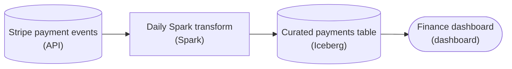

*Only the storage node changes: the curated table becomes an Iceberg table. The Spark job keeps appending, and a schema change is a commit to the table's metadata while the Parquet data files stay put.*

| Key insight: The commit costs kilobytes, not terabytes |
| --- |
| Adding Stripe's new field writes a new schema into a fresh `metadata.json` and atomically swaps the catalog's current-metadata pointer to it. That's a few kilobytes and one pointer swap, whether the table is 10 GB or 10 TB. Older snapshots still resolve the old field IDs, so readers that are mid-query never break. |

| ✕ Plain Parquet directory | ✓ Iceberg table |
| --- | --- |
| The schema is the union of the file footers, matched by name. A drop or a widen (`int` to `long`) makes the footers disagree, so every partition is rewritten. Cost scales with total data size. | The schema is one table-level definition keyed by stable field IDs. Add, drop, rename, reorder and widen are all metadata commits, and the data files stay put. Cost is constant. |

**Follow-up questions**

1. A downstream job pinned to last week's schema keeps running while you add the new column. What lets it keep reading the old shape?\
   *Connects schema changes to snapshot isolation: the old metadata snapshot resolves the old field IDs, so time-travel reads stay consistent.*
2. Finance renames `amount` to `gross_amount`. Why is that safe in Iceberg but a silent data-loss trap in plain Parquet?\
   *Ties the rename to field IDs: plain Parquet matches the new name against nothing and reads NULLs, while Iceberg only relabels the ID.*


<br>

### Exercise 2 of 2

**● TASK**

A streaming pipeline writes a Parquet file every 30 seconds per partition into an Iceberg table. After 4 months the table holds 11 million sub-megabyte files and query latency has drifted from 12 seconds to 8 minutes. Apply the section's small-files framing and add the named scheduled job that runs alongside the streaming writer to keep file size in the section's target range.

**Starting canvas** (already placed for you):

- Mobile clickstream Kafka (source, Kafka)
- Spark Structured Streaming 30-sec micro-batch (transform, Spark Structured Streaming)
- Iceberg fct_events (11M sub-MB files, 8min query latency) (storage, Iceberg)
- Live ops dashboard (consumer, Looker)
- Hourly analytics dashboard (consumer, Looker)


<br>

### Solution

#### Compaction beside the writer

4 months of 30-second commits turned `fct_events` into a textbook case of the **small-files problem**. Each trigger lands one sub-MB Parquet file per partition, and a scan pays per file: a manifest entry to plan, a footer to open, a task to schedule. At 11 million files that overhead buries the actual bytes, which is how 12 seconds became 8 minutes.

| Pitfall: Slowing the writer trades away freshness |
| --- |
| A longer trigger interval does make bigger files, but the live ops dashboard loses the freshness it depends on, and the 11 million files already on disk stay put. Commit cadence serves writes and file layout serves reads. Keep the 30-second cadence and fix layout in a separate job. |

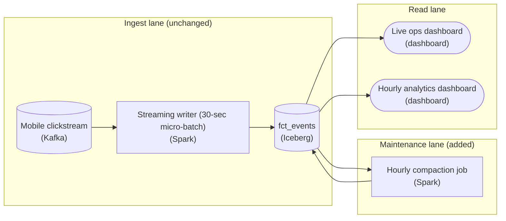

*The writer keeps its 30-second cadence; a separate scheduled Spark job reads the small files in `fct_events` and rewrites them into a few large ones.*

1. **Schedule `rewrite_data_files` as its own batch job**

   The compaction node is a second Spark transform on its own hourly schedule. It calls `rewrite_data_files` with the `binpack` strategy, packing each partition's small files up to the target size and committing a new snapshot. Iceberg commits are atomic and snapshot-isolated, so compaction runs concurrently with ingest and neither dashboard ever sees a half-rewritten table.

**Hourly compaction job**

```sql
/* Runs hourly, independent of the 30-second streaming writer */
CALL catalog.system.rewrite_data_files(
  table    => 'analytics.fct_events',
  strategy => 'binpack',
  options  => map(
    'target-file-size-bytes',   '536870912',  /* 512 MB, the upper target */
    'min-input-files',          '5',
    'partial-progress.enabled', 'true'
  )
);

/* Reclaim the small files the rewrite made obsolete */
CALL catalog.system.expire_snapshots(
  table      => 'analytics.fct_events',
  older_than => TIMESTAMP '2026-09-16 00:00:00'
);
```

*Targets the 128 MB to 512 MB range via `target-file-size-bytes`.*

| Key insight: Compaction and `expire_snapshots` are a pair |
| --- |
| `rewrite_data_files` writes the new large files, but older snapshots still reference the small ones, so storage does not shrink until `expire_snapshots` runs past your time-travel window. The same compact-then-expire pair maintains Delta and Hudi tables under a streaming writer. |

**Follow-up questions**

1. What target file size fits a partition that only receives a few MB a day?\
   *The 128 MB to 512 MB range assumes partitions hold enough data to fill files that large.*
2. How would `partial-progress.enabled` help if the writer commits to a partition mid-rewrite?\
   *Commit conflicts between the maintenance job and ingest.*


<br>

---

## Schema Evolution Without Rewrites

Columnar files record each column's name inside the file. Older lake engines matched file columns to the table schema by that name or by position, and both break. Rename `amt` to `amount` on a name-matching table and every file written before the rename lacks an `amount` column, so 3 years of orders read back as NULL. On a position-matching table, dropping the second column shifts every later column one slot. The traditional fix was to rewrite every file.


<br>

### Field ids name the column

A table format assigns each column a numeric field id when the column is created and never reuses it. Writers store the id beside each column in every data file, and readers resolve columns by id, so the name becomes a label in metadata that can change freely. Here is the schema history in the root metadata of `orders`:

```sql
{
  "current_schema_id": 2,
  "schemas": [
    {
      "schema_id": 1,
      "fields": [
        {
          "id": 1,
          "name": "order_id",
          "type": "bigint"
        },
        {
          "id": 2,
          "name": "order_date",
          "type": "date"
        },
        {
          "id": 3,
          "name": "amt",
          "type": "integer"
        },
        {
          "id": 4,
          "name": "legacy_flag",
          "type": "boolean"
        }
      ]
    },
    {
      "schema_id": 2,
      "fields": [
        {
          "id": 1,
          "name": "order_id",
          "type": "bigint"
        },
        {
          "id": 2,
          "name": "order_date",
          "type": "date"
        },
        {
          "id": 3,
          "name": "amount",
          "type": "bigint"
        },
        {
          "id": 5,
          "name": "currency",
          "type": "varchar"
        }
      ]
    }
  ]
}
```

Schema 2 renamed id 3 and widened it from integer to bigint. It also dropped id 4 and added id 5, and not one data file was rewritten. A reader on schema 2 handles a file written under schema 1 like this:

File written under schema 1

| field id | name in file | value |
| --- | --- | --- |
| 1 | order_id | 1007 |
| 2 | order_date | 2023-04-02 |
| 3 | amt | 2500 |
| 4 | legacy_flag | true |

Row returned under schema 2

| field id | column | value |
| --- | --- | --- |
| 1 | order_id | 1007 |
| 2 | order_date | 2023-04-02 |
| 3 | amount | 2500, as bigint |
| 5 | currency | NULL |

| Change | Statement | Data files rewritten |
| --- | --- | --- |
| Add | ALTER TABLE orders ADD COLUMN currency varchar | 0: old files read NULL for id 5 |
| Rename | ALTER TABLE orders RENAME COLUMN amt TO amount | 0: id 3 keeps its bytes |
| Drop | ALTER TABLE orders DROP COLUMN legacy_flag | 0: id 4 bytes stay, unread |
| Widen | integer to bigint on id 3 | 0: values upcast on read |

**Table L is a directory of files whose engine matches columns by name; table T is a table format with field ids. Both hold 3 years of orders. You rename amt to amount in each. What does SUM(amount) return?**

- **A.** T returns the full total; L sums only rows written after the rename, because older files have no amount
- **B.** Both return the full total, because a rename changes nothing stored in the data files
- **C.** Both sum only rows written after the rename until old files are rewritten with the new name
- **D.** L returns the full total, while T returns NULL for old rows until their files are rewritten

<details>
<summary>Solution</summary>

**A.** T returns the full total; L sums only rows written after the rename, because older files have no amount

L looks up the name amount in each old file, but the column there is still called amt, so L reads NULL. T resolves id 3 and finds the bytes in every file.

**Why the others are wrong**

- **B.** The files are untouched in both tables, which is L's problem: its old files still call the column amt, and L matches by name.
- **C.** That describes L alone. T never needs the name stored in a file to match the schema, because it maps columns by id.
- **D.** The behaviours are reversed: name matching is what fails, and id matching is what survives a rename.

</details>


<br>

### Which type changes stay metadata-only

A widening is safe when every value the old type can hold is exactly representable in the new one, so readers upcast while decoding. Any change that could lose or reinterpret a value needs new files: add a new column, fill it by rewriting, move readers over, then drop the old one.

✓Metadata-only

- integer to bigint
- real to double
- decimal(10,2) to decimal(12,2)
- required column to optional

✗Not metadata-only

- bigint to integer
- varchar to integer
- decimal(10,2) to decimal(10,4)
- optional column to required

**Which change to orders cannot commit as a metadata-only schema update?**

- **A.** Adding a nullable promo_code column that older files will read as NULL
- **B.** Renaming currency to currency_code while dashboards still query the old name
- **C.** Narrowing amount from bigint to integer when some stored values exceed the integer range
- **D.** Widening a quantity column from integer to bigint so it can hold larger counts

<details>
<summary>Solution</summary>

**C.** Narrowing amount from bigint to integer when some stored values exceed the integer range

Readers have no safe conversion for values an integer cannot hold, so this needs a new column filled by rewriting files.

**Why the others are wrong**

- **A.** The new column takes a fresh id, and files that lack the id read NULL without any rewrite.
- **B.** The rename commits in metadata alone. The broken dashboards are a downstream cost, and no data file changes.
- **D.** Every integer fits in a bigint, so readers upcast while decoding and the files stay as written.

</details>


<br>

### The drop and re-add trap

Ids also make a mistake expensive. Drop `legacy_flag` (id 4), regret it a week later and add `legacy_flag boolean` again: the new column gets id 6. Old files hold their values under id 4, readers ask for id 6, and every historical row reads NULL. The bytes still sit in the old files, but no schema maps a column to them, so recovery means a rewrite that copies id 4 values into id 6.


<br>

---

## Pipeline Architecture

### Exercise 1 of 2

**● TASK**

A financial-services platform runs three workloads on one Snowflake warehouse: a customer account history view needing sub-50ms reads, a BI revenue dashboard, and a compliance audit scanning quarterly history. Split them across an operational store for the point lookups, a lakehouse archive on object storage that keeps 7 years and serves the audit via time travel, and a warehouse mart fed daily from that lakehouse for the dashboard.

**Starting canvas** (already placed for you):

- Transaction app writes (source, API)
- Snowflake all_transactions (7yr, all workloads) (storage, Snowflake)
- Customer account history view (sub-50ms ask, 800ms today) (consumer, API)
- BI revenue dashboard (consumer, Looker)
- Compliance audit consumer (quarterly historical reads) (consumer, API)


<br>

### Solution

#### One ledger, three access patterns

The move you just made is workload isolation: one Snowflake warehouse was serving three read patterns that each want a different physical shape, so 2 of them were always going to be wrong. A sub-50ms point lookup wants a row store indexed on the account key; a seven-year audit wants cheap columnar files on object storage; a daily dashboard wants a small pre-aggregated mart. Forcing all three onto `all_transactions` means the account view scans far more than a key lookup should (the 800ms you saw), and quarterly audits burn warehouse credits scanning cold history.

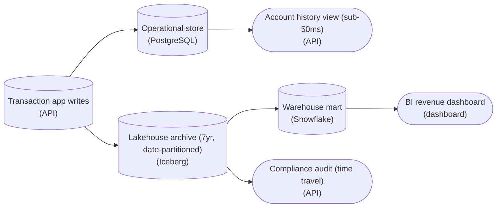

*Each store matches one read pattern; the mart is a daily-batch rollup of the Iceberg lakehouse on object storage, not a fourth copy of the ledger.*

| Pitfall: A bigger warehouse can't fix a shape mismatch |
| --- |
| The tempting non-answer is to scale the warehouse up or bolt a clustering key onto `all_transactions`. That hides the symptom and multiplies the bill: the point lookup is still a scan, and you now pay premium compute to keep 7 years of cold audit data hot. Match each pattern to a store; don't overpower one store into doing all three. |

| Key insight: Partitioning makes the mart incremental |
| --- |
| Feed the mart daily and incrementally. Because the lakehouse is partitioned by date, the batch job reads only yesterday's partition and appends, instead of rescanning 7 years that never change. A full refresh would reprocess frozen history every night for a dashboard that only cares about recent trend. |

| Real world: The table format is the archive |
| --- |
| Compliance reads history through the table format's time travel: Iceberg (or Delta) snapshots let the audit query 'as of' any past quarter with no separate archive copy to keep in sync. The lakehouse is the system of record for history; the warehouse mart is a derived, disposable rollup you can rebuild from it. |

**Follow-up questions**

1. The mart job fails one night. What breaks, and why is that acceptable here?\
   *Tests that the learner sees the mart as derived and rebuildable, not a source of truth.*
2. Audit now wants results in seconds, not minutes. Do you touch the lakehouse or add a store?\
   *Probes when a fourth purpose-built store is justified versus over-splitting.*


<br>

### Exercise 2 of 2

**● TASK**

A health-tech company has kept a 1.4 PB warehouse beside a 6 PB raw S3 lake for 4 years, so every metric has two conflicting answers. The chief data officer wants one canonical lakehouse archive that feeds the executive dashboard, full-history ML training, and regulator audits that read the table as it stood years ago, while the clinician-facing sub-50ms app keeps its own operational store. Row changes in that operational store must reach the archive through change data capture. Because a streaming source writes constantly, a job has to keep merging the many small files the archive accumulates into target-size files.

**Starting canvas** (already placed for you):

- Operational app DB (source, PostgreSQL)
- Clinical event firehose (source, Kafka)
- Genomic file uploads (source, S3)
- Clinician-facing API (sub-50ms) (consumer, API)
- Executive analytics dashboard (consumer, Looker)
- Spark ML training (full history) (consumer, Jupyter)
- Regulator audit query (historical via time travel) (consumer, API)


<br>

### Solution

#### One table, one answer

An open table format is what lets a single copy of the data replace both the old warehouse and the raw lake. Iceberg (or Delta Lake, or Hudi) leaves Parquet files on object storage and adds a metadata layer of snapshots on top. Every reader then sees a committed, consistent table, and each metric has **one answer** instead of two. The three analytical readers all hang off that one table. The clinician app does not, because no file-based table answers a single-row lookup in 50 ms.

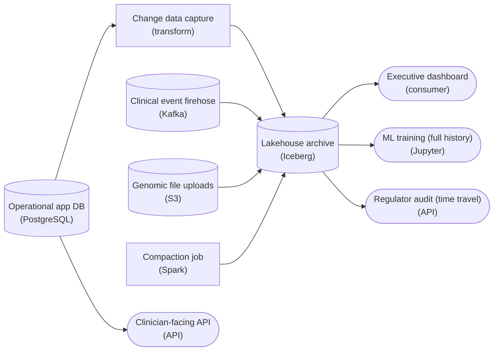

*The app database's changes arrive through change data capture, and the firehose and genomic uploads commit directly, all into one Iceberg archive that a compaction job keeps at target file size. The dashboard, ML training and regulator audit read that archive, while the clinician API stays on its PostgreSQL store.*

1. **Commit every source into the one archive**

   The firehose and the genomic uploads append to the same table, and the app database's row changes arrive through change data capture instead of nightly dumps, so updates and deletes land as commits too. Each write is an atomic commit that creates a new snapshot. That means the dashboard and the ML job never read a half-written batch, even while the stream commits every 30 seconds.

2. **Answer the regulator from an old snapshot**

   The audit reads the same table as of a past snapshot ID or timestamp, so no frozen copy is maintained. The one setting that matters is snapshot expiration: it has to outlast the audit lookback, or the files behind an old snapshot are deleted and time travel fails.

3. **Compact behind the stream**

   A writer committing every 30 seconds leaves 2,880 small files per partition per day. The compaction job rewrites them into files of a few hundred MB (`rewrite_data_files` on Iceberg, `OPTIMIZE` on Delta) as a new snapshot. Readers switch over atomically, so compaction never breaks a query in flight.

| Pitfall: One archive is not one database for every workload |
| --- |
| Wiring the clinician API to the lakehouse in the name of a single source of truth trades millisecond lookups for multi-second scans. The archive is the analytical and audit plane. The bedside app keeps its own row store and sends its changes to the archive, not the other way round. |

**Follow-up questions**

1. The clinical event schema gains a new field mid-year. What changes in the archive, and are any data files rewritten?\
   *Schema evolution at the metadata level.*
2. A genomic batch arrives three days late for a date the dashboard already shows. How does the archive absorb it?\
   *Late data landing as a new snapshot.*
3. How would you partition the archive so both the regulator's year-old read and the dashboard's latest-day read stay cheap?\
   *Partitioning against two read patterns.*


<br>

---

## The Small Files Problem

A file is small when its fixed costs outweigh its bytes. Every file read from object storage costs requests to open it and read its footer, plus a fetch for every column chunk, and each request pays network latency whatever its size. Writers create small files: each writer task produces its own file for every partition it touches on every commit. Take a clickstream table `events` that is partitioned by hour with a 256MB file target. A micro-batch job commits to it every minute, and each batch brings 30MB of new data spread across 20 writer tasks.

- **28,800** — files written per day
- **1.5MB** — average file size
- **2.6M** — files in manifests after 90 days

A query over 1 day reads 43.2GB in any layout, but this layout pays the per-file overhead once for each file the day produced, against 169 times for the same 43.2GB compacted to 256MB files. Planning slows as well, because manifests hold an entry with column stats for every file, so planning time grows with table age even for a query that scans 1 hour. Tiny files also compress less well, since each one restarts its dictionaries and encodings.


<br>

### Reading the symptoms from metadata

The files metadata table lists every data file in the current snapshot with its size and row count, so diagnosis is a query:

```sql
SELECT
  COUNT(*) AS file_count,
  ROUND(AVG(file_size_in_bytes) / 1048576.0, 1) AS avg_file_mb,
  COUNT_IF(file_size_in_bytes < 16777216) AS files_under_16mb
FROM "events$files"
```

| Signal | events now | At 256MB |
| --- | --- | --- |
| Files per hour partition | 1,200 | about 7 |
| Average file size | 1.5MB | about 256MB |
| Files in manifests after 90 days | 2.6M | about 15,000 |
| Planning time as the table ages | grows | grows about 170x slower |

Read the signals together. An average far below target with thousands of files per partition means writer fan-out, and planning time that climbs month over month while bytes scanned stay flat points at file count rather than data volume.

**clicks has 400 files averaging 300MB. sessions has 90,000 files averaging 2MB, and its planning time doubled in 3 months while bytes scanned stayed flat. Which table needs compaction first?**

- **A.** clicks, because 300MB files are past the target and force each task to read too much
- **B.** Neither, because bytes scanned are unchanged and scanned bytes drive query cost
- **C.** sessions, but expire its old snapshots first so the metadata shrinks before compacting
- **D.** sessions, since 2MB files and planning growth with flat bytes point to file count

<details>
<summary>Solution</summary>

**D.** sessions, since 2MB files and planning growth with flat bytes point to file count

Rewriting its roughly 180GB at 256MB per file leaves about 700 files and removes most of the per-file overhead.

**Why the others are wrong**

- **A.** A 300MB file sits close to a 256MB target and well inside the usual 128MB to 1GB range.
- **B.** Planning doubled while bytes stayed flat, which is per-file cost appearing. Fixed costs scale with file count.
- **C.** Expiry trims history, yet the current snapshot still lists 90,000 files. Only rewriting them cuts the count.

</details>


<br>

### Compaction

Compaction reads the small files of a partition, writes them back as target-size files, and commits a replace snapshot that removes the old files and adds the new ones. For 1 hour of `events` it swaps 1,200 files of 1.5MB for 7 files of about 256MB. The rows are identical, so no answer changes; queries already running keep their pinned snapshot, and the 1,200 files are deleted only when that snapshot expires. Table formats ship this as a built-in procedure, often exposed as an `OPTIMIZE` command. It takes a table and a target size, and a partition filter narrows it to the partitions you want rewritten.

Two choices decide whether compaction helps or fights the writers. First, compact closed partitions, such as the 09:00 hour once the clock is safely past 10:00. Appends only add files, so they rarely conflict with compaction. If a delete or update touches a file that compaction is replacing, though, whichever commits later has to redo its work. Second, sort while rewriting: sorting each hour by `user_id` gives every output file a narrow `user_id` range, so a filter on 1 user skips most files using their min/max stats.

> **TIP**
>
> Fix the writer as well. Routing rows by partition key before the write lets 1 task write each hour's data per batch, which yields 60 files of 30MB an hour. That is still below target, so compaction stays, with 20 times fewer files to merge.

**A dashboard query on events starts at 11:00:00 on snapshot 900 and runs 40 seconds. At 11:00:15, compaction of the 09:00 hour commits snapshot 901. What does the query return?**

- **A.** A mix of small and compacted 09:00 files, since the file list changed during the scan
- **B.** The complete result of snapshot 900, read from the small files that compaction replaced
- **C.** An error, because compaction deleted files the query had already planned to read
- **D.** The result of snapshot 901, since the engine re-plans when a newer snapshot commits

<details>
<summary>Solution</summary>

**B.** The complete result of snapshot 900, read from the small files that compaction replaced

The query pinned 900 at planning, and those 1,200 files stay in storage until 900 expires.

**Why the others are wrong**

- **A.** Compaction edited nothing: it wrote new files and committed a new snapshot that this query never sees.
- **C.** Compaction drops files from the new snapshot's list. Physical deletion waits for expiry.
- **D.** Engines plan each query once against 1 snapshot; re-planning mid-scan would break isolation.

</details>


<br>

---

## Pipeline Architecture

### Exercise 1 of 2

**● TASK**

Design a pipeline that applies a PostgreSQL orders database's change feed (about 2 million updates and deletes a day) to the orders table in object storage every hour. Today each run rewrites Parquet in place, so a failed run leaves half-applied changes and the finance dashboard can read a half-written table. Store the table in an open table format so each hourly merge commits atomically and the dashboard reads only committed snapshots.


<br>

### Solution

#### Atomic commits live in the metadata, not the files

An open table format such as Iceberg is what turns an hourly merge into object storage into an all-or-nothing operation. The Parquet data files stay where they are; what changes is a small set of metadata files on top of them. Readers never list the folder: they read the current `metadata.json`, follow it to a snapshot, then to its manifests, then to exactly the data files that snapshot names. A write becomes visible only at the moment that pointer moves.

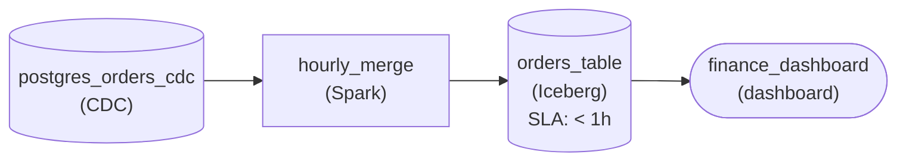

*Change events feed an hourly Spark merge that commits into an Iceberg table; the dashboard reads only committed snapshots.*

1. **Write the new files beside the old ones**

   The merge job reads the hour's inserts, updates and deletes and writes fresh Parquet files for every row it touches. Nothing references those files yet, so the dashboard keeps reading the previous snapshot as if the job were not running.

2. **Commit by moving one pointer**

   Once the files are written, the job adds a new snapshot and its manifests, then swaps the table's current metadata to point at it in a single atomic step. Either the swap lands and the whole hour is visible, or it never lands and the hour does not exist. A run that dies earlier leaves files nobody points at, and the next run simply retries.

| Pitfall: Rewriting partitions in place is the race |
| --- |
| On a plain lake, the table is whatever files sit in the folder right now. Overwriting a partition means deleting old files and writing new ones as separate steps, so a reader in between sees a gap, a mix of old and new rows, or a crashed run's leftovers. Careful scheduling never closes that window; only a commit point does. |

| Real world: Delta Lake and Hudi make the same move |
| --- |
| Delta Lake records each commit as a numbered JSON file in `_delta_log`, and Hudi keeps a timeline of completed actions. The file names differ, but each format turns a directory of Parquet into a transactional table by deciding visibility in metadata rather than in the file listing. |

**Follow-up questions**

1. The merge job crashes after writing half its Parquet files but before committing. What does the dashboard show, and what becomes of those files?\
   *Checks that visibility is a metadata decision, not a file one.*
2. 2 hours of changes arrive late and one run applies both. Can the dashboard ever see only the first hour?\
   *Checks that one commit is the unit of visibility, however much it contains.*


<br>

### Exercise 2 of 2

**● TASK**

An hourly Spark job appends about 50 GB of clickstream events to a curated table while a second job appends late events, so their commits can race; the writer that loses a race must retry its commit rather than fail. A nightly partner export scans the table for 40 minutes and must read one consistent snapshot while commits land mid-scan. An operator must also be able to read the table as it stood before a bad load, up to 7 days back.


<br>

### Solution

#### One snapshot chain, 3 jobs

Optimistic commits, snapshot isolation and time travel all come from one structure. An Iceberg or Delta table is an immutable chain of snapshots plus a pointer naming the current one. Writers race to move that pointer, a reader pins one snapshot at query start, and an operator asks for an older one. Put the curated table on that chain and let each writer retry a lost race, and all 3 guarantees follow.

1. **Retry the commit that loses the race**

   Both jobs read the current snapshot, write their data files, then try to swap the pointer from the snapshot they read to their own. When the late-events job swaps first, the hourly swap fails. The two appends add disjoint new files, so the hourly job rereads the winning snapshot, writes one small metadata file and swaps again, reusing its 50 GB of data files. Setting the error action to retry on both writers is what turns a lost race into a cheap second attempt instead of a failed run.

2. **Let the export pin its snapshot**

   When the export starts, its planner resolves the current snapshot and reads only the files listed in that snapshot's manifests. Either writer can commit the next snapshot 20 minutes into the scan, but those files are not in the pinned manifest, so the export ships one moment in time with no half-loaded hour.

3. **Read back the state before a bad load**

   A bad load is just one more commit. Reading the snapshot before it (an older `metadata.json` in Iceberg, an earlier log version in Delta) shows the table exactly as it was. That only works while the old data files still exist, so snapshot expiry must keep at least 7 days.

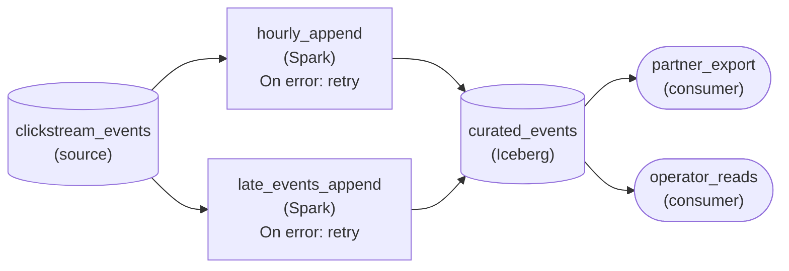

*Two Spark writers commit snapshots to an Iceberg table and retry a lost commit. The export reads a pinned snapshot and the operator reads older ones, which are kept for at least 7 days.*

| Pitfall: A directory listing is not a snapshot |
| --- |
| With plain Parquet the export lists the directory and reads files as it goes. Files a writer lands mid-scan may or may not be picked up, so one night can ship part of an hour. There is also no pointer for two writers to race on, so a conflict cannot even be detected. |

| Real world: Retention decides how far back you can travel |
| --- |
| Expiring snapshots deletes older snapshots and the data files that only they reference. Set expiry to 3 days to save storage and the 7-day lookback quietly shrinks to 3, even though nothing in the pipeline looks broken. |

**Follow-up questions**

1. The partner wants any night in the last 30 days rerun with the exact rows it shipped. What changes?\
   *Ties the length of retention to recording which snapshot each export read.*
2. If the late-events job rewrote rows the hourly job had just read, could the hourly job still retry by swapping again?\
   *Probes when a retry is not enough: the loser's output was computed from data the winner changed.*


<br>

---

## Choosing Storage Across Workloads

Most real datasets serve several access patterns at once. Take a grocery delivery marketplace with 1 `orders` dataset and 3 groups of users. The shopper app reads and updates single orders at up to 3,000 writes per second and needs answers in under 20ms. Finance and data science need 4 years of history and must reproduce month-end numbers and training sets exactly. A group of 300 analysts refresh revenue dashboards by store and category and expect charts in under a second.

| Access pattern | Query shape | Latency | Store |
| --- | --- | --- | --- |
| Shopper app | 1 row by order_id, read and update | under 20ms | Operational database |
| Finance, data science | full scans of history, pinned to a snapshot | minutes | Lakehouse archive |
| Analyst dashboards | aggregates by store and category, 300 users | under 1s | Warehouse mart |

No single store meets all 3. The operational database is a row store with indexes, fast for single-row reads and writes and slow for scans. The lakehouse is versioned and built for scans, but each query spends seconds reading manifests and opening files, while 300 analysts expect charts in under 1 second. The warehouse mart answers those charts because it holds a small, pre-aggregated table shaped for 1 query pattern.


<br>

### How data moves between the 3 stores

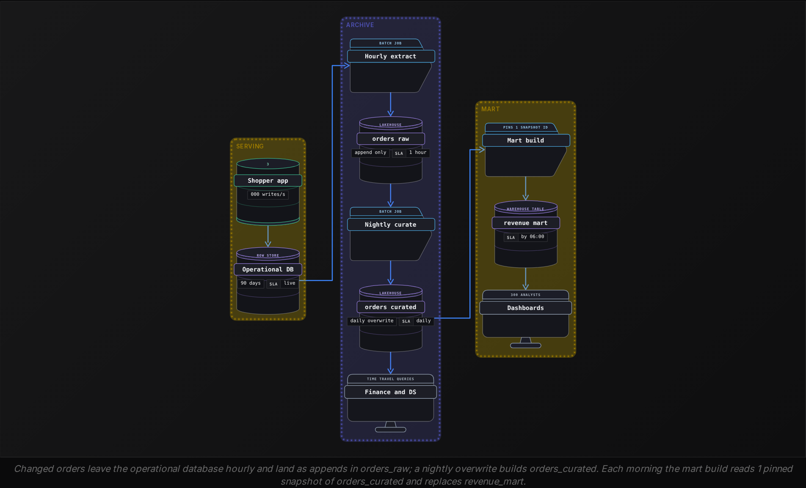

Each store owns a different part of the data. The operational database owns the present and keeps 90 days, so its indexes stay small. The lakehouse owns history: every order ever placed, plus each recent version within retention. The mart owns nothing: it is a derived copy that can be dropped and rebuilt from `orders_curated`, which is what makes it safe to tune hard for the dashboards.

**The September revenue report was published on 2026-10-01 with its snapshot id recorded. On 2026-11-03 finance rebuilds it from orders_curated and gets a total 0.4% higher, because October corrections changed September rows. Retention is 45 days. What reproduces the published number?**

- **A.** Query orders_curated pinned to the recorded snapshot id, which is 33 days old and still retained
- **B.** Query September in the operational database, since it still holds those original order rows
- **C.** Rebuild from orders_raw with today's code, since raw appends are never corrected afterwards
- **D.** Compact orders_curated first so the September partition returns to its original files

<details>
<summary>Solution</summary>

**A.** Query orders_curated pinned to the recorded snapshot id, which is 33 days old and still retained

Time travel returns the exact rows the report used, because 33 days sits inside the 45-day window.

**Why the others are wrong**

- **B.** It keeps 90 days of current state, and current state already includes the October corrections.
- **C.** The correction rows were appended to orders_raw in October too, so a rebuild today includes them.
- **D.** Compaction rewrites files without changing rows, so it cannot undo a correction.

</details>


<br>

### Where it breaks, and what prevents it

| Stress | What breaks | Property that prevents it |
| --- | --- | --- |
| Mart build runs while the nightly job commits | revenue mixes 2 versions of a day | snapshot isolation: the build pins 1 snapshot id |
| Mart build rerun after a failure | rows appended twice, revenue doubled | the build replaces the mart from 1 pinned snapshot |
| Operational database adds tip_amount | the extract drops the new field | ADD COLUMN in lakehouse metadata, old rows read NULL |
| Upstream renames store to store_id | a rename looks like a drop plus an add | extract maps names; lakehouse renames by field id |
| 24 hourly extracts a day into orders_raw | small files slow every history scan | nightly compaction of yesterday's partition |
| 300 analysts query orders_curated directly | per-file costs on every chart refresh | the mart, shaped for the dashboard query |


<br>

### When to drop a layer

Every store is another copy to keep in sync and another place to fail. With 10 analysts happy with 10-second charts, querying `orders_curated` directly beats building a mart. With 30 days of history and no reproduction need, the operational database plus a warehouse could cover everything. Add a store only when an access pattern needs lower latency or more concurrency than the existing stores give, or more history than they keep, and record which pattern justified it.

**A new design replaces the hourly extract with a streaming job that commits to orders_raw every 30 seconds using 40 writer tasks, and the mart build switches to reading orders_raw at 06:00. Which 2 problems does this create?**

- **A.** Commit conflicts among the 40 tasks, and orders lost from the mart when a swap fails
- **B.** Columns going missing in the mart, and snapshots expiring partway through the 06:00 build
- **C.** Over 100,000 small files a day, and a mart built from raw rows that skip the nightly corrections
- **D.** Torn reads in the dashboards, and extra load on the operational database at 06:00

<details>
<summary>Solution</summary>

**C.** Over 100,000 small files a day, and a mart built from raw rows that skip the nightly corrections

At 40 files every 30 seconds, orders_raw gains 115,200 files a day, and reading orders_raw bypasses the curated layer where corrections are applied.

**Why the others are wrong**

- **A.** The 40 tasks write files inside 1 commit, so they never compete for the pointer, and colliding appends rebase without losing rows.
- **B.** Nothing in the change touches the schema, and a build that runs for minutes sits far inside a retention window of days.
- **D.** The build replaces the mart in 1 commit, so dashboards see old or new totals, and nothing upstream of the extract changes.

</details>


<br>

---

## Pipeline Architecture

### Exercise 1 of 2

**● TASK**

Mobile app click events arrive in Kafka, about 400 million a day, and an hourly job lands them in a 9 TB curated table that analysts query from a dashboard. Every few weeks a release adds new fields, and the next one renames the `screen` column to `screen_name`. Design the pipeline so both changes apply without rewriting any existing data files, and rows written before the rename still read under the new name.


<br>

### Solution

#### Renames live in metadata, not in files

Schema evolution in a table format works because the table never trusts the column names stored inside its files. Iceberg gives every column a permanent field id, and the table schema maps each name to an id. Renaming `screen` to `screen_name` writes that one new mapping into a new metadata file; the year of Parquet files underneath is untouched, and a reader resolving by id finds the old values under the new name. Swapping the plain Parquet target for an Iceberg table is the whole change: Kafka and the hourly Spark load stay as they were.

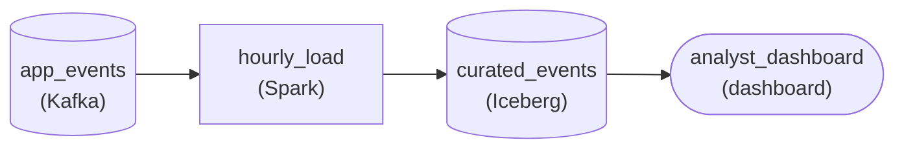

*Kafka feeds an hourly Spark load into an Iceberg table that the dashboard reads; adds and renames touch only Iceberg metadata.*

| Pitfall: A plain Parquet rename splits one column in two |
| --- |
| In a plain Parquet lake each file footer carries the name it was written with. After the release, older files say `screen` and newer files say `screen_name`, so a reader resolving by name returns nulls for one half of history. The only repair is rewriting all 9 TB so every footer agrees, close to a full day of compute for every rename. |

| Key insight: A new field is a new id with no bytes behind it |
| --- |
| When a release adds a field, the schema gains a fresh id. Older files have no column for that id, so readers return null for those rows: nothing is backfilled and nothing is rewritten. Dropping a field runs the same way in reverse: the id leaves the current schema and the old bytes are simply ignored. |

| Performance: Kilobytes of metadata instead of terabytes of data |
| --- |
| Each add or rename commits one small metadata file, so the cost stays flat whether the table holds 9 TB or 90 TB. The hourly load keeps appending about 1 GB of compressed files per run, and the next commit simply writes them under the newest schema. |

**Follow-up questions**

1. What happens if a later release reuses the old name `screen` for a different field?\
   *Tests whether reads resolve by id, so the new field never picks up the renamed column's history.*
2. How would you read the table exactly as it looked before the rename?\
   *Connects schema history to snapshots and time travel from the earlier section.*


<br>

### Exercise 2 of 2

**● TASK**

Vehicle telemetry arrives on Kafka at about 120 GB a day and must be queryable in a lakehouse table within a minute, so a streaming job commits every 60 seconds into each of 12 device-type partitions, writing files of roughly 7 MB. Design the pipeline so that freshness holds while a compaction job rewrites each finished day toward 256 MB files, and a fleet dashboard reads the table.


<br>

### Solution

#### Compaction keeps a one-minute writer cheap to read

This is the small files problem in its most common form: a fast writer. One commit a minute into 12 partitions is 17,280 files a day, each around 7 MB, so every query over a day has to open 1,440 files per partition. Compaction fixes the read side and leaves the write side alone. A separate job rewrites a finished day into about 40 files near 256 MB, and the table's contents do not change.

1. **Leave the streaming writer alone**

   The one-minute freshness is the requirement, so slowing the micro-batch to grow the files gives up the thing the stream exists for. The writer keeps committing small files into today's partition, and you accept that cost on purpose.

2. **Compact finished days back into the same table**

   The compaction job reads a day that no longer receives commits and writes the rewritten files into the same lakehouse table as one atomic commit. Queries already running on the old snapshot finish undisturbed, and queries after the commit see 40 files instead of 1,440. Choosing a day the stream has finished means compaction never competes with the writer for the same files.

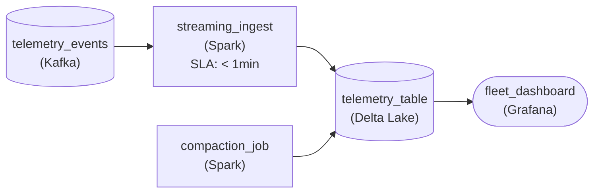

*The stream commits every minute; once a day the compaction job rewrites the finished day inside the same `telemetry_table` that the dashboard reads.*

| Performance: From 1,440 file opens to about 40 per partition-day |
| --- |
| At 120 GB a day across 12 partitions, each partition holds about 10 GB. Left alone, that is 1,440 files of roughly 7 MB, which sits below the 16 MB line where opening files costs more than reading them. Rewritten to 256 MB it becomes about 40 files, and per-file metadata drops to a small fraction of the scan. The compaction job costs one read and rewrite of 120 GB a day. |

| Pitfall: Compaction writes back into the table, not into a copy |
| --- |
| A tempting design sends the stream to one table and has a batch job copy each day into a second, tidier table. That doubles storage, and the dashboard has to choose between the fresh table and the fast one. Compaction rewrites files inside the one table, so that single table is both fresh and fast. |

**Follow-up questions**

1. Late telemetry can still land in a day up to 3 days after it ends. What has to change about when compaction runs?\
   *Whether compaction re-runs on partitions that picked up new small files, or waits until a day really stops changing.*
2. The dashboard mostly reads today's partition, which is still all small files. How would you compact it without waiting for the day to end?\
   *Compacting finished hours inside an open partition without conflicting with the streaming writer.*


<br>

---

## Putting It All Together

A ride-hailing company keeps live trips in an operational database for the rider and driver apps, archives every trip in a lakehouse table partitioned by hour, and builds a city-level earnings mart each morning for operations dashboards. Trips stream into the archive every minute, finance restates last month after fare disputes settle, and the pricing team adds a surge_reason column mid-month.

- Minute-level commits from many writer tasks fill each hourly partition with small files, so the archive needs compaction on closed hours and fewer writer tasks per hour.
- Compaction and streaming appends commit side by side because appends remove no files; a dispute correction that rewrites trip files is the commit that can conflict.
- The morning mart build pins 1 archive snapshot and stores its id, so finance can reproduce a published number for as long as retention covers the gap.
- The new surge_reason column lands as an ADD COLUMN with a fresh field id: older trips read NULL and no file is rewritten.
- The mart stays a disposable copy rebuilt from the archive, while the operational database keeps only the trips the apps still touch.


<br>

---

## Pipeline Architecture

### Exercise 1 of 2

**● TASK**

Parcel scan events arrive on Kafka, about 300 million a day, for three readers: a tracking page fetching one parcel's latest status in under 50 ms, a daily operations dashboard aggregating delivery times over all history, and claims staff replaying five years of raw scans. Give each reader the storage layer that matches its access pattern, and keep the raw history as a lake table on object storage that the daily aggregation reads from.


<br>

### Solution

#### Each reader gets the shape it reads best

Choosing storage across workloads starts from how each reader touches the data, not from the data itself. The same 300 million daily scans are read three ways: one key at a time in under 50 ms, as daily scans over all history, and as an untouched replay of five years. The lake on object storage is the one copy that holds everything cheaply, so it becomes the system of record, and the faster shapes are derived beside it.

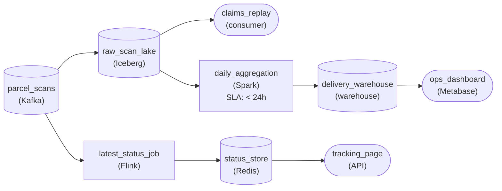

*Scans land in `raw_scan_lake`; a stream job keeps `status_store` current for lookups, and a daily Spark job builds the warehouse marts from the lake.*

1. **Make the lake the system of record**

   Land every scan in an Iceberg table on object storage before anything reshapes it: raw, append-only, partitioned by scan date. Claims replay reads it directly, and if a derived layer ever carries a bug, you rebuild it from here.

2. **Derive the narrow shape and the wide shape**

   The tracking page wants one row per parcel, so a stream job upserts the latest status into Redis keyed by parcel ID. The dashboard wants columnar scans over aggregates, so a daily Spark job reads the lake and writes marts into the warehouse.

| Pitfall: One store for three readers fails 2 of them |
| --- |
| Serving the tracking page from the warehouse turns a 50 ms lookup into a query on an engine built for scans. Keeping only aggregates in the warehouse discards the raw scans claims depend on. And the lake alone cannot answer a single-key lookup fast enough. Each shape wins exactly one workload. |

| Performance: Only the lake has to be big |
| --- |
| At about 150 GB a day, five years of raw scans is roughly 270 TB, which sits on the cheapest tier as object storage. The serving store holds just the latest row per active parcel and the warehouse holds aggregates, so the expensive layers stay small. |

**Follow-up questions**

1. A data science team wants to retrain a delay model weekly on three years of raw scans. Which layer should it read?\
   *Whether a new full-history scan workload goes to the lake instead of bloating the warehouse.*
2. What changes if the dashboard must show today's on-time rate within 15 minutes?\
   *Adding a fresher path into the analytical layer while the lake stays the source of record.*


<br>

### Exercise 2 of 2

**● TASK**

Retail checkout events, about 24 GB a day, stream from Kafka into an Iceberg table partitioned by day and 40 regions, committing every minute so a sales dashboard stays within 15 minutes of the registers. Each partition now gains 1,440 files of about 400 KB a day, and dashboard scans have slowed badly. Design the pipeline with compaction that rewrites closed partitions into large files while the dashboard keeps reading, never seeing a half-rewritten partition. New checkout fields arrive every few weeks and must land without rewriting existing files.


<br>

### Solution

#### Compaction is a commit, not a cleanup

The small files problem is what a minute-level writer does to any table: one commit adds one file per region partition, so this table gains 40 x 1,440 = 57,600 files a day at about 400 KB each. A dashboard scanning 30 days opens around 1.7 million files, and at that size opening each file and reading its footer costs more than the rows inside. Iceberg puts the repair and the safety net in the same place: compaction is just another commit, and **snapshot isolation** makes that commit invisible to anyone already mid-query.

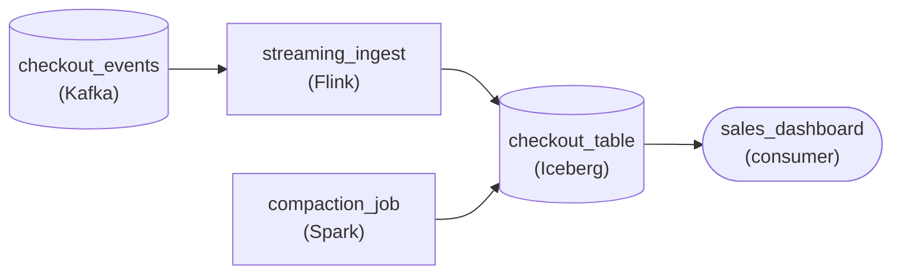

*`streaming_ingest` commits every minute; a nightly `compaction_job` rewrites yesterday's partitions and commits them back into `checkout_table`, which the dashboard reads.*

1. **Leave the minute writer alone**

   The 15-minute promise is why `streaming_ingest` commits every minute. Hourly commits would cut files 60x and break the dashboard. Keep the writer as it is and repair the layout behind it.

2. **Compact only closed partitions**

   Today's partitions still take a commit every minute, so rewriting them races the writer. Yesterday's are closed: each holds about 600 MB, which at a 512 MB target file size becomes 2 files. That is 1,440 files down to 2 per region per day, a small nightly Spark job across 40 regions.

3. **Let the rewrite land as one snapshot**

   `compaction_job` writes the large files first, then commits a new snapshot that swaps them for the small ones in a single atomic step. A query that started earlier keeps reading its own snapshot; the next query sees the compacted layout. Same rows, same totals, never a half-rewritten partition.

| Pitfall: Expiring snapshots too early pulls files from under readers |
| --- |
| The replaced small files stay in object storage until every snapshot referencing them expires. Expire right after compaction and a ten-minute dashboard query still on the old snapshot fails mid-scan. Keep snapshot retention longer than your longest query. |

| Key insight: A new field is a metadata write, not a rewrite |
| --- |
| When checkout adds a field, Iceberg records the column in table metadata with its own ID. Old files simply lack it and read back as null, and the next compaction writes files that include it at no extra cost. |

**Follow-up questions**

1. Holiday traffic triples volume to 72 GB a day. Does nightly compaction still keep up, or should it compact each finished hour instead?\
   *Compaction cadence against partition size and contention with the writer.*
2. Finance wants a query rerun exactly as `checkout_table` stood before last night's compaction. What makes that possible, and for how long?\
   *Linking time travel to snapshot retention.*


<br>

---

## Key Takeaways

- A lakehouse table is the file list in its current snapshot; the catalog pointer swap is the single atomic step that makes every commit all or nothing.
- Each query pins 1 snapshot, and writers commit optimistically: appends rebase cheaply, while overlapping overwrites must recompute.
- Time travel reaches back only as far as retention, and retention costs the storage of every replaced file.
- With field ids, adding or dropping a column is a metadata-only change, and so is renaming or widening one; narrowing a type and re-adding a dropped name are not.
- File count drives the small files problem. Diagnose it from the files metadata table, then compact closed partitions and cut writer fan-out at the source.
- Give each access pattern a store that meets its latency and concurrency needs and keeps the history it requires, and keep derived stores rebuildable from the lakehouse.
