Beginner·Pipeline Architecture · 25 min · 11 challenges

# Storage Layers: Beginner

At 6:40 pm, the dinner peak at DoorDash, an analyst is about to run last month's revenue-by-city query. The orders live in 3 places: the live database checkout writes to, raw event files in a lake, and a warehouse. Pick the live database and checkouts stall behind the scan; pick the warehouse and the answer arrives in seconds.


<br>

---

## Storage Is Not Just the Database

In Pipeline Anatomy the storage role was a single box: the place data lands so a consumer can read it. Open that box at any company past its first year and you find several systems holding the same data in several shapes. A food delivery app taking 2 million orders a day keeps each order in 3 places, because 3 different readers need it in 3 different forms.

The checkout screen needs every field of 1 order right now, and it has to change that order the moment a courier picks it up. An analyst needs 60 million orders from last month, 3 columns each, summed by city. A data scientist needs every raw order event from the last 2 years, including the fields nobody has cleaned yet, to test a delivery time model. No single layout on disk serves all 3 reads well, so storage splits into shapes.

| Shape | What it holds | Who reads it | Typical read |
| --- | --- | --- | --- |
| Operational database | The live orders, 1 row per order, changed as the order moves | The app itself | Fetch or update 1 order by its id in a few milliseconds |
| Data warehouse | Cleaned, typed tables of orders and customers | Analysts, dashboards | Sum 60 million orders by city in seconds |
| Data lake | Raw files of every order event as received, plus cleaned copies | Pipelines, data scientists | Reread 2 years of files with a new rule |


<br>

### One order in 3 shapes

Here is order 8841207 as the operational database holds it: 1 row, every column, found by its id.

| order_id | customer_id | city | total_cents | status | placed_at |
| --- | --- | --- | --- | --- | --- |
| 8841207 | 55018 | Austin | 2499 | delivered | 2026-10-22 18:41:03 |

The lake holds the same order as the events the app emitted while the order moved: 1 JSON object per event, written into a file alongside thousands of neighbours and never edited again. The first event looks like this.

```sql
{
  "event": "order_placed",
  "order_id": 8841207,
  "customer_id": 55018,
  "city": "Austin",
  "total_cents": 2499,
  "ts": "2026-10-22T18:41:03Z",
  "app_version": "7.12.0"
}
```

The warehouse holds it as a slice through a column. Every order's `total_cents` sits together on disk, every `city` sits together, and a query summing revenue by city reads those 2 slices and touches nothing else. Order 8841207 is in there, but a query asking for it by id has to search a column of 1.4 billion ids to find it, then gather its other fields from 5 more columns. The layout that makes sums fast makes a single lookup slow, and that trade is the whole reason the shapes differ.


<br>

### Why one shape cannot do every job

A disk hands back bytes in order, so whatever sits next to each other on disk is cheap to read together. Put a whole row together and 1 lookup is cheap, while a sum over 1 column drags every other column along for the ride. Put a whole column together and the sum is cheap, while 1 lookup has to visit every column separately. Files in a lake sit in a third arrangement: whole files written once. They are cheap to store and to reread end to end, but there's no index to find 1 record. Each arrangement wins 1 kind of read by giving up the others.

Keeping 3 copies of every order sounds wasteful until you price the alternatives. Storage for 1.4 billion orders costs less per month than 1 engineer's afternoon, while a checkout that waits behind an analyst's query costs orders. A pipeline's job is often to carry data from one layer to the next: out of the operational database, into the lake as files, then into the warehouse as tables. The batch versus streaming choice sets how often that movement runs; this lesson sets where the data lands.

> **TIP**
>
> When someone says 'the database', ask which one. The answer tells you what read they expect: 1 row by key, millions of rows aggregated, or raw files to reread.

**The marketing team wants average order value per city for the last 90 days, refreshed every morning. Which storage shape should the query run against?**

- **A.** The operational database, because it holds the most current orders with every column present.
- **B.** The data warehouse, because the daily query averages total_cents by city, reading 3 columns across millions of rows.
- **C.** The data lake's raw zone, because the JSON files hold every order event ever emitted.
- **D.** A summary table inside the operational database, loaded each night with the 90 day totals.

<details>
<summary>Solution</summary>

**B.** The data warehouse, because the daily query averages total_cents by city, reading 3 columns across millions of rows.

The warehouse stores each column together, so grouping city and averaging total_cents reads 2 columns plus the date column for the filter and skips the rest. A daily refresh matches a nightly batch load.

**Why the others are wrong**

- **A.** Current, yes, but the query reads 180 million rows while checkouts write to the same disk. The report slows the app and the app slows the report.
- **C.** The raw files do hold the data, but each query parses every field of every JSON object. The raw zone is for reprocessing, and this question runs every morning.
- **D.** A summary table there still puts a nightly scan of 180 million rows next to checkout traffic. The summary belongs in the warehouse with the other aggregates.

</details>


<br>

---

## Pipeline Architecture

### Exercise 1 of 1

**● TASK**

A startup runs every storage job on one Postgres: the app writes orders, analysts scan the full order history, and a Looker dashboard refreshes off it. The scans lock tables and evict the app's hot pages, and the team wants cheap raw copies of each daily order extract kept for replay. Split the storage so the app keeps Postgres, raw extracts land in a cheap store built for bulk, and the analyst scans and dashboard read from a store built for large scans.

**Starting canvas** (already placed for you):

- Postgres app (source, PostgreSQL)
- Analyst SQL scans (against Postgres) (transform, SQL)
- Looker dashboard (consumer, Looker)


<br>

### Solution

#### One database was doing three jobs

Storage is plural. This single Postgres was being asked to be an operational database, a lake and a warehouse at once, and those are **three shapes built for opposite access patterns**. Your `Postgres app` is a row store tuned for tiny, frequent reads and writes of single orders. The analyst scans read millions of rows across the whole history. On one box, the big scans hold locks and evict the app's hot pages from cache. The fix is not a bigger Postgres. It is three destinations, each built for one job.

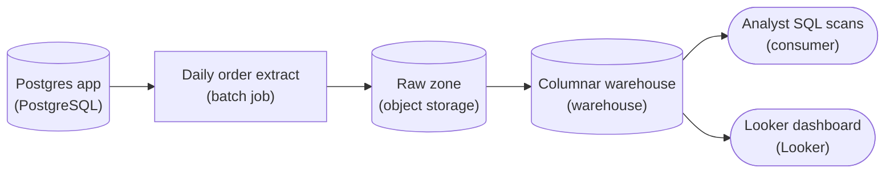

*The app keeps Postgres, a daily batch extract lands cheap raw copies in the lake, and the warehouse serves every large scan.*

1. **Extract each day's orders as a batch**

   The dashboard refreshes daily and analysts study history, so nobody needs orders the instant they are written. That makes this a **batch** job: one scheduled `Daily order extract` per day. Ideally it is incremental, reading only rows past the last `created_at` or id watermark instead of re-dumping the whole table every night.

2. **Land the raw copy in the lake first**

   The extract writes files to a `Raw zone` in object storage, partitioned by date (for example `dt=2026-09-17/`). This is the lake: cheap, built for bulk, and your **replay tape**. Because the untouched extract is kept, you can reprocess history whenever downstream logic changes, without touching production again.

3. **Serve every large scan from the warehouse**

   The `Columnar warehouse` loads from the raw zone and is what the analysts and the `Looker dashboard` query. A columnar engine stores each column together, so `SUM(total_amount)` over all history reads only that column. The scan that blocked Postgres runs cheaply here, on hardware fully isolated from the app.

| Pitfall: A read replica is still a row store |
| --- |
| The tempting shortcut is a Postgres read replica for Looker. It moves read load off the primary, but a full-history scan still drags every column of every row through cache, and it still gives you no cheap raw copy to replay. Isolation is necessary but not sufficient: the scans need a shape built for large reads. |

| ✕ Row store (operational database) | ✓ Columnar warehouse |
| --- | --- |
| Rows stored together on a page. Fetching one order by `order_id` reads one page. Great for `INSERT` and point lookups; a scan of one column drags every other column through cache. | Each column stored together and compressed. A scan of `total_amount` across all orders reads only that column's blocks. Great for aggregates over history; a single-row write is comparatively expensive. |

| Real world: The lake earns its keep on reprocessing day |
| --- |
| The raw zone feels like duplicate storage until a metric definition changes. Because the untouched daily extracts sit in cheap object storage, you rebuild the warehouse tables by reloading history from the lake, with no re-export from the live `Postgres app`. |

**Follow-up questions**

1. The team now wants the dashboard fresh within minutes instead of once a day. What in this design changes, and what stays?\
   *Whether freshness is a cadence change on the ingest side while the three storage shapes stay put.*
2. Orders can be updated after creation (status changes). How does an incremental extract keyed only on `created_at` miss those, and how would you catch them?\
   *Incremental watermarks versus full reloads.*


<br>

---

## The Data Warehouse

A data warehouse is a storage layer built for 1 kind of read: scan many rows, a few columns at a time, and aggregate them. It is good at that because of 3 properties, and you can identify a warehouse by them: a columnar layout, a schema the system enforces, and storage kept separate from compute.


<br>

### Columnar layout

Take the orders table with its 6 columns. A row layout writes order 8841201 in full, then 8841202 in full, and so on down the disk. A columnar layout writes every order_id, then every customer_id, then every city, each column in its own run of bytes.

Row layout: what sits together

| Position | Bytes stored |
| --- | --- |
| 1 | 8841201, 55010, Austin, 1899, delivered, 2026-10-22 18:40:11 |
| 2 | 8841202, 55011, Denver, 3250, delivered, 2026-10-22 18:40:19 |
| 3 | 8841203, 55012, Chicago, 4100, placed, 2026-10-22 18:40:27 |

Columnar layout: what sits together

| Column | Bytes stored |
| --- | --- |
| order_id | 8841201, 8841202, 8841203, ... |
| city | Austin, Denver, Chicago, ... |
| total_cents | 1899, 3250, 4100, ... |
| status | delivered, delivered, placed, ... |

Now run the morning dashboard's query: revenue by city for the last 30 days.

```sql
SELECT
  city,
  SUM(total_cents) AS revenue_cents
FROM orders
WHERE placed_at >= TIMESTAMP '2026-09-22 00:00:00'
GROUP BY city
```

The query names 3 columns, `city` along with `total_cents` and `placed_at`. In the row layout the disk reads every byte of all 6 columns, because the 3 the query wants are interleaved with the 3 it does not. In the columnar layout the disk reads the 3 column runs and skips the other 3, about half the bytes. A real orders table at a mature product carries 40 to 60 columns while a dashboard query reads 3 or 4, so the saving grows with the width of the table. Over 60 million orders, that is the difference between a query that returns in seconds and one that returns in minutes.


<br>

### Enforced schema

A warehouse table declares its columns and their types before a single row arrives, and it rejects any row that breaks the declaration.

```sql
CREATE TABLE orders (
  order_id BIGINT,
  customer_id BIGINT,
  city VARCHAR,
  total_cents BIGINT,
  status VARCHAR,
  placed_at TIMESTAMP
)
```

With `total_cents` declared as `BIGINT`, a load that tries to insert the string 'twenty-four ninety-nine' fails at the table's edge and the analyst's `SUM` never meets a string. Dozens of dashboards and hundreds of saved queries lean on those types, and 1 wrong row would break all of them at once. The price is that changing a column's shape takes a deliberate step, which a warehouse team pays so every reader can trust every type.


<br>

### Storage separated from compute

In older warehouse designs 1 machine, or 1 fixed cluster, held both the disks and the processors. When finance ran month-end at the same hour marketing analysed a campaign, both fought for the same processors and both slowed down, and adding capacity meant buying a bigger machine for everyone. A modern warehouse keeps table data in a storage service and runs queries on compute clusters that attach to that storage on demand. Finance gets a cluster, marketing gets another, both read the same tables with no copy, and a cluster sitting idle is switched off and billed nothing while the tables stay put.

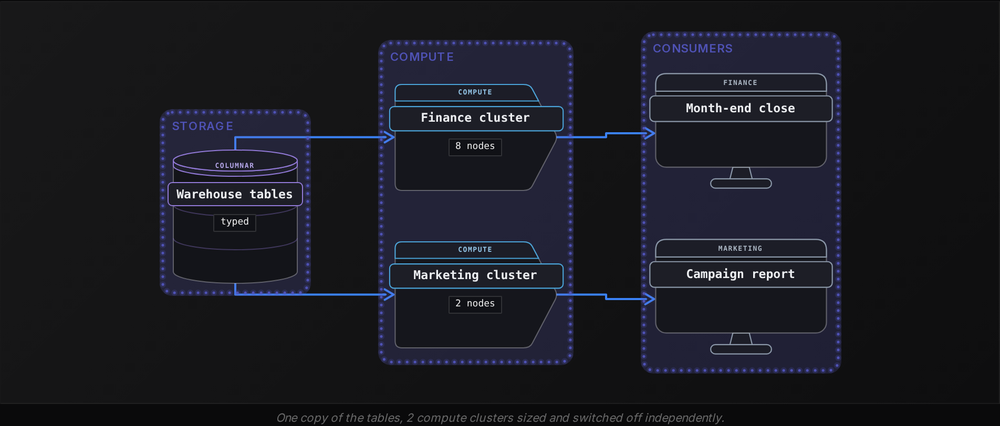


<br>

### Workloads every warehouse carries

- **Daily revenue dashboard** *Scan millions of rows, return a few hundred numbers*\
  Runs every morning after the overnight load and reads 3 or 4 columns.
- **Month-end finance close** *Join orders, refunds and courier payouts*\
  Needs every amount typed as a number and every date typed as a date, because the result goes to the auditors.
- **Experiment analysis** *Compare conversion between 2 app variants*\
  Groups weeks of orders by the variant each customer saw, a read that touches 2 or 3 columns across tens of millions of rows.

> **TIP**
>
> If a team describes a system by its typed tables and the clusters they spin up to query them, you are looking at a warehouse, whatever it is called.

**The warehouse's columnar layout speeds up some reads far more than others. Which of these queries gains the least from it?**

- **A.** SUM(total_cents) grouped by status over every order placed in the last year
- **B.** COUNT(*) of orders per city per day for all of 2025
- **C.** AVG(total_cents) for every order delivered in Denver
- **D.** SELECT * for order 8841207, found by its order_id

<details>
<summary>Solution</summary>

**D.** SELECT * for order 8841207, found by its order_id

The query wants every column of 1 row, so the engine searches the order_id run for the match, then fetches that position from 5 other column runs. The operational database does this in milliseconds.

**Why the others are wrong**

- **A.** Reads 3 columns out of 6 and skips the rest across 730 million rows. This is the read columnar layout exists for.
- **B.** Reads city and placed_at and skips 4 columns. The count needs no other column, so most of the table is never touched.
- **C.** Reads total_cents along with city and status, half of the 6 columns, and skips the rest. The layout halves the bytes read.

</details>


<br>

---

## Pipeline Architecture

### Exercise 1 of 2

**● TASK**

Marketing's dashboard reads revenue totals each morning, scanning only the order date and amount columns of hundreds of millions of orders. Today a Pandas job scans raw Parquet in S3 on every refresh: 18 minutes, no schema enforced. Pick the row-oriented or columnar store this read calls for and place it with a declared schema between the lake and the dashboard. Load it with a nightly batch transform that runs inside that store instead of Pandas.

**Starting canvas** (already placed for you):

- S3 raw orders files (Parquet, no schema) (source, S3)
- Marketing aggregation SQL (Pandas, 18 min/query) (transform, Pandas)
- Marketing dashboard (consumer, Looker)


<br>

### Solution

#### A columnar layer between the lake and the dashboard

Columnar versus row layout is the heart of this fix. A revenue question reads an order date and an amount: 2 columns out of dozens, across hundreds of millions of orders. When Pandas pulls lake files into one process, no engine skips the other columns and no schema rejects a bad file. Every dashboard refresh pays the full 18-minute scan. A **data warehouse** stores each column contiguously and declares its schema before rows land. It also runs the scan on compute that scales apart from the storage.

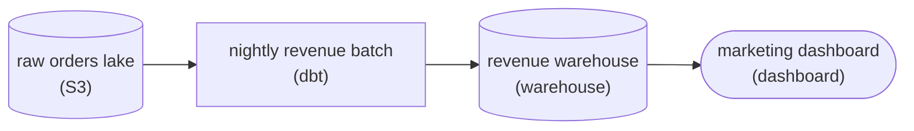

*The lake keeps the raw orders. A nightly dbt batch rebuilds the revenue table inside a columnar warehouse with a declared schema, and the dashboard reads only the warehouse.*

The load is a batch because of who reads it. Marketing looks at the totals once a morning, so one run overnight that rebuilds the revenue table gives the reader everything they need. A streaming job would keep that table fresh to the second for a reader who never checks it before the morning, and you would pay for it all day.

| Pitfall: Parquet on the lake is not yet a warehouse |
| --- |
| Parquet already stores values by column, so the problem can look solved. It is not. Pandas loads each file into memory in one process and aggregates there. Nothing pushes the two-column read down into the scan, nothing enforces types, and nothing adds compute. Tuning the `groupby` or adding RAM keeps the same shape of work. |

| ✕ Row-oriented scan | ✓ Columnar scan |
| --- | --- |
| Every order is read whole, all 20 columns, to reach the date and the amount. Bytes read grow with the width of the table. | Only the date and amount columns are read, roughly a tenth of the bytes on a twenty-column table. The declared schema guarantees both columns are typed, and the batch runs on warehouse compute sized to the query. |

**Follow-up questions**

1. The nightly batch now takes too long because it rebuilds all history. How would it process only the orders that landed since the last run?\
   *Applies a full versus incremental batch load to the warehouse table.*
2. Marketing wants revenue by campaign, a field that only half of the historical files carry. What happens when those rows meet a schema enforced at write time?\
   *Tests what declaring the schema before the write actually buys.*


<br>

### Exercise 2 of 2

**● TASK**

A mobile app's clickstream arrives through Kafka and lands as raw JSON in Snowflake at $23/TB/month, nearing petabyte scale. Move the storage to a data lake on object storage: a raw zone kept unchanged, a cleaned zone with duplicates removed stored as Parquet, and a curated zone, so Snowflake loads only the daily clicks mart. The dashboard refreshes once a day, so a daily batch job builds each zone from the one before it.

**Starting canvas** (already placed for you):

- Mobile app clickstream Kafka (source, Kafka)
- Snowflake clickstream_raw (storing raw JSON, expensive) (storage, Snowflake)
- Snowflake daily_clicks_mart (storage, Snowflake)
- Click analytics dashboard (consumer, Looker)


<br>

### Solution

#### Files in object storage, in 3 zones

A data lake is just files in object storage, and that plainness is why it wins here. Object storage writes each file whole, never edits it in place, and costs a **small fraction of warehouse storage** per terabyte. So the petabytes of raw JSON that sat in `clickstream_raw` move to the lake, and Snowflake keeps only what the dashboard actually reads.

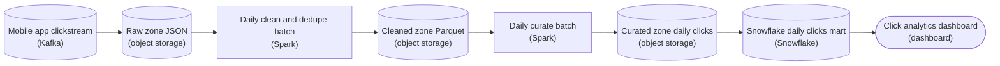

*Raw JSON, cleaned Parquet and curated totals live in object storage; only the curated mart loads into Snowflake.*

1. **Land the raw events untouched**

   Kafka writes the JSON into the raw zone exactly as it arrived, and nothing ever rewrites it. Every later hop leaves the zone before it intact, so a wrong cleaning rule costs one rerun, not lost data.

2. **Clean into Parquet**

   The daily batch job applies types, sets broken records aside, drops duplicates and writes Parquet. Because Parquet is columnar, a later read pulls only the few fields it needs instead of parsing every full JSON record.

3. **Curate, then load only the mart**

   A second batch step shapes the daily click totals in the curated zone, and only that small set loads into the Snowflake mart. The dashboard refreshes once a day, so a scheduled batch run gives it all the freshness it needs.

| Pitfall: A warehouse is not an archive |
| --- |
| Leaving the raw JSON in `clickstream_raw` 'just in case' means paying warehouse rates around the clock for bytes no query reads. The original belongs in the raw zone; the warehouse holds the shaped answer. |

**Follow-up questions**

1. A cleaning rule shipped a bug last week. Which zones do you rebuild, and from where?\
   *Applies the rule that each zone rebuilds from the one before it.*
2. A second team wants hourly totals instead of daily ones. What changes in the curated zone and the batch schedule?\
   *Tests that a curated zone is shaped for one consumer.*


<br>

---

## The Data Lake

A data lake is files in object storage. Object storage is a service that keeps each file as an object under a key that looks like a path. It writes an object whole and can read back all of it or a part, but it never edits an object in place: to change a file you write a new one. Its price per terabyte is a small fraction of a database disk, and it holds any format you hand it, so the lake becomes the place a company keeps everything it might want later.

| Zone | Example path | Format | Written by |
| --- | --- | --- | --- |
| Raw | lake/orders/raw/2026-10-22/events-0001.json | JSON, exactly as received | Ingestion pipeline |
| Cleaned | lake/orders/cleaned/2026-10-22/part-0001.parquet | Parquet, typed, 1 record per event | Cleaning job |
| Curated | lake/orders/curated/daily_city_revenue/2026-10-22/part-0000.parquet | Parquet, aggregated for a use | Modelling job |


<br>

### Zones

A lake without structure turns into a swamp nobody trusts, so teams divide it into zones with 1 rule each. Raw holds data exactly as it arrived and is never changed, so the original is always there to go back to. Cleaned holds the same records with types applied, broken records set aside and duplicates removed. Curated holds data shaped for 1 consumer, such as daily revenue per city or a feature file for the delivery time model. Names vary between companies, but the 3 jobs stay the same.

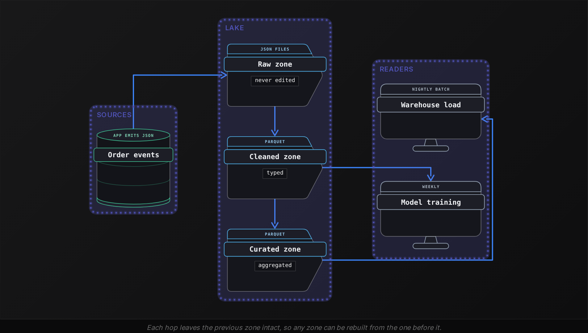

The raw zone justifies its storage bill the first time something goes wrong upstream. In June the app shipped a version that wrote `total_cents` in dollars for 3 days, so every cleaned file for those days held totals 100 times too small. The raw events were untouched. The team fixed the cleaning rule and reran it over those 3 days, which rebuilt the cleaned and curated zones with the right totals. Had the lake only kept cleaned data, the original amounts would have been gone.


<br>

### Why Parquet

Raw files arrive in whatever format the source speaks: CSV from a partner, JSON from the app. From the cleaned zone on, the lake converts to Parquet, which applies the warehouse's columnar idea inside a file.

| Format | Layout inside the file | Types | Reading 3 of 40 fields |
| --- | --- | --- | --- |
| CSV | 1 line per record, fields separated by commas | None, everything is text | Reads every byte of every line |
| JSON | 1 object per record, field names repeated in each | None enforced | Reads and parses every byte of every object |
| Parquet | Values grouped by column, with a footer describing the file | Written into the file | Reads the 3 column groups and skips 37 |

Take 1 day of 2 million order events with 40 fields each. As JSON every record repeats all 40 field names, so at roughly 600 bytes per record the day comes to around 1.2 GB. Parquet writes each field name once per file and compresses similar values stored next to each other, so the same day commonly lands at a quarter of that size or less. A query that reads 3 fields then touches 3 small column groups instead of 1.2 GB of text, and takes each field's type from the footer.

✓Do

- Land data in raw exactly as received, in its original format
- Convert to Parquet in the cleaned zone and read Parquet from there on
- Name zones so a path tells you what has been done to the data

✗Don't

- Edit a file in the raw zone, ever
- Run daily reports against JSON or CSV when a Parquet copy exists
- Skip zones and write a consumer's table straight from raw

**A data scientist wants 18 months of order events to test a delivery time model, including 3 fields the cleaning job drops because no dashboard uses them. Where should she read?**

- **A.** The raw zone, because it keeps every field of every event exactly as it arrived.
- **B.** The cleaned zone, because it holds every event as typed Parquet for fast scans.
- **C.** The warehouse orders table, because it holds 18 months of history with enforced types.
- **D.** The operational database, because it is the original source of every order.

<details>
<summary>Solution</summary>

**A.** The raw zone, because it keeps every field of every event exactly as it arrived.

The dropped fields survive only in raw, and 18 months of files sit there untouched. Reading JSON is slower than Parquet, but the read runs once.

**Why the others are wrong**

- **B.** Cleaned is typed and fast, and that's where the 3 fields were dropped. The speed does not help when the columns she needs are absent.
- **C.** The warehouse is loaded from cleaned, so it has the same gap, and it keeps 1 row per order, while she wants the events behind each order.
- **D.** The live database keeps the current state of each order, so events from 18 months ago were overwritten as statuses changed, and an 18 month scan would slow checkouts.

</details>


<br>

---

## Pipeline Architecture

### Exercise 1 of 2

**● TASK**

A retailer's checkout app, analyst dashboards and raw order events share one Snowflake account, so key lookups at checkout take seconds and dashboard scans slow the live app. Redesign the storage: checkout reads and writes go to a store where a lookup by key is one seek and a purchase commits atomically, and raw order events land in cheap object storage kept for replay. A nightly batch job loads Snowflake from that storage for the dashboards.

**Starting canvas** (already placed for you):

- Checkout API (source, API)
- Snowflake checkout_db (warehouse-as-OLTP, wrong shape) (storage, Snowflake)
- Mobile checkout app (consumer, API)


<br>

### Solution

Row storage and columnar storage are two physical layouts for the same order, and each is fast at a different job. A row store keeps every field of an order side by side on disk, which suits the app's small, frequent reads and writes. A columnar warehouse keeps each field separately, which suits scans of a few columns across millions of orders. One account cannot be both, so the redesign keeps a copy of each order in the layout its reader needs. A nightly **batch load** carries the history to the warehouse, so analytical work never touches the store the app writes to.

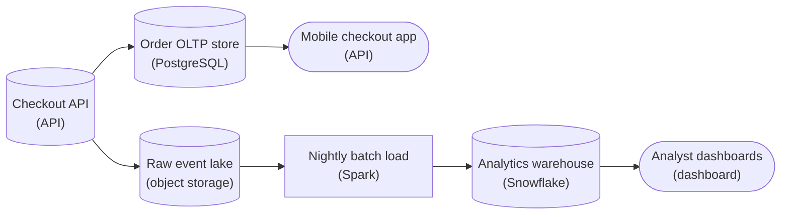

*Each order lands three ways: a row store the app reads and writes, object storage kept for replay, and a columnar warehouse that a nightly batch job fills for the dashboards.*

#### Match each copy to its access pattern

1. **Put checkout on a row-oriented PostgreSQL store**

   Checkout reads one order by `order_id` and writes a cart of several rows at once. Because all of an order's columns sit in one block, the lookup is a single seek, and a transaction makes the whole cart commit or roll back together. No dashboard query runs against this copy, so the app keeps its compute.

2. **Land raw events in object storage**

   Raw order events are written as files and never edited, so the lake keeps the complete history at the cheapest price per byte. Replaying a past day means reading those files again, without touching checkout or the warehouse.

3. **Load the warehouse with a nightly batch job**

   Analysts read the dashboards each morning, so one run a night over the day's lake files is fresh enough. The job reads files, not the checkout store, so the app never pays for the load, and a failed run simply reruns over the same files.

4. **Keep Snowflake for the dashboards**

   The warehouse stores each column on its own. A dashboard summing `total_amount` by day reads two columns and skips the other eighteen. A row store does that scan badly, because it must read every column of every row to get those two.

| Pitfall: The layout that speeds scans slows key lookups |
| --- |
| To rebuild one order, a columnar store opens a separate chunk for every field and still scans more rows than the one it needs. That is why checkout lookups took seconds. Each layout is excellent at one job, and the fix is giving each job its own copy, not tuning the warehouse. |

**Follow-up questions**

1. A new screen lists a customer's last 20 orders. Which copy should serve it?\
   *It is still a small keyed read for the app, so it belongs in the row store with an index on `customer_id`.*
2. Finance wants revenue by region for the last three years. Which copy answers it?\
   *It is a scan of a few columns over many rows, which is the columnar warehouse's job.*
3. Operations wants orders placed in the last minute on a wall screen. Does the nightly batch still fit?\
   *No: a one-minute view needs a streaming path from the order events, and checkout stays on the row store either way.*


<br>

### Exercise 2 of 2

**● TASK**

A growth-stage company serves three readers from one Postgres: a mobile inventory display that must show stock the moment it changes, a revenue dashboard opened each morning and compared with yesterday, and an analyst exploring three years of raw mobile event JSON. Give each reader the storage shape its access pattern needs, and for every copy you add, choose whether a nightly batch or a stream carries it, from how fresh its reader needs the data.

**Starting canvas** (already placed for you):

- Postgres app db (one-store-fits-all) (storage, PostgreSQL)
- Mobile app inventory display (sub-ms point lookups) (consumer, API)
- Daily revenue dashboard (analytical SQL) (consumer, Looker)
- Ad-hoc mobile event analyst (3yr JSON) (consumer, Jupyter)


<br>

### Solution

#### Read pattern first, then freshness

Choosing a storage shape runs three questions in order: how is the data read, how fresh must it be, and how much of it is there. The first question sorts these readers. The inventory display looks up one item by key, the revenue dashboard scans a few columns across many rows, and the analyst explores years of semi-structured JSON. The second question decides what carries each copy. A reader who cannot tell 10 seconds from 10 hours gets a nightly batch, and a reader who can tell gets no copy at all.

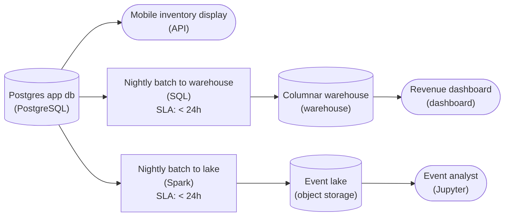

*Postgres keeps the live lookups; 2 nightly batches copy rightward into the warehouse and the lake, the shapes their readers scan.*

1. **Keep the inventory display on Postgres**

   The display reads one row by key and must reflect stock the moment it changes. Postgres is the freshest copy by definition, so any batch or stream in front of it only adds lag. Here, no pipeline is the right pipeline.

2. **Feed the warehouse with a nightly batch**

   The dashboard is opened each morning and compared with yesterday, so it cannot tell whether last night's orders are seconds or hours old. A nightly batch copies the day into a columnar warehouse once, and the dashboard's scans never touch the compute serving live lookups. A stream here would pay all day for freshness nobody reads.

3. **Copy the event history to a lake**

   Three years of JSON belongs on cheap object storage, where scale stops being a cost problem. The analyst explores history, not the last minute, so a nightly batch carries this copy too.

| Pitfall: Freshest is not the same as needed |
| --- |
| Pointing the dashboard at Postgres because it is freshest puts long scans beside the inventory lookups. Streaming into the warehouse buys seconds the 9 am reader never notices. Ask whether the reader can tell the difference, and pick the slowest carrier that passes. |

**Follow-up questions**

1. The revenue dashboard becomes a wall screen refreshed every minute. What carries its copy now?\
   *Freshness flips from a nightly batch to a stream while the warehouse shape stays the same.*
2. Event volume grows tenfold. Which of the three questions changes its answer?\
   *Scale moves cost and sizing, not the access pattern or the freshness the analyst needs.*


<br>

---

## The Operational Database

The operational database is the storage layer the application itself talks to. When a customer taps Place Order, the app inserts 1 row; a courier accepting the order updates that row, and a refresh of the tracking screen reads it. Each of those happens hundreds of times a second across the fleet, and each has to finish fast enough that the person holding the phone never notices.

| Operation | Rows touched | Columns touched | Time allowed |
| --- | --- | --- | --- |
| Place order | 1 insert | All 6 | Under 50 ms |
| Courier picks up | 1 update | status | Under 50 ms |
| Customer views order | 1 read | All 6 | Under 50 ms |
| Monthly revenue by city | 1.4 billion reads | 3 | Minutes, taken from the rows above |


<br>

### Row layout, built for one record

Every operation above wants 1 record, often with all its columns, so the operational database stores each row's columns together on disk. One read brings back the whole order. An index on `order_id` lets the database jump to that row's position without reading its neighbours, the way a book's index sends you to 1 page. The same layout that cost the warehouse in the previous section is exactly right here, because nobody at checkout wants a column.


<br>

### ACID transactions

Placing an order changes more than 1 row. The app inserts the order, decrements the restaurant's count of a limited dish and records the payment, and those 3 writes have to behave as 1. The operational database wraps them in a transaction and promises 4 properties, remembered by the letters ACID.

- **Atomic** *All or nothing*\
  If the payment write fails, the order insert and the stock decrement both roll back, so no half-order is left behind.
- **Consistent** *Rules hold after every transaction*\
  A stock count declared non-negative never goes below 0, and every order's customer_id points to a real customer.
- **Isolated** *Concurrent transactions do not see each other mid-flight*\
  If 2 customers order the last portion at the same instant, they do not both receive it; 1 waits and sees the count at 0.
- **Durable** *Committed means saved*\
  Once the app receives the commit, a power loss 1 second later does not lose the order.

| Step | Write | If this step fails |
| --- | --- | --- |
| 1 | Insert the order row | Nothing has been written; the customer sees an error |
| 2 | Decrement the dish's stock count | Step 1 rolls back; no order without stock |
| 3 | Record the payment | Steps 1 and 2 roll back; no stock lost without payment |
| 4 | Commit | All 3 writes become permanent together |


<br>

### OLTP: thousands of tiny operations

This access pattern has a name: online transaction processing, OLTP. It means many operations per second, each touching a handful of rows by key and needing an answer in milliseconds, and any of them may be a write. The database is tuned for it: indexes to find rows, locks to keep transactions isolated, and a log that makes commits durable. Those features cost something on every operation, which is fine when the operation touches 1 row and ruinous when it touches 1.4 billion.

- **450** — checkout writes per second at peak
- **9 min** — a revenue query on the live database


<br>

### Why the analytical query belongs elsewhere

One Tuesday an analyst pointed the monthly revenue query at the live database at 6:40 in the evening, the dinner peak. With no index on `placed_at`, the database had no way to skip to last month, so it read all 6 columns of all 1.4 billion orders to sum 1 column of 60 million of them. The read held disk and processor until 6:49, and in that window the slowest checkouts went from 40 ms to over 2 seconds. Customers saw spinners and some gave up. The query returned a correct number; it ran in the wrong place.

The remedy is the pipeline shape you already know. A batch job copies the day's new and changed orders out each night, or a stream carries each change within seconds, and the copy lands in the lake and the warehouse. Analysts read the copy, and so do the dashboards and models. The operational database goes back to the job it does well: serving 1 row right now under 4 guarantees.

**Each of 4 teams proposes a read against the live operational database. Which one is the read it handles well?**

- **A.** Count the orders each city placed in each hour across the last 12 months, for a seasonality chart.
- **B.** Join orders to refunds to find every customer refunded more than 3 times since launch.
- **C.** Fetch order 8841207 by its id and set its status to picked_up when the courier confirms.
- **D.** List the 100 restaurants with the highest average order value since the app launched.

<details>
<summary>Solution</summary>

**C.** Fetch order 8841207 by its id and set its status to picked_up when the courier confirms.

This read uses the index to find 1 row, then writes it back; the customer sees the change the instant it commits. Row layout and the index on order_id, backed by the transaction guarantees, are built for exactly this.

**Why the others are wrong**

- **A.** That read scans every row of the year, all columns in row layout, and holds the disk for minutes while checkouts wait. It belongs in the warehouse.
- **B.** A join across 2 full tables reads 1.4 billion rows plus refunds. The warehouse holds both tables with typed columns and reads only the columns the join needs.
- **D.** Averaging total_cents across 1.4 billion rows and ranking restaurants scans the whole table. Run it on the warehouse copy, where it reads 2 columns.

</details>


<br>

---

## Pipeline Architecture

### Exercise 1 of 2

**● TASK**

A regional grocery chain has three storage needs side by side: POS terminals writing thousands of transactions per second, a supply-chain forecasting dashboard joining 18 months of sales, and a legal team archiving every register receipt for 7 years. The forecasters read the dashboard once each morning and only need sales through the previous day. Design the storage so every sale flows through all three foundational storage shapes, with each consumer reading from the shape its access pattern needs.

**Starting canvas** (already placed for you):

- POS terminals (source, API)
- Supply-chain forecasting dashboard (consumer, Metabase)
- Tax-audit receipt archive (7yr retention) (consumer, API)


<br>

### Solution

#### One sale, three storage shapes

Picking a storage layer comes down to how the data is read, how fresh it must be, and how much of it there is. Here a single register sale answers those questions three ways. It lands as one row in a row-oriented operational database, the store the registers write to. It is copied as an immutable file into the data lake, where 7 years of receipts sit cheaply. Then **a nightly batch job** loads it into a columnar warehouse, where 18 months of sales can be scanned and joined without touching the registers.

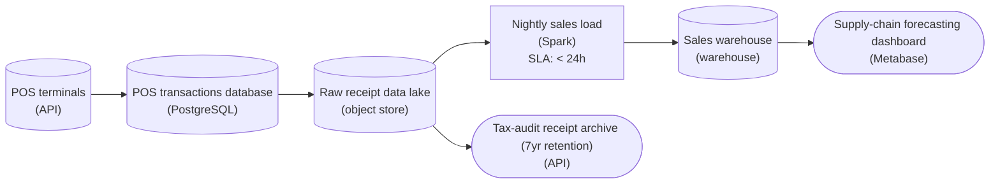

*One sale is written as a row in PostgreSQL, kept verbatim in the lake, and loaded once a night by a Spark batch job into the columnar warehouse the dashboard reads.*

| ✕ Row layout (the POS database) | ✓ Column layout (the warehouse) |
| --- | --- |
| Each sale is one small insert, and looking up a sale reads one row. Keeping a row's fields together makes that cheap, and transactions keep the payment and inventory writes consistent. | The forecast reads a few columns (store, product, quantity, date) across 18 months of rows. Storing each column together lets the scan skip every column the query never names. |

| Key insight: A morning dashboard needs a daily batch, not a stream |
| --- |
| The forecasters read the dashboard once each morning, so sales through yesterday are fresh enough. A scheduled batch job that reads the previous day's files from the lake and loads the warehouse once a night meets that with one run a day. A streaming load would keep a job running around the clock to deliver freshness nobody reads. |

| Pitfall: The forecast query does not belong on the POS database |
| --- |
| If the dashboard reads straight from the operational database, an 18-month join competes with thousands of writes per second at the registers. Copy the data out and let the warehouse take the scan. |

| Real world: 7 years of receipts is a lake job |
| --- |
| Raw receipts are written once and read almost never, until an auditor asks. Immutable files on object storage, partitioned by date in a raw zone, keep them verbatim at a fraction of warehouse cost. |

**Follow-up questions**

1. If the forecasters wanted sales within 15 minutes of the register, what changes about the warehouse load?\
   *This moves the warehouse feed from a nightly batch to a continuously running streaming load.*
2. If the warehouse should hold cleaned, deduplicated sales instead of raw receipts, where does that cleanup sit?\
   *This adds a clean zone between the lake's raw files and the warehouse load.*
3. How would you serve an auditor one receipt from 7 years ago?\
   *Date partitioning in the lake narrows the read to one day's files, with no index lookup.*


<br>

### Exercise 2 of 2

**● TASK**

A subscription billing app writes invoices to a row-oriented MySQL table that now holds 600 million rows across 30 columns. Finance's revenue dashboard sums only two of them, invoice amount and billing month, and each refresh reads every column for 25 minutes. Design a pipeline that copies invoices nightly into a storage layer built for that access pattern and serves the dashboard from it, leaving MySQL to the app.


<br>

### Solution

#### Read two columns, not thirty

This is the job **columnar storage** exists for. A row-oriented MySQL table keeps all 30 fields of an invoice side by side on disk, which suits the app fetching or updating one invoice. Finance asks the opposite question: two fields from all 600 million invoices. A column-oriented warehouse stores each column on its own, so summing invoice amount by billing month reads those two columns and skips the other 28, roughly a fifteenth of the bytes. That is where the 25 minutes go away.

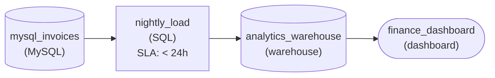

*MySQL stays the app's row store; a nightly load copies invoices into a columnar warehouse that the finance dashboard reads.*

| Pitfall: An index does not shrink a full scan |
| --- |
| The tempting fix is an index on billing month or a bigger MySQL server. Finance sums every month, though, so the query still walks every row and drags all 30 columns through memory. More hardware trims minutes; the row layout is what costs the 25. |

| Key insight: The access pattern picks the layout |
| --- |
| Same invoices, two shapes. Single-invoice reads and writes want whole rows together, so the app keeps its row store. Wide sums over a few fields want columns apart, so analysts get a column store. Neither is wrong; each fits one way of reading. |

**Follow-up questions**

1. Finance adds plan tier as a third column in the report. What changes in the design?\
   *Whether you see that a column store reads only the columns a query names, so three of thirty is still cheap.*
2. An analyst wants one customer's full invoice history with all 30 fields. Which store fits that read better, and why?\
   *Noticing when the access pattern swings back toward whole rows.*


<br>

---

## Picking the Right Storage Shape

Picking a shape for a new workload comes down to 3 questions, asked in order: how will the data be read, how fresh does it need to be, and how much of it is there. The answers usually point at 1 shape, and when they point at 2, the second is a copy fed by a pipeline.

| Question | If the answer is | Points toward |
| --- | --- | --- |
| Access pattern | 1 row by key, read and written by the app | Operational database |
| Access pattern | Many rows, few columns, summed or counted | Data warehouse |
| Access pattern | Whole files reread, raw fields kept for years, formats mixed | Data lake |
| Freshness | The instant it is written | Operational database, where the write happens |
| Freshness | Minutes to hours behind the write | Warehouse or lake, fed by a batch or streaming copy |
| Freshness | Days old is fine; read once or rarely | Data lake |
| Scale | Gigabytes of hot, changing rows | Operational database |
| Scale | Terabytes of typed tables | Data warehouse |
| Scale | Terabytes to petabytes, mixed formats, each byte read rarely | Data lake |

The operational database is the freshest copy by definition, which tempts people to read it for everything. Ask instead whether the consumer can tell the difference. A dashboard opened at 9 am and compared with yesterday can't tell whether the orders are 10 seconds or 10 hours old, so it belongs on a warehouse loaded overnight. A courier deciding which door to knock on can tell, so that read stays on the operational database.


<br>

### Placing 5 workloads

| Workload | Access | Freshness | Scale | Shape |
| --- | --- | --- | --- | --- |
| Courier app shows 1 order | 1 row by id, then an update | Now | Gigabytes, hot | Operational database |
| Morning revenue dashboard | Sum 3 columns over 60 million rows | Daily | Terabytes | Warehouse |
| Train a delivery time model on 2 years of events | Every field of every file | Weekly | Tens of terabytes | Lake, raw and cleaned |
| Month-end finance close | Typed joins across 3 tables | Monthly | Terabytes | Warehouse |
| Fix a cleaning rule and rebuild 3 days | Reread the original files | Once | Terabytes | Lake, raw zone |

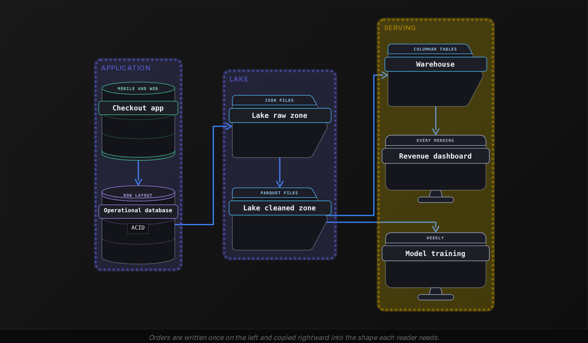

Read the diagram left to right. The operational database is the only place a person writes an order. Everything to its right is a copy carried by a nightly batch or a stream, and each reader takes the copy whose shape and freshness fit its need.

**A support agent has a customer on the phone and needs to see the customer's 5 most recent orders, each with its current status. Where should the support tool read?**

- **A.** The warehouse, because it holds every order with typed columns the tool can trust.
- **B.** The lake's cleaned zone, because the Parquet files hold every order event in order.
- **C.** The lake's curated zone, because a per-customer table could be built for support.
- **D.** The operational database, because it has the current status and finds rows by customer_id in milliseconds.

<details>
<summary>Solution</summary>

**D.** The operational database, because it has the current status and finds rows by customer_id in milliseconds.

The tool needs 5 indexed rows, current as of now, including the status the courier set seconds ago. That's the OLTP read the operational database is built for: 5 indexed lookups.

**Why the others are wrong**

- **A.** The warehouse copy is loaded overnight, so an order placed 20 minutes ago is missing and a status changed this morning is stale. The agent would tell the customer wrong things.
- **B.** Finding 5 orders for 1 customer means scanning files, since a folder of Parquet has no index on customer_id. The customer waits seconds to minutes.
- **C.** A curated table is still a copy refreshed on a schedule, so the current status is as stale as the last job. Support needs the write itself.

</details>


<br>

### 3 placement mistakes

> Mismatches and what they cost
>
> - Dashboard on the operational database: a 9 minute scan steals disk from checkouts, and shoppers see spinners.
> - Checkout on the warehouse: columnar storage is built for bulk loads, so 1-row inserts are slow and a shopper will not wait.
> - Raw clickstream in the warehouse: 50 billion untyped events a month pay warehouse prices and pass schema enforcement before anyone has agreed a schema.

Each layer you add is also a pipeline you own, so add a shape when its question arrives. A new app with 2 GB of orders can run its morning report on a nightly copy of the operational database for a year. The warehouse arrives when that report takes minutes, and the lake when someone needs events a cleaning rule threw away or untyped events pile up. Pipeline Anatomy's test for when a pipeline is not needed applies to storage layers too.

**The app team wants to capture every tap and scroll, about 50 billion events a month with no agreed fields yet. For the first quarter, only 1 exploring team reads them. Where should the events land first?**

- **A.** A warehouse table with every field declared as VARCHAR, so the schema can be fixed later.
- **B.** The lake's raw zone as files, in whatever format the app emits them.
- **C.** An events table in the operational database, next to orders, so the app writes once.
- **D.** The lake's curated zone as Parquet aggregates, counting taps per screen per day.

<details>
<summary>Solution</summary>

**B.** The lake's raw zone as files, in whatever format the app emits them.

Tens of terabytes a month and growing, changing fields, 1 exploratory reader, no freshness demand: every answer points at the lake. Once the fields settle, a cleaning job writes Parquet and the warehouse loads what dashboards need.

**Why the others are wrong**

- **A.** That is 50 billion rows a month at warehouse prices, behind a schema nobody can define yet, so the declared columns would be wrong within weeks.
- **C.** That means 50 billion inserts a month into the database that serves checkout, with every write paying for indexes and durability. Checkout latency would climb within days.
- **D.** Aggregating before anyone knows which fields matter throws away the detail the exploring team came for. Curated tables come after raw and cleaned, never instead of them.

</details>


<br>

---

## Pipeline Architecture

### Exercise 1 of 2

**● TASK**

Delivery trucks send about 300 GB of raw GPS pings a day as JSON, and the fields change whenever new firmware ships. Land every file unchanged in a data lake on object storage, partitioned by ingestion date. A daily Spark job should read only the previous day's partition and write cleaned Parquet to a separate curated zone of the same lake.


<br>

### Solution

#### Files, folders, and an engine that reads them

A data lake is just files in object storage, and this whole design rides on that. The raw zone keeps every ping exactly as it arrived, in whatever shape the firmware produced that day, because files are immutable and nothing enforces a schema on write. The folder layout does the organizing: one prefix per ingestion date. Spark is the external engine that turns those files into something queryable, and it writes its result back to the lake instead of over its input.

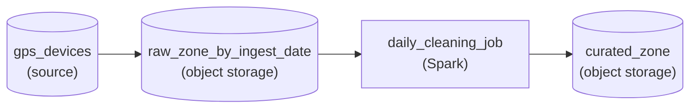

*Raw pings land unchanged under a per-day prefix; Spark reads one day and writes Parquet to the curated zone.*

1. **Route by ingestion date, not by content**

   A path like `raw/gps/ingest_date=2026-10-10/` is a routing scheme, not a schema. The daily job lists one prefix and opens about 300 GB, never the years of history beside it. Partitioning by a field inside the JSON would force a parse before you could even pick the folder.

2. **Write derived data to its own zone**

   Cleaned Parquet goes under a separate curated prefix. Raw stays the source of truth: when a parsing bug turns up, you rerun Spark over the affected date prefixes and replace only that curated output, while the raw files never change.

| Pitfall: Cleaning in place destroys the replay |
| --- |
| Rewriting the raw JSON as Parquet in the same folder, or deleting the originals once cleaned, looks tidy. It throws away the only copy of what the devices actually sent, so a cleaning bug or a firmware field you dropped can never be recovered. |

| Performance: Cheap to keep, cheap to read one day |
| --- |
| At 300 GB a day the lake grows about 9 TB a month. Near 2 cents per GB-month, each month of raw pings adds roughly $180 to the bill, and older dates can move to a cold tier for a fraction of that. The daily read stays flat because the job touches one date prefix however many years pile up. |

**Follow-up questions**

1. Pings from trucks that were offline for three days arrive today. Which date prefix do they land in, and what does the daily job see?\
   *Ingestion date versus event date in a lake layout.*
2. Analysts filter the cleaned data by truck region in every query. Would you lay out the curated zone the same way as the raw one?\
   *Choosing each zone's folder layout by who reads it.*


<br>

### Exercise 2 of 2

**● TASK**

A ticketing app's checkout makes thousands of seat holds a second: each updates one 25-column seat row and inserts one payment row, and both must commit together or not at all. The seat page reads one whole seat row by seat_id per view. Finance needs nightly revenue per tour from two payment columns, via a nightly batch copy of payments into a columnar store. Choose the seat database's storage shape and draw checkout, the seat page and finance's report.


<br>

### Solution

#### Row storage fits one-row reads and writes

A row-oriented operational database stores all the columns of a seat side by side in one block. Reading a seat by `seat_id` takes one seek, and updating it is one block write. Checkout traffic has exactly that shape: thousands of tiny requests a second, each touching one whole row. PostgreSQL fits this workload, and its ACID transaction lets the seat update and the payment insert commit as one unit. Finance's revenue scan has the opposite shape, so it reads somewhere else.

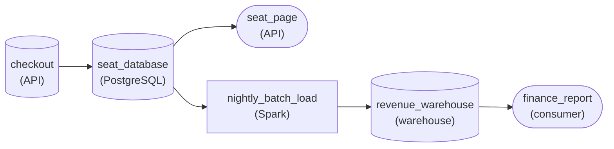

*Checkout and the seat page share the row-oriented `seat_database`; `nightly_batch_load` copies payments into `revenue_warehouse`, which `finance_report` scans.*

| Pitfall: Columnar storage splits the row you need |
| --- |
| A columnar warehouse or Parquet in a lake keeps each of the 25 columns in its own chunk. Fetching one seat means stitching 25 pieces back together, and updating it rewrites column chunks. That layout wins when a scan wants 2 columns across millions of rows. Here every checkout and seat page request wants all 25 columns of one row, so it loses. |

| Key insight: The transaction matters as much as the layout |
| --- |
| Fast reads cover only half of the requirement. If the seat update lands and the payment insert fails, a seat is held and nobody has paid for it. Putting both writes in one transaction means the database commits both or rolls both back. That is why the seat page can trust whatever it reads. |

| Performance: A nightly batch copy keeps the scan off checkout |
| --- |
| Revenue per tour reads two columns of every payment row, the columnar case from the warehouse section. Run against `seat_database`, that full scan competes with checkout for disk and locks at on-sale. A `nightly_batch_load` copies the day's payments into `revenue_warehouse` once, and `finance_report` scans the columnar copy while checkout keeps the row store to itself. |

| Real world: The same shape sits behind every login |
| --- |
| Reading one user by `user_id` at login, adding an item to a cart, and decrementing one inventory count are all the same kind of work. Wherever an app does small, frequent work on whole rows, a row store such as PostgreSQL or MySQL is usually underneath, with a batch copy feeding the reports. |

**Follow-up questions**

1. Finance now wants revenue refreshed every hour during an on-sale. What changes in the copy, and what stays on `seat_database`?\
   *Checks whether a tighter freshness need changes the copy's cadence while the scan still stays off the row store.*
2. The seat page now also shows how many seats are left in one section. Does that change the storage shape?\
   *Checks whether you can tell a small, indexed lookup apart from a full analytical scan.*


<br>

---

## Putting It All Together

The food delivery app launches a loyalty programme: every tenth order ships with free delivery. The checkout screen must show a customer's progress toward the next free delivery as they order. Finance needs the monthly cost of free deliveries by city for the board. The data science team wants 18 months of raw order events, including app version and device, to predict which customers the programme will keep.

- The progress counter is read and written at checkout, 1 row per customer, in the same transaction as the order insert, so it lives in the operational database and inherits its ACID guarantees.
- The monthly cost by city sums 2 columns over 60 million orders and refreshes once a day, so it runs on the warehouse, loaded by the nightly batch copy, with amounts typed as BIGINT for the board.
- The retention model needs app_version and device, fields the cleaning job drops, and 18 months of history, so the data scientist reads the lake's raw zone first and the cleaned Parquet for everything else.
- Every copy to the right of the operational database is carried by a pipeline, and the batch versus streaming choice from the previous lesson sets how far behind the checkout each copy runs.
- Had the finance query been pointed at the operational database, the dinner peak would have paid for the board report in slow checkouts, the same mismatch the 6:40 pm incident showed.


<br>

---

## Pipeline Architecture

### Exercise 1 of 2

**● TASK**

A helpdesk app writes support tickets to Postgres while agents work them. Every raw ticket must also be kept untouched in a lake for replay, and support leads check average resolution time per team on a dashboard each morning. Lay the pipeline out in bronze, silver and gold layers, putting each copy of the tickets in the storage shape its job needs. Load the gold mart by batch or streaming, whichever those morning readers actually need.


<br>

### Solution

#### Each layer owns one job

Medallion layering is the storage selection rule applied three times to the same tickets. Bronze is the lake copy exactly as the app wrote it, cheap to keep forever so anything later can be rebuilt. Silver is the cleaned copy: one row per ticket, team names fixed. Gold is the warehouse mart shaped for the question people read, average resolution time per team. Postgres stays where it was, holding the live tickets agents are working.

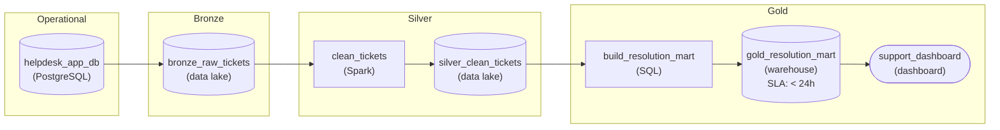

*Postgres keeps the live tickets, the lake holds the bronze and silver copies, and a nightly batch loads the warehouse gold mart that feeds the morning dashboard.*

1. **Let bronze own replay**

   Land raw tickets in the lake before touching them. When the cleaning rules change, and they will, you rerun silver from bronze instead of asking the app for history it may no longer keep.

2. **Let silver own cleaning, once**

   Collapse reopened tickets and fix team names in one place. Every gold mart then starts from the same cleaned tickets, so 2 reports never disagree about what a resolved ticket is.

3. **Let gold own the question people read, loaded nightly**

   Build the resolution mart in the warehouse, where columnar scans over three years of tickets are cheap, and load it with a nightly batch. Leads compare this morning with yesterday and could never tell tickets 10 seconds old from tickets 10 hours old, so a stream would buy freshness nobody can see. The dashboard never touches Postgres or the raw files.

| Pitfall: A dashboard on the app database slows the agents |
| --- |
| The tempting shortcut is pointing the dashboard straight at Postgres or at the bronze files. Postgres is row-oriented and busy serving agents, so a multi-year aggregation competes with every ticket update. Bronze is raw, so the dashboard would redo the cleaning on each query, slightly differently each time. |

**Follow-up questions**

1. The app wants to show a customer their own ticket history on the help page. Which storage shape serves it?\
   *Applies the rule to a new reader: an application lookup belongs in an operational store, not the gold mart.*
2. A shift supervisor wants to see the open-ticket queue per team update within a minute. What changes for that copy?\
   *Applies the freshness question to a reader who can tell the difference, which moves that copy from a nightly batch to a stream.*


<br>

### Exercise 2 of 2

**● TASK**

Trace one online furniture order through 3 storage shapes. The checkout app writes each order as a single row into PostgreSQL, the operational store. Copy every order into a data lake as raw files under order-date prefixes, then have a nightly batch job load them into a columnar warehouse that enforces the schema on write. Analysts read daily revenue from a dashboard on that warehouse, scanning two columns across 400 million orders.


<br>

### Solution

#### One order, 3 copies, 3 shapes

Every storage shape in this lesson is a bet on an access pattern, and following a single furniture order makes those bets visible. Checkout touches the order as one row, a few milliseconds at a time. The lake keeps it inside an immutable daily file, raw, so nothing is lost. The warehouse stores it as values spread across columns, so a revenue sum over 400 million orders reads two columns instead of forty. Same order, 3 copies, each shaped for whoever reads it.

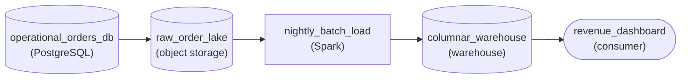

*The order is written once as a row in `operational_orders_db`, copied raw into `raw_order_lake` under its order date, and loaded nightly into `columnar_warehouse`, which `revenue_dashboard` reads.*

1. **Keep the app on a row store**

   Checkout inserts one order and reads it back by its id. A row layout puts all 40 fields of that order together on disk, so each write and lookup touches one small place. That is the operational job, and PostgreSQL does it well.

2. **Land raw files by date in the lake**

   The lake is just files in object storage, organized by convention. Writing each day's orders under an order-date prefix means a reader asking for one day opens one folder, and because files are never edited, yesterday's raw copy stays exactly as checkout wrote it.

3. **Load a columnar warehouse for the scan**

   The nightly batch job reads the day's files and writes them into the warehouse, where the schema is checked before anything lands. Stored column by column, a daily revenue query reads only the date and amount columns, about 5 percent of each order, across all 400 million rows.

| Pitfall: The dashboard does not belong on the checkout database |
| --- |
| Pointing the revenue dashboard straight at PostgreSQL works on day one. Then every query reads every field of every row to sum one, and that scan competes with checkout writes for the same disks. The row layout that makes inserting an order cheap is exactly what makes a 400-million-row sum slow. |

**Follow-up questions**

1. Data science wants the raw order history, including fields the warehouse drops. Which copy should they read?\
   *Whether the lake is recognized as the home for raw and bulk reads.*
2. The nightly warehouse load fails for one day. How do you rebuild just that day?\
   *Whether immutable date-prefixed lake files let you reload one day without touching the checkout database.*


<br>

---

## Key Takeaways

- Storage is plural: the same order lives as a row in the operational database, a column slice in the warehouse and an event in a lake file, because each layout wins a different read.
- A warehouse stores data by column under an enforced schema, with storage separated from compute, and it exists for queries that aggregate a few columns over millions of rows.
- A lake is files in object storage. Raw files are never edited, and everything downstream of them, the cleaned and curated zones, is converted to Parquet.
- An operational database stores whole rows, wraps multi-row writes in ACID transactions and serves OLTP: 1 row by key in milliseconds, hundreds of times a second.
- Analytical queries on the operational database steal disk and processor from checkouts, so a pipeline copies the data out and the reads move to the warehouse or lake.
- Pick a shape by access pattern first. Freshness comes next, judged by what the consumer can actually perceive, and scale after that; add each layer when its question arrives.
