Intermediate·Pipeline Architecture · 32 min · 11 challenges

# Storage Layers: Intermediate

At Netflix, an analyst wants to know how many members in Germany started a new series in its first week. The viewing-history table behind the answer holds years of plays. Written one way, her query reads every byte; written another, it reads a small slice of the table and returns quickly. The difference is how the table is stored.


<br>

---

## Columnar Versus Row Storage

Every storage format decides which bytes sit next to each other on disk. That choice sets how many bytes a query must read and how well they compress. It also sets how fast a CPU can work through them. Take a `page_views` table with 40 columns. They include `country`, `session_id`, `page_url` and `user_agent`, plus a JSON blob in `properties`. Its rows average 290 bytes, and `country` is a 2-letter code.


<br>

### Same rows, 2 layouts

A row layout writes each row's values together, then the next row's. A columnar layout writes each column's values together, then the next column's. Here are 4 rows of `page_views`, with 3 of its 40 columns, in the order each layout puts them on disk.

Row layout, in file order

| Position | Bytes |
| --- | --- |
| 1 | US, s_91, /home |
| 2 | DE, s_17, /cart |
| 3 | US, s_44, /home |
| 4 | US, s_91, /pay |

Columnar layout, in file order

| Position | Bytes |
| --- | --- |
| 1 | US, DE, US, US |
| 2 | s_91, s_17, s_44, s_91 |
| 3 | /home, /cart, /home, /pay |

```sql
SELECT
  country,
  COUNT(*) AS views
FROM page_views
GROUP BY country
```

For this query the row layout leaves the engine no shortcut. The 2 bytes of `country` sit inside every 290-byte row, and storage returns data in blocks of kilobytes or megabytes, so the engine reads every row in full to extract a single field. In the columnar layout the country values form one contiguous run: the engine reads that run and skips the other 39 columns.

- **0.7%** — share of each row the count needs
- **145x** — bytes read, row layout over columnar


<br>

### Why columns compress better

Neighbouring values in a column share a type and often repeat. Millions of `country` values hold around 200 distinct strings, while a single row puts a timestamp beside a URL beside a boolean. Columnar writers turn that sameness into savings with encodings, applied per column before any general-purpose codec runs.

3 encodings a columnar writer picks per column

- **Dictionary encoding.** Each distinct page_type is stored once, and every value becomes a small integer code. With 18 page types, a code needs 5 bits instead of a 10 to 20 byte string.
- **Run-length encoding.** A repeated value is stored once with its count. If a file is sorted by country, 3 million consecutive US values become a single pair: US, 3,000,000.
- **Delta encoding.** Each timestamp is stored as its difference from the previous one. Sorted event times sit milliseconds apart, and small differences need far fewer bits than full timestamps.

Sort order decides how much run-length encoding saves. Written in arrival order, `country` goes US, DE, US, BR, so each run is only 1 or 2 values long. Sorted by country, each country collapses into a single long run.


<br>

### Vectorized execution

The third gain happens inside the CPU. A row-at-a-time engine calls its filter and aggregation code once per row, decoding each row to find the field it wants. A vectorized engine takes a batch of one column's values, typically 1,000 or more, and runs a single tight loop over the batch. The batch sits contiguously in memory and stays in the CPU cache, and modern CPUs can apply a single instruction to several values at once. A columnar file already stores data in that shape, so the engine decodes a column straight into batches.


<br>

### Where rows still win

The operational database from the beginner lessons stores rows on purpose. Its work is a single record at a time: insert order 8841, fetch it with all its fields, update its status. A row layout serves each of those with a single contiguous read or write. In a columnar file, assembling a single row touches 40 separate column regions, and adding a single row means appending to all 40, so columnar files are written in large batches and rarely updated in place.

✓Row layout fits

- Fetching or updating a record by its key
- Thousands of small inserts per second
- Reading most columns of a few rows

✗Columnar layout fits

- Aggregating millions of rows
- Reading a few of many columns
- Writing in large batches, then reading many times


<br>

### Inside a columnar file

A columnar file cuts its rows into row groups, commonly roughly 128MB each; some formats call them stripes. Within a row group each column has its own chunk, so a reader can fetch `country` for a row group without touching `page_url`. The footer at the end of the file records the minimum and maximum value of each column in each row group, along with how many nulls it holds. The pushdown section puts those statistics to work, letting the engine skip row groups without reading them.

| Part of the file | What it holds |
| --- | --- |
| Row group 1 | About 128MB of rows, one chunk per column |
| Row group 2 | The next 128MB of rows, one chunk per column |
| Footer | Schema, plus min, max and null count per column per row group |

**page_views is stored as columnar files with 40 columns. Which query gains the least from the columnar layout?**

- **A.** Count views per country across the whole table
- **B.** Fetch all 40 columns for the 12 views in 1 session
- **C.** Average load_ms per page_type over a year
- **D.** Count distinct session_id per day for a quarter

<details>
<summary>Solution</summary>

**B.** Fetch all 40 columns for the 12 views in 1 session

Correct. It needs every column of a few rows, so the engine reads all 40 chunks and the I/O saving disappears. A row store suits this lookup.

**Why the others are wrong**

- **A.** This reads 1 of 40 columns across every row, the case where columnar layout saves the most.
- **C.** It reads 2 columns over many rows: the scan skips the other 38 and the average runs as a vectorized loop.
- **D.** Again 2 columns over many rows, so the engine reads a small share of each row's bytes.

</details>


<br>

---

## Pipeline Architecture

### Exercise 1 of 2

**● TASK**

A 2-billion-row, 24-column orders fact in PostgreSQL feeds a quarterly report whose queries each aggregate two or three columns, and the dashboard takes 18 minutes because the row store reads every column of every row. Redesign the pipeline so the report's aggregations run on a columnar warehouse loaded from that fact, with the dashboard reading from the warehouse and the row-stored fact off the report's path.

**Starting canvas** (already placed for you):

- Postgres orders fact (2B rows, 24 cols, row-stored) (storage, PostgreSQL)
- Analytical SQL transform (transform, SQL)
- Postgres analytics_mart (storage, PostgreSQL)
- Quarterly report dashboard (consumer, dashboard)


<br>

### Solution

#### Columnar storage: pay for the columns you read

Choosing columnar storage here comes down to the access pattern. The report touches two or three columns, but a row store keeps every column of an order glued together on the same page. So aggregating `total_amount` still drags all 24 columns of every one of the 2B rows through I/O. Columnar storage flips the physical layout: each column lives in its own contiguous run, so a query reads only the columns it names and leaves the rest on disk.

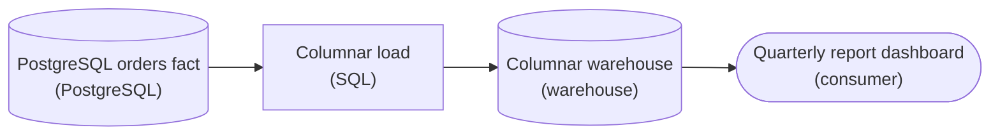

*The row store stays the source of record; the dashboard reads a columnar copy in the warehouse.*

| ✕ Row store | ✓ Columnar store |
| --- | --- |
| The 2B `orders` rows sit page by page with all 24 columns interleaved. `SUM(total_amount)` still pulls `customer_notes`, `shipping_json` and the other 21 columns off disk. The read is sized by the widest row, not by the query. | Each column is a separate contiguous run. `SUM(total_amount)` reads one run, and the other 23 never leave disk. Runs of like-typed values compress hard (dictionary, RLE), so even that one column is smaller, and the engine sums it in vectorized batches. |

| Pitfall: An index doesn't fix a full-column aggregate |
| --- |
| The reflex is a b-tree on `order_date` or a read replica. But a quarterly `GROUP BY` visits most of the 2B rows, so the planner sequential-scans anyway, and a replica just copies the same row layout. The bottleneck is the storage layout, not the query plan or the hardware. |

| Performance: I/O scales with columns touched, not rows stored |
| --- |
| Reading 3 of 24 columns is roughly an 8x cut before compression. Dictionary and run-length encoding on like-typed values often stack another 3-10x on top. That is how an 18-minute scan collapses to seconds: fewer bytes off disk, then vectorized aggregation over those bytes. |

**Follow-up questions**

1. A support tool now needs to fetch one complete order by `order_id`. Which store should it read, and why?\
   *Fetching a whole order by key is the access pattern a row store wins, so the PostgreSQL fact keeps serving that path.*
2. If the report later aggregates 20 of the 24 columns, how much of the columnar win is left?\
   *The I/O cut shrinks toward 24/20, so compression and vectorized execution carry most of what remains.*


<br>

### Exercise 2 of 2

**● TASK**

A daily revenue dashboard reads an orders fact in the data lake that is partitioned by user_id, which left 10 million tiny per-user directories. The dashboard filters on a single day, so its queries cannot prune any of them. Redesign the lake table so it is partitioned by the date the dashboard filters on, in Hive-style folders, and have the dashboard read from it.

**Starting canvas** (already placed for you):

- Postgres orders source (source, PostgreSQL)
- Daily Spark transform (transform, Spark)
- Lake fct_orders/user_id=... (10M tiny dirs) (storage, object storage)
- Daily revenue dashboard (consumer, dashboard)


<br>

### Solution

#### Partition on the column you filter

**Partition pruning** only works when the folder path carries the column a query filters on. An engine sees `fct_orders/event_date=2026-09-16/` and skips every other date folder before it opens a single file. The old layout put `user_id` in the path, so the dashboard's one-day filter had nothing to match, and the engine listed and read all 10 million directories.

| Pitfall: A high-cardinality key is a small-files factory |
| --- |
| Each distinct partition value becomes a directory. Partitioning by `user_id` produced 10 million of them, each holding a few kilobytes of one person's orders. The planner spends its time listing paths and opening tiny files, which is slower than no partitioning at all, and the date filter still prunes nothing. |

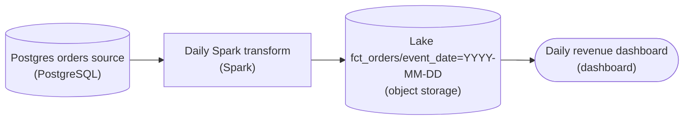

*The Spark job writes the orders fact into Hive-style `event_date=` folders, and the dashboard reads that table.*

1. **Partition the fact by the date the dashboard filters on**

   In the Spark transform the write becomes `partitionBy('event_date')`, which lays the fact out as one folder per day. A year of data is about 365 folders, each holding a full day of orders in files big enough to read efficiently. A query with `WHERE event_date = '2026-09-16'` touches one folder, and a week-long range touches seven.

| ✕ Partitioned by `user_id` | ✓ Partitioned by `event_date` |
| --- | --- |
| 10 million directories of kilobyte files. A one-day filter matches no folder name, so every directory is listed and read. | About 365 folders per year. A one-day filter reads one folder, and the other 364 are never opened. `user_id` stays an ordinary column inside the files. |

| Key insight: Pick the key from the filter, then check its cardinality |
| --- |
| A good partition key is the column most queries filter on, with few enough distinct values that each partition still holds a healthy amount of data. `event_date` passes both tests for a daily dashboard. `user_id` fails the second test by a factor of tens of thousands. |

**Follow-up questions**

1. Most dashboard queries also filter on `region`. Do you add `region` as a second partition column?\
   *Weighs the extra pruning against multiplying the folder count (`event_date` x `region`) and drifting back toward small files.*
2. A finance report scans 5 years of orders by month. Is a daily `event_date` partition still the right granularity for it?\
   *Matching partition granularity to the ranges the queries actually filter on.*


<br>

---

## Partitioning and File Pruning

Columnar files let a query skip columns. Partitioning lets it skip whole files. A partitioned table keeps its files in a directory per value of a chosen column, and the engine compares the query's filter to those directory values before it lists a single data file.

| Directory | Files | Size |
| --- | --- | --- |
| page_views/view_date=2026-10-20/ | 24 | 5.5GB |
| page_views/view_date=2026-10-21/ | 24 | 5.5GB |
| page_views/view_date=2026-10-22/ | 24 | 5.5GB |

`page_views` holds 450 days of history. An hourly load writes each day as 24 columnar files of roughly 230MB, 5.5GB in all. A query filtering on `view_date = DATE '2026-10-21'` reads 1 directory. The other 449 are never even listed, and skipping them that way is partition pruning.

```sql
SELECT
  page_type,
  COUNT(*) AS views
FROM page_views
WHERE view_date = DATE '2026-10-21'
GROUP BY page_type
```


<br>

### Choose the partition column from how the table is filtered

A partition key pays off only when queries filter on it. Partition `page_views` by `load_hour`, the hour the pipeline wrote each row, while analysts filter on `view_date`, and every query still opens every partition, because no filter mentions `load_hour`. Choosing well starts from the query log: count which columns appear in WHERE clauses and how many distinct values each holds.

| Column | Queries filtering on it | Distinct values per day |
| --- | --- | --- |
| view_date | 94% | 1 |
| country | 31% | about 200 |
| page_type | 12% | 18 |
| session_id | 3% | about 9 million |

`view_date` wins on both counts. Almost every query filters on it, and a single value per day gives each partition 5.5GB, enough for files in the hundreds of MB. `session_id` is the opposite case: 9 million partitions a day would hold a few hundred bytes each. `country` sits in between, and the third of queries filtering on it tempts teams to add it as a second level.


<br>

### Country partitions mean thousands of tiny files

Add `country` under `view_date`, keep the hourly load, and each run now writes 1 file per country it saw. With 200 countries across 24 runs, that is up to 4,800 files a day. The 5.5GB splits unevenly: the biggest countries get hourly files of tens of MB, and most get files well under 1MB.

Partitioned by view_date

| For 90 days | Count |
| --- | --- |
| Partitions | 90 |
| Files | 2,160 |
| Average file | about 230MB |

By view_date and country

| For 90 days | Count |
| --- | --- |
| Partitions | up to 18,000 |
| Files | up to 432,000 |
| Average file | about 1.1MB |

Each file carries costs that do not shrink with its size. The engine has to list it and read its footer, and it schedules a task for every file. On object storage, a single request to storage often takes tens to hundreds of milliseconds. A 90-day query on the date-only table pays those costs 2,160 times; on the country-partitioned table it pays them up to 432,000 times, and on a 1MB file the footer is a sizeable share of the bytes. Small files also compress worse and hold row groups too small for their statistics to skip much. The third of queries that filter on country got faster, and all the rest got slower.

> **TIP**
>
> Serve a secondary filter like `country` inside the files: sort each hour's rows by `country` before writing. Each row group's min and max then cover a narrow band of countries, and the engine skips row groups for other countries without multiplying the file count.

✓Do

- Partition on the column most queries filter on
- Keep each partition in the hundreds of MB or more
- Sort within files by secondary filter columns
- Read the query log before choosing a partition column

✗Don't

- Partition on high-cardinality columns like session_id
- Partition on a column no query filters on
- Stack partition levels until files shrink below 1MB
- Pick the partition column from the load schedule instead of the filters

**A payments table lands 3GB of compressed files per day. In the query log, 90% of queries filter on paid_date, 40% on merchant_id (60,000 merchants) and 8% on currency (30 values). Which layout fits?**

- **A.** Partition by paid_date and merchant_id so merchant queries prune
- **B.** Partition by merchant_id alone, since it has the most distinct values
- **C.** Partition by paid_date and currency, since 30 values stay manageable
- **D.** Partition by paid_date and sort each day's rows by merchant_id

<details>
<summary>Solution</summary>

**D.** Partition by paid_date and sort each day's rows by merchant_id

Correct. Partitioning on paid_date matches 90% of queries and keeps 3GB partitions, and the merchant sort gives row groups narrow min and max ranges to skip by.

**Why the others are wrong**

- **A.** A day's 3GB over 60,000 merchant partitions averages 50KB per merchant. Merchant queries prune, and every other query opens thousands of tiny files.
- **B.** High cardinality argues against partitioning on this column, and this drops paid_date, the filter in 90% of queries.
- **C.** Only 8% of queries filter on currency, yet every query now opens up to 30 times as many files, tiny ones for rare currencies.

</details>


<br>

---

## Pipeline Architecture

### Exercise 1 of 2

**● TASK**

An IoT pipeline writes its hourly batch output as GZIP-compressed CSV in a partitioned curated zone, and because each 5GB file cannot be split Spark collapses to one task per file so the dashboard takes 40 minutes to refresh. Replace the curated GZIP-CSV layout with an open columnar lake table format that splits across executors and reads only the columns a query touches, so the work fans out instead of bottlenecking on a single task per file.

**Starting canvas** (already placed for you):

- IoT device telemetry stream (source, Kafka)
- Hourly batch transform (writes GZIP CSV) (transform, Spark)
- Lake fct_telemetry GZIP CSV (5GB/partition, not splittable) (storage, S3)
- Telemetry analytics dashboard (consumer, Looker)


<br>

### Solution

#### Why one file became one task

The 40 minutes comes from the shape of the file, not the amount of data. GZIP is not a splittable codec, so Spark cannot hand the middle of a `.csv.gz` to a second reader. Spark cuts each input into **splits**, and every split becomes one task on one executor core. A 5GB file that cannot be split is exactly one split, so it is exactly one task. A hundred idle executors cannot help decode a stream that only one core may touch.

| Pitfall: More executors do not divide an indivisible file |
| --- |
| The reflex is to add executors or repartition the read. That does nothing, because the bottleneck is one task per file: the extra cores sit idle while a single core inflates 5GB. Writing smaller CSVs gives you more tasks, but you stay row-oriented and still scan every column to read three. The layout is the problem, not the cluster. |

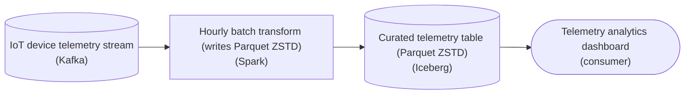

*Same source and dashboard. The curated zone becomes an Iceberg table of ZSTD Parquet, so the read fans out across row groups.*

The fix is a columnar file (Parquet) under an open table format. Parquet compresses each column chunk inside independent **row groups**, and every row group is its own split. One 5GB file now yields dozens of tasks spread across every executor. The codec no longer decides splittability, so it returns to its real job: trading bytes for CPU. For a read-heavy dashboard table, set ZSTD, which gives a near-GZIP ratio at near-Snappy decompression speed. Because values sit column by column, long runs of repeated device and region values compress far better than the interleaved CSV rows did, and a query reads only the columns it touches.

| Key insight: Parquet splits the file; the table format governs it |
| --- |
| Bare Parquet already gives splittable, columnar reads. The table format layer (`Iceberg` / `Delta`) adds the manifest of which files belong to the table, snapshot isolation and partition pruning. The hourly write lands as one atomic commit, so the dashboard never reads a half-written partition. This is the gold tier of a medallion lake: the serving layer uses the query-optimized format. |

**Follow-up questions**

1. The dashboard filters heavily by `event_hour` and `region`. How would you partition the curated table so the engine skips whole days without opening them?\
   *Partitioning as a coarse prune, plus the small-file risk of over-partitioning.*
2. If the format had to stay CSV, what codec would at least give you splits?\
   *Block-splittable codecs like `bzip2` exist; `gzip` is not splittable.*


<br>

### Exercise 2 of 2

**● TASK**

fct_transactions is an Iceberg table partitioned by transaction_date and clustered by customer_id, holding 600 days of history. Add a pushdown-capable query engine between the table and its two consumers, a fraud audit filtering by date and a customer-statement query filtering by customer_id, so both read through the engine and prune by partition and file statistics instead of scanning the full history.

**Starting canvas** (already placed for you):

- fct_transactions (Iceberg, partitioned by transaction_date, clustered by customer_id) (storage, Iceberg)
- Fraud audit query (filter on transaction_date) (consumer, Jupyter)
- Customer statement query (filter on customer_id) (consumer, Metabase)


<br>

### Solution

#### Two filters, one storage layer

**Predicate pushdown** sends the `WHERE` clause down to storage, so storage decides which bytes get read at all. The engine no longer streams every row in and filters afterwards. `fct_transactions` already carries what that decision needs: Iceberg keeps partition membership and per-file min/max column stats next to the data. The missing piece was something that reads that metadata, which is a pushdown-capable engine between the table and both consumers.

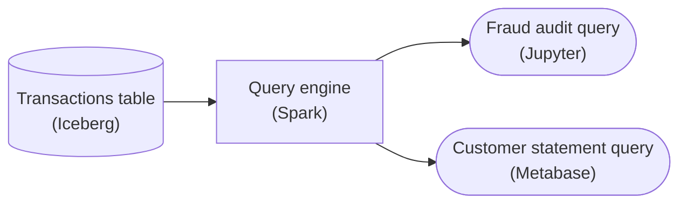

*Both consumers read through the engine. It prunes `fct_transactions` by partition on `transaction_date` and by file stats on `customer_id`, then reads only the files that survive.*

Each consumer uses a different pruning path. The audit filters on `transaction_date`, which is the partition column, so the engine drops whole days from metadata alone and never opens those files. The statement query filters on `customer_id`, and partitioning gives that column nothing. Clustering does help it: each file holds a narrow range of customers, so the engine skips every file whose min/max range cannot contain the target.

| Key insight: Clustering gives the stats something to skip |
| --- |
| Without clustering by `customer_id`, every file would span the whole customer range, and min/max pruning could never rule a file out. Partitioning serves the date filter. Clustering is what makes the second filter cheap. |

| Pitfall: Pushdown belongs to the engine, not the table |
| --- |
| A partitioned, clustered table does not prune itself. Suppose a notebook loads the files and filters in memory. The metadata goes unused and you get the full 600-day scan, with the filter applied only after every byte has been read. |

**Follow-up questions**

1. The statement query adds a date range to its `customer_id` filter. Which pruning runs first, and how does that change the file stats the engine has to check?\
   *Partition pruning and file-stats pruning compose.*
2. A new dashboard filters on `merchant_id`, which is neither partitioned nor clustered. Why does it still scan almost everything?\
   *Pushdown only helps columns that the physical layout supports.*


<br>

---

## Compression: Bytes Versus CPU

Encodings shrink a column using what its values mean. A codec then squeezes the encoded bytes further by finding repeated byte patterns, with no idea what they represent. Every codec sits somewhere on 3 axes: how small it makes the data (ratio), how fast it restores it (decompression speed), and whether a reader can start in the middle of the output (splittability).

| Codec | Ratio | Decompression per core |
| --- | --- | --- |
| LZ4 | about 2.1x | about 4,500MB/s |
| Snappy | about 2.1x | about 1,800MB/s |
| zstd, level 1 | about 2.9x | about 1,700MB/s |
| gzip (deflate), level 1 | about 2.7x | about 400MB/s |

*Round figures on general text, in line with the zstd project's published benchmark. Speed counts the uncompressed bytes produced. Your data will give different numbers, and the ordering usually holds.*

The table splits into 2 families. LZ4 and Snappy give up ratio for speed. zstd and gzip compress harder, but zstd still decompresses quickly while gzip needs around 4 times the CPU per byte decompressed. zstd also offers levels up to 22: higher levels spend more CPU on write for a better ratio, and decompression speed barely changes.


<br>

### Which side of the machine is slower?

The better codec depends on where a query waits. Take a job whose scan decompresses to 600GB, running on 100 cores. Reading and decompressing overlap, so the slower of the 2 sets the pace. From object storage the cluster pulls 5GB/s in total; from local SSD it pulls 100GB/s.

| Codec | On disk | Read, object storage | Read, local SSD | Decompress, 100 cores |
| --- | --- | --- | --- | --- |
| LZ4 | 286GB | 57s | 2.9s | 1.3s |
| Snappy | 286GB | 57s | 2.9s | 3.3s |
| zstd, level 1 | 207GB | 41s | 2.1s | 3.5s |
| gzip, level 1 | 222GB | 44s | 2.2s | 15s |

On object storage every codec decompresses faster than the network delivers, so the job waits on bytes. zstd finishes in roughly 41s against 57s for LZ4 because it moves 79GB less. On local SSD the bottleneck flips: reading takes 2 to 3 seconds for every codec, gzip's 15s of decompression dominates, and LZ4 finishes first at 2.9s while zstd needs 3.5s.

> Choosing by bottleneck
>
> - I/O-bound, such as scans of cold data on remote storage: favour ratio, usually zstd
> - CPU-bound, such as hot data on local disk or in cache: favour decompression speed with LZ4 or Snappy
> - Written once and read thousands of times: pay for a higher zstd level at write time
> - gzip rarely wins on new data: its ratio trails zstd's at about a quarter of the decompression speed


<br>

### Splittability: can 100 cores share one file?

A cluster is fast because many cores read different parts of the data at once. A gzip-compressed CSV file breaks that, because a deflate stream can only be decoded from its beginning. Land a single 20GB gzip CSV and it expands to around 54GB, which 1 core decompresses in roughly 135 seconds while the other 99 wait. Snappy or LZ4 wrapped around a whole CSV file usually has the same problem.

Columnar files avoid this by compressing small pages inside each column chunk independently. A reader jumps to any row group through the footer and decodes it alone, so a columnar file is splittable with every codec in the table. The codec decides splittability only when it wraps an entire file.

✓One core per file

- A CSV or JSON file under whole-file gzip
- A CSV file under whole-file Snappy or LZ4
- Any compressed stream without a block index

✗Many cores per file

- Columnar files with any codec, split by row group
- Uncompressed CSV, split at line breaks
- Formats that compress independent, indexed blocks

> **TIP**
>
> When raw landing files must arrive as gzip, keep each one between 128MB and 1GB so the cluster has many separate files to read in parallel, then rewrite them as columnar files early.

**A nightly job scans 3 years of cold sensor readings stored on object storage as Snappy-compressed columnar files. While it runs, the cluster's CPUs sit at 30%. Which change most likely shortens it?**

- **A.** Rewrite the files with zstd so the job pulls fewer bytes from storage
- **B.** Rewrite the files with LZ4 because it decompresses faster than Snappy
- **C.** Rewrite each day as 1 gzip CSV file for a better ratio than Snappy
- **D.** Turn compression off so the CPUs stop spending time on decompression

<details>
<summary>Solution</summary>

**A.** Rewrite the files with zstd so the job pulls fewer bytes from storage

Correct. Idle CPUs mean the job waits on storage. zstd's better ratio cuts the bytes moved, and the spare cores absorb its decompression.

**Why the others are wrong**

- **B.** Decompression is not the bottleneck at 30% CPU, and LZ4's ratio matches Snappy's, so the bytes pulled stay about the same.
- **C.** The ratio improves, but each file becomes a single core's job, and gzip decodes at a fraction of Snappy's speed.
- **D.** Uncompressed files roughly double the bytes pulled from storage, which is already the bottleneck.

</details>


<br>

---

## Pipeline Architecture

### Exercise 1 of 2

**● TASK**

The DAU dashboard's daily-unique-users SQL scans all 10TB of unpartitioned GZIP CSV clickstream in S3 on every refresh. Rewrite the curated lake as a columnar table format (Delta Lake, Iceberg, or a columnar warehouse), partitioned on event_date and compressed with a splittable codec like ZSTD. Put a pushdown-capable engine such as Spark or Snowflake between that table and the dashboard so the same SQL scans about 100GB.

**Starting canvas** (already placed for you):

- Mobile clickstream Kafka (source, Kafka)
- Daily Spark transform (writes GZIP CSV) (transform, Spark)
- Lake mobile_clickstream GZIP CSV unpartitioned (10TB) (storage, S3)
- DAU dashboard (full 10TB scan today) (consumer, Looker)


<br>

### Solution

#### 4 storage levers that multiply

Storage levers pay off by **compounding, not adding**. A columnar format reads only the columns a query names. Partitioning on `event_date` reads only the days it asks for. A splittable codec lets many workers share the read. A pushdown engine skips the row groups whose min/max statistics cannot match. A rough 10x from columns and another 10x from partition and stats pruning is how 10TB becomes about 100GB.

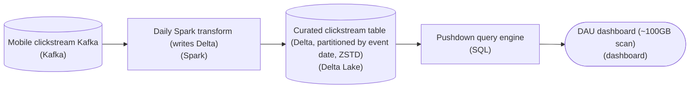

*2 levers are boxes on the canvas: the Delta Lake table and the pushdown engine. Partitioning on `event_date` and ZSTD live in how the transform writes.*

1. **Make the curated table columnar**

   A CSV row stores every attribute of an event side by side, so counting `user_id` per day still drags the whole payload off disk. Delta Lake writes Parquet underneath, and the reader touches only `user_id` and `event_date` while the dozens of other columns stay on disk.

2. **Seat a pushdown engine in front of the dashboard**

   Layout alone saves nothing until something applies the predicate before reading. The engine pushes the `event_date` filter down to skip whole partitions and reads row-group statistics to skip blocks. Without it, the dashboard full-scans the same well-built table.

**The write that encodes partitioning and the codec**

```python
(events_df
    .write
    .format("delta")
    .partitionBy("event_date")
    .option("compression", "zstd")
    .mode("overwrite")
    .save("s3://lake/curated/mobile_clickstream"))
```

*`partitionBy("event_date")` gives one directory per day; ZSTD compresses per Parquet block, unlike whole-file GZIP.*

| Pitfall: One lever caps the others |
| --- |
| Partitioning CSV still reads every column of the chosen days. A pushdown engine pointed at whole-file GZIP still cannot split the read or prune columns. Each missing lever limits what the rest can save, so the 100x appears only when all 4 compose. |

**Follow-up questions**

1. The dashboard moves to a rolling 30-day window. How much of the saving survives?\
   *Partition pruning scales with the date range rather than being all or nothing.*
2. Should you also partition by `event_hour` for hourly DAU?\
   *Over-partitioning creates many small files, which slows every reader.*


<br>

### Exercise 2 of 2

**● TASK**

An ad-tech platform lands every bid event through an 80,000 writes-per-second bidding service and a Kafka firehose, and three teams each need that same data in a different shape. The bidding service answers 12ms point lookups by bid id, the advertiser dashboard scans 365 days of history (2 PB raw) while filtering on date and a handful of columns, and the data science team trains on the full raw bid history. Design the storage so each team reads from a store matched to its access pattern, with the dashboard served from columnar files an engine can prune by date before it scans.

**Starting canvas** (already placed for you):

- Bidding service writes (80K txn/sec) (source, API)
- Bid event firehose (source, Kafka)
- Bid lookup API (12ms primary-key lookups) (consumer, API)
- Advertiser reporting dashboard (365d, 2PB) (consumer, Looker)
- ML model training (consumer, Jupyter)


<br>

### Solution

Storage layout should follow the read. A 12ms point lookup, a 365-day filtered scan and a full-history read each want a different layout on disk, so no single store serves all three well. The answer is to land the bid events once, then write **one copy per access pattern**: a row-oriented key-value store, columnar files partitioned by date, and a raw lake.

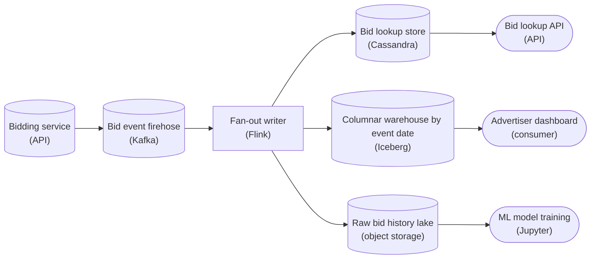

*One firehose fans out into three layouts: a key-value row store for lookups, date-partitioned columnar files for the dashboard, and the raw lake for training.*

1. **Point lookups get a row store keyed on `bid_id`**

   The lookup fetches one whole bid by `bid_id` in 12ms. A row-oriented key-value store like Cassandra keeps that record together under its key, so a single read returns it. A columnar file would have to stitch the row back together from every column, which blows the latency budget.

2. **The dashboard scan gets columnar files partitioned by `event_date`**

   The dashboard touches a date range and a few columns. Columnar files prune columns: a query that needs 5 of 40 columns reads only those 5. Partitioning by `event_date` prunes files: `WHERE event_date BETWEEN ...` skips whole days before any file is opened. Together that is **predicate pushdown**, and it is why a query over 2 PB scans only a small fraction of it. Each column also holds runs of similar values, so it compresses well and the bytes that remain are fewer still. Partition daily on the column queries actually filter on, not by minute, or the engine drowns in tiny files.

3. **ML training reads raw history from the lake**

   The data science team wants every field of every bid, so land the raw history untouched in cheap object storage. The columnar copy can always be rebuilt from this raw one, so a new model or a reworked dashboard table needs no re-ingest.

| Pitfall: One store cannot win all three reads |
| --- |
| It is tempting to point all three teams at the row store the bidding service already writes to. But a 365-day scan over a row store reads every column of every row and competes with 80K writes/sec for IO. The dashboard crawls and the 12ms lookups degrade. When access patterns diverge this far, give each one its own store. |

**Follow-up questions**

1. The firehose can deliver the same bid event twice. How do you keep the `bid_id` store and the lake from double-counting?\
   *Idempotent writes: upsert by `bid_id`, dedupe on a lake key.*
2. What breaks if you partition the columnar copy by `advertiser_id` instead of `event_date`?\
   *The partition key must match the dashboard's real filter, not a high-cardinality column.*


<br>

---

## Predicate Pushdown

Partitions and footer statistics save bytes only when the engine compares the query's filter to them before reading. Predicate pushdown is that hand-off: the engine moves a filter from the query down into the scan, which tests it against partition values, row-group min and max, and bloom filters. A filter left above the scan runs after the data is read, so every byte gets fetched first.


<br>

### One filter, 2 spellings

`fct_orders` is partitioned by `event_date` and `country`. 3 days times 2 countries gives 6 partitions. Each partition holds 1 file of 5 row groups of 128MB, and the footer records min and max `order_ts` for each row group. The query asks for orders placed on 2026-04-22 at or after 19:00. Switch between the 2 spellings and watch which row groups the engine opens.

The filter compares the partition and timestamp columns directly

S3 Parquet

fct_orders

Trino

query

6 files3,840 MB30 row groups

event_date · countryrow groups by order_ts (min to max)

2026-04-21 · US00–06h06–12h12–18h18–21h21–24h

2026-04-21 · DE00–06h06–12h12–18h18–21h21–24h

2026-04-22 · US00–06h06–12h12–18h18–21h21–24h

2026-04-22 · DE00–06h06–12h12–18h18–21h21–24h

2026-04-23 · US00–06h06–12h12–18h18–21h21–24h

2026-04-23 · DE00–06h06–12h12–18h18–21h21–24h

the query

SELECT… FROM fct_orders

WHEREevent_date = '2026-04-22'

ANDorder_ts >= '2026-04-22 19:00:00'

0 MBread of 3,840 MB

What the filter lets the engine skip

1/9

```sql
SELECT
  order_id,
  order_ts
FROM fct_orders
WHERE event_date = DATE '2026-04-22'
  AND order_ts >= TIMESTAMP '2026-04-22 19:00:00'
```

```sql
SELECT
  order_id,
  order_ts
FROM fct_orders
WHERE DATE(order_ts) = DATE '2026-04-22'
  AND HOUR(order_ts) >= 19
```

The first spelling names `event_date`, so the engine keeps the 2 partitions for 2026-04-22 and drops the other 4. Inside each file it compares 19:00 to each row group's max `order_ts`. The first 3 row groups end at 18:00:00 or earlier and are skipped; the last 2 are read. That is 4 row groups and 512MB of file, out of 30 row groups and 3,840MB. The second spelling filters on `hour(order_ts)`, a value no footer stores, and never mentions `event_date`, so unless the engine rewrites it, the scan reads all 30 row groups and filters the rows afterwards.

- **7.5x** — less data scanned by the first spelling


<br>

### Writing filters the scan can test

4 habits that keep a filter pushable

- **Compare the bare column.** order_ts >= TIMESTAMP '2026-04-22 19:00:00' can be tested against min and max; hour(order_ts) >= 19 cannot.
- **Filter the partition column itself.** A condition on order_ts tells the engine nothing about the event_date directories, so state the event_date condition as well.
- **Move arithmetic to the constant side.** Write event_date >= DATE '2026-04-22' instead of date_add('day', 7, event_date) >= DATE '2026-04-29'.
- **Match types.** Compare a DATE column to a DATE literal. When types differ, the engine may cast the column on every row, and a cast column can lose its pushdown.

*Some engines rewrite a few common wrappers, such as a cast from timestamp to date, back into a range on the bare column. Whether yours did shows up in the plan, covered below.*

**Which filter lets the engine skip fct_orders row groups using the footer's min and max order_ts?**

- **A.** hour(order_ts) BETWEEN 19 AND 23
- **B.** CAST(order_ts AS varchar) >= '2026-04-22 19:00:00'
- **C.** order_ts >= TIMESTAMP '2026-04-22 19:00:00'
- **D.** date_add('hour', 5, order_ts) >= TIMESTAMP '2026-04-23 00:00:00'

<details>
<summary>Solution</summary>

**C.** order_ts >= TIMESTAMP '2026-04-22 19:00:00'

Correct. A bare column against a typed literal is checked against each row group's max order_ts, so row groups ending before 19:00 on 2026-04-22 are skipped.

**Why the others are wrong**

- **A.** The condition wraps order_ts in a function, so the scan has no stored value to compare it with.
- **B.** The footer stores timestamp values, and casting every row to text hides the column from those statistics.
- **D.** It selects the same rows as the bare comparison, but the arithmetic sits on the column. Move the 5 hours to the constant side.

</details>


<br>

### Bloom filters for needle lookups

Min and max help when values are clustered: a row group spanning 06:00 to 12:00 rules itself out for 19:00. They fail on a column like `customer_id`, whose values are scattered, so every row group's min and max span almost the whole id range. A bloom filter fills that gap. At write time the writer builds a small bit array per row group from every `customer_id` in it. At read time the engine asks whether `c_48213` could be present. A no is certain, and the row group is skipped. A yes means possibly, with a false-positive rate set at write time, often about 1%.

```sql
SELECT
  order_id,
  order_ts
FROM fct_orders
WHERE event_date = DATE '2026-04-22'
  AND customer_id = 'c_48213'
```

Say the customer ordered once on 2026-04-22, so the order sits in 1 of the 10 row groups across that date's 2 files. The bloom filters rule out the other 9, barring a false positive. They only help with equality and short `IN` lists. Neither `customer_id LIKE 'c_48%'` nor a range filter gets anything from them. They also exist only for columns the writer was configured to build them on.


<br>

### Verify with EXPLAIN

Pushdown is the engine's decision, so check it instead of assuming it. `EXPLAIN` prints the plan without running the query. `EXPLAIN ANALYZE` runs it and adds what each step actually read.

To check the first spelling, put `EXPLAIN ANALYZE` on the line above its `SELECT` and run it. The plan lists the scan of fct_orders with the constraint the engine pushed into it, and the input size that scan read.

| Where to look | Filter pushed down | Filter not pushed down |
| --- | --- | --- |
| Constraint on the fct_orders scan | Names event_date with 2026-04-22 | No event_date constraint |
| Input size the scan reports | A small share of the table | Close to the full size of the columns read |

> **TIP**
>
> Run `EXPLAIN ANALYZE` on both spellings and compare the input size each scan reports. A wide gap means pushdown worked; matching numbers mean it did not.

**A customer placed 1 order on 2026-04-22. EXPLAIN ANALYZE on a query filtering event_date = DATE '2026-04-22' and customer_id = 'c_48213' shows the scan read all 10 row groups for that date. What is the likely cause?**

- **A.** Bloom filters only work on partition columns such as event_date
- **B.** The files were written without bloom filters on customer_id
- **C.** The event_date condition used up the pushdown, so the second was ignored
- **D.** Equality conditions use min and max only, and bloom filters need LIKE

<details>
<summary>Solution</summary>

**B.** The files were written without bloom filters on customer_id

Correct. Scattered ids defeat min and max, so only a bloom filter could skip the 9 row groups without the order, and it must be built at write time.

**Why the others are wrong**

- **A.** Partition columns need no bloom filter, since the directory name already prunes them. Bloom filters serve data columns like customer_id.
- **C.** Engines push down every eligible condition together. The date condition did its part by narrowing the scan to 2 files.
- **D.** It is the reverse: bloom filters answer equality and short IN lists, and give nothing to LIKE patterns.

</details>


<br>

---

## Pipeline Architecture

### Exercise 1 of 2

**● TASK**

A support platform keeps 600 million tickets, 40 columns wide, in MySQL, a row store the agent console reads by ticket id to open one whole ticket. A new dashboard of weekly average resolution time by team scans just 3 of those 40 columns across every ticket, and data up to a day old is fine. Design the pipeline so each access pattern reads from the storage layout that suits it.


<br>

### Solution

#### Two reads, two layouts

Row versus columnar storage is a question of which bytes sit next to each other on disk. MySQL writes each ticket's 40 fields together, so opening one ticket by id is a single short read that returns everything the console shows. The dashboard asks the opposite question: 3 fields, every ticket. Against the row layout, that scan drags all 40 columns of 600 million rows off disk and throws away 37 of every 40.

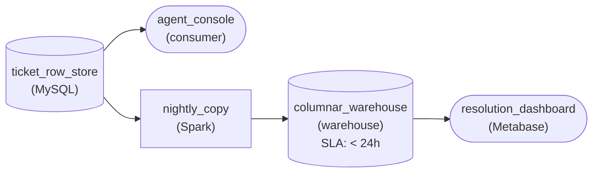

*The `ticket_row_store` keeps serving whole-ticket lookups to the `agent_console`; a nightly Spark copy refreshes the `columnar_warehouse` at least daily for the dashboard to scan.*

| Performance: 3 columns out of 40 is a 13x cut |
| --- |
| At roughly 2KB per ticket row, a full scan of MySQL reads about 1.2TB to answer the weekly question. The columnar copy reads only team, opened time and resolved time, about 3/40 of that, near 90GB. Wall clock time drops by a similar factor because the scan is bound by bytes read, not CPU. |

| Pitfall: Columnar everywhere slows the console |
| --- |
| The tempting fix is to move every ticket read to the warehouse. A column store keeps each field in its own chunk, so rebuilding one whole ticket means touching 40 separate places, and the console's single-ticket lookups get slower. Keep the row store for the read it was built for and give the scan its own columnar copy. |

| Real world: Two copies is the normal shape |
| --- |
| Most teams run exactly this split: the application database stays row-oriented for key lookups, and a daily batch job copies the data into a columnar warehouse or a Parquet-based lake for analytics. |

**Follow-up questions**

1. Support wants to export 50 sample tickets with all 40 columns. Which store should serve it?\
   *Checks that whole-row reads by key still point at the row store.*
2. The dashboard grows to read 30 of the 40 columns. Does the columnar copy still pay off?\
   *Checks that the win scales with the fraction of columns a scan touches.*


<br>

### Exercise 2 of 2

**● TASK**

Parcel scanners emit 2 TB of scan events a day into a stream, and a nightly batch job loads them into a lake table kept for three years. Analysts query it from notebooks, always filtering on scan date and usually the last 7 days, while about 400 million distinct shipment IDs appear each day. Draw the stream, the nightly load, the lake table and the notebooks, naming the lake table for the partition key you choose.


<br>

### Solution

#### Partition on the column every query filters

Partitioning is a bet on the filter: the table is split into folders by a column's value, and any query that filters on that column skips every other folder before a byte is read. Every notebook query here filters on scan date, so `scan_date` is the key. Three years of daily data becomes 1,095 Hive-style folders like `scan_date=2026-10-04/`, and a 7-day query lists and opens 7 of them.

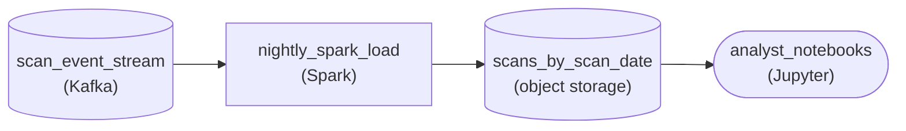

*The nightly `Spark` load writes Hive-style `scan_date=` folders that notebook queries prune to a week.*

| Performance: A week reads 7 of 1,095 folders |
| --- |
| Each daily partition holds about 2 TB, plenty to split into healthy file sizes. A 7-day query touches roughly 14 TB instead of the 2.2 PB the full three years hold, a cut of more than 99 percent that happens while the engine plans the query, not while it scans. |

| Pitfall: A key with 400 million values is a file factory |
| --- |
| Putting `shipment_id` in the partition path, alone or under `scan_date`, writes about 400 million directories a day of roughly 5 KB each. The engine spends its time listing and opening tiny files, and since no notebook query filters on shipment, nothing is pruned in return. A good key has a bounded number of values and matches the common filter. |

| Key insight: Partition no finer than anyone filters |
| --- |
| Hourly partitions would give 26,280 folders of about 83 GB each. Analysts slice whole days, so every query would open 24 folders to get what one daily folder already holds: more metadata, no extra pruning. |

**Follow-up questions**

1. Analysts start filtering on one of 12 regions as well. Should `region` join `scan_date` in the partition path?\
   *Checks the cardinality math for a second key: 12 x 1,095 partitions of roughly 170 GB each stays bounded.*
2. Some scans arrive up to three days late. Which `scan_date` partitions does the nightly load have to write?\
   *Connects the partition key to late-arriving data: the load rewrites a small window of recent folders, not the whole table.*


<br>

---

## Turning a 10TB Scan Into 100GB

Each technique so far cut bytes on its own. Applied to a single table, the cuts multiply. Here is `page_views` as it first landed: 450 days of uncompressed, row-oriented CSV, 10TB in all. It has 40 columns, and its rows average 290 bytes. The quarterly report counts sessions per country and page type over the last 90 days, excluding bots.

```sql
SELECT
  country,
  page_type,
  APPROX_DISTINCT(session_id) AS sessions
FROM page_views
WHERE view_date >= DATE '2026-07-25'
  AND is_bot = FALSE
GROUP BY country, page_type
```

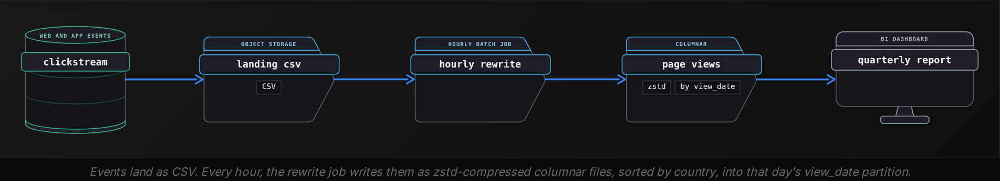


<br>

### 3 factors, multiplied

| Step | What the scan skips | Factor | Bytes scanned |
| --- | --- | --- | --- |
| Start: row CSV | Nothing | 1x | 10TB |
| Partition by view_date, filter on it | 360 of 450 days | 5x | 2TB |
| Columnar files | 36 of 40 columns, 232 of 290 bytes | 5x | 400GB |
| Encodings plus zstd | 3 of every 4 bytes in those columns | 4x | 100GB |

Each factor comes from an earlier section. Partitioning removes the days the report does not ask for, and it works only because the WHERE clause compares `view_date` directly, the pushdown habit. Columnar layout removes 36 of the 40 columns. Encodings and zstd shrink what remains 4x, helped by the country sort that lengthens runs. The order of the steps changes nothing, because each factor divides the bytes that are left.

- **100x** — less data read per quarterly report


<br>

### Remove one piece, keep the rest

| Missing piece | Bytes scanned | Why |
| --- | --- | --- |
| Nothing | 100GB | All 3 factors apply |
| Pushdown: filter written as date_format(view_ts, '%Y-%m-%d') >= '2026-07-25' | Over 500GB | No partition pruned, and view_ts becomes a fifth column read |
| Partitioning | Over 500GB | All 450 days of the 4 columns, plus a date column to filter |
| Encodings and compression | 400GB | Partitions and columns still cut 25x |
| Columnar layout | 500GB | Whole rows for 90 days, even granting row files 4x compression |

*A table without partitions can still skip row groups by the min and max of a date column if its files were written in date order. To find out which ones to skip, though, the engine first reads the footer of every file across all 450 days.*

The cheapest piece to lose is the one that costs nothing to keep. A single function around a timestamp turns the 100GB report back into a scan of more than 500GB, while the files themselves stay exactly as they were. Columnar layout and compression pay off whatever the filter says, so they are defaults; partitioning is a per-table decision that pays only when filters reach it.

**On the final page_views layout, a query reads page_url and load_ms, which average 87 of each row's 290 bytes and also compress 4x. It filters view_date directly over the last 9 days. About how many bytes does it scan?**

- **A.** About 750GB
- **B.** About 60GB
- **C.** About 150GB
- **D.** About 15GB

<details>
<summary>Solution</summary>

**D.** About 15GB

Correct. Those columns are 87/290 of 10TB, or 3TB; 4x compression leaves 750GB, and 9 of 450 days leaves 15GB.

**Why the others are wrong**

- **A.** That is both columns compressed across all 450 days. The view_date filter still prunes 441 of them.
- **B.** That prunes partitions and columns but leaves out the 4x from encodings and zstd.
- **C.** That divides by 5 for partitions, as the quarterly report did, but 9 of 450 days is a 50x cut.

</details>


<br>

### Going below 100GB

The quarterly report reads every country, so the country sort helped only compression. A Germany-only version adds `country = 'DE'`, and row-group min and max on `country` can now prune, but only a whole row group at a time. Each hourly file of about 230MB holds 2 row groups, so German rows share row groups with other countries and the scan falls at best to about half, near 50GB. A daily job that rewrites each day sorted by country makes about 43 row groups per day; if German views are 6% of traffic, they fill about 3 of them, and the scan approaches 6GB.

**A teammate proposes adding country as a second partition level under view_date, keeping the hourly load, so the Germany report prunes better. What happens to the quarterly report?**

- **A.** Roughly the same bytes, now spread across up to 432,000 small files
- **B.** About 200 times fewer bytes, since each country becomes its own partition
- **C.** No change at all, because the report has no filter on country
- **D.** The query fails, because a partition column cannot appear in GROUP BY

<details>
<summary>Solution</summary>

**A.** Roughly the same bytes, now spread across up to 432,000 small files

Correct. The report reads every country, so nothing extra is pruned, while its file count for 90 days climbs from 2,160 to up to 432,000, each with fixed per-file costs.

**Why the others are wrong**

- **B.** Partition pruning needs a filter on the partition column, and the quarterly report has no country filter.
- **C.** The bytes barely move, but the file count does: the report slows down because the engine has to list every tiny file and read each one's footer.
- **D.** Partition columns can be selected and grouped like any other column; the engine reads their values from the directory path.

</details>


<br>

---

## Pipeline Architecture

### Exercise 1 of 1

**● TASK**

A nightly Spark batch rewrites 4 TB a day of raw JSON payment logs from a raw landing zone into a Parquet curated table that a reporting dashboard scans dozens of times a day. The table uses Snappy today, and dashboard reads are bound by bytes pulled from storage. Design the pipeline from raw landing to the dashboard, and choose the curated table's codec to shrink bytes read without slowing decompression, naming it on that stage.


<br>

### Solution

#### Pick the codec, not whether to compress

Compression trades CPU for bytes, and on this table the trade is lopsided. The curated table is written once a night and scanned dozens of times a day. Every byte the codec removes is saved on every scan, while the extra compression work is paid once. With storage reads as the bottleneck, the only real question is which codec. **ZSTD** answers it: GZIP-like ratios at near-Snappy decompression speed, so the 4 TB nightly rewrite lands as fewer bytes without making any dashboard query slower.

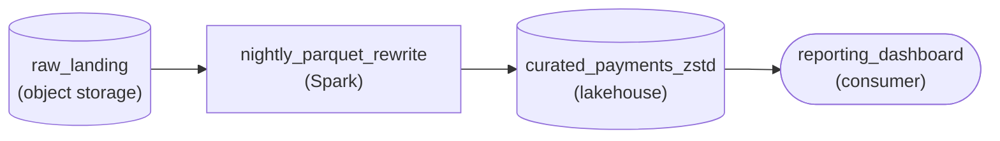

*Raw JSON lands in object storage, the nightly Spark batch rewrites it as ZSTD Parquet in `curated_payments_zstd`, and the dashboard scans that table.*

| Key insight: Pay to compress once, save on every scan |
| --- |
| ZSTD compresses more slowly than Snappy, but that cost lands in the nightly Spark job, which has room in its window. Decompression is what the dashboard pays on every scan, and ZSTD keeps it close to Snappy. Set the codec explicitly on the table, because Parquet writers still default to Snappy. |

| Pitfall: GZIP shrinks bytes but taxes every read |
| --- |
| Switching to GZIP gets a similar ratio, but its slow decompression is paid on each of those dozens of daily scans, which swaps an I/O bottleneck for a CPU one. Leaving Snappy in place is the other miss: it is the default because of history, not because it suits a read-heavy table. |

| Real world: New analytical tables can start on ZSTD |
| --- |
| Spark, Iceberg, Delta and Trino all read ZSTD natively, so a new read-heavy table can pick it from day one. The math changes only when reads are rare: a cold archive cares about ratio far more than decompression speed. |

**Follow-up questions**

1. What changes if the raw JSON must be archived for seven years and read about once a year?\
   *Whether ratio or decompression speed matters when reads almost never happen.*
2. Why does the curated Parquet table compress far better than the raw JSON under the same codec?\
   *How a columnar layout puts runs of similar values next to each other.*


<br>

---

## Putting It All Together

Suppose a Netflix analyst owns a weekly report on German members watching a new series. The viewing-history table behind it sits on remote object storage as zstd-compressed columnar files, partitioned by view date and sorted by country within each day. The report filters the date column directly, and EXPLAIN ANALYZE shows it reading 7 daily partitions and a few row groups per day instead of years of plays.

- Partitioning by view date pays only because the report's filter names the date column directly; a function around a timestamp would send the scan through every day.
- Sorting each day by country lets row-group min and max skip other countries without adding a partition level and its flood of tiny files.
- Remote object storage makes the report I/O-bound, so a high-ratio codec like zstd shortens it more than a faster codec would.
- Columnar layout limits the scan to the few columns the report names, and the encodings on those columns multiply the codec's saving.


<br>

---

## Pipeline Architecture

### Exercise 1 of 2

**● TASK**

An API gateway lands 3 TB a day of raw JSON access logs in object storage, and analysts query one day of logs for one of 200,000 tenants at a time. Design a nightly batch job that rewrites the logs into a Parquet table, laid out so this query prunes by partition first and then skips row groups by their min/max statistics. Label the table's storage stage with its partition key and in-file sort order. Analysts read the table from a dashboard.


<br>

### Solution

#### Coarse partition, fine statistics

Predicate pushdown works in levels, and this layout lets 2 of them fire on the same query. The day partition prunes whole days before any file is opened. Inside the surviving day, each Parquet footer records a min and max `tenant_id` per row group, and the engine skips every row group whose range cannot hold the tenant asked for. Of a day's data, a single-tenant lookup ends up touching one or two row groups.

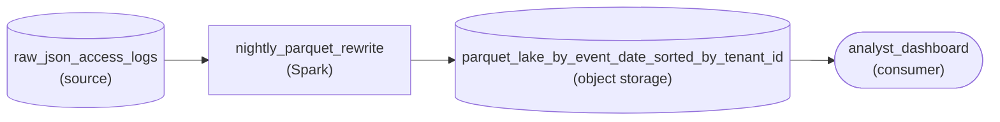

*Raw JSON is rewritten nightly into Parquet partitioned by day and sorted by tenant, so pruning works at both levels.*

1. **Partition on `event_date` at day grain**

   Every query names one day, so the day is the coarse filter. Four hundred days of history become four hundred partitions, and a lookup opens one of them. Hourly partitions would multiply file counts without any pruning these queries can use.

2. **Sort each day's files by `tenant_id`**

   Min/max statistics only skip a row group when its range is narrow. Written in arrival order, every row group holds hundreds of tenants and spans nearly the whole key range, so nothing is skipped. Sorting by `tenant_id` during the nightly rewrite gives each row group a tight, non-overlapping slice.

| Pitfall: Tenant is a sort key, not a partition key |
| --- |
| Partitioning by `tenant_id` looks like the most direct pushdown, but 200,000 tenants means 200,000 directories a day, most holding a few kilobytes. The engine spends its time listing and opening tiny files. A high-cardinality filter belongs in row-group statistics inside a coarse partition. |

| Key insight: Pushdown is designed at write time |
| --- |
| The footer statistics exist only because the nightly job writes Parquet; the raw JSON carries none, so a query against it reads every byte. The sort order is fixed at that same moment, which makes the rewrite the place where pushdown is won or lost. |

**Follow-up questions**

1. Security needs every log line for one `request_id` on a given day, and the IDs are random. Why do min/max statistics skip nothing here, and which finer level helps?\
   *Bloom filters for high-cardinality equality lookups.*
2. A few queries filter on `status_code` instead of tenant. What does the current sort order do for them?\
   *Only the sort column gets narrow row-group ranges.*


<br>

### Exercise 2 of 2

**● TASK**

Video players emit 6 billion playback heartbeats a day, 2 TB of raw JSON with 30 fields from 40 million devices in 8 regions, into a raw landing zone kept 18 months. A nightly batch job rewrites each day into a curated table that a dashboard reads for buffering ratio by region over the last 7 days and that support engineers query for one device on one day. Design the pipeline and put the curated table's file format, codec and partition key in its stage name, picking a key that lets both queries skip files without producing tiny ones.


<br>

### Solution

#### Partition on the filter every reader shares

A partition key is a promise about how the table will be read: every query that filters on it skips whole folders, and every query that does not pays for all of them. 2 readers share this table, so the key has to be the filter they have in common, the day, and it has to stay coarse enough that each partition still holds large **columnar files**. Parquet and ZSTD then cut the bytes inside each surviving partition, and the device lookup gets its narrowing from file statistics rather than from the key.

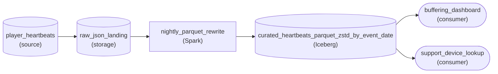

*Raw JSON lands in the lake, a nightly Spark rewrite writes ZSTD Parquet partitioned by `event_date`, and both readers prune to their own days.*

1. **Start from the filters both readers share**

   The dashboard filters a 7-day range and a region; the support lookup filters one day and one `device_id`. The day appears in both, so `event_date` prunes for both: 7 of about 540 date folders for the dashboard, 1 for support. A `device_id` key would help only support and make the dashboard open every folder.

2. **Check cardinality against file size**

   Divide a compressed day by the number of key values. About 250 GB a day over 8 regions is roughly 31 GB per region-day, so adding `region` still leaves files of hundreds of MB. Over 40 million devices it is about 6 KB each: millions of tiny files and a listing slower than the read.

3. **Let format and codec shrink what survives**

   Rewriting JSON as Parquet lets the dashboard read 3 of 30 columns instead of whole rows, and ZSTD shrinks those column chunks further while Parquet stays splittable. Sorting each day by `device_id` before writing gives every row group a tight min/max range, so the support lookup skips nearly all row groups in its one partition.

| Performance: From a petabyte of JSON to tens of gigabytes |
| --- |
| 18 months of raw JSON is about 1 PB. The dashboard's query opens 7 date partitions (about 1.75 TB compressed), reads 3 of 30 columns (about 175 GB), and with `region` in the key only one region's folders (roughly 20 GB). The cost concentrates in the nightly rewrite, which reads 2 TB once so later queries never have to. |

| Pitfall: A near-unique key makes file listing the bottleneck |
| --- |
| Partitioning by `device_id` feels right because support looks devices up, but 40 million values a day means about 6 KB per file and over 20 billion files across 18 months. Listing them costs more than reading the data, and the dashboard prunes nothing. High-cardinality filters belong to row-group statistics, not to the folder layout. |

**Follow-up questions**

1. Support now needs a `session_id` lookup across 30 days without knowing the day. Does the key change?\
   *Whether you reach for row-group statistics or bloom filters instead of a high-cardinality partition key.*
2. Raw volume grows to 40 TB a day. Is a daily partition still the right grain?\
   *Re-checking partition size against file size: day plus region, or hourly, may now fit.*


<br>

---

## Key Takeaways

- Columnar layout reads only the columns a query names, compresses well because neighbouring values match, and feeds vectorized loops.
- Pick the partition column from the filters in the query log, and keep partitions in the hundreds of MB so the table does not fill up with tiny files.
- Choose a codec by bottleneck: ratio when the job waits on storage, decompression speed when it waits on CPU.
- Columnar files split by row group with any codec, while a whole-file gzip CSV keeps 1 core busy and the rest idle.
- Compare bare columns to typed literals so filters can prune partitions and reach the min and max statistics and bloom filters inside each file, then confirm with EXPLAIN ANALYZE.
- The savings multiply: partitions and column pruning each cut the bytes 5x, compression cut them another 4x, and a 10TB scan became 100GB.
