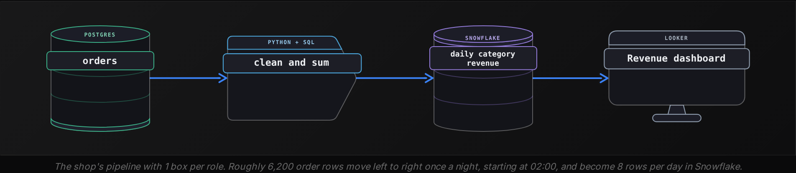
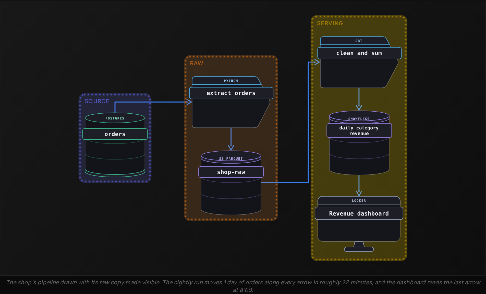
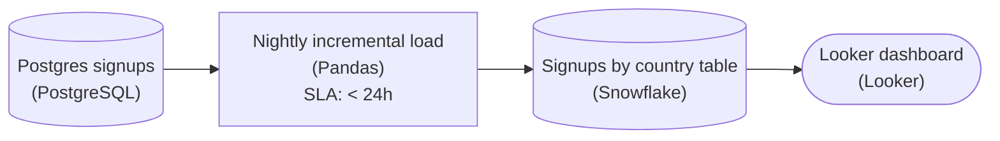
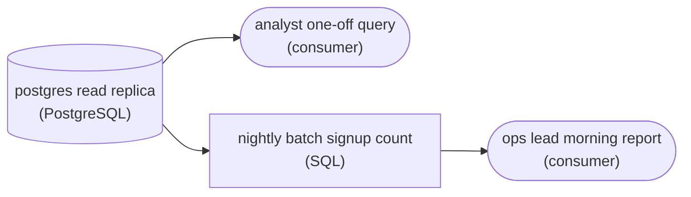
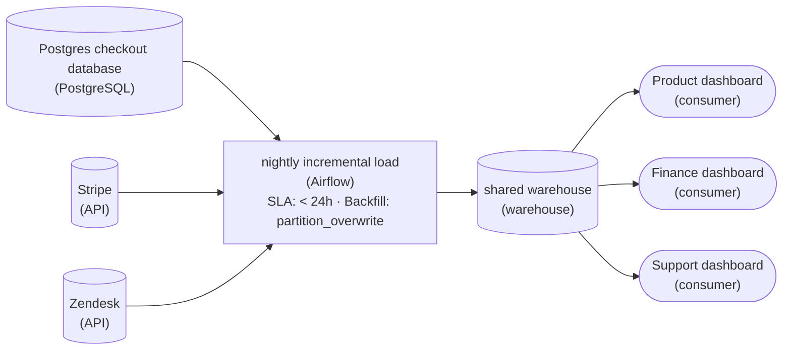
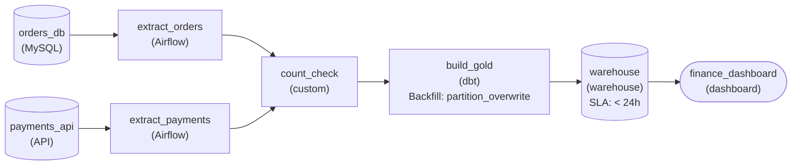
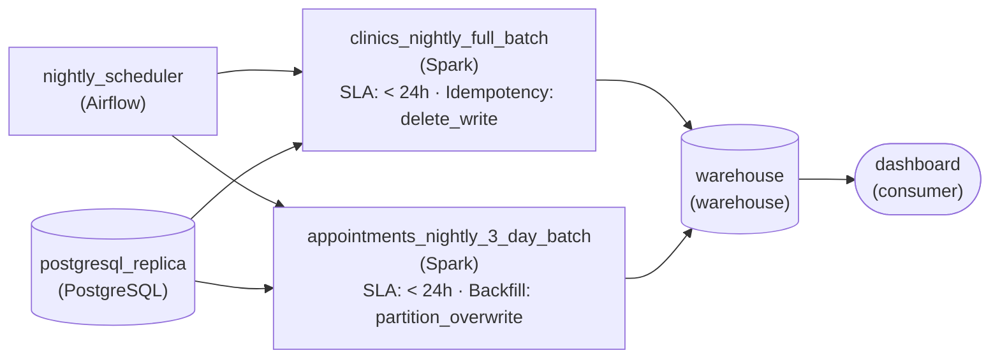
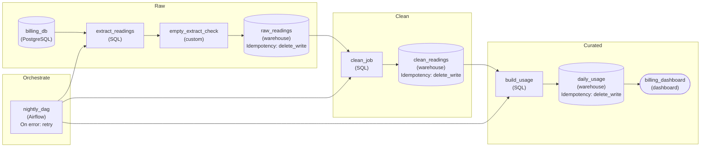

Beginner·Pipeline Architecture · 20 min · 6 challenges

# Pipeline Anatomy: Beginner

At 8:00 every weekday a finance lead opens a dashboard and reads yesterday's sales, already summed by category, without anyone having run a job by hand. The orders sat in a checkout database at midnight, and by morning they were in a different system, in a different shape, with the test purchases removed. The machinery that did that overnight is what this lesson takes apart, one box at a time.


<br>

---

## Why Pipelines Exist

### One chart, 3 attempts to produce it

A small online kitchenware shop sells pans and knives, along with kettles, through a website that writes every purchase to a Postgres table called orders: around 6,200 rows a day, 2 million in total. The finance lead wants a chart of yesterday's revenue by product category, refreshed before she arrives. Each of the 3 attempts to give it to her exposes 1 of the 3 gaps a pipeline exists to close.

The first attempt runs a report query straight against the checkout database. It returns the right numbers, and it scans 2 million rows on the machine that is also taking payments. Postgres serves a checkout with thousands of reads and writes of 1 row each, so a scan over 2 million rows competes for the same disk and memory. On a busy morning the report pushes checkout latency from 200 milliseconds to 2 seconds while it runs. That is the load gap: the system that records the data is tuned for a workload the opposite of analysis, and asking it to do both slows the business it serves.

The second attempt moves the work onto a person. An analyst exports yesterday's orders as a CSV at 7:30 and converts the amount column from text to numbers. She drops the 20 or so test orders developers placed from company email addresses, then sums by category and emails the chart. The conversion and the sum are needed because orders holds 1 row per purchase with the amount stored as a string, and the chart needs 1 row per category per day with a decimal total. That's the shape gap: data is recorded in the shape that made the sale fast to write, and read in the shape that makes a question fast to answer, and the 2 shapes differ in almost every real system.

The analyst's version holds for 3 weeks, until she takes a holiday. The chart shows Friday's numbers until Wednesday, because the export lived in 1 person's calendar and nobody else owned it. That is the schedule gap: the work recurs every day at a fixed time, and anything that depends on a human remembering it is eventually skipped. The finance lead made 2 pricing decisions that week on numbers 4 days old.

> The 3 gaps a pipeline closes
>
> - Load gap: the source system cannot absorb analytical reads without slowing the business function it exists for.
> - Shape gap: data is written 1 row per event and read as totals and joins, so it must be reshaped before use.
> - Schedule gap: the work recurs on a timer, and only a machine runs a timer without ever forgetting.


<br>

### What a pipeline is

A data pipeline is a sequence of automated steps that moves data from the system where it is produced to the system where it is used, reshaping it on the way. For the shop that means a process that copies each day's purchases out of Postgres during the quiet hours and converts and cleans them. It stores the result in a system built to scan millions of rows, then refreshes the chart, all on a timer and with nobody in the loop. The copy closes the load gap and the timer the schedule gap. Cleaning and summing close the shape gap.

The word covers a 40-line Python script on a cron timer and a graph of 300 coordinated jobs equally. Whatever its size, a pipeline starts itself: the run on 15 March begins at 02:00 because a scheduler started it. It's repeatable, so the same day's input produces the same output on every run. And it is owned: a named person or team is paged when it fails. A script someone runs by hand when they remember is a report, however much code it contains.


> **TIP**
>
> Before building anything, write down which of the 3 gaps the request shows. A request that shows only the load gap is usually solved by something cheaper than a pipeline, and the last section of this lesson covers those alternatives.

**The support team runs a query at 9:00 every morning against the checkout database to count yesterday's refunds grouped by reason, then pastes the counts into a shared sheet before standup. Which gaps does this task show?**

- **A.** Only the load gap, because the query runs on the production database
- **B.** All 3: load (a scan on the checkout database), shape (refund rows regrouped by reason), schedule (daily, by a person)
- **C.** Only the schedule gap, because the numbers are correct when the query runs
- **D.** None of them, since a query that works needs no pipeline

<details>
<summary>Solution</summary>

**B.** All 3: load (a scan on the checkout database), shape (refund rows regrouped by reason), schedule (daily, by a person)

Each gap is present. The scan competes with checkout traffic, the output is a different shape from the refund rows, and the 9:00 timing depends on someone remembering.

**Why the others are wrong**

- **A.** The load gap is present, and so are the other 2: the refunds are regrouped by reason, and the query runs every morning by hand.
- **C.** Correct output says nothing about the cost of producing it. The query still loads the checkout database and still reshapes rows into counts.
- **D.** The analyst's CSV export also worked, until a holiday. A task that shows all 3 gaps is the textbook case for a pipeline.

</details>


<br>

---

## The Four Roles in Any Pipeline

Every pipeline, from the shop's nightly copy to the systems behind a streaming service's recommendations, is built from the same 4 roles. Naming them turns any pipeline diagram into something readable, because every box in one is playing exactly 1 of them at that point in the flow.


<br>

### Source

A source is a system that produces data as a side effect of running the business. The shop's Postgres orders table exists so the checkout can record a sale, and the fact that finance wants a chart from it played no part in its design. Other sources: a payments API such as Stripe, a clickstream from the website, log files from a server, a SaaS tool's export endpoint. Like the orders table, every source is shaped for the operational job rather than for analysis, and none can be asked to work harder without risk to the business function it exists for. Both facts shape everything downstream. A pipeline reads from a source and never writes back to one.


<br>

### Transform

A transform is a step that reads data in 1 shape and writes it in another. The shop's transform converts amount strings to decimals, drops test orders, moves timestamps to UTC and sums revenue by category and day. Transforms range from a 20-line SQL query to a Spark job across 200 machines, and the technology varies more here than in any other role: Python scripts, dbt models, Spark, Flink. What identifies a transform is that its output differs in shape or content from its input, and that it holds no data of its own between runs. Stop a transform and nothing is lost except the run in progress.


<br>

### Storage

Storage is a system that holds the transformed result so it can be read many times without repeating the work. The shop writes its 8 category rows a day into a Snowflake table, and for a month's chart the dashboard scans 240 rows instead of 186,000 orders. Storage in a pipeline is chosen for the reads that will hit it: a warehouse such as Snowflake or BigQuery for scans over millions of rows, object storage such as S3 for cheap files, Redis for 1-row lookups in under a millisecond. Storage is the role where the technology most often overlaps with a source. Postgres is a source for the shop and would be storage for a pipeline that fed a web application.


<br>

### Consumer

A consumer is whatever reads the stored result and acts on it: a Looker dashboard, a machine learning model's training job, an export to an accounting system, another pipeline. The consumer is the reason the pipeline exists, and its question decides the shape storage holds. The shop's consumer asks for revenue by category by day, so that is the shape in Snowflake. A consumer asking for revenue by customer would need a different table, built from the same orders.



| Role | Produces or holds | Shop example | How to recognise it |
| --- | --- | --- | --- |
| Source | Data as a by-product of business activity | Postgres orders table | Exists for an operational job; the pipeline only reads it |
| Transform | A new shape from an input shape | Python task that cleans and sums | Keeps nothing between runs |
| Storage | The result, ready to be read repeatedly | Snowflake daily_category_revenue | Chosen for the reads that will hit it |
| Consumer | A decision, a screen or an action | Looker chart read at 8:00 | The reason the pipeline exists |

*A role is a position in the flow, and the same product plays different roles in different pipelines: Snowflake is storage here and a source for a pipeline that exports finance totals to an accounting system.*

**The shop adds a second pipeline that reads the Snowflake table daily_category_revenue every night and pushes category totals into NetSuite, the accounting system. In that second pipeline, which role does the Snowflake table play?**

- **A.** Storage, because Snowflake is a warehouse
- **B.** Source, because the second pipeline reads from it and writes nothing back
- **C.** Consumer, because the table holds finished numbers
- **D.** Transform, because the totals were summed before they landed there

<details>
<summary>Solution</summary>

**B.** Source, because the second pipeline reads from it and writes nothing back

Roles are positions in a flow. The first pipeline's storage is the second pipeline's source, and NetSuite is the second pipeline's consumer.

**Why the others are wrong**

- **A.** The product does not fix the role. In the second pipeline nothing writes to this table; it is only read from, which is what a source is.
- **C.** A consumer acts on data: NetSuite is the consumer here. The table is where the second pipeline's data comes from.
- **D.** Summing happened in the first pipeline's transform. The table holds the result and performs no work of its own.

</details>


<br>

---

## Reading a Pipeline Left to Right

A pipeline diagram is read the way data moves through it: left to right, source to consumer, along the arrows. Each arrow means the box at its head reads what the box at its tail wrote, and nothing more. Boxes with no arrow in are sources, and boxes with no arrow out are consumers. Everything between is a transform or storage, and the question that tells those 2 apart is whether the box still holds data after the run ends.



This drawing has 6 boxes where the previous section's had 4, and the 4 roles still account for every one of them. The extraction is now its own transform, because copying rows out of Postgres and writing them as Parquet changes their format even though it changes no values. The S3 bucket is storage sitting in the middle of the flow: it has an arrow in and an arrow out, and the Parquet files are still there a month later. A box with both arrows that keeps its data is storage a later step reads; a box with both arrows that keeps nothing is a transform.


<br>

### 3 questions to ask of every box

- What does it read? Follow the arrows in. A source reads nothing from the pipeline.
- What does it write? Follow the arrows out. A consumer writes nothing back into the pipeline.
- Does it keep what it wrote? Storage does. A transform hands its output on and forgets it.

Asked of every box in turn, those 3 questions name its role without reading a single label. Labels help afterwards: a Postgres box on the far left is almost certainly an operational source, and a Looker box on the far right a dashboard. Labels in the middle are where readers get lost, because a Snowflake box can be storage that a dbt transform reads, and a dbt box can appear twice in one diagram doing 2 different jobs.


<br>

### One order, traced along the arrows

| Time on 14 and 15 March | Box | What happens to order 88213 |
| --- | --- | --- |
| 14:32, 14 Mar | orders | Written as 1 row: amount '24.99' stored as text, time in Europe/London |
| 02:03, 15 Mar | extract_orders | Read with the day's other 6,213 rows and written unchanged to Parquet |
| 02:03, 15 Mar | shop-raw | Sits in s3://shop-raw/orders/date=2024-03-14/ with its original values |
| 02:10, 15 Mar | clean_and_sum | Amount cast to 24.99, time shifted to UTC, summed into the kettles row for the day |
| 02:22, 15 Mar | daily_category_revenue | Present only as part of 1 category row: kettles, 1,088 orders, 41,208.40 |
| 08:00, 15 Mar | Revenue dashboard | Chart reads the kettles row among 240 rows for the month |

The trace shows what left to right costs the individual record. Order 88213 is a row of its own in Postgres and in S3, and after the transform it exists only inside a category total. Anyone asking the dashboard about that 1 order has to go back along the arrows to a box that still holds it, which is why the diagram keeps the raw copy in S3.

**A diagram shows this flow: web_clicks (Kafka) to parse_events (Flink) to events_raw (S3) to sessionize (Spark) to sessions (BigQuery) to retention_dashboard (Looker). Which boxes still hold data after a run finishes?**

- **A.** parse_events and sessionize, because they do the work
- **B.** events_raw and sessions, the 2 storage boxes in the middle and near the end
- **C.** Only sessions, because it is the last box before the dashboard
- **D.** Every box, since data passes through all of them

<details>
<summary>Solution</summary>

**B.** events_raw and sessions, the 2 storage boxes in the middle and near the end

Both have an arrow in and an arrow out, and both keep what was written: Parquet files in S3 and rows in BigQuery. The Kafka topic is the source, and the dashboard is the consumer.

**Why the others are wrong**

- **A.** Those are transforms. Each reads and writes but keeps nothing: stop either one and only the run in progress is lost.
- **C.** events_raw also keeps its files. Storage can sit anywhere in a flow, and this diagram has it twice.
- **D.** Passing through differs from holding. Transforms pass data on without keeping it, and a consumer reads rather than stores.

</details>

Direction is the other thing readers reverse. A dashboard box on the right receives no push from the warehouse; it runs a query, and the arrow records that read. The same holds for every arrow in the diagram.

**An arrow runs from daily_category_revenue (Snowflake) to Revenue dashboard (Looker). What does that arrow say?**

- **A.** Looker runs a query that reads the table
- **B.** Snowflake pushes new rows to Looker whenever they land
- **C.** Looker writes its chart results back into the table
- **D.** Data can move in either direction depending on the day

<details>
<summary>Solution</summary>

**A.** Looker runs a query that reads the table

An arrow means the box at its head reads what the box at its tail wrote. The dashboard issues a query at 8:00, and the arrow records that read.

**Why the others are wrong**

- **B.** A warehouse table does not track or contact the systems that read it. The read starts on the consumer's side.
- **C.** Consumers write nothing back into the pipeline. An arrow into a Looker box only ever means a read.
- **D.** Arrows are directed. Data moves from tail to head, and a flow that needed the reverse would draw a second arrow.

</details>


<br>

---

## A First End-to-End Pipeline

This section runs the shop's pipeline for 14 March from the source through to the consumer that reads the result, with 1 transform and 1 destination in between. Each step produces something that can be opened and counted, and knowing what each one produces is how a broken run is diagnosed in the morning.


<br>

### Step 1: extract, 02:00 to 02:03

```sql
SELECT
  order_id,
  customer_email,
  category,
  amount,
  created_at
FROM orders
WHERE created_at >= '2024-03-14 00:00:00'
  AND created_at < '2024-03-15 00:00:00'
```

The extract step reads 1 day's window from Postgres and writes the rows unchanged. It produces 6,214 rows in 1 Parquet file of 410 KB at s3://shop-raw/orders/date=2024-03-14/, and holds a connection to the checkout database for 3 minutes at the quietest hour of the day. Nothing is fixed here on purpose: amounts are still text, timestamps are still in the application's zone, and the developers' test orders are still present, because the raw copy is the one thing in the pipeline that matches what the source said that night. Postgres rows change afterwards as refunds and edits land.

| order_id | customer_email | category | amount | created_at |
| --- | --- | --- | --- | --- |
| 88213 | dana@example.com | kettles | 24.99 | 2024-03-14 14:32:07 |
| 88214 | test@kitchenco.com | pans | 0.01 | 2024-03-14 14:33:50 |
| 88215 | li.wen@example.com | knives | 42.50 | 2024-03-14 14:35:12 |
| 88216 | omar@example.com | pans | 37.00 | 2024-03-14 14:36:44 |


<br>

### Step 2: transform, 02:05 to 02:20

```sql
SELECT
  CAST(
    CONVERT_TIMEZONE('Europe/London', 'UTC', created_at)
    AS DATE
  ) AS order_date,
  category,
  COUNT(*) AS orders,
  SUM(CAST(amount AS DECIMAL(10, 2))) AS revenue
FROM raw_orders
WHERE customer_email NOT LIKE '%@kitchenco.com'
GROUP BY 1, 2
```

The transform reads the 6,214 raw rows and produces 8: 1 per category for the day. On the way it casts amount to a decimal, drops 24 test orders, converts timestamps to UTC and sums what remains. The 6,190 real orders total 180,757.80 across 8 categories. An engineer compares the row count and the sum against the source the first time the chart looks wrong, so the step logs both.

| order_date | category | orders | revenue |
| --- | --- | --- | --- |
| 2024-03-14 | pans | 1,420 | 52,318.60 |
| 2024-03-14 | kettles | 1,088 | 41,208.40 |
| 2024-03-14 | knives | 731 | 30,744.90 |
| 2024-03-14 | bakeware | 905 | 19,872.15 |

*4 of the 8 rows the transform produced; the other 4 categories (boards and utensils, storage and glassware) account for the remaining 2,046 orders.*


<br>

### Step 3: load, 02:20 to 02:22

The load step writes the 8 rows into the Snowflake table daily_category_revenue. What it produces is a new state of that table: 8 rows for 14 March alongside every earlier day. It deletes any rows already dated 14 March before inserting, so a rerun after a failure leaves 8 rows for the day rather than 16. A month holds 240 rows and a year 2,920. The run reports success at 02:22, and the on-call engineer sees 1 line in the morning: 3 steps, 6,214 rows in, 8 rows out, 22 minutes.


<br>

### Step 4: the consumer reads

```sql
SELECT
  order_date,
  category,
  revenue
FROM daily_category_revenue
WHERE order_date >= DATEADD(day, - 30, CURRENT_DATE)
ORDER BY order_date, category
```

The chart on screen is produced by nothing the finance lead can see: a 3-minute extract, a 15-minute transform, a 2-minute load, all finished before 02:30, and a query over 240 rows when she opens the page. The freshness is what batch costs. The order placed at 00:05 on 14 March reached the chart on the morning of the 15th, and an order placed 5 minutes after the extract ran waits for the next night's run.

- **32 hours** — from the day's first order to the chart
- **5h 38m** — between load finishing and the chart

**On the morning of 15 March the chart shows revenue for 13 March and nothing for 14 March. daily_category_revenue holds no rows dated 14 March. The S3 folder date=2024-03-14/ holds a 410 KB Parquet file written at 02:03. Which step failed?**

- **A.** The extract step, because the chart is missing a day
- **B.** The transform or the load, because raw rows exist and table rows do not
- **C.** The consumer, because Looker cached the previous day
- **D.** Postgres, because the orders were never recorded

<details>
<summary>Solution</summary>

**B.** The transform or the load, because raw rows exist and table rows do not

Each step's product narrows the search. Raw rows are present, so extraction ran; the table has no rows, so either the transform produced nothing or the load never wrote. The transform's logged row count settles which.

**Why the others are wrong**

- **A.** The extract's product is the Parquet file, and it exists with the expected size. The failure is after it.
- **C.** The table itself has no rows for 14 March, so a fresh query would show the same gap. The problem is upstream of the dashboard.
- **D.** The 410 KB file holds the day's orders, read from Postgres at 02:03. The source did its job.

</details>


<br>

---

## Pipeline Architecture

### Exercise 1 of 2

**● TASK**

Every night a Python batch job wipes and reloads a Snowflake table of daily signups by country straight from Postgres, and a Looker dashboard reads that table each morning. Postgres keeps only 90 days of signups, so each full reload throws away every day older than that. Wire the source, the job, the table and the dashboard end to end, and choose how the nightly load runs so the table keeps every past day while still refreshing once a day.

**Starting canvas** (already placed for you):

- Postgres signups (90-day retention) (source, PostgreSQL)
- Daily Python ETL (transform, Pandas)
- Snowflake daily_signups_by_country (storage, Snowflake)
- Looker dashboard (consumer, Looker)

<details>
<summary><strong>Solution</strong></summary>

#### Full reload or incremental: the 90-day trap

An **incremental load** adds only the slice of data that is new since the last run. A full reload rebuilds the whole destination from the source every time. Which one fits depends on what the source still remembers. Postgres prunes signups after 90 days, so a full reload can only ever rebuild 90 days, and every night it quietly drops the 91st. The table can outgrow its source only if each nightly batch run appends its own day and leaves the older days alone.



*One source, one nightly batch transform, one destination: each run appends a single day, so history outlives Postgres's 90 days.*

1. **Read one bounded day per run**

   The job runs once a night as a batch over a bounded input: the signups created on the run's date. Take that window from the run's date, not the clock, so a rerun of 14 March next week reads the same day. Each run produces one row per country for its day.

2. **Append that day and leave the rest alone**

   The load writes those rows into the Snowflake table and touches nothing older. Days Postgres has already pruned survive because no run ever rewrites them. Each morning the dashboard reads the whole table and sees every day since the job started.

| Pitfall: A full reload is capped at the source's memory |
| --- |
| Wipe-and-reload feels safe because the table always matches Postgres. That is the problem: it matches a source that forgets. The dashboard's history shrinks back to 90 days every night, and nobody notices until someone asks for last spring. |

| Key insight: Full reloads still win when the source keeps everything |
| --- |
| If the source holds its full history and is small enough to reread in one night, a full reload is simpler: there is no window to get wrong, and edits to old rows are picked up for free. The trade flips once the source forgets, or grows past what one night can reread. |

**Follow-up questions**

1. A refund edits a signup from 3 days ago. Does the incremental load ever see that change?\
   *What an append-only daily window misses when older rows change.*
2. The 14 March run fails and the 15 March run succeeds. What is missing from the table, and how does the date window help you fill it?\
   *Why taking the window from the run's date makes a single missed day easy to rerun.*
3. If Postgres kept every signup forever, would you still choose an incremental load?\
   *Weighing simplicity against nightly cost once retention is no longer the constraint.*

</details>


<br>

### Exercise 2 of 2

**● TASK**

A startup built a six-node pipeline (Postgres to Fivetran to S3 to dbt to Snowflake to Looker) for the CEO's one-time question about last quarter's signups; nobody reads it now. The ops lead does want yesterday's signup count each morning. Redesign for the cheapest shape that covers both, with no reads on the production database: decide which need a person answers by querying directly and which earns a scheduled batch job.

**Starting canvas** (already placed for you):

- Postgres app DB (production) (source, Postgres)
- Fivetran extract (transform, Fivetran)
- S3 raw (storage, S3)
- dbt curated (transform, dbt)
- Snowflake quarterly_signups (storage, Snowflake)
- Looker - 'CEO question' dashboard (consumer, Looker)

<details>
<summary><strong>Solution</strong></summary>

#### A query for the one-off, a batch job for the recurring

Batch processing earns its place when the same bounded question comes back on a schedule; a question asked once is just a query. The CEO's count of last quarter's signups is bounded and asked once. One analyst runs it by hand against a read replica, and that is the end of it. The ops lead's count of yesterday's signups is just as bounded, but it is asked every morning. That makes it the one need here that earns a **scheduled batch job**: a nightly run that reads only the previous day's rows from the replica and delivers one number.



*2 needs, 4 nodes. The analyst reads the replica once by hand. One nightly batch job counts one day's rows on the replica and sends the ops lead a single number.*

| Pitfall: Keeping the warehouse to serve one daily number |
| --- |
| The tempting fix is to keep the six-node chain and point the daily count at it. That keeps an extract, a raw layer, dbt models, a warehouse table and a dashboard running to serve one integer a day. A nightly job that counts one day's rows on the replica needs none of them. Its input is bounded, it finishes in seconds, and a failed run is fixed by running that one day again. |

| Key insight: The replica carries every read |
| --- |
| Both needs read the replica, never the checkout instance. That one extra instance takes the load off production for the analyst and the nightly job alike, so neither has to copy data anywhere first. |

**Follow-up questions**

1. The ops lead now wants a year of daily counts kept and charted. What is the first thing you add, and why that one?\
   *Tests when stored history, rather than the count itself, starts to justify a storage stage.*
2. The nightly job fails on Tuesday and nobody notices until Thursday. What does the rerun need to read, and why is that cheap here?\
   *Tests that a bounded daily input turns a rerun into a one-day job.*

</details>


<br>

---

## When a Pipeline Is Not Needed

The shop's data team is 2 people, and in 1 week they received 4 requests. A pipeline for each would leave them maintaining jobs whose readers have moved on, so the first decision on any request is whether a pipeline is the cheapest thing that closes the gaps it shows. Most of what looks like pipeline work is covered by 3 cheaper tools.


<br>

### A query

A question asked once is answered by a query, run by hand, against a copy of the database rather than the checkout instance. The CEO wants the total number of orders ever placed, for 1 slide in an investor deck. A count over 2 million rows on a replica takes 4 seconds and costs an analyst 10 minutes, and once the slide exists nothing about the answer changes. A pipeline built for it would run every night for a reader who looked once.


<br>

### A read replica

Postgres streaming replication keeps a second instance a few seconds behind the first, holding the same tables in the same shape. Every analytical read moves to the replica, and the checkout database never sees a scan again. For the shop's data size a replica is 1 more instance, roughly 150 dollars a month, and nothing to build or schedule. It closes the load gap entirely and closes nothing else: the amounts are still text, the test orders still there, and every reader still writes the same cleaning into every query. A developer checking whether order 88213 was charged twice is exactly the replica's reader, and so is any analyst exploring the data before anyone knows what the recurring question will be.


<br>

### A cache

If the same answer is read many times, it is cheaper to compute it once and keep it. The shop's homepage shows how many orders were placed today, and the page is loaded 4,000 times an hour. A materialized view refreshed every minute, or a Redis key with a 60-second expiry, answers every load from memory in under a millisecond and runs the count 60 times an hour instead of 4,000. A cache closes the load gap for a repeated identical read and can reshape within 1 database, since a materialized view may aggregate. Its cost is staleness equal to its refresh interval, and it cannot move data to a different system or clean it on the way.


<br>

### When the pipeline wins

Customer support wants each day's refunds by reason in a shared sheet before their 9:00 standup. That recurs on a schedule, the output is a different shape from the refund rows, it crosses from Postgres to a sheet, and a team acts on it every morning. A replica would stop the scan hurting checkout and still leave someone running the query at 8:45. A cache would hold yesterday's answer and still not put it in the sheet. Only the pipeline closes all 3 gaps at once. It also brings code to maintain and a scheduler to run, and someone gets paged when it fails. That ongoing cost is justified because the alternative is a person doing the same work by hand every day.

| Tool | Load gap | Shape gap | Schedule gap | Ongoing cost |
| --- | --- | --- | --- | --- |
| Query on a replica | Closed | For 1 run only | Open | Minutes of an analyst's time |
| Read replica | Closed | Open | Open | A second instance, seconds of lag |
| Cache or materialized view | Closed | Within 1 database | A refresh timer | Staleness equal to the refresh interval |
| Pipeline | Closed | Closed, across systems | Closed | Code, a scheduler and an on-call owner |

Marketing's request, a list of every customer who bought a kettle in 2023, sits between the rows. It reshapes data, so a replica alone leaves the work to an analyst, and it covers a closed period, so once delivered the answer never changes. A single query on the replica, saved in case the list is asked for again, is the whole solution. The signal that would change the answer is a second request for the same list with a newer window.

> The 3 signals a task has outgrown a query
>
> - It repeats on a schedule, and the same question comes back with a newer window each time.
> - Its reads land on a system that cannot absorb them, or its output must land in a different system.
> - Someone downstream makes a decision from the output, so a missed run has a cost.

**Four requests reached the shop's data team in the same week: the CEO's one-time order count for an investor deck, support's daily refunds by reason in a sheet before 9:00, a developer's check on whether order 88213 was charged twice, and marketing's list of 2023 kettle buyers. Which request should become a pipeline first?**

- **A.** The CEO's order count, because it comes from the top of the company
- **B.** Support's daily refunds by reason
- **C.** The developer's check on order 88213
- **D.** Marketing's list of 2023 kettle buyers

<details>
<summary>Solution</summary>

**B.** Support's daily refunds by reason

It carries all 3 signals: it recurs every morning, it reshapes refund rows and moves them to a sheet, and a team acts on it. Nothing cheaper closes all 3 gaps.

**Why the others are wrong**

- **A.** A single question answered once. One query against the replica is enough, and a pipeline would outlive its only reader by years.
- **C.** A 1-row lookup for debugging. The read replica serves it in milliseconds, and it neither repeats nor feeds a scheduled decision.
- **D.** A one-off extract over a closed period. Once delivered, nothing about it changes, and a saved query on the replica covers a repeat.

</details>

| ✓ Do | ✗ Don't |
| --- | --- |
| • Write down which of the 3 gaps a request shows before choosing a tool.<br><br>• Point every analytical read at a replica, so the checkout database only ever serves the checkout.<br><br>• Answer a question asked once with a query, and save the query in case it is asked again.<br><br>• Build a pipeline when the work recurs, reshapes data across systems and feeds a decision. | • Build a pipeline for a one-off question; it will run nightly for nobody.<br><br>• Run reporting scans against the production database to save the cost of a replica.<br><br>• Treat a cache as a pipeline; it holds 1 answer and cannot move data to another system.<br><br>• Let a recurring report live in 1 person's calendar; the first holiday breaks it. |


<br>

---

## Pipeline Architecture

### Exercise 1 of 2

**● TASK**

Nine team-specific extracts read three sources (the Postgres checkout database, Stripe and Zendesk) into three dashboards (Product, Finance and Support), so every source is scanned three times a night. Replace them with one nightly batch job, run by a scheduler, that loads all three sources into one shared warehouse the three dashboards read from. Each run loads only the day it owns rather than reloading full history, so rerunning a failed night replaces just that day.

<details>
<summary><strong>Solution</strong></summary>

#### Nine extracts, one scheduled batch job

A **scheduled batch job** fits whenever readers can wait until morning. It reads a bounded slice of each source once, at an hour the source is quiet, and writes that slice where every reader can find it. The nine extracts were already nine batch jobs. The problem was that each source paid for three reads a night, so the checkout database spent its night-time disk and memory on the same rows three times while it was still taking payments. Collapsing the nine into one costs the dashboards nothing, because all three were a day behind already, and it cuts the reads on every source to one.



*Read left to right: three sources, one scheduled nightly load that writes only the day it owns, one shared warehouse, and three dashboards reading from it.*

1. **Read each source once**

   Every source gets exactly one arrow out, into the same nightly load. A fourth team that wants these numbers adds a new reader on the warehouse. It never adds a new extract against the checkout database.

2. **Hand the start time to a scheduler**

   The scheduler owns when the job runs and in what order its tasks go, so the run starts at night without anyone pressing a button. The warehouse is written only after the extract for that night has finished.

3. **Load only the day the run owns**

   The 14 March run reads only the rows that changed on 14 March and writes only that day's slice of the warehouse. Setting the load to `partition_overwrite` means a rerun of a failed night replaces that one day and leaves every other day untouched.

| Pitfall: A full reload repeats the scan you were escaping |
| --- |
| Reloading full history every night is simpler to write, but it re-reads every row the checkout database has ever stored on the same machine that takes payments. It also makes a rerun as expensive as the first run. Loading one day keeps each night's read bounded, however long the shop has been open. |

**Follow-up questions**

1. A Stripe refund can arrive three days after the payment it reverses. Which day's run should pick it up, and what does that do to the day it owns?\
   *Extends the incremental load to rows that change after their own day has already been loaded.*
2. Finance asks for its numbers by 06:00 and Support asks for 09:00. Does that call for one nightly job or two?\
   *Tests whether a different deadline justifies a second scheduled job.*

</details>


<br>

### Exercise 2 of 2

**● TASK**

Build the nightly batch as an orchestrated DAG: an orders extract from MySQL and a payments extract from an API both feed a row-count check, and only after it passes does a gold build load the warehouse behind the finance dashboard. Each run loads only its own date's orders and payments, never the full history, so rerunning a past night replaces just that day's slice. Finance checks the dashboard once each morning, so a daily refresh is enough.

<details>
<summary><strong>Solution</strong></summary>

#### One bounded day per run

This pipeline is a nightly batch job: it wakes once, reads a bounded slice of input, produces a finished result and stops. The slice is the part worth getting right. Each run takes its window from the run's date, not the clock, so the run for 14 March reads the orders and payments created on 14 March and nothing else. That is an **incremental load scoped by date partition**, and it is why a rerun next week reads the same slice instead of whatever the source holds by then.



*The nightly batch: `extract_orders` and `extract_payments` each read one day and fan in at `count_check`; `build_gold` overwrites that day's partition in the `warehouse`, refreshed daily for the `finance_dashboard`.*

1. **Scope each extract to the run date**

   Both extracts filter on the run's date, so each produces exactly one day of raw rows that can be opened and counted. They read different systems, so they run side by side and fan in at `count_check`, and nothing downstream starts until both have succeeded.

2. **Overwrite the day's partition on load**

   `build_gold` writes into the warehouse with `backfillStrategy` set to partition overwrite: the run for a date replaces that date's partition and touches nothing else. Rerun 14 March after late refunds and that day's totals are corrected while every other day stays as it was.

| ✕ Full reload every night | ✓ Load only the run date |
| --- | --- |
| Reads every order ever placed, rebuilds every total and rewrites the whole table. Simple, but the work grows with history, and a peak month makes every night slower. | Reads one day, writes one partition. The work stays the size of a day, and a rerun is a targeted correction instead of a rebuild. |

| Pitfall: Appending a rerun counts the day twice |
| --- |
| An incremental load that appends instead of overwriting looks fine on the first run. The day a night is rerun, its rows land a second time and the dashboard shows that day doubled. Scoping the read to a date is only half of it; the write has to replace the same date. |

**Follow-up questions**

1. Refunds keep arriving for up to 3 days. How would each night also refresh the two days before it?\
   *Widening the incremental window from one partition to a short trailing range of partitions.*
2. When would reloading the full history every night be the better choice?\
   *A small source, or rows that change anywhere in history, can make a full reload simpler and still cheap.*

</details>


<br>

---

## Putting It All Together

A regional pharmacy chain with 140 stores runs its point-of-sale on a single SQL Server instance. The head of operations wants a 7:00 report of yesterday's prescription fills per store, the store managers want a live count of today's fills on a wall screen, and an auditor has asked once for every controlled-substance sale in the last quarter.

- The auditor's request is a query on a read replica, because it covers a closed period that is asked about once, and nothing about it justifies scanning the live point-of-sale system.
- The wall screen is a cache. A count refreshed every 30 seconds answers 140 stores' screens from memory, and a 30-second lag costs nothing.
- The 7:00 report shows all 3 gaps: a daily schedule, fills regrouped per store, and a decision made from it, so it becomes a pipeline with SQL Server as source, a transform, a warehouse table as storage, and the report as consumer.
- Drawn left to right, the pipeline runs from SQL Server through an extract to a raw copy, and from there through a transform into the warehouse table that the report reads. The raw copy is the box to open when a store's fills look wrong.
- The product each step leaves behind, the raw file, the per-store row count, the table state, is what tells operations which step to look at when the report is empty.


<br>

---

## Pipeline Architecture

### Exercise 1 of 2

**● TASK**

Clinic managers read yesterday's numbers on a warehouse dashboard at 7am, rebuilt by hand each morning from the PostgreSQL replica. Choose what replaces that hand step (a query, the replica, a cache or a scheduled batch job) and design how it runs between the midnight close and 7am, including the bounded input each table's run reads. Clinics: 300 rows, edited and deleted in place. Appointments: 40M rows, a 9-hour full read, edited up to 3 days after a visit.

<details>
<summary><strong>Solution</strong></summary>

#### A recurring reader earns a nightly batch

Batch processing earns its place here because the reader comes back every morning and only wants yesterday. A query, the replica or a cache would each leave someone repeating the hand step. Once you choose the batch, the work is structuring its execution. A batch run starts on a schedule, reads an input fixed before it starts, runs to completion and stops, and here it has the 7 hours between midnight and 7am to do all of that. Each table's run gets its own bounded input sized to that window. The 300 `clinics` rows fit whole every night. A 9-hour full read of `appointments` does not fit, so its run reads only the recent days that can still change.

| ✕ A query, the replica or a cache | ✓ A scheduled nightly batch |
| --- | --- |
| A hand-run query answers one question once. The replica only moves scans off the primary database, and a cache only speeds up an answer that already exists. None of them puts yesterday's numbers in the warehouse before managers arrive, so someone keeps repeating the hand step every morning. | A scheduled batch runs once a night over a fixed slice of each table, reads from the replica, and lands the numbers before the first manager looks. A reader who returns every day is what pays for the job. |



*A scheduled nightly batch over the `postgresql_replica`. `nightly_scheduler` starts both runs through dependency edges after midnight. Each run reads an input fixed by its run date, completes under a daily '< 24h' freshness, and stops before the 7am dashboard. `clinics_nightly_full_batch` reads all 300 rows and replaces its table; `appointments_nightly_3_day_batch` reads the last 3 days and overwrites those partitions in the `warehouse`.*

1. **Give the batch a trigger and a cadence**

   Nobody should have to start this job, so a scheduler owns it. `nightly_scheduler` triggers both batch runs once the day closes after midnight. Its edges are dependencies, not data. The cadence comes from the reader: managers only ask about yesterday, so each run carries '< 24h'. A continuous feed would add a job to keep alive for a freshness no one reads.

2. **Bound each run's input to fit the window**

   A batch run fixes its input before it starts, keys it to its run date, and must complete inside the 7 hours between midnight and 7am. For `clinics` that input is a full snapshot of 300 rows, and `delete_write` replaces the table, so a closed clinic simply disappears. For `appointments` it is the 3 days before the run date, roughly 75,000 rows at 25,000 a day, written with `partition_overwrite`. Tonight's window overlaps 2 days that last night already loaded, so the run rewrites those partitions instead of appending a second copy.

| Pitfall: An unbounded read outgrows the night |
| --- |
| Rereading all 40 million `appointments` rows takes 9 hours, past the 7 hours between midnight and 7am, and the read grows every day as history piles up. A batch run keyed to its run date reads a fixed slice instead, so its runtime stays flat. Shrinking that slice to 1 day goes too far: an edit made the next afternoon would never arrive, which is why the window covers 3 days. |

**Follow-up questions**

1. Appointment edits can now arrive up to 30 days after the visit. What happens to the nightly read volume, and is a bounded batch still the right call?\
   *Sizing a lookback window: 30 days at 25,000 a day is about 750,000 rows, still far below a full read.*
2. The `clinics` table grows to 5 million rows after a merger. At what point would you move it off a full load?\
   *A full load's cost tracks table size, so a growing table eventually earns an incremental load.*
3. Finance asks for the total number of appointments ever booked, once, for a board slide. Does that need a change to this nightly batch?\
   *A question asked once is answered by a query on the replica, not by a new scheduled job.*

</details>


<br>

### Exercise 2 of 2

**● TASK**

Design a nightly batch pipeline that loads one day of water meter readings (about 3 million rows) from a PostgreSQL billing database into a warehouse, landing them raw, cleaning them, and building a daily usage table read by a billing dashboard. An orchestrator must run the stages in dependency order and retry a stage that fails. Because a retry reloads the same day, every load must be idempotent, by partition overwrite or MERGE, so a rerun leaves that day's rows unchanged. If the extract returns zero rows, the run must stop before it overwrites good data.

<details>
<summary><strong>Solution</strong></summary>

#### A retry is only as safe as the write it repeats

Idempotency is what turns a retry from a risk into a repair. The orchestrator will rerun a failed stage on its own, so every write in this pipeline has to leave the same 3 million rows whether it runs once or 5 times. In practice that means each layer replaces the day it owns instead of appending to it. It also means nothing gets replaced until a check has confirmed there is something to replace it with.



*`nightly_dag` runs extract, clean and build in order with retries; every layer overwrites its own day, and an empty extract stops at `empty_extract_check`.*

| ✕ Partition overwrite | ✓ MERGE |
| --- | --- |
| Delete the day's partition and write the fresh extract in one transaction (`delete_write`). It fits here: readings arrive as whole days and a corrected day is re-extracted in full, so replacing the whole partition is exactly right. It is also cheap, one bulk write per day with no per-row key lookup. | Match each incoming row on meter and reading time, then update or insert (`upsert`). Reach for it when a run carries a mix of days or only the rows that changed, because it never deletes what the run did not mention. The price is a key comparison against the target for every row. |

| Pitfall: An overwrite trusts its input completely |
| --- |
| Partition overwrite is idempotent, and it will just as reliably replace a full day with nothing. If the extract times out and returns zero rows, a blind `delete_write` wipes the day in `raw_readings`, and every later stage faithfully carries the empty day to the dashboard. The row-count check in front of the raw write fails the run instead, so the good rows stay put and the failure is visible. |

| Key insight: Retries need idempotent stages and real dependencies |
| --- |
| The 'retry' action on `nightly_dag` reruns whichever task failed, which is safe only because each write it repeats replaces its day. Put the same retry on an append and a timeout at 02:04 becomes a duplicated day at 02:31. The dependency edges matter as much: `clean_job` starts when the raw write succeeds, not at a clock time cron guessed. |

**Follow-up questions**

1. Corrected readings now arrive up to 3 days late. What changes in the nightly run?\
   *Extending partition overwrite to a rolling window: each night re-extracts and overwrites the last 3 day partitions, and reruns stay idempotent.*
2. A `meters` table of 400,000 accounts, edited in place, must also reach the dashboard. Full or incremental load?\
   *Choosing a full load for a small table that changes in place, versus the incremental daily load that suits append-only readings.*

</details>


<br>

---

## Key Takeaways

- A pipeline closes 3 gaps: the source can't absorb analytical load, data is written in a different shape from how it is read, and the work recurs on a timer.
- Every pipeline is built from 4 roles: a source produces data, a transform reshapes it, storage holds the result, and a consumer acts on it.
- A diagram is read left to right along the arrows; sources have no arrow in, consumers have no arrow out, and storage is any box that still holds data after the run.
- Each step produces something inspectable, from the raw file to the final table state, with the transform's row count and sum logged in between. Diagnosis starts by checking which product is missing.
- When a problem shows fewer than all 3 gaps, a plain query or a replica solves it, as can a cache, at a fraction of a pipeline's ongoing cost.
