Intermediate·Pipeline Architecture · 20 min · 11 challenges

# Pipeline Anatomy: Intermediate

A retailer's order events start life in a single Kafka topic. Within a year finance, marketing and the recommendations team each want them, each with their own idea of what counts as an order, and the product catalog, ad spend and support tickets want joining in. The chain built for 1 source and 1 consumer has to become something with 4 of each, and its shape has to change.


<br>

---

## Many Sources, One Curated Layer

At a mid-size retailer the order pipeline begins as 1 chain. A Kafka topic `orders.v1` feeds an hourly Spark job that writes Parquet to S3, and a Snowflake task loads `fct_revenue_hourly` for the finance dashboard. The first change request comes from marketing, which wants orders joined to ad spend, and the quickest path is a second job reading the same topic. Three months later the recommendations team builds a third. Each job drops test orders, casts `amount` from string to NUMERIC and deduplicates on `order_id`, and each does it a little differently.

The cost arrives as disagreement. For Tuesday hour 14 finance counts 40,000 orders, marketing counts 40,210 because its job never filtered the staff-discount test accounts, and the recommendations model trains on 39,600 because its deduplication keys on `order_id` plus `updated_at` and drops legitimate resubmissions. Three teams hold 3 numbers, and a meeting decides which one is real. New sources multiply the problem: once the Postgres product catalog, the Zendesk ticket API and the Google Ads spend export arrive as sources, 4 sources and 3 consumers wired point to point need 12 jobs, and the cleaning of each source is written in 3 of them.


<br>

### The trigger is the second consumer

One source and 1 consumer need no middle layer; the transform can shape data for its only reader, which is the beginner pipeline. The second consumer of the same source is the moment to split, because the cleaning either gets copied or gets shared, and copied cleaning drifts within weeks. The second source feeding the same consumer is the other trigger: conforming keys, such as the catalog's `sku` against the order line's `product_code`, is work every later consumer needs too. Either event turns N x M jobs into N + M, with 1 landing job per source and 1 serving job per consumer.


<br>

### What each layer promises

The medallion names, bronze, silver and gold, already describe the 3 layers. Designing them means writing down what each one promises to the layer beside it, because that promise lets finance and recommendations stop reading the Kafka topic themselves.

| Layer | Holds | Promise to the next layer | Owner |
| --- | --- | --- | --- |
| Raw (bronze) | Every record as the source sent it, Parquet on S3 partitioned by arrival hour, never updated | Nothing lost, nothing changed, replayable from any hour | Data platform |
| Curated (silver) | 1 row per order, typed, deduplicated, test accounts removed, catalog keys conformed | The company's single definition of an order | Data platform with domain owners |
| Serving (gold) | Aggregates and joins shaped for 1 consumer, derived only from curated | Fast for its reader, rebuildable from curated at any time | The consuming team |

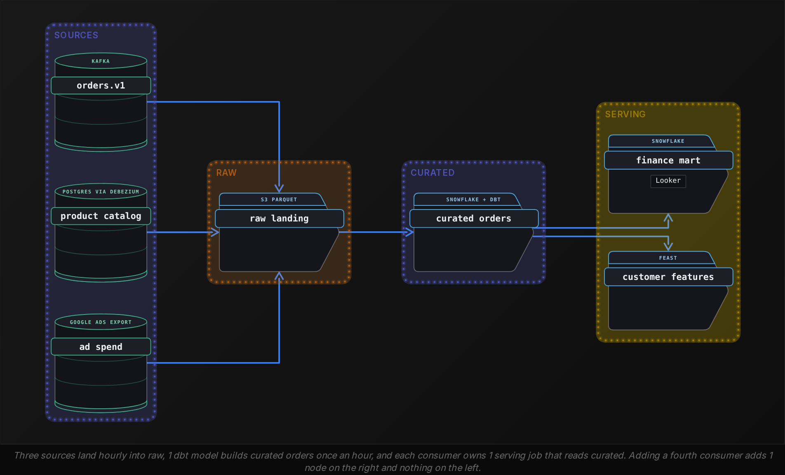

The layer is paid for in latency and storage. Each extra hop runs on its own schedule, so an hourly curated layer bounds every serving table at hourly freshness or slower. Storage roughly triples, but at around $23 per compressed TB a month, 3 copies of the retailer's 2TB order history cost about $140 a month, less than 1 hour of 3 teams reconciling revenue numbers.

The layer also moves where a bug gets fixed. When the test-account filter missed a new pattern of staff accounts in March, the fix landed in 1 dbt model and every serving table picked it up on its next run. Point to point, the same fix is 3 pull requests to 3 repositories, and the third ships a month late.

**The recommendations team needs order data for a model. Today 1 Spark job reads orders.v1, filters test accounts, deduplicates and writes fct_revenue_hourly, an hourly aggregate finance reads. What should the team read?**

- **A.** A new consumer on orders.v1 with its own filtering and deduplication
- **B.** fct_revenue_hourly, since the cleaning is already done
- **C.** Split the existing job: land raw to S3, build a curated orders table that holds the cleaning, and have both the finance aggregate and the model read it
- **D.** A nightly export of fct_revenue_hourly to S3 for the model to load

<details>
<summary>Solution</summary>

**C.** Split the existing job: land raw to S3, build a curated orders table that holds the cleaning, and have both the finance aggregate and the model read it

Both consumers read 1 definition of an order, the cleaning is written once, and the next consumer is 1 serving job added on the right of the diagram.

**Why the others are wrong**

- **A.** That is the second copy of the cleaning. The 2 jobs agree for a few weeks, then 1 of them changes a rule and the model trains on a different set of orders than finance reports.
- **B.** The table is aggregated by hour for finance's reader. It has no customer_id or order_id, and finance may reshape it whenever its dashboard changes.
- **D.** It inherits the aggregate's shape and adds a hop and a day of latency on top.

</details>


<br>

---

## Pipeline Architecture

### Exercise 1 of 1

**● TASK**

A food-delivery marketplace has 3 sources (PostgreSQL orders, MySQL menus, a promotions API) and 4 teams that each clean their own copy, so order counts disagree and a test-order filter fix reached only 2 teams. Redesign it in bronze, silver and gold layers: land every source raw in object storage, have one job build a curated orders table on the lake that drops test orders, and give each team its own warehouse serving table read from the curated one.


<br>

### Solution

#### One curated table between three sources and four teams

The medallion pattern earns its place the moment a second team reads the same data. With 3 sources and 4 teams each pulling and cleaning on their own, the company runs 12 extract-and-clean jobs and 4 separate copies of the test-order rule, so a fix that reaches 2 of them leaves 2 teams counting different orders. Bronze, silver and gold in the middle turn that into 3 landing jobs, 1 curated build and 4 serving jobs: **8 jobs, and the rule lives in exactly one**.

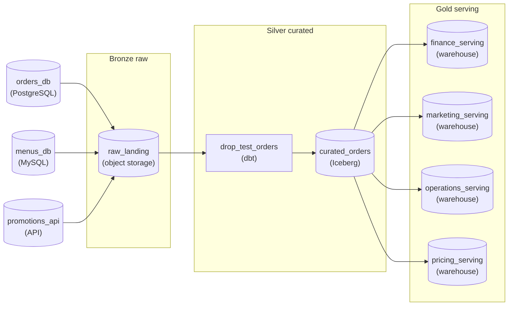

*Bronze lands three sources raw on object storage, one job drops test orders and writes the curated orders table on the lake, and four warehouse tables read only from it.*

1. **Land each source raw in the lake**

   Bronze holds the three sources exactly as they arrived, on object storage. Its promise to the next layer is completeness, not cleanliness: nothing is filtered here, so when the test-order rule changes again, silver is rebuilt from history instead of re-pulled from the sources.

2. **Curate orders once**

   Silver is one job and one table: orders joined to menus and promotions, with test orders removed. Its promise is that every row is a real customer order under the company's single definition. Keeping it on the lake in an open table format means raw and derived data share one storage layout.

3. **Give each team one serving table**

   Gold is one warehouse table per team, each read from silver only: finance gets revenue, pricing gets per-restaurant features. Each team owns its gold job, so a fifth team adds one node on the right and nothing on the left.

| Pitfall: A shared raw zone does not fix the counts |
| --- |
| Landing everything in one lake and letting each team read the raw zone looks like consolidation, but every team still writes its own cleaning, so the test-order filter still exists in four places. Agreement comes from the silver table, not from shared storage. |

| Performance: The middle layer costs one hop and extra copies |
| --- |
| Each layer runs on its own schedule, so an hourly silver build bounds every gold table at hourly freshness or slower. Storage roughly triples: three copies of the 2TB order history at about $23 per compressed TB a month is around $140 a month, less than one afternoon of teams reconciling order counts. |

**Follow-up questions**

1. Customer support now needs order data for refund reports. How many jobs change, and where?\
   *Checks that a new consumer adds one gold table and leaves bronze and silver untouched.*
2. Pricing asks for numbers no older than 15 minutes. What does the hourly silver build do to that request?\
   *Checks that each layer's schedule bounds the freshness of everything downstream of it.*


<br>

---

## ETL vs ELT

### Where the transform runs

ETL and ELT differ in where the transform runs, and that single fact decides what the loaded data looks like. In ETL, an engine between source and warehouse (Informatica PowerCenter, SSIS, a Spark cluster) reads the source, cleans and reshapes rows in its own memory, and loads only finished tables. The warehouse never holds raw data. In ELT, the loader copies source data into the warehouse as close to verbatim as the types allow, and the transform runs inside the warehouse as SQL, usually versioned and scheduled by dbt. The raw copy stays and can be queried.

The ETL default came from the economics of the 2000s warehouse. A Teradata or Oracle appliance was bought by the rack, its compute fixed and shared by every analyst, so a transform scanning 2TB of raw clickstream inside it slowed every dashboard in the company. A separate ETL server protected the expensive box. The price was flexibility: a question the loaded tables could not answer needed a new extract, a change request to the ETL team and often weeks of waiting.

Cloud warehouses broke the constraint in 2 places. BigQuery (2011) and Snowflake (2015) separated storage from compute, so stored bytes cost object-store prices and compute is sized per workload, with Snowflake billing isolated virtual warehouses by the second. Redshift (2013) made cluster compute rentable and resizable by the hour, and separated storage only with RA3 nodes in 2019. The 2TB transform now runs on its own compute for a few dollars, and the raw copy it reads costs around $46 a month. With storage that cheap and compute that elastic, loading raw first became the default, and dbt (2016) gave SQL transforms the version control and tests ETL tools had kept inside their GUIs.

✓ETL: transform before load

- A separate engine owns the compute; the warehouse holds only finished tables
- Raw data is gone after load; a new question needs a new extract
- Masking, parsing and model inference run in general-purpose code
- Fits data that must be reduced or protected before it lands

✗ELT: transform after load

- Warehouse compute does the work, sized per job
- Raw tables persist; a new model is a new SQL file over old rows
- Transforms are SQL, tested and versioned with dbt
- Fits any transform SQL can express over data allowed to land


<br>

### Choose per transform

The retailer's curated layer holds both. Casting `amount` to NUMERIC, deduplicating on `order_id` and removing test accounts are ELT: dbt models over raw tables that keep every row, so a rule change reruns against history without touching the source. The model below does the cast, filter and deduplication for curated orders, and it runs in Snowflake in about 40 seconds over 1 hour of raw data.

```sql
select
  order_id,
  cast(amount as numeric(12, 2)) as amount,
  customer_id,
  sku,
  date_trunc('hour', ordered_at) as order_hour
from {{ source('raw', 'orders') }}
where customer_id not in (select customer_id from {{ ref('test_accounts') }})
qualify row_number() over (
  partition by order_id order by ingested_at desc
) = 1
```

> Transforms that run before load
>
> - Protection: card numbers and emails in order events are hashed by the ingestion job, so no warehouse table ever holds them and Time Travel cannot bring them back.
> - Expression: extracting features from product images or scoring a model is Python, so it runs in Spark before load and only its outputs land.
> - Volume: raw clickstream at 3 million events an hour is 72 million rows a day; sessionizing before load cuts warehouse storage and every downstream scan by roughly 50x.

The rule that falls out: a transform that must happen before the data may exist in the warehouse, or that SQL cannot express, runs before load. Everything else runs after, where it is cheaper to change and leaves the raw rows in place to answer the next question.

**An ingestion job pulls support tickets from the Zendesk API into Snowflake. Ticket bodies contain customer emails and, a few times a week, card numbers typed into free text. Analysts need the ticket text searchable. Where does the masking run?**

- **A.** In a dbt model after load, with the raw table dropped once the model has run
- **B.** In the ingestion job, before the row is written anywhere in the warehouse
- **C.** In a view over the raw table, granting analysts the view only

<details>
<summary>Solution</summary>

**B.** In the ingestion job, before the row is written anywhere in the warehouse

Protection is a constraint on what may land, so this transform runs before load. Masked text is still searchable, and the card number was never useful to an analyst.

**Why the others are wrong**

- **A.** The raw text has already landed in a warehouse 40 analysts can query, and Snowflake Time Travel keeps a dropped table recoverable for 1 to 90 days.
- **C.** The raw table still holds the numbers, every role with raw access reads them, and a misgranted role or a zero-copy clone leaks them.

</details>


<br>

---

## Pipeline Architecture

### Exercise 1 of 2

**● TASK**

An ingestion feeds a warehouse from app events (millions an hour, each with a customer email) and product catalog images, which warehouse SQL cannot decode. Its six transforms are type casts, deduplication, email hashing, image feature extraction, sessionizing and a join to the product dimension. Emails may never land unhashed, and sessions must be queryable within 15 minutes. Place each before the load (ETL) or as SQL in the warehouse over a raw copy (ELT).


<br>

### Solution

#### Each transform goes where its constraint lives

ETL versus ELT is a choice you make per transform, not per pipeline. Since cloud warehouses split storage from compute, the default is ELT: land a raw copy, then transform it as SQL where analysts can rerun it. A transform moves before the load only when something makes the warehouse the wrong place for it. Of these six, 3 have such a reason.

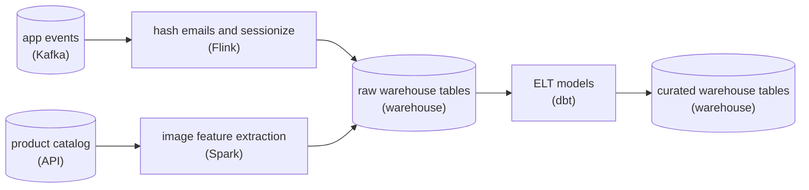

*Hashing, sessionizing and image features run before the load; casts, dedup and the dimension join run as dbt SQL over the raw copy.*

1. **Hash emails in flight**

   The rule is about storage, not queries. A plaintext email that lands in a raw table and is hashed by a later model has already been stored. Hashing has to happen in the stage that writes, so it lives in the stream processor before the load.

2. **Extract image features outside the warehouse**

   Warehouse SQL works on rows and columns; it cannot decode pixels or run a vision model. A Spark job reads the images, computes the features, and loads only the feature columns.

3. **Sessionize the stream before it lands**

   Millions of events an hour with a 15-minute bar is stateful windowing over an unbounded stream. Flink holds each user's open session and emits it when the gap closes, loading both the hashed events and finished sessions.

4. **Leave the rest to ELT**

   Type casts, deduplication and the dimension join have no such constraint. The dimension already sits in the warehouse, and a dedup rule that keeps changing is cheaper to rerun from the raw copy than to re-extract. dbt models keep all 3 versioned and repeatable.

| Pitfall: A hash after the load is too late |
| --- |
| Putting email hashing in a dbt model feels tidy because it sits beside the other SQL. But the raw table it reads has already stored every plaintext email, and warehouse time travel keeps old versions even after you delete them. |

| Key insight: Before-load needs a named reason |
| --- |
| For each transform, ask what would break if it ran in the warehouse. A compliance rule, a data type SQL cannot read, or a freshness bar a scheduled model cannot meet are reasons. Habit is not. |

**Follow-up questions**

1. Duplicate events reach the sessionizer before the in-warehouse dedup runs. When would you move deduplication before the load too?\
   *Whether a before-load transform pulls an upstream one along with it.*
2. Compliance now allows emails in a locked raw schema for 24 hours. Does hashing move?\
   *Whether a changed constraint changes the placement.*


<br>

### Exercise 2 of 2

**● TASK**

An hourly merge step joins 4 inputs into an enriched shipments table: shipments and carrier invoices land hourly, GPS pings every 15 minutes, and a fuel price file daily around 14:00. Have an orchestrator run the merge each hour only after both hourly inputs pass checks for partial input. GPS pings up to an hour old are fine, and a late fuel file must not hold up a run: the run uses the latest price on or before its date.


<br>

### Solution

#### A merge runs at the pace of the inputs it waits on

When several inputs converge on one step, that step takes on dependency management for all of them. It can only run as often as the inputs it waits on, and it only writes a correct hour if each input is pinned to that hour. Here the 2 hourly drops set the cadence, so the merge is hourly. The 15-minute GPS feed is faster than the run needs, and the daily fuel file is far slower, so neither should gate it.

#### Break down the requirements

1. **Find the effective cadence**

   A run cannot start before both hourly drops for its hour exist, so hourly is the fastest the merge can go. Running it every 15 minutes would only re-read the same hourly data four times.

2. **Pin each input to the run's interval**

   Shipments and invoices are read for exactly the run's hour. GPS is read as the latest pings at or before the hour, accepted up to an hour old. Fuel is the latest price on or before the run's date, which before 14:00 means yesterday's.

3. **Stop a partial hour before the write**

   A sensor waits until both hourly partitions have landed, then a row-count check compares each drop with the count its source published. If either fails, the run stops before the enriched table is touched.

#### The reference architecture

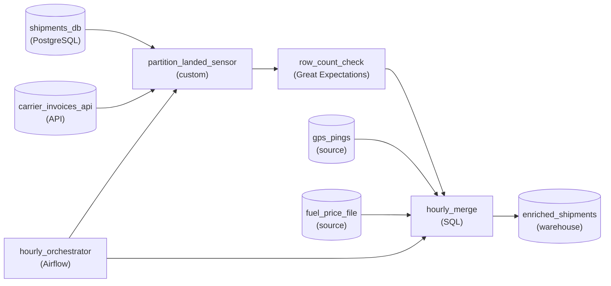

*Hourly inputs pass the landed sensor and the row-count check; GPS pings and the fuel price file feed the merge directly under its as-of rule.*

The orchestrator owns the schedule and the order: `partition_landed_sensor`, then `row_count_check`, then `hourly_merge`. Only the hourly inputs go through the gates. `gps_pings` and `fuel_price_file` go straight to the merge, where the as-of rule decides which version each run reads.

| Pitfall: Waiting on the daily file stalls every morning run |
| --- |
| If the merge waits for the fuel file, the 03:00 run sits until 14:00 and every later hour piles up behind it. Yesterday's price is already acceptable, so the wait buys nothing. |

| Key insight: Every input is a place a backfill can start |
| --- |
| If invoices are reloaded for a past day, every hourly merge that read that day has to rerun over the same dates. Otherwise the enriched table keeps the old numbers. |

**Follow-up questions**

1. What changes if finance needs today's fuel price, never yesterday's?\
   *Trading freshness for a blocking dependency: either the morning runs wait, or they rerun once the file lands.*
2. A third hourly input usually lands at 50 past the hour. What happens to each run's start time?\
   *The slowest gating input sets when each run can start.*


<br>

---

## Steps That Merge Many Inputs

In the curated layer, `orders_enriched` joins 3 inputs: curated orders (hourly, from Kafka), the product catalog (Debezium change capture out of Postgres, landing every 15 minutes) and FX rates (1 daily file from the European Central Bank, published around 16:00 CET). A step with 3 inputs faces 3 questions a single-input step never does: when it may run, which version of each input it reads, and what it does when 1 input has not arrived.


<br>

### Cadence collapses to the slowest input

The join can run for hour 14 only when every input it needs for hour 14 exists. Orders land by 14:05 and catalog changes by 14:15, so the join could start at 14:15. The FX rate arrives once a day, so an hourly join at 03:00 UTC either waits 12 hours for today's rate or reads yesterday's. The orchestrator makes the wait explicit: in Airflow, an `ExternalTaskSensor` per upstream DAG or a Dataset schedule on all 3; in Dagster, 3 declared upstream assets. Either way, the step's effective cadence is the slowest of its inputs unless the design names which inputs may be stale and by how much.

| Input | Cadence | Typically lands | Staleness the join accepts |
| --- | --- | --- | --- |
| Curated orders | hourly | :05 past the hour | None, the run waits |
| Product catalog (SCD2) | every 15 minutes | :15 past the hour | Up to 1 hour, prices change rarely |
| FX rates | daily | 15:00 UTC | Previous day's rate until today's lands, rate date recorded |

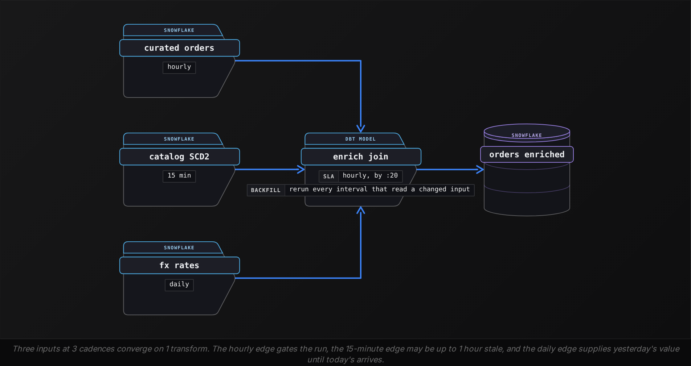


<br>

### Which version of each input

A join that reads the current catalog gives a different answer on a rerun than it gave the first time. A backfill of March 12 run on March 20 would price March 12 orders at March 20 prices and file them under categories renamed in between. A merge step needs an as-of rule per input, each tied to the run's `data_interval_start`: orders whose `order_hour` equals the interval, catalog rows whose `valid_from` and `valid_to` bracket the interval's start, and the FX rate for the interval's date. With all 3 rules the step is reproducible, and reproducibility is what makes its retries and backfills safe.

```sql
SELECT
  o.order_id,
  o.amount,
  c.category,
  o.amount * fx.rate_to_usd AS amount_usd,
  fx.rate_date
FROM curated_orders AS o
LEFT JOIN catalog_scd2 AS c
  ON c.sku = o.sku
    AND c.valid_from <= '2024-03-15 14:00:00'
    AND (
      c.valid_to > '2024-03-15 14:00:00'
      OR c.valid_to IS NULL
    )
LEFT JOIN fx_rates AS fx
  ON fx.currency = o.currency
    AND fx.rate_date <= '2024-03-15'
WHERE o.order_hour = '2024-03-15 14:00:00'
QUALIFY ROW_NUMBER() OVER (
  PARTITION BY o.order_id
  ORDER BY fx.rate_date DESC
) = 1
```


<br>

### What a missing input does to the output

An inner join on the catalog drops every order whose `sku` has not arrived, and the drop is silent: 40,000 orders in, 39,850 out, and the dashboard shows $3,600 less revenue than the payment processor settled. A left join keeps the 150 orders and leaves `category` null, which is visible and recoverable, because a trailing-window rebuild fills them in when the catalog catches up. The characteristic failure of a merge step is partial input dressed as complete input, so the step checks before it writes. A row-count assertion that `orders_enriched` for the hour equals curated orders for the hour guards against the inner-join drop. A null-rate check on `category` above 0.1% guards against the late catalog, whose 150 nulls are 0.375% of the hour.

The step also changes what an upstream rerun means. When the catalog CDC job is backfilled for a day, every join run that read that day must rerun, or the enriched table keeps pre-fix prices. Dagster's partitioned assets, with partition mappings, propagate that backfill to the dependent join partitions. Airflow Datasets record the dependency, but a Dataset update triggers 1 new join run at the current date, so the affected intervals still need an explicit backfill of the join DAG over the same dates. A merge step with 3 inputs is 3 places a backfill can start from and 1 place all of them must pass through.

**The orders_enriched join for hour 03 UTC cannot find an FX rate for today, because the ECB publishes around 15:00 UTC. The finance dashboard needs hourly revenue in USD through the day. Which design serves it?**

- **A.** Put a sensor on the FX file so the hour 03 join waits until 15:00
- **B.** Join on the most recent rate on or before the interval's date, record rate_date in the row, and restate the day's rows after the new rate lands
- **C.** Inner join on today's rate and let unmatched orders fall out until the rate arrives
- **D.** Move the whole join to a daily run at 16:00

<details>
<summary>Solution</summary>

**B.** Join on the most recent rate on or before the interval's date, record rate_date in the row, and restate the day's rows after the new rate lands

The join keeps its hourly cadence, the staleness is visible in the data, and the restatement makes the final numbers exact.

**Why the others are wrong**

- **A.** Every hour before 15:00 waits up to 12 hours, so the dashboard shows nothing for the morning.
- **C.** Orders disappear from the morning's revenue, and nothing records that they were dropped.
- **D.** It removes the FX wait by making every input daily, and the dashboard loses the intraday revenue it was built to show.

</details>


<br>

---

## Pipeline Architecture

### Exercise 1 of 1

**● TASK**

A hotel-booking platform lands three sources in a raw store: bookings by change stream flushed every 15 minutes, clickstream as hourly files, and partner rates once a day. An hourly Airflow DAG merges them, retrying 3 times; a quality gate releases each hour to a revenue dashboard and a pricing model, while a finance export reads the merge output directly. Draw it with each stage's cadence, and page on-call from the one job whose failure stalls all three readers.


<br>

### Solution

#### Find the job every reader waits on

A production diagram gets read for **blast radius**: for each job, follow its edges forward and count the readers that go stale when it fails. Here the fan-in sits at `hourly_merge`, and the fan-out splits right after it: 2 readers wait behind `quality_gate`, and `finance_export` reads the merge output directly. Only one job sits upstream of all three, so that is where the page belongs. Cadence and failure behaviour are the other 2 columns of the reading: how often each edge moves data, and what each job does when it breaks.

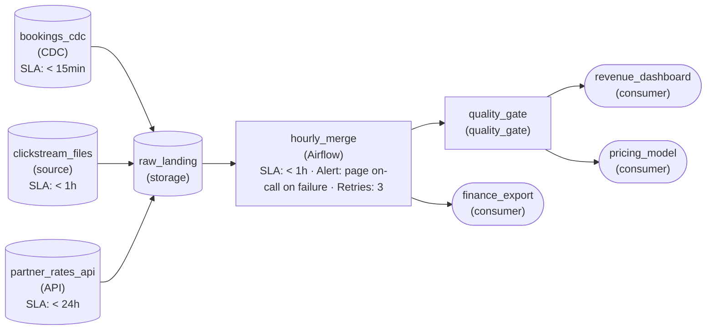

*Three sources land in `raw_landing`; the hourly Airflow merge retries 3 times and pages on failure, then feeds `quality_gate` (dashboard and pricing) and `finance_export` directly.*

1. **Write the cadence on every edge into the merge**

   Bookings arrive every 15 minutes, clickstream hourly, partner rates daily, and the merge runs hourly. So each merge picks up 4 bookings flushes, one clickstream file and, for 23 of 24 hours, the same partner rates it used last hour. Marking `slaFreshness` on each source turns those mismatches into something you can see instead of something you learn from an incident.

2. **Put failure behaviour on jobs, not stores**

   `raw_landing` holds files; it does not run on a schedule, so it has no retry to set. The jobs are the Airflow merge and the gate. The merge retries 3 times, which absorbs a slow read from the raw store, and only an hour that still fails after the third attempt is worth waking someone for.

3. **Trace each job forward and count readers**

   `quality_gate` reaches the dashboard and the pricing model: 2 readers. `hourly_merge` reaches the gate and `finance_export`, so all three. That count is why the alert sits on the merge: it is the single job whose failure every reader feels.

| Pitfall: The gate looks central, but finance reads past it |
| --- |
| The gate sits closest to the consumers, so it is the tempting place for the page. Trace the edges and `finance_export` never touches it: a gate-only alert stays silent through an outage finance notices first, while a merge failure also leaves the gate with nothing to check. |

| Real world: Owners change where layers change |
| --- |
| Fill the owner column the same way: the bookings, clickstream and partner teams own their feeds up to `raw_landing`; the platform team owns the store, the merge and the gate; each consumer team owns its reader. The page goes to the platform team because the merge is theirs, and a broken source feed goes back to the team that publishes it. |

**Follow-up questions**

1. A fraud model starts reading bookings from `raw_landing` every 15 minutes, skipping the merge. Which job's failure now reaches the most readers, and what protects the fraud model?\
   *Recounting blast radius when a reader bypasses the fan-in, and watching freshness where no job failure would fire.*
2. The partner rates file arrives 6 hours late but nothing errors. Which readers see stale prices, and would the merge's page fire?\
   *Telling lateness apart from failure, and why freshness monitoring sits beside failure alerts.*


<br>

---

## Reading a Real Pipeline Diagram

The diagram below is the retailer's order pipeline as it runs today, with the operating facts a production diagram carries and a sketch leaves off. Reading it is a procedure, and applied to a 40-node diagram at a new job it tells you in 20 minutes what a month of incidents would otherwise teach.

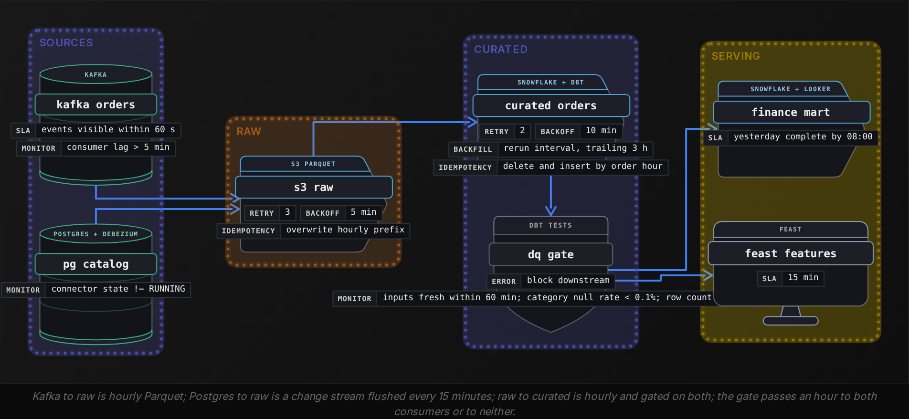


<br>

### Ends first, then the fan-in

Start at the 2 ends, because they set the requirements. Sources decide arrival behaviour: Kafka delivers within seconds and replays from any offset inside its 7 days of retention, while the Debezium connector follows the Postgres write-ahead log and fails its task when it loses its replication slot. Consumers decide freshness: the finance mart promises yesterday complete by 08:00, the feature store promises 15-minute freshness. Then find where edges converge. Here orders meet the catalog at `curated_orders`, the role `orders_enriched` played in section 2: its cadence is bounded by its slowest input, and every consumer inherits that bound.


<br>

### Cadence per edge

An edge carries no words, so each one gets 2 questions: what moves along it and how often. Curated to the mart is hourly aggregation; curated to the feature store is a 15-minute refresh reading an hourly table, so 3 of every 4 refreshes return nothing new. A cadence mismatch across an edge is a finding, and the next section resolves this one.


<br>

### Failure behaviour per node

For each node, 3 questions. Does it retry, and is its write safe to retry? The raw landing overwrites an hourly S3 prefix, so 3 retries leave 1 copy. The curated load deletes and inserts by `order_hour` in 1 transaction, so a retry after a timed-out commit removes its own earlier rows before loading. A load that appended instead would commit 40,000 rows, lose the acknowledgement, and commit 40,000 more on attempt 2, with every task green and finance seeing double revenue at 08:00. Does a failure block downstream or let stale data through? The gate blocks, so a bad hour never reaches the mart, at the price of a frozen dashboard. Who is paged? The `monitorAlert` on each node names the condition, and the owner column names the person.

| Node | Cadence | On failure | Owner |
| --- | --- | --- | --- |
| kafka_orders | continuous | lag alert at 5 min, replay within 7 days | Checkout team |
| pg_catalog | change stream, flushed every 15 min | connector-state alert, no automatic recovery after slot loss | Catalog team |
| s3_raw | hourly | 3 retries 5 min apart, overwrite prefix | Data platform |
| curated_orders | hourly | 2 retries, delete and insert, pages platform on-call | Data platform |
| dq_gate | hourly | blocks both consumers, pages platform on-call | Data platform |
| finance_mart | hourly | 2 retries, dashboard shows stale hours | Finance analytics |
| feast_features | 15 min | 1 retry, model serves last good values | Recommendations |


<br>

### Ownership at the layer boundary

Ownership changes hands where the layer changes. The checkout team owns the topic and its schema, the catalog team owns the Postgres tables, the data platform owns raw through the gate, and each consuming team owns its serving table. The boundary between layers is where the contract lives: the checkout team may add fields to `orders.v1` but may not rename `order_id`, and the platform may change how `curated_orders` is built but not what a row means. A diagram without owners turns every cross-boundary incident into 20 minutes of finding out who to call.

> Five questions for any pipeline diagram
>
> - Which nodes are sources and consumers, and what freshness does each consumer need?
> - Where do edges converge, and which input bounds that node's cadence?
> - What moves along each edge, and how often?
> - For each node: does it retry safely, does it block or pass stale data, who is paged?
> - Where does ownership change, and what is the contract at that boundary?

**At 02:00 the Debezium connector for the catalog loses its replication slot and its task fails. Reading the diagram above, what does the finance mart show at 09:00, and who was paged?**

- **A.** Hours 02 to 08 present with category null for new products; nobody paged, because every task succeeded
- **B.** The mart frozen at hour 01; the catalog team paged by the connector alert at 02:00, and the platform on-call paged when the gate blocked hour 02
- **C.** The mart up to date, because the join reads the SCD2 catalog and existing products still resolve
- **D.** Hours 02 to 08 missing after Airflow retried curated_orders twice and gave up, paging only platform

<details>
<summary>Solution</summary>

**B.** The mart frozen at hour 01; the catalog team paged by the connector alert at 02:00, and the platform on-call paged when the gate blocked hour 02

Each node pages its own owner. The catalog team recreates the slot and re-snapshots; the gate's errorAction holds both consumers until the catalog is fresh again.

**Why the others are wrong**

- **A.** The connector-state alert fires at 02:00, and the gate's freshness check fails hour 02 before any null reaches the mart.
- **C.** Existing rows resolve, but a frozen input fails the gate's freshness check whether or not the join would produce nulls.
- **D.** Retrying the join reads the same stale catalog and succeeds each time. The gate stops the data, and the connector alert pages the catalog team too.

</details>


<br>

---

## Pipeline Architecture

### Exercise 1 of 2

**● TASK**

A ride-hailing app publishes trip events to one Kafka topic, read by a finance dashboard of hourly driver earnings and a feature store of per-rider features refreshed every 10 minutes. Land the events raw, keep one curated trips table that both readers agree on, and choose where the pipeline forks and how often curated runs. Then attach a surge-pricing service that must react within 1 second, plus a nightly job reconciling its decisions against curated trips.


<br>

### Solution

#### Fork after the curated layer, not at the topic

When 2 readers of one source must agree on what a trip is, they fork at the **curated layer**. Fork at ingestion instead and each branch writes its own cleaning: finance drops cancelled trips one way, the feature job another, and the dashboard and the model quietly disagree. Forking after `curated_trips` gives one bronze landing, one silver definition, and 2 gold outputs that differ only in shape and cadence.

1. **Run curated at the faster reader's cadence**

   The feature store needs trips no older than 10 minutes, and it can only be as fresh as the layer it reads. So `curate_trips` runs every 10 minutes, inside the `< 15min` band. An hourly curated run would starve the feature store; a streaming one would buy the dashboard nothing it asked for.

2. **Let the hourly reader aggregate the slices**

   The finance branch is the one that aggregates. Each hourly run of `hourly_earnings_rollup` reads the 6 10-minute curated slices that make up the hour and sums earnings by driver. The feature job reads only the newest slice and updates each rider's rolling values in `rider_feature_store`.

3. **Attach the 1-second reader at the topic**

   No batch layer meets a 1-second budget: curated is up to 10 minutes old by design. Surge pricing reads `trip_events` directly through a streaming job with minimal cleaning and logs each decision to `surge_decisions`. This is the case where forking at ingestion is right: latency forces it, not convenience.

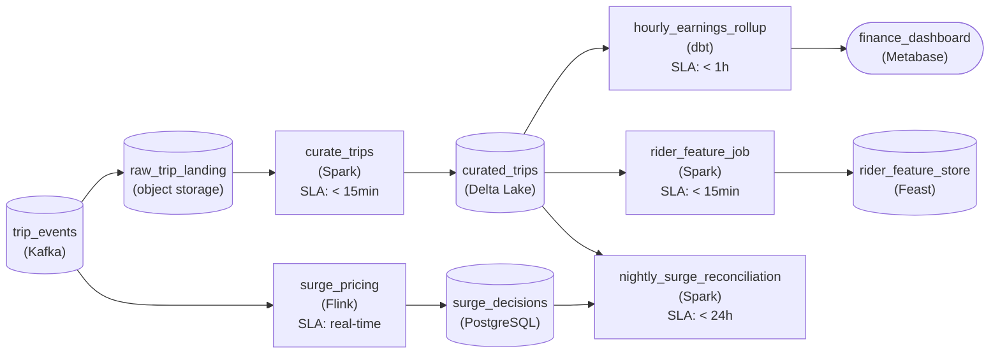

*Bronze `raw_trip_landing`, silver `curated_trips` every 10 minutes, 2 gold branches, and a real-time branch off `trip_events` checked nightly.*

| Pitfall: Forking at ingestion doubles the definition of a trip |
| --- |
| The tempting design gives each team its own job off the Kafka topic. It looks decoupled, but a refund rule fixed in one branch stays wrong in the other, and every backfill runs twice. A shared silver table means the fix happens once. |

| Key insight: A shortcut off the topic needs a nightly check |
| --- |
| Surge pricing acts on uncleaned events, so some decisions rest on trips later cancelled or corrected. `nightly_surge_reconciliation` compares `surge_decisions` with `curated_trips` each night, keeping the fast branch honest against the one definition everyone else uses. |

**Follow-up questions**

1. Finance now wants yesterday's earnings final by 08:00, and some trip events arrive up to 2 hours late. What changes in the hourly branch?\
   *Late data: reprocessing past curated slices and rerunning the hourly aggregates they touch.*
2. A city-operations map needs open trips refreshed every minute. Does it fork at curated or at the topic?\
   *Whether a 1-minute need fits a batch curated cadence or belongs on the streaming branch.*


<br>

### Exercise 2 of 2

**● TASK**

A subscription software company's billing events, CRM and product usage logs are read directly by a finance dashboard, sales operations and a churn model, each cleaning its own copy. Redesign it as bronze, silver and gold: every source lands raw in object storage, one curated layer and the gold tables live in the warehouse, and each reader reads its own gold table. Usage logs carry IP addresses that may never be stored and arrive at 2 million events an hour, though readers need usage only per account per day. Run each transform before the warehouse load (ETL) or as SQL inside it (ELT), as its constraint requires.


<br>

### Solution

#### A constraint decides where each transform runs

This is the medallion pattern with a placement decision inside it. Bronze, silver and gold give three readers one agreed version of every account, and ETL versus ELT decides, transform by transform, whether the work happens before the warehouse load or as SQL inside the warehouse. On a cloud warehouse the default is ELT. A transform moves before the load only when a constraint forces it, and this pipeline has exactly two: IP addresses that may never be stored, and 2 million usage events an hour that no reader needs at that grain.

| ✕ Before: every reader cleans its own copy | ✓ After: one curated layer |
| --- | --- |
| Finance, sales operations and the churn model each read billing, CRM and usage straight from the sources and clean them in their own jobs. That is up to 9 cleaning jobs, three definitions of an active account, and IP addresses copied into three places. | 4 jobs: IP stripping before landing, a usage rollup before the warehouse load, SQL that cleans billing and CRM inside the warehouse, and SQL that builds each reader's gold table. A fix to the account definition lands once and reaches all three readers. |

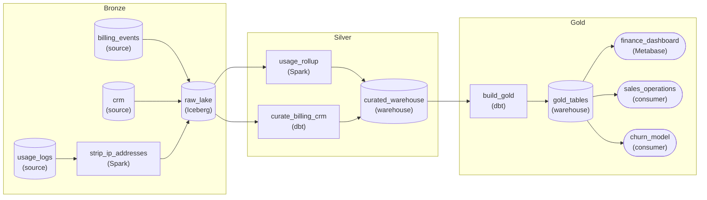

*Every source lands in `raw_lake`. `strip_ip_addresses` and `usage_rollup` run before the load (ETL), and the dbt nodes run as SQL inside the warehouse over raw copies loaded as-is (ELT).*

1. **Strip IPs before anything is stored**

   The IP constraint is about storage, not about who may read it, so the removal has to happen before bronze. `strip_ip_addresses` is ETL by necessity: it is the only transform ahead of the raw landing, and it drops exactly one field. Everything else in the usage event lands untouched, so bronze is still a faithful raw copy.

2. **Roll up usage before the warehouse load**

   Readers need usage per account per day. Loading 48 million events a day into the warehouse only to `GROUP BY` them away pays warehouse compute for a grain no one reads. `usage_rollup` runs Spark over bronze and loads only the per-account daily table: ETL, and its constraint is volume.

3. **Leave everything else to warehouse SQL**

   Billing and CRM are small and carry nothing that may not land, so no constraint pulls their cleaning out of the warehouse. They load raw, and `curate_billing_crm` cleans and joins them as SQL: ELT, the cloud default. `build_gold` is ELT too, shaping one gold table per reader from the shared curated layer.

| Pitfall: Dropping IPs in silver is already too late |
| --- |
| If bronze lands the usage logs as they arrive and silver drops the `ip_address` field, the IPs sit in bronze for good, and bronze is the layer you keep for replay. A field that may never be stored has to go before the first write. |

| Performance: 48 million events a day shrink to one row per account |
| --- |
| 2 million events an hour is about 48 million a day. With roughly 40,000 accounts, the daily rollup loads about 40,000 rows. Spark over the lake does the heavy pass once, and every warehouse query after it runs on the small table. |

| Key insight: Bronze keeps the grain the rollup throws away |
| --- |
| Because bronze holds every stripped event, a question at a finer grain, such as usage per feature, is a new rollup over bronze rather than a re-ingest from the source. |

**Follow-up questions**

1. Legal now allows a salted hash of the IP for fraud review. Where does the hashing run, and what changes in bronze?\
   *Whether the before-landing transform changes shape when the constraint loosens.*
2. The churn model moves to scoring every 15 minutes. Which jobs change cadence, and does the usage rollup still belong before the load?\
   *Batch versus streaming on the usage path, and whether volume still decides ETL.*


<br>

---

## One Source, Two Consumers

Two teams read the retailer's orders. The finance dashboard wants hourly revenue by category, complete for yesterday by 08:00 and refreshed through the day. The recommendations team wants per-customer features in Feast: orders in the last 7 days, average basket, most recent category, refreshed every 15 minutes, and computed point-in-time so that a training set built for March 12 sees only what was known on March 12. Same source, 2 consumers, and 2 places the pipeline can fork.


<br>

### Fork at ingestion

The first design gives each consumer its own reader on `orders.v1`. The dashboard path is the hourly batch already built. The feature path is a 15-minute Spark Structured Streaming job that reads the topic, cleans, aggregates per customer and writes to Feast's offline store, with its own test-account filter, deduplication and cast of `amount`. It ships fast, because neither team waits on the other, and it recreates the drift section 0 opened with.


<br>

### Fork at the curated layer

The second design keeps 1 raw landing and 1 curated `orders` table, and forks after it: 1 serving job aggregates curated orders into the finance mart, and 1 computes features from the same rows. The cost is that the curated layer must run at the faster consumer's cadence. An hourly curated table cannot feed a 15-minute feature refresh, so the curated load moves to a 15-minute micro-batch, and the finance mart, still hourly, reads 4 curated slices per run. A 15-minute `MERGE` over 10,000 orders completes in under 30 seconds on an X-Small Snowflake warehouse.

- **96** — curated loads a day at 15-minute cadence
- **1** — definition of an order both teams read

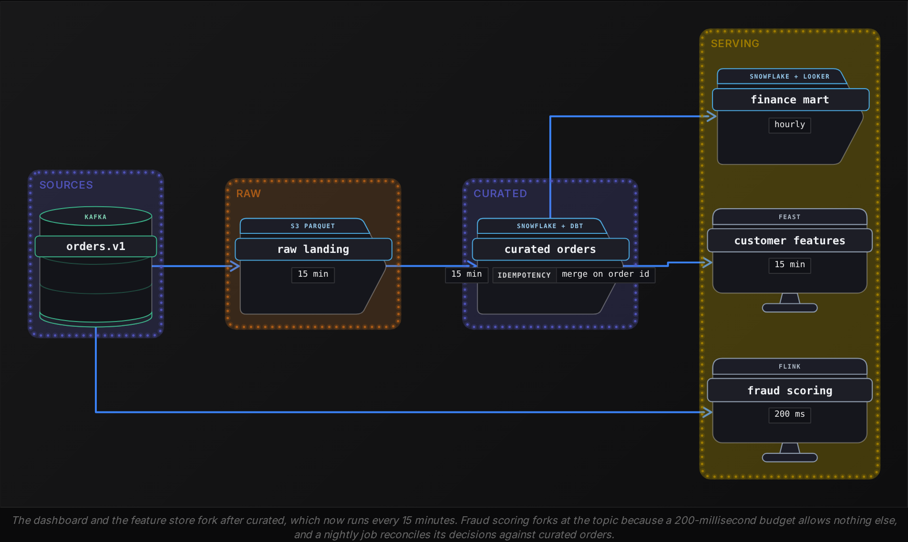

| Concern | Fork at ingestion | Fork at curated |
| --- | --- | --- |
| Definition of an order | 2 implementations that drift | 1 dbt model, both read it |
| Fix to the test-account filter | 2 pull requests, 2 deploys | 1 change, both consumers next run |
| Freshness | each path at its own cadence | curated at the fastest consumer's cadence |
| Reconciliation | numbers disagree, a meeting picks one | both derive from the same rows |

Point-in-time correctness decides it. A training set asks, for each order on March 12, what the customer's 7-day order count was at that moment. From curated orders with `order_hour` as event time, that is a window over 1 table. From a streaming path with its own deduplication, the answer depends on which late orders the stream happened to see, and the model trains on features the dashboard cannot reproduce. Forking at curated makes the model's orders match finance's by construction.


<br>

### When the fork belongs at ingestion

A consumer that needs latency the curated layer cannot provide reads the source directly. Fraud scoring at checkout needs a decision within 200 milliseconds of the order event, and a 15-minute micro-batch is 4,500 times too slow. It gets a Flink job on `orders.v1` with minimal cleaning, plus a nightly job reconciling its decisions against curated orders. The early fork is deliberate and bounded, and its reconciliation cost is written into the design.

**A fourth consumer appears: fraud scoring that must accept or hold an order within 200 milliseconds of the event. The curated layer runs every 15 minutes. Where does this consumer attach?**

- **A.** To the curated orders table, polling every minute
- **B.** To orders.v1 directly, through a Flink job with minimal cleaning, plus a nightly job reconciling its decisions against curated orders
- **C.** To the raw S3 landing, since it is the earliest batch copy
- **D.** To the finance mart, which already has revenue by hour

<details>
<summary>Solution</summary>

**B.** To orders.v1 directly, through a Flink job with minimal cleaning, plus a nightly job reconciling its decisions against curated orders

The requirement forces the fork before the curated layer, and the reconciliation keeps the 2 definitions of an order from drifting unnoticed.

**Why the others are wrong**

- **A.** The freshest row in curated is up to 15 minutes old, 4,500 times the budget.
- **C.** Raw is written every 15 minutes too, so it is no fresher than curated and holds unfiltered rows.
- **D.** It is an hourly aggregate with no order-level rows, built for a different reader.

</details>

✓Do

- Split a pipeline into layers at the second consumer or the second source, before cleaning gets copied
- Write each layer's promise down: raw is complete and untouched, curated is the one definition
- Pin every input of a merge step to the run's interval with an as-of rule
- Run the curated layer at the fastest consumer's cadence and let slower consumers aggregate
- Put a count and freshness check between curated and serving, and make it block

✗Don't

- Don't let a consumer read another consumer's serving table as if it were curated
- Don't inner join a late-arriving dimension; keep the rows and make the nulls visible
- Don't mask PII in a model after the raw rows have landed in the warehouse
- Don't fork at ingestion for a consumer a 15-minute curated layer would satisfy


<br>

---

## Pipeline Architecture

### Exercise 1 of 1

**● TASK**

A retailer is moving reporting off an on-prem appliance with fixed, shared compute to a cloud warehouse that bills storage and compute separately. Design its ELT pipeline: point-of-sale rows and a nightly mainframe inventory export land raw in the warehouse, and SQL inside it rebuilds curated tables each night for analyst dashboards. The export arrives as EBCDIC fixed-width records the warehouse cannot parse, so one transform still has to run before the load.


<br>

### Solution

#### Load first, except where the warehouse cannot read it

ELT moves the transform into the warehouse, and 2 cost changes made it the sensible default for this retailer. On the appliance, compute was a fixed rack every analyst shared, so a heavy transform slowed every dashboard. In the cloud warehouse, storage is billed apart from compute and stored bytes are cheap, so keeping a raw copy costs little. Compute is also sized per workload and billed only while it runs, so a nightly transform no longer competes with morning dashboards. What ELT cannot remove is a transform the warehouse has no way to run: it cannot parse EBCDIC fixed-width records, so decoding happens before the load.

1. **Land the sales rows untouched**

   The point-of-sale rows load as close to verbatim as the types allow. Nothing is filtered or reshaped on the way in, so when an analyst asks a question the curated tables cannot answer, the raw table already holds the answer instead of a new extract request.

2. **Decode the export, and only decode it**

   The pre-load job turns mainframe records into ordinary rows: character set, field boundaries, numeric formats. It does not join, filter or aggregate. Every business rule stays downstream, where changing it is a SQL edit rather than a change to the loader.

3. **Curate in SQL, nightly**

   A dbt transform reads the raw tables each night and rebuilds the curated tables the dashboards read. It runs on its own warehouse compute, so its size no longer threatens anyone else's queries.

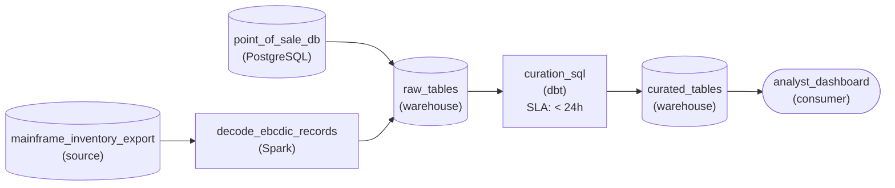

*Only the mainframe export is transformed before load. Everything else lands raw and is curated by nightly SQL inside the warehouse.*

| Pitfall: A decoder that also cleans is ETL again |
| --- |
| The tempting shortcut is to let the job that decodes the export also drop discontinued items and roll stock up by store, since it touches every row anyway. Then the warehouse holds only the finished table, the raw inventory is gone, and the next new question needs a change to that job. Keep the pre-load step to what the warehouse truly cannot do. |

**Follow-up questions**

1. What changes if the mainframe team starts exporting UTF-8 CSV instead?\
   *Whether the decode step disappears and the export loads raw like the sales rows.*
2. If the sales rows carried full card numbers, what would also have to run before the load?\
   *Whether a compliance rule, not just a file format, can keep a transform ahead of the warehouse.*


<br>

---

## Putting It All Together

A grocery delivery company, 2 years after launch, has 6 jobs reading its order topic: finance, marketing, a demand forecast, a courier-dispatch feature store, a fraud model and a customer support view. Finance and marketing report order counts 3% apart every week, the forecast team spent a quarter rebuilding deduplication the finance team had already written, and the dispatch features are refreshed every 5 minutes from a topic that the fraud model also reads with its own filters. The platform team is asked to redraw it.

- Six consumers on 1 topic is 4 triggers past the point where a curated layer pays for itself; the redesign lands raw once, builds 1 curated orders table, and gives each team a serving job (section 0).
- Deduplication, test-account removal and the join to the store catalog move into dbt over raw tables, while address and payment fields are hashed in the ingestion job before anything lands (section 1).
- The curated table joins orders to a catalog that changes hourly and a delivery-zone file published daily, so its cadence is set by the orders feed and each input is pinned to the run interval with the zone file allowed to be a day stale and recorded as such (section 2).
- The new diagram carries retry policy, alert condition and owner on every node, and a blocking gate between curated and serving, so the morning the catalog connector stops, 1 team is paged and every dashboard freezes with a reason (section 3).
- The dispatch feature store sets the curated cadence at 5 minutes and finance aggregates 12 slices an hour from it; only the fraud model keeps a direct reader on the topic, with a nightly reconciliation against curated orders (section 4).


<br>

---

## Pipeline Architecture

### Exercise 1 of 4

**● TASK**

A bike-share operator lands Kafka dock events hourly and a membership database change stream every 15 minutes in a raw store, and an orchestrated hourly job builds curated rides once both have landed. A quality check releases each hour to the finance dashboard and the maintenance report together or not at all. The change stream once went silent at 02:10 and finance noticed at 09:00. Draw it so a silent source pages the ingestion team from the raw store.


<br>

### Solution

#### Catch silence on the side of the boundary that can fix it

Reading a production diagram means asking 3 things of every node: how often it runs, what it does on failure, and who owns it. This pipeline shows why. The curated build fans in on both sources and the release check hands an hour to both readers or neither, so a source that goes quiet at 02:10 breaks nothing loudly. It stops hours from being released, and the first symptom is a dashboard stuck on 01:00, owned by a team that cannot fix the cause.

1. **Start at the consumers**

   Both readers sit behind the same release check, so both freeze on the 01:00 hour. Finance looks first, at 09:00, and what it sees is not an error: the last loaded hour simply stops moving. Maintenance sees the same stale hour an hour later.

2. **Walk back to the fan-in**

   At 03:00 the orchestrator finds the membership data missing, so `curated_build` waits instead of running. Waiting is correct, since an hour without memberships would misprice rides, but a wait raises nothing on its own. That is how 7 hours pass quietly.

3. **Put the alarm where the owner works**

   The fix is upstream of raw: restart the change-stream connector, which ingestion owns. So the freshness alert sits on `raw_landing` and pages ingestion within 30 minutes of silence. Analytics never crosses into a connector it does not own, and once memberships land, the held hours build and release in order.

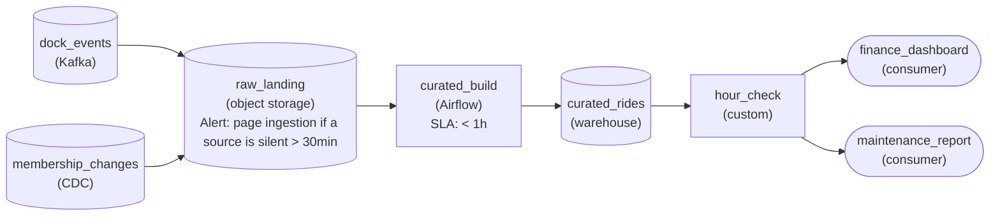

*Both sources land in `raw_landing`, which pages ingestion when either goes silent; the hourly `curated_build` waits for both, and `hour_check` releases each hour to both readers or neither.*

| Pitfall: A stale-data alert on the dashboard pages the wrong team |
| --- |
| A freshness check on `finance_dashboard` does catch the incident, but it fires hours late and lands on analytics, who can only see that the hour is held. They then have to trace back across the raw boundary to learn which source stopped. Alert where the silence starts, on the layer the paged team owns. |

**Follow-up questions**

1. The dock events stream goes quiet at 14:00 instead. Which reader notices first, and does the page change?\
   *Applies the same reading to the other source: same fan-in, same alert owner.*
2. The membership stream is legitimately empty for an hour most nights. How do you keep the silence alert from paging every night?\
   *Separates a source that is quiet from one that is broken, for example by alerting on missed flushes rather than on zero rows.*


<br>

### Exercise 2 of 4

**● TASK**

A parcel logistics company's operations dashboard reads a curated shipments table in a warehouse. Land three inputs raw in object storage: depot scan events hourly, a carrier rate file daily, and vehicle telemetry every 5 minutes. An orchestrated hourly job, retrying 3 times, joins them into the curated table once the hour's scans pass a completeness check, using the latest rate file on or before its date and the newest telemetry at or before the hour. When the rate file is 6 hours late, page the rates team from the raw store.


<br>

### Solution

#### Only one input gets to block the run

Dependency management in a multi-input join comes down to one question per input: does this input decide when the run happens, or does the run just read the newest version it can find? Here the hourly scans decide, because they are the rows the table is about, so they are the only input behind a completeness check. The daily rate file and the 5-minute telemetry are read as-of: the latest rate file on or before the run's date, the newest telemetry at or before the hour. That keeps the join's effective cadence hourly, set by the scans, instead of collapsing to daily, which is what happens when the slowest input is allowed to block.

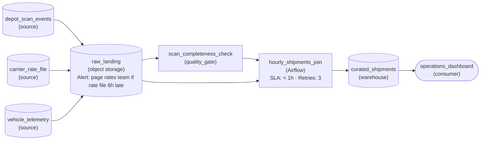

*Three inputs land in `raw_landing`; only scans pass `scan_completeness_check`, and the hourly join reads rates and telemetry as-of. The arrival alert on the raw store pages the rates team.*

1. **Land all three inputs raw before joining**

   Each input lands in object storage at its own cadence: scans hourly, the rate file daily, telemetry every 5 minutes. The raw store is the one place where arrival can be watched, so the join reads all three from it rather than from the sources.

2. **Gate only the input that defines the hour**

   A run on a partial hour of scans undercounts shipments, so the completeness check sits on the scan path only. The rate file and telemetry take a direct edge into the join: the as-of rule already says what to use when the newest copy is missing.

3. **Attach each failure to the team that can fix it**

   Retries belong to the join task, since a transient warehouse error is the join's own problem. A missing rate file is not: the join keeps succeeding on yesterday's rates, so the alert watches the file's arrival on the raw store and pages the rates team.

| Pitfall: Blocking on the daily file turns an hourly table daily |
| --- |
| Putting the rate file behind the same readiness check as the scans looks safe, but the join then inherits the slowest cadence: the first run of the day waits for the file, and on a late morning the dashboard freezes at last night's state while scans pile up in the raw store. |

| Key insight: The late morning, read straight off the diagram |
| --- |
| The file normally lands around 06:00. On the morning it is 6 hours late, every hourly run still fires once its scans pass the check, so the dashboard shows current shipments costed at yesterday's rates. At the 6-hour mark the alert on the raw store pages the rates team. The operations data team who own the join hear nothing, because their task never failed. |

**Follow-up questions**

1. Finance wants a daily cost report priced on the actual day's rates. Where does it fork, and what does it wait for?\
   *Tests giving a reader with a stricter need its own gated step instead of changing the hourly join's as-of rule.*
2. One depot's scan export stops arriving. What does the dashboard show, and who should hear about it?\
   *Tests that a gated input stalls the run, so its arrival needs its own owner and alert.*


<br>

### Exercise 3 of 4

**● TASK**

Surge pricing needs a decision within 500 milliseconds of each trip event a ride-hailing app publishes to Kafka; a city operations dashboard refreshes hourly and a driver-matching feature store every 5 minutes. Land trips and PostgreSQL driver records raw, build one curated trips table both slower readers share, and choose where each reader forks and how often curated runs. The orchestrated merge joining trips to drivers waits until each trip window has fully landed and uses the driver record in effect at trip time. Each night, reconcile surge decisions against curated trips.


<br>

### Solution

#### Each reader forks at the latest layer it can afford

Fork placement decides this design: every reader leaves the pipeline at the latest layer that still meets its freshness. Surge pricing has 500 ms, which no scheduled run can meet, so it forks at the Kafka topic itself. The feature store and the dashboard can both wait minutes, so they fork after `curated_trips` and share one definition of a trip. The early fork has a price: surge acts on uncleaned events, and that is what the nightly reconciliation pays back.

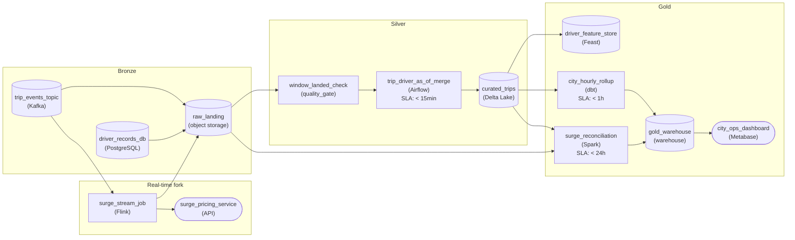

*Surge forks at the topic; the feature store and the dashboard fork after `curated_trips`, which an orchestrated as-of merge rebuilds every 5 minutes.*

1. **Let the fastest curated reader set the cadence**

   `curated_trips` runs every 5 minutes because the feature store refreshes every 5 minutes. The dashboard only needs hourly numbers, so `city_hourly_rollup` aggregates the same table once an hour. A slower reader can always aggregate a faster table downstream. A faster reader can never get fresh data out of a slower one.

2. **Pin the merge to landed windows and as-of drivers**

   A merge runs at the pace of its slowest input. `window_landed_check` holds each 5-minute window until its trips have arrived, including the phones that reconnect late. `trip_driver_as_of_merge` joins each trip to the driver snapshot in effect at trip time, so rerunning Tuesday 09:05 gives the same row even after that driver changes vehicle.

| Pitfall: Forking the feature store at ingestion splits the truth |
| --- |
| Reading features straight off the topic looks faster. But then test trips, duplicates and late events are counted one way in matching and another way on the dashboard. A 5-minute refresh fits inside a curated run, so the early fork gains nothing and costs you agreement between the 2 readers. |

| Key insight: Reconciliation is the bill for an early fork |
| --- |
| `surge_stream_job` decides before any cleaning happens, so it also writes its decisions to `raw_landing`. Each night `surge_reconciliation` compares that log with `curated_trips` and flags surge charged on trips the curated build later dropped or merged. Any reader you fork ahead of the curated layer needs a check like this. |

**Follow-up questions**

1. The feature store moves to a 1-minute refresh. Do you speed up `curated_trips` or fork matching earlier?\
   *Tests whether the learner weighs a sub-minute curated build against a second early fork that needs its own reconciliation.*
2. A driver record correction arrives 2 days late. What reruns, and how does the as-of join keep that rerun safe?\
   *Tests pinned inputs: rerunning only the affected windows and getting deterministic results.*


<br>

### Exercise 4 of 4

**● TASK**

Design a hospital's admissions pipeline in bronze, silver and gold layers. HL7 admission messages, a staffing system and a lab feed land raw in the lake, and patient identifiers in the HL7 and lab data may never land there in clear form. An orchestrated build turns the raw data into one curated admissions table every 15 minutes for a bed-capacity dashboard, and a readmission-risk model is trained from the same curated table nightly. The build runs only once every source has landed, so if the lab feed stops, its owner is paged and the dashboard freezes on its last complete refresh instead of showing nulls.


<br>

### Solution

#### One hash before the lake, one gate before the build

Medallion layering carries this design, with a single ETL exception carved out of an otherwise ELT pipeline. Patient identifiers decide where that line falls: bronze is a raw copy kept for replay, so anything hashed after landing has already been stored in clear form. Hashing runs in flight; joining admissions to staffing, rolling up beds and building nightly features all run inside the lake on data that is already safe.

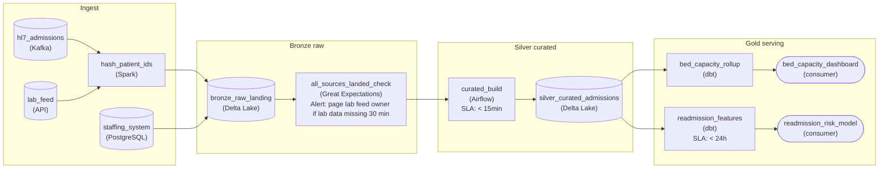

*`hash_patient_ids` runs before the lake; `all_sources_landed_check` holds the 15-minute `curated_build` until every source lands; the readers fork after `silver_curated_admissions`.*

1. **Hash identifiers on the way in**

   Only the HL7 messages and the lab feed carry patient identifiers, so only they pass through `hash_patient_ids` before `bronze_raw_landing`. Staffing lands untouched. A stable hash keeps admissions and lab results joinable downstream without anyone seeing the original number.

2. **Build one curated table, fork the cadences after it**

   `curated_build` runs every 15 minutes because the dashboard is the fastest reader. The fork comes after `silver_curated_admissions`: `bed_capacity_rollup` serves the dashboard and `readmission_features` runs nightly for the model, both reading the same admissions, so their counts agree.

3. **Gate the build on every source landing**

   `all_sources_landed_check` confirms all 3 sources delivered for the window before the orchestrator starts `curated_build`. When the lab feed goes quiet the check fails, the build never runs, the dashboard keeps its last complete refresh, and the check's alert pages the lab feed's owner.

| Pitfall: A join over a missing feed returns nulls, not an error |
| --- |
| If the build runs on schedule regardless, the join from admissions to lab results finds nothing for the window and writes nulls. The dashboard refreshes on time, looks healthy, and shows patients with no pending labs: the silent failure the hospital asked to rule out. |

| Key insight: Page upstream, freeze downstream |
| --- |
| The page is raised at the check closest to the broken input and goes to whoever owns it. The freeze needs no extra machinery: every reader sits behind the same gate, so a held build leaves all of them on their last complete data. |

**Follow-up questions**

1. Infection control wants to know within a minute of a positive culture. Where does that path fork, and does `curated_build` change?\
   *Forking a fast path off the hashed lab data instead of speeding up the whole curated layer.*
2. The staffing system goes down instead of the lab feed. Should the bed-capacity dashboard still freeze?\
   *Whether every input must block the build, or whether the latest staffing snapshot is an acceptable stale input.*


<br>

---

## Key Takeaways

- The second consumer of a source, or the second source into a consumer, is the moment to add a curated layer: N x M jobs become N + M, and cleaning lives once.
- ETL and ELT differ in where compute runs; cloud warehouses made load-raw-then-transform cheaper, and protection, expression and volume still force a transform before load.
- A merge step's cadence is bounded by its slowest input, every input needs an as-of rule tied to the run interval, and partial input is checked before the write.
- Read a diagram ends first, then the fan-in, then cadence per edge, failure behaviour per node and ownership at each layer boundary.
- Fork at the curated layer and run it at the fastest consumer's cadence; fork at ingestion only when a latency requirement forces it, and reconcile.
