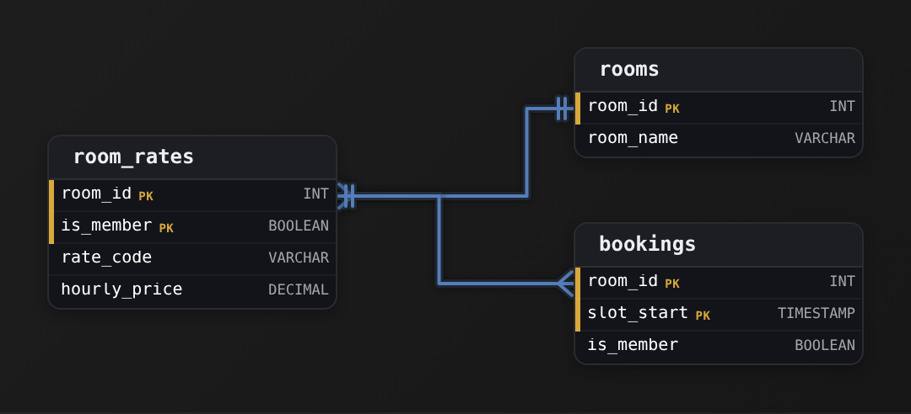
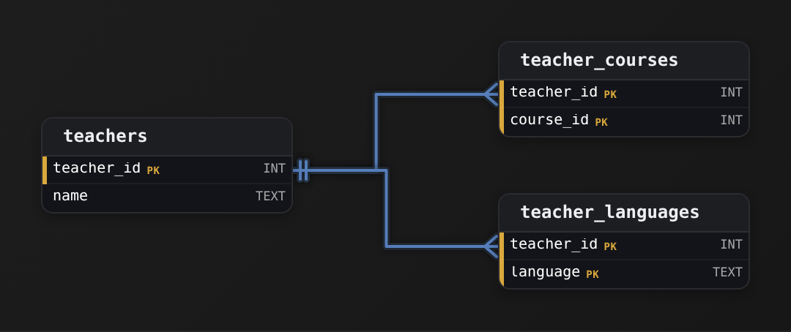
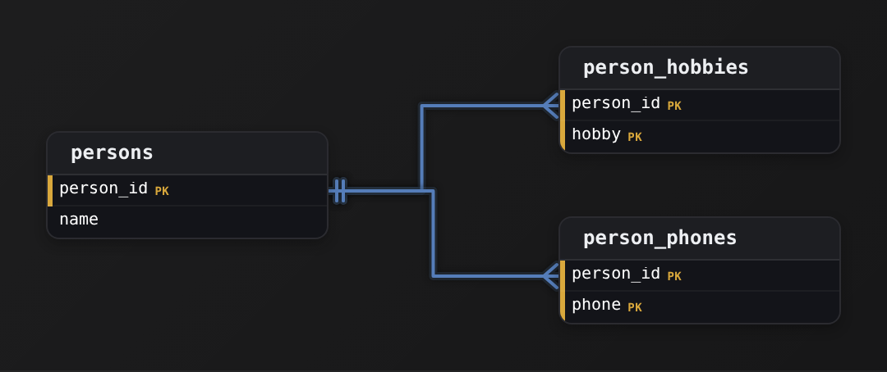
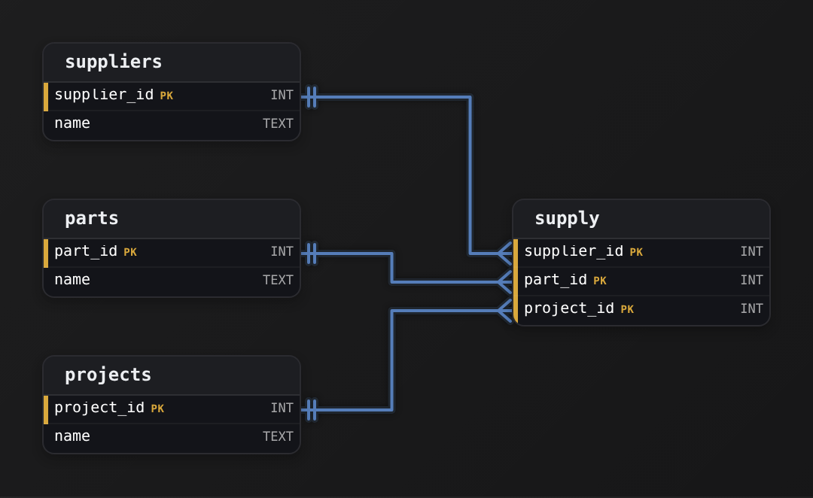
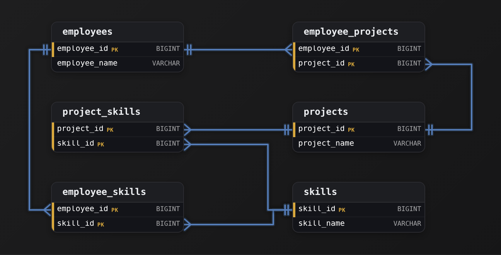
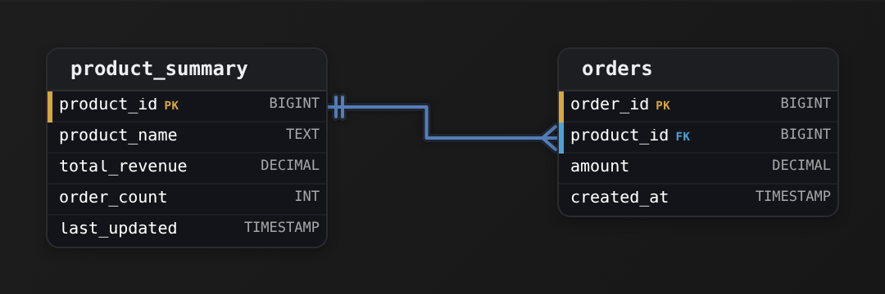
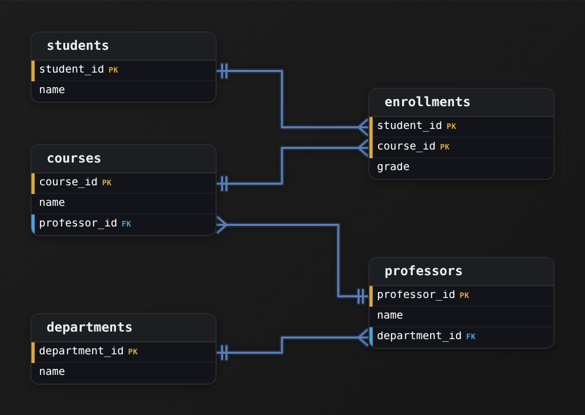
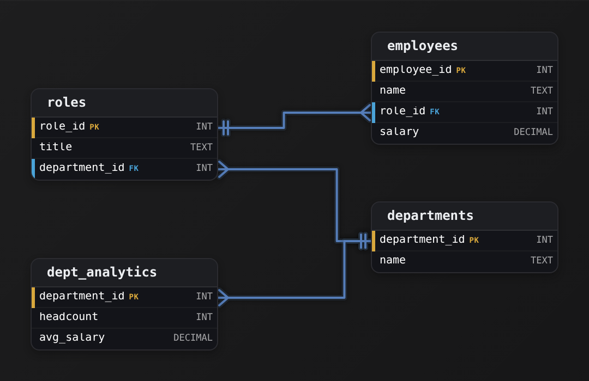

Intermediate·Data Modeling · 19 min · 12 challenges

# Beyond 3NF

At Airbnb, a host profile table pairs every language a host speaks with every listing the host manages. A host with 3 languages and 4 listings fills 12 rows, and the table passes every 3NF check. A host adds Italian, and the language-sync job inserts 1 row where the full update needs 4. One dashboard now shows that host's Italian on 1 listing, another on all 4.


<br>

---

## Boyce-Codd Normal Form

Every normal form is a rule about functional dependencies. Column A determines column B, written `A -> B`, when 2 rows that agree on A always agree on B. A candidate key is a set of columns that determines every other column, and a table can have more than 1 candidate key. 3NF requires that every column outside the keys depends on a whole candidate key and on nothing else. The rule says nothing about columns that sit inside a key, and that silence is the gap Boyce-Codd Normal Form closes.


<br>

### A table that passes 3NF and still breaks

A tutoring marketplace records which tutor a student works with in each subject in `sessions(student_id, subject, tutor_id)`. Two business rules hold: a student has 1 tutor per subject, and a tutor teaches exactly 1 subject.

| student_id | subject | tutor_id |
| --- | --- | --- |
| S1 | Algebra | T7 |
| S1 | Physics | T2 |
| S2 | Algebra | T7 |
| S3 | Algebra | T9 |
| S4 | Physics | T2 |

The rules give 2 dependencies. `{student_id, subject} -> tutor_id`, because a student has 1 tutor per subject. `tutor_id -> subject`, because a tutor teaches 1 subject. That second dependency makes `{student_id, tutor_id}` a second key of the table: knowing the tutor tells you the subject. `subject` belongs to the key `{student_id, subject}`, so it counts as a key column, and 3NF exempts any dependency whose right side is a key column. That exemption lets `tutor_id -> subject` slip through, and the table passes.

Now watch it fail. Tutor T7 moves from Algebra to Geometry: every row carrying T7 must change, 2 rows in this sample and thousands in production, and a job that misses 1 leaves T7 teaching 2 subjects at once. Student S3 drops Algebra: the only row recording that T9 teaches Algebra disappears with the student. A new tutor T11 who teaches Chemistry can't be stored at all until a student signs up, because `student_id` is part of every key.

> The BCNF test
>
> - Write down every dependency the business rules imply.
> - Check whether the left side of each one is a candidate key of the table.
> - A dependency whose left side isn't a candidate key breaks BCNF, even when its right side is a key column.

`tutor_id` isn't a candidate key of `sessions`, because it doesn't determine `student_id`. So `tutor_id -> subject` breaks BCNF. The fix moves that dependency into a table where its left side is the key.


<br>

### The decomposition


`tutor_subjects` has 1 determinant, `tutor_id`, and it's the key. `student_tutors` has a 2-column key and no other columns, so nothing can depend on part of it. T7 moving to Geometry is now 1 row. S3 leaving deletes 1 row in `student_tutors` while T9 keeps teaching Algebra. T11 gets a row before any student arrives. The original 3-column view comes back with a join.

```sql
SELECT
  st.student_id,
  ts.subject,
  st.tutor_id
FROM student_tutors AS st
JOIN tutor_subjects AS ts
  ON st.tutor_id = ts.tutor_id
```

The price is that the rule `{student_id, subject} -> tutor_id` now spans 2 tables. A row pairing S1 with T7 and a second row pairing S1 with T9 would give S1 2 Algebra tutors, and neither table can reject the second row on its own. The check becomes a join that counts tutors per student per subject.

```sql
SELECT
  st.student_id,
  ts.subject,
  COUNT(*) AS tutors
FROM student_tutors AS st
JOIN tutor_subjects AS ts
  ON st.tutor_id = ts.tutor_id
GROUP BY st.student_id, ts.subject
HAVING COUNT(*) > 1
```

BCNF always removes the redundancy. It sometimes gives up the ability to enforce a dependency inside 1 table, and the engineer decides which costs more. For a tutor who changes subject once a year while thousands of session rows carry that subject, the join check wins.

> **TIP**
>
> A table with 2 overlapping candidate keys is the signature of a BCNF problem. Find the dependency that created the second key and ask whether its left side identifies a row on its own.

**A retail chain stores shifts(employee_id, store_id, manager_id). Each manager runs exactly 1 store, and each employee has exactly 1 manager at a given store. Which change brings the table into BCNF?**

- **A.** Leave the table alone. Both store_id and manager_id are key columns, so no dependency between them can violate a normal form.
- **B.** Split into managers(manager_id, store_id) and shifts(employee_id, manager_id), and derive the store through a join when a query needs it.
- **C.** Split into employees(employee_id, store_id) and stores(store_id, manager_id), with 1 row per store in the second table.
- **D.** Add a shift_id column as a new single-column key so that every other column depends on that key alone.

<details>
<summary>Solution</summary>

**B.** Split into managers(manager_id, store_id) and shifts(employee_id, manager_id), and derive the store through a join when a query needs it.

The dependency manager_id -> store_id now lives in a table where manager_id is the key, and a manager moving stores is 1 row.

**Why the others are wrong**

- **A.** Key columns are exactly what BCNF examines. manager_id -> store_id has a left side that isn't a candidate key, so the store repeats on every shift the manager covers.
- **C.** A store can have several managers, so store_id -> manager_id doesn't hold, and the split loses which manager each employee reports to.
- **D.** A new key changes nothing about manager_id -> store_id. The store still repeats on every row the manager appears in.

</details>


<br>

---

## Data Modeling

### Exercise 1 of 2

**● TASK**

Design a teaching assignments schema in BCNF where teachers are assigned to courses but each course has only one teacher.

<details>
<summary><strong>Solution</strong></summary>

#### Decomposing into BCNF

Boyce-Codd Normal Form asks that every determinant be a candidate key. The tempting first cut is one wide table, `teaching(teacher_id, teacher_name, course_id, course_name)`, but it carries `teacher_id → teacher_name` and `course_id → course_name`, and neither left side is the table's key. That breaks BCNF and hands you the classic anomalies. The fix is the decomposition you drew: `teachers` and `courses` get their own tables, and `teaching_assignments` records who teaches what.


*Both columns of `teaching_assignments` are foreign keys, into `teachers` and `courses`.*

| Pitfall: The one-table trap |
| --- |
| Storing `teacher_name` and `course_name` beside the assignment repeats both on every row. Rename a teacher and you rewrite every course they teach; delete their last course and the teacher disappears. Splitting `teachers` and `courses` out kills both the update and the deletion anomaly. |

The phrase you had to translate was 'each course has only one teacher.' In dependency terms that is `course_id → teacher_id`: the course tells you its teacher, but not the reverse. That is a **one-to-many** relationship, one teacher to many courses, and it lets a teacher own many `courses` without repeating their details anywhere.

| Key insight: Junction table, tightened key |
| --- |
| A junction table between 2 entities usually needs the composite pair `(teacher_id, course_id)` as its key. The one-teacher rule tightens that: since `course_id` alone determines the row, a `UNIQUE` on `course_id` enforces it. Every table stays in BCNF. |

**Follow-up questions**

1. What changes if a course can be co-taught by 2 teachers?\
   *Back to a true many-to-many: the composite `(teacher_id, course_id)` is the only candidate key and the `UNIQUE` on `course_id` is dropped.*
2. Where would the term a course ran in, like 'Fall 2026', live?\
   *Tests whether a relationship attribute belongs on the `teaching_assignments` row.*

</details>


<br>

### Exercise 2 of 2

**● TASK**

Design a room booking schema in BCNF that still stops any room being booked twice in the same time slot. Each booking reserves one room for one slot and is charged at either the member or the guest rate. Every rate code (such as 'A-MEMBER') belongs to exactly one room and carries its own hourly price, and each room has exactly one member rate and one guest rate.

<details>
<summary><strong>Solution</strong></summary>

#### A rate code that decides the room

Boyce-Codd normal form asks one thing: every column that determines another must be a candidate key. The obvious table, `bookings(room_id, slot_start, rate_code)`, has 2 candidate keys: (`room_id`, `slot_start`) and (`rate_code`, `slot_start`). Every column is part of a key, so it passes 3NF. Yet `rate_code` alone decides `room_id`, and `rate_code` is not a key. That is the gap BCNF closes. In that table, repointing 'A-MEMBER' means rewriting every booking under it, and nothing stops a row that charges Room B's code to Room A.



*`rate_code` is a key in `room_rates`. `bookings` keeps (`room_id`, `slot_start`) as its key and finds its rate through (`room_id`, `is_member`).*

1. **Find the determinant that is not a key**

   List the dependencies: (`room_id`, `slot_start`) decides the rate, and `rate_code` decides `room_id`. The second one has a non-key on its left, so it must move.

2. **Give `rate_code` a table where it is a key**

   `room_rates` stores each code once, with its room, its member flag and its `hourly_price`. Here `rate_code` and (`room_id`, `is_member`) are both candidate keys, so every determinant is a key.

| Pitfall: Dropping `room_id` from bookings loses the double-booking rule |
| --- |
| Splitting into `rates(rate_code, room_id)` and `bookings(rate_code, slot_start)` is also BCNF. But its key lets 'A-MEMBER' and 'A-GUEST' both take Room A at 9:00. Recording `is_member` instead of the code keeps (`room_id`, `slot_start`) as the booking key, so the rule survives the split. |

| Real world: Codes that encode their parent hide BCNF breaks |
| --- |
| Fare codes tied to one route, price lists tied to one store and plan codes tied to one product all follow this pattern. Whenever a code implies its parent, check whether the code sits next to that parent inside some other key. |

**Follow-up questions**

1. What changes if a room may offer several member rates, such as peak and off-peak?\
   *Then (`room_id`, `is_member`) no longer decides the code, so the booking needs another column that does.*
2. How would you keep the price a booking was charged after `hourly_price` changes?\
   *This separates the current rate from the amount recorded on the booking.*

</details>


<br>

---

## Fourth Normal Form (4NF)

BCNF governs facts with 1 value: a tutor has 1 subject. Many facts carry a list of values, like the several languages a host speaks and the several listings a host manages. A table that stores both lists side by side has no functional dependency at all, passes BCNF, and still multiplies rows.

| host_id | language | listing_id |
| --- | --- | --- |
| 41 | English | L100 |
| 41 | English | L205 |
| 41 | English | L310 |
| 41 | Spanish | L100 |
| 41 | Spanish | L205 |
| 41 | Spanish | L310 |
| 58 | French | L411 |

Host 41 speaks 2 languages and manages 3 listings, so the table needs 6 rows, 1 per combination. Nothing determines anything: the same host appears with 2 languages and the same language with 3 listings, so the key is all 3 columns and BCNF has no complaint. Now host 41 learns Italian. The complete update inserts 3 rows, 1 per listing. A job that inserts only `(41, Italian, L100)` leaves the table claiming Italian goes with 1 listing and not the other 2, a claim nobody ever made, because a language belongs to the host and applies to every listing.


<br>

### Multi-valued dependency

The relationship is a multi-valued dependency, written `host_id ->> language`: for a given host, the set of languages across the rows is the same whatever listing those rows carry. The symmetric dependency `host_id ->> listing_id` holds for the same reason. 4NF requires that the left side of every such dependency is a candidate key. `host_id` alone is not a key of `host_profile`, so the table fails. The repair puts each list in its own table keyed by the host.


host_languages

| host_id | language |
| --- | --- |
| 41 | English |
| 41 | Spanish |
| 58 | French |

host_listings

| host_id | listing_id |
| --- | --- |
| 41 | L100 |
| 41 | L205 |
| 41 | L310 |
| 58 | L411 |

Adding Italian is now 1 row in `host_languages`, and no listing is involved. The saving grows with the lists: a host with 5 languages and 10 listings costs 50 rows in the combined table and 15 across the pair.


<br>

### The test that tells split from keep

Not every 3-column table with repeated values is a cross product. `listing_translations(listing_id, language, translated_title)` stores the languages a particular listing has been translated into. Adding a Japanese translation to L100 says nothing about L205. The language is a fact about that listing, so the columns stay together, and the table is already in 4NF. One question separates the 2 cases: when you add a value to column B for a given A, must you also add it for every value of column C that A has? If yes, B and C are independent lists and the table splits. If no, B and C form a single fact and the table stays.

Real data can answer the question for you. Count the distinct values of each list per host and compare the product with the rows stored.

```sql
SELECT
  host_id,
  COUNT(DISTINCT language) AS languages,
  COUNT(DISTINCT listing_id) AS listings,
  COUNT(*) AS stored_rows
FROM host_profile
GROUP BY host_id
```

When `stored_rows` equals `languages` times `listings` for every host, the table is storing 2 independent lists as a product and belongs in 2 tables. When it falls short for some hosts, either a job skipped rows or the 2 columns share a real relationship, and the data owners can tell you which.

**A university stores course_offerings(course_id, textbook_isbn, instructor_id). The textbooks for a course are fixed by the department, and the instructors for a course are assigned by the scheduling office. Neither list depends on the other. A course with 3 textbooks and 4 instructors holds 12 rows. What does 4NF call for?**

- **A.** Keep the table as it is, because course_id determines nothing on its own and so there is no dependency to repair.
- **B.** Split into course_textbooks(course_id, textbook_isbn) and textbook_instructors(textbook_isbn, instructor_id), with 2 smaller tables.
- **C.** Add a section_id column so that each row records 1 section taught with 1 textbook by 1 instructor.
- **D.** Split into course_textbooks(course_id, textbook_isbn) and course_instructors(course_id, instructor_id), 7 rows in place of 12.

<details>
<summary>Solution</summary>

**D.** Split into course_textbooks(course_id, textbook_isbn) and course_instructors(course_id, instructor_id), 7 rows in place of 12.

Each independent list gets its own table keyed by the course. Adding a textbook is 1 row and never touches the instructors.

**Why the others are wrong**

- **A.** There are 2 multi-valued dependencies from course_id, one per list, and a left side that isn't a key is exactly what 4NF repairs.
- **B.** This ties instructors to textbooks, a relationship nobody stated, and the second table still holds all 12 combinations.
- **C.** This invents a fact. The department's textbook list belongs to the course, and a section would have to repeat it.

</details>


<br>

---

## Data Modeling

### Exercise 1 of 2

**● TASK**

A teacher can teach multiple courses AND speak multiple languages. These facts are independent. The current schema stores them together in one table, forcing a row for every course-language pair (a multi-valued dependency). Decompose the design so each independent multi-valued fact lives in its own table, keyed back to the teacher.

<details>
<summary><strong>Solution</strong></summary>

#### The concept: multi-valued dependencies and 4NF

This is a **fourth normal form** decomposition. A multi-valued dependency shows up when one key independently determines 2 (or more) sets of values. Here a `teacher_id` determines a set of courses AND, separately, a set of languages. The 2 facts have nothing to do with each other: which languages you speak does not depend on which courses you teach. When 2 independent multi-valued facts share a table, the only way to represent them is one row per combination, and that combination is fiction the data never actually asserted.

| Pitfall: The row you were probably tempted to keep |
| --- |
| A single `teacher_courses_languages(teacher_id, course_id, language)` table looks tidy but forces the cross product. A teacher with 3 courses and 2 languages needs 3 * 2 = 6 rows, and every one of them is a claim like 'teaches Algebra AND speaks French' that you never meant to make. Add a 4th course and you must insert a row for each language to keep the data consistent; drop a language and you must delete it from every course row. Miss one and the table now says something false. That update anomaly is the tell of a 4NF violation. |



*Each independent multi-valued fact gets its own table, both keyed back to the teacher.*

The fix is to split the one table into two, one per independent fact: `teacher_courses(teacher_id, course_id)` and `teacher_languages(teacher_id, language)`. In each, the whole row is the key, so `teacher_id` pairs with `course_id` in one and with `language` in the other, and `teacher_id` in both is a foreign key back to `teachers`. Now the 3 courses and 2 languages are stored as 3 + 2 = 5 rows instead of 6, and each row asserts exactly one true fact. Adding a course touches only `teacher_courses`; the languages are untouched, because they were never entangled in the first place.

| Key insight: 4NF is about splitting, not joining |
| --- |
| The signal to decompose is 2 independent one-to-many facts about the same entity. If the facts were dependent, say a course is taught in a specific language, then `(course_id, language)` would belong together in one table and splitting them would lose information. That distinction, whether the pairing carries meaning or is just a cross product, is exactly what fourth normal form asks you to check before you keep multiple repeating groups in one table. |

**Follow-up questions**

1. What changes if a course is actually taught in a particular language, so the pairing is meaningful?\
   *Tests whether the learner can tell a real multi-valued dependency from a genuine dependent pairing that belongs together.*
2. How would you add a third independent fact, say the grade levels a teacher covers?\
   *Checks that the pattern generalizes: another `teacher_*` table keyed to `teacher_id`, not another column bolted onto an existing one.*

</details>


<br>

### Exercise 2 of 2

**● TASK**

A person can have multiple hobbies and multiple phone numbers independently. Eliminate the multi-valued dependency.

<details>
<summary><strong>Solution</strong></summary>

#### Fourth normal form: independent facts get their own table

The concept you just applied is **fourth normal form (4NF)**, and the thing it removes is a *multi-valued dependency*. A person has many hobbies, and independently has many phone numbers. Neither set has anything to do with the other, so the moment you try to store both against the same `person_id` in one table, the 2 independent lists collide. 4NF says: when 2 facts about an entity vary independently, each one gets its own table.

| Pitfall: The one-table version multiplies rows |
| --- |
| The tempting wrong answer is a single `persons` table carrying both `hobby` and `phone`. Because the 2 lists are independent, you can only keep the row unique by storing the **cross product**: someone with 3 hobbies and 2 phones needs 3 x 2 = 6 rows. Add one phone and you must insert 3 more rows, one per hobby, or the data lies about which hobby pairs with which number. Those phantom pairings ARE the multi-valued dependency. |

| ✕ Crammed into one table (MVD) | ✓ Split at 4NF |
| --- | --- |
| `persons(person_id, hobby, phone)`. To stay consistent every `hobby` must repeat for every `phone`. 6 rows for 3+2 facts, and an insert/delete anomaly on every change because the 2 lists are entangled by the composite key. | `person_hobbies(person_id, hobby)` and `person_phones(person_id, phone)`, each a composite primary key. 3 + 2 = 5 rows, no repetition, and adding a phone touches exactly one table. Each list varies on its own. |



*2 independent one-to-many facts, 2 separate child tables. Each child's primary key is the pair (`person_id`, value), and `person_id` is a foreign key back to persons.*

| Key insight: The tell: 2 independent lists on one key |
| --- |
| The signal for a 4NF split is a single entity owning 2 or more sets that grow independently of each other. Do not fold both into one child table. `person_hobbies` and `person_phones` each carry a composite key of `person_id` plus the value; `person_id` alone is the foreign key to `persons`. Because the value is part of the key, each fact is naturally unique without a surrogate id. |

| Real world: In production this hides in wide profile tables |
| --- |
| You meet this most often when a `users` or `profiles` table has quietly accumulated `skills`, `tags`, and `contact_methods` as parallel repeating groups (or comma-joined strings). The fix is the same each time: one child table per independent multi-valued attribute, keyed on the parent id plus the value. It keeps writes single-row and stops the cross-product row explosion before it starts. |

**Follow-up questions**

1. If a phone number needs a label like 'mobile' or 'work', where does that column live?\
   *Tests whether they see the attribute belongs on `person_phones` and whether the key stays (`person_id`, phone) or gains the label.*
2. What breaks if you merge `person_hobbies` and `person_phones` into one attributes table with a type column?\
   *Checks that they can articulate the entity-attribute-value trade-off versus a clean 4NF split.*

</details>


<br>

---

## Fifth Normal Form (5NF)

4NF splits 2 independent lists. 5NF handles 3 lists tied together by a rule, and the rule decides whether a 3-column table is a fact in its own right or a product that a join could rebuild.

A creator marketing platform tracks sponsorships: a creator promotes a brand on a platform. `sponsorships(creator_id, brand, platform)` has a 3-column key and no functional or multi-valued dependency, so it passes BCNF and 4NF. Whether it passes 5NF depends on 1 sentence from the business. Suppose the sentence is: a creator promotes a brand on every platform where that creator is active and that brand advertises. Under that rule, every row of `sponsorships` follows from 3 smaller facts: which brands a creator works with, which platforms a creator is active on, and which platforms a brand advertises on.

| creator_id | brand | platform |
| --- | --- | --- |
| C1 | Acme | Video |
| C1 | Acme | Audio |
| C1 | Zest | Video |
| C1 | Zest | Audio |
| C2 | Acme | Video |

C1 works with Acme and Zest, is active on Video and Audio, and both brands advertise on both platforms, so C1 gets 4 rows. C2 works with Acme alone and is active on Video alone, so C2 gets 1. When C1 joins a third platform where both brands advertise, the rule demands 2 new rows. A creator with 5 brands on 4 platforms costs 20 rows, all of which follow from 9 facts about this creator (5 brands, 4 platforms) plus the brand-platform facts that every creator shares. The join dependency `*({creator_id, brand}, {creator_id, platform}, {brand, platform})` states that the table equals the join of its 3 projections. 5NF requires that every join dependency follows from the keys; here it follows from a business rule instead, so the table fails 5NF and splits 3 ways.


```sql
SELECT
  cb.creator_id,
  cb.brand,
  cp.platform
FROM creator_brands AS cb
JOIN creator_platforms AS cp
  ON cb.creator_id = cp.creator_id
JOIN brand_platforms AS bp
  ON bp.brand = cb.brand
    AND bp.platform = cp.platform
```


<br>

### The spurious row

The split works only while the rule holds. Suppose deals are negotiated 1 at a time: C1 promotes Acme on Video only and Zest on Audio only, even though C1 is active on both platforms and both brands advertise on both. The pair tables record C1 with Acme, C1 with Zest, C1 on Video, C1 on Audio, and each brand on each platform. Joining them produces 4 sponsorships where 2 exist.

| creator_id | brand | platform | status |
| --- | --- | --- | --- |
| C1 | Acme | Video | real deal |
| C1 | Acme | Audio | spurious |
| C1 | Zest | Video | spurious |
| C1 | Zest | Audio | real deal |

The 2 extra rows are spurious tuples: facts the join invents because the pieces no longer determine the whole. When each deal is its own agreement, the triple is the fact, the table is already in 5NF, and splitting it destroys information.

> The 5NF decision
>
> - Write the rule in business words: does every combination the 3 pairs allow exist as a real fact?
> - If yes, the triple table is derived data. Store the 3 pair tables and join when a query needs the triple.
> - If no, the triple is a fact of its own. Keep it in 1 table, which already satisfies 5NF.

Most 3-column tables in a warehouse are genuine facts: an order line, a deal, a session. They're already in 5NF and nobody needs to touch them. 5NF matters when a table turns out to be a product of pairs and a pipeline writes 5 rows when a creator with 5 brands joins 1 new platform, an event that changed 1 fact. The query below tests the rule against real data by comparing the rows the pairs predict with the rows stored.

```sql
SELECT
  (
    SELECT
      COUNT(*)
    FROM sponsorships
  ) AS stored_rows,
  COUNT(*) AS predicted_rows
FROM creator_brands AS cb
JOIN creator_platforms AS cp
  ON cb.creator_id = cp.creator_id
JOIN brand_platforms AS bp
  ON bp.brand = cb.brand
    AND bp.platform = cp.platform
```

Equal counts over months of data make the rule credible and the split safe. A stored count below the predicted one means some combinations are deliberately absent, and the triple stays where it is.

**A logistics company stores routes(courier_id, zone_id, vehicle_type). The dispatch rule: a courier may serve a zone with a vehicle type whenever the courier is certified for that vehicle, the courier is assigned to that zone, and the zone permits that vehicle. Which design follows from the rule?**

- **A.** Store courier_vehicles, courier_zones and zone_vehicles, and build routes with a 3-way join whenever a query needs it.
- **B.** Store courier_vehicles and courier_zones only, since a vehicle the courier is certified for is allowed wherever the courier goes.
- **C.** Keep routes as the only table, because a 3-column key can never be decomposed without losing rows on the way back.
- **D.** Store routes and the 3 pair tables together, and run a nightly comparison job that reconciles them when they drift.

<details>
<summary>Solution</summary>

**A.** Store courier_vehicles, courier_zones and zone_vehicles, and build routes with a 3-way join whenever a query needs it.

The rule is a join dependency over 3 pairs, so the triple is derived data and the pairs are the facts.

**Why the others are wrong**

- **B.** This drops the zone permissions. The join would place a courier in a zone on a vehicle that zone forbids.
- **C.** Decomposition loses rows only when the join dependency fails. The dispatch rule guarantees it holds.
- **D.** This stores the same fact twice. The pairs plus the rule already define routes, so the triple is pure redundancy.

</details>


<br>

---

## Data Modeling

### Exercise 1 of 2

**● TASK**

Model a supply catalog in 5NF where a supplier supplies a part for a project, a three-way fact that splitting into supplier-part, supplier-project and part-project tables would corrupt with invented combinations. Keep suppliers, parts and projects as dimension tables, and record each supply fact in one ternary junction table whose composite primary key is supplier, part and project, each column a foreign key to its dimension.

<details>
<summary><strong>Solution</strong></summary>

#### The concept: fifth normal form and the irreducible ternary

Fifth normal form (5NF, also called project-join normal form) asks one question of every relationship: can this table be split into smaller tables and then rebuilt exactly by joining them back together? If yes, split it. If the split would either lose facts or invent facts that were never true, the relationship is **irreducible** and must stay in one table. The supply catalog is the textbook case: the fact 'supplier `S` supplies part `P` for project `J`' is a genuine three-way statement, so it lives in one ternary table, `supply`, keyed on all 3 ids.



*3 dimension tables and one ternary junction. The composite primary key of supply is all 3 columns, and each of those columns is also a foreign key back to its dimension.*

| Pitfall: The pairwise-decomposition trap |
| --- |
| The tempting wrong answer is 3 two-column tables: `supplier_part`, `supplier_project`, and `part_project`. It looks more normalized. But joining them back invents rows. If `S` supplies `P` (for some project), `S` works on `J` (with some part), and `P` is used on `J` (by some supplier), the three-way join asserts that `S` supplies `P` for `J`, even when that specific combination was never recorded. You have manufactured a fact. That spurious tuple is precisely the join dependency 5NF exists to forbid. |

| ✕ Pairwise decomposition (wrong) | ✓ Single ternary junction (5NF) |
| --- | --- |
| 3 tables `supplier_part`, `supplier_project`, `part_project`. Each fact of the real relationship is scattered across 2 or 3 of them, and rejoining `supplier_part` to `supplier_project` to `part_project` reconstructs combinations that were never asserted. You cannot store 'S supplies P for J' without side effects on unrelated rows. | One table `supply` with primary key `(supplier_id, part_id, project_id)`. Each row is exactly one asserted three-way fact, nothing more, nothing less. There is no join dependency to exploit because there is nothing to decompose: the relationship is stored whole. |

**The 5NF catalog schema**

```sql
CREATE TABLE suppliers (
    supplier_id INT PRIMARY KEY,
    name        TEXT NOT NULL
);

CREATE TABLE parts (
    part_id INT PRIMARY KEY,
    name    TEXT NOT NULL
);

CREATE TABLE projects (
    project_id INT PRIMARY KEY,
    name       TEXT NOT NULL
);

CREATE TABLE supply (
    supplier_id INT NOT NULL REFERENCES suppliers(supplier_id),
    part_id     INT NOT NULL REFERENCES parts(part_id),
    project_id  INT NOT NULL REFERENCES projects(project_id),
    PRIMARY KEY (supplier_id, part_id, project_id)
);
```

*Each dimension owns its own key; supply borrows all 3 as one composite primary key that is simultaneously 3 foreign keys.*

| Key insight: The composite key is doing 2 jobs at once |
| --- |
| In `supply`, the trio `(supplier_id, part_id, project_id)` is the whole primary key AND each column is individually a foreign key. As a primary key it guarantees each three-way fact appears at most once. As 3 foreign keys it guarantees every id in the fact points at a real supplier, part, and project. There is no surrogate id and no extra column: the identity of a supply fact IS the combination of what it relates. |

**Follow-up questions**

1. If the business needs to record how many units of the part a supplier delivers to a project, where does that quantity live?\
   *Tests whether the learner sees that a non-key attribute of the relationship belongs as an extra column on `supply`, not on any dimension, and does not disturb the ternary key.*
2. Suppose the rule relaxes so that any supplier who supplies a part and works on a project automatically supplies that part to that project. Is the relationship still irreducible?\
   *Tests the 5NF judgement itself: under that rule the join dependency holds, decomposition into pairwise tables is now lossless, and the ternary table would be redundant.*

</details>


<br>

### Exercise 2 of 2

**● TASK**

Model which employees use which skills on which projects, in fifth normal form. The rule is fixed: an employee uses a skill on a project exactly when the employee holds that skill, is staffed on that project, and the project requires that skill. Keep employees, skills and projects as their own entities, and store no fact that can be rebuilt from the others.

<details>
<summary><strong>Solution</strong></summary>

#### Fifth normal form: when the three-way fact is derivable

**Fifth normal form** is about join dependencies. A table that ties three things together carries one when it can be split into smaller projections and rejoined with nothing lost and nothing invented. Here the business rule makes every assignment derivable: an employee uses a skill on a project exactly when three pairwise facts hold. A table of assignment rows would only repeat what those facts already say, and every new skill, staffing or requirement would force you to insert or delete a fan of assignment rows to keep it in sync.



*Three pairwise junctions, each keyed on its pair; assignments are the join of `employee_skills`, `employee_projects` and `project_skills`.*

1. **Find the three pairwise facts in the rule**

   Read the rule clause by clause. Holding a skill is a fact about an employee and a skill. Staffing is a fact about an employee and a project. Requiring is a fact about a project and a skill. Each one is true on its own, whether or not any assignment comes of it, so each gets its own table keyed on its pair: `employee_skills`, `employee_projects` and `project_skills`.

2. **Rebuild assignments with a three-way join**

   Join `employee_skills` to `employee_projects` on `employee_id`, then join to `project_skills` on both `project_id` and `skill_id`. That last double condition makes the dependency cyclic: any 2 of the tables alone over-generate rows, and only all three together give back exactly the assignments the rule defines.

| ✕ One three-way assignment table | ✓ Three pairwise tables |
| --- | --- |
| Keyed on `(employee_id, project_id, skill_id)`. Every row is implied by three pairwise facts, so the table carries a join dependency. When an employee learns a new skill you must insert a row for every staffed project that needs it, and missing one leaves the data contradicting the rule. | Each fact is stored once. A new skill is one row in `employee_skills`, and the assignments it creates appear in the join automatically. Nothing derivable is stored, so nothing can drift, and the design is in 5NF. |

| Pitfall: 2 of the three tables are not enough |
| --- |
| Dropping `project_skills` and joining only `employee_skills` with `employee_projects` claims that every employee uses every skill they hold on every project they staff, including skills the project never asked for. The decomposition is lossless only when all three projections are kept. |

| Key insight: The rule decides the split, not the table count |
| --- |
| The split is right here because the rule says assignments follow from the three pairwise facts. When assignments are chosen one by one, as when a supplier provides a specific part to a specific project, rejoining the pairs would fabricate rows. In that case the three-way table is already the 5NF design. |

| Real world: Derived assignments stay a view |
| --- |
| Teams that need the assignment list often expose the three-way join as a view. Readers get one assignment row per employee, project and skill, while writes touch only the pairwise facts that actually changed. |

**Follow-up questions**

1. A manager can now bar one employee from using one skill on one project, even when all three facts hold. What happens to the design?\
   *Assignments are no longer the join of their projections, so the join dependency is gone; the exceptions need a three-way record of their own.*
2. How would you confirm that existing assignment rows really obey the rule before you migrate to the three pairwise tables?\
   *Compare the stored rows with the three-way join of their own projections; any difference means the rule did not actually hold.*

</details>


<br>

---

## Strategic Denormalization

Normal forms optimise for writes that touch 1 row and for a table that can never contradict itself. Analytical tables face a different load. A dashboard reads 2 billion order rows and writes nothing. A pipeline rewrites a whole partition once an hour. Under that load a join across 2 billion rows costs minutes of compute per query, while a column copied into the fact table costs a few bytes per row plus 1 refresh step. Denormalization is the decision to pay the second price in place of the first, and strategic means the decision is written down with its conditions.


<br>

### The query that forces the question

A delivery marketplace keeps `orders`, `customers`, `cities` and `regions` in 3NF. Revenue by region, the number on every executive dashboard, needs 3 joins.

```sql
SELECT
  r.region_name,
  SUM(o.order_total) AS revenue
FROM orders AS o
JOIN customers AS c
  ON o.customer_id = c.customer_id
JOIN cities AS ci
  ON c.city_id = ci.city_id
JOIN regions AS r
  ON ci.region_id = r.region_id
WHERE o.order_date >= DATE '2026-10-01'
GROUP BY r.region_name
```

At 2 billion orders and 40 million customers, the first join alone ships the customer table to every worker and probes it 2 billion times. With `region_name` copied onto each order row, the query reads 1 table, groups, and finishes in a fraction of the time. The copy makes each region name appear on every order in it, which is the redundancy 3NF removed. Whether that's a problem depends on 5 questions.

| Question | Copy the column | Keep the join |
| --- | --- | --- |
| How often does the value change? | Yearly, with notice | Daily or without warning |
| How many reads per write? | Thousands | Comparable |
| Who writes the copy? | One pipeline that can rerun | Several apps, by hand |
| How stale may a read be? | Hours | Seconds |
| Can the copy be rebuilt from the source? | Yes, by a query | No, the source is gone |

Region names change about never, the dashboard runs thousands of times a day, the warehouse pipeline owns `orders`, and a region rename that lands in the next hourly refresh hurts nobody. Every answer lands in the copy column. Contrast a `customer_balance` copied onto orders: it changes with every payment, a payment service writes it, and a stale value sends the wrong collections email. Every answer lands in the join column.


<br>

### The rule that keeps the copy safe

A copy is never a source of truth. regions remains the only place a region name is written, and orders carries a derived value that a job can regenerate from regions at any time. When the copy disagrees with the source, the fix is to rerun the job. The failure to design against is an application writing straight into the wide table: now orders says North and regions says Northeast, each has a writer, and the update anomaly from the start of this lesson is back with 2 owners and no referee.

| ✓ Normalize when | ✗ Denormalize when |
| --- | --- |
| • Many services write the table<br><br>• A wrong value costs money immediately<br><br>• Values change often<br><br>• Reads already run fast enough | • One pipeline writes, thousands of queries read<br><br>• A value 1 hour stale is acceptable<br><br>• Values change rarely<br><br>• The join dominates query time |

| ✓ Do | ✗ Don't |
| --- | --- |
| • Name the source table a copied column derives from, in the column documentation<br><br>• Rebuild the copy from the source on a schedule<br><br>• Measure the join cost before copying<br><br>• Keep the normalized tables as the only write path | • Let applications update a copied column<br><br>• Copy a value that changes with every transaction<br><br>• Copy because the join looks long rather than slow<br><br>• Lose the query that regenerates the copy |

**An analytics team wants to copy product_category from products onto a 5 billion row page_views table so category dashboards stop joining. Categories are reassigned in a quarterly catalog review, a nightly pipeline owns page_views, and the dashboards tolerate 1 day of lag. Which assessment is right?**

- **A.** Copy it, and have the catalog service update page_views directly whenever a category changes so the copy never goes stale.
- **B.** Keep the join, because a normal form forbids storing the same category value 5 billion times in 1 table.
- **C.** Copy it, refreshed by the nightly pipeline from products, and document products as the source of the column.
- **D.** Copy it onto the current quarter's rows only, so the catalog review never has to rewrite historical page views.

<details>
<summary>Solution</summary>

**C.** Copy it, refreshed by the nightly pipeline from products, and document products as the source of the column.

Rare changes, 1 pipeline writer, thousands of reads and a tolerated lag of 1 day put every answer in the copy column.

**Why the others are wrong**

- **A.** That gives the copy a second writer, and the service would rewrite billions of rows on every reassignment.
- **B.** Normal forms are a design for write-heavy tables with many writers. The question here is query cost against staleness.
- **D.** A partial copy forks the query logic: older rows still need the join, and every dashboard carries both paths.

</details>


<br>

---

## Data Modeling

### Exercise 1 of 2

**● TASK**

Revenue-by-customer and revenue-by-product reports run constantly, and their joins back to the customer and product tables are too slow. Design one reporting fact table at the order-line grain (one row per product line in an order) that deliberately denormalizes customer_name and product_name onto every row so those reports need no joins. Keep every column at that grain: no order-header values such as an order total or order status.

<details>
<summary><strong>Solution</strong></summary>

#### Denormalization, on purpose

Copying `customer_name` and `product_name` onto every order line is **strategic denormalization**: you break normalization on purpose, duplicating attributes that belong to the customer and product tables so the hot reports never join. In a normalized model each name lives once and every report joins back to it. That is safe for writes, but these reports run constantly and the joins are the bottleneck. So you build one wide fact table, `orders_flat`, that carries the names inline, and the report reads a single table.


*One row per order line. The `customer_id` and `product_id` keys stay for drill-back; the names ride alongside so the report needs no join.*

1. **Fix the grain before you pick columns**

   The grain is one row per product line within an order, so `order_line_id` is the primary key. Everything else in the table must describe THAT line and nothing coarser. `quantity` and `line_total` are line-level measures; `customer_name` and `product_name` are attributes of the line's customer and product. Keep `customer_id` and `product_id` too: they cost almost nothing and let you re-join when a report needs an attribute you did not copy.

| Pitfall: Don't mix in the order-header grain |
| --- |
| The tempting extra is `order_total` or `order_status` on each row. Those live at the order grain: an order with 3 lines repeats the same `order_total` 3 times, and `SUM(order_total)` now triple-counts. Denormalizing a dimension attribute onto a line is safe; copying an order-level value onto it changes what a row means. Order totals belong in a second fact table at the order grain. |

| ✕ Normalized (what was slow) | ✓ Denormalized fact |
| --- | --- |
| `order_lines` holds only `customer_id` and `product_id`. Every revenue-by-customer query joins to `customers` and `products` to resolve the names. Each fact stored once, updates are safe, and every read pays the join. | `orders_flat` carries `customer_name` and `product_name` inline. Revenue-by-customer is a `GROUP BY customer_name` over one table. You trade storage and a sync pipeline for read speed. |

| Real world: Every copied name needs a sync pipeline |
| --- |
| The copied `customer_name` is only as fresh as the job that writes it. If a customer renames, `orders_flat` shows the old name until the next load, or longer if the pipeline breaks. That is the consistency you trade away, and it is worth it only because these reports run far more often than names change. |

**Follow-up questions**

1. A customer changes their name. Should existing `orders_flat` rows show the old name or the new one?\
   *Decides whether the sync pipeline rewrites history or only stamps new rows.*
2. The team now also wants revenue by order status. Where does `order_status` go?\
   *Denormalizing toward a coarser grain needs its own table, not extra columns here.*

</details>


<br>

### Exercise 2 of 2

**● TASK**

Create a product summary table that caches pre-computed aggregates (total revenue, order count). This is a deliberate denormalization for read performance.

<details>
<summary><strong>Solution</strong></summary>

#### Pre-aggregation: paying the cost once, not per read

A summary table is **denormalization by pre-aggregation**. You stop recomputing a product's totals from raw `orders` rows on every request. Instead you keep `product_summary`, which stores the already-summed answers: one row per product, with `total_revenue` and `order_count` as plain columns. A read becomes a single-row lookup by `product_id` rather than a scan-and-`SUM` over every order. You store a value you could derive because deriving it on every read is the expensive part.



*`product_summary` is a one-row-per-product cache of aggregates derived from `orders`.*

3 things matter in this shape. `product_id` as the primary key gives exactly one summary row per product. `total_revenue` and `order_count` hold the pre-computed aggregates. `last_updated` is the column that often gets left off. Without a timestamp you cannot tell a fresh row from a stale one, you cannot drive an incremental refresh, and you cannot answer "as of when?" when a number looks wrong.

| Pitfall: A plain view caches nothing |
| --- |
| The tempting shortcut is a view over `SELECT product_id, SUM(amount), COUNT(*) FROM orders GROUP BY product_id`. It is always correct, but it stores no rows, so every read re-scans `orders` and slows down as sales grow. Pre-aggregation writes the `SUM` into `total_revenue` at write or refresh time, which leaves the read with no aggregation to do. |

| Real world: Staleness is a product decision |
| --- |
| Read-heavy dashboards run on this pattern. The summary is kept current by a trigger on `orders`, an incremental job, or a nightly rebuild, and consumers query only `product_summary`. A leaderboard can tolerate minutes of lag, but a billing total cannot. `last_updated` is how you choose that bound and enforce it. |

**Follow-up questions**

1. How would you keep `total_revenue` correct when an order is refunded or deleted, not just inserted?\
   *Whether the refresh path handles decrements as well as append-only growth.*
2. For revenue by month, would you widen `product_summary` or add a `product_month_summary` table?\
   *Choosing the grain of a pre-aggregate.*

</details>


<br>

---

## Denormalization Patterns

Section 3 decided when to denormalize. Each shape below comes with the query that builds it and the event that breaks it.


<br>

### Pattern 1: Copy a column across the join

One attribute from a parent table is copied onto each child row. The region example is this pattern: `region_name` lands on `orders`. The build is a query the pipeline runs on every refresh.

```sql
CREATE TABLE orders_with_region AS
SELECT
    o.order_id,
    o.customer_id,
    o.order_date,
    o.order_total,
    r.region_name
FROM orders o
JOIN customers c
    ON o.customer_id = c.customer_id
JOIN cities ci
    ON c.city_id = ci.city_id
JOIN regions r
    ON ci.region_id = r.region_id
```

It breaks when the parent value changes and the job doesn't rerun. Pick columns that change rarely: names of regions, product categories, plan tiers.


<br>

### Pattern 2: The pre-joined wide table

When several dashboards each need a different handful of columns from the same 4 tables, copying them 1 at a time produces 4 pipelines. The wide table joins once and carries every attribute analysts ask for, 1 row per order.

| order_id | order_date | order_total | customer_name | city_name | region_name | plan_tier |
| --- | --- | --- | --- | --- | --- | --- |
| 9001 | 2026-10-02 | 42.10 | Ana Ruiz | Lisbon | South | Plus |
| 9002 | 2026-10-02 | 18.75 | Tom Ahn | Porto | North | Basic |
| 9003 | 2026-10-03 | 63.00 | Ana Ruiz | Lisbon | South | Plus |

A query touches 1 table. The cost is width: 40 columns, most of them repeated text, across 2 billion rows. Columnar storage reads only the columns a query names, so unused width costs disk rather than query time, which is why wide tables are affordable in a warehouse and painful in a transactional database. The wide table also freezes the join at build time: the value on a row is the value at the last refresh, a feature for reporting and a bug when someone expects the current value.


<br>

### Pattern 3: The stored derived value

A number a query would compute from many rows is computed once and stored on the parent. `order_total` on `orders` is the sum of its lines. `order_count` on `customers` counts that customer's orders. Every read of the number skips the aggregation, and the pipeline overwrites the stored column from a query like this one.

```sql
SELECT
  customer_id,
  COUNT(*) AS order_count,
  MAX(order_date) AS last_order_date
FROM orders
GROUP BY customer_id
```

It breaks the moment a new order lands and the stored count lags by 1. The refresh cadence of the pipeline is the staleness of the number, and the documentation must say so, or a support agent reads 11 orders on the customer page while the order list shows 12.

| Pattern | What is copied | What breaks it | Who repairs it |
| --- | --- | --- | --- |
| Column copy | 1 parent attribute | The parent value changes | Scheduled rebuild from the parent |
| Wide table | Every joined attribute | Any source table changes | Full rebuild of the partition |
| Stored derived value | An aggregate of child rows | A new or changed child row | Recompute from the children |

> **TIP**
>
> Every pattern here is a cache. Keep the regenerating query next to the table definition, because a copy you can't rebuild becomes a liability the day it drifts.


<br>

---

## Data Modeling

### Exercise 1 of 2

**● TASK**

Design a users table that embeds pre-computed activity stats to avoid expensive aggregation queries at read time.

<details>
<summary><strong>Solution</strong></summary>

#### Store the answer, not the ingredients

A profile page wants 3 numbers every time it loads, so **pre-aggregation** computes them once and keeps them on the user row. `post_count`, `follower_count` and `following_count` are not facts about a user the way `email` is. They are running totals derived from other tables. Normalization says leave them out and count on demand. Denormalization deliberately folds them back in.


*One row, one read: a profile is a single lookup on `user_id`.*

| Pitfall: A lean `users` table makes every read pay |
| --- |
| Keeping `users` to identity columns and running `COUNT(*)` against `posts` and `follows` on each view is correct but expensive. A hot profile with millions of followers turns that count into the query sitting in your slow log. |

| Key insight: You move when you pay, not how much |
| --- |
| Each new post now also runs `post_count = post_count + 1`. Profiles are read far more often than posts are written, so a tiny write cost buys single-row reads. The column is a cache, so it can drift. |

| Real world: Counters sit on top of the source rows |
| --- |
| The same shape serves product pages: `review_count` and `like_count` live on the product row, bumped by application code or an event consumer. The rows in `reviews` stay the source of truth, and a nightly recount repairs any drift. |

**Follow-up questions**

1. What happens to one `follower_count` row when thousands of follows land per second?\
   *Single-row write contention, and how sharded counters or batched increments spread it out.*
2. How would you detect and repair drift between `post_count` and the rows in `posts`?\
   *A pre-aggregate is a cache, so it needs a reconciliation recount.*
3. When would the counts belong in a separate `user_stats` table keyed by `user_id`?\
   *Hot, frequently updated columns next to stable identity columns churn row versions.*

</details>


<br>

### Exercise 2 of 2

**● TASK**

Apply strategic denormalization to build a wide `orders_analytics` table at one row per order (each order is for a single product) so reporting needs no joins across orders, customers, and products. Give it the order id as primary key, order date, customer id, customer name, product id, product name, quantity, unit price, and total price, with both names copied onto each order row.

<details>
<summary><strong>Solution</strong></summary>

#### Denormalization: copy the value onto the row

The technique you just applied is **strategic denormalization**: you deliberately copied `customer_name` and `product_name` out of their home tables and onto every `orders_analytics` row so a report never has to join to fetch them. A normalized schema stores each fact exactly once and reaches for it with a join; a denormalized reporting table trades that storage discipline for read speed, keeping the name right next to the order it describes.

The starting schema forced every reporting query through 3 tables: `orders` joined to `customers` on `customer_id`, then joined to `products` on `product_id`. That is correct and space-efficient, but on a read-heavy dashboard you pay for those 2 joins on every single query. The wide table pays that cost once, at write time, and hands reads a flat row.


*One wide row per order. The id columns still point back to the source tables; the name columns are the denormalized copies that kill the joins.*

| Key insight: Keep the id AND the copy |
| --- |
| Notice you kept both `customer_id` and `customer_name` (and both `product_id` and `product_name`). The name is the denormalized copy that serves reads; the id is the foreign key that still lets you trace the row back to the source `customers` and `products` tables, refresh the copy, or join for a column you did not denormalize. Dropping the ids would strip the table of its lineage. |

| Pitfall: Getting the grain wrong |
| --- |
| The most common miss here is grain. The prompt says one row per order and one product per order, so `order_id` is the primary key and stands alone. If you had modeled one row per order line item instead, `order_id` would repeat and could no longer be the key by itself, you would need a line id or a composite key. Naming the grain in one sentence ("one row per order") before you pick the key is what keeps the design honest. |

| ✕ Normalized (source of truth) | ✓ Denormalized (this table) |
| --- | --- |
| `orders`, `customers`, `products` kept separate. `customer_name` lives once in `customers`. A report joins on `customer_id` and `product_id` every time. Writes are cheap and there is no duplication to keep in sync. | `orders_analytics` carries `customer_name` and `product_name` inline. Reports scan one table, no joins. The cost: if a customer renames, the copy is stale until a refresh rewrites it, so this table is a reporting derivative, not the system of record. |

| Real world: In production this is a fact table |
| --- |
| This wide shape is exactly how a reporting `fact_orders` table looks in a warehouse: the numeric measures (`quantity`, `unit_price`, `total_price`) sit beside denormalized descriptive attributes so BI tools can group and filter without joining. The normalized OLTP tables stay the source of truth; a scheduled job rebuilds this table from them. `total_price` is stored, not computed live, for the same reason, the read should do no arithmetic it can avoid. |

**Follow-up questions**

1. A customer changes their name. What has to happen to `customer_name` in this table, and why is `customer_id` what makes that possible?\
   *Tests that they understand denormalized copies need a refresh path and that the retained FK is the lineage back to source.*
2. If an order could contain several products, what becomes the grain and the primary key?\
   *Pushes past the one-product-per-order assumption into line-item grain and composite or surrogate keys.*

</details>


<br>

---

## Putting It All Together

Airbnb's analytics team models host data. Hosts speak several languages and manage several listings. Each listing shows a review count on the search page. A nightly dashboard reports bookings by market region, and the region name lives in a table 3 joins away from the bookings table.

- Host languages and host listings are independent lists, so 4NF puts them in 2 tables and a new language is 1 row.
- A table ( host_id , listing_id , co_host_id ) for shared listings, where a listing has several hosts, each host has 1 co-host per listing and each co-host serves exactly 1 listing, passes 3NF while co_host_id -> listing_id has a left side that is not a key: the BCNF shape of the tutor table.
- The review count on each listing is a stored derived value: computed from reviews on a schedule, with the lag documented for anyone reading it.
- The region name copied onto bookings for the dashboard is a column copy: rarely changed, pipeline-owned, rebuilt from the regions table on every refresh.
- Every one of those copies points back at a normalized table that remains the only place the value is written.


<br>

---

## Data Modeling

### Exercise 1 of 2

**● TASK**

Design a full BCNF-normalized university schema covering students, professors, courses, and enrollments.

<details>
<summary><strong>Solution</strong></summary>

#### BCNF, one fact per place

Boyce-Codd Normal Form is the rule you just applied: every fact hangs off the key that determines it, and nothing else. A table is in BCNF when, for every dependency in it, the left-hand side is a candidate key. In plain terms, a professor's `department_id` belongs wherever the professor is identified, a course's `professor_id` belongs with the course, and a grade belongs with the exact student-and-course pair that earned it. Once each fact sits with its own determinant, an update touches one row, never many, and there is no way to store 2 disagreeing copies of the same truth.



*5 tables, each holding facts about one entity; enrollments is the junction that ties students to courses.*

1. **Give each entity its own table and surrogate key**

   `departments`, `professors`, `courses`, and `students` are the 4 real-world things the university tracks, so each gets a table keyed by its own id. The `name` columns are facts about that id and nothing else, which is exactly what BCNF wants. Splitting them out is why a department rename is a single `UPDATE departments` rather than a sweep across every professor who works there.

2. **Point the many-to-one links with foreign keys**

   A professor belongs to one department, so `professors.department_id` is a foreign key up to `departments`. A course is taught by one professor, so `courses.professor_id` points to `professors`. Each `FK` lives on the many side of the relationship, which keeps the single fact (this professor's department) in one place and lets the database reject an enrollment or assignment that references something that does not exist.

3. **Resolve the many-to-many with a junction table**

   A student takes many courses and a course holds many students, so neither table can carry a foreign key to the other. `enrollments` is the junction: its primary key is the composite `(student_id, course_id)`, and that pair is the only thing that determines `grade`. The composite key doubles as 2 foreign keys and, being unique, stops the same student from being enrolled in the same course twice.

| Trick: The grade tells you where the junction goes |
| --- |
| Whenever an attribute depends on a pair of entities rather than either one alone, it is the signal to create a junction table. `grade` is meaningless on `students` (which course?) and meaningless on `courses` (whose grade?); it only makes sense against `(student_id, course_id)`. That composite key IS the enrollment. Any attribute of the relationship (an `enrolled_on` date, a final `grade`) rides on the junction row. |

| Pitfall: The denormalized single table |
| --- |
| The tempting wrong answer is one wide `enrollments` row carrying `student_name`, `course_name`, `professor_name`, and `department_name` alongside the `grade`. It reads nicely in one query, but every professor name is now copied across all their courses' enrollments, so renaming a professor means rewriting thousands of rows and any missed row silently disagrees. That repetition is precisely the anomaly BCNF removes by giving each name exactly one home. |

| ✕ Denormalized | ✓ BCNF |
| --- | --- |
| One `enrollments` table repeats `department_name` on every row. Reads need no joins, but a department rename updates N rows and a partial failure leaves 2 spellings of the truth. | `department_name` lives once in `departments`; enrollments reaches it through `professors` and `courses`. A rename is one row, and the schema makes a contradictory copy impossible to store. |

| Real world: Where deliberate denormalization comes back |
| --- |
| Production systems normalize to BCNF for the transactional store, then denormalize on purpose for analytics: a reporting warehouse often flattens this exact schema into a wide `enrollment_facts` table so dashboards avoid four-way joins. The difference is that the flat copy is derived and rebuilt from the normalized source, never the system of record, so the anomaly risk stays contained. |

**Follow-up questions**

1. A course can now be co-taught by 2 professors. How does the schema change?\
   *Turns the courses-to-professors link into another many-to-many, needing a `course_instructors` junction.*
2. Where would you record which term a student took a course, so retakes are allowed?\
   *Tests whether `term_id` belongs in the `enrollments` composite key.*
3. If every professor also has exactly one office, does `office` belong on `professors` or its own table?\
   *Probes when a one-to-one fact stays inline versus splitting out.*

</details>


<br>

### Exercise 2 of 2

**● TASK**

Design a normalized HR schema covering departments, roles, employees, and salary history.

<details>
<summary><strong>Solution</strong></summary>

#### 4 tables, one spine of foreign keys

This is **normalization**: every fact lives in exactly one place, and tables point at each other through keys instead of repeating data. Each entity gets its own table with a primary key that names one row uniquely, `department_id`, `role_id`, `employee_id`, and the tables that depend on it carry a foreign key back to that primary key. A department has many roles, a role has many employees; that is the one-to-many shape, and a foreign key on the many side (`roles.department_id`, `employees.role_id`) is exactly how you record it.



*departments -> roles -> employees is a chain of one-to-many links; `dept_analytics` is a deliberate denormalized rollup keyed back to departments.*

1. **Give every entity its own table and a primary key**

   `departments`, `roles`, and `employees` are 3 distinct things, so they get 3 tables. Each gets a surrogate primary key (`department_id`, `role_id`, `employee_id`) so a row is addressable even if its human-readable name later changes. The key is what every foreign key downstream will point at.

2. **Put the foreign key on the many side**

   One department has many roles, so the key goes on `roles`: `roles.department_id` references `departments.department_id`. Same for `employees.role_id` -> `roles.role_id`. Putting the FK on the many side means a new employee is one insert with no touch to the parent, and reassigning someone is a single column update.

| Pitfall: Common pitfall: flattening it into one wide table |
| --- |
| The tempting shortcut is one `employees` table with `department_name` and `role_title` copied onto every row. Now renaming a department means updating thousands of rows, and a typo silently splits one department into two. That is the update anomaly normalization exists to kill: store `department_id` once, join for the name. |

| ✕ Compute on read every time | ✓ `dept_analytics` rollup |
| --- | --- |
| Recomputing `headcount` and `avg_salary` with a `GROUP BY` over `employees` on every dashboard load is correct but repeats the same scan for data that barely changes minute to minute. | `dept_analytics` stores `headcount` and `avg_salary` per department, refreshed on a schedule. It is a **deliberate** denormalization: a read-optimized copy, keyed by `department_id` so it still ties back to the source of truth. |

| Key insight: Denormalize on purpose, never by accident |
| --- |
| `dept_analytics` breaks the one-fact-one-place rule on purpose, and that is fine because it is a derived cache, not a second authority. The line to hold: source tables (`departments`, `roles`, `employees`) stay normalized; the rollup is allowed to be stale and rebuildable. Copying `department_name` onto `employees` fails that test because it is authoritative data duplicated, not a derived aggregate. |

**Follow-up questions**

1. If salary needs to be tracked over time instead of a single `employees.salary` value, what table would you add and what would its primary key be?\
   *Extends one-to-many: an employee has many salary records over time, so the FK and an effective-date belong on the new child table.*
2. How would you keep `dept_analytics.avg_salary` fresh, and what is the trade-off between a nightly refresh and updating it inside every employee write?\
   *Tests understanding that a denormalized rollup buys read speed at the cost of staleness or write complexity.*

</details>


<br>

---

## Key Takeaways

- BCNF fails when a dependency's left side is not a candidate key, even when its right side is a key column; move that dependency into a table where its left side is the key.
- 4NF separates 2 independent lists about the same key into 2 tables, so adding a value is 1 row rather than a product of rows.
- 5NF splits a 3-way table into pairs only when a business rule guarantees the join rebuilds it without spurious rows; most triples are facts and stay whole.
- Denormalize for values that change rarely, are read thousands of times per write, and are owned by 1 pipeline, and keep the normalized tables as the only write path.
- Every copied column, wide table and stored aggregate is a cache with a source, a rebuild query and a documented staleness.
