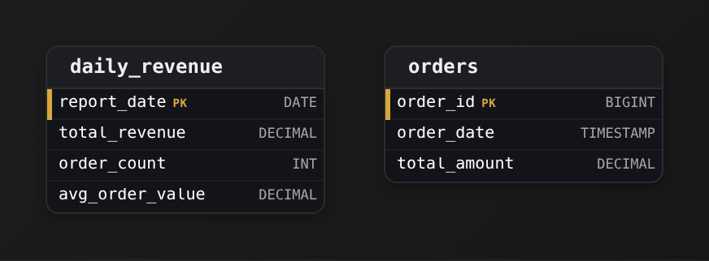
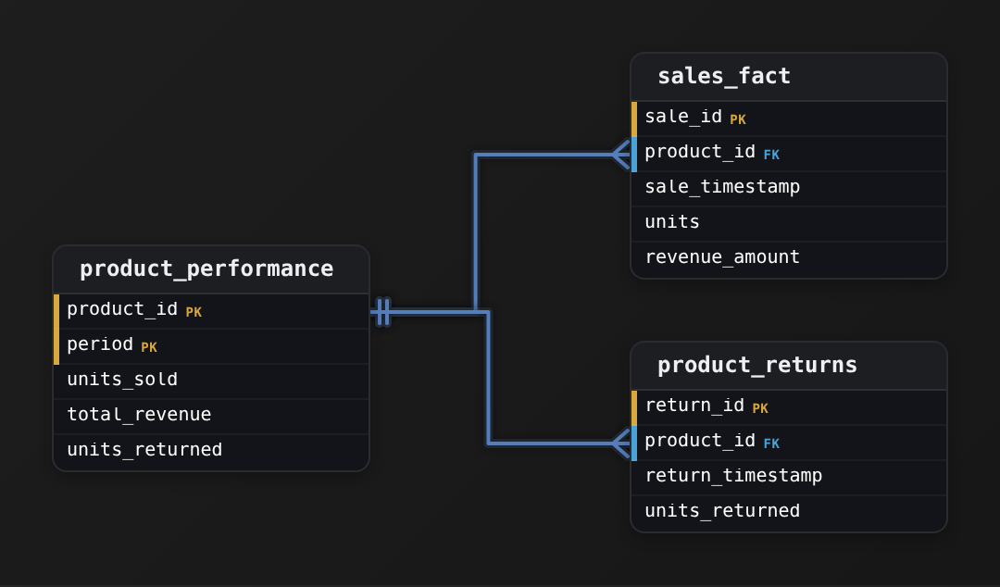
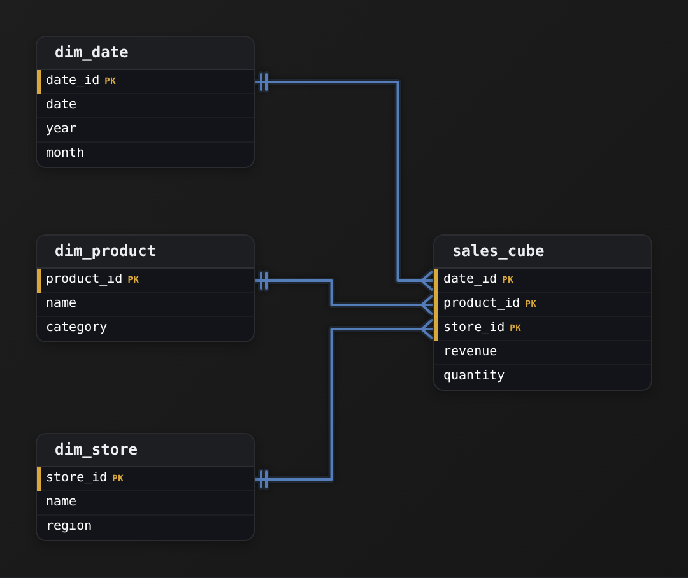
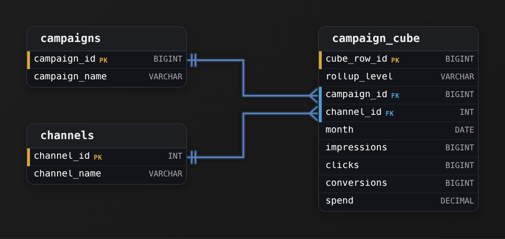
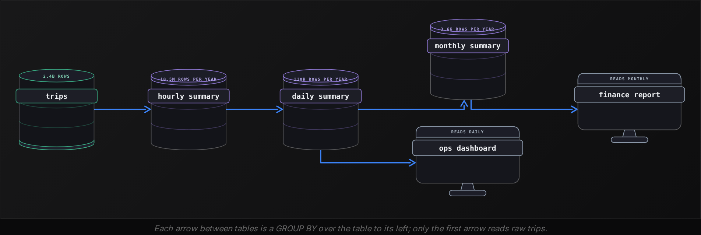
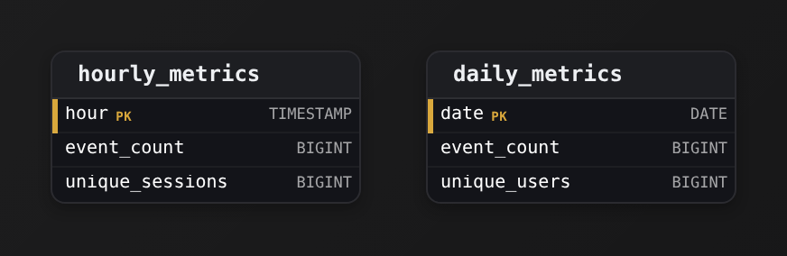
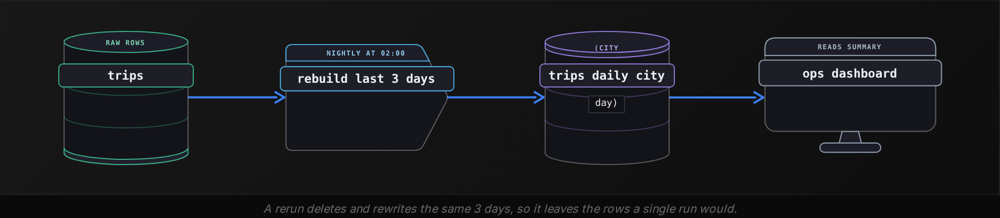
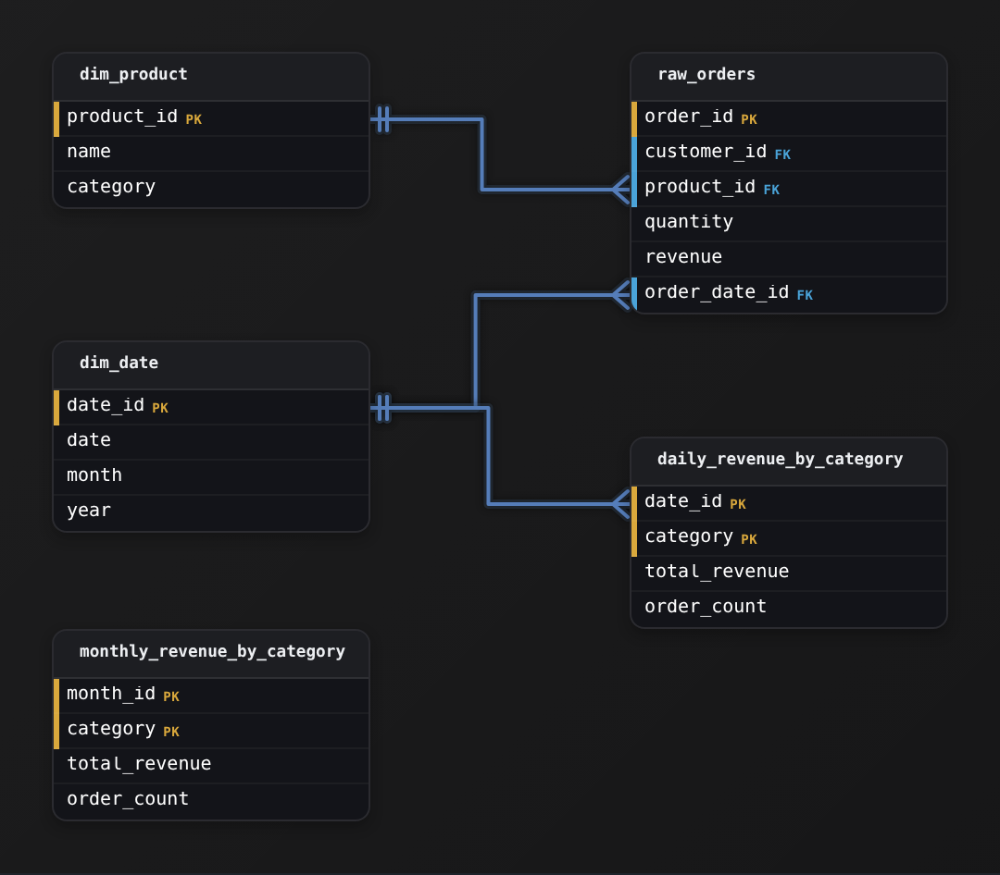
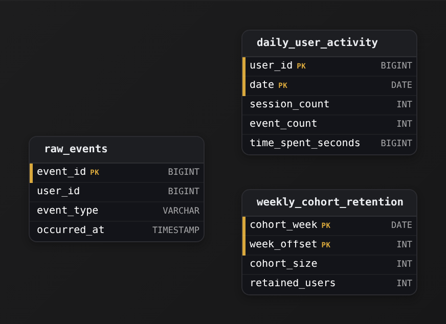

Intermediate·Data Modeling · 23 min · 12 challenges

# Pre-Aggregation

At Uber, one operations team opens its Monday dashboard: trips and fares for the 300 cities it covers, over the last 90 days. Pointed at the raw trips table, the page spins for 40 seconds while the whole team waits. Pointed at a nightly summary table, it reads 27,000 rows and loads before the coffee cools. Pre-aggregation decides which morning they get.


<br>

---

## Why Pre-Aggregate?

### One dashboard, 2.4 billion rows

Take a simplified model of that team's data at Uber. Every completed trip is 1 row in `trips`: trip_id, rider_id, driver_id, country, city, vehicle_type, started_at, fare, distance_km. After 6 years the table holds 2.4 billion rows, about 900GB on disk. The dashboard charts trips and fare per city per day for the last 90 days, and this is the query behind it.

```sql
SELECT
  city,
  DATE_TRUNC('day', started_at) AS trip_date,
  COUNT(*) AS trip_count,
  SUM(fare) AS fare_total
FROM trips
WHERE started_at >= DATE '2026-07-25'
GROUP BY city, DATE_TRUNC('day', started_at)
```

The engine reads every row from the last 90 days, about 100 million of them, groups them into 300 cities by 90 days, and returns 27,000 rows. On a shared cluster that takes 40 seconds. Each morning 40 analysts open the dashboard, each tab re-runs the query, and every filter click (one city, one week) re-runs it again with a narrower WHERE clause. The same 100 million rows are read hundreds of times a day to produce the same 27,000 numbers.


<br>

### Compute once, read many

Pre-aggregation moves that GROUP BY out of the dashboard and into a scheduled job. The job runs once a night, writes its result to a summary table, and every dashboard query reads the summary instead of the raw table.

```sql
CREATE TABLE trips_daily_city AS
SELECT
  city,
  date_trunc('day', started_at) AS trip_date,
  count(*) AS trip_count,
  sum(fare) AS fare_total
FROM trips
GROUP BY
  city,
  date_trunc('day', started_at)
```

| city | trip_date | trip_count | fare_total |
| --- | --- | --- | --- |
| Austin | 2026-10-21 | 18,412 | 341,207.50 |
| Austin | 2026-10-22 | 19,006 | 352,118.25 |
| Berlin | 2026-10-21 | 42,880 | 619,330.00 |
| Berlin | 2026-10-22 | 41,215 | 598,004.75 |

One row now means: every trip that started in one city on one day. The table holds 657,000 rows (300 cities by 2,190 days), the dashboard query becomes a filter over it, and the 2.4 billion raw rows are never touched after the nightly job finishes. A filter for Berlin in the last week reads 7 rows and returns in under a second.

```sql
SELECT
  city,
  trip_date,
  trip_count,
  fare_total
FROM trips_daily_city
WHERE trip_date >= DATE '2026-07-25'
```

- **3,650x** — fewer rows per dashboard query
- **30MB** — summary table on disk


<br>

### What you give up

> The summary answers only its own question
>
> - Filtering by driver or rider is impossible: those columns were grouped away and no query can bring them back.
> - Hourly trends are gone: a row holds a whole day, and a day cannot be split back into hours.
> - Numbers lag the raw table by up to one job cycle, so a trip at 11pm shows up tomorrow.
> - Someone owns the job: when it fails, the newest day goes missing and nothing raises an error.

If next month's questions group by a column this month's never used, the summary cannot answer them, and the job has to be changed and rerun.

> **TIP**
>
> Before building a summary, list the 5 queries the dashboard runs most and write down the GROUP BY columns of each. The summary's grouping columns are the union of those lists, and nothing else.

**A product manager asks why the nightly summary job cannot be dropped and the dashboard pointed straight at trips on a bigger cluster. Which answer is right?**

- **A.** A bigger cluster cannot run a GROUP BY over 100 million rows, so the summary table exists because the raw query would fail to return at all.
- **B.** The dashboard tool can only read tables with fewer than 1 million rows, so the summary exists to fit under that limit rather than to save work.
- **C.** A bigger cluster makes each query faster, but every refresh still reads the same 100 million rows to reproduce the same 27,000 numbers, so the repeated work stays and the bill grows with it.
- **D.** The summary exists because trips is deleted after 90 days, so the nightly job is the only place where the older history survives.

<details>
<summary>Solution</summary>

**C.** A bigger cluster makes each query faster, but every refresh still reads the same 100 million rows to reproduce the same 27,000 numbers, so the repeated work stays and the bill grows with it.

Pre-aggregation removes repeated work. The cluster only makes each repetition cheaper, and 40 analysts times hundreds of clicks times 100 million rows is the same waste at any speed.

**Why the others are wrong**

- **A.** The raw query already returns, in 40 seconds. The summary exists to stop repeating that work, and a cluster that finishes it in 10 seconds still repeats it hundreds of times a day.
- **B.** Dashboard tools read tables of any size. The summary saves work: one GROUP BY per night instead of hundreds per day.
- **D.** The raw table keeps all 6 years. The summary is a cache of a GROUP BY over it, and the raw rows stay where they are.

</details>


<br>

---

## Data Modeling

### Exercise 1 of 2

**● TASK**

Design a daily revenue aggregate table pre-computed from raw orders to avoid expensive full-table scans.

<details>
<summary><strong>Solution</strong></summary>

#### A rollup table, keyed by its grain

Pre-aggregation means answering "what was revenue on each day?" once, on a schedule, and storing the answer. Dashboards then read a small `daily_revenue` table instead of scanning every row of `orders`. The design depends on one decision made first: **the grain**.



*`daily_revenue` is derived from `orders` by a job, not joined to it, so there is no foreign key between them.*

| Key insight: One row per calendar day |
| --- |
| Grain answers "what does one row mean?" Here it is one day, so `report_date` is the primary key, and every other column is an aggregate over that day: `SUM(total_amount)` becomes `total_revenue`, `COUNT(*)` becomes `order_count`. |

| Pitfall: Averages do not add up |
| --- |
| Keeping `order_id` turns the row back into an order, which just copies `orders`. Storing only `avg_order_value` breaks weekly rollups: 7 daily averages cannot be averaged. Keep the additive `total_revenue` and `order_count`, then divide at the end. |

**The nightly refresh**

```sql
INSERT INTO daily_revenue (report_date, total_revenue, order_count, avg_order_value)
SELECT
    order_date::date        AS report_date,
    SUM(total_amount)       AS total_revenue,
    COUNT(*)                AS order_count,
    AVG(total_amount)       AS avg_order_value
FROM orders
WHERE order_date::date = CURRENT_DATE - 1
GROUP BY order_date::date
ON CONFLICT (report_date) DO UPDATE
    SET total_revenue   = EXCLUDED.total_revenue,
        order_count     = EXCLUDED.order_count,
        avg_order_value = EXCLUDED.avg_order_value;
```

*The `GROUP BY` key is the grain; the `report_date` PK makes `ON CONFLICT` a safe, re-runnable upsert.*

| Real world: Billions of rows become 365 a year |
| --- |
| BI layers work this way: overnight jobs roll raw events into per-day or per-hour summaries, and dashboards only query those. In a star schema these rollups are fact tables keyed to a date dimension. |

**Follow-up questions**

1. What changes if revenue must also be split by `region`?\
   *The grain becomes one row per (`report_date`, `region`), so the primary key becomes composite.*
2. A late order arrives dated 3 days ago. How does `daily_revenue` stay correct?\
   *Re-run the upsert over a trailing window of days, not only yesterday.*

</details>


<br>

### Exercise 2 of 2

**● TASK**

Design a pre-aggregated summary table that a dashboard reads instead of scanning the 500-million-row sales_fact (product_id, sale_timestamp, units, revenue_amount) and product_returns (product_id, return_timestamp, units_returned). Make the grain one row per product per period, keyed by the composite (product_id, period). Store only additive columns (units_sold, total_revenue, units_returned) so coarser rollups stay correct; return rate is computed at query time.

<details>
<summary><strong>Solution</strong></summary>

#### Pre-aggregation: trade storage for read speed

A **summary table** is pre-aggregation in its plainest form. You run the `GROUP BY` over `sales_fact` and `product_returns` once, on a schedule, and write the result into `product_performance`. The dashboard then reads a few thousand rows instead of scanning 500 million. It is the same idea an OLAP cube materializes. What you designed is the rollup's grain and its columns.



*2 large facts roll up into one small summary keyed on (`product_id`, `period`).*

1. **Fix the grain, then the key falls out**

   Say the grain as a sentence: one row per product per period. The primary key follows directly as the composite of `product_id` and `period`. Every other column must then be a fact measured at exactly that grain.

2. **Keep only additive measures**

   `units_sold`, `total_revenue` and `units_returned` are plain sums, so a quarter is just the `SUM` of its months. This is what lets one table serve day, month and quarter views.

| Pitfall: A stored ratio breaks on rollup |
| --- |
| A `return_rate` column (`units_returned / units_sold`) is correct on a single row and wrong at any coarser grain. A quarter's rate is not the sum or the average of its monthly rates, because each month has a different denominator. Store both components and divide at query time. The same applies to `avg_price` or `margin_pct`. |

| Real world: The summary is a rebuildable read model |
| --- |
| A nightly or hourly job repopulates `product_performance`, either as a materialized view or as a scheduled `INSERT ... SELECT`. The duplication is deliberate denormalization. The facts remain the source of truth, and you can drop and rebuild the summary at any time. |

**Follow-up questions**

1. If the finest `period` you store is a day, how does the dashboard serve a monthly view without a second table?\
   *Additivity means you re-aggregate the summary itself with `SUM` grouped by month.*
2. A product has sales in a period but zero returns. Should a row still exist, and what does `units_returned` hold?\
   *The outer-join gap: the row exists with `units_returned` as 0.*
3. What breaks if `product_id` alone is the primary key?\
   *Grain, not just uniqueness, drives the key: every period collapses into one row.*

</details>


<br>

---

## Metric Types and Additivity

### Roll up: a summary of a summary

The nightly table holds one row per city per day. A monthly report wants one row per city per month, and the cheapest way to produce it reads the daily table rather than the raw trips. Combining finer rows into coarser rows is a roll up, and whether the result is right depends on the metric. Suppose the nightly job also stored distinct_riders and avg_fare for each day.

| city | trip_date | trip_count | fare_total | distinct_riders | avg_fare |
| --- | --- | --- | --- | --- | --- |
| Austin | 2026-10-20 | 10,000 | 150,000.00 | 5,200 | 15.00 |
| Austin | 2026-10-21 | 18,412 | 341,207.50 | 9,800 | 18.53 |
| Austin | 2026-10-22 | 19,006 | 352,118.25 | 10,100 | 18.53 |

Summing trip_count across the 3 days gives 47,418, and summing fare_total gives 843,325.75. Both are correct, because each trip belongs to exactly one day and its fare is counted exactly once. A metric with that property is additive: the roll up is a SUM over the finer rows, along any column you like.

Now sum distinct_riders: 25,100. The true 3-day figure is lower, perhaps 19,600, because a rider who took a trip on the 20th and again on the 22nd appears in both daily counts and once in the combined count. Nothing in the daily table can recover the overlap. The avg_fare column fails differently. Summing it gives 52.06, which means nothing, and averaging the 3 averages gives 17.35, which is wrong: the quiet 20th gets the same weight as the busy 21st. The true 3-day average is 843,325.75 divided by 47,418, which is 17.79.


<br>

### 3 kinds of metric

| Examples | Kind | How it rolls up |
| --- | --- | --- |
| trip_count, fare_total, distance_km | Additive | SUM across any column: city, day, vehicle type |
| drivers_online, account_balance | Semi-additive | SUM across cities or accounts; last value or average across time |
| distinct_riders, avg_fare, p95_wait | Non-additive | Cannot be rolled up from the stored number; store its ingredients instead |

Semi-additive metrics measure a level at an instant rather than a flow over a period. drivers_online at 9am in Austin plus drivers_online at 9am in Berlin is a real number, the drivers online across both cities. drivers_online at 9am plus drivers_online at 10am counts the same drivers twice. Rolling a snapshot across time means choosing one instant (the last reading of the month) or averaging the readings, and the column name must say which, so a reader of `drivers_online_month_end` knows what the number is.


<br>

### Store the parts, never the answer

Non-additive metrics become additive when the summary stores their ingredients. A ratio is a numerator over a denominator, and both are sums. Store fare_total and trip_count, leave avg_fare out, and divide at read time: the monthly average is sum(fare_total) / sum(trip_count), which is the weighted 17.79 for the 3 days above.

```sql
SELECT
  city,
  DATE_TRUNC('month', trip_date) AS trip_month,
  SUM(trip_count) AS trip_count,
  SUM(fare_total) AS fare_total,
  SUM(fare_total) / SUM(trip_count) AS avg_fare
FROM trips_daily_city
GROUP BY city, DATE_TRUNC('month', trip_date)
```

Distinct counts have no exact ingredient smaller than the full list of ids, but they have an approximate one. A sketch is a small, fixed-size summary of a set of ids. Two sketches can be merged, and the merged sketch estimates the distinct count of the union, within about 2 percent, at a few kilobytes per row. The nightly job stores a sketch of rider ids per row, and every roll up merges them.

```sql
SELECT
  city,
  DATE_TRUNC('day', started_at) AS trip_date,
  APPROX_SET(rider_id) AS riders_sketch
FROM trips
GROUP BY city, DATE_TRUNC('day', started_at)
```

```sql
SELECT
  city,
  DATE_TRUNC('month', trip_date) AS trip_month,
  CARDINALITY(MERGE(riders_sketch)) AS distinct_riders
FROM trips_daily_city
GROUP BY city, DATE_TRUNC('month', trip_date)
```

*Percentiles have the same shape: the p95 of 30 daily p95 values is not the monthly p95. Store a quantile digest, a sketch of the value distribution that merges the same way, or keep the finer rows and compute the percentile from them.*

**A daily summary stores conversion_rate as bookings divided by searches. A weekly dashboard averages the 7 daily rates. Why is the weekly figure wrong, and what fixes it?**

- **A.** Each day gets equal weight regardless of how many searches it had, so a quiet Sunday pulls the week as hard as a busy Friday; store bookings and searches and divide their weekly sums.
- **B.** Averages of rates are always too high because a rate cannot exceed 1; store the rate as a percentage between 0 and 100 and average those values instead.
- **C.** The daily rate is rounded, so 7 roundings compound into a visible error; store the rate with 6 decimal places and the weekly average becomes exact.
- **D.** Rates need a sketch the way distinct counts do; store a sketch of booking ids per day and merge the 7 sketches to obtain the weekly rate.

<details>
<summary>Solution</summary>

**A.** Each day gets equal weight regardless of how many searches it had, so a quiet Sunday pulls the week as hard as a busy Friday; store bookings and searches and divide their weekly sums.

A rate is non-additive. Its ingredients, bookings and searches, are additive, and the weekly rate is the ratio of their weekly sums.

**Why the others are wrong**

- **B.** Scaling the rate changes nothing about the weighting. The average of 7 percentages has the same equal-weight error as the average of 7 rates.
- **C.** Rounding is a tiny effect. The error comes from weighting each day equally when the days have different search volumes.
- **D.** Sketches solve distinct counts, where overlap is the problem. A rate has exact additive ingredients, so storing and summing them is both exact and cheaper.

</details>


<br>

---

## Data Modeling

### Exercise 1 of 2

**● TASK**

Design a store-level daily sales aggregate using fully additive metrics (sums that roll up correctly across all dimensions).

<details>
<summary><strong>Solution</strong></summary>

#### Grain first, then metrics

The technique here is **grain definition**: before you name a single column, you fix the exact meaning of one row. For this aggregate the grain is one store, one day, so the natural key is (`store_id`, `sale_date`) and both together form the primary key. Everything else on the row must be a fact measured at that grain and nothing else. Pin the grain down in one sentence you could say out loud ("one row per store per day") and the rest of the table almost designs itself.


*One row per (`store_id`, `sale_date`); every measure is a plain SUM at that grain.*

| Trick: Store only fully additive measures |
| --- |
| A measure is fully additive when SUM over any dimension still means something. `total_revenue`, `units_sold` and `transaction_count` are all counts of things, so summing them across stores, across days, or across both gives the correct grand total. That is what lets one daily table answer weekly, monthly, per-region and company-wide questions with the same `SUM(...) GROUP BY ...`. |

| Pitfall: Never store an average as a column |
| --- |
| The tempting wrong version adds `avg_order_value` to the row. Averages are non-additive: the average of daily averages is not the real average, and there is no weight to recover it from once the detail is gone. The fix is to keep the 2 additive components, `total_revenue` and `transaction_count`, and divide at read time (`SUM(total_revenue) / SUM(transaction_count)`). Store the sums, compute the ratios in the query. |

| ✕ Additive (keep) | ✓ Non-additive (derive) |
| --- | --- |
| `total_revenue`, `units_sold`, `transaction_count`, each is a SUM that rolls up across `store_id` and `sale_date` unchanged. | `avg_order_value`, `pct_returns`, `distinct_customers`, ratios, percents and distinct counts cannot be re-summed. Derive them from stored sums, or model distinct counts at their own grain. |

This is also **pre-aggregation**: you collapse millions of raw transactions once, into one small row per store-day, so dashboards never rescan the fact table. Because the stored measures are additive, that single daily table is the source for every coarser period. A monthly report is just `SUM(total_revenue) ... GROUP BY store_id, date_trunc('month', sale_date)` over the same rows. In real warehouses this is exactly how a daily aggregate feeds weekly and quarterly rollups without a second pipeline.

**Follow-up questions**

1. How would you report distinct customers per store-week if `store_daily_sales` only stores counts?\
   *Tests understanding that distinct counts are non-additive and cannot be summed from a daily grain; you need per-customer detail or an approximate sketch.*
2. A stakeholder wants average revenue per store. What do you compute at read time and why not store it?\
   *Checks that ratios are derived from `SUM(total_revenue)` and a count, never persisted as a column.*

</details>


<br>

### Exercise 2 of 2

**● TASK**

A fintech dashboard needs each user's account balance over time. Design a single daily snapshot table with one row per user per day. Account balance is a semi-additive metric: you can sum it across users at a single point in time, but you cannot sum it across days. Store the balance snapshot plus the daily transaction count, and use a composite key over the user and the snapshot date to set the grain.

<details>
<summary><strong>Solution</strong></summary>

#### The daily snapshot fact table

What you just modeled is a **daily snapshot fact**: one row that captures the state of a measure at a fixed point in time, taken once per day. The 2 keys you put on the table, `user_id` and `snapshot_date`, are not just identifiers, they DEFINE the grain: exactly one row per user per day. Get the grain right and everything else, the measures and the queries, falls out of it. The whole design is a single table `user_daily_balances` because the question only ever asks for a balance as-of a day, and a snapshot answers that in one indexed lookup.


*Composite PK (`user_id`, `snapshot_date`) sets the grain: one balance snapshot per user per day.*

| Key insight: The composite key IS the grain |
| --- |
| A single-column key on `user_id` would allow only one row per user for all time, and a single-column key on `snapshot_date` would allow one row per day for everyone. Only the composite `(user_id, snapshot_date)` says 'one row per user per day', which is precisely the grain the dashboard reads. The primary key doubles as the uniqueness constraint that stops a double-load from writing 2 balances for the same user on the same day. |

| Pitfall: Semi-additive means SUM across days is nonsense |
| --- |
| `account_balance` is semi-additive: `SUM(account_balance)` across users on one `snapshot_date` gives a real total (assets under management that day), but `SUM(account_balance)` across days for one user double-counts money that never moved. Roll balance up over time with a point-in-time pick, `AVG`, or a last-value, never a `SUM`. Contrast `transaction_count`, which is fully additive: summing it across both users and days is always meaningful. |

| ✕ `account_balance` (semi-additive) | ✓ `transaction_count` (additive) |
| --- | --- |
| Sum across users at one `snapshot_date`: valid. Sum across days: WRONG. Time rollups use last-value or `AVG`, not `SUM`. | A flow, not a level. `SUM(transaction_count)` across any mix of users and days is valid, so monthly activity is a plain `GROUP BY`. |

**The design as DDL**

```sql
CREATE TABLE user_daily_balances (
    user_id           bigint        NOT NULL,
    snapshot_date     date          NOT NULL,
    account_balance   numeric(18,2) NOT NULL,
    transaction_count integer       NOT NULL DEFAULT 0,
    PRIMARY KEY (user_id, snapshot_date)
);
```

*numeric for money (never float), a real date for the grain, and the composite PK enforcing one row per user per day.*

2 data-type choices carry weight here. Money is `numeric(18,2)`, not `float`, because binary floating point cannot represent 0.10 exactly and balances must reconcile to the cent. The grain column is a real `date`, not a string, so range scans and `BETWEEN` filters use the index and sort correctly. Storing the snapshot pre-aggregated this way means the dashboard never re-derives a balance from a transaction ledger at read time, which is the whole point of a snapshot fact: the expensive work happens once, at load.

**Follow-up questions**

1. A user has no activity on a given day. Do you still write a row with the carried-forward balance, or leave a gap?\
   *Tests whether the snapshot is dense (every user every day) or sparse, and how as-of queries handle missing days.*
2. How would you answer 'what was this user's balance on a date with no row'?\
   *Pushes toward a last-value-before-date lookup, reinforcing that balance is a level, not a flow.*
3. If you also needed intraday balances, what changes about the grain and the key?\
   *Moves `snapshot_date` toward a `snapshot_at` timestamp and reshapes the composite key.*

</details>


<br>

---

## OLAP Cubes & Rollups

### Many groupings, one table

OLAP, online analytical processing, is the name for queries that slice a measure by one grouping column after another: trips by city, then by vehicle type, then by city and vehicle type together, then the company total. Each slice is a GROUP BY with a different column list, and a summary that holds only (city, day) rows cannot serve the vehicle type view. A column used for grouping like this is called a dimension, and a cube is a summary that holds every combination of its dimensions in one table.

Take 2 dimensions, city and vehicle_type. There are 4 combinations: both, city only, vehicle_type only, and neither, which is the grand total. You could build them with 4 separate queries, or with 1 query using CUBE.

```sql
SELECT
  city,
  vehicle_type,
  COUNT(*) AS trip_count,
  SUM(fare) AS fare_total,
  GROUPING(city, vehicle_type) AS grouping_id
FROM trips
WHERE started_at >= DATE '2026-10-22'
  AND started_at < DATE '2026-10-23'
GROUP BY CUBE(city, vehicle_type)
```

| city | vehicle_type | trip_count | fare_total | grouping_id |
| --- | --- | --- | --- | --- |
| Austin | sedan | 14,200 | 263,000.00 | 0 |
| Austin | xl | 4,806 | 89,118.25 | 0 |
| Austin | NULL | 19,006 | 352,118.25 | 1 |
| NULL | sedan | 820,300 | 14,765,400.00 | 2 |
| NULL | xl | 281,100 | 5,246,400.00 | 2 |
| NULL | NULL | 1,101,400 | 20,011,800.00 | 3 |

NULL in a dimension column means 'all values', and grouping_id records which columns were collapsed: bit value 1 for vehicle_type, bit value 2 for city. The id column matters because a real city value can be missing too, and a trip with an unknown city would otherwise look like the all-cities row. A dashboard reading the cube filters on grouping_id to pick a view: `grouping_id = 1` gives one total per city, `grouping_id = 3` gives the single company row, and the Austin row with id 1 holds 19,006 trips, the sum of its 2 rows with id 0.


<br>

### Rollups for hierarchies, grouping sets for choice

Dimensions multiply. A cube over d dimensions holds 2 to the power d groupings: 3 dimensions give 8, 6 give 64, 10 give 1,024, and most of them answer questions nobody asks. Grouping by vehicle_type and hour without city, for a dashboard with no hourly view, produces rows nobody reads and a longer job every night.

ROLLUP covers a hierarchy. `ROLLUP (country, city)` produces (country, city), (country) and (), and skips (city) alone, since a city belongs to one country and the (country, city) rows already hold its total. GROUPING SETS lists the exact combinations you want and nothing else. The `trips` table has a country column, so the 3 dimensions country, city and vehicle_type can be trimmed to 5 groupings.

```sql
SELECT
  country,
  city,
  vehicle_type,
  COUNT(*) AS trip_count,
  SUM(fare) AS fare_total
FROM trips
GROUP BY GROUPING SETS ((country, city, vehicle_type), (country, city), (country, vehicle_type), (country), ())
```

| Clause over (country, city, vehicle_type) | Groupings | Rows per day with 20 countries, 300 cities, 4 types |
| --- | --- | --- |
| CUBE | 8 | 3,105 |
| ROLLUP | 4 | 1,521 |
| GROUPING SETS above | 5 | 1,601 |

The cube's 8 groupings include (city, vehicle_type), which repeats (country, city, vehicle_type) row for row, because every city sits inside exactly one country. The grouping sets drop that repeat and keep (country, vehicle_type), which the rollup would never produce. Per day the row counts are all small; across 6 years, the cube stores 1,500 redundant rows a day that someone has to document and keep correct.

> Reading a cube
>
> - Filter on the grouping id, or on which dimension columns are NULL, before summing anything; rows with different ids overlap.
> - A non-additive measure is computed from raw rows or merged sketches inside each grouping, never derived from a finer grouping in the same table.

**A cube over (city, vehicle_type) is stored for each day in trips_cube. An analyst wants the sedan fare total across all cities on 2026-10-22 and runs the query below. What does it return?**

```sql
SELECT
  sum(fare_total)
FROM trips_cube
WHERE vehicle_type = 'sedan'
  AND trip_date = date '2026-10-22'
```

- **A.** The correct sedan total, because the WHERE clause selects the sedan rows and the sum adds the per-city rows together, which is how a cube is meant to be read.
- **B.** Zero, because the all-cities sedan row has city set to NULL and a NULL comparison removes the row from the sum.
- **C.** The correct total only if the cube was built with ROLLUP, since CUBE stores the per-city sedan rows without a separate all-cities sedan total.
- **D.** Double the sedan total, because the per-city sedan rows and the all-cities sedan row (city NULL, grouping id 2) both match the filter and both are summed.

<details>
<summary>Solution</summary>

**D.** Double the sedan total, because the per-city sedan rows and the all-cities sedan row (city NULL, grouping id 2) both match the filter and both are summed.

The all-cities row already equals the sum of the per-city rows. Adding them together counts every sedan trip twice. The fix is to add AND grouping_id = 2 and read the one row, or AND grouping_id = 0 and sum the per-city rows.

**Why the others are wrong**

- **A.** The WHERE clause selects every row where vehicle_type is sedan, and that includes the all-cities sedan row as well as each per-city sedan row.
- **B.** The filter compares vehicle_type, which is 'sedan' on that row, so the row passes. NULL in city plays no part in this WHERE clause.
- **C.** CUBE produces every combination, including (vehicle_type) alone, so the all-cities sedan row exists. ROLLUP (city, vehicle_type) is the clause that would omit it.

</details>


<br>

---

## Data Modeling

### Exercise 1 of 2

**● TASK**

Design a sales cube aggregate that supports rollups across any combination of date, product, and region.

<details>
<summary><strong>Solution</strong></summary>

#### The star schema, plainly

The shape this challenge asked for is a **star schema**: one central fact table surrounded by dimension tables. The fact table, `sales_cube`, holds the numbers you measure (revenue, quantity); each dimension table (`dim_date`, `dim_product`, `dim_store`) holds the descriptive attributes you slice by. The word 'cube' just means you can aggregate those measures along several independent axes at once, and 'rollup across any combination' is exactly what a star schema is built to answer.



*One fact table with a three-part key, 3 dimensions hanging off it.*

| Trick: The composite key IS the grain |
| --- |
| The insight that cracks this is that `sales_cube`'s primary key is the set of dimension foreign keys together: `(date_id, product_id, store_id)`. That composite key declares the grain, one row per date per product per store, and guarantees you never store the same cell twice. Each part of the key is both a `PK` component AND an `FK` into its dimension. That dual role is what turns a plain table into a cube. |

Notice region is not a column on `sales_cube`. It lives on `dim_store` as an attribute. A store belongs to a region, so you reach region by joining through `store_id`. This is why the schema handles 'any combination' for free: to roll up by region you `GROUP BY dim_store.region`; to roll up by month you `GROUP BY dim_date.month`; to do both you group by both. The fact table never changes, only the columns you group by.

| Pitfall: Common pitfall: a single surrogate key |
| --- |
| The tempting wrong move is to give `sales_cube` one auto-increment `id` as the primary key and leave the 3 dimension keys as ordinary columns. It looks tidier, but it lets duplicate (`date_id`, `product_id`, `store_id`) rows in, so your rollups silently double-count. The composite key is not decoration; it is the constraint that keeps the aggregate correct. Another version of the same mistake is copying `region` or `category` onto the fact row, which denormalizes the dimensions and means an attribute rename has to touch millions of fact rows. |

| ✕ Additive measures on the fact | ✓ Attributes on the dimension |
| --- | --- |
| `revenue` and `quantity` live on `sales_cube` because they are additive: summing them across any set of rows is meaningful. `SUM(revenue)` over a region-month slice is a real answer. | `year`, `month`, `category`, `region` live on the dimensions because they describe, they are not summed. You group and filter by them. Keeping them off the fact is what makes the star both compact and flexible. |

In production this is the backbone of nearly every reporting warehouse and BI tool. Analysts drag `category` and `region` onto a pivot without writing SQL, and the tool is really just generating `GROUP BY` over this exact star. When someone later asks to slice by a new attribute, say store 'format' or product 'brand', you add a column to the dimension, not to the fact, and every historical row is instantly sliceable by it.

**Follow-up questions**

1. How would you support slicing by product `brand` if brand were added later?\
   *Tests whether they add the attribute to `dim_product` rather than to `sales_cube`.*
2. What breaks if a store's `region` reassignment must not rewrite past sales?\
   *Opens the door to slowly changing dimensions, versioning `dim_store` rows instead of updating in place.*
3. If you needed a running count of distinct customers per slice, why can't that live as a measure on `sales_cube`?\
   *Tests understanding of additive vs non-additive measures.*

</details>


<br>

### Exercise 2 of 2

**● TASK**

Design a flat summary table that serves as an OLAP cube for a marketing dashboard over 3 dimensions: campaign, channel and month. It pre-computes impressions, clicks, conversions and spend for every combination of those dimensions, from campaign by channel by month down to the single grand total. Each row must record which dimensions it rolls up, so the dashboard can tell a channel total from a detail row.

<details>
<summary><strong>Solution</strong></summary>

#### 8 groupings, one table

An OLAP cube answers a dashboard filter before anyone clicks it, because every dimension combination is already a stored row. Campaign, channel and month give 2^3 = 8 groupings: the full detail, 3 pairs, 3 single dimensions and the grand total. In a warehouse the cube is a flat table. The decision that makes it usable is **how each row says which grouping it belongs to**.



*`campaign_cube` holds all 8 groupings. A rolled-up dimension is left empty, and `rollup_level` names the grouping.*

1. **Keep every dimension column on every row**

   `campaign_id`, `channel_id` and `month` appear on all 8 groupings. A channel-by-month total leaves `campaign_id` empty, and the grand total leaves all 3 empty. A composite key over the dimensions cannot have an empty part, so the row is keyed by a surrogate `cube_row_id`.

2. **Name the grouping on the row**

   `rollup_level` holds values such as 'campaign+channel+month', 'channel' or 'all', so the dashboard filters to exactly the level it is drawing. Without that flag, a row with an empty `channel_id` is ambiguous: it could be an all-channels total or a detail row whose channel was never recorded.

3. **Fill it with one `GROUP BY CUBE`**

   `GROUP BY CUBE (campaign_id, channel_id, month)` emits all 8 groupings in a single pass, and `GROUPING()` supplies the value for `rollup_level`. Because the measures are additive, every rolled-up row is a plain `SUM` of the detail rows.

| Pitfall: The detail rows alone are not a cube |
| --- |
| Storing only campaign by channel by month gives you the cube's bottom level and nothing more. Every channel total or monthly total is then still a scan and a `SUM` at read time. The cube pays off only when the higher levels are already rows. |

| Real world: Cubes grow as 2^n |
| --- |
| 3 dimensions give 8 groupings, and 10 give 1,024. At that point the cube can outgrow the fact table it summarizes. When the dashboard only ever asks for a handful of combinations, `GROUPING SETS` stores just those and drops the rest. |

**Follow-up questions**

1. If the dashboard never shows campaign by month without channel, how would `GROUPING SETS` shrink this table?\
   *This practices choosing groupings deliberately instead of taking all 2^n.*
2. What changes if `month` must also roll up to quarter and year?\
   *This adds a hierarchy within one dimension alongside rollups across dimensions.*
3. How many groupings does adding a region dimension create, and is the full cube still worth storing?\
   *This practices the 2^n growth argument.*

</details>


<br>

---

## Granularity Design

### What one row means

The granularity of a summary is the meaning of one row: the set of columns that make a row unique and the time bucket it covers. `trips_daily_city` has the granularity (city, day). Every design decision about a summary is a decision about granularity, because the granularity fixes both the questions the table can answer and its size.

| Granularity | Rows per day | Rows per year | Answers | Cannot answer |
| --- | --- | --- | --- | --- |
| (day) | 1 | 365 | company-wide daily trend | anything by city |
| (city, day) | 300 | 109,500 | city trends and rankings | hourly peaks, vehicle mix |
| (city, vehicle_type, hour) | 28,800 | 10.5M | peak hours per city and type | anything about one rider |
| (rider_id, day) | 1.1M | 400M | per-rider daily activity | nothing a raw query cannot do as cheaply |

The last row fails. A high-cardinality column in the granularity gives the summary about as many rows as the raw table, since most riders take 1 trip a day, and a summary the size of its source saves nothing. For 300 cities the third row fits best: it answers every hourly peak question and still sits about 38 times below the raw table, 28,800 rows a day against 1.1 million trips.


<br>

### Finest grain first, coarser grains from it

Pick the finest granularity any current consumer needs, then derive each coarser table from the one below it rather than from raw. Per night, the hourly table reads about 1.1 million raw trips, the daily table reads 28,800 hourly rows, and the monthly table rebuilds the current month from at most 9,300 daily rows. Each step is a SUM for additive metrics and a merge for sketches; a metric that cannot be rolled up has to be recomputed from raw at every level, and the chain breaks.




<br>

### Columns that belong in the granularity

- A column belongs when a dashboard filters or groups by it: city, vehicle_type, hour.
- Leave out a column that gives about 1 raw row per summary row: rider_id makes 1.1M rows a day from 1.1M trips.
- A column with 2,000 values, such as restaurant, can stay if each summary row still covers dozens of raw rows.
- The time bucket is the finest size anyone charts: hour for ops, day for most teams, never minute for a dashboard.
- A derived flag such as is_airport_trip has 2 values, doubles the rows at most, and often replaces a second summary.


<br>

---

## Data Modeling

### Exercise 1 of 2

**● TASK**

Design two aggregate tables at different grains (hourly and daily) that can be reconciled with each other.

<details>
<summary><strong>Solution</strong></summary>

#### Two grains, one truth

**Grain** is the exact thing one row stands for, and here the primary key states it: `hourly_metrics` holds one row per `hour`, `daily_metrics` one row per `date`. Both pre-aggregate the same event stream, so a dashboard reads a few hundred rows instead of rescanning raw events. Whether the two tables can be reconciled depends on which measures you put in them.



*Each table's PK is its grain: one row per `hour`, one row per `date`.*

| Key insight: Additive metrics roll up; distinct counts do not |
| --- |
| `event_count` is additive: a day's total is exactly the sum of its 24 hourly rows. `unique_sessions` is not. A session seen at 09:00 and again at 14:00 counts once in each hour, so summing hourly uniques double-counts it. Distinct counts only hold at the grain they were computed at. |

| ✕ Reconciling the additive column | ✓ Reconciling the distinct column |
| --- | --- |
| `SUM(event_count)` from `hourly_metrics` grouped by day should match `daily_metrics.event_count` row for row. If it drifts, one aggregation is broken or late. | No sum of hourly rows gives `unique_users`. `daily_metrics.unique_users` must be a fresh `COUNT(DISTINCT user_id)` over raw events at day grain. |

| Pitfall: Summing hourly uniques inflates the daily count |
| --- |
| Building the daily table as `SUM(event_count), SUM(unique_sessions)` over `hourly_metrics` is cheap and the additive column tallies perfectly, but `SUM(unique_sessions)` is silently wrong, and worse the more visitors return across hours. Roll additive columns up from the finer table; recompute distinct ones from raw. |

| Real world: Tag every measure with its additivity |
| --- |
| Warehouse teams label measures additive, semi-additive or non-additive. Counts and sums roll up everywhere; balances roll up across everything but time; distinct counts and ratios roll up across nothing. The tag tells the rollup job which columns it may `SUM` and which it must re-derive. |

**Follow-up questions**

1. How could daily distinct users become approximately roll-up-able from the hourly table?\
   *Mergeable sketches such as HyperLogLog, whose registers combine across hours where a `SUM` cannot.*
2. If `hourly_metrics` loads every hour but `daily_metrics` runs at midnight, how do you stop the reconciliation check from false-alarming mid-day?\
   *Compare a partial day only against completed hours.*

</details>


<br>

### Exercise 2 of 2

**● TASK**

Design a single pre-aggregation summary table for revenue by region. Executive reports roll up to the month, but analysts must be able to drill into weekly detail, so choose the finest grain any consumer actually needs. Store additive components instead of a stored average, so that average order value can be computed correctly at every rollup level rather than falling into the average-of-averages trap. Give the table a composite primary key on its grain columns.

<details>
<summary><strong>Solution</strong></summary>

#### Grain is the design decision

The grain of a summary table is the level of detail one row represents. Here 2 consumers pull from the same table: executives roll up to the month, analysts drill into the week. The rule is to build at the **finest grain any consumer actually needs** and let coarser reports aggregate up. Weekly is finer than monthly, so the grain is one row per region per week: `revenue_by_region_week` keyed on (`region`, `week`). A monthly figure is then a `SUM` over the 4 or 5 weeks in that month, and no consumer is left unserved.


*One pre-aggregated fact row per region-week. The composite key (region, week) is exactly the grain; the 2 measures are additive.*

The primary key is the grain written down. Because a row is identified by its region-and-week pair, the key is composite: (`region`, `week`) together are unique, neither alone is. Getting the key to match the grain is what stops duplicate rows for the same region-week from silently double-counting revenue.

| Pitfall: The average-of-averages trap |
| --- |
| The tempting shortcut is to store `avg_order_value` directly. But an average is not additive: you cannot average 4 weekly `avg_order_value` figures to get a correct monthly one, because each week had a different `order_count`. A region with 1000 orders one week and 10 the next is not weighted right by a plain average of the two. Store the additive components, `total_revenue` and `order_count`, and derive the average on read as `SUM(total_revenue) / SUM(order_count)`. It comes out correct at the week, the month, or the year. |

| ✕ Stored average (broken) | ✓ Additive components (correct) |
| --- | --- |
| Columns `avg_order_value` per region-week. Monthly rollup does `AVG(avg_order_value)`, which throws away how many orders backed each week. The number is wrong whenever weekly volumes differ. | Columns `total_revenue` and `order_count`. Both `SUM` cleanly across any set of weeks; average order value is `SUM(total_revenue) / SUM(order_count)` at whatever level you group. One table, every rollup correct. |

| Real world: In production |
| --- |
| This is why warehouse fact tables store fully-additive measures (counts, sums) and leave ratios to the BI layer. Pre-aggregating to region-week turns a scan of millions of raw orders into a handful of rows per region, so a dashboard grouping by month reads a tiny table instead of the order log. The grain choice is the whole point: too coarse and the analysts can't drill, too fine (per-order) and you've saved nobody any work. |

**Follow-up questions**

1. An executive now wants a running median order value, not the average. Can you still serve it from this table?\
   *Tests whether the learner sees that median is non-additive: no stored components let you reconstruct it from region-week rows. It needs a finer grain or a different structure.*
2. A new consumer needs daily revenue for one region. What breaks, and what has to change?\
   *Tests grain discipline: weekly is now too coarse, so the finest-grain rule forces a rebuild at daily grain with `day` in the composite key.*

</details>


<br>

---

## Refresh Strategies for Aggregates

### 3 ways to keep a summary current

A summary is a cache of a GROUP BY, and like any cache it goes stale the moment new rows land in the raw table. The refresh strategy decides how much work each update costs and how far behind the raw table the summary may fall.

| Strategy | Raw rows read per run | Cost over the years | Rows that arrive late |
| --- | --- | --- | --- |
| Full rebuild | all 2.4B | grows with the raw table | always included |
| Incremental append | 1 day, about 1.1M | flat | missed once their day is written |
| Trailing window rebuild | last 3 days, about 3.3M | flat | included if under 3 days late |

#### Full rebuild

Drop the summary and run the CREATE TABLE AS from the first section again. The result is correct by construction, since every raw row is read every time, and the job is 1 statement. Cost is the problem: the run reads 2.4 billion rows tonight and 2.8 billion next year, and a nightly job that already takes 3 hours has no room to grow.

#### Incremental append

Aggregate only the rows that arrived since the last run and insert them. For a daily summary that means one day of trips, about 1.1 million rows, at a cost that stays flat for years.

```sql
INSERT INTO trips_daily_city
SELECT
  city,
  date_trunc('day', started_at) AS trip_date,
  count(*) AS trip_count,
  sum(fare) AS fare_total
FROM trips
WHERE started_at >= date '2026-10-22'
  AND started_at < date '2026-10-23'
GROUP BY
  city,
  date_trunc('day', started_at)
```

Incremental append breaks on 2 kinds of row. A trip that started at 23:58 on the 22nd but reached `trips` at 02:10 on the 23rd, after the job ran, belongs to a day that is already summarized, and tomorrow's run filters it out by date, so it is never counted. A job rerun by hand after a failure inserts the 22nd a second time, and the dashboard shows Austin at 38,012 trips instead of 19,006.

#### Trailing window rebuild

Delete the last N days from the summary, recompute them from raw, and insert. With N = 3 the job reads 3 days of trips, a trip arriving up to 3 days late lands in its proper day on the next run, and running the job twice produces the same table as running it once, because the delete removes whatever the first run wrote.

```sql
DELETE FROM trips_daily_city
WHERE trip_date >= date '2026-10-20'
```

```sql
INSERT INTO trips_daily_city
SELECT
  city,
  date_trunc('day', started_at) AS trip_date,
  count(*) AS trip_count,
  sum(fare) AS fare_total
FROM trips
WHERE started_at >= date '2026-10-20'
  AND started_at < date '2026-10-23'
GROUP BY
  city,
  date_trunc('day', started_at)
```

Pick N from the data by measuring how late trips actually arrive. If 99.9 percent land within 6 hours and the rest within 2 days, N = 3 covers them, and N = 30 reads 10 times the rows for no gain. A trip later than N days needs a backfill: the same 2 statements with an older date, which is why the job takes its start date as a parameter.




<br>

### Trust the numbers after the job

A refresh that fails without a signal is worse than no refresh, because nobody notices the missing or half-counted day. Most failures show up in 2 checks. First, the summary's trip_count for the latest day must equal a count(\*) on the raw table for the same day exactly, at the cost of one scan of 1.1 million rows, and any difference pages the owner. Second, compare the day against the same weekday last week, where a gap above 20 percent pages the owner before anyone reads the number.

**The trips_daily_city job appends one day per run, with the date as a parameter. Tuesday's 02:00 run inserted Monday's rows, then reported a failure in a later step. On Wednesday morning, after the normal run had appended Tuesday, an engineer reran the job for Monday's date. How do Monday and Tuesday look in the summary?**

- **A.** Monday once and Tuesday once, because the INSERT skips rows whose city and trip_date already exist in the summary.
- **B.** Monday twice and Tuesday once: the rerun recomputed and inserted Monday again, and nothing in an append removes the first copy.
- **C.** Monday missing and Tuesday once, because the failed run removed Monday's rows when it stopped and the rerun started from Tuesday.
- **D.** Monday twice and Tuesday twice, because every run inserts the 2 most recent days to cover late arrivals and nothing removes the first copies.

<details>
<summary>Solution</summary>

**B.** Monday twice and Tuesday once: the rerun recomputed and inserted Monday again, and nothing in an append removes the first copy.

The first run wrote Monday before failing, the rerun wrote it again, and the normal Wednesday run wrote Tuesday once. A trailing window rebuild would have deleted Monday before reinserting it.

**Why the others are wrong**

- **A.** An INSERT adds rows and checks nothing. The summary has no rule that stops a second row for the same city and day.
- **C.** A failed run leaves whatever it already wrote. Nothing deleted Monday, and the rerun targeted Monday again.
- **D.** The job appends 1 day per run. Only Monday was written twice, by the failed run and the rerun.

</details>


<br>

---

## Data Modeling

### Exercise 1 of 2

**● TASK**

Design a refresh tracking table that records when each materialized aggregate was last updated and from which watermark.

<details>
<summary><strong>Solution</strong></summary>

#### The refresh tracking table

A materialized aggregate trades freshness for speed. You pre-compute a rollup once so thousands of reads skip the heavy `GROUP BY`, but the numbers are only as current as the last rebuild. So every pre-aggregation needs a small companion **control table** that records when each aggregate was last rebuilt and whether that rebuild worked. That is `refresh_log`.


*One row per aggregate, keyed on `view_name`; each refresh upserts its own row.*

With `view_name` as the primary key, "how stale is `daily_sales`?" is a single-row lookup. Each other column answers one question: `last_refreshed_at` is the freshness clock, `status` says whether the run finished ('success', 'failed', 'running'), `row_count` sanity-checks output size, and `duration_seconds` shows a refresh slowly getting too slow.

| ✕ One row per view | ✓ One row per run |
| --- | --- |
| `view_name` is the PK and each refresh overwrites the row. Cheapest staleness lookup, but only the latest state survives. | Key on `(view_name, last_refreshed_at)` and append an immutable row per run. Full history for debugging and SLA audits, at the cost of a `MAX(last_refreshed_at)` to find the current state. |

| Pitfall: A timestamp alone is not a signal |
| --- |
| Storing only `last_refreshed_at` can't tell you whether the last refresh succeeded. A run that writes 'success' with a `row_count` of 0 is often the earliest warning that an upstream source went empty. |

| Real world: Staleness alerts read this table |
| --- |
| The orchestrator (Airflow, dbt, cron) writes this row at the end of every rebuild, and a monitor compares `last_refreshed_at` to each view's SLA. That is how you catch a job that silently stopped firing before a stakeholder finds a stale dashboard. |

**Follow-up questions**

1. Where would you record the source watermark a refresh consumed, so an incremental rebuild can resume from it?\
   *A `source_watermark` column turns full refreshes into incremental ones.*
2. What key would you switch to if every refresh attempt had to be kept?\
   *The append-only log keyed on `(view_name, last_refreshed_at)`.*

</details>


<br>

### Exercise 2 of 2

**● TASK**

Create an incrementally-refreshable aggregate table with a watermark column to track where the last refresh left off.

<details>
<summary><strong>Solution</strong></summary>

#### The pattern: a pre-aggregated table that remembers where it stopped

An **incrementally-refreshable aggregate** is a table that stores a rolled-up measure at a chosen grain, plus one extra column, the watermark, that records how far the last refresh consumed the source. Instead of recomputing the whole aggregate every run, each refresh reads only the source rows past the stored watermark, folds them into the matching buckets, and advances the watermark. The table you designed does exactly this: `event_count` is the rolled-up measure, and `last_event_id` is the bookmark that makes the next run cheap.


*One row per (hour, `source_id`). `event_count` is the measure; `last_event_id` is the watermark.*

1. **Fix the grain, then the primary key falls out of it**

   The grain is the question the table answers: how many events per source, per hour. That sentence names 2 dimensions, `hour` and `source_id`, so the composite primary key is `(hour, source_id)`. Getting the grain right first is what lets the refresh `UPSERT` a bucket by its key instead of guessing whether a row already exists. A vaguer grain, say hour alone, would force every source's events into one bucket and lose `source_id` forever.

2. **Pre-aggregate the measure so reads are already summarized**

   `event_count` is stored, not computed at query time. That is the whole point of **pre-aggregation**: pay the summarization cost once, on write, so dashboards read a small table instead of scanning raw events. Each refresh adds the newly-counted rows into the existing `event_count` for that bucket rather than replacing it.

3. **Add the watermark so the next run knows where to start**

   `last_event_id` stores the highest source event id already folded into the aggregate. The next refresh runs `WHERE event_id > last_event_id`, processes only that slice, and writes the new maximum back. A monotonic id (or a `processed_at` timestamp) works; the column just has to be something the source orders by and never rewrites.

| ✕ Full refresh (no watermark) | ✓ Incremental (with watermark) |
| --- | --- |
| Every run re-scans all history and rebuilds every bucket. Correct, but cost grows with total data forever, and a 5-minute schedule re-counts years of events each time. | Each run reads only rows past `last_event_id`, folds them into the affected buckets, and advances the watermark. Cost scales with new data, not total data. |

| Pitfall: The watermark has to live in the table it protects |
| --- |
| The common mistake is tracking progress in a separate 'last run time' config row or an external job variable. When the aggregate write and the watermark advance are not in the same row and the same transaction, a crash between them either double-counts or skips events. Storing `last_event_id` on `hourly_event_agg` lets you upsert the count and the watermark atomically per bucket. |

| Real world: In production this is how rollup tables stay live |
| --- |
| Metrics tables, materialized views with `REFRESH ... CONCURRENTLY` cursors, and streaming sinks all use this shape: a grain, a stored measure, and a watermark column. It is the same idea as a Kafka consumer offset, just persisted next to the data it summarizes. |

**Follow-up questions**

1. What changes if late-arriving events can land in an hour you already aggregated?\
   *Tests whether the learner sees that a strictly increasing `last_event_id` skips backfilled rows, and that a lookback window or an `event_time`-based watermark is needed.*
2. How would you support exactly-once counting if a refresh crashes mid-batch?\
   *Probes the atomic upsert of `event_count` and `last_event_id` together.*

</details>


<br>

---

## Putting It All Together

A food delivery company serves 2,000 restaurants across 50 cities, and its restaurant partners open a performance dashboard every morning: orders, revenue, distinct customers and median delivery time per restaurant per day for the last 30 days, with a city-level view for the account managers.

- The raw orders table holds 800 million rows, so each dashboard open re-reads 30 days of it; a nightly summary at (restaurant, day) cuts each query to 30 rows, and the city view rolls those rows up to (city, day).
- orders and revenue are additive and roll up by SUM; distinct customers is stored as a sketch and merged; median delivery time is stored as a quantile digest, because the median of daily medians is wrong.
- A GROUPING SETS clause over (city, restaurant) and (city) gives the account managers their city totals in the same table, with grouping_id telling the 2 kinds of row apart.
- Granularity stays at (restaurant, day): customer_id would push the summary to the size of the raw table, and hour is left out because no partner charts hourly orders.
- The job rebuilds the last 3 days each night, so an order confirmed 2 days late lands in its proper day, and a rerun after a failure leaves no duplicate rows.


<br>

---

## Data Modeling

### Exercise 1 of 2

**● TASK**

Build a star schema with an orders fact table linked to product and date dimensions, plus a daily aggregate at one row per date and category and a monthly rollup at one row per month and category. Both summary tables store the additive components total_revenue and order_count, not a pre-computed average, so ratios stay correct at every rollup level. Give the daily aggregate a composite primary key on date and category, and the monthly rollup one on month and category, instead of a surrogate id.

<details>
<summary><strong>Solution</strong></summary>

#### The 3 layers you just modeled

This capstone stacks 3 ideas the lesson introduced one at a time. First a **star schema**: a fact table `raw_orders` sitting at the center, each row a single order, with foreign keys out to the `dim_product` and `dim_date` dimensions that describe it. Then 2 pre-aggregated summary tables built on top of that fact: `daily_revenue_by_category` collapses orders to one row per date and category, and `monthly_revenue_by_category` rolls that up again to one row per month and category. The whole point is that dashboards never scan millions of raw order rows, they read the small rollup that already carries the answer.



*Fact at the center, 2 dimensions, and 2 additive rollups. The composite keys on the summary tables spell out their grain.*

| Key insight: Store the additive parts, not the average |
| --- |
| The summary tables carry `total_revenue` and `order_count`, never a stored `avg_revenue`. Both of those are additive: to get a monthly number you just sum the daily `total_revenue` and sum the daily `order_count`. The average is then derived on read as `total_revenue / order_count`, and it stays correct at every level. Store a pre-computed average instead and you cannot roll it up, because the mean of daily means is not the true monthly mean unless every day had the same order count. |

| ✕ Grain hidden behind a surrogate | ✓ Grain in the key |
| --- | --- |
| A single `daily_id` surrogate primary key lets 2 rows share the same date and `category`. Nothing in the schema stops a double-counted duplicate, and a reader has to go read the load job to learn what one row means. | A composite primary key on (`date_id`, `category`) makes the grain a rule the database enforces: one row per date per category, duplicates rejected on insert. The key IS the documentation of the grain. |

Notice the same move on the monthly table: its key is (`month_id`, `category`), not a surrogate. That is why `monthly_revenue_by_category` keys on `month_id` while the daily table keys on `date_id`, each grain names itself. The dimensions stay narrow and shared: `category` lives once on `dim_product`, but it is denormalized down into both summary tables so a category dashboard never has to join back to the fact. That copied `category` column is a deliberate trade, a little redundancy bought in exchange for a rollup you can read without a join.

| Real world: This is a dbt project in miniature |
| --- |
| In production the raw fact is a source table, and `daily_revenue_by_category` and `monthly_revenue_by_category` are scheduled models that rebuild nightly (or incrementally) off it. The additivity rule is what makes the incremental build cheap: yesterday's daily rows never change, so you only recompute today, and the monthly model just re-sums the daily one. Break additivity by storing an average and you are forced to rescan raw orders every run. |

**Follow-up questions**

1. You now need a distinct-customer count per category per day. Can you just add it to `daily_revenue_by_category` and sum it up to the month?\
   *Tests whether the learner sees that distinct counts are non-additive, so they cannot be rolled up from the daily grain and need a separate treatment (e.g. HLL sketches or recomputation from the fact).*
2. How would the schema change if a product could move between categories over time?\
   *Pushes on the denormalized `category` copies and introduces slowly-changing-dimension thinking on `dim_product`.*

</details>


<br>

### Exercise 2 of 2

**● TASK**

Design a user engagement analytics system with raw events, daily activity aggregates, and a weekly summary rollup.

<details>
<summary><strong>Solution</strong></summary>

#### One table per grain

Pre-aggregation means storing each question's answer at the grain it gets asked, so a dashboard never re-derives it from the firehose. `raw_events` keeps one row per event, `daily_user_activity` rolls those up to one row per user per day, and `weekly_cohort_retention` rolls up again to one row per cohort per week-offset. 3 tables, because analytics questions arrive at 3 grains.



*Event, then user-day, then cohort-week: each table's PK is its grain.*

The keys fall straight out of the grain. An event has no business columns guaranteed unique (one user can fire the same `event_type` twice in a second), so `raw_events` mints `event_id`. The aggregates are different: their grain already is a combination of columns, so the key is **composite**. 'One row per user per day' is `(user_id, date)`; 'one row per cohort per week-offset' is `(cohort_week, week_offset)`.

| Pitfall: A surrogate `activity_id` lets a rerun double-count |
| --- |
| Give `daily_user_activity` its own `activity_id` and leave `(user_id, date)` as plain columns, and nothing stops 2 rows for the same user on the same day. A re-run of the nightly job quietly doubles the counts. With the composite PK, a recomputed day collides on `(user_id, date)` and upserts instead. |

| ✕ Asking `raw_events` | ✓ Asking `daily_user_activity` |
| --- | --- |
| 'Weekly actives' scans every event in the range and runs `COUNT(DISTINCT user_id)` over millions of rows, on every page load. | The same question reads at most 7 rows per user keyed on `(user_id, date)`; the expensive `GROUP BY` over raw events ran once, in the batch job. |

| Real world: Grain-matched keys make rollups safe to rebuild |
| --- |
| This is the usual warehouse layering: `raw_events` is the fact grain, the daily and weekly tables are marts rebuilt on a schedule. Because each mart's PK matches its grain, the job can re-run any window and upsert without corrupting history. |

**Follow-up questions**

1. If retention had to be split by acquisition channel, how would the key on `weekly_cohort_retention` change?\
   *Adding a dimension to the grain widens the composite key to `(cohort_week, week_offset, channel)`.*
2. How do you keep `daily_user_activity` correct when late events land for a day already aggregated?\
   *Recompute a trailing window and upsert on `(user_id, date)`.*

</details>


<br>

---

## Key Takeaways

- A summary table stores the result of a GROUP BY once so that dashboards read thousands of rows instead of billions.
- Additive metrics roll up with SUM; ratios need their numerator and denominator stored; distinct counts need a mergeable sketch.
- CUBE produces every combination of dimensions, ROLLUP follows a hierarchy, and GROUPING SETS names the combinations you want.
- Granularity is what one row means: the finest grain any consumer needs, without high-cardinality columns, with coarser tables derived from it.
- A trailing window rebuild keeps cost flat, absorbs late rows, and leaves the same table whether the job runs once or twice.
