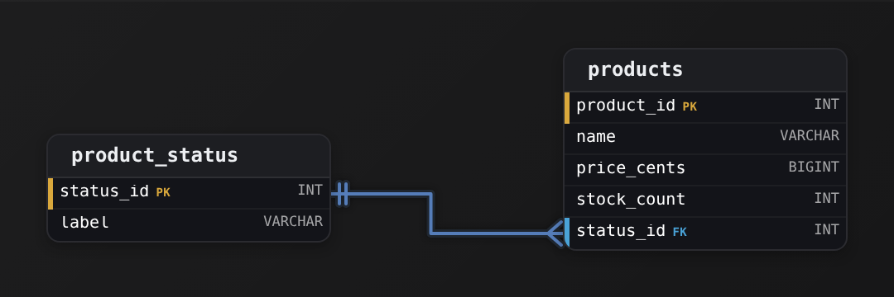
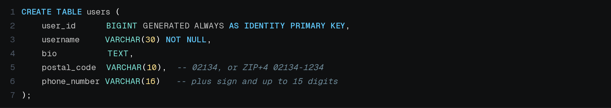
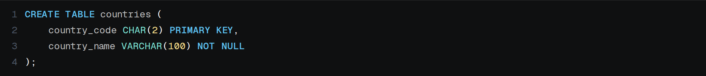
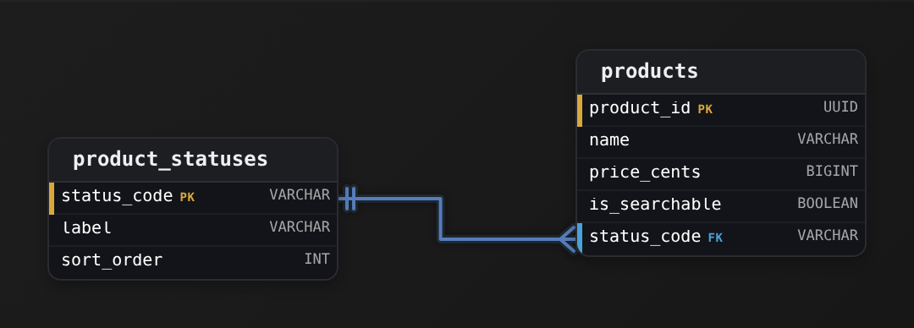
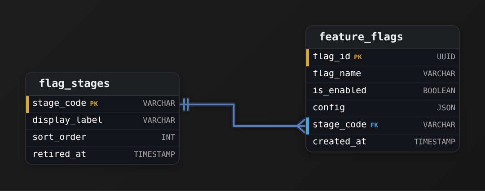
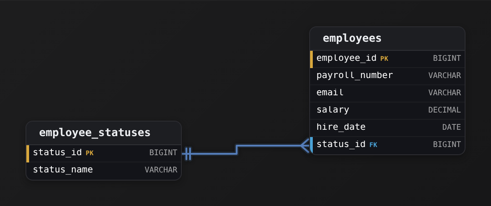
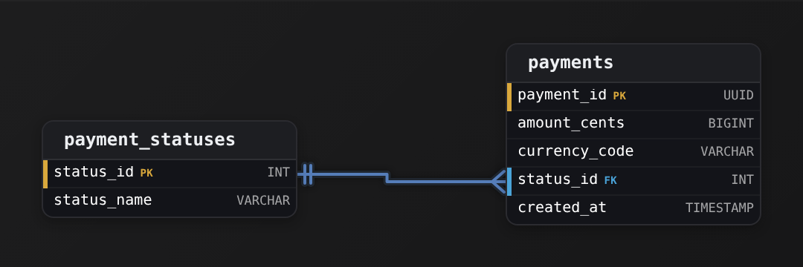
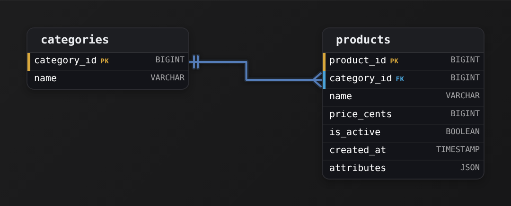
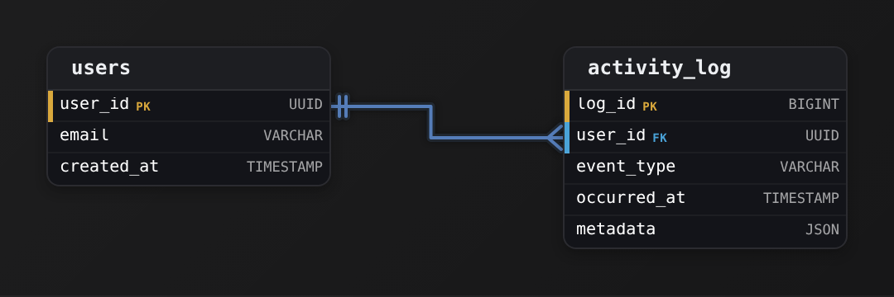

Intermediate·Data Modeling · 22 min · 12 challenges

# Schema Types

A billing team closes the month, reconciles the revenue report against the bank statement, and finds the two disagree by $4,712.38. No transaction is missing. No single row is wrong on its own. The gap traces back to a column someone declared as FLOAT 3 years earlier. Each column in a schema carries a decision like that one, and this lesson walks through the ones that break in production.


<br>

---

## The FLOAT Money Bug

The subscription billing platform this lesson models has 3 tables that matter here: `customers`, `invoices` and `invoice_lines`. One row of `invoice_lines` is one priced line on one invoice: a quantity, a unit price and a line total. The first migration declared `unit_price` and `line_total` as FLOAT because the ORM mapped a Python float to that type by default. The revenue report summed `line_total` and matched the bank for 2 years, then drifted the month volume crossed 10 million lines.

| invoice_line_id | invoice_id | quantity | unit_price | line_total |
| --- | --- | --- | --- | --- |
| 8841001 | INV-30417 | 3 | 19.99 | 59.97 |
| 8841002 | INV-30417 | 1 | 0.10 | 0.10 |
| 8841003 | INV-30418 | 2 | 0.20 | 0.40 |


<br>

### Why 0.1 has no binary form

FLOAT and DOUBLE follow IEEE 754: a sign, an exponent and a binary fraction. A value is exact only when it is a sum of powers of 2, so 0.5 and 19.75 are exact while 0.1 repeats in binary the way 1/3 repeats in decimal. The nearest 64-bit double to 0.1 is 0.1000000000000000055511151231257827, and every operation carries that difference forward. Width depends on the platform: FLOAT is 32-bit single precision in MySQL, as is REAL in PostgreSQL, while PostgreSQL's bare FLOAT is a 64-bit double. The billing platform's columns were the 32-bit kind, good for about 7 significant digits, which is why the drift reached dollars.

```sql
SELECT
  CAST(0.1 AS FLOAT8) + CAST(0.2 AS FLOAT8) = CAST(0.3 AS FLOAT8) AS equal_float,
  CAST(0.1 AS FLOAT8) + CAST(0.2 AS FLOAT8) AS total_float,
  CAST(0.1 AS NUMERIC) + CAST(0.2 AS NUMERIC) = CAST(0.3 AS NUMERIC) AS equal_decimal
```

| equal_float | total_float | equal_decimal |
| --- | --- | --- |
| false | 0.30000000000000004 | true |

Two effects follow. The first is drift under aggregation: summing 0.1 across 1,000,000 rows returns 100000.00000133288 in DOUBLE and 100958.34 in 32-bit REAL, because each addition rounds and the rounding never cancels. The second is failed matching: a reconciliation join on `invoices.total = payments.amount` drops every pair computed along different arithmetic paths, and the dropped rows are the discrepancy nobody can explain.


<br>

### DECIMAL and integer minor units

| ✓ DECIMAL(p, s) | ✗ BIGINT minor units |
| --- | --- |
| • p total digits, s of them after the point: DECIMAL(12,2) tops out at 9,999,999,999.99<br><br>• Addition, subtraction and multiplication are exact; division still rounds to s digits<br><br>• Readable in every tool with no conversion, which is why reporting schemas prefer it<br><br>• Arithmetic runs in software, roughly 3 to 10 times slower than hardware floats | • $19.99 stored as 1999; the currency's minor unit is the whole unit of the column<br><br>• Integer arithmetic is exact and hardware-fast, with no rounding anywhere<br><br>• Needs a currency column beside it, because JPY has no minor unit and KWD has 3 digits<br><br>• Division by 100 belongs to the presentation layer, and every consumer has to know that |

The platform's `invoice_lines` moves to `unit_price DECIMAL(12,4)` and `line_total DECIMAL(12,2)`; 4 places on the unit price give a $0.0025 per-request metered rate a home. Tax rates get `DECIMAL(6,5)`, which holds 0.08250 exactly. The rounding rule for a line total becomes a written policy, since 3 units at $0.0025 is $0.0075 and somebody decides whether that invoices as $0.01 or $0.00. Stripe's API takes every amount as an integer in the currency's smallest unit, the minor-units design applied to a whole payments company.

The integer design has a ceiling worth knowing. A 32-bit INT holds 2,147,483,647, so a running `balance_cents INT` on a customer account overflows after $21.47 million of lifetime billing, which one enterprise contract can reach. BIGINT removes that concern for any business that exists.

- **$92.2 quadrillion** — ceiling of BIGINT cents

FLOAT remains the right type where approximation is the nature of the value: sensor readings, GPS coordinates, ML feature vectors, percentages computed for a chart. Measurement error there dwarfs representation error, and hardware speed matters when a query scans billions of rows. The rule per column is one question: will anyone ever reconcile this number against another system? If yes, the type is exact.

> **TIP**
>
> Migrating an inherited FLOAT money column: `CAST(line_total AS DECIMAL(12,2))` rounds on the cast itself, so record `SUM(line_total)` before and after, and keep the difference in the migration ticket. Finance will ask for that number.

**The platform adds exchange_rate to invoices so that EUR invoices can be reported in USD. A rate like 1.08734 is multiplied against every line total. Which type holds it?**

- **A.** FLOAT, since a rate is a measurement and multiplication is fast
- **B.** DECIMAL(18,8), with the rounding of the converted total defined in one place
- **C.** BIGINT, storing the rate as 108734
- **D.** DECIMAL(5,2), the same shape as the money columns

<details>
<summary>Solution</summary>

**B.** DECIMAL(18,8), with the rounding of the converted total defined in one place

Eight places cover what rate providers publish, the multiplication stays exact, and the one rounding to 2 places happens where the policy says.

**Why the others are wrong**

- **A.** A rate multiplied into money makes the result approximate, and converted revenue drifts from the treasury system's figure.
- **C.** Money works as an integer because its minor unit is fixed; a rate has no fixed scale, so every consumer must know the implied divisor.
- **D.** Two places store 1.08734 as 1.09, a 0.24% error on every converted invoice.

</details>


<br>

---

## Data Modeling

### Exercise 1 of 2

**● TASK**

Apply the type-review checklist to a products table with product_id as primary key, a name, a price stored exactly as integer cents, and a stock_count of whole units. Product status keeps gaining new values, so do not use an enum: add a status_id foreign key to a product_status lookup table (status_id primary key plus a label). Give every column its appropriate type.

<details>
<summary><strong>Solution</strong></summary>

#### Running the type-review checklist on a real catalog

This is the checklist you just learned, applied end to end: pick a **primary key**, choose a type that matches each value's real shape, and split any column whose set of values will keep growing into its own lookup table. 2 tables fall out of it. `products` holds one row per item; `product_status` holds one row per status label. The 3 decisions worth slowing down on are how you store money, how you store stock, and why status becomes a foreign key instead of an enum.



*Many products point at one status row: an N:1 edge from `products.status_id` to `product_status`.status_id.*

| Pitfall: Money is not a float |
| --- |
| The instinct is to type the price as `FLOAT` or `DOUBLE`, and it looks fine until 0.10 + 0.20 stops equalling 0.30. Binary floating point cannot represent most decimal fractions exactly, so cents drift and totals fail to reconcile. Storing the price as `price_cents` in an integer type (a `BIGINT` so large catalogs and currencies with no sub-unit still fit) keeps money exact: every value is a whole count of the smallest unit, and arithmetic stays precise. `DECIMAL(12,2)` is the other correct answer; the one wrong answer is any floating-point type. |

`stock_count` gets the same treatment for a simpler reason: you can hold 3 units or 4, never 3.5. A whole-number type like `INT` makes the fractional value unrepresentable, which is exactly what you want. Both columns also earn a `CHECK (... >= 0)` constraint, since neither a price nor a shelf count is ever negative. The type narrows what can be stored; the constraint narrows it further to what is valid.

| ✕ Status baked into the column | ✓ Status as a lookup table |
| --- | --- |
| An enum or a `CHECK (status IN ('active','discontinued'))` on `products` hard-codes today's values. Adding 'preorder' next quarter means an ALTER on a large table, and every new value is a schema migration. | A `status_id` foreign key into `product_status` makes a new status a one-row `INSERT` into a tiny table. The label lives in exactly one place, so renaming 'discontinued' updates one row instead of every product. This is third normal form: the label depends on the status, not on the product. |

That split gives you the classic **one-to-many** shape: many rows in `products` reference one row in `product_status`, an N:1 edge. The `status_id` in the lookup table is a surrogate key, a meaningless integer whose only job is to be a stable target for the foreign key, so a label change never ripples into `products`. The foreign key itself is what guarantees a product can never point at a status that does not exist.

**The catalog as DDL**

```sql
CREATE TABLE product_status (
    status_id INT PRIMARY KEY,
    label     VARCHAR(50) NOT NULL
);

CREATE TABLE products (
    product_id  INT PRIMARY KEY,
    name        VARCHAR(200) NOT NULL,
    price_cents BIGINT NOT NULL CHECK (price_cents >= 0),
    stock_count INT    NOT NULL CHECK (stock_count >= 0),
    status_id   INT    NOT NULL REFERENCES product_status(status_id)
);
```

*The ER answer written out: integer-cents money, whole-number stock, and status as a foreign key into a lookup table.*

| Real world: In production this is the money-bug prevention pattern |
| --- |
| Payment systems store amounts as integer minor units almost universally (Stripe's API is entirely in cents) precisely to dodge floating-point drift. The status lookup table is just as common: order state, subscription state, ticket state all live in small reference tables so that adding a state is data, not a deploy. |

**Follow-up questions**

1. How would you handle prices in currencies with different sub-unit rules, like yen (no cents) or Kuwaiti dinar (3 decimal places)?\
   *Tests whether integer minor units generalize, and whether a currency column belongs alongside `price_cents`.*
2. If a product could carry several statuses at once (say 'active' and 'on sale'), what changes about the one-to-many design?\
   *Pushes from N:1 toward a many-to-many junction table between products and `product_status`.*

</details>


<br>

### Exercise 2 of 2

**● TASK**

Design a payments transactions table with a primary key, an exact-precision money amount that never drifts from the bank statement, and a whole-number item quantity. The set of valid statuses will grow over time, so model status as its own lookup table that transactions references instead of baking the allowed values into the column definition.

<details>
<summary><strong>Solution</strong></summary>

#### 2 decisions, 2 tables

This schema turns on 2 modeling calls you were asked to make. First, picking column types that match what the data actually IS: money that must never drift needs an exact numeric type, and a count of items needs a whole-number type. Second, pulling the status set out of the transaction row and into its own **lookup table** that `transactions` points at with a foreign key. Everything else here is scaffolding around those 2 choices.


*transactions references `transaction_status`: one status row describes many transactions.*

1. **Store money as an exact decimal, never a float**

   The prompt says the amount must stay exact against the bank statement, so `amount` is `DECIMAL(12,2)` (also spelled `NUMERIC`). A decimal stores the value in base-10 with a fixed number of digits, so '19.99' is exactly '19.99'. A binary float type like `FLOAT` or `REAL` cannot represent most decimal cents exactly, so sums slowly drift a cent here and there. The type IS the guarantee: choosing `DECIMAL` is how you enforce the precision requirement, not something you patch up in application code.

| Pitfall: FLOAT for money is the classic trap |
| --- |
| Reaching for `FLOAT` because it 'holds decimals' is the mistake to avoid here. `0.1 + 0.2` stored as binary floats is not `0.3`, and once you SUM millions of rows the rounding error becomes a real, visible mismatch with the ledger. `DECIMAL(p,s)` (or an integer count of `amount_cents`) is the only safe way to hold currency. |

2. **Move the status set into a lookup table**

   The valid statuses are expected to grow, so they must live as DATA, not as part of the column definition. That is why there is a `transaction_status` table: each allowed status is a row keyed by `status_id`, and `transactions.status_id` is a foreign key pointing at it. Adding 'refunded' later is a one-row `INSERT`, with no schema change and no redeploy. This is the one-to-many shape: one status row is referenced by many transaction rows.

| ✕ Status baked into the column | ✓ Status as a lookup table |
| --- | --- |
| A `CHECK (status IN ('paid','failed'))` or an `ENUM` bakes the allowed values into the table definition. Every new status is a migration that rewrites the column, and the list of valid values is invisible to normal queries. | `transaction_status` holds the values as rows and `transactions.status_id` references them. New values are inserts, the `FK` still guarantees only known statuses get used, and each status name is stored once instead of repeated on every transaction row. |

| Key insight: Why the FK is what makes this normalized |
| --- |
| Storing the raw text 'paid' on every transaction repeats the same string millions of times and lets typos like 'pais' slip in. Referencing `transaction_status.status_id` instead means the label lives in exactly one place (third normal form) and the foreign key rejects any `status_id` that is not a real status. That combination, one home for the value plus a referential guarantee, is the whole point of a lookup table. |

**Follow-up questions**

1. If a report needs to sum `amount` per status name, which tables does the query touch and how do they join?\
   *Checks that you see the FK relationship as the join path back to the human-readable label.*
2. How would you also record WHEN each status change happened, not just the current status?\
   *Extends the lookup-table idea toward a status-history table keyed by transaction and timestamp.*
3. What would change if amounts could be in different currencies?\
   *Pushes on the data-type decision: a currency code column, and why you never mix currencies in one summed column.*

</details>


<br>

---

## String Types & Platform Traps

The `customers` table holds `full_name`, `email`, `country_code`, `currency_code` and `billing_address`, all text. The 3 families are CHAR(n), fixed width and space-padded; VARCHAR(n), variable width with a declared ceiling; and TEXT, variable width with no declared ceiling. What each does when real data arrives depends on the platform more than on the SQL standard.


<br>

### CHAR earns its place only for codes

A CHAR(3) column stores 'US' as 'US ' and pads every shorter value to the declared width. PostgreSQL treats the trailing spaces as insignificant in comparisons but keeps them in the stored bytes, MySQL strips them on read, and a value exported to a CSV carries them into whichever system reads it next. That is acceptable only when the value is the same width by definition. ISO 3166-1 alpha-2 country codes are CHAR(2), ISO 4217 currency codes are CHAR(3), and a width that matches the standard rejects 'USA' in a country column before it reaches a join.


<br>

### What each platform does past the limit

| Platform | Insert longer than VARCHAR(n) | VARCHAR(n) versus TEXT |
| --- | --- | --- |
| PostgreSQL | Error: value too long for type character varying(n) | Identical storage and speed; the limit is validation only |
| MySQL 5.7+ | Error in strict mode; truncated with a warning in non-strict mode | Same InnoDB storage for long values; TEXT is indexable only by prefix and cannot take a literal DEFAULT before 8.0.13 |
| Snowflake | Error; the default VARCHAR ceiling is 16,777,216 characters | No storage penalty for a large declared ceiling |
| BigQuery | Error when declared STRING(L); plain STRING has no limit | STRING is the only type; L is a check, not a storage hint |
| Oracle | Error; VARCHAR2(100 BYTE) and VARCHAR2(100 CHAR) count differently | Default semantics are bytes unless NLS_LENGTH_SEMANTICS says CHAR |

The MySQL row is the one that loses data. Without STRICT_TRANS_TABLES in `sql_mode`, a 300-character address inserted into VARCHAR(255) becomes a 255-character address and a warning the driver never surfaces. Strict mode has been the default since 5.7, but a server configured in 2014 and upgraded in place can still lack it, so the first check on an inherited MySQL instance is `SELECT @@sql_mode`.


<br>

### Characters, bytes and the number 191

VARCHAR(n) counts characters everywhere except Oracle in byte mode, but indexes count bytes. Under MySQL's `utf8mb4` a character takes up to 4 bytes, and InnoDB's older COMPACT row format caps an index key at 767 bytes. Dividing 767 by 4 gives 191, which is why Laravel migrations defaulted string columns to 191 characters for years and why `email VARCHAR(255)` with a unique index fails to create on those tables. The DYNAMIC row format, default since MySQL 5.7.9, raises the cap to 3,072 bytes for new tables.


<br>

### Sizing against the data that will arrive

A length chosen from the first 100 rows of sample data is the common failure. The rule that survives: a code gets CHAR of the standard's width, text a human types gets a VARCHAR whose ceiling comes from a published limit or a generous round number, and free text that can grow gets TEXT. Email addresses have a ceiling of 254 characters under RFC 5321, so `email VARCHAR(254)`. Personal names have no documented maximum, and a 40-character limit rejects Hubert Blaine Wolfeschlegelsteinhausenbergerdorff Sr., a real 53-character name, so `full_name VARCHAR(255)`. Addresses run past 200 characters in Japan and Brazil, so `billing_address TEXT`.

Some values look numeric and are text. A US postal code 02134 loses its leading zero in an INT column. A phone number in E.164 form is a plus sign and up to 15 digits, and the plus sign is data. Account numbers, order references and tax ids are never summed, so each is a string sized to the issuing system's format. The test is arithmetic: a value never added, subtracted or compared as a magnitude is text.

**The customers.email column runs on PostgreSQL. Which declaration fits the data it will hold?**

- **A.** VARCHAR(50), since the sample shows 95% of addresses are shorter than that
- **B.** VARCHAR(254) with a CHECK that the value contains '@'
- **C.** CHAR(254), so every row is the same width
- **D.** TEXT with no constraint, because PostgreSQL stores it the same way

<details>
<summary>Solution</summary>

**B.** VARCHAR(254) with a CHECK that the value contains '@'

The ceiling comes from RFC 5321 and costs nothing in PostgreSQL storage; the CHECK validates what a length cannot.

**Why the others are wrong**

- **A.** Addresses up to 254 characters are valid, and the 5% are real customers whose signups fail with a type error.
- **C.** Every address is stored padded to 254 characters, about 10 times a typical one, and the spaces surface in CSV exports and in any consumer that compares strictly. Email is variable width, which CHAR denies.
- **D.** Storage is identical, but the column now accepts a 2 MB paste as an email; the length is a guard as well as documentation.

</details>


<br>

---

## Data Modeling

### Exercise 1 of 2

**● TASK**

Design a users table keyed by a user id, where the canvas types carry each length rule: VARCHAR for a column with a stated maximum, TEXT for one with none. A username is at most 30 characters, and a profile bio is free-form prose of any length. Each user also has a US postal code such as 02134 and a phone number in E.164 form (a plus sign and up to 15 digits), both kept exactly as entered.

<details>
<summary><strong>Solution</strong></summary>

#### Bounded strings vs. unbounded text

Sizing a text column starts with one question: is there a maximum length you can state? A username capped at 30 characters has one, and so do a postal code and an E.164 phone number, so each is a bounded `VARCHAR`. A bio is open-ended prose with no honest ceiling, so it is `TEXT`. The second question is whether a value that looks like a number is really a number. Postal codes and phone numbers are never added up, so both stay strings.



*One row per user, keyed by `user_id`: `VARCHAR` marks every column with a stated maximum, and `TEXT` marks the one without.*

| Key insight: The length limit is a business rule |
| --- |
| Use `VARCHAR(n)` when the maximum is a rule you can state, such as a 30-character handle or 15 digits plus a sign. Putting that rule in the column type means every insert path enforces it. Typing `VARCHAR(255)` on every string out of habit enforces nothing: if you cannot say why the number is 255, either pick a bound you can defend or use `TEXT`. |

| Pitfall: A value you never add is text |
| --- |
| Declare `postal_code` as `INT` and '02134' is stored as 2134. Declare `phone_number` as `BIGINT` and the plus sign, which is part of the number, is dropped. Neither value is ever summed or compared as a magnitude, so both belong in strings sized to their format. |

**`users` table**

```sql
CREATE TABLE users (
    user_id      BIGINT GENERATED ALWAYS AS IDENTITY PRIMARY KEY,
    username     VARCHAR(30) NOT NULL,
    bio          TEXT,
    postal_code  VARCHAR(10),  -- 02134, or ZIP+4 02134-1234
    phone_number VARCHAR(16)   -- plus sign and up to 15 digits
);
```

*Every bounded column states its maximum; `bio` stays unbounded.*

| Real world: A real bound protects every downstream system |
| --- |
| URL slugs, display layouts and SMS gateways all assume handles and phone numbers are short. A real cap on `username` and `phone_number` protects all of them. Keeping `bio` as `TEXT` means you never ship a migration to widen it because a user hit an arbitrary cap. |

**Follow-up questions**

1. If usernames may grow to 50 characters, is changing `VARCHAR(30)` to `VARCHAR(50)` a safe migration?\
   *On Postgres, widening a `VARCHAR` only changes metadata. Narrowing one rewrites the table and can fail on existing rows.*
2. Users outside the US start signing up. What does `postal_code` need to hold now?\
   *UK and Canadian postal codes contain letters and spaces, which is one more reason the column was never a number.*

</details>


<br>

### Exercise 2 of 2

**● TASK**

Design a countries table using a fixed-length string for ISO country codes and a variable-length string for names.

<details>
<summary><strong>Solution</strong></summary>

#### Matching the type to the shape of the data

The whole exercise here is picking a string type by what the value actually looks like. An ISO country code is always exactly the same width, so it wants a fixed-length type, `CHAR`. A country name can be 4 letters ('Chad') or fifty-plus ('The United Kingdom of Great Britain and Northern Ireland'), so it wants a variable-length type, `VARCHAR`. Same data category, strings, but 2 different physical types because the 2 columns have 2 different shapes.



*One table: a fixed-width code as the natural primary key, a variable-width name beside it.*

ISO 3166-1 defines a two-letter alpha-2 code ('US', 'FR', 'JP') and a three-letter alpha-3 code ('USA', 'FRA', 'JPN'). Either way the width is fixed by the standard, so `CHAR(2)` or `CHAR(3)` says exactly what a legal value is: the type itself rejects a one-character typo or a stray four-character string before it ever reaches the row.

**countries**

```sql
CREATE TABLE countries (
    country_code CHAR(2) PRIMARY KEY,
    country_name VARCHAR(100) NOT NULL
);
```

*Fixed-length code as the key, variable-length name beside it.*

| Key insight: Why the code is the primary key |
| --- |
| ISO codes are a natural key: unique, stable, and already the value every other table would reference. So `country_code` becomes the `PRIMARY KEY` directly, with no separate surrogate id. A foreign key in `users` or `orders` then stores a compact `CHAR(2)` instead of repeating the full country name on every row. |

| Pitfall: Reaching for VARCHAR everywhere |
| --- |
| The common instinct is to type both columns `VARCHAR` and move on. It works, but you give up the guarantee: `VARCHAR(3)` happily stores 'U' or 'US ' with a trailing space, so bad codes slip in and joins quietly miss. `CHAR(2)` pins the width to the standard. Reserve fixed-length `CHAR` for values that really are always the same size; using it for `country_name` would pad every 'Chad' with trailing blanks. |

| ✕ CHAR(n), fixed width | ✓ VARCHAR(n), variable width |
| --- | --- |
| Stores exactly `n` characters, padding shorter values. Right when every value is the same length by definition: ISO codes, US state abbreviations, fixed-format SKUs. Here the width doubles as a validation rule. | Stores only the characters present, up to a cap `n`. Right when length genuinely varies: names, descriptions, emails. Pick `n` as a sane ceiling (`VARCHAR(100)`), not a promise every value fills it. |

**Follow-up questions**

1. If you switched to the three-letter alpha-3 codes, what single change does the schema need?\
   *Tests that the width lives in the type: `CHAR(2)` becomes `CHAR(3)`, and nothing else moves.*
2. Where would `region` or `continent` go, and would it belong in this table or its own?\
   *Tests normalization instinct once the model grows past 2 columns.*

</details>


<br>

---

## Temporal Types & DST

In the `subscriptions` table, `started_at` is an instant that happened, `next_renewal_at` is an appointment that will happen, and `trial_ends_at` is a calendar day. In `payment_events`, `occurred_at` records each charge attempt, another instant. A type that fits one kind of time corrupts the others.

The temporal types and what one value means

- DATE: a calendar day with no clock and no zone. 2026-11-01 is a different span of instants in Tokyo and in Denver.
- TIME: a wall-clock time with no day. 09:00 is an appointment pattern, and it names an instant only once a day and a zone are attached.
- TIMESTAMP (naive): a day and a clock reading with no zone. 2026-11-01 01:30:00 could be any of roughly 38 instants, one per UTC offset in use.
- TIMESTAMPTZ: an instant on the global timeline, converted to UTC on write. The same instant reads back in any zone the session asks for.
- INTERVAL: a duration. '1 month' is calendar arithmetic; '2592000 seconds' is 30 days elapsed, and the two disagree in every month that is not 30 days long.


<br>

### The hour that happens twice

On 2026-11-01 the United States leaves daylight saving time: at 02:00 Eastern Daylight Time the clocks return to 01:00 Eastern Standard Time, so every reading between 01:00 and 02:00 occurs twice. On 2026-03-08 the readings between 02:00 and 03:00 never occur at all. A naive TIMESTAMP `payment_events.occurred_at` filled by a server set to America/New_York records 2 charge attempts an hour apart as the same value.

| Wall clock in New York | Actual instant (UTC) | Minutes since 00:30 local |
| --- | --- | --- |
| 2026-11-01 00:30:00 | 2026-11-01 04:30:00Z | 0 |
| 2026-11-01 01:30:00 (first time) | 2026-11-01 05:30:00Z | 60 |
| 2026-11-01 01:30:00 (second time) | 2026-11-01 06:30:00Z | 120 |
| 2026-11-01 02:30:00 | 2026-11-01 07:30:00Z | 180 |

In a naive column the second and third rows are indistinguishable, and elapsed time between them computes as 0 minutes for a gap of 60. As TIMESTAMPTZ they hold 05:30Z and 06:30Z, and the subtraction is correct in every zone. The point reaches past DST: subtracting 2 instants gives elapsed time, while subtracting 2 wall-clock readings is right only within one zone on a day without a transition.

PostgreSQL's TIMESTAMPTZ stores the UTC instant and discards the offset it arrived with: '2026-11-01 01:30:00-05:00' reads back in the session's `TimeZone`, and the Eastern origin is gone. Where the originating zone is a business fact (which local day a charge belongs to on a statement), it gets its own column, `occurred_tz VARCHAR(40)` holding an IANA name such as America/New_York.


<br>

### Past instants versus future appointments

A charge that already happened is an instant and belongs in TIMESTAMPTZ. A renewal at 09:00 local on the first of the month is an appointment, and converting it to a UTC instant today bakes in today's timezone rules. Mexico abolished daylight saving time in October 2022, so a Mexico City renewal stored as a UTC instant in 2021 fires an hour early from 2023 on; Egypt reinstated DST in April 2023 and shifted pre-computed instants the other way. The schema that survives law changes stores `renewal_time TIME` plus `renewal_tz` holding the IANA name, and computes the instant when the scheduler enqueues the job.

Durations split the same way. A 14-day trial is elapsed time and stores as `trial_days INT`. A monthly plan is calendar time: in PostgreSQL `started_at + INTERVAL '1 month'` from January 31 lands on February 28, and another month lands on March 28, so a subscription begun on the 31st drifts to the 28th forever unless `billing_day_of_month INT` is stored separately. Store the rule the business stated, and derive each date from it at the point of use.

| Platform | Naive civil time | Instant | Note |
| --- | --- | --- | --- |
| PostgreSQL | TIMESTAMP | TIMESTAMPTZ | Instant type keeps UTC and drops the offset |
| MySQL | DATETIME | TIMESTAMP | TIMESTAMP range ends 2038-01-19 03:14:07 UTC |
| Snowflake | TIMESTAMP_NTZ | TIMESTAMP_TZ keeps offset; TIMESTAMP_LTZ renders in session zone | Bare TIMESTAMP is an alias for NTZ by default |
| BigQuery | DATETIME | TIMESTAMP | A literal with no zone is read as UTC |

> **TIP**
>
> A MySQL TIMESTAMP cannot hold a value past January 19, 2038, so a 15-year contract end date written today fails on insert. On MySQL, store instants in DATETIME, in UTC by convention, enforced in the application's connection settings.

**A subscription renews at 09:00 on the 1st of each month in the customer's own timezone, and the charge job must run at that moment. Which columns hold the schedule?**

- **A.** next_renewal_at TIMESTAMPTZ, with the next 12 instants pre-computed on signup
- **B.** renewal_time TIME plus renewal_tz as an IANA zone name, with the instant computed when the job is scheduled
- **C.** renewal_at TIMESTAMP naive plus utc_offset VARCHAR(6) holding '-05:00'
- **D.** renewal_day INT and run every job at 09:00 UTC

<details>
<summary>Solution</summary>

**B.** renewal_time TIME plus renewal_tz as an IANA zone name, with the instant computed when the job is scheduled

The appointment is stored as the business stated it, and the scheduler's tz database resolves it under whatever rules apply that month.

**Why the others are wrong**

- **A.** The instants encode this year's offset rules, so a DST law change or a customer who moves shifts every one by an hour.
- **C.** A fixed offset is one date's rules; after the March transition the 09:00 renewal fires at 10:00 local.
- **D.** The charge lands at 04:00 in New York and 18:00 in Tokyo, breaking every customer-facing promise about timing.

</details>


<br>

---

## Data Modeling

### Exercise 1 of 2

**● TASK**

Create an orders table choosing between date-only and full timestamp types based on what each column actually needs.

<details>
<summary><strong>Solution</strong></summary>

#### Match the type to what the column measures

Picking between `DATE` and `TIMESTAMP` is a data-type decision about meaning, not size. A `TIMESTAMP` records **the exact moment an event happened**. A `DATE` records which calendar day something belongs to. They answer different questions, so choose by what each column has to answer rather than defaulting to the more precise one.


*`created_at` captures a moment; `ship_date` captures a calendar day.*

| ✕ `created_at` as `DATE` | ✓ `ship_date` as `TIMESTAMP` |
| --- | --- |
| Orders placed at '09:01' and '16:45' become indistinguishable. You lose ordering within the day and can no longer measure time-to-fulfill. Once that precision is dropped at write time, no query can recover it. | The warehouse ships in daily batches and never records a ship time, so every row gets a fake '00:00:00'. Readers wonder whether that midnight is real, and time zone conversion can shift the value onto the wrong day. |

| Pitfall: Extra precision is a false promise |
| --- |
| Making every temporal column a `TIMESTAMP` to be safe implies the time of day is meaningful. On `ship_date` it is not, and the phantom time invites off-by-one-day bugs. A `DATE` documents intent: this is a day, treat it as a day. |

| Real world: Events get timestamps, calendars get dates |
| --- |
| Event columns like `updated_at` and `logged_in_at` mark moments, so they are timestamps. Business-calendar columns like `due_date`, `invoice_date` and `birth_date` mark days, so they are dates. The naming suffix often tells you which one you are looking at. |

**Follow-up questions**

1. A `delivered_at` column records the moment a courier scans the package. Which type does it take?\
   *Applies the moment-versus-day test to a new column.*
2. Orders now arrive from several countries. What changes about how you store `created_at`?\
   *Extends toward a time-zone-aware timestamp so the stored instant is unambiguous.*

</details>


<br>

### Exercise 2 of 2

**● TASK**

Design a sessions table where both start and end times need full timestamp precision.

<details>
<summary><strong>Solution</strong></summary>

#### Matching the data type to the precision the attribute needs

The concept this challenge is drilling is **choosing a column's data type from what the value actually has to carry**. The phrase "full timestamp precision" is the whole tell: a session begins at a specific moment and ends at a specific moment, and each moment is a date *and* a time-of-day. So `started_at` and `expires_at` are both `TIMESTAMP` columns. Anything narrower quietly throws information away.


*One table, one identity column, and 2 full-precision temporal attributes.*

| ✕ DATE | ✓ TIMESTAMP |
| --- | --- |
| `DATE` stores only the calendar day, no time-of-day. Store a login at 2:47:13 PM as `DATE` and it collapses to midnight of that day, so `expires_at - started_at` is a whole number of days and every session that starts and ends on the same day looks like it lasted zero time. | `TIMESTAMP` keeps the day and the time together down to sub-second, so the difference between `started_at` and `expires_at` is a real duration. This is exactly what "full timestamp precision" asks for. |

| Pitfall: Reaching for DATE (or splitting date and time apart) |
| --- |
| The common miss is typing `started_at` as `DATE`, or worse, modeling a separate `start_date` and `start_time` pair. Splitting them forces every duration query to re-stitch 2 columns and makes an index on "when did this start" impossible. One `TIMESTAMP` column per moment is both the correct precision and the simpler shape. |

| Key insight: Every table still needs an identity |
| --- |
| Even a two-attribute table gets a primary key. `session_id` is a surrogate PK: a stable, single-column handle that other tables (users, events, audit logs) can reference without depending on the timestamps. Never let a value that can change or repeat, like `started_at`, stand in as the key. |

**Follow-up questions**

1. If sessions span time zones, would you use `TIMESTAMP` or `TIMESTAMPTZ`?\
   *Tests whether the learner knows that `TIMESTAMP` is naive (no offset) and `TIMESTAMPTZ` anchors the instant to UTC.*
2. What would change if you only ever needed the calendar day a session started, not the time?\
   *Checks that data-type choice follows the required precision: that case is the one where `DATE` is correct.*

</details>


<br>

---

## ENUM Traps

`subscriptions.status` launches with 3 values: trialing, active and cancelled. ENUM looks built to reject anything else, and it is, for a set that never changes; subscription statuses at any company have never stayed still for a year. The 3 storage designs for a constrained value differ in what the fourth value costs.


<br>

### What ENUM gives and what it takes

In PostgreSQL an ENUM is a named type: `CREATE TYPE subscription_status AS ENUM ('trialing','active','cancelled')`. A value takes 4 bytes, an invalid insert fails, and `ORDER BY status` follows declaration order, which puts 'trialing' first where an alphabetical sort puts it last. `ALTER TYPE ... ADD VALUE` could not run inside a transaction block before version 12, and from 12 the new value is unusable until that transaction commits; renaming a value arrived in version 10. Removing a value has no statement: the path is a new type, an `ALTER COLUMN ... TYPE ... USING` cast that rewrites the table, and a drop of the old type.

MySQL stores an ENUM as a 1-based integer index into the declared list. Appending a value is an in-place change while the storage width holds; inserting one mid-list renumbers rows and rewrites the table, which on a billion rows locks writes for hours. Sharper still: in non-strict mode an invalid value is stored as '' with index 0, so an application typo writes a row whose status is nothing and whose insert succeeded.

| ✓ ENUM | ✗ Lookup table with a foreign key |
| --- | --- |
| • Values live in the schema; adding one is a DDL change deployed with a migration<br><br>• Compact storage and a rejected insert on a bad value<br><br>• No place for a display label, a sort weight or a retirement date<br><br>• Right for sets fixed by definition: day of week, card suit | • Values live in rows of subscription_statuses; adding one is an INSERT<br><br>• Carries label, sort_order and retired_at beside the code<br><br>• Costs one join, usually against a table of fewer than 50 rows<br><br>• Right for any set a product manager has opinions about |

Between the two sits `status VARCHAR(20)` with a CHECK listing the allowed values. Changing the list is a drop and re-add of the constraint, and PostgreSQL's `NOT VALID` skips the full-table scan at add time, so the swap takes milliseconds at any table size. The CHECK gives ENUM's rejection without ENUM's rebuild cost, and lacks only the labels and ordering a lookup table carries.


<br>

### Booleans that hold 3 values

A nullable BOOLEAN holds true, false and NULL, and `WHERE is_active = false` skips the NULLs, so a report of inactive subscriptions undercounts by every row whose flag was never set; `is_active BOOLEAN NOT NULL DEFAULT false` removes the third state. Flag creep is the second failure: `is_active`, `is_paused` and `is_cancelled` have 8 combinations and 3 valid ones, and nothing stops a row being active and cancelled, so 3 mutually exclusive flags are one status column. Third, a boolean can hide a timestamp: `cancelled_at TIMESTAMPTZ NULL` records that and when, and `cancelled_at IS NOT NULL` replaces `is_cancelled`.


<br>

### UUIDs as identifiers

When ids are generated outside the database, by a mobile client or a service that cannot wait for a sequence, UUIDs replace BIGINT. PostgreSQL's native `uuid` is 16 bytes; the same value in CHAR(36) is 36 bytes compared as text, which inflates every index and foreign key that references it. The version matters as much. A random UUIDv4 lands on a random index page, so InnoDB's clustered index splits pages continuously and a PostgreSQL btree fills with half-empty leaves. UUIDv7, standardised in RFC 9562 in 2024, leads with a millisecond timestamp so inserts append at the rightmost page the way a sequence does, and PostgreSQL 18 ships `uuidv7()` built in.

**The platform moves subscription_id to a UUID so that ids can be generated client-side before the row exists. On PostgreSQL, which choice keeps the primary key index healthy?**

- **A.** CHAR(36) holding UUIDv4 strings
- **B.** The uuid type holding UUIDv4 values
- **C.** The uuid type holding UUIDv7 values
- **D.** VARCHAR(255), to leave room for other id formats later

<details>
<summary>Solution</summary>

**C.** The uuid type holding UUIDv7 values

Sixteen bytes, and the leading timestamp makes each new id larger than the last, so inserts append at the btree's right edge.

**Why the others are wrong**

- **A.** Thirty-six bytes per key compared as text, random insert positions, and every foreign key column pays the same.
- **B.** Storage drops to 16 bytes, but random values still scatter inserts and the leaves fill unevenly.
- **D.** The column accepts any string, so a malformed client id is stored and its join to invoices finds nothing.

</details>


<br>

---

## Data Modeling

### Exercise 1 of 2

**● TASK**

Design a products table whose ID is minted independently by several regional catalog services with no shared sequence. Each product carries a required yes/no flag for whether it shows in search, and a price in exact cents. Its lifecycle status (draft, live, discontinued) is a set the merchandising team keeps extending, each value with a display label and a sort order, and the database must reject an unknown status.

<details>
<summary><strong>Solution</strong></summary>

#### A status set that keeps growing

The ENUM section warned about exactly this kind of status: a lifecycle the merchandising team keeps extending. As an ENUM, every new value is a DDL migration. A mid-list insert can rewrite the whole table, and there is nowhere to put a label or a sort order. A **lookup table** turns the set into data, and a foreign key from `products` makes the database itself refuse an unknown status. The key deserves the same care. Several services mint IDs with no shared sequence, so a UUID is the type that cannot collide.



*`products.status_code` references `product_statuses.status_code`; `product_id` is a UUID minted by whichever service creates the product.*

1. **Mint the key where the row is born**

   No sequence spans the regional catalog services, so an auto-increment `BIGINT` would eventually hand out the same `product_id` twice. A `UUID` is generated by the service that creates the product and is unique without any coordination. Prefer a time-ordered UUID (version 7) so new keys land near each other in the primary-key index instead of scattering across it.

2. **Turn the status set into rows**

   `product_statuses` holds one row per code: `status_code` is its primary key, with `label` and `sort_order` beside it. `products.status_code` is a foreign key to that table, so an insert carrying 'archvied' fails at the database instead of slipping through. Adding '`on_hold`' next quarter is an `INSERT`, not a migration. The join it costs is against a table of a handful of rows.

3. **Give the flag and the price types that cannot lie**

   `is_searchable` is a `BOOLEAN NOT NULL`: 2 states and no third. A `CHAR(1)` holding 'Y' or 'N' also accepts 'y', 'X' and the empty string unless you bolt on a `CHECK`. `price_cents` stays a `BIGINT` count of cents, the exact-money choice from the first section of this lesson.

| Pitfall: An ENUM can swallow the typo silently |
| --- |
| In MySQL with strict mode off, inserting a status outside the `ENUM` list stores '' at index 0 and the insert reports success. You end up with a product that has no status and no error. A foreign key has no lenient mode: the row is rejected every time. |

**The same design as DDL**

```sql
CREATE TABLE product_statuses (
    status_code VARCHAR(20)  PRIMARY KEY,
    label       VARCHAR(50)  NOT NULL,
    sort_order  INT          NOT NULL
);

CREATE TABLE products (
    product_id    UUID         PRIMARY KEY,  -- minted by the creating service
    name          VARCHAR(255) NOT NULL,
    price_cents   BIGINT       NOT NULL,
    is_searchable BOOLEAN      NOT NULL,
    status_code   VARCHAR(20)  NOT NULL REFERENCES product_statuses (status_code)
);
```

*The foreign key and the `NOT NULL` flags are the declared rules; nothing here relies on application code to keep statuses valid.*

**Follow-up questions**

1. A status is retired but old products still carry it: what would you add to `product_statuses` instead of deleting the row?\
   *Retiring a value without breaking the foreign key on existing rows.*
2. Where in this catalog would a native `ENUM` or a `CHECK` list still be the right call?\
   *Separating sets fixed by definition from sets the business keeps changing.*

</details>


<br>

### Exercise 2 of 2

**● TASK**

Design the feature flags table for a product whose regional services each create new flags on their own, with no shared counter to hand out ids. Every flag has a required unique name, an on/off toggle, and a settings bundle whose keys differ from flag to flag. Each flag also sits in a lifecycle stage (today draft, rolling out, retired) that product keeps adding to and wants shown with a display label and sort order.

<details>
<summary><strong>Solution</strong></summary>

#### 3 columns, 3 different promises

A flag row looks simple, but each column's type is a separate promise about the future. The id has to be mintable anywhere, the toggle has exactly 2 answers, and the stage is a set product will keep growing. That gives you a UUID key, a `BOOLEAN`, and **a lookup table with a foreign key instead of an ENUM**.



*`feature_flags` keyed by a UUID, with `stage_code` pointing at the `flag_stages` lookup table.*

1. **Mint `flag_id` as a UUID**

   Several regional services create flags with no shared counter, so a sequence would either collide across regions or need a central service to hand out numbers. A `UUID` can be generated by whichever service creates the flag, and 2 regions will not produce the same one.

2. **Declare the rules on the columns**

   `is_enabled` is a `BOOLEAN` because a toggle has exactly 2 answers. The per-flag settings go in `config` as `JSON` because their keys differ row to row. `flag_name` is required and carries a unique key, so the database rejects a duplicate name instead of trusting every service to check first.

3. **Give the stage its own table**

   Stages are a set product keeps changing, and each one needs a label and a sort position. Rows in `flag_stages` hold `display_label`, `sort_order` and `retired_at` beside the code, adding a stage is an INSERT, and the foreign key on `feature_flags.stage_code` still rejects a stage that does not exist.

| Pitfall: An ENUM stage makes every new stage a migration |
| --- |
| An ENUM of 'draft', '`rolling_out`' and 'retired' feels tidy until product asks for 'paused'. That request becomes a DDL change, and the ENUM has nowhere to keep a label or sort order. In MySQL with non-strict mode, a typo is stored as '' and the insert succeeds. Keep ENUM for sets fixed by definition, like day of week. |

**Follow-up questions**

1. If flags were only ever created by one central admin service, would a `BIGINT` sequence for `flag_id` be the better choice?\
   *Checks that the UUID follows from distributed creation, not from habit.*
2. Product wants to retire '`rolling_out`' without breaking old flags that still reference it. What changes in `flag_stages`?\
   *Uses `retired_at` on the lookup row instead of deleting the value.*

</details>


<br>

---

## Type Review Framework

A column's type is the cheapest quality control a schema has, applied by the database to every write with no pipeline, test or reviewer, and the most expensive thing to change once the table is large. A type review before the first deploy asks every column the same questions.

> The per-column review
>
> - Money or anything reconciled against another system: DECIMAL with stated precision and scale, or BIGINT minor units beside a currency column. FLOAT is a finding.
> - Text: does the length come from a standard or a known format, and does this platform reject or truncate past it? Is it a code that wants CHAR?
> - Time: past instant (TIMESTAMPTZ), future appointment (local time plus IANA zone), calendar day (DATE) or duration? A naive TIMESTAMP needs a written source for its zone.
> - Constrained values: will the set grow or carry labels? Lookup table if so, CHECK if only validity matters, ENUM only for sets fixed by definition.
> - Booleans: NOT NULL with a default, no 2 flags that cannot both be true, and a nullable timestamp for a flag that records an event.
> - Keys: BIGINT from a sequence, or native uuid holding time-ordered values. INT primary keys and CHAR(36) ids are findings.


<br>

### A type shapes; a constraint rejects

The type decides what a stored value looks like, a weaker promise than it sounds. Inserting 19.995 into a PostgreSQL `NUMERIC(10,2)` column stores 20.00 with no error, because the engine rounds to the declared scale on write; MySQL in strict mode does the same and emits a note the driver discards. A negative amount fits DECIMAL(10,2), and so does a NULL. Rejection comes from constraints: `NOT NULL` for a fact that must exist, `CHECK (amount >= 0)` for a sign the business forbids, a foreign key for a code that must exist in a lookup table. A reviewed column names both its type and the constraints that make it a validator.

```sql
CREATE TABLE invoice_lines (
  invoice_line_id BIGINT GENERATED ALWAYS AS IDENTITY PRIMARY KEY,
  invoice_id      BIGINT NOT NULL REFERENCES invoices(invoice_id),
  quantity        INTEGER NOT NULL CHECK (quantity > 0),
  unit_price      DECIMAL(12,4) NOT NULL CHECK (unit_price >= 0),
  line_total      DECIMAL(12,2) NOT NULL CHECK (line_total >= 0),
  currency_code   CHAR(3) NOT NULL REFERENCES currencies(code),
  created_at      TIMESTAMPTZ NOT NULL DEFAULT now()
);
```


<br>

### What a wrong type costs to fix

| Platform | Metadata-only change | Rewrite or rebuild |
| --- | --- | --- |
| PostgreSQL | Widening VARCHAR(n), VARCHAR to TEXT | INT to BIGINT, FLOAT to NUMERIC: full rewrite under an exclusive lock, plus every index |
| MySQL | Appending an ENUM value, widening VARCHAR within the same length-prefix size | Most others copy the table; gh-ost or pt-online-schema-change avoid downtime |
| Snowflake | Widening VARCHAR, raising NUMBER precision | Scale or type family: add a column, backfill, swap names |
| BigQuery | INT64 to NUMERIC, NUMERIC to BIGNUMERIC or FLOAT64, lengthening STRING(L) | Narrowing or cross-family: CREATE OR REPLACE TABLE AS SELECT |

The rewrite column is where the review pays for itself. An `id INT` primary key on `payment_events` holds 2,147,483,647 values; at 1,000 inserts per second that is 24.9 days of continuous writes, which a growing platform reaches within a few years of normal traffic. The fix rewrites the table and then every table whose foreign key references it, in dependency order, each under its own lock. Declared BIGINT on the first day, the column costs 4 extra bytes per row and nothing else.

| ✓ Do | ✗ Don't |
| --- | --- |
| • Declare money as DECIMAL or BIGINT minor units, and write down the rounding rule beside it<br><br>• Take string lengths from a standard or a known format, and check how the platform treats overflow<br><br>• Store past events as TIMESTAMPTZ and future appointments as local time plus an IANA zone name<br><br>• Model a growing value set as a lookup table with a foreign key<br><br>• Pair every type with the NOT NULL, CHECK and FK constraints that reject bad rows | • Let an ORM default pick FLOAT for a column anyone will reconcile<br><br>• Size a column from a sample and assume the longest value has been seen<br><br>• Subtract 2 naive timestamps and call the result elapsed time<br><br>• Add a third boolean flag to a row that already cannot keep 2 consistent<br><br>• Choose INT for a key or CHAR(36) for a UUID on a table that will grow |

**Review this column from a proposed payments table that will serve customers in 40 countries: amount DECIMAL(10,2). Which finding is the one to raise?**

- **A.** DECIMAL arithmetic is slow at this volume; switch to FLOAT
- **B.** The scale is fine, but the column needs NOT NULL and CHECK (amount >= 0), and 10 digits caps a payment at 99,999,999.99, which a rupiah invoice can exceed
- **C.** Replace it with amount_cents BIGINT and drop the idea of a currency column
- **D.** Change it to DECIMAL(10,4) to hold fractional cents

<details>
<summary>Solution</summary>

**B.** The scale is fine, but the column needs NOT NULL and CHECK (amount >= 0), and 10 digits caps a payment at 99,999,999.99, which a rupiah invoice can exceed

The type alone accepts NULL and negatives, and a precision chosen for dollars overflows on a 150,000,000 rupiah invoice, about US$9,000.

**Why the others are wrong**

- **A.** Payments are reconciled against the processor, so the column must be exact; the speed difference is irrelevant beside a mismatched settlement report.
- **C.** Minor units differ by currency; yen has none and dinar has 3 digits, so the integer is meaningless without currency_code beside it.
- **D.** Adding scale without adding precision leaves 6 integer digits, so the largest storable payment drops to 999,999.9999.

</details>


<br>

---

## Data Modeling

### Exercise 1 of 2

**● TASK**

A nightly payroll import writes employees straight to the database without the HR app's checks, so declare each rule below as a constraint in the schema and give every column a type that fits. No two employees share an email or a payroll number. Each employee has exactly one status from HR's often-growing status list, and no two statuses share a name. Salary reconciles to the cent with payroll, and hire date is a calendar day.

<details>
<summary><strong>Solution</strong></summary>

#### One rule, one declared constraint

A declared constraint is a business rule written into the schema instead of into application code. The database checks it on every insert and update from every writer, including the payroll import that never touches the HR app. The work here is translation. Each no-duplicates rule becomes its own unique constraint, so `email`, `payroll_number` and `status_name` each carry a `UK` badge. A value that must come from a list HR maintains becomes a referential constraint: a required foreign key to a table of defined statuses.

| Key insight: A type shapes a value, a constraint checks a rule |
| --- |
| `DECIMAL` and `DATE` decide what one value can look like. No type knows that another row already holds an email, or that 'sabbatical' was never defined. Rules about other rows and other tables need declared constraints. |

| Pitfall: The primary key does not make email unique |
| --- |
| Giving `employees` an `employee_id` key and checking for duplicate emails in the HR app looks safe. The import never runs that check, though, and two concurrent hires can both pass a `SELECT` before either one inserts. Only a declared unique constraint refuses the second row. |

1. **Declare unique constraints on `email` and `payroll_number`**

   These are two rules, so they get two constraints. A composite unique constraint on the pair would still let two employees share an email as long as their payroll numbers differ.

2. **Make `status_id` a required foreign key**

   Statuses grow often, which rules out an ENUM or a CHECK list, and free text would let 'actve' slip in. Store each status as a row in `employee_statuses`. The foreign key from `employees.status_id` is a referential constraint that rejects any status that was never defined. Because the relationship is required, with exactly one status per employee, it also refuses a row that has no status.

3. **Declare `status_name` unique too**

   Without this constraint, a second 'active' row splits employees across two identical statuses. The foreign key guarantees that a status exists, and the unique constraint guarantees that it exists only once.

The types finish the review. `salary` reconciles with payroll, so it is `DECIMAL` with a stated scale such as `DECIMAL(12,2)`, never a float. `hire_date` is a calendar day, so it is `DATE`, with no time or zone attached.



*Every HR rule is a declared constraint. Unique constraints (`UK`) on `email`, `payroll_number` and `status_name` reject duplicates. The required foreign key from `employees.status_id` to `employee_statuses.status_id` rejects a missing or undefined status. `salary` is `DECIMAL` and `hire_date` is `DATE`.*

**Follow-up questions**

1. Payroll starts paying in euros as well as dollars. What does `salary` need beside it?\
   *An amount without its currency is ambiguous, so money is stored together with a currency code.*
2. Two employees may share an email only if one of them is terminated. Can a plain unique constraint on `email` still express that?\
   *This is where a plain unique constraint stops being enough and a narrower one takes over.*

</details>


<br>

### Exercise 2 of 2

**● TASK**

Design a payments table with a payment_id UUID primary key, an amount stored as BIGINT cents rather than FLOAT so sums over millions of rows never drift, a currency_code, and a created_at timestamp. Model status as a payment_statuses lookup table with its own primary key, referenced by a status_id foreign key instead of an ENUM, so adding a status is an INSERT, not an ALTER TABLE.

<details>
<summary><strong>Solution</strong></summary>

#### 3 type choices that keep a payments table honest

This schema is really 3 decisions the lesson named: a **surrogate primary key** (`payment_id` as a `UUID`), integer money (`amount_cents` as a `BIGINT` count of cents), and a status lookup table (`payment_statuses`) that `payments` points at through a `status_id` foreign key. None of them change what the row means; each of them changes how the table behaves under scale and over time. That is the whole reason to reach for them deliberately instead of the defaults a form generator would pick.



*One `payment_statuses` row is referenced by many payments rows: a 1:N relationship carried by the `status_id` foreign key.*

| Pitfall: FLOAT for money quietly loses cents |
| --- |
| The tempting version stores `amount` as a `FLOAT` or `DOUBLE`. It looks fine for one row, but 0.10 and 0.20 have no exact binary representation, so `SUM(amount)` over millions of rows drifts a fraction of a cent at a time until a reconciliation report is off by real money. Storing `amount_cents` as an integer count of the smallest unit means every value is exact and every sum is exact. `NUMERIC`/`DECIMAL` is the other correct choice; integer cents is the leaner one when you never need sub-cent precision. |

| ✕ ENUM status column | ✓ `payment_statuses` lookup table |
| --- | --- |
| An `ENUM` or `CHECK`-constrained `status` column bakes the allowed values into the column definition. Adding 'refunded' means an `ALTER TABLE` on a large, hot table, and every consumer that hard-codes the list has to be found and updated. | A `payment_statuses` table with its own `status_id` primary key makes each status a row. Adding a status is an `INSERT`, retiring one is an `UPDATE` to a flag, and `payments.status_id` is a plain foreign key the database enforces. New behavior is data, not a schema migration. |

| Key insight: Why a UUID surrogate key here |
| --- |
| `payment_id` is a `UUID` rather than an auto-increment `INT` because payment IDs often travel outside the database, into URLs, receipts, and third-party processor calls, and a sequential integer leaks volume and lets anyone guess the next id. A `UUID` is unguessable and can be generated before the row is ever written, which matters when several systems create payments concurrently. It is a surrogate key: it has no business meaning, so nothing about the payment can ever force it to change. |

**Follow-up questions**

1. How would you record when a payment moved between statuses, not just its current `status_id`?\
   *Pushes past a single foreign key toward a `payment_status_history` table (`payment_id`, `status_id`, `changed_at`), the event-log shape behind most audit requirements.*
2. The `currency_code` column stores things like 'USD' and 'EUR'. When would you promote that to its own lookup table too?\
   *Tests when a lookup table earns its keep, versus when a stable, standardized code (ISO 4217) is fine as a plain column.*

</details>


<br>

---

## Putting It All Together

The subscription billing platform expands from US-only to 40 countries. The product team asks for prices in local currencies, renewals at 09:00 in each customer's own zone, a paused status for customers on payment holidays, and client-generated ids for a new mobile signup flow. One schema review covers all 4 requests before any migration runs.

- Local currencies turn unit_price and line_total into DECIMAL columns beside a CHAR(3) currency_code with a foreign key, and the review catches that a 10-digit precision fails on rupiah and dong invoices.
- Renewals at 09:00 local are appointments, so subscriptions gains renewal_time TIME and renewal_tz holding an IANA name, while payment_events . occurred_at stays TIMESTAMPTZ because charges are instants that happened.
- With status modelled as a lookup table, paused is an INSERT into subscription_statuses with a label and sort order, and no table is rewritten.
- Client-generated ids arrive as UUIDv7 in a native uuid column, so the primary key index keeps appending at its right edge as signups scale.
- Every new column ships with NOT NULL, a CHECK or a foreign key, because the type decides what a value looks like and the constraint decides whether it is allowed in at all.


<br>

---

## Data Modeling

### Exercise 1 of 2

**● TASK**

A product catalog needs a schema where every column carries the right data type. Model a categories table and a products table with a one-to-many relationship (a category has many products), then type every column using this lesson's checklist. The products table must include an integer primary key, a foreign key to categories, a product name, a price, an active flag, a created-at timestamp, and a flexible JSON attributes column. Choose a money-safe type for price (never FLOAT; store the amount as integer cents), and pick the appropriate type for every remaining column.

<details>
<summary><strong>Solution</strong></summary>

#### Typing every column, one checklist pass

Data typing is the habit of asking, for each column, "what kind of value actually lives here, and what type stores it safely?" You just walked 2 tables through that checklist: `categories` and `products`. The shape is small, but every column is a decision, and the decisions are what carry over to real schemas.



*One category has many products: the many-side (products) holds the foreign key.*

The keys come first because they set the pattern. `category_id` and `product_id` are surrogate keys: machine-generated integers with no business meaning, typed `BIGINT` so you never run out of room. A foreign key must match the type of the primary key it points at, so `products.category_id` is `BIGINT` too. Get that pairing wrong and the reference either won't declare or forces a silent cast on every join.

| Key insight: One-to-many lives on the many-side |
| --- |
| "A category has many products" means the `category_id` foreign key sits on `products`, not on `categories`. Each product row names its one category; a category is found by every product that points back to it. Putting the key on the one-side is the classic reversal, and it can't represent many children at all. |

| Pitfall: Never type money as FLOAT |
| --- |
| `FLOAT` is binary floating point, so 0.10 + 0.20 is not exactly 0.30 and cents drift as you sum orders. Store the amount as an integer count of the smallest unit: `price_cents` as `BIGINT`, where 1999 means $19.99. Integers add and compare exactly. `DECIMAL` is the other money-safe answer; `FLOAT` never is. |

The remaining columns are direct reads of what they hold. `name` is text, so `VARCHAR`. `is_active` is a yes/no flag, so `BOOLEAN` rather than an integer 0/1 you'd have to remember the meaning of. `created_at` is a moment in time, so `TIMESTAMP`. And `attributes` is open-ended per-product data that doesn't deserve its own columns, so `JSON` keeps it flexible without reshaping the table every time a product gains a field.

| ✕ Model-shaped guess | ✓ Typed on purpose |
| --- | --- |
| `price` as `FLOAT`, `is_active` as `INT`, `created_at` as `VARCHAR`, `product_id` as `INT`. Each looks fine in a demo and fails at scale: float cents drift, the flag's meaning is a guess, dates won't sort or filter as dates, and `INT` keys overflow past ~2.1 billion rows. | `price_cents` as `BIGINT`, `is_active` as `BOOLEAN`, `created_at` as `TIMESTAMP`, `product_id` as `BIGINT`. Every type matches the value's real nature, so arithmetic, comparisons, and range queries all behave, and the keys have headroom. |

**Follow-up questions**

1. If a product could belong to several categories at once, how would the one-to-many become a many-to-many?\
   *Tests whether the learner reaches for a join table with 2 foreign keys instead of stacking category columns.*
2. Why prefer a surrogate `product_id` over using `name` as the primary key?\
   *Checks the surrogate-key reasoning: names change and repeat, a generated `BIGINT` stays stable and unique.*

</details>


<br>

### Exercise 2 of 2

**● TASK**

Design a user activity schema. Create users (user_id as the primary key, email as a unique key, created_at) and activity_log (log_id as the primary key, user_id as the foreign key, event_type, occurred_at, metadata for open-ended per-event detail). Connect activity_log to users.

<details>
<summary><strong>Solution</strong></summary>

#### One type per meaning

A column type is the cheapest quality control a schema has: the database checks it on every write, with no pipeline or reviewer involved. In this schema each value gets the type that cannot hold a wrong answer. `user_id` is a `UUID`, not a string. `email` is a bounded `VARCHAR` carrying a unique key. Both moments are full `TIMESTAMP` instants, not dates. The open-ended `metadata` is `JSON` rather than a spread of guessed columns. The stable facts about a person live in `users`, and the stream of what they do lives in `activity_log`.



*`activity_log.user_id` references `users.user_id`; each `activity_log` row is one event for one user.*

**The same design as PostgreSQL DDL**

```sql
CREATE TABLE users (
    user_id     UUID PRIMARY KEY DEFAULT gen_random_uuid(),
    email       VARCHAR(320) NOT NULL,
    created_at  TIMESTAMPTZ NOT NULL DEFAULT now()
);
CREATE UNIQUE INDEX users_email_uq ON users (lower(email));

CREATE TABLE activity_log (
    log_id       BIGINT GENERATED ALWAYS AS IDENTITY PRIMARY KEY,
    user_id      UUID NOT NULL REFERENCES users(user_id),
    event_type   VARCHAR(64) NOT NULL,
    occurred_at  TIMESTAMPTZ NOT NULL DEFAULT now(),
    metadata     JSONB NOT NULL DEFAULT '{}'
);
```

*The canvas `TIMESTAMP` becomes `TIMESTAMPTZ` here, and the canvas `JSON` becomes `JSONB`.*

1. **Mint each table's key for its role**

   `users.user_id` is a `UUID` because it is an opaque handle. You can generate it anywhere and put it in a URL without revealing how many users exist. `activity_log.log_id` is an identity `BIGINT` because the log is an internal, append-only stream. A compact sequence is cheaper to index and follows insertion order. One habit applied to both tables would be wrong for one of them.

2. **Let declared constraints do the guarding**

   Every activity row must point at a real user, so `user_id` in `activity_log` is a `NOT NULL` foreign key. Its type matches the key it references: a `UUID` for a `UUID`. `email` gets a 320-character `VARCHAR`, which is the real ceiling for an address, and a unique key. In the DDL that key is built on `lower(email)`, so 'Ada@x.com' and 'ada@x.com' cannot both exist.

| Pitfall: A zoneless timestamp and metadata spread across columns |
| --- |
| The canvas offers one `TIMESTAMP`, but the column you deploy must store an instant (`TIMESTAMPTZ` in PostgreSQL). A naive timestamp is a clock reading with no zone, so events written from 2 regions sort wrongly and shift on daylight-saving changes. Inventing `meta1`, `meta2` and `device` columns for whatever an event might carry gives you the same data as one `JSON` column, as a wide, mostly `NULL` table that is harder to change. |

| ✕ String id and unbounded text | ✓ Typed id and keyed email |
| --- | --- |
| `user_id TEXT` accepts 'banana' as an id. `email TEXT` with no unique key lets 2 rows differ only by capitalization. The table holds junk, and every reader has to validate it again. | `user_id UUID` rejects anything that is not a UUID at write time. A unique key on the lowercased `email` makes the uniqueness you intended the uniqueness you actually get, applied once for every writer. |

**Follow-up questions**

1. An event's `metadata` always carries a `source` that every report filters on. When does it earn its own typed column?\
   *This weighs the flexibility of `JSON` against the type and constraint a real column gives you.*
2. `event_type` only ever takes 6 values. Would you make it an enum, a lookup table, or keep `VARCHAR` with a check constraint?\
   *This connects the enum trade-offs to what happens when a seventh value arrives.*
3. What should happen to a user's `activity_log` rows when the user is deleted?\
   *This extends the foreign key from existing to choosing its `ON DELETE` behaviour.*

</details>


<br>

---

## Key Takeaways

- Binary floating point cannot hold 0.1, so any column that is reconciled against another system is DECIMAL or BIGINT minor units.
- String lengths come from standards and known formats; whether overflow errors or truncates depends on the platform and its sql_mode.
- Past events are TIMESTAMPTZ instants; future appointments are a local time plus an IANA zone name; durations are the rule, not the date.
- A value set that grows or carries labels is a lookup table; a nullable boolean has 3 states and a flag that records an event wants a timestamp.
- Types shape values and constraints reject them, and a wrong type on a large table costs a rewrite, so review every column before the first deploy.
