Intermediate·Data Modeling · 21 min · 12 challenges

# Design Patterns

Say 2 teams at Netflix bring weekly hours watched to the same leadership meeting, and their numbers are 3 percent apart. One team counted raw play events. The other read a cleaned table that drops trailers and autoplay previews. Both computed what they meant to. The disagreement ends when both teams read one cleaned silver table and one metric definition says whether trailers count.


<br>

---

## Medallion Architecture

### 3 copies of the same data

A pipeline that reads a source system and writes a report in a single step has nowhere to stand when a rule changes. Suppose the report counted refunds as revenue for 6 months. Fixing it means pulling the source again, and a payments API may keep only 30 days of events, so the older months are gone for good. A layered design keeps 3 copies of the data, each with a stated promise about what it holds and who may change it.

| Layer | One row means | Promise | Who reads it |
| --- | --- | --- | --- |
| Bronze | one record exactly as the source delivered it | append only, never edited, never deleted | pipeline engineers replaying history |
| Silver | one cleaned record per real-world event or entity | typed columns, duplicates removed, bad rows quarantined | analysts and downstream builds |
| Gold | one answer per business question | shaped for a named consumer, arithmetic done once | dashboards and executives |

The names describe how far the data has travelled from the source. Bronze is evidence. Whatever arrived stays there even if it's malformed, so it can be read again next year. Silver is the version you would hand to an analyst. Gold is built for one audience, with the arithmetic done so 20 dashboards don't each redo it.

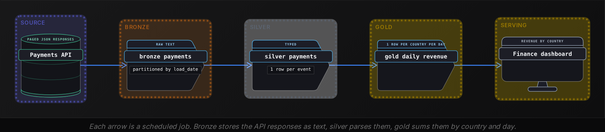

#### What a bronze row holds

A bronze table adds columns about the delivery rather than the business. _ingested_at records when the row landed, _source_file records which file or API page it came from, and payload is the record as a single string. Nothing is parsed yet, because parsing is where mistakes happen, and bronze exists so mistakes can be undone.

| load_date | _ingested_at | _source_file | payload |
| --- | --- | --- | --- |
| 2026-10-20 | 2026-10-20 01:31:04 | page_0017.json | {"id":"ev_91","customer":"c_204","amount_cents":"4999","country":"fr","paid_at":"2026-10-20T00:58:11Z"} |
| 2026-10-20 | 2026-10-20 01:31:04 | page_0017.json | {"id":"ev_92","customer":"c_777","amount_cents":"1299","country":"DE","paid_at":"2026-10-20T01:02:40Z"} |
| 2026-10-20 | 2026-10-20 01:33:52 | page_0017.json | {"id":"ev_91","customer":"c_204","amount_cents":"4999","country":"fr","paid_at":"2026-10-20T00:58:11Z"} |

Row 1 and row 3 are the same event, delivered twice because the API retried a page. The country arrives as fr on one row and DE on another, and the amount is a string. All 3 problems are left in place. The silver build is where they get fixed, and it reads bronze every time it runs:

```sql
INSERT INTO silver_payments
SELECT
  event_id,
  customer_id,
  amount_cents,
  country,
  paid_at
FROM (
  SELECT
    json_extract_scalar(payload, '$.id') AS event_id,
    json_extract_scalar(payload, '$.customer') AS customer_id,
    CAST(json_extract_scalar(payload, '$.amount_cents') AS BIGINT) AS amount_cents,
    upper(json_extract_scalar(payload, '$.country')) AS country,
    from_iso8601_timestamp(json_extract_scalar(payload, '$.paid_at')) AS paid_at,
    row_number() OVER (
      PARTITION BY json_extract_scalar(payload, '$.id')
      ORDER BY _ingested_at DESC
    ) AS rn
  FROM bronze_payments
  WHERE load_date = DATE '2026-10-20'
) AS parsed
WHERE rn = 1
```

The inner query parses each field out of the JSON string, casts the amount to a whole number of cents, upper-cases the country, and numbers each event's copies from newest to oldest. The outer query keeps copy number 1, so ev_91 lands in silver once. If a later audit finds that countries should have been mapped through a lookup table, the fix is a change to this query and a rerun over bronze. The API is never called again.

#### Gold answers one question

Gold tables are shaped by their reader. The finance dashboard asks for revenue by country by day, so that is the table, with one row per country per day and no column it doesn't need:

```sql
INSERT INTO gold_daily_revenue
SELECT
  CAST(paid_at AS DATE) AS revenue_date,
  country,
  SUM(amount_cents) AS revenue_cents,
  COUNT(*) AS payments
FROM silver_payments
WHERE CAST(paid_at AS DATE) = DATE '2026-10-20'
GROUP BY 1, 2
```

A bug in parsing is fixed in silver, and every gold table inherits the fix on its next run. A new question gets a new gold table built from silver, with no new parsing code. A rebuild costs a read of bronze, which sits on your own storage, rather than a request to a source that may say no.

> Where a fix belongs
>
> - Malformed or duplicated source records: the silver build, rerun over bronze.
> - A metric computed with the wrong rule: the gold build, rerun over silver.
> - Rows that should never have existed: bronze keeps them. Silver moves them to a rejects table with a reason column.

> **TIP**
>
> Partition bronze by the date the row was loaded. Dates inside the payload belong to silver, where they have been parsed and trusted. Load date is the one value the pipeline controls, so a rerun for 2026-10-20 reads exactly the files that arrived that day.

**A finance analyst finds that gold_daily_revenue has counted refunds, which arrive as events with a negative amount_cents, as revenue for the last 90 days. Which change fixes both the past and the future?**

- **A.** Patch the 90 affected rows in gold_daily_revenue by hand and add a filter on amount_cents to the gold query.
- **B.** Delete the refund rows from bronze_payments so that no downstream table can ever see them again.
- **C.** Add an event_type column in the silver build, filter the gold query to payments, and rerun silver then gold for the 90 days from bronze.
- **D.** Ask the payments team to resend the 90 days of events with the refunds removed from the feed.

<details>
<summary>Solution</summary>

**C.** Add an event_type column in the silver build, filter the gold query to payments, and rerun silver then gold for the 90 days from bronze.

Silver gains the distinction every consumer needs, gold applies the business rule, and the rerun reads bronze without touching the source API.

**Why the others are wrong**

- **A.** Hand-edited rows leave no record of why they changed, and every other gold table built from silver still sees refunds mixed in with payments.
- **B.** Bronze is append only. Refunds are real events, and the refunds report that someone builds next quarter will need them.
- **D.** The source may keep only 30 days, and the events are already in bronze. The pipeline has everything it needs to rebuild.

</details>


<br>

---

## Data Modeling

### Exercise 1 of 2

**● TASK**

Design the three medallion layers (bronze → silver → gold) for an order pipeline, showing how data is progressively cleaned and enriched.

<details>
<summary><strong>Solution</strong></summary>

A **medallion architecture** stores the same order data three times, each copy at a different level of refinement. `bronze_orders` keeps the feed exactly as it landed. `silver_orders` holds one clean, typed row per order. `gold_daily_revenue` holds the pre-aggregated answer the business reads. Data flows one way, bronze to silver to gold, and each layer has one job.

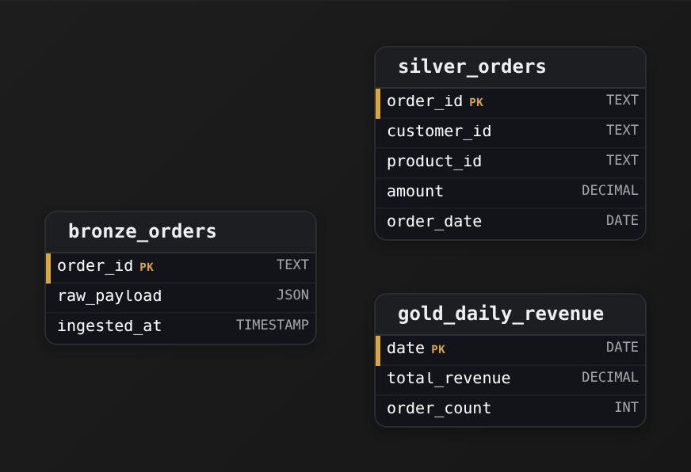

*One dataset, three refinement levels. The layers are linked by transforms, not foreign keys, so no edges are drawn.*

1. **Land the raw feed in `bronze_orders`**

   Store `raw_payload` as it arrived, plus `ingested_at`. Do not parse, validate or drop anything here. When a downstream bug corrupts `amount`, you replay from bronze instead of re-fetching from a source that may no longer have the data. Bronze is your undo button.

2. **Flatten and clean into `silver_orders`**

   This is where `raw_payload` becomes real columns: `customer_id`, `product_id`, `amount` as a `DECIMAL`, `order_date` as a `DATE`. Cast types, deduplicate on `order_id`, drop malformed rows. Silver is the trusted grain, one record per order, that every gold table builds on.

3. **Change the grain in `gold_daily_revenue`**

   The key moves from `order_id` to `date`: thousands of silver rows collapse into one row per day carrying `total_revenue` and `order_count`. That change of grain is the pre-aggregation. Key gold by how the data is queried, not how it was ingested, and the daily revenue chart reads one row instead of scanning every order.

| Pitfall: Skipping silver duplicates the cleaning |
| --- |
| Computing `gold_daily_revenue` straight off `bronze_orders` means every aggregate re-parses `raw_payload` and re-applies the cleaning rules. 2 gold tables then disagree because they cleaned bronze slightly differently. Silver makes the cleaning happen once, so every gold table sums the same trusted `amount`. |

| Real world: Same layers, different names in dbt |
| --- |
| Databricks lakehouses use bronze, silver and gold by name; dbt projects call them staging, core and marts. The discipline is identical: a replayable landing zone, a conformed clean layer, and purpose-built aggregates on top. |

**Follow-up questions**

1. A refund arrives a week later. Which layer do you update, and does `gold_daily_revenue` need a rebuild?\
   *Gold is derived, so a change in silver must flow up into it.*
2. The business wants revenue by `product_id` as well as by day. Do you widen `gold_daily_revenue` or add a new gold table?\
   *Gold tables are cheap, single-purpose aggregates, each keyed to one question.*

</details>


<br>

### Exercise 2 of 2

**● TASK**

Create bronze, silver, and gold layers for a clickstream pipeline, demonstrating raw ingestion → cleaning → business-ready metrics.

<details>
<summary><strong>Solution</strong></summary>

#### The pattern: medallion architecture

What you just modeled is the **medallion architecture**: 3 layers that each do one job. `bronze_events` is raw ingestion, you land the payload exactly as it arrived and never lose it. `silver_events` is the cleaned, typed, one-row-per-event table you can actually query. `gold_daily_sessions` is the pre-aggregated, business-ready table a dashboard reads directly. Data flows one way, bronze to silver to gold, and each layer is rebuildable from the one before it.

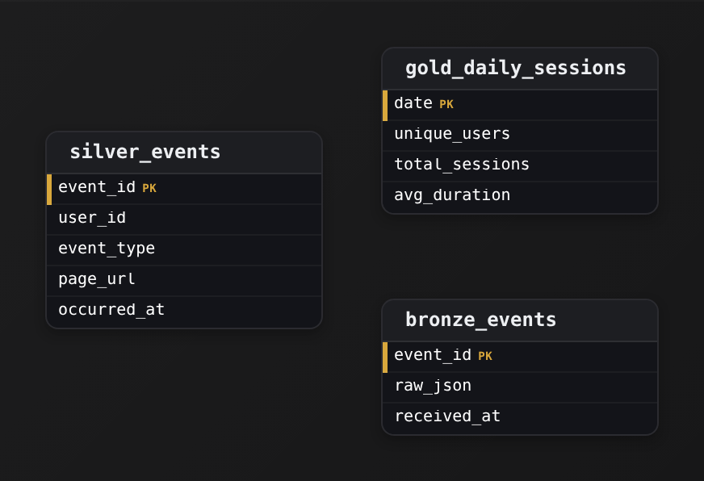

*3 tables, one direction of flow. Grain gets coarser and value gets higher as you move right.*

1. **Land everything raw in bronze**

   `bronze_events` keeps `raw_json` as the untouched payload plus `received_at`, the moment YOU got it. You don't parse or reshape here. If a downstream bug corrupts silver, you replay from bronze; if the source adds a field next month, it's already captured. `event_id` is the primary key so a retried delivery doesn't land twice.

2. **Clean and flatten into silver**

   `silver_events` pulls the fields out of `raw_json` into typed columns, `user_id`, `event_type`, `page_url`, and `occurred_at`, the event's real time rather than the arrival time. The grain is still one row per event, so `event_id` stays the key. This is the layer analysts join against.

3. **Pre-aggregate the metrics into gold**

   `gold_daily_sessions` collapses events to one row per `date` with `unique_users`, `total_sessions`, and `avg_duration` already computed. The grain CHANGED, so the primary key changed too: it's `date`, not `event_id`. A dashboard reads a handful of rows instead of scanning millions of events on every page load.

| Pitfall: Common pitfall: parsing straight into one table |
| --- |
| The tempting shortcut is to skip bronze and write parsed columns directly, or to compute metrics on the fly against `silver_events` every time. Both hurt you later. Without bronze you can't replay when parsing logic changes, and a malformed `raw_json` payload becomes a dropped row instead of a stored one. Without gold, every dashboard hit re-scans the full event history. |

| Key insight: Grain drives the primary key |
| --- |
| Notice the key moves from `event_id` (bronze, silver) to `date` (gold). That's not arbitrary: the primary key is whatever makes a row unique at that layer's grain. When you pre-aggregate to one row per day, the day IS the identity. Getting this right is what keeps a re-run idempotent instead of doubling your counts. |

**Follow-up questions**

1. If you needed sessions per user per day instead of per day, what becomes the primary key of the gold table?\
   *Tests whether they see the key as a function of grain (`(date, user_id)` here).*
2. How would you handle a late-arriving event whose `occurred_at` is yesterday but `received_at` is today?\
   *Tests understanding that silver keys on event time while bronze keys on arrival, and gold may need reprocessing.*

</details>


<br>

---

## Data Vault

### Hubs, links and satellites

A warehouse with one wide customer table works until a second source arrives. Your company acquires a competitor whose CRM describes customers with 14 attributes, 9 of which yours has never heard of. Widening the table means editing and retesting each job that loads it and each view or report that reads it. Data Vault splits a model into 3 kinds of table so that a new source adds tables and edits none.

The 3 table types

- **Hub** *one row per business key*\
  A business key is the identifier the business already uses: an order number, an email, a product code. The hub stores only that key, the first time it was seen, and the source that supplied it.
- **Link** *one row per relationship between hubs*\
  Customer c_204 placed order 51833: that fact is a link row. A link carries the hash keys of the hubs it joins plus load time and source, and no descriptive attributes.
- **Satellite** *one row per change to a hub or link*\
  Names, cities, plans, prices: every descriptive attribute lives in a satellite, stamped with when it loaded and which system said so. Rows are added, never updated.

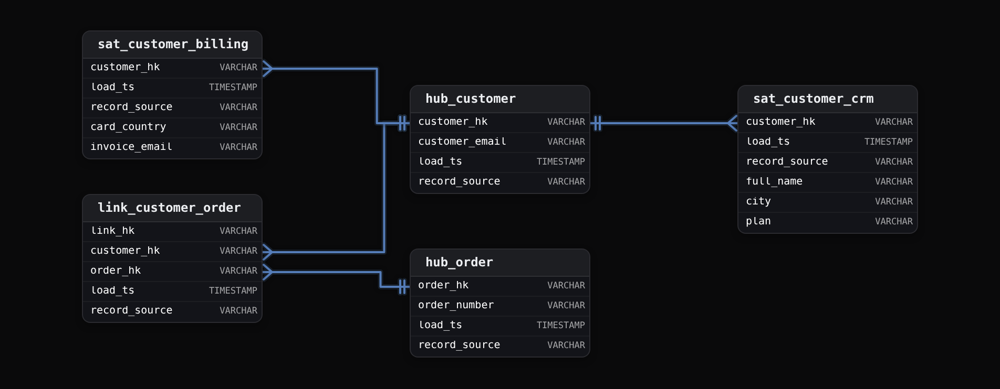

customer_hk is a hash of the email. Link rows and satellite rows use that fixed-length value to refer to a customer, so the email is never repeated. Each satellite belongs to one source: sat_customer_crm holds what the CRM says about a customer and sat_customer_billing holds what the billing system says, and the 2 are never merged in storage. Here is the CRM satellite for 1 customer after 3 loads:

| customer_hk | load_ts | record_source | full_name | city | plan |
| --- | --- | --- | --- | --- | --- |
| 8f3a... | 2023-11-02 03:00 | crm | Ana Costa | Lisbon | basic |
| 8f3a... | 2024-02-14 03:00 | crm | Ana Costa | Porto | basic |
| 8f3a... | 2024-09-30 03:00 | crm | Ana Costa | Porto | pro |

No row was overwritten when Ana moved or upgraded. Reading her current state means taking the newest row per customer:

```sql
SELECT
  h.customer_email,
  s.city,
  s.plan
FROM hub_customer AS h
JOIN (
  SELECT
    customer_hk,
    city,
    plan,
    ROW_NUMBER() OVER (
      PARTITION BY customer_hk
      ORDER BY load_ts DESC
    ) AS rn
  FROM sat_customer_crm
) AS s
  ON s.customer_hk = h.customer_hk
WHERE s.rn = 1
```

Add WHERE load_ts <= TIMESTAMP '2024-03-01 00:00:00' to the inner query and the Porto, basic row becomes the newest. That is what the warehouse knew on 2024-03-01, because load_ts records when a change loaded. When Ana actually moved is the source's effective date, which belongs in the satellite as its own column. Every row also names the system that asserted it, so an auditor gets a source and a timestamp.

| ✓ Data Vault | ✗ One wide customer table |
| --- | --- |
| • New source: add a satellite, touch nothing else<br><br>• History: every load kept, as-of queries by load_ts<br><br>• Audit: record_source on every row<br><br>• Queries: 3 to 6 joins to assemble one customer | • New source: alter the table and edit everything that loads or reads it<br><br>• History: last value wins<br><br>• Audit: who said the city is Porto is unknown<br><br>• Queries: 1 table, written in a minute |

The last row of that comparison is the price. Dashboards are rarely pointed at a vault directly. The vault is the storage behind the silver layer, and flatter tables are built from it for analysts. Before those, decide how a vault absorbs the acquisition.


<br>

---

## Data Modeling

### Exercise 1 of 2

**● TASK**

Design a Data Vault hub for customers: the core entity table that holds only business keys and metadata.

<details>
<summary><strong>Solution</strong></summary>

#### The hub: an entity's identity, and nothing else

A Data Vault **hub** is the table that declares a business entity exists. For customers, `hub_customer` answers exactly one question: which distinct customers have we ever seen? It holds the business key that identifies a customer and the metadata that says when and where we first loaded it. It holds no name, no email, no address, no status. Those descriptive attributes belong in a satellite, and the relationships this customer participates in belong in links. Keeping the hub to identity alone is the whole point of the pattern: the key stays stable while everything else about the customer changes around it.


*The four-column shape every hub takes: a hash surrogate key, the business key it hashes, and 2 load-metadata columns.*

1. **Store the business key that a person would recognize**

   `customer_bk` is the natural identifier the source system uses, the customer number or account ID a human could point at. This is what makes the row mean something. If 2 source loads carry the same `customer_bk`, they are the same customer, full stop.

2. **Make the primary key a hash of the business key**

   `customer_hk` is a surrogate key, but a deterministic one: it is a hash (typically MD5 or SHA over the business key). Because it is computed, not sequence-generated, every process that touches this customer derives the same `customer_hk` independently, with no lookup against the hub first. That is what lets satellites and links load in parallel and still join correctly.

3. **Record when and where each key arrived**

   `load_date` is when this business key first landed in the warehouse, and `record_source` names the feed it came from (`crm`, `billing`, `web_signup`). These 2 are mandatory on every Data Vault table, not optional audit sugar: they make the load auditable and let you trace any key back to its origin.

| Trick: Why hash the key instead of an auto-increment surrogate |
| --- |
| A classic surrogate key from a sequence forces a serial dependency: you must insert into the hub, read back the generated `customer_hk`, then use it in the satellite. A hash of `customer_bk` removes that round trip entirely. `customer_hk` is a pure function of the business key, so every table computes it in isolation and the joins line up. That is the difference between a sequence surrogate and a hash surrogate, and it is the reason Data Vault reaches for the hash. |

| Pitfall: The descriptive-attribute leak |
| --- |
| The most common wrong answer adds `customer_name`, `email`, or `status` to the hub. The moment you do, the hub is no longer a stable identity table: a name change or a status flip means rewriting a row that other tables key off of. Descriptive, changing attributes go in a satellite hanging off `customer_hk`; the hub keeps only the key and its load metadata. |

| ✕ `customer_bk` (business key) | ✓ `customer_hk` (hash key) |
| --- | --- |
| The human-meaningful identifier from the source, like a customer number. Stable in meaning but variable in length and format, and awkward as a join column across many wide tables. | A fixed-width hash of `customer_bk` used as the `PK` and as the foreign key in every satellite and link. Uniform, fast to join, and computable anywhere without touching the hub. |

**Follow-up questions**

1. A customer can be identified by both a CRM ID and a billing account number. How does the hub change?\
   *Tests composite business keys: the hub carries multiple `_bk` columns and `customer_hk` hashes all of them together.*
2. Where does the customer's current mailing address live, and how do you get its history?\
   *Checks that descriptive, time-varying attributes belong in a satellite keyed by `customer_hk`, not in the hub.*

</details>


<br>

### Exercise 2 of 2

**● TASK**

Create a Data Vault satellite for customer attributes: the descriptive data that changes over time, linked to the hub.

<details>
<summary><strong>Solution</strong></summary>

#### The satellite: where change lives

A Data Vault splits a customer into 2 objects that change at different rates. The **hub** holds the thing that never changes: the identity. The satellite holds everything that does: the name, the email, the city. You just built `sat_customer`, and the move that makes it a satellite is its key. It is not keyed by `customer_hk` alone, but by `customer_hk` plus `load_date` together. That composite is how one customer accumulates many rows over time instead of overwriting a single one.

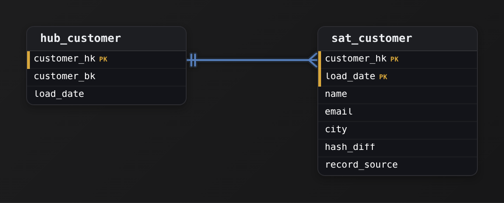

*The hub owns identity once; the satellite carries the changing attributes, one row per version, pointing back at the hub.*

Read the columns as 3 jobs. `customer_hk` is the surrogate key: a hash of the business key `customer_bk`, so every satellite row points at the hub without re-storing the natural key. `load_date` stamps when this version arrived, so the pair `customer_hk` + `load_date` is unique per version. `hash_diff` is a hash of the descriptive columns, the cheap way to ask "did anything actually change?" And `record_source` records which feed the row came from, because a vault takes the same customer from many systems.

| Trick: The composite key IS the history |
| --- |
| Putting `load_date` in the primary key alongside `customer_hk` is the whole idea. It turns an UPDATE into an INSERT: a new version becomes a new row rather than clobbering the old one. This is SCD Type 2 done the vault way, no `is_current` flag and no `end_date` needed to store it. The latest version is just the row with the newest `load_date` for that `customer_hk`. |

| ✕ Attributes on the hub (wrong) | ✓ Attributes on the satellite (right) |
| --- | --- |
| Hang `name`, `email`, `city` directly on `hub_customer`. Now the hub has one row per customer and an email change is an UPDATE that destroys the old value. You have collapsed identity and description into one table and thrown history away. | Keep the hub to identity (`customer_hk`, `customer_bk`) and push every descriptive column into `sat_customer` keyed by `customer_hk` + `load_date`. Identity is asserted once; every change appends a version. The hub stays stable while the satellite grows. |

| Pitfall: Loading a new row on every batch |
| --- |
| The common mistake is inserting a satellite row every load even when nothing changed, which floods the table with duplicate versions. That is what `hash_diff` prevents: compare the incoming hash to the latest stored `hash_diff` for that `customer_hk`, and only INSERT when they differ. No change, no row. |

| Real world: Why teams split it this way |
| --- |
| In production you rarely have one satellite. A customer's slow-changing profile (`name`, `city`) and fast-changing contact fields often live in separate satellites off the same `hub_customer`, so a noisy feed never rewrites the quiet one. Because every satellite hangs off the hub by `customer_hk`, you add a new one without touching anything that already exists, which is exactly why vaults tolerate schema change so well. |

**Follow-up questions**

1. How would you query the current state of every customer from `sat_customer`?\
   *Tests the SCD Type 2 read pattern: the newest `load_date` per `customer_hk`, usually a window function like `ROW_NUMBER()` partitioned by `customer_hk`.*
2. The same customer arrives from a CRM and a billing system. What keeps their versions from colliding?\
   *Checks that they see `record_source` and the shared `customer_hk` cooperating rather than fighting.*
3. You need to model which orders a customer placed. Which vault object carries that, and why not a satellite?\
   *Extends the concept to links: a relationship between 2 hubs is a link, not descriptive data on one hub.*

</details>


<br>

---

## One Big Table (OBT)

### Every attribute beside the number it describes

An analyst wants October revenue by customer region and product category. In a model that keeps orders and their lines apart from customers and products, that query joins 4 tables, and each of 30 dashboard authors writes those joins again. Some join orders to lines and sum the order total, counting a 3-line order 3 times. One Big Table runs those joins once in the pipeline and stores the result, so the analyst's query has none.

order_lines (silver)

| order_line_id | order_id | product_id | qty | amount_cents |
| --- | --- | --- | --- | --- |
| L1 | O100 | P7 | 2 | 3998 |
| L2 | O100 | P9 | 1 | 1299 |
| L3 | O101 | P7 | 1 | 1999 |

order_lines_wide

| order_line_id | order_id | customer_region | category | product_name | amount_cents |
| --- | --- | --- | --- | --- | --- |
| L1 | O100 | EMEA | Audio | Headphones | 3998 |
| L2 | O100 | EMEA | Cables | USB-C cable | 1299 |
| L3 | O101 | APAC | Audio | Headphones | 1999 |

The row meaning is unchanged: one row per order line. What changed is that each line now carries customer_region and category alongside product_name, copied from their source tables at build time. Both rows for order O100 say EMEA, and that repetition is the point: the analyst reads 1 table.

```sql
CREATE TABLE order_lines_wide AS
SELECT
  ol.order_line_id,
  ol.order_id,
  o.ordered_at,
  o.shipping_fee_cents,
  o.payment_status,
  c.customer_email,
  c.region AS customer_region,
  p.product_name,
  p.category,
  ol.qty,
  ol.amount_cents
FROM order_lines ol
JOIN orders o
  ON o.order_id = ol.order_id
JOIN customers c
  ON c.customer_id = o.customer_id
JOIN products p
  ON p.product_id = ol.product_id
```

```sql
SELECT
  customer_region,
  category,
  SUM(amount_cents) AS revenue_cents
FROM order_lines_wide
WHERE ordered_at >= TIMESTAMP '2026-10-01 00:00:00'
GROUP BY 1, 2
```

The second query reads 1 table, so it cannot miss a join condition, and any chart tool can generate its GROUP BY. Storage grows, because the region string is stored once per line rather than once per customer, and that trade is usually worth making for the handful of tables analysts touch most.

#### An order-level column on an order-line table

Shipping is charged once per order. Copied onto order lines, it appears once per line:

| order_line_id | order_id | shipping_fee_cents | amount_cents |
| --- | --- | --- | --- |
| L1 | O100 | 500 | 3998 |
| L2 | O100 | 500 | 1299 |
| L3 | O101 | 700 | 1999 |

SUM(shipping_fee_cents) over these 3 rows gives 1700, and the true total is 1200. SUM(DISTINCT shipping_fee_cents) happens to return 1200 here, which makes it worse: if order O102 also charges 500, the true total becomes 1700 while DISTINCT still returns 1200 with no sign of error. The fix is orders_wide, one row per order with the fee on it. A column whose row meaning differs from its table's belongs in a different table.

#### Which moment is the region from?

Say a customer moved from Lisbon, in EMEA, to Singapore, in APAC, in March 2026. Their January orders in order_lines_wide show EMEA if the table stores the region at order time, and APAC if it's rebuilt nightly from the current customer record. Both are valid, and they answer different questions: where the customer lived when they ordered, versus where the customer lives now. Pick one per column and write it in the column description. If both are needed, store them as 2 columns named region_at_order and region_current.

| ✓ Do | ✗ Don't |
| --- | --- |
| • Name the table after its row meaning: order_lines_wide, orders_wide, sessions_wide.<br><br>• Build it from silver so parsing and deduplication happen once, upstream.<br><br>• Document for each copied column which moment in time it reflects. | • Put an order-level amount on an order-line table and hope nobody sums it.<br><br>• Hand-maintain a wide table; rebuild it from upstream on every run.<br><br>• Build one wide table per dashboard; build one per row meaning. |

**Analysts run this on order_lines_wide, where one row is one order line. Which statement is true?**

```sql
SELECT
  customer_region,
  SUM(shipping_fee_cents) AS shipping
FROM order_lines_wide
GROUP BY 1
```

- **A.** Shipping is overstated because each order's fee appears once per line; the sum needs a table with one row per order.
- **B.** The query is right because the wide table copied shipping_fee_cents from orders without changing the value.
- **C.** Replacing SUM with SUM(DISTINCT shipping_fee_cents) corrects the total for every region.
- **D.** The query fails because shipping_fee_cents belongs to orders and a GROUP BY on the wide table cannot reach it.

<details>
<summary>Solution</summary>

**A.** Shipping is overstated because each order's fee appears once per line; the sum needs a table with one row per order.

A 3-line order contributes its fee 3 times. orders_wide, at one row per order, gives the right total with the same query shape.

**Why the others are wrong**

- **B.** The value is unchanged but its count is multiplied by the number of lines, which is what SUM adds up.
- **C.** DISTINCT removes repeats of the same amount across different orders too, so 2 orders charged 500 each count as 500.
- **D.** The column exists on order_lines_wide, which is why the query runs and why the result is wrong.

</details>


<br>

---

## Data Modeling

### Exercise 1 of 2

**● TASK**

Design a One Big Table (OBT) for order-line analytics with one row per order line, keyed by the composite order_id plus product_id since an order holds several products. Pre-join customer name and country and product name and category as flat columns so analysts never write a JOIN, and carry quantity, unit_price, line_revenue and order_date. Model only this wide gold-layer table, not its normalized sources.

<details>
<summary><strong>Solution</strong></summary>

#### Denormalized down to one row per line

A **One Big Table** (OBT) takes denormalization as far as it goes. It is one wide gold-layer table that pre-joins every attribute an analyst filters or groups by, so a dashboard or BI extract reads it in a single scan with no JOIN. There is no thin fact pointing at `customers` and `products` dimensions. Instead, `customer_name`, `customer_country`, `product_name` and `product_category` sit on every row, and the table is rebuilt from the normalized sources on a schedule.


*One table and no edges. The customer and product attributes are flat columns, and the composite PK shows the grain: one row per order line.*

1. **Pin the grain first**

   One row is one product within one order. Everything else follows from that sentence. The measures must be line-level too, which is why `quantity`, `unit_price` and `line_revenue` belong on the row and an order total does not.

2. **Let the grain choose the key**

   `order_id` repeats across the lines of a multi-product order, so it cannot identify a row alone. The pair `order_id` plus `product_id` can. The composite key is simply the grain written in columns.

| Key insight: A many-to-many grain takes a two-column key |
| --- |
| Orders hold many products, and products appear in many orders. The order line is the bridge between them, so its natural key is one column from each side. When a grain sits on a many-to-many, expect a composite key. |

| Pitfall: A lone `order_id` key collides on line two |
| --- |
| With `order_id` as the only PK, an order's second product collides with the first or gets dropped. A related slip is copying an order-level `order_total` onto each line. Repeat it across 3 lines and `SUM(order_total)` triples the real figure. |

**Follow-up questions**

1. If a product's `product_category` changes, should past lines show the new value or keep the one in effect at `order_date`?\
   *Freezing attributes at event time or showing the latest value is a slowly changing dimension decision.*
2. Where would order-level totals go without breaking the line grain?\
   *Keep measures at the grain of their table, for example in a separate order-grained table.*

</details>


<br>

### Exercise 2 of 2

**● TASK**

Create a marketing analytics OBT with session, user, and campaign data flattened into one wide table.

<details>
<summary><strong>Solution</strong></summary>

#### One Big Table, plainly

A One Big Table is **denormalization taken all the way**: the session, the user who owns it and the campaign that drove it are pre-joined so every attribute a marketing analyst needs sits on one row. The join happens once, at build time. After that, 'which channel converts best' is a single `GROUP BY channel` scan over `sessions_obt`, with no three-way join.


*One row per session. User and campaign attributes are copied in, not referenced.*

The decision that holds it together is the **grain**: one row per session. `pages_viewed` and `converted` describe the session; `user_segment` and `country` are folded in from the user; `campaign_name` and `channel` from the campaign. `session_id` is the PK because it identifies the grain, and `user_id` stays as a plain column so sessions can still roll up per user.

| ✕ Normalized star schema | ✓ One Big Table |
| --- | --- |
| `fact_sessions` joined to `dim_users` and `dim_campaigns` at query time. No duplicated attributes, cheap updates, but every query pays for the joins and must know the keys. | `sessions_obt` with `user_segment`, `channel` and the rest copied onto each row. More storage, and a rename means a rebuild, but reads are one flat scan. |

| Pitfall: Mixing grains onto one row |
| --- |
| Adding `campaign_total_spend` or `user_lifetime_revenue` puts a coarser fact on the session grain. Summing `revenue_attributed` stays correct; summing `campaign_total_spend` counts it once per session. Keep session facts on the row and leave rollups to the query. |

| Real world: Wide is cheap in a columnar warehouse |
| --- |
| BigQuery, Snowflake and Redshift store by column, so a query touching only `channel` and `revenue_attributed` never reads the rest. That is why BI tools point straight at tables like `sessions_obt`. |

**Follow-up questions**

1. A session touches 2 campaigns before converting. Does one row per session still hold?\
   *A many-per-session attribute breaks the grain and needs a bridge table or an array column.*
2. Marketing renames the segment 'smb' to 'small business'. What happens to `sessions_obt`?\
   *Denormalized attributes are copies, so a dimension change means a rebuild or backfill.*

</details>


<br>

---

## Semantic Layers

### The metric written once

At one company, 3 teams each publish active customers for the trailing month:

| Dashboard | Rule used | Count |
| --- | --- | --- |
| Marketing | any order in the trailing 30 days | 41,200 |
| Finance | paid order in the trailing 30 days, refunds excluded | 38,950 |
| Product | any session in the trailing 28 days | 97,300 |

All 3 numbers are correct for their rule, and the business has no way to say which one is the company's. The rules live inside 3 tools, written as SQL by 3 people, and a fourth tool will add a fourth rule. A semantic layer moves the metric definitions out of the tools and into one place that every tool queries.

```sql
metrics:
  - name: active_customers
    description: Customers with at least 1 paid order in the trailing 30 days
    table: order_lines_wide
    expression: COUNT(DISTINCT customer_email)
    filter: CAST(ordered_at AS DATE) >= date_add('day', -30, current_date) AND payment_status = 'paid' AND amount_cents > 0
    allowed_breakdowns: [customer_region, category]
  - name: revenue
    table: order_lines_wide
    expression: SUM(amount_cents) / 100.0
    allowed_breakdowns: [customer_region, category, ordered_at.day]
  - name: conversion_rate
    type: ratio
    table: daily_funnel
    numerator: SUM(orders)
    denominator: SUM(sessions)
    allowed_breakdowns: [customer_region, funnel_date.week]
```

A definition names the metric, the table it reads, the expression that computes it, the filter that scopes it, and the breakdowns a user may group by. When the finance tool asks for active_customers by customer_region, the layer writes the SQL:

```sql
SELECT
  customer_region,
  COUNT(DISTINCT customer_email) AS active_customers
FROM order_lines_wide
WHERE CAST(ordered_at AS DATE) >= DATE_ADD('day', - 30, CURRENT_DATE)
  AND payment_status = 'paid'
  AND amount_cents > 0
GROUP BY 1
```

The marketing tool asking the same question gets the same SQL and the same 38,950. Changing the rule to 28 days is an edit to 1 line of the definition, and every tool follows on its next query. Nobody searches 40 dashboards for the string 30.

#### Ratios are summed before they are divided

Conversion rate is orders divided by sessions. Store a daily rate and average it, and the answer is wrong whenever days differ in size:

| Day | Sessions | Orders | Daily rate |
| --- | --- | --- | --- |
| Monday | 50 | 5 | 10.0% |
| Tuesday | 100 | 30 | 30.0% |
| Average of the 2 rates |  |  | 20.0% |
| Combined, 35 / 150 | 150 | 35 | 23.3% |

The 2 answers differ by more than 3 points on 2 days of data. The definition therefore declares conversion_rate as a ratio of 2 sums, and the layer adds up the numerator and the denominator across whatever grouping the user asked for before it divides:

```sql
SELECT
  customer_region,
  CAST(SUM(orders) AS DOUBLE) / SUM(sessions) AS conversion_rate
FROM daily_funnel
GROUP BY 1
```

> What each layer owns
>
> - Gold and wide tables own the rows: cleaned, joined, at a stated row meaning.
> - The semantic layer owns the arithmetic: which rows a named number filters to, and how its columns are summed and divided.
> - Tools own presentation: charts, colours, drill paths. A tool never owns a definition.

**A new charting tool is adopted and its users want active_customers by category. What happens?**

- **A.** The tool's authors copy the 30-day rule from the Finance dashboard's SQL into the new tool's query builder.
- **B.** The warehouse team creates active_customers_by_category as a new gold table so the tool can read a single column.
- **C.** The layer rejects the request because category describes a product and active_customers counts customers.
- **D.** The layer checks that category is an allowed breakdown, generates SQL from the one definition, and the tool shows the number Finance sees.

<details>
<summary>Solution</summary>

**D.** The layer checks that category is an allowed breakdown, generates SQL from the one definition, and the tool shows the number Finance sees.

The definition is read, the GROUP BY column changes, and all tools agree because none of them holds its own rule.

**Why the others are wrong**

- **A.** That's a fourth copy of the rule. When the rule changes to 28 days, this tool keeps reporting the old number.
- **B.** A gold table per breakdown per tool multiplies tables, and the rule still lives in that table's build rather than in one definition.
- **C.** Customers who bought in a category is a valid question, and category is listed in allowed_breakdowns.

</details>


<br>

---

## Data Modeling

### Exercise 1 of 2

**● TASK**

Dashboards, notebooks and a finance API each compute monthly recurring revenue differently from the same payments and customers tables. Model a semantic layer over those tables: define each metric once with its aggregation expression, its filter (such as excluding refunded payments) and the physical table it reads. Define the dimensions consumers may group by, each mapped to a physical table and column, and record which dimensions each metric allows.

<details>
<summary><strong>Solution</strong></summary>

#### Metrics live above the tables

A **semantic layer** earns its name by holding definitions, not data. `payments` and `customers` stay exactly as the warehouse stores them. Above them sit 3 small tables that say what monthly recurring revenue means, which columns a consumer may group it by, and which pairings are allowed. Every dashboard, notebook and API call reads the definition from here instead of rewriting `SUM(amount)` its own way, so the numbers finally agree.

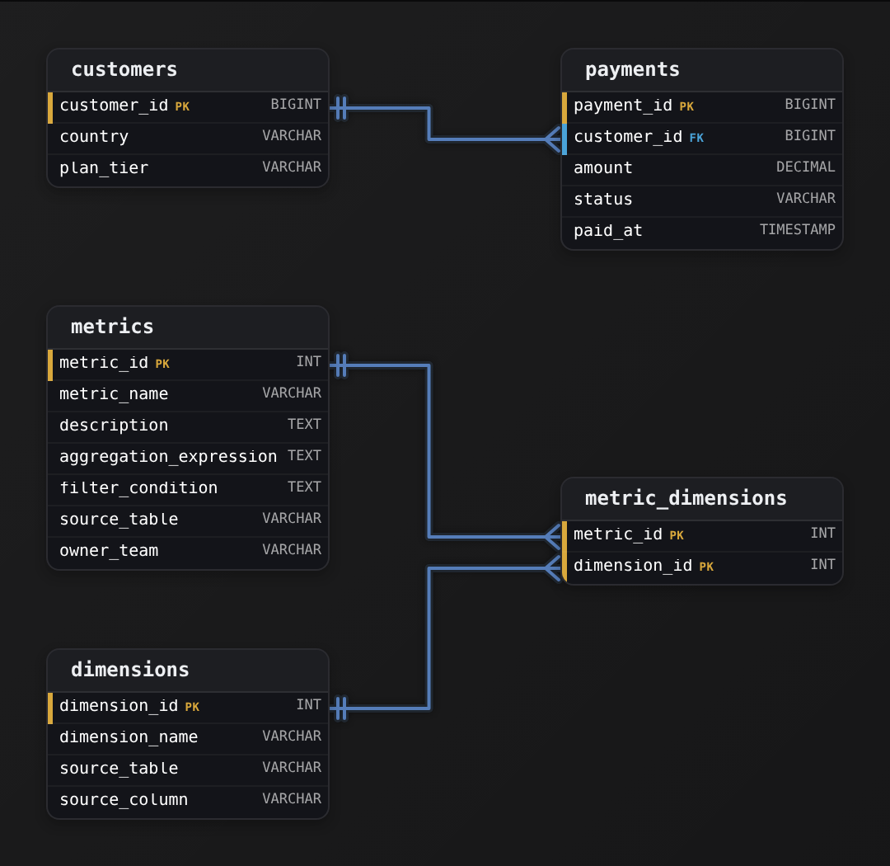

*`metrics`, `dimensions` and `metric_dimensions` define MRR once over the physical `payments` and `customers` tables. Every consumer reads these rows instead of writing its own SQL.*

1. **Give each metric one row with its full recipe**

   `metrics` holds the `aggregation_expression` (for MRR, `SUM(amount)`), the `filter_condition` (`status <> 'refunded'`) and the `source_table` it reads. The filter is part of the definition. Leave it out, and marketing's revenue with refunds and finance's revenue without them both look 'correct'.

2. **Register dimensions as pointers to physical columns**

   `dimensions` maps a business name like 'customer country' to a `source_table` and `source_column` (`customers`, `country`). Consumers group by the name. The layer resolves the column and the path to it through `payments.customer_id`.

3. **Allow each metric only its valid dimensions**

   `metric_dimensions` holds one row per allowed pairing, keyed by both ids. MRR by 'plan tier' is listed and MRR by 'payment id' is not, so no tool can serve a meaningless slice.

| Pitfall: A view per team is not a semantic layer |
| --- |
| The usual miss is drawing only the physical tables, or one `revenue_by_country` view per dashboard. Each view hard-codes its own filter, the views drift apart, and you are back to 3 revenue numbers. The definition has to be data that every consumer reads. |

| Real world: dbt metrics and LookML store this same shape |
| --- |
| MetricFlow's YAML and a LookML view both declare a measure with its expression and filter, the dimensions it can reach, and the table underneath. The tables you drew are that YAML written as rows. |

**Follow-up questions**

1. How would you add average revenue per customer, defined from 2 other metrics?\
   *Derived metrics: a metric whose expression references other metrics rather than a column.*
2. What changes when finance needs MRR converted at one agreed exchange rate?\
   *Where a shared conversion rule lives so every consumer applies it the same way.*

</details>


<br>

### Exercise 2 of 2

**● TASK**

Build a semantic layer metrics catalog: one table where each row documents a defined business metric. Give each metric its own primary key, plus a name, a description, its SQL formula, the base table it reads from, a category, and an owner.

<details>
<summary><strong>Solution</strong></summary>

#### A table of meanings, not measurements

A **semantic layer** at its smallest is one table whose rows are definitions of business metrics. They are not values of those metrics. A fact table records that revenue was 4,210 on Tuesday. A metrics catalog records what 'Net Revenue' means: this `sql_formula`, read from this `base_table`, owned by this person. Here the metric itself is the entity, and every column is one attribute of it.


*One entity, 7 attributes: each row in `semantic_metrics` documents a metric and stores no measured value.*

1. **Name the entity, then list its attributes**

   One row per defined metric. Everything a consumer needs to trust and reproduce it becomes a column. Humans read `metric_name` and `description`, the query generator reads `sql_formula` and `base_table`, and governance uses `category` and `owner`. All of them describe the one entity, so the design stays a single table.

2. **Key it with a surrogate `metric_id`**

   `metric_id` is a system-generated surrogate key. It carries no business meaning and exists only so the row has a stable identity. Dashboards, tests and lineage point at `metric_id`, which leaves a metric free to be renamed without breaking any of them.

| Pitfall: A metric's name is a label, not its identity |
| --- |
| Keying on `metric_name` looks fine because names look unique. Then 'Revenue' becomes 'Gross Revenue' and every reference breaks, or 2 teams define 'Active Users' differently. If you need names to be unique, add a `UNIQUE` constraint on `metric_name` as its own rule, separate from the key. |

| Real world: BI tools generate SQL from these rows |
| --- |
| dbt's semantic layer, LookML and Cube all sit on this shape. When a query runs, the tool reads `sql_formula` and `base_table` to write the SQL, so 'Net Revenue' comes out the same on every dashboard. Analysts search and browse metrics by `owner` and `category`. |

**Follow-up questions**

1. How would you record who changed a metric's `sql_formula`, and when?\
   *Points toward a history table keyed on `metric_id` instead of overwriting the definition in place.*
2. What if a metric may only be grouped by certain dimensions?\
   *Grows the single entity into a small cluster: a child table of allowed dimensions with an FK to `metric_id`.*

</details>


<br>

---

## Pipeline DAG Design

### Tasks, edges and no cycles

Every table in the previous sections is written by a task, and every task reads tables written by other tasks. A pipeline DAG is that set of tasks with an arrow from each writer to each reader. Directed means the arrows have a direction. Acyclic means following them never returns to the start, so some task can always run first. An orchestrator walks the graph and starts a task when every task pointing into it has finished.

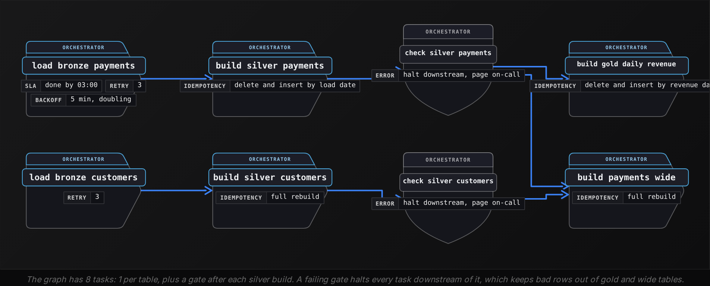

#### Depend on completion, never on the clock

A common first design runs the bronze load at 01:30 and the silver build at 02:00, because bronze usually takes 20 minutes. Here is the night it takes 50:

| Time | What happens |
| --- | --- |
| 01:30 | load_bronze_payments starts, 40 pages to fetch |
| 01:41 | API returns rate-limit errors, the loader backs off and retries |
| 02:00 | build_silver_payments starts on schedule and reads 23 of 40 pages |
| 02:20 | load_bronze_payments finishes; silver already wrote the day |
| 06:00 | Finance dashboard shows 58% of the day's revenue, no alert fired |

The silver build never failed, so nobody was paged. The fix is an edge in the orchestrator from the bronze task to the silver task: silver starts when bronze reports success, at 01:50 on a fast night and 02:20 on this one. A clock schedule belongs on the first task in the graph, and every other task waits for its inputs.

**load_bronze_payments starts at 01:30 and build_silver_payments at 02:00. On a night when bronze runs until 02:20, which design guarantees silver never reads a partial day?**

- **A.** Move the silver build to 03:00, leaving a 90-minute gap for the bronze load.
- **B.** Declare an edge from the bronze task to the silver task, so silver starts when bronze reports success.
- **C.** Have silver poll the bronze row count and start once it stops growing for 5 minutes.
- **D.** Merge bronze loading and silver building into one task so the 2 steps cannot drift apart.

<details>
<summary>Solution</summary>

**B.** Declare an edge from the bronze task to the silver task, so silver starts when bronze reports success.

The orchestrator waits on completion, so a 20-minute load and a 50-minute load both hand silver a complete day.

**Why the others are wrong**

- **A.** A longer gap moves the failure to a slower night. A clock can't know when another task finished.
- **C.** A rate-limited loader can pause longer than 5 minutes between retries, and the poll reads the pause as completion.
- **D.** A parsing failure then blocks the raw load too, and the failure no longer names which table is missing.

</details>

#### Rerunning a task must give the same table

Tasks get rerun: a fix lands, a source resends a day, an engineer presses retry. A task that appends rows produces 2 copies of the day on its second run. A task that first removes what it wrote for that day, then writes, produces the same table however many times it runs:

```sql
DELETE FROM gold_daily_revenue
WHERE revenue_date = DATE '2026-10-20'
```

Run the DELETE and the INSERT in one transaction, or as one overwrite of the date's partition, and the pair always leaves exactly 1 copy of 2026-10-20; a run that fails halfway leaves the old copy in place. The date is the task's parameter, handed in by the orchestrator, so a 90-day backfill runs as 90 copies of the task, in parallel where the graph allows.

#### A gate between layers

A quality gate is a task that reads a table and fails when a condition breaks, with every downstream task waiting on it:

```sql
SELECT
  COUNT(*) AS silver_rows,
  COUNT(DISTINCT event_id) AS distinct_events,
  SUM(
    CASE
      WHEN event_type = 'payment'
        AND amount_cents <= 0 THEN 1
      ELSE 0
    END
  ) AS non_positive
FROM silver_payments
WHERE CAST(paid_at AS DATE) = DATE '2026-10-20'
```

If silver_rows differs from distinct_events, deduplication failed. If non_positive is above 0, a refund was classified as a payment. Either way the gate fails, the gold build never starts, and the dashboard shows yesterday's number with a staleness flag instead of today's wrong one.

- One task writes one table, so a failure names the table that is missing.
- Edges follow data: if task B reads what task A writes, B depends on A.
- Gates sit between layers and block; a gate that only warns is a log line.
- Retries belong on tasks that call external systems; a SQL bug fails 3 times the same way.

**After a bug fix, the whole graph is rerun for 2026-10-20. silver_payments is correct and passes its gate, but gold_daily_revenue shows every country at exactly double its true revenue. Which task is at fault?**

- **A.** load_bronze_payments, because it appended the day's pages a second time.
- **B.** build_silver_payments, because its row_number ranking kept both copies of each event.
- **C.** check_silver_payments, because it validates silver and never checks the gold table.
- **D.** build_gold_daily_revenue, because its INSERT ran without the DELETE, adding a second copy of the day.

<details>
<summary>Solution</summary>

**D.** build_gold_daily_revenue, because its INSERT ran without the DELETE, adding a second copy of the day.

An append-only gold task doubles on every rerun. If the task deletes that date before inserting, a rerun leaves 1 copy.

**Why the others are wrong**

- **A.** Bronze may hold 2 copies, but silver keeps 1 row per event_id and is stated to be correct.
- **B.** Silver passed the gate comparing row count to distinct events, so it holds 1 row per event.
- **C.** The gate did its job. A gold check would catch the symptom, but the cause is how gold writes.

</details>


<br>

---

## Data Modeling

### Exercise 1 of 2

**● TASK**

Design a pipeline runs model in bronze, silver and gold layers. The orchestrator emits raw JSON run events (queued, started, succeeded, failed), sometimes twice, and every event must be kept exactly as received. Analysts need one clean row per pipeline run with its status, start and end times, and the logical date it ran for. On-call engineers need a curated daily summary per pipeline of runs, failures and average duration.

<details>
<summary><strong>Solution</strong></summary>

#### 3 layers, 3 grains

Medallion layering is what turns a stream of orchestrator chatter into a runs table people can trust. Each layer gets its own grain. Bronze holds one row per event, exactly as the scheduler sent it. Silver holds one row per run. Gold holds one row per pipeline per day. The trap is a single runs table fed straight from the event stream: a duplicated 'failed' event becomes 2 failures, a retry overwrites the first attempt, and nothing is left to replay when the parsing logic changes.

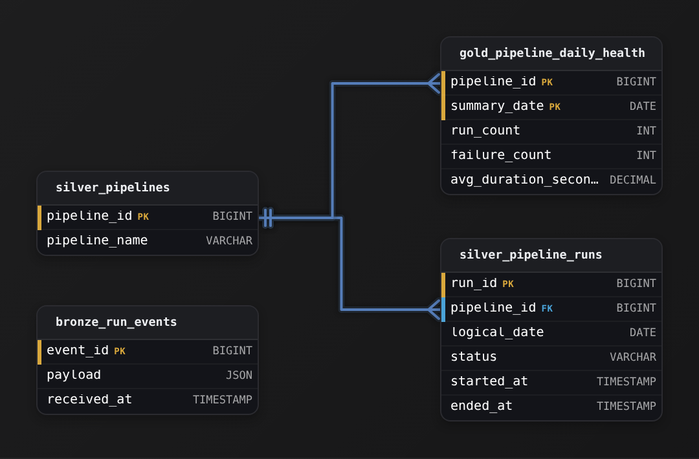

*Bronze keeps the raw `payload`, silver holds one row per run in `silver_pipeline_runs`, and gold `gold_pipeline_daily_health` is keyed by `pipeline_id` and `summary_date`.*

1. **Land events in bronze untouched**

   `bronze_run_events` stores the `payload` as JSON plus `received_at`, and nothing else: no status column, no dedup, no parsing. If the event format changes, or your silver logic has a bug, you rebuild silver from bronze. You never have to ask the orchestrator to resend history.

2. **Collapse events to one row per run in silver**

   `silver_pipeline_runs` dedups the events and folds the queued, started and finished events into one row: `status`, `started_at`, `ended_at` and the `logical_date` the run was for. Status is normalized here, so 'SUCCESS' and 'succeeded' land as one value. A run still in flight has a null `ended_at`. Pipelines get their own small silver table, so a renamed DAG keeps its history.

3. **Build the daily summary from silver only**

   `gold_pipeline_daily_health` holds `run_count`, `failure_count` and `avg_duration_seconds`, all computed from clean silver runs. In the DAG that loads these tables, the gold task waits on the silver task, which waits on the bronze landing. **Dependencies flow downward**, never from bronze straight to gold.

| Pitfall: Gold built from bronze counts every duplicate |
| --- |
| Aggregating `gold_pipeline_daily_health` directly from raw events skips the dedup step. An event sent twice doubles the failure count, and a 'started' event with no matching finish has no duration at all. Every rule silver applies would then have to be copied into gold, and the 2 copies drift apart. |

**Follow-up questions**

1. How would you add per-task timing inside each run, and which layer would that table live in?\
   *Pushes the silver grain one level finer, with a task-run table that references `run_id`.*
2. A parsing bug mislabeled a week of failed runs as 'succeeded'. Which layers do you rebuild, and in what order?\
   *Tests that bronze is the replay source and that gold reloads only after silver is fixed.*

</details>


<br>

### Exercise 2 of 2

**● TASK**

Create a DAG dependency graph schema for a ride-hailing pipeline that lands raw trip events and driver records, cleans each source separately, then builds a curated daily driver earnings table. Model the pipelines, their tasks, the dataset each task writes, and the medallion layer each dataset lives in (bronze, silver or gold). Give each layer an order so dependencies can be checked to flow downward, and record each task's upstream tasks: a task can have several.

<details>
<summary><strong>Solution</strong></summary>

#### Layers give the DAG its direction

Medallion layering is what turns a pile of task edges into a DAG you can trust. Every dataset a task writes lives in exactly one layer: 'bronze' for raw landings, 'silver' for cleaned per-source tables, 'gold' for curated business tables. Each layer also carries a `layer_rank`. A common shortcut is to tag tasks with a free-text layer and stop there. **Nothing then says gold sits below silver**, so an edge from a gold task back into bronze looks as valid as any other.

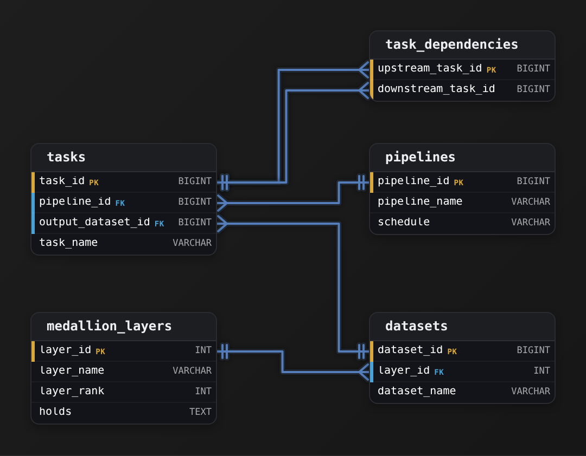

*Each dataset sits in one ranked layer; `task_dependencies` holds one edge per row between 2 `tasks`.*

1. **Place each dataset in its layer**

   `trips_raw` and `drivers_raw` land in bronze untouched. `trips_clean` and `drivers_clean` are the silver tables, one per source, deduplicated and typed. `daily_driver_earnings` is the single gold table. Each is a row in `datasets` pointing at its `layer_id`, so the layer is decided once, by the data, not retyped on every task.

2. **Point tasks at what they write**

   A task is the unit the scheduler runs, and `output_dataset_id` tells you which layer it works in. The 2 bronze ingestion tasks have no upstreams, so they run side by side. A failed trips landing never blocks the driver side.

3. **Store edges as rows**

   `task_dependencies` holds one row per edge, keyed by `(upstream_task_id, downstream_task_id)`. The gold earnings task fans in from both silver cleaning tasks. A single `parent_task_id` column on `tasks` could only hold one of them.

| Pitfall: A gold task reading bronze skips the cleaning |
| --- |
| Wiring `daily_driver_earnings` straight to `trips_raw` makes the graph look shorter, but gold then computes earnings from duplicated, untyped events. With `layer_rank` on each layer, you can catch it with a check that every edge moves down at most one rank and never up. |

**Follow-up questions**

1. Where would a data quality check between silver and gold live in this schema?\
   *Model it as its own task: the silver tasks feed it and the gold tasks depend on it, so a failed check stops gold.*
2. How would you stop a cycle, such as `A` depending on `B` and `B` depending on `A`, from being recorded?\
   *Keys cannot forbid cycles; a recursive check over `task_dependencies` before each insert can.*

</details>


<br>

---

## Putting It All Together

A music streaming company launches a paid tier in Brazil. On day 1 the CFO wants weekly Brazilian revenue, paying listener counts and free-to-paid conversion, and the numbers must survive a restatement when the payment processor corrects a batch of currency conversions 2 weeks later.

- The processor's corrected batch lands in bronze under its own load date; the silver rerun reads the original 2 weeks' partitions together with that load date and keeps the newest _ingested_at per event, so the corrections replace the originals and gold inherits the fix with no call back to the processor.
- Listener identity lives in a hub whose business key is account email, with one satellite per source, so the Brazilian payment processor's attributes arrive as a new satellite and no existing loader changes.
- Analysts read subscriptions_wide, which has one row per subscription day with country and plan on it. The processor fee sits in a separate payments_wide so nobody sums it per day.
- Conversion is defined once in the semantic layer as paid starts over free trials, summed per week before dividing, so the CFO's chart and the growth team's tool show the same percentage.
- The gold build waits on the silver gate rather than on 02:00, each task takes a date, and the 2-week restatement runs as 14 reruns that each delete and rewrite their day.


<br>

---

## Data Modeling

### Exercise 1 of 2

**● TASK**

Design a complete medallion + dimensional architecture for e-commerce: raw ingestion layers feeding into a star schema.

<details>
<summary><strong>Solution</strong></summary>

A medallion architecture and a star schema answer different questions, and this design needs both. The medallion is the horizontal flow: raw data lands in bronze, gets cleaned into silver, and is rolled up into gold. The star schema is the shape of the clean middle: one fact table pointing at the dimension tables around it. The key is that **`silver_orders` does double duty**. It is the silver layer of the medallion and the fact table of the star.

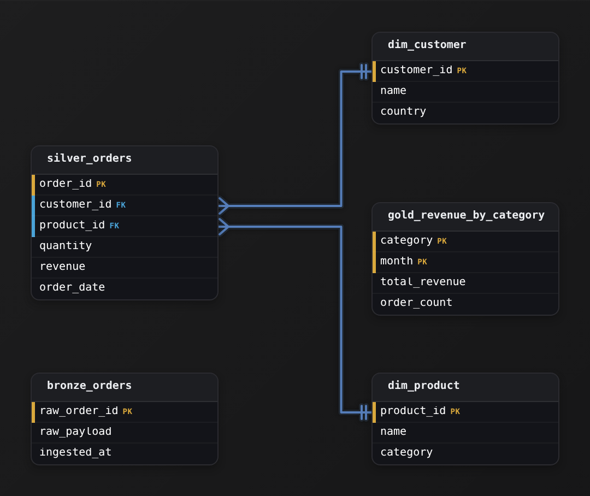

*Bronze feeds silver; `silver_orders` is the fact pointing at `dim_customer` and `dim_product`; gold is the rollup.*

1. **Land the raw layer untouched**

   `bronze_orders` keeps data exactly as it arrived: a `raw_payload`, a `raw_order_id` and an `ingested_at` timestamp. It has no foreign keys and no parsed columns. Bronze is replayable: when cleaning logic changes, you rebuild silver from bronze instead of re-fetching from the source.

2. **Split the clean data into facts and dimensions**

   The measures, one row per order with `quantity` and `revenue`, go in `silver_orders`. Descriptive context moves into `dim_customer` and `dim_product`. The fact carries only `customer_id` and `product_id`, so a country name lives in one place instead of on every order row.

3. **Pre-aggregate the gold layer**

   `gold_revenue_by_category` is derived from the star, not part of it. Its grain is one row per `category` per `month`, so its key is the composite `(category, month)`, with no foreign keys back. A dashboard reads this small table instead of rescanning every order.

| Pitfall: Foreign keys point from fact to dimension |
| --- |
| The many side references the one side. `dim_customer` knows nothing about orders; it is a clean lookup of customer attributes. If you catch yourself adding an `order_id` to `dim_customer`, the star is inverted. |

| Real world: Layer prefixes tell analysts what is safe |
| --- |
| A dbt project or a lakehouse uses this exact layout: raw loads in bronze, conformed models in silver, marts in gold. The `bronze_`, `silver_` and `gold_` prefixes (or separate schemas) signal which tables analysts may query directly. |

**Follow-up questions**

1. If a customer moves country, how do old orders keep reporting under the old `country`?\
   *Leads to a type 2 slowly changing dimension with effective-date rows in `dim_customer`.*
2. Revenue by country is now needed too: add a column to `gold_revenue_by_category` or build a second gold table?\
   *Gold grain is fixed, so a new grain means a new rollup.*

</details>


<br>

### Exercise 2 of 2

**● TASK**

Build a Data Vault schema for customer orders: hubs for core entities, links for relationships, and satellites for descriptive attributes. Give each hub a hash surrogate key over its business key, model the customer-to-order relationship as a link with a composite key of both hub hash keys, and track descriptive history in a satellite keyed by hub hash key plus load_date.

<details>
<summary><strong>Solution</strong></summary>

#### Data Vault: 3 table types, one job each

Data Vault is a modeling pattern that splits a subject area into 3 kinds of table, each with a single responsibility. A **hub** holds the identity of a business entity and nothing else. A link records that 2 entities are related. A satellite holds the descriptive attributes that change over time. You were asked to model customers and orders, so the answer is `hub_customer`, `hub_order`, one `link_customer_order`, and a `sat_customer` for the changing details. Keeping identity, relationships, and description in separate tables is the whole point: each can be loaded independently and reloaded without touching the others.

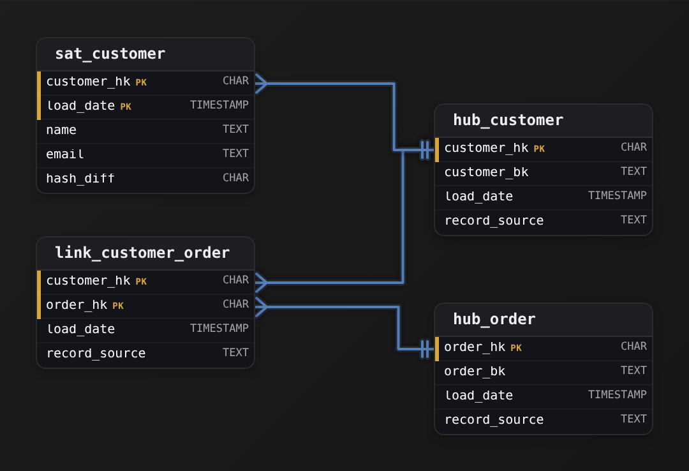

*2 hubs anchor identity; the link joins them; the satellite hangs history off the customer hub. Hash keys are fixed-width `CHAR` digests.*

1. **Give each hub a hash surrogate key over its business key**

   `hub_customer` carries the natural business key `customer_bk` (the value that identifies the customer in the source), plus `load_date` and `record_source` for lineage. The primary key is not the business key itself but `customer_hk`, a hash computed over `customer_bk`. Hashing gives every hub a fixed-width, single-column key you can compute in parallel across loads without a lookup or a sequence, and `hub_order` follows the identical shape with `order_hk` over `order_bk`.

2. **Model the relationship as a link with a composite key of both hash keys**

   `link_customer_order` does not describe anything; it only asserts that a customer placed an order. Its key is the pair (`customer_hk`, `order_hk`), each a foreign key back to its hub. Because a link can hold any combination of hub keys, it expresses many-to-many for free: one customer to many orders, and the same structure would carry an order shared across customers without a schema change.

3. **Track descriptive history in a satellite keyed by hub key plus `load_date`**

   `sat_customer` hangs off `hub_customer` via `customer_hk` and adds the mutable fields `name` and `email`. Its primary key is (`customer_hk`, `load_date`): the same customer gets a new row each time an attribute changes, so the table is an append-only history rather than an overwrite. `hash_diff` is a hash of the descriptive columns; comparing it against the latest row tells the loader whether anything actually changed, so identical reloads insert nothing.

| Pitfall: Don't put attributes on the hub |
| --- |
| The most common mistake is folding `name` and `email` straight into `hub_customer` and dropping the satellite. That collapses the pattern back into a plain dimension: the hub gains a `load_date` in its key or, worse, you overwrite on change and lose history. Identity belongs on the hub; anything that changes belongs on a satellite keyed by `customer_hk` plus `load_date`. |

| Key insight: Why `hash_diff` instead of comparing every column |
| --- |
| A satellite load has to answer "did this record change?" on every run. Comparing `name` and `email` individually works for 2 columns but not for twenty. `hash_diff` reduces the whole descriptive payload to one value, so the change check is a single equality test against the current row regardless of how wide the satellite gets. |

**Follow-up questions**

1. Where would you store an attribute of the relationship itself, like the order's quantity or price at the time it was placed?\
   *Tests that links carry no descriptive data; the answer is a link satellite keyed on the link's hash key plus `load_date`.*
2. If orders also belonged to a store, would you add `store_hk` to `link_customer_order` or create a new link?\
   *Tests understanding that a link's grain is fixed by its key set; a new relationship grain is usually a new link.*

</details>


<br>

---

## Key Takeaways

- Bronze keeps every record as delivered, silver fixes it once, gold answers one question; a bug is fixed in the layer that introduced it and rerun downstream.
- Data Vault keeps identity in hubs and relationships in links. Attributes go in satellites, so a new source adds a satellite and overwrites nothing.
- One Big Table runs the joins in the pipeline and stores the result at one stated row meaning; a column with a different row meaning belongs in a different wide table.
- A semantic layer defines each metric once, as an expression with a filter and a list of allowed breakdowns. It generates the SQL every tool runs, including ratios summed before dividing.
- A pipeline DAG runs a task when its inputs are complete, reruns each task for a date without doubling, and blocks at a gate between layers.
