Intermediate·Data Modeling · 30 min · 12 challenges

# Star Schemas

Ridgeline Outfitters sells hiking gear through a website and 14 stores. Every Monday finance asks for last week's revenue by product category and region. Against the operational database the query joins 12 tables and runs for 9 minutes. The warehouse answers it from 840 million rows in under 2 seconds, with 3 joins. The difference is the shape of the tables, and that shape has a name.


<br>

---

## The Star Schema

A star schema places 1 fact table at the centre and a ring of dimension tables around it. At Ridgeline Outfitters the centre is `fact_sales`, and its grain is 1 row per order line item: 1 product on 1 order, sold to 1 customer on 1 date through 1 channel. Each row carries 4 foreign keys, 2 identifiers and 4 measures: `quantity`, `unit_price`, `discount_amount` and `line_amount`. Everything descriptive about the customer, the product, the date and the channel lives in the dimension the key points to.

The 2 kinds of table have opposite shapes. `fact_sales` is tall and narrow: 840 million rows over 3 years and 10 columns, every column a key or a numeric measure. `dim_customer` is short and wide: 4.2 million rows and 31 columns, among them `city`, `region`, `loyalty_tier` and `acquisition_channel`. `dim_product` holds 38,000 rows, `dim_channel` 16, and `dim_date` 36,525, 1 per calendar day for 100 years. Facts hold the numbers and dimensions hold the words.

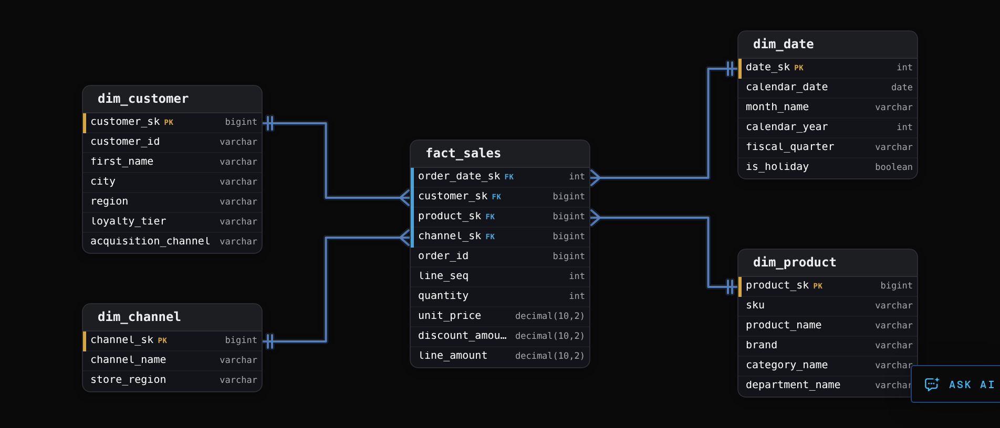


<br>

### Why the shape is fast to query

Every analytical query walks the same path: start at the fact table, filter and group through the dimensions, aggregate the measures. Units sold by brand and month during 2025 reads the 2025 partitions of `fact_sales`, joins `dim_product` for `brand` and `dim_date` for `month_name`, and sums `quantity`. The warehouse returns 1,100 rows in 1.8 seconds.

```sql
SELECT
  p.brand,
  d.month_name,
  SUM(f.quantity) AS units
FROM fact_sales AS f
JOIN dim_product AS p
  ON p.product_sk = f.product_sk
JOIN dim_date AS d
  ON d.date_sk = f.order_date_sk
WHERE d.calendar_year = 2025
GROUP BY p.brand, d.month_name
```

- Columnar storage: the engine reads the 3 columns the query names out of 10, and never touches the other 7.
- Partition pruning: fact_sales is partitioned by order date, so a 2025 filter skips 2 of the 3 years on disk.
- Broadcast joins: a 38,000-row dimension is copied to every worker and probed in memory during the fact scan.
- Predicate pushdown: a filter on brand becomes a list of product keys applied to fact rows as they are read.

The broadcast join is the mechanism worth holding onto. Joining 840 million fact rows to 38,000 product rows costs about as much as scanning the fact table once, because every worker probes its own in-memory copy of the dimension. Ridgeline's operational schema answers the same question through 11 joins across normalized product, brand, supplier, category and department tables, each resolved before a row can be summed, and runs for 9 minutes.


<br>

### Star against snowflake

A snowflake schema keeps dimensions normalized: `dim_product` carries a `category_id` pointing to `dim_category`, which carries a `department_id` pointing to `dim_department`. A star copies `category_name` and `department_name` onto every product row, storing 'Footwear' 6,400 times instead of once for about 50 KB. The snowflake makes any department filter 2 joins deeper, and every analyst has to remember which of 3 tables holds the category name.

Snowflaking earns its place in 2 situations: a fact table that lives at a hierarchy level, such as marketing spend per category, which needs a category table to own `category_sk`; and a dimension where a repeated 2 KB description column would dominate storage. A 38,000-row product table with a 12-character category name is neither.

**Ridgeline's merchandising team renames a category about twice a year. An analyst proposes moving category_name out of dim_product into a new dim_category, so a rename updates 1 row instead of 6,400. Which design serves the warehouse best?**

- **A.** Snowflake it: a rename touches 1 row, and the extra join is small.
- **B.** Keep category_name on dim_product and let the load rewrite the 6,400 rows when a rename arrives.
- **C.** Put category_id on fact_sales directly, so renames never touch a dimension.
- **D.** Keep both: a dim_category table and the copied name on dim_product.

<details>
<summary>Solution</summary>

**B.** Keep category_name on dim_product and let the load rewrite the 6,400 rows when a rename arrives.

The load rebuilds dimension rows from the source hierarchy every night, so a rename flows through with no special handling. Queries stay at 1 join per dimension, for about 50 KB of repeated strings.

**Why the others are wrong**

- **A.** The rename is a 6,400-row update the nightly load runs in milliseconds, twice a year. The extra join is paid by every query that filters or groups on category, forever.
- **C.** This adds a column to 840 million rows and still needs a category table to resolve the name. Category describes the product, and the sale only inherits it.
- **D.** The name now lives in 2 places that can disagree after a rename, the exact condition normalization exists to prevent.

</details>


<br>

---

## Data Modeling

### Exercise 1 of 2

**● TASK**

Design a star schema for sales analytics: one central sales table holding the quantity and revenue of each sale, joined to dimensions for date, product and customer. Each product has a name and a category and belongs to a brand, and each brand has a supplier name. Brands are renamed often, so snowflake the product dimension so a brand rename touches exactly one row, while date and customer stay as single denormalised tables.

<details>
<summary><strong>Solution</strong></summary>

#### One dimension snowflaked, the rest a star

A star schema keeps each dimension as one wide table, one join away from the facts. **Snowflaking** a dimension splits part of it into a sub-dimension that the dimension points at. Most of the design work is choosing which dimensions stay flat. Here only brand gets its own table. It is renamed often and many products share it, so storing it once means a rename touches one row. Date and customer stay flat because nothing in them is renamed in bulk.

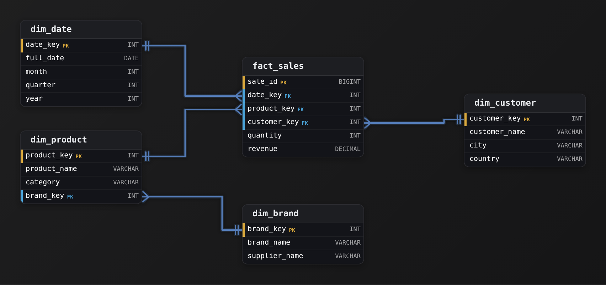

*`fact_sales` sits at the centre. `dim_product` points at `dim_brand`, the one snowflaked sub-dimension.*

1. **Put the measures in the centre**

   `fact_sales` holds one row per sale with `quantity` and `revenue`, plus one integer foreign key per dimension: `date_key`, `product_key` and `customer_key`. Nothing descriptive lives here, so the large table stays narrow and a query reads only the columns it names.

2. **Keep date and customer flat**

   `dim_date` holds `month`, `quarter` and `year` side by side, and `dim_customer` holds `city` and `country`. The repetition is cheap because these tables are small, and a filter on `country` costs one join that the engine can broadcast.

3. **Split brand out of product**

   `dim_product` keeps `category` but replaces the brand name with `brand_key`, a foreign key to `dim_brand`. That table holds `brand_name` and `supplier_name` once per brand, so a rename updates one `dim_brand` row instead of every product of that brand.

| Pitfall: Snowflake only where a split pays for itself |
| --- |
| After splitting one dimension, it is tempting to split all of them: `category` into its own table, `country` into another, `year` into a third. Each split adds a join to every query that filters on that attribute, and that is how an operational schema ends up at 11 joins. Split an attribute out only when it changes and repeats across many rows, as brand does here. |

| ✕ Brand flat on product | ✓ Brand snowflaked |
| --- | --- |
| `dim_product` stores `brand_name` and `supplier_name` on every product row. A brand filter is one join from `fact_sales`, but a rename rewrites every product of that brand. | `dim_product` stores `brand_key`, and `dim_brand` stores the name once. A rename touches one row. A brand filter costs one extra join, against a table small enough to sit in memory on every worker. |

**Follow-up questions**

1. Suppliers start being renamed too. Would you split `supplier_name` out of `dim_brand` into a third table?\
   *Checks that each split is justified by how the attribute changes, not applied out of habit.*
2. A report sums `revenue` by `category`. How many joins does it need here, and how many if category were snowflaked as well?\
   *Counts the join cost each extra split adds to a common query.*

</details>


<br>

### Exercise 2 of 2

**● TASK**

Design a star schema for website pageviews, each recording its time on page, sliced by date (day of week, month), user (country, device) and page (URL). Every page belongs to a site section, and the content team renames sections every few weeks across 40,000 pages. Snowflake the section out of the page dimension so a rename touches one row, and keep every other dimension flat.

<details>
<summary><strong>Solution</strong></summary>

#### A star with one snowflaked arm

Almost all of this model is a plain star schema: `fact_pageviews` sits in the middle holding `time_on_page_seconds`, with one integer foreign key out to each flat dimension. The one exception is the section hierarchy. It becomes a **snowflake arm**, with `dim_page` pointing at its own `dim_section`, because section names change often and are shared by thousands of pages.

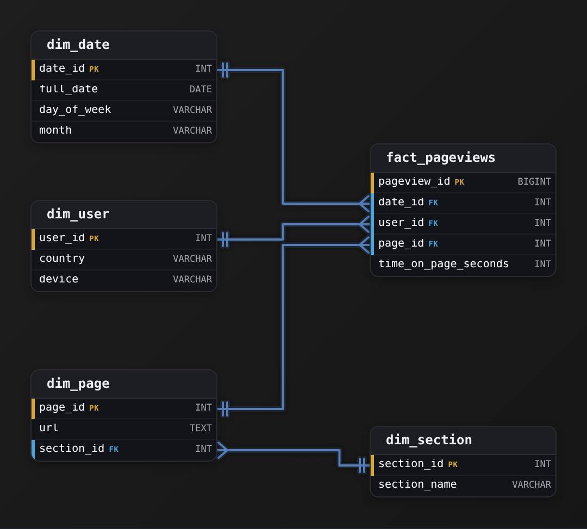

*`fact_pageviews` at the centre, `dim_date` and `dim_user` flat, and `dim_page` snowflaked out to `dim_section`.*

1. **Keep the date and user dimensions flat**

   A question like time on page by country and month is one large scan of `fact_pageviews` and 2 small joins. Putting `day_of_week` and `month` on `dim_date`, and `country` and `device` on `dim_user`, keeps each of those joins a single equality probe into a small table the engine can broadcast to every worker.

2. **Split the section out of `dim_page`**

   If `section_name` sat on `dim_page`, renaming a section would rewrite every one of its pages, potentially thousands of rows each time. Moving it into `dim_section` and leaving a `section_id` on the page row means a rename touches exactly one row. The cost is one extra join, and `dim_section` holds a few dozen rows, so that join is close to free.

| Pitfall: Snowflaking every attribute buys you nothing |
| --- |
| It is tempting to normalize further and split out `dim_country`, `dim_device` and `dim_month`. None of those values gets renamed across thousands of rows, so each split only adds a join before a row can be summed. Take that far enough and you are back to the operational schema's chain of joins and its minutes-long queries. |

| Real world: Snowflake the hierarchy that churns |
| --- |
| The same call shows up with product brands, store regions and campaign groupings. Snowflake a hierarchy when its labels change often and are shared widely, and flatten it when it is stable. The fact table and its query shape stay the same either way. |

**Follow-up questions**

1. If sections were renamed once a year instead of every few weeks, would you still snowflake `dim_section`?\
   *Weighs the cost of a rare wide rewrite against an extra join on every query.*
2. Sections now roll up into departments that are renamed just as often. Where does the department name go?\
   *Extends the snowflake arm by one more level and checks that the fact table is untouched.*

</details>


<br>

---

## Types of Fact Tables

Ridgeline runs 3 business processes against the same dimensions. Sales asks what happened. Inventory asks what the level was on a given day. Fulfilment asks how long each stage of an order took. Each question maps to a type of fact table, and a table built for 1 answers the others slowly or not at all.


<br>

### Transaction facts

A transaction fact holds 1 row per discrete event, written once and never updated. `fact_sales` is 1. A return is a new row with a negative `quantity` rather than an update, so the table stays append-only and reloading any day's partition reproduces the same rows. The measures are fully additive: `quantity` and `line_amount` sum across customers, products, days and channels, and the total always means something.

| order_id | line_seq | product_sk | quantity | line_amount |
| --- | --- | --- | --- | --- |
| 50218 | 1 | 41077 | 1 | 299.99 |
| 50218 | 2 | 41530 | 1 | 109.99 |
| 50218 | 3 | 43902 | 1 | 79.99 |
| 50219 | 1 | 61204 | 1 | 44.99 |
| 50231 | 1 | 41077 | -1 | -299.99 |

The last row returns the tent from order 50218 as its own event. What a transaction fact cannot answer is a question about state. `fact_inventory_movements` records every receipt, shipment and adjustment as a row with a signed `quantity_delta`, so units on hand for a product on 3 March is the sum of every movement since the warehouse opened, and a dashboard of 60 days of stock levels replays 3 years of movements 60 times.


<br>

### Periodic snapshot facts

A periodic snapshot holds 1 row per entity per period, capturing the state at the close of the period. `fact_inventory_daily` has the grain of 1 row per product per warehouse per day: 38,000 products across 6 warehouses produce 228,000 rows every night, whether or not anything moved. The 3 March question becomes 1 lookup. Rows are never updated; the next night writes a new set.

- **83.2M** — snapshot rows written per year

The measure `units_on_hand` is semi-additive: it sums across some dimensions and not others. Adding the 6 warehouses for a product on 1 day gives company-wide stock that day, a number a buyer can act on. Adding the same product across 30 days describes nothing, because each day's row already includes the units carried over from the day before.

| sku | warehouse | snapshot_date | units_on_hand |
| --- | --- | --- | --- |
| RL-4471 | Denver | 2026-03-01 | 131 |
| RL-4471 | Denver | 2026-03-02 | 125 |
| RL-4471 | Denver | 2026-03-03 | 128 |
| RL-4471 | Reno | 2026-03-03 | 84 |

Summing the 2 warehouses on 3 March gives 212 units, a real figure. Summing the 3 Denver rows gives 384, which counts a unit that sat on the shelf all 3 days 3 times. Across time the valid aggregates are the last day's value, the period average or the minimum, and the metric's written definition fixes which one applies.


<br>

### Accumulating snapshot facts

An accumulating snapshot holds 1 row per instance of a process with a defined start and end. `fact_order_fulfilment` has 1 row per order, created at placement and updated as each milestone arrives. Each milestone is a date key, NULL until it happens, and the row carries the `carrier_sk` that shipped the order. Lag columns such as `days_to_deliver`, counted from placement, are computed in the load, so a lifecycle report never redoes date arithmetic across 325 million orders. This is the 1 fact type whose rows change after they are written, so its load is a merge rather than an append.

| order_id | placed_date_sk | shipped_date_sk | delivered_date_sk | days_to_deliver |
| --- | --- | --- | --- | --- |
| 50218 | 20260902 | 20260903 | 20260906 | 4 |
| 50219 | 20260902 | 20260904 | NULL | NULL |
| 50231 | 20260904 | NULL | NULL | NULL |


<br>

### Factless facts

A factless fact table has keys and no measures. `fact_promotion_coverage` holds 1 row per product per promotion per day on promotion, and the row itself is the fact. `COUNT(*)` is the metric. It answers questions about what did not happen: promoted products that sold nothing, found by left-joining coverage to `fact_sales` and keeping the rows with no match.

| Type | One row per | Rows updated | Measures | Answers |
| --- | --- | --- | --- | --- |
| Transaction | 1 event, such as a line item sold | never | additive | what happened |
| Periodic snapshot | 1 entity per period | never | semi-additive | the level on a date |
| Accumulating snapshot | 1 process instance | at each milestone | durations between milestones | how long each stage took |
| Factless | 1 coverage or relationship | never | none, COUNT(\*) | what did and did not happen |

The 4 types are complementary. Ridgeline's sales, inventory and fulfilment facts share the same dimensions, and a question goes to the table whose grain matches its shape.

**The operations team wants the median number of days from order placement to delivery, by carrier, for orders placed in September 2026. Which table should the query read?**

- **A.** fact_sales, filtered to September order dates.
- **B.** A transaction fact of carrier scan events, 1 row per scan.
- **C.** fact_order_fulfilment, grouping days_to_deliver by carrier_sk.
- **D.** fact_inventory_daily, joined to a carrier dimension.

<details>
<summary>Solution</summary>

**C.** fact_order_fulfilment, grouping days_to_deliver by carrier_sk.

The accumulating snapshot has 1 row per order with the placement-to-delivery lag computed at load time. The query is a filter on placed_date_sk, a group by carrier and a median over 1 column.

**Why the others are wrong**

- **A.** Its grain is the line item and its only date is the order date. Delivery is a fulfilment milestone and never appears on a sales row.
- **B.** The duration exists only after pairing each order's placement with its delivered scan, a join every analyst rewrites a little differently. The data is there; the shape fights the question.
- **D.** Stock levels per warehouse per day carry nothing about orders or carriers. Periodic snapshots answer state questions, and this one is about a lifecycle.

</details>


<br>

---

## Data Modeling

### Exercise 1 of 2

**● TASK**

An online store already has customer and product tables. Design the fact tables keyed to them for 2 questions: what each order line sold (quantity, unit price, line total, with its order id and order date), and how many units of each product were on hand at the end of each day. Line totals get summed over any date range, while units on hand is a level read on a given day.

<details>
<summary><strong>Solution</strong></summary>

#### 2 questions, 2 fact types

Choosing between a transaction fact and a periodic snapshot comes down to **metric additivity**: can the measure be summed across every dimension, including time? `line_total` and `quantity` can, because a month of sales is the sum of its days. `units_on_hand` cannot. It is a level, and adding Monday's stock to Tuesday's counts the same unit twice. That one difference is why the design needs 2 fact tables, not one.

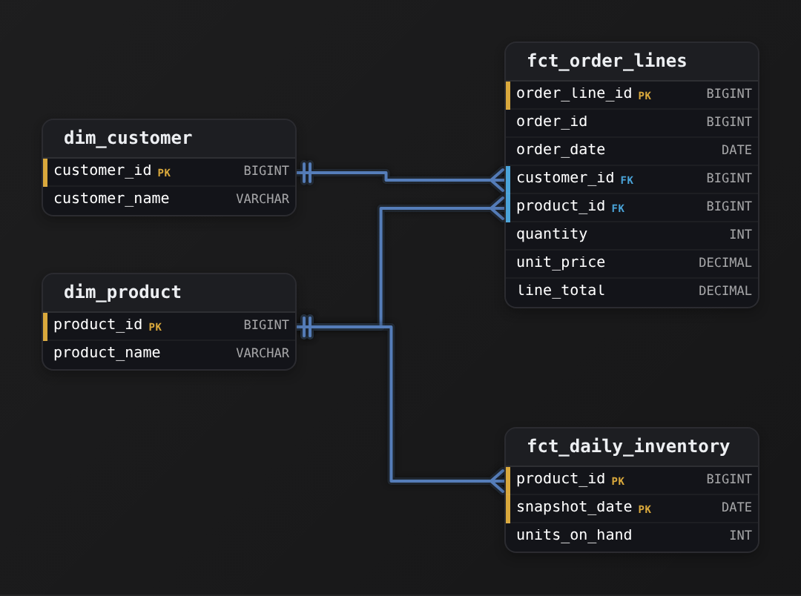

*`fct_order_lines` is the transaction fact and `fct_daily_inventory` the periodic snapshot. Both reference `dim_product`.*

`fct_order_lines` is a transaction fact: one row per order line, written once when the sale happens and never updated. Its sales measures are additive, so filtering on `order_date`, customer or product and then applying `SUM` gives a real number. `fct_daily_inventory` is a periodic snapshot: one row per product per day, written whether or not anything sold. That is what lets you read the stock level on a day with no sales.

| Pitfall: Stock does not belong on the order line |
| --- |
| Putting `units_on_hand` on `fct_order_lines` ties the level to sales events. A product that sold nothing on 3 March has no row that day, so its stock is missing. A product with 40 lines that day carries 40 copies of the level, and a `SUM` adds them all together. A level needs its own table with a row for every day. |

| Key insight: Sum across products, never across days |
| --- |
| `units_on_hand` is semi-additive. Summing every product on one `snapshot_date` gives total stock that day, which is a real figure. Across days, the valid answers are the last day's value, the average or the minimum, and the metric's written definition decides which one applies. |

**Follow-up questions**

1. Fulfilment wants the days from order placed to order delivered. Which fact type holds that, and what changes on its rows over time?\
   *Points at the accumulating snapshot: one row per order, with its milestone dates filled in as each stage happens.*
2. `unit_price` sits on `fct_order_lines`. Is it additive?\
   *Summing prices across lines means nothing, so `unit_price` is non-additive; `line_total` is the measure to sum.*

</details>


<br>

### Exercise 2 of 2

**● TASK**

Design a periodic snapshot fact table for a retailer's inventory: one row per product, per warehouse, per day, keyed to product, warehouse and date dimensions. Each row records the units on hand at close and the units received that day. Monthly reports need a valid figure for each measure under its additivity: units received per month, and the stock level on each month's last day.

<details>
<summary><strong>Solution</strong></summary>

#### 2 measures, 2 behaviours

Metric additivity decides how each column in this snapshot may roll up. `units_received` is a flow: each day's count is new stock, so it is **additive** across product, warehouse and date, and a month is the sum of its days. `units_on_hand` is a balance: it is semi-additive, summing across products and warehouses but never across days, because a unit that stays on the shelf is counted again every day.

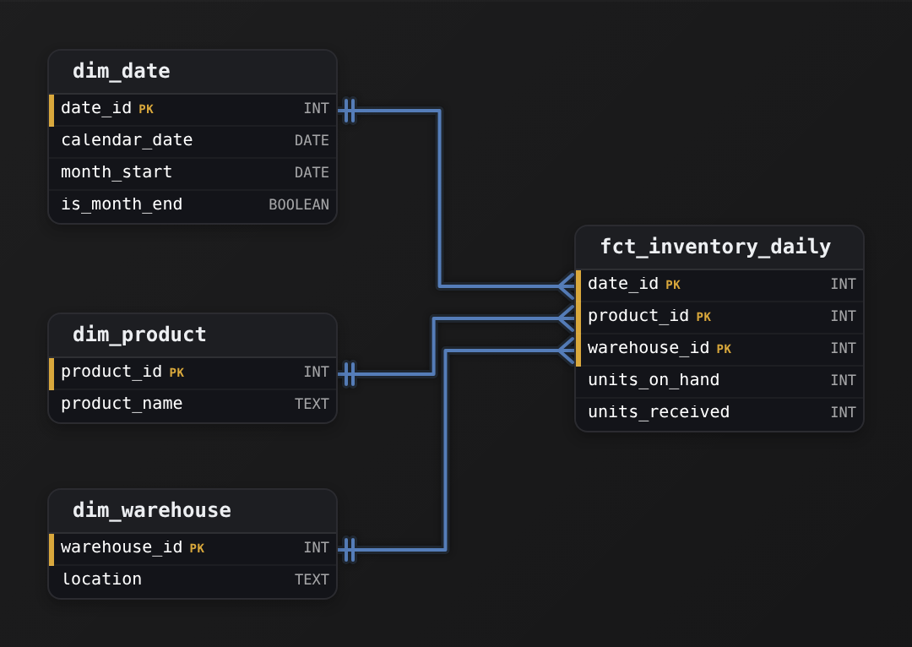

*One `fct_inventory_daily` row per day, product and warehouse; `is_month_end` on `dim_date` lets a report read the balance only at month end.*

1. **Classify each measure before placing it**

   Ask of every column: does adding it across dates give a real quantity? Receipts on 1 and 2 March add up to what arrived in those 2 days, so `units_received` is additive. Stock on 1 and 2 March adds up to nothing physical, so `units_on_hand` is semi-additive: it adds across warehouses on one day, and only there.

2. **Give the date dimension a month-end marker**

   A month's stock figure is the level on its last day, so `dim_date` carries `is_month_end`. A monthly report sums `units_received` over every day grouped by `month_start`, and reads `units_on_hand` only from rows whose date has `is_month_end` set. The classification lives in the model, not in each analyst's memory.

| Pitfall: Summing a balance over days inflates it |
| --- |
| Grouping the daily rows by `month_start` and summing `units_on_hand` returns about 30 times the stock a warehouse holds: a pallet untouched all month is counted on every day. The query runs and the number looks plausible, which is why the design has to make the month-end value easy to pick. |

| Key insight: Every balance follows the same rule |
| --- |
| A bank's daily account snapshot has the same pair: deposits that day are additive, the closing balance is semi-additive. Over a month you report total deposits, and either the month-end balance or the average daily balance, whichever the metric's written definition names. |

**Follow-up questions**

1. How would you report a month's average daily stock for one product in one warehouse?\
   *Sum `units_on_hand` over the month's days and divide by the number of days, not by the number of rows across warehouses.*
2. Where would a dollar value of stock go, and how does it roll up?\
   *Units times unit cost on the snapshot row is still a balance, so it is semi-additive like `units_on_hand`.*
3. What changes if reports also need the units shipped each day?\
   *It is another flow measure on the same row, additive across every dimension including the date.*

</details>


<br>

---

## Types of Dimensions

A `fact_sales` row says `customer_sk = 8827414`, `quantity = 2`, `line_amount = 189.98`. `dim_customer` turns the key into Priya Natarajan in Denver, Gold tier, acquired through a referral in 2023. Every `WHERE` clause and every `GROUP BY` an analyst writes lands on a dimension column, so the set of dimensions and their attributes decides which questions the warehouse answers without a rebuild.


<br>

### Conformed dimensions

A conformed dimension is 1 physical table shared by several fact tables, with 1 set of keys and 1 definition per attribute. `dim_customer` is referenced by `fact_sales`, `fact_returns` and `fact_support_tickets`, so a cross-process question, such as customers who bought the Cascade 65 pack and opened a ticket within 30 days, is a join through the shared key. Before Ridgeline conformed it, support derived `region` from the ticket's time zone and sales from the shipping address, and the 2 regional dashboards disagreed by 11 percent.

> What conformance requires
>
> - One physical table, loaded by 1 pipeline, referenced by every fact that needs the entity
> - One written definition per attribute: region means the region of the shipping address
> - One key space, so every process's facts point at the same customer_sk for the same customer
> - A definition change reaches every consumer at once, and is announced as one


<br>

### Role-playing dimensions

A role-playing dimension is 1 physical table referenced more than once by the same fact, each reference in a different role. `fact_order_fulfilment` carries `placed_date_sk`, `shipped_date_sk` and `delivered_date_sk`, all pointing at `dim_date`. The table is loaded once; the query aliases it once per role, and the alias is the only thing that differs between orders by placed month and orders by delivered month.

```sql
SELECT
  d_placed.month_name AS placed_month,
  d_deliv.month_name AS delivered_month,
  COUNT(*) AS orders
FROM fact_order_fulfilment AS f
JOIN dim_date AS d_placed
  ON d_placed.date_sk = f.placed_date_sk
JOIN dim_date AS d_deliv
  ON d_deliv.date_sk = f.delivered_date_sk
WHERE d_placed.calendar_year = 2026
GROUP BY 1, 2
```


<br>

### Junk dimensions

An order carries flags that belong to no customer or product: `is_gift`, `is_expedited`, `gift_wrap` and a `payment_method` with 4 values. Left on the fact they are 4 columns across 840 million rows, and every new flag is an `ALTER TABLE` on the largest table in the warehouse. A junk dimension collects them: `dim_order_flags` holds every combination, 2 x 2 x 2 x 4 = 32 rows, and `fact_sales` carries 1 `order_flags_sk` as a fifth key. A new boolean flag doubles it to 64 rows and leaves the fact untouched.

| order_flags_sk | is_gift | is_expedited | gift_wrap | payment_method |
| --- | --- | --- | --- | --- |
| 1 | false | false | false | card |
| 2 | true | false | true | card |
| 17 | false | true | false | paypal |
| 32 | true | true | true | gift_card |


<br>

### Degenerate dimensions

`order_id` sits on `fact_sales` with no dimension table behind it. A `dim_order` would hold 1 column, the id, and joining 840 million rows to it to fetch a value they already carry gains nothing. An identifier with no attributes of its own stays on the fact as a degenerate dimension, used to group line items back into their orders.


<br>

### The date dimension

`dim_date` has 1 row per calendar day, 36,525 of them, generated once for 100 years. Its columns are everything a report groups or filters by: `day_of_week`, `month_name`, `quarter`, `fiscal_year`, `fiscal_quarter`, `is_weekend`, `is_holiday`. Ridgeline's fiscal year begins on 1 February, so a calendar `EXTRACT(QUARTER ...)` is wrong for every finance report, and `dim_date.fiscal_quarter` holds the answer once. Before the table existed, 4 teams wrote their own fiscal quarter logic and 2 disagreed about which year 31 January belongs to.

Each new attribute forces the question of where it lives, and the answer follows from what it describes and which attributes travel with it.

**Marketing adds a coupon_code to orders. A coupon has a discount_pct, a campaign_name and a validity window, and 2,300 coupons have been issued so far. Where does the coupon belong in the star?**

- **A.** On fact_sales as a degenerate dimension, since it is an identifier.
- **B.** As a fifth column in dim_order_flags.
- **C.** A new dim_coupon with 1 row per coupon, and a coupon_sk on fact_sales.
- **D.** As columns on dim_customer, recording the coupon each customer used.

<details>
<summary>Solution</summary>

**C.** A new dim_coupon with 1 row per coupon, and a coupon_sk on fact_sales.

The coupon has its own attributes and identity, so it is a dimension. Orders without a coupon point at a 'no coupon' row so the join never drops them.

**Why the others are wrong**

- **A.** A degenerate dimension is an identifier with no attributes. A coupon has 3, and a revenue-by-campaign report would need a lookup table to resolve them.
- **B.** The junk dimension holds every combination of its columns, so 2,300 coupons turn 32 rows into 73,600, and campaign attributes do not belong among flags.
- **D.** A coupon describes an order, and 1 customer uses many coupons over time. On the customer it either overwrites history or forces a new customer row per purchase.

</details>


<br>

---

## Data Modeling

### Exercise 1 of 2

**● TASK**

Design a conformed customer dimension that could be shared across multiple fact tables and subject areas.

<details>
<summary><strong>Solution</strong></summary>

#### One customer row, every fact

A **conformed dimension** is one dimension table that several fact tables join to and agree on. When `fact_orders` and `fact_support_tickets` both point at the same `dim_customer`, 'Berlin' means one thing everywhere. Orders by country and tickets by country then line up row for row.

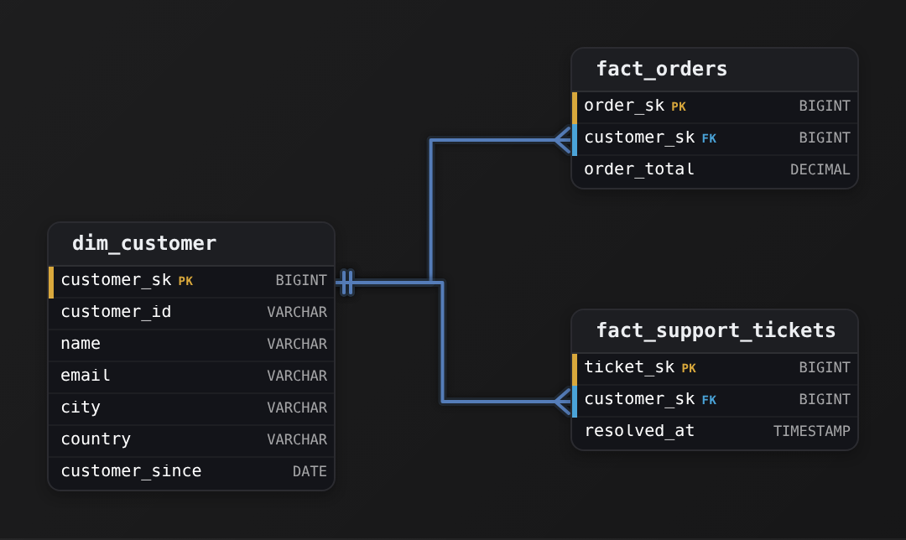

*One `dim_customer` serves 2 facts, and both join on the surrogate `customer_sk`.*

The primary key is `customer_sk`, a meaningless integer the warehouse mints. The business identifier `customer_id` rides along as an ordinary attribute. That natural key belongs to a source system you do not control: it can be recycled, it can arrive as a long string, and it can differ between the sources you are conforming. Facts join on the compact surrogate, so they never inherit those problems.

| Key insight: The surrogate buys you history |
| --- |
| Say a customer moves from 'Berlin' to 'Munich'. A slowly-changing dimension keeps the old row and adds a new one. The 2 rows share a `customer_id`, and each gets its own `customer_sk`. Old orders still point at the old `customer_sk`, so historical reports keep saying 'Berlin'. If facts joined on the natural key, you could not keep that history. |

| Pitfall: A natural key welds facts to one source |
| --- |
| Making `customer_id` the PK looks simpler, and the joins work fine today. The day 2 source systems disagree on an id, or an id gets recycled, every fact joined on it is silently wrong. Mint `customer_sk` and demote `customer_id` to a descriptive column. |

| Real world: Why dashboards stop disagreeing |
| --- |
| Companies keep one `dim_customer`, one `dim_date` and one `dim_product` that finance, marketing and support all join to. When each team builds its own customer table instead, 2 dashboards report different customer counts for the same month, and nobody can say which is right. |

**Follow-up questions**

1. How would you extend `dim_customer` so a report shows a customer's `country` as it was at the time of each order?\
   *Leads to a Type 2 dimension, which adds effective-date columns and a current-row flag.*
2. A second source system has its own customer ids. How do both map to one row in `dim_customer`?\
   *Conforming across sources means a match step that feeds one `customer_sk`.*

</details>


<br>

### Exercise 2 of 2

**● TASK**

Create a role-playing date dimension scenario where the same date dimension serves multiple purposes (order date, ship date) in a single fact table.

<details>
<summary><strong>Solution</strong></summary>

#### One calendar, many roles

A **role-playing dimension** is one physical dimension table that a single fact joins to more than once, with each join playing a different business role. `fct_orders` cares about 2 dates, the order date and the ship date, and both are plain calendar days. So you build ONE `dim_date` and point two foreign keys at it: `order_date_id` and `ship_date_id`. It is the same table playing 2 roles.

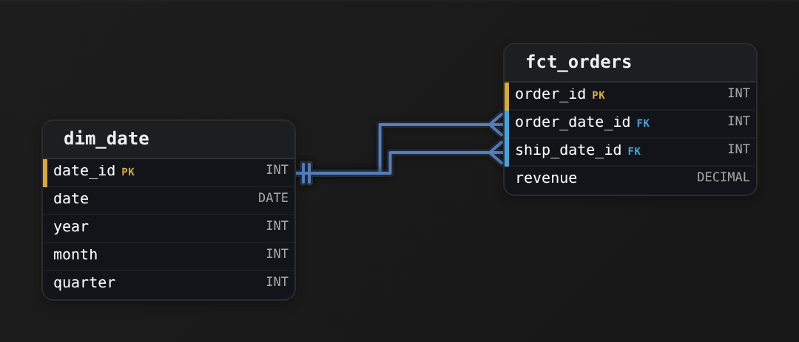

*2 FKs from `fct_orders`, `order_date_id` and `ship_date_id`, both landing on `dim_date.date_id`. That is the whole pattern.*

| Pitfall: Cloning the dimension makes calendars drift |
| --- |
| The instinct is to build a `dim_order_date` and a separate `dim_ship_date`, each with its own `year`, `month` and `quarter`. Now every calendar attribute lives in 2 places, a fiscal-calendar fix has to be applied twice, and the copies drift apart. The date '2026-03-31' is the same day whichever role it plays, so it should exist as exactly one row. |

1. **Give the dimension a surrogate key it can be reused by**

   `dim_date.date_id` is a surrogate key, so `order_date_id` and `ship_date_id` are just integers pointing into the same key space. Any date column on any fact can borrow this one dimension. The fact does not care which role a row plays; it only carries an id.

2. **Resolve the role at query time, not in the schema**

   You separate the roles when you query, by joining `dim_date` twice under different aliases: `JOIN dim_date od ON od.date_id = fct_orders.order_date_id` and `JOIN dim_date sd ON sd.date_id = fct_orders.ship_date_id`. Then `od.month` is the order month and `sd.month` is the ship month. The model stays lean; the role lives in the alias.

| Real world: Roles become named views for report builders |
| --- |
| The pattern is everywhere once you look: `dim_customer` playing bill-to and ship-to, `dim_airport` playing origin and destination. Warehouses often expose each role as a thin view over the one table, so a report builder sees 'Ship Date' while storage holds a single `dim_date`. |

**Follow-up questions**

1. What changes if an order has not shipped yet and `ship_date_id` is unknown?\
   *Point the FK at a dedicated 'not applicable' row in `dim_date` instead of `NULL`, so inner joins do not silently drop unshipped orders.*
2. How would you add a third role, say `return_date_id`, to the same fact?\
   *The pattern generalizes: one new FK column, no new dimension table.*

</details>


<br>

---

## Defining the Grain

The grain of a fact table states what 1 row means, and it is decided before any column is added. Ridgeline's `fact_sales` grain reads: 1 row per order line item, unique on (`order_id`, `line_seq`). Naming the columns that enforce the unit is what lets another engineer write a test against it.

| Grain statement | Precision | What goes wrong |
| --- | --- | --- |
| 1 row per sale | vague | a sale could be an order, a line item or a payment |
| 1 row per order | a unit, no key | 3 products per order and 1 product_sk column |
| 1 row per order line item, unique on (order_id, line_seq) | testable | nothing a query cannot check |


<br>

### Two grains, the same 2 orders

Order 50218 holds 3 line items: a tent at 299.99, a sleeping pad at 109.99 and a stove at 79.99. Order 50219 holds 1 headlamp at 44.99.

Order grain

Line item grain

At the order grain, `product_sk` for order 50218 has no honest value: 3 products, 1 cell. Whatever the load writes there, a units-by-product report attributes the whole order to 1 product or drops it. `SUM(line_amount)` is 489.97 at both grains, so revenue agrees with finance and nobody looks further, until merchandising asks for revenue by category and the stove's 79.99 has been reported under tents for months. A wrong grain produces no error message, only numbers that look right.


<br>

### Mixed grain, the quieter failure

The second grain error puts 2 grains in 1 table. The 12.00 shipping fee on order 50218 is charged once per order, and the first place a developer reaches for is a `shipping_fee` column on each line row. Now 3 rows carry 12.00 and `SUM(shipping_fee)` returns 36.00: the query and the column are both correct, and the number is 3 times too large. The fix is to allocate the fee across lines in proportion to `line_amount`, or to store it in a separate fact at the order grain.

```sql
SELECT
  order_id,
  line_seq,
  COUNT(*) AS n
FROM fact_sales
GROUP BY order_id, line_seq
HAVING COUNT(*) > 1
```

A count above 1 means duplicate source rows or a grain statement that does not match the data, so the test runs after every load and fails the pipeline when it returns rows.

The story below makes the grain choice for `fact_sales` under the 2 requests that landed in its first quarter.


<br>

---

## Data Modeling

### Exercise 1 of 2

**● TASK**

Design a fact table at the line-item grain: one row per item within each order.

<details>
<summary><strong>Solution</strong></summary>

#### Grain first, everything else follows

The whole design turns on one sentence you had to commit to before drawing a single column: **the grain is one row per item within an order**. Grain is the promise a fact table makes about what a single row means. Once you say "one line item," the primary key writes itself, the measures that are allowed to live on the row are settled, and the dimensions you can hang off it become obvious. That is why `fct_order_lines` keys on both `order_id` and `line_item_id` together: a line item only has an identity *inside* its order, so the grain is the composite of the two.

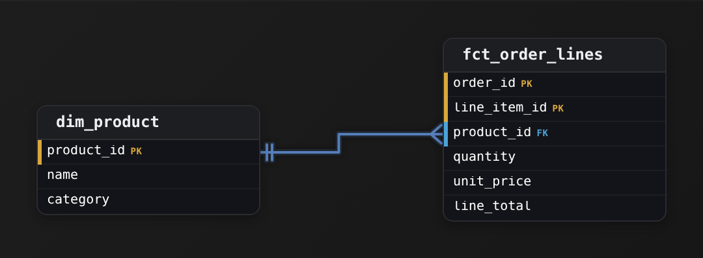

*The fact table carries the numbers you add up; the dimension carries the words you slice by.*

| Pitfall: Keying the fact at the wrong grain |
| --- |
| The most common miss is keying on `order_id` alone and stuffing the line items into repeated or array-like columns, or worse, keying on `product_id`. Both break the promise: an order with 3 items either collapses to one row (you lose 2 lines) or forces you to widen the row per product. Keep the PK exactly at the grain, `(order_id, line_item_id)`, and every line item gets its own honest row. |

Notice the split of what goes where. `quantity`, `unit_price`, and `line_total` sit on the fact because they are **measures**, numbers that make sense to sum or average across many rows. The product's `name` and `category` do not live on the fact; they live once in `dim_product` and are reached by the `product_id` foreign key. That is the star: descriptive, low-churn attributes in a dimension, additive numbers in the fact, joined by a slim key. Repeating `category` on every order line would bloat the table and mean re-writing millions of rows the day marketing renames a category.

| Real world: In production, `line_total` earns its keep |
| --- |
| You could always recompute `quantity * unit_price` at query time, but storing `line_total` on the row is standard practice: it locks in the amount actually charged even if `unit_price` on the product later changes, and it lets a dashboard sum revenue without a multiply on every scan. A fact table is allowed to carry a derived measure when it is additive and captures a point-in-time truth. |

**Follow-up questions**

1. If the same order can be shipped in parts, where would you record ship date so it does not break the line-item grain?\
   *Tests whether a new attribute belongs on the fact row, in a new dimension, or forces a finer grain.*
2. How would you add a customer to this model without changing the grain of `fct_order_lines`?\
   *Reinforces that a new `dim_customer` plus an `FK` leaves each line-item row intact.*

</details>


<br>

### Exercise 2 of 2

**● TASK**

Create a daily-grain fact table that aggregates all transactions to one row per day per store per product.

<details>
<summary><strong>Solution</strong></summary>

#### Grain first: one row per day per store per product

The whole design falls out of one sentence: **the grain is one row per day, per store, per product**. That sentence names the 3 things that make a row unique, and those 3 become the composite primary key of the fact table `fct_daily_sales` (`date_id`, `store_id`, `product_id` together). Everything else in the table is either a foreign key pointing at a dimension or a measured number. Fix the grain before you draw anything and the rest of the star schema is bookkeeping.

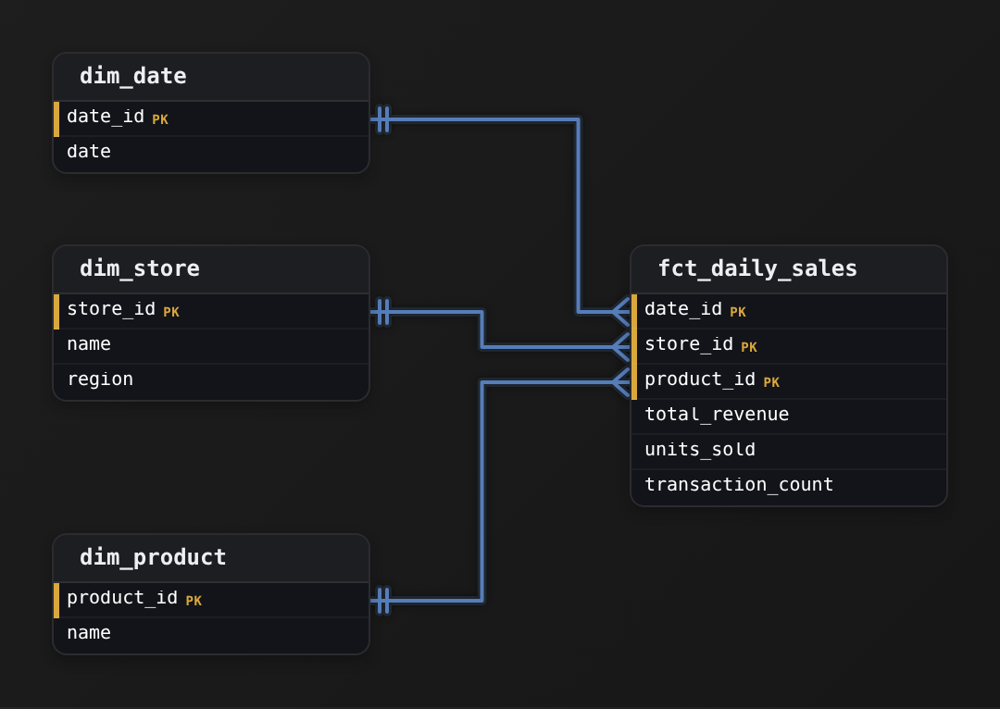

*A star: one fact at the center, 3 dimensions on the points. The fact's PK is the 3 FKs together.*

| Key insight: The composite key IS the grain, written down |
| --- |
| Each column of the primary key answers one part of "what makes this row unique": day, store, product. If you can add a fourth thing to that key without changing what a row means, your grain sentence was incomplete. If 2 rows could ever share all 3 of (`date_id`, `store_id`, `product_id`), you have duplicated a day's sales and `total_revenue` will double-count. |

| Pitfall: Don't store one row per transaction and call it a fact table |
| --- |
| The most common wrong answer keeps the raw grain: one row per receipt line, keyed by `transaction_id`. That is a fine transaction-grain fact, but it is not what was asked. The daily grain pre-aggregates every transaction for a day into ONE row, so a dashboard reads `SUM(total_revenue)` over far fewer rows. Pre-aggregation is the point: you trade drilling to a single sale for a table that answers "revenue by store by day" instantly. |

| Key insight: Only additive measures belong at this grain |
| --- |
| `total_revenue`, `units_sold`, and `transaction_count` are all fully additive: you can `SUM` them across any dimension and the number stays meaningful. That is why they survive aggregation. An average price does NOT belong as a stored measure here (averaging an average across stores is wrong); store `total_revenue` and `units_sold` and let the query divide. Keep the fact table to additive facts plus the foreign keys, nothing else. |

| ✕ Dimension row | ✓ Fact row |
| --- | --- |
| `dim_store` holds the descriptive context that rarely changes: `name`, `region`. One row per store, keyed by a surrogate `store_id`. Dimensions answer "which" and "what kind of." They are wide and short. | `fct_daily_sales` holds the measurements. Its columns are the 3 FKs plus additive numbers. One row per grain combination, keyed by all 3 FKs together. Facts answer "how much" and "how many." They are narrow and tall. |

The 3 edges are each a many-to-one from fact to dimension: many daily-sales rows point at one `dim_date` row, many at one `dim_store` row. Using surrogate integer keys like `date_id` and `store_id` (rather than the raw date or a store name) keeps the fact table narrow and its joins fast, and lets a dimension's descriptive columns change without touching millions of fact rows. This is the star schema in miniature, and the same shape reappears everywhere: web events by day, ad spend by campaign by day, inventory snapshots by warehouse.

**Follow-up questions**

1. What changes if a store's `region` gets reassigned and you need to keep history?\
   *Pushes toward slowly-changing dimensions (SCD Type 2): a new `dim_store` surrogate row per version, so old facts still point at the region that was true then.*
2. How would you add a monthly-grain summary on top of this?\
   *Tests whether the learner sees that a coarser fact rolls up from the daily one by summing additive measures over `date_id`.*

</details>


<br>

---

## Surrogate Keys

A surrogate key is an integer the warehouse assigns to a dimension row at load time. It means nothing to the business, has no relation to any source system, and never changes. The source's `customer_id` sits beside it as a natural key, kept for traceability and never referenced by a fact table, and `fact_sales` joins to `dim_customer` on `customer_sk` alone.


<br>

### Where natural keys break

Natural keys come from source systems built for their own needs, and Ridgeline's fail in 3 ways. Emails change: 4 percent of customers update theirs each year, and a fact keyed on email loses its history at every update. SKUs get reused: the supplier retired `RL-2208`, a 2-person tent, in 2023 and reissued it for wool socks in 2025, so 2 years of tent sales keyed on SKU now join to socks. And a type 2 dimension, which adds a new row for each change to a tracked attribute instead of overwriting the old one, holds several rows per `customer_id`, which a fact row cannot point at without a date to pick the version.


<br>

### One key per version

Priya Natarajan moved from Portland to Denver on 14 August 2024. The dimension keeps both versions: the Portland row, `customer_sk` 3310562, closed on the move date, and the current Denver row, 8827414. A June 2024 sale references 3310562 and an October 2024 sale references 8827414, so revenue by city puts each sale where Priya lived when she bought, with no date logic in the query.

| customer_sk | customer_id | city | valid_from | valid_to | is_current |
| --- | --- | --- | --- | --- | --- |
| 3310562 | C-77120 | Portland | 2021-04-02 | 2024-08-14 | false |
| 8827414 | C-77120 | Denver | 2024-08-14 | 9999-12-31 | true |

```sql
SELECT c.city, SUM(f.line_amount) AS revenue
FROM fact_sales f
JOIN dim_customer c ON c.customer_sk = f.customer_sk
GROUP BY c.city;

SELECT c.city, SUM(f.line_amount) AS revenue
FROM fact_sales f
JOIN dim_customer c
  ON c.customer_id = f.customer_id
 AND f.sale_date >= c.valid_from
 AND f.sale_date <  c.valid_to
GROUP BY c.city;
```

In the second query the engine hashes on `customer_id`, then checks each fact row against every version of that customer with a residual range filter, which costs more than a single equality probe. It is also fragile: a sale stamped at exactly `valid_to` matches 2 versions or none depending on which boundary convention the dimension and the query assumed. The surrogate key resolved the version once, at load time, and stored the answer in the fact row.


<br>

### Generating the key

The load assigns the key. A `customer_id` the dimension has never seen gets a new row and the next value from a sequence. A change to a tracked attribute closes the current row and inserts a new one with a new key. The alternative to a sequence is a hash, such as the MD5 of `customer_id` and `valid_from`, which produces the same key on every rerun of the same input, so a failed load replays without consulting the previous run. A row with key -1 stands for 'unknown customer', so a fact whose customer has not arrived yet still joins and its amount stays in the totals.

A BIGINT key is 8 bytes and a UUID string is 36, a difference of 28 bytes per row for each foreign key column, and `fact_sales` carries 5 of them. `dim_date` is the conventional exception to meaningless keys: its key is the date written as `20260902`, because the table is never versioned and a readable key makes partition filters legible.

- **23.5 GB** — saved per key column on fact_sales

The payoff of keys the warehouse owns shows up the day a second source system arrives with its own numbering.

**Ridgeline acquires a competitor whose system numbers customers from 1, and 410,000 of its customer_id values collide with Ridgeline's. Both lists load into dim_customer. What keeps the fact tables correct?**

- **A.** Add 10,000,000 to every acquired customer_id so the values no longer collide.
- **B.** Key the dimension on email address, which both systems hold.
- **C.** Keep the surrogate keys as they are and widen the natural key to (source_system, customer_id).
- **D.** Reassign every surrogate key from 1 across the merged customer list.

<details>
<summary>Solution</summary>

**C.** Keep the surrogate keys as they are and widen the natural key to (source_system, customer_id).

The warehouse owns customer_sk, so no existing fact row changes. Acquired customers get new surrogate keys as they load, and the 2-column natural key still traces each row to its source.

**Why the others are wrong**

- **A.** This works until the next acquisition, and it makes the dimension depend on an unwritten arithmetic convention that breaks the trace back to the source row.
- **B.** About 3 percent of acquired customers share an email with a Ridgeline customer, sometimes the same person and sometimes not, and emails change.
- **D.** Every fact row referencing a customer_sk, 840 million sales rows and more, would be rewritten. A surrogate key's one promise is that it never changes.

</details>

| ✓ Do | ✗ Don't |
| --- | --- |
| • Assign surrogate keys in the load, from a sequence or a deterministic hash<br><br>• Keep the natural key beside the surrogate key to trace rows to the source<br><br>• Give each dimension version its own key so facts join on equality alone<br><br>• Carry a -1 'unknown' row so facts with a late dimension still join and count | • Reassign or renumber surrogate keys once facts reference them<br><br>• Join facts to dimensions on a natural key the source can change or reuse<br><br>• Use UUID strings where an 8-byte integer key will do<br><br>• Offset colliding source ids instead of widening the natural key with source_system |


<br>

---

## Data Modeling

### Exercise 1 of 2

**● TASK**

Design a product dimension and a sales fact for a warehouse that loads 2 catalogs, both of which number their products from 1. A product's category can change, and every sale must keep the category the product had when it was sold. The sales fact will grow to billions of rows. Decide how the warehouse mints the dimension's key, and keep each version traceable to its source product.

<details>
<summary><strong>Solution</strong></summary>

#### The warehouse decides what identifies a product

This design turns on **key generation**: the warehouse, not either catalog, decides which number identifies a product version. Both catalogs hand you product 1, so neither source code can be the key. A category change also needs a second row for the same product, so the code could not stay unique anyway. `product_sk` is minted in the load, one value per version, and the source identity sits beside it as `source_system` plus `product_code`.

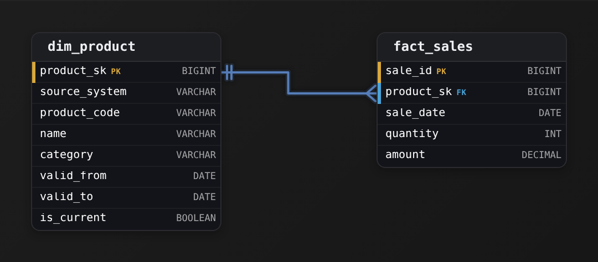

*`fact_sales` joins on `product_sk` alone; `source_system` plus `product_code` trace each version back to its catalog.*

1. **Widen the natural key to `source_system` plus `product_code`**

   Product 1 from the first catalog and product 1 from the second are different products. Adding `source_system` makes the pair unique per source. A lookup during the load then resolves to exactly one product, and nothing collides when a third catalog arrives.

2. **Mint `product_sk` from a sequence in the load**

   Each new version takes the next value of a sequence as it lands. The number means nothing outside the warehouse and never changes once a fact references it. It also fits in a `BIGINT`, which is all `fact_sales` stores on each of its billions of rows.

3. **Give every category change its own key**

   When a category changes, set the old row's `valid_to`, flip its `is_current` to false, and insert a new row with a fresh `product_sk` and the same natural key. Sales already loaded keep pointing at the version they were sold under, so the join needs equality alone.

| Pitfall: Offsetting ids hides the collision instead of fixing it |
| --- |
| Adding 10,000,000 to the second catalog's codes makes the numbers distinct today. But the stored value no longer matches anything in the source, and the scheme breaks once that catalog grows past the offset or a third one arrives. Widen the natural key and let the surrogate do the identifying. |

| ✕ Sequence-minted integer | ✓ UUID string |
| --- | --- |
| 8 bytes per fact row, compact indexes, and equality joins on an integer. The only cost is that the load needs one place to hand out the next number. | Needs no coordination, but stores 36 characters per row as text (16 bytes at best). That cost repeats across billions of sales and every index on `product_sk`. |

| Key insight: A hash key is the one that survives a rebuild |
| --- |
| A sequence hands out different numbers if you rebuild `dim_product` from scratch in a different order. If rebuilds are routine, hash `source_system`, `product_code` and `valid_from` into a 64-bit integer instead: the same inputs give the same key every time. |

**Follow-up questions**

1. A sale arrives before its product reaches `dim_product`. Which `product_sk` does the fact get, and how does it still count in totals?\
   *A reserved -1 'unknown' row lets the fact join and count, and it is repointed once the product lands.*
2. A catalog renumbers one of its product codes. Which rows change, and which stay exactly as they are?\
   *Only the natural key on `dim_product` changes; every `product_sk` already stored in `fact_sales` is untouched.*

</details>


<br>

### Exercise 2 of 2

**● TASK**

Our customer_id values and a newly acquired retailer's both start at 1, so one id can name 2 different customers. Design a customer dimension and a sales fact at one row per order line, where the fact's billions of rows join on a compact customer key the warehouse generates in its load and never renumbers. Each customer row must trace back to its source system and customer_id, and a sale whose customer has not loaded yet must still join and count.

<details>
<summary><strong>Solution</strong></summary>

#### Minting a key the warehouse owns

Once 2 systems both number customers from 1, the source id stops identifying anyone. The fix is a **surrogate key** that the warehouse mints itself during the load. How it is minted matters as much as having one. It has to be compact, because every fact row repeats it. It has to be stable, because facts point at it forever. And it cannot be derived from a source value that might collide.

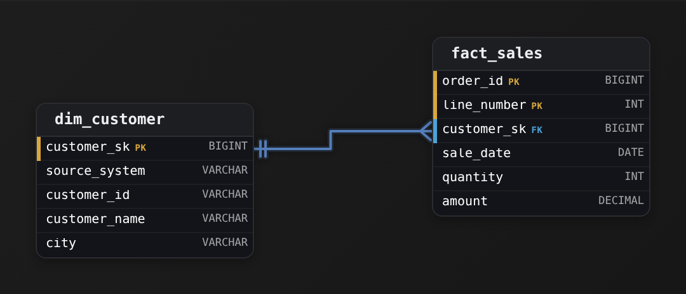

*`customer_sk` is minted in the load. The pair `source_system` plus `customer_id` traces each row back to its source, and `fact_sales` joins on `customer_sk` alone.*

1. **Choose how `customer_sk` is minted**

   A sequence gives a `BIGINT` that is 8 bytes on every one of billions of fact rows. A deterministic hash of `source_system` and `customer_id`, fitted into a `BIGINT`, works too, and it is useful when loads run in parallel. A `UUID` costs twice the bytes for no extra guarantee. The source `customer_id` cannot be the key at all, because it collides.

2. **Widen the natural key and keep it beside the surrogate**

   Store `source_system` next to `customer_id`, so that the pair is unique and every row traces back to the system it came from. The load looks up this pair to find an existing `customer_sk` before it mints a new one.

3. **Reserve `customer_sk = -1` for the unknown customer**

   Seed one 'unknown' row with key -1. A sale whose customer has not arrived yet gets `customer_sk = -1`, so it still joins and counts in totals instead of dropping out of an inner join.

| Pitfall: An offset is a renumbering in disguise |
| --- |
| Adding 10,000,000 to the acquired `customer_id` values hides the collision, but it rewrites a source value. It also breaks the next time a third system arrives with its own range. Widening the natural key leaves every minted `customer_sk` untouched. |

**Follow-up questions**

1. If the dimension were rebuilt from scratch every night, would a sequence or a hash keep each `customer_sk` the same across rebuilds?\
   *Shows when a deterministic hash wins over a sequence.*
2. A third source arrives whose ids are strings like 'C-0042'. What in this design has to change?\
   *Tests that the widened natural key, not the surrogate, absorbs a new source.*

</details>


<br>

---

## Putting It All Together

Ridgeline's CFO asks for a single fiscal Q3 pack, covering August to October: revenue by category and region, units on hand per warehouse on 31 October, and median days from placement to delivery by carrier for orders placed in the quarter, with the figures reconciling to the source system.

- Revenue by category and region reads fact_sales at the line item grain, joined to dim_product for category and dim_customer for region, and sums line_amount, which is additive at every rollup because the grain was set before the first column.
- Units on hand on 31 October reads 1 day of fact_inventory_daily and sums across warehouses only; the same measure summed across the quarter's 92 days would be a number that describes nothing.
- Median days to deliver by carrier reads fact_order_fulfilment, whose 1 row per order already holds days_to_deliver and carrier_sk, filtered through the placed_date_sk role of dim_date.
- All 3 figures take the quarter from the same dim_date.fiscal_quarter, and the revenue and inventory figures read the same dim_product, so the pack agrees with itself wherever its facts share a dimension.
- Reconciliation to the source system runs through the natural keys stored beside each surrogate key, while the facts themselves joined on surrogate keys that no SKU reuse or email change could disturb.


<br>

---

## Data Modeling

### Exercise 1 of 2

**● TASK**

Build a complete retail star schema with date, product, store, and customer dimensions feeding into a central sales fact table. Each dimension gets its own surrogate key, and the fact table references every dimension by that key.

<details>
<summary><strong>Solution</strong></summary>

#### The star schema, named plainly

A **star schema** is one central fact table surrounded by dimension tables, each joined to the fact by a single key. The fact holds the measurements you sum and count; the dimensions hold the descriptive attributes you slice by. Here the measurements are `revenue` and `units_sold`, and you slice them by date, product, store, and customer. Drawn out, `fct_sales` sits in the middle and the four `dim_` tables fan out around it, which is where the name comes from.

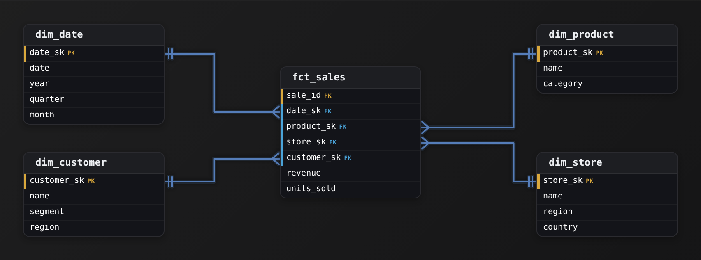

*One fact, four dimensions. Every FK in `fct_sales` points at a dimension's surrogate PK.*

1. **Fix the grain of the fact before anything else**

   The grain is the question "what does one row of `fct_sales` mean?" Here it is one sale, so `sale_id` is the primary key and every measure (`revenue`, `units_sold`) has to be true at that level. Deciding this first is what tells you which dimensions can attach: a sale happens on a date, for a product, at a store, to a customer, so those four foreign keys belong. Skip this step and you end up mixing per-sale and per-day rows in one table, and no aggregation can be trusted.

2. **Give each dimension its own surrogate key**

   Each `dim_` table gets a synthetic key it owns: `date_sk`, `product_sk`, `store_sk`, `customer_sk`. These are the primary keys of the dimensions and carry no business meaning; they exist only to join. The descriptive columns (`category`, `region`, `segment`) live right on the dimension, denormalized, so a query filtering by `category` never has to hop through another table.

3. **Reference every dimension from the fact by its surrogate key**

   `fct_sales` carries one foreign key per dimension, each pointing at that dimension's `_sk`. This is the one-to-many relationship that makes the star work: one row in `dim_product` maps to many rows in `fct_sales`, never the reverse. A query then joins the narrow fact to the wide dimensions on integer keys, which is the cheap, index-friendly path analytic engines are built for.

| Key insight: Why surrogate keys, not the natural ones |
| --- |
| It is tempting to join on the source system's `customer_id` or an SKU string. The surrogate `customer_sk` decouples the warehouse from the source: if the business re-numbers customers, merges 2 source systems, or a customer's `segment` changes over time, you absorb it in the dimension without rewriting every fact row. It also keeps the fact's foreign keys as compact integers instead of long natural strings. |

| Pitfall: Don't snowflake the dimensions |
| --- |
| The common mistake is to normalize `dim_product` by pulling `category` into a separate `dim_category` table with its own key, then linking it. That turns your star into a snowflake and adds a join to every category query for no analytic benefit. In dimensional modeling you deliberately keep dimensions flat and denormalized; the redundancy is the point. |

**Follow-up questions**

1. How would you handle a customer whose `segment` changes over time, so history stays correct?\
   *Tests slowly-changing dimensions (Type 2): a new dimension row with a new `customer_sk` per version rather than an in-place update.*
2. Sales and returns both happen at the store. Do returns go in `fct_sales` or a separate fact?\
   *Tests grain discipline: a return at a different grain or sign convention argues for its own fact table.*
3. Why is `dim_date` its own table instead of just storing the raw date on the fact?\
   *Tests why pre-computed `year`/`quarter`/`month` attributes belong in a dimension for cheap slicing.*

</details>


<br>

### Exercise 2 of 2

**● TASK**

Design a digital marketing star schema with campaign and date dimensions feeding into a performance fact table.

<details>
<summary><strong>Solution</strong></summary>

#### The star schema you just drew

A star schema splits data into a central **fact table** of the numbers a business counts and a ring of dimensions holding the context you slice them by. Your measures, impressions, clicks, conversions and spend, sit in `fct_ad_performance`; the things you slice by, the campaign and the day, sit in `dim_campaign` and `dim_date`. The fact sits in the middle with a dimension on each point, which is where the name comes from.

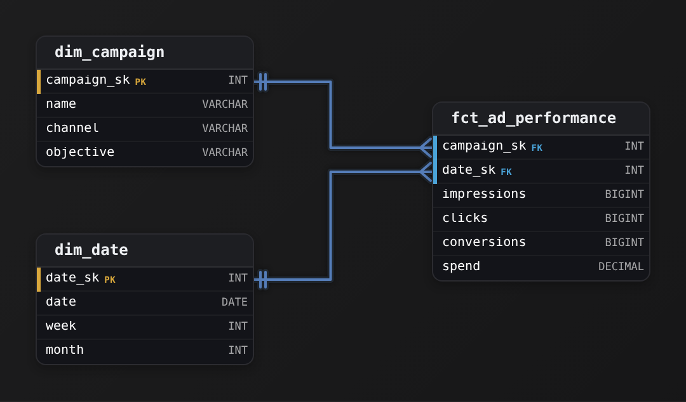

*One fact table in the center with a foreign key out to each dimension. The grain is one row per campaign per day.*

1. **Name the grain before anything else**

   A fact table's grain is what one row represents. Here it is one campaign on one day, so the fact keys are the pair `campaign_sk` and `date_sk`. Deciding this first tells you which columns are measures that roll up (`impressions`, `spend`) and which are context that describes (`channel`, `month`). Get it wrong and every aggregate double-counts.

2. **Give each dimension a surrogate key**

   `campaign_sk` and `date_sk` are surrogate keys, meaningless integers the warehouse mints rather than an ad-platform ID or a calendar date. Joining the fact on narrow integer keys keeps it skinny and lets a campaign be renamed without rewriting history in the fact rows.

| Pitfall: Descriptions belong in the dimensions |
| --- |
| Widening `fct_ad_performance` with `channel`, `objective` and `month` so you can query one table repeats the same strings across millions of rows and forces a schema change whenever marketing adds an attribute. Push descriptive text out to the dimensions, leave only measures and foreign keys in the fact. |

| Key insight: Why a dedicated `dim_date` |
| --- |
| Storing raw `date` and calling `date_trunc` at query time makes every analyst re-derive periods. A `dim_date` with prebuilt `week` and `month` lets every report group the same way, and it is the one dimension almost every fact table reuses. |

**Follow-up questions**

1. If a campaign's `objective` changes over time and you must report the value true on each day, how would `dim_campaign` change?\
   *Introduces slowly changing dimensions (Type 2): versioned rows keyed by a new surrogate.*
2. Marketing wants spend broken out by ad creative too. New dimension, or a change to the grain?\
   *Tests whether adding a dimension shifts the grain to one row per campaign per creative per day.*

</details>


<br>

---

## Key Takeaways

- A star schema is 1 tall narrow fact table joined on equality to a ring of short wide dimensions, the shape every warehouse optimizer is tuned for.
- Transaction facts record events, periodic snapshots record state per period, accumulating snapshots record 1 lifecycle per row; the question's verb picks the table.
- Dimensions carry the words: conformed across facts, role-played through aliases, junk for flags, degenerate for bare identifiers, and dim_date for every calendar rule.
- The grain is the first decision and the uniqueness test is its proof; a wrong or mixed grain produces numbers that look right.
- Surrogate keys are assigned by the load, never change, and give each dimension version its own key so facts join on equality alone.
