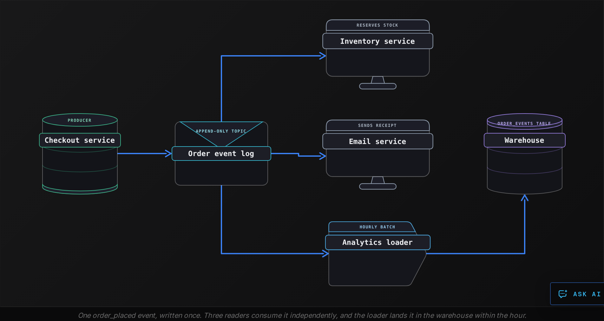
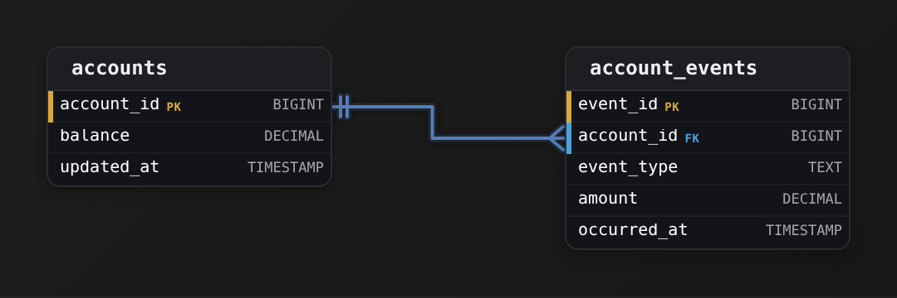
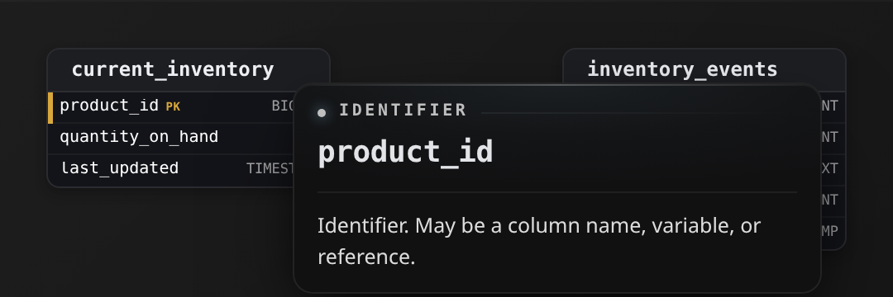
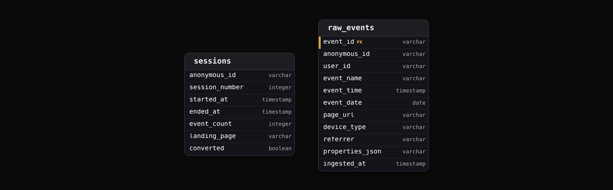
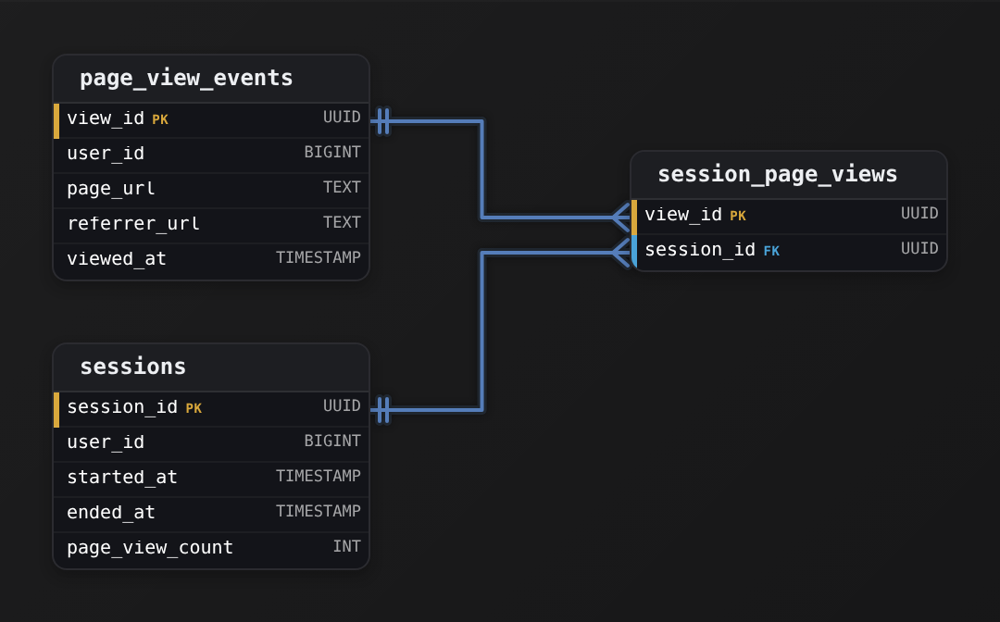
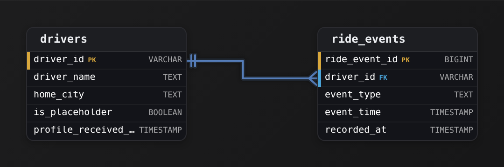
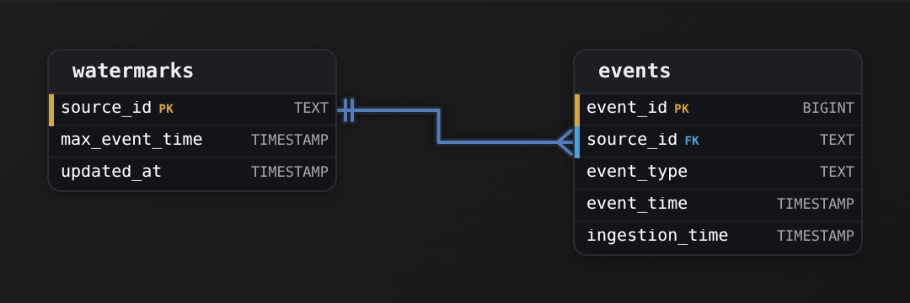
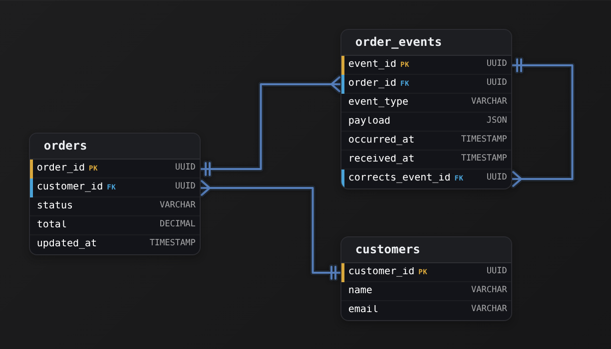
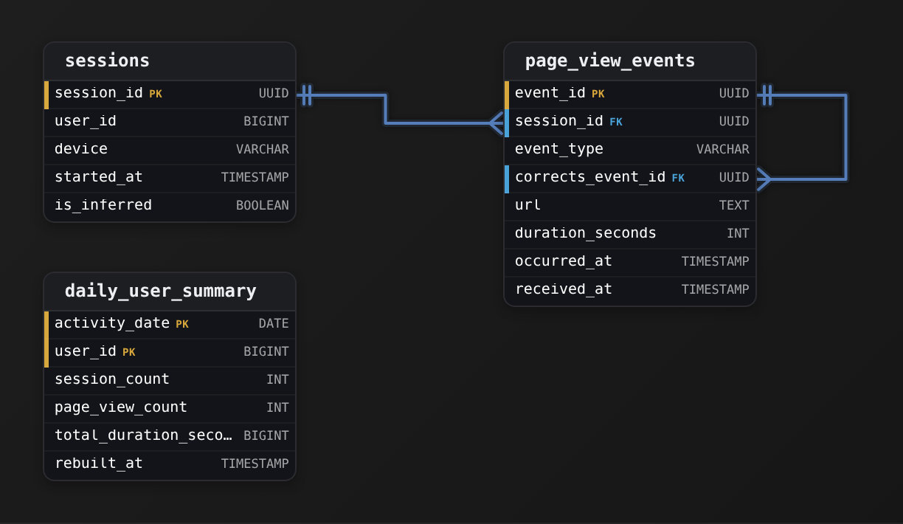

Intermediate·Data Modeling · 27 min · 12 challenges

# Event Streams

An Uber rider taps request at 8:02, a driver accepts at 8:03, the car arrives at 8:09, the trip ends at 8:31, and a tip lands 4 hours later from a phone that was offline in a tunnel. Pricing, driver pay, fraud checks and the receipt all read the same sequence of facts. A trip is a history, and this lesson shows how to model one.


<br>

---

## Event-Driven Architecture

An event is a record that something happened: customer 4471 placed order 8812 at 14:02:17, a thermostat read 21.5 degrees, a driver accepted a trip. The record names the thing, when it happened and what changed, and it never changes afterwards, because the past does not change. A system built on events writes each record to a shared log once, and every other system that cares reads the log at its own pace.


<br>

### Request-driven versus event-driven

In a request-driven design, the checkout service finishes an order by calling the inventory service, then the email service, then the analytics service, and waits for each reply. Adding a fraud check means changing checkout again. When the email service is down, the order either fails or checkout grows a retry branch for that one call. In an event-driven design, checkout writes one `order_placed` event to the log and returns. Inventory, email, analytics and fraud each subscribe to the log and react when they are ready. Checkout holds no list of who reads its events, so a new consumer costs the producer nothing.



| ✓ Request-driven | ✗ Event-driven |
| --- | --- |
| • Producer calls each consumer and waits for a reply<br><br>• Producer code changes when a consumer is added<br><br>• A down consumer blocks or fails the request<br><br>• History lives in server logs nobody queries | • Producer writes one event and returns<br><br>• Consumers are added without touching the producer<br><br>• A down consumer catches up from its last offset<br><br>• The log is a queryable record of everything that happened |

*The log sits between producer and consumers, which is why these systems are called decoupled: the 2 sides share a contract about the event, and nothing else.*


<br>

### The shape of an event

Every event carries an envelope, the fields that are the same for every event type, and a payload, the fields specific to this type. The envelope is what routing, deduplication and loading rely on, so it is strict. The payload is what the business reads, so it changes as the business does, and a `schema_version` in the envelope records which shape the payload has.

| Field | Part | Example | Why it is there |
| --- | --- | --- | --- |
| event_id | envelope | evt_01HX4K9Q7M | Dedupe retries, trace one event end to end |
| event_type | envelope | order_placed | Route to the consumers that care |
| event_time | envelope | 2026-10-20T14:02:17Z | When it happened, stamped by the producer |
| entity_id | envelope | order_8812 | Group every event about one thing |
| producer | envelope | checkout-v12 | Trace a malformed event to its source |
| schema_version | envelope | 3 | Read old payloads with the right code |
| payload | payload | items, total, currency | The facts specific to this type |

```sql
{
  "event_id": "evt_01HX4K9Q7M",
  "event_type": "order_placed",
  "event_time": "2026-10-20T14:02:17Z",
  "entity_id": "order_8812",
  "producer": "checkout-v12",
  "schema_version": 3,
  "payload": {
    "customer_id": "cust_4471",
    "items": [
      {
        "sku": "SKU-220",
        "qty": 2,
        "unit_price": 19.99
      }
    ],
    "total": 39.98,
    "currency": "EUR"
  }
}
```

> **TIP**
>
> Name events as facts in the past tense: `order_placed`, `payment_captured`, `trip_completed`. A name like `send_receipt` is an instruction aimed at one consumer, and once it sits in a shared log every other reader has to know to skip it.


<br>

### Querying an event table

Once the loader lands events in the warehouse, the table has one row per event, and most questions become a count grouped by type and time. This query shows what happened in each hour of one day.

```sql
SELECT
  DATE_TRUNC('hour', event_time) AS event_hour,
  event_type,
  COUNT(*) AS events
FROM order_events
WHERE event_time >= TIMESTAMP '2026-10-20 00:00:00'
  AND event_time < TIMESTAMP '2026-10-21 00:00:00'
GROUP BY DATE_TRUNC('hour', event_time), event_type
ORDER BY event_hour, event_type
```

**A payment service must tell inventory, email, fraud and analytics that a refund went through. Which record belongs in the shared log?**

- **A.** A refund_pending event with refund_id and a note that the amount will follow in a later message
- **B.** An update_order_status event with order_id and new_status set to refunded
- **C.** A refund_succeeded event with refund_id, order_id, amount, currency and event_time
- **D.** A direct write that sets orders.refunded to true in the orders table

<details>
<summary>Solution</summary>

**C.** A refund_succeeded event with refund_id, order_id, amount, currency and event_time

A past-tense fact with an envelope and the fields each reader needs. All 4 consumers subscribe and react without the payment service knowing them.

**Why the others are wrong**

- **A.** Pending is a promise, and the amount is the one field every consumer needs. The log should hold the completed fact with its amount.
- **B.** This is an instruction aimed at the order service. Fraud and analytics need the refund fact, with its amount, and would have to ignore a status command.
- **D.** The state changes and nobody is told. The 4 systems would have to poll the table, and the time and amount of the refund are lost.

</details>


<br>

---

## Data Modeling

### Exercise 1 of 2

**● TASK**

Design an append-only events table for an event-driven system. Each event should be immutable once written.

<details>
<summary><strong>Solution</strong></summary>

#### Event sourcing: store what happened, not the current state

The technique this challenge asked you to apply is **event sourcing**: instead of a table whose rows you overwrite as things change, you keep an append-only log where every row is a fact that already happened. The `events` table never sees an `UPDATE` or a `DELETE`; the only write is an `INSERT`. Current state is something you derive by replaying the log, not something you store and mutate in place. That single shift is what makes the design immutable, auditable, and replayable.


*One immutable row per fact. Rows are only ever inserted, never changed.*

Each column earns its place. `event_id` is the primary key and the log's order: a monotonic identity so you can read events back in the exact sequence they were written. `event_type` names what happened ('OrderPlaced', 'PaymentCaptured') so one table can hold many kinds of fact. `aggregate_id` groups every event about the same entity, the order or the user, so you can replay just that entity's history. `payload` carries the event-specific detail, kept flexible because different `event_type` values describe different things. `occurred_at` records when the fact happened, and `source_service` says who emitted it, which is priceless when many services write to the same log.

| Pitfall: The mutable-status column |
| --- |
| The most common miss is adding a `status` column you plan to flip from 'pending' to 'shipped'. The moment you `UPDATE` that column you've thrown away the fact that it was ever pending, and the log stops being append-only. In event sourcing a status change is a NEW row, a `StatusChanged` event, not an edit to an old one. If you find yourself wanting to overwrite anything on `events`, model it as another event instead. |

| ✕ State table (mutable) | ✓ Event log (append-only) |
| --- | --- |
| One row per order; `status` is overwritten on each change. You always know the current value, but the history is gone and an `UPDATE` bug is unrecoverable. | One row per thing that happened, keyed by `event_id` and grouped by `aggregate_id`. Current status is derived by replaying events; every prior state is still on disk, so you can audit or rebuild at any point. |

| Real world: Where this shows up |
| --- |
| This is the shape behind bank ledgers, order pipelines, and audit trails. Because the log is immutable you can build several read models from the same `events` stream, replay it into a fresh projection after a bug, or hand it to another team's service by `event_type`. Enforcing immutability at the boundary, a table that only accepts `INSERT`s, is often done with a database trigger or a write-only role so nothing can quietly mutate a past fact. |

**Follow-up questions**

1. How would you reconstruct an order's current status from this table?\
   *Tests that they understand state is derived by replaying events filtered by `aggregate_id`, ordered by `event_id`.*
2. What would you add if 2 services could emit events for the same aggregate at the same time?\
   *Pushes toward an ordering or version column per `aggregate_id` to detect concurrent writes.*
3. The `payload` shape differs per `event_type`. How do you keep readers from breaking when it evolves?\
   *Tests schema-versioning of events and why `payload` is kept flexible rather than split into typed columns.*

</details>


<br>

### Exercise 2 of 2

**● TASK**

Create an audit log table that tracks all changes across the system with enough detail to reconstruct what happened.

<details>
<summary><strong>Solution</strong></summary>

#### One append-only log for every change

The concept this challenge asks you to apply is the **immutable audit log**: a single append-only table where every insert, update, and delete anywhere in the system writes one row, and no row is ever changed again. Instead of scattering `updated_by` and `updated_at` columns across every business table, you record each change as its own event. That is event sourcing in miniature, the log of what happened becomes the source of truth you can replay to reconstruct any record's history.


*One row per change. `table_name` + `record_id` point back at the row that changed; `old_values` and `new_values` carry the before/after snapshot.*

Read the columns as answers to who-what-when. `table_name` and `record_id` say WHICH row changed, kept as loose text (not a foreign key) so the log can cover every table without one FK per target. `operation` says WHAT kind of change ('INSERT', 'UPDATE', 'DELETE'). `changed_by` and `changed_at` are the WHO and WHEN. The pair that actually lets you reconstruct history is `old_values` and `new_values`: store the row's before and after state as `jsonb`, and any table's shape fits the same 2 columns. An UPDATE fills both, an INSERT leaves `old_values` null, a DELETE leaves `new_values` null.

| Key insight: Why jsonb instead of a column per field |
| --- |
| The log has to describe changes to tables you haven't designed yet. A flat `old_email` / `new_email` pair only works for one table; `old_values` and `new_values` as `jsonb` snapshots let one schema audit the whole system. You trade strict typing for universality, which is the right trade for a cross-cutting log. |

| Pitfall: Common pitfall: mutable columns on the business table |
| --- |
| The tempting wrong answer is to bolt `last_modified_by` and `last_modified_at` onto each table and call it auditing. That only ever remembers the MOST RECENT change, the previous values are overwritten and gone. You cannot reconstruct what happened, only what the row looks like now. Auditing needs a separate row per change, never an updated cell. |

| ✕ Mutable columns on each table | ✓ Append-only `audit_log` |
| --- | --- |
| Add `modified_by` / `modified_at` in place. Each write overwrites the last. History depth is exactly one; a DELETE erases the row and its trail together. No way to answer 'what was the price last Tuesday'. | Append one row per change with `old_values` / `new_values`. History is unbounded and ordered by `changed_at`. A DELETE is just another logged event, so the record survives its own deletion. |

The defining property is that the log is immutable, rows are only ever inserted, never updated or deleted. That is what makes it trustworthy: to replay a record's life you filter by `table_name` and `record_id`, order by `changed_at`, and walk the `new_values` forward. In production this same shape shows up as change-data-capture streams, database triggers writing to a history table, and event-sourced systems where the event log, not the current-state table, is canonical.

**Follow-up questions**

1. How would you enforce that `audit_log` is truly append-only, so even an admin can't edit history?\
   *Tests whether the learner knows immutability is enforced (revoke UPDATE/DELETE grants, INSERT-only triggers), not just intended.*
2. The log grows forever. How do you keep it queryable, by partitioning on `changed_at`, archiving cold ranges, or both?\
   *Tests awareness that an unbounded append-only table needs a retention and partitioning story.*
3. If `record_id` values collide across tables (2 tables both have id 100), does storing `table_name` alongside it fully disambiguate the target?\
   *Tests understanding of why the polymorphic pointer needs both columns to identify a row.*

</details>


<br>

---

## Immutable Append-Only Logs

A log is a file that only grows. Each write goes to the end, receives the next position number, called an offset, and stays at that offset until the log is trimmed. Nothing in the middle is rewritten, and nothing is deleted one row at a time. This one rule, append only, is what makes a log cheap to write, safe to share between many readers, and possible to replay.

| offset | event_type | entity_id | event_time | payload summary |
| --- | --- | --- | --- | --- |
| 0 | order_placed | order_8812 | Oct 20 14:02:17 | total 39.98 EUR, street Rue Lepic 41 |
| 1 | payment_captured | order_8812 | Oct 20 14:02:19 | 39.98 EUR by card |
| 2 | order_placed | order_8813 | Oct 20 14:02:40 | total 120.00 EUR |
| 3 | address_corrected | order_8812 | Oct 20 14:05:02 | street changed to Rue Lepic 14 |
| 4 | order_shipped | order_8812 | Oct 21 09:41:10 | carrier DPL |
| 5 | order_cancelled | order_8813 | Oct 21 10:15:33 | reason: customer request |

Offset 3 is how a log handles a mistake. The customer typed the wrong street, and in a table someone would run an UPDATE. In a log, the original `order_placed` stays exactly as it was, and a new `address_corrected` event records the fix. Both facts are true: the order was placed with one address, and the address was later corrected. A consumer that printed a label from offset 0 at 14:03 used the wrong street, and the log can show why: the correction arrived 2 minutes after the label.

- **1** — write per event, always at the tail
- **0** — rows updated in place, ever


<br>

### Every reader keeps its own place

The log holds no record of who has read what. Each consumer stores the offset it has reached and asks for everything after it. The email service may sit at offset 5 while the analytics loader, which runs hourly, is at 2. A fraud consumer added next month starts at the oldest offset the log still keeps and reads forward. Under the 7-day retention covered below, that offset is a week old, so last year's orders come from the warehouse copy. When a consumer ships a bug, the fix is to reset its offset to the point before the bug and replay. The log did nothing special to allow this.


<br>

### Reading current state from an append-only table

When the log lands in the warehouse, the table has 2 rows for order 8813 and 4 for order 8812, and a dashboard wants one row per order showing where it stands now. The answer is the latest event per entity. `row_number()` numbers each order's events from newest to oldest, and the row numbered 1 is the current state. Ties on `event_time` are broken by offset, which is the order the log received them.

```sql
WITH ranked AS (
  SELECT
    entity_id,
    event_type,
    event_time,
    ROW_NUMBER() OVER (
      PARTITION BY entity_id
      ORDER BY event_time DESC, log_offset DESC
    ) AS rn
  FROM order_events
)

SELECT
  entity_id,
  event_type AS current_status,
  event_time AS status_since
FROM ranked
WHERE rn = 1
```


<br>

### Retention and compaction

A log that grows forever fills every disk, so logs are trimmed by one of 2 policies. Time-based retention drops everything older than a window, such as 7 days, which suits a log that feeds a warehouse where the full history is copied anyway. Compaction keeps only the latest event for each entity key and drops the older ones, so the log holds current state for every key but loses the path that led there. A compacted log answers 'what is order 8812 now' and cannot answer 'what was it at 14:03'.

*A compacted log deletes a key by appending a tombstone, an event carrying the key and an empty payload. Even deletion is an append.*

| ✓ Do | ✗ Don't |
| --- | --- |
| • Record a correction as a new event that references the one it corrects<br><br>• Store the offset with each row when loading a log into a table<br><br>• Choose time retention when the warehouse keeps the full history<br><br>• Break event_time ties with offset, the true arrival order | • Run UPDATE or DELETE on an event table to fix a value<br><br>• Share one offset across consumers, because the slowest stalls the rest<br><br>• Compact a log that a replay or an audit will later need<br><br>• Trust event_time alone to order events from different producers |

**Offset 1 records a 39.98 capture for order 8812, but the card processor's settlement shows the card was actually charged 39.89. Which change makes the records match the charge?**

- **A.** Append a payment_corrected event with amount 39.89 and a reference to the capture at offset 1
- **B.** Update the payload of the payment_captured event at offset 1 so the amount reads 39.89
- **C.** Delete offset 1 and append a fresh payment_captured event carrying the corrected amount
- **D.** Append the corrected amount as a second payment_captured event with the same event_id

<details>
<summary>Solution</summary>

**A.** Append a payment_corrected event with amount 39.89 and a reference to the capture at offset 1

Offset 1 still shows what the system recorded, the new event states the real charge, and readers meet both in log order.

**Why the others are wrong**

- **B.** Rewriting offset 1 destroys the evidence of what the system believed, and consumers that already read offset 1 never learn of the change.
- **C.** Deleting from the middle breaks the append-only rule and the history. Readers past offset 1 now hold a record the log claims never existed.
- **D.** A repeated event_id is what deduplication looks for. Every consumer that dedupes on it drops the correction as a retry.

</details>


<br>

---

## Data Modeling

### Exercise 1 of 2

**● TASK**

Design a clickstream log table that is strictly INSERT-only. No updates or deletes are allowed.

<details>
<summary><strong>Solution</strong></summary>

#### An immutable log is just an append-only table

The concept the section named is the **immutable log**: a table you only ever `INSERT` into, never `UPDATE` or `DELETE`. Each row records that a thing happened at a moment in time, and once written it is frozen. A click is an event, not a piece of state, so there is nothing to edit later. When you designed `page_clicks`, every column describes the click as it occurred: who (`user_id`), in which visit (`session_id`), where (`page_url`), on what (`clicked_element`), and when (`occurred_at`). Nothing in that row will ever be corrected, because the click already happened exactly as recorded.


*One flat event table. A surrogate PK, the dimensions that describe the click, and the moment it happened.*

| Key insight: Why the key is a surrogate, not the data |
| --- |
| `click_id` is a **surrogate key**: a system-generated id (a `bigint` sequence or a uuid) whose only job is to name the row uniquely. You reach for one here because there is no natural key that safely identifies a click. It is tempting to use `(user_id, occurred_at)`, but the same user can fire 2 clicks in the same millisecond, and a timestamp is a value you might want to trust rather than a guaranteed-unique identifier. The surrogate sidesteps all of that: it is unique by construction and never has to change. |

| Pitfall: The columns an immutable log must NOT have |
| --- |
| The most common mistake on this shape is bringing state-table habits: adding an `updated_at`, an `is_deleted` flag, or a `status` column you plan to flip later. In an append-only log none of those make sense, because a row is never revisited. If a click was later found to be a bot, you do not update the row, you record a new observation elsewhere. One timestamp, `occurred_at`, the event time, is all a log row needs. |

| ✕ Mutable state table | ✓ Immutable log |
| --- | --- |
| A `carts` or `user_profile` row is the current truth. You `UPDATE` it in place, keep an `updated_at`, and the past is overwritten. You store WHAT IS. | A `page_clicks` row is a fact that already happened. You only `INSERT`, keep `occurred_at`, and the past is preserved forever. You store WHAT HAPPENED. |

| Real world: In production... |
| --- |
| Append-only logs are the backbone of analytics and event sourcing. Because rows never change, the table partitions cleanly by `occurred_at`, replicates without update conflicts, and can be replayed to rebuild any downstream aggregate. Teams often enforce the rule at the boundary too, granting the ingestion role `INSERT` only, so an accidental `UPDATE` fails as a permission error rather than corrupting history. |

**Follow-up questions**

1. If GDPR forces you to erase a user, how do you honor that without breaking the append-only rule?\
   *Tests whether they reach for tombstone events or crypto-shredding a per-user key instead of a raw DELETE.*
2. The same click could arrive twice from a retrying client. How do you dedupe an append-only log?\
   *Pushes toward an idempotency key from the producer rather than an UPDATE-on-conflict.*

</details>


<br>

### Exercise 2 of 2

**● TASK**

Create an order status events table that tracks each order's lifecycle immutably, using new rows instead of updates.

<details>
<summary><strong>Solution</strong></summary>

#### An append-only event log

Event sourcing changes one habit: an order's status is no longer a column you overwrite. Each change becomes its own row in `order_events`. The newest row is the current status, and every earlier row is the history. Nothing is updated in place and nothing is deleted, so the table is an **immutable log**.


*One row per status change. `order_id` groups an order's events and `created_at` orders them in time.*

| Pitfall: An `UPDATE` erases the history you need |
| --- |
| The instinctive design is an `orders` table with a `status` column that you `UPDATE` from 'pending' to 'shipped' to 'delivered'. That table can tell you the current status and nothing else. When someone asks when the order shipped or how long it sat in 'pending', the answer is gone, because each `UPDATE` overwrote the previous state. |

Each column has one job. `event_id` is a surrogate key, so 2 events with the same `order_id` and status stay distinct. `created_at` defines "latest", and that makes the current state a query: run `ROW_NUMBER()` partitioned by `order_id` and ordered by `created_at DESC`, then keep rank 1.

**`order_events` schema and current-status read**

```sql
CREATE TABLE order_events (
    event_id   BIGINT GENERATED ALWAYS AS IDENTITY PRIMARY KEY,
    order_id   BIGINT      NOT NULL REFERENCES orders (order_id),
    status     TEXT        NOT NULL,
    notes      TEXT,
    created_at TIMESTAMPTZ NOT NULL DEFAULT now()
);

/* Group events per order so latest-per-order queries stay cheap. */
CREATE INDEX idx_order_events_order_time
    ON order_events (order_id, created_at DESC);

/* Current status = the newest event for each order. */
WITH ranked AS (
    SELECT
        order_id,
        status,
        created_at,
        ROW_NUMBER() OVER (
            PARTITION BY order_id
            ORDER BY created_at DESC
        ) AS rn
    FROM order_events
)
SELECT order_id, status, created_at
FROM ranked
WHERE rn = 1;
```

*The table only ever gets appends. The current view is derived from the log, never stored.*

| Real world: The log is truth, the projection is a cache |
| --- |
| The same shape shows up in shipment tracking, payment state machines, subscription lifecycles and audit trails. Teams often keep both: `order_events` as the source of truth, and a small `orders` projection that holds the current `status` for fast reads and is rebuilt from the log. If a customer disputes a ship date, the log still has the row. |

**Follow-up questions**

1. How would you guarantee that a row in `order_events` can never be changed once it is written?\
   *Immutability has to be enforced, for example by revoking `UPDATE` and `DELETE` grants or adding a trigger that raises an error.*
2. 2 events for one order share the same `created_at`. How do you pick the latest deterministically?\
   *Add the monotonic `event_id` as a secondary sort key.*
3. The log reaches a billion rows. How do you keep current-status reads fast?\
   *Options include a projection table, a materialized view, or partitioning by time.*

</details>


<br>

---

## Event Sourcing

Most applications store state and discard how it got there. An `accounts` table says the balance is 240.00, and nobody can say which deposits and withdrawals produced that number. Event sourcing turns the storage inside out: the events are the source of truth, and the balance is a result computed from them, as many times as anyone needs.

| offset | event_type | account_id | amount | event_time | balance after |
| --- | --- | --- | --- | --- | --- |
| 10 | account_opened | acc_77 | 0.00 | 2026-03-01 09:00 | 0.00 |
| 11 | deposited | acc_77 | 100.00 | 2026-03-02 10:15 | 100.00 |
| 12 | deposited | acc_77 | 200.00 | 2026-03-10 16:40 | 300.00 |
| 13 | withdrawn | acc_77 | 60.00 | 2026-03-15 12:05 | 240.00 |

The last column is computed, never stored: start at 0 and apply each event in order, adding on `deposited` and subtracting on `withdrawn`. Any state that can be described as a start value plus a sequence of changes can be rebuilt this way, which covers account balances, inventory levels, order status, and a document's edit history.


<br>

### Rebuilding state with a query

```sql
SELECT
  account_id,
  SUM(
    CASE
      WHEN event_type = 'deposited' THEN amount
      WHEN event_type = 'withdrawn' THEN - amount
      ELSE 0
    END
  ) AS balance
FROM account_events
WHERE event_time <= TIMESTAMP '2026-03-31 23:59:59'
GROUP BY account_id
```

The `WHERE` clause is the part a state-based table cannot offer. Change the timestamp to March 12 and the same query returns 300.00, the balance as it stood that day, with no history table and no archived copy. Audits ask that question constantly. The second gift is repair: if the code that computes balances had a bug that subtracted each withdrawal twice for 3 weeks, the events are still right, because they record what was requested. Fix the code, run the fold again, and every balance is correct without a single hand-written correction.

Dashboards do not run this fold on every page load. A pipeline runs it on a schedule and writes the result to a plain `account_balances` table, called a read model. A read model is derived, so it can be dropped and rebuilt whenever the code or the question changes.


<br>

### Snapshots

Replaying an account's 9 years of events to answer each balance request is slow, and a busy account can hold millions. A snapshot stores the computed state at a known offset. To get the current balance, read the snapshot, then apply only the events after its offset. The snapshot is a cache: delete it and the events rebuild it. Most systems take a snapshot every N events or every night, and keep the latest 1 or 2.

account_snapshots

| account_id | as_of_offset | balance |
| --- | --- | --- |
| acc_77 | 12 | 300.00 |

events after offset 12

| offset | event_type | amount |
| --- | --- | --- |
| 13 | withdrawn | 60.00 |

*Current balance: 300.00 from the snapshot, minus 60.00 from offset 13, with no replay of offsets 10 to 12.*


<br>

### What event sourcing costs

> The bills come due later
>
> - Old events never change shape, so code that reads `deposited` must handle version 1 payloads for as long as those events exist.
> - A read model is rebuilt from the log after the fact, so it lags the log by seconds to minutes, and a screen can show the previous state briefly.
> - Storage grows with activity rather than with the number of accounts: an active account writes thousands of events a year.
> - Deleting a person's data on request means rewriting or encrypting history, which an append-only design resists by construction.


**For 3 weeks a bug in the withdrawal service wrote withdrawn events with the amount doubled. Balances computed from the log are now wrong. What is the correct repair?**

- **A.** Fix the service code, then replay all withdrawal events through the corrected code to rebuild every balance
- **B.** Update the balance snapshot for each affected account to the figure the customer reports as correct
- **C.** Edit the amount field of each bad withdrawn event back to the real value and rebuild the snapshots
- **D.** Append a withdrawal_corrected event carrying each overcharge, add a branch for it to the fold, then rebuild the snapshots

<details>
<summary>Solution</summary>

**D.** Append a withdrawal_corrected event carrying each overcharge, add a branch for it to the fold, then rebuild the snapshots

The doubled events remain as a record of the bug, each correction states the excess, and the new branch adds that excess back, so the rebuild yields true balances.

**Why the others are wrong**

- **A.** Replay helps when the computation was wrong. Here the stored events carry the doubled amount, so replaying them reproduces the same wrong balances.
- **B.** Snapshots are caches that the next rebuild overwrites from the events, and a customer's memory is no substitute for the record.
- **C.** Editing events in place rewrites history. Consumers that already read those offsets never see the fix, and the audit trail of the bug disappears.

</details>


<br>

---

## Data Modeling

### Exercise 1 of 2

**● TASK**

Design event sourcing tables for a bank account: an immutable events log and a derived current-state view.

<details>
<summary><strong>Solution</strong></summary>

#### Event sourcing: the log is the truth

Event sourcing means you never store just the current answer. You store every fact that changed it, in order, and treat the sequence of facts as the system of record. Here that split into 2 tables you drew: `account_events`, the append-only log of what happened, and `accounts`, the derived current-state you keep so a balance read is one row lookup instead of a re-sum of history. The log is authoritative; `accounts` is a convenience you could throw away and rebuild by replaying the log.



*The immutable log (`account_events`) points at the derived state (accounts) via `account_id`. One row per account in accounts; many events per account in the log.*

Notice which way the foreign key points. Each row in `account_events` carries an `account_id` that references the one row in `accounts` for that account. That is the many-to-one shape of a log: an account has many events, an event belongs to exactly one account. The `event_id` is the log's own primary key so every fact is individually addressable and the natural ordering key; `occurred_at` records when the fact happened, which is what you fold over to rebuild `balance`.

| Trick: 2 tables, 2 jobs |
| --- |
| The insight that cracks this shape is refusing to fold the 2 roles into one table. A single `accounts` table with a mutable `balance` loses history the moment you `UPDATE`. A single `account_events` table with no `accounts` makes every balance read a full re-aggregation. You need both: the log for truth and audit, `accounts` for cheap reads. `accounts` is a materialized fold of the log keyed by `account_id`. |

| Pitfall: Common pitfall: a mutable balance and no log |
| --- |
| The version most people reach for is one `accounts` table where a deposit does `UPDATE accounts SET balance = balance + 100`. It answers 'what is the balance' fine, but it cannot answer 'why', 'when', or 'what was it last Tuesday', and a buggy update silently corrupts the only copy of the number. Event sourcing exists precisely to make those questions answerable and to make corruption recoverable by replay. |

| Key insight: Immutable means enforced, not just intended |
| --- |
| 'Append-only' is a property you protect, not a comment. In production you revoke `UPDATE` and `DELETE` on `account_events` and only grant `INSERT`, so a corrected mistake is a new compensating event (a reversal), never an edited past. That is what makes the log trustworthy as an audit trail and what lets you rebuild `accounts` bit-identically by replaying from the beginning. |

| ✕ Mutable state only | ✓ Event-sourced (log + derived state) |
| --- | --- |
| One `accounts` row per account; every transaction is an in-place `UPDATE balance`. Reads are cheap, but history, audit, and 'balance as of date X' are impossible, and a bad write overwrites truth. | `account_events` holds every deposit and withdrawal as an immutable row; `accounts.balance` is a fold you maintain on each insert. Reads stay cheap AND you can audit, time-travel, and rebuild state from the log after any bug. |

| Real world: In production this is the ledger pattern |
| --- |
| Banks, payment processors, and inventory systems almost never store a mutable balance alone. They keep an immutable ledger like `account_events` and a projection like `accounts` (often several projections for different read patterns). When the projection and the log disagree, the log wins and the projection is rebuilt, never the other way around. |

**Follow-up questions**

1. How would you get an account's balance as of a past date without a stored snapshot?\
   *Tests whether they understand `accounts.balance` is a fold: sum `amount` over `account_events` where `occurred_at <= :date`.*
2. If replaying the whole log on every rebuild gets slow, what would you add?\
   *Looks for periodic snapshot rows so replay starts from the latest snapshot plus later events, not from the beginning.*
3. A customer disputes a withdrawal that was recorded in error. How do you fix it?\
   *Checks that they append a compensating reversal event rather than `DELETE`-ing the row, preserving immutability.*

</details>


<br>

### Exercise 2 of 2

**● TASK**

Create an event-sourced inventory system with an events log and a projection table showing current stock levels.

<details>
<summary><strong>Solution</strong></summary>

#### Event sourcing: the log is the truth

Event sourcing means you never overwrite a stock number in place. Each change is appended to a log as an immutable fact, and the current quantity is derived by replaying those facts. Your 2 tables split that job: `inventory_events` is the append-only ledger of what happened, and `current_inventory` is a **projection**, a precomputed answer to 'how many do we have right now?' so a read never re-sums the whole log.



*Many events per product fold into one stock row: `inventory_events.product_id` is the FK to the projection's `product_id` PK.*

The primary keys carry the one-to-many. The log is keyed by a surrogate `event_id` because it holds many rows per product. The projection is keyed by `product_id` because it holds exactly one. The log stores a signed `quantity_delta` (+50 on a receipt, -3 on a sale), not an absolute count, so no row ever needs editing.

| Pitfall: One mutable table loses the history |
| --- |
| The tempting design is a single table updated with `SET quantity_on_hand = quantity_on_hand - 3` on every sale. It works until someone asks why a product sits at 12. The history was overwritten, so you cannot audit it, replay it, or repair a bad write. |

| Key insight: The projection is a disposable cache |
| --- |
| Since `quantity_on_hand` is just `SUM(quantity_delta)` per `product_id`, you can drop `current_inventory` and rebuild it from the log at any time. Ledgers and bank balances work the same way. Let only the process that folds new events forward write to the projection, or the 2 drift apart. |

**Follow-up questions**

1. How would you report stock as of last Tuesday when the projection holds only today's number?\
   *Replaying `inventory_events` up to an `occurred_at` cutoff gives time travel.*
2. If products move between warehouses, how do the keys change?\
   *The projection's grain becomes (`product_id`, `warehouse_id`), a composite PK.*

</details>


<br>

---

## Clickstream Modeling

A clickstream is the event stream of what people do in a product: pages viewed, buttons tapped, searches run, videos paused. Each row is one person doing one thing at one instant, and a mid-sized app produces hundreds of millions of these a day. Nothing about a tap changes once it has happened, so the raw table is append only, and the questions share one shape: how many people did X, then Y, within one visit.



Two identity columns matter. `anonymous_id` is a random id the app assigns before anyone logs in, and `user_id` is filled once they do. A shopper browses 20 products anonymously, logs in to buy, and the login event, which carries both ids, is the only thing that connects the browsing to the purchase. Drop either column and every funnel breaks at the login step.


<br>

### A tracking plan: few names, many properties

The event name is the vocabulary everyone shares, so it stays small and follows one pattern: object, then past-tense action. What varies goes in properties. `product_viewed` with `product_id` 220 is one event name that covers the whole catalog, while `product_220_viewed` is a new event name per product and a dashboard nobody can maintain. The tracking plan is the table that says which names exist, when each fires, and which properties are required.

| event_name | Fires when | Required properties |
| --- | --- | --- |
| page_viewed | a screen or page renders | page_url, referrer |
| product_viewed | a product detail page renders | product_id, price, category |
| search_performed | the search button is tapped | query, results_count |
| cart_item_added | an item lands in the cart | product_id, quantity, price |
| order_placed | checkout completes | order_id, total, item_count |


<br>

### Sessions: the visit the raw table never records

The app records taps. A visit is derived: a run of events from one `anonymous_id` with no gap of 30 minutes or more between neighbours. `lag()` fetches the previous event's time for the same person, a gap of 30 minutes or a missing previous event flags a new session, and a running sum of those flags numbers each session. The cutoff is a convention, and a video app measuring binge watching might pick 4 hours.

```sql
WITH gaps AS (
  SELECT
    anonymous_id,
    event_time,
    event_name,
    LAG(event_time, 1) OVER (
      PARTITION BY anonymous_id
      ORDER BY event_time
    ) AS prev_time
  FROM raw_events
  WHERE event_date = DATE '2026-10-20'
),
flags AS (
  SELECT
    anonymous_id,
    event_time,
    event_name,
    CASE
      WHEN prev_time IS NULL
        OR DATE_DIFF('minute', prev_time, event_time) >= 30 THEN 1
      ELSE 0
    END AS new_session
  FROM gaps
)

SELECT
  anonymous_id,
  event_time,
  event_name,
  SUM(new_session) OVER (
    PARTITION BY anonymous_id
    ORDER BY event_time
  ) AS session_number
FROM flags
```

| anonymous_id | event_time | event_name | new_session | session_number |
| --- | --- | --- | --- | --- |
| anon_9f2 | 08:14:02 | page_viewed | 1 | 1 |
| anon_9f2 | 08:16:40 | product_viewed | 0 | 1 |
| anon_9f2 | 08:17:05 | cart_item_added | 0 | 1 |
| anon_9f2 | 13:02:11 | page_viewed | 1 | 2 |
| anon_9f2 | 13:03:50 | order_placed | 0 | 2 |


<br>

### Funnels

A funnel asks how many sessions reached each step. Counting events gives the wrong answer, because one session can view 12 products and add 3 to the cart. The query reads `sessionized_events`, the October 20 output of the sessionization query saved as a table, where one `anonymous_id` with one `session_number` is one visit. The inner query collapses each visit to 3 flags, and the outer one counts the sessions with each flag set.

```sql
SELECT
  COUNT(*) AS sessions,
  COUNT_IF(viewed > 0) AS viewed_product,
  COUNT_IF(added > 0) AS added_to_cart,
  COUNT_IF(purchased > 0) AS purchased
FROM (
  SELECT
    anonymous_id,
    session_number,
    COUNT_IF(event_name = 'product_viewed') AS viewed,
    COUNT_IF(event_name = 'cart_item_added') AS added,
    COUNT_IF(event_name = 'order_placed') AS purchased
  FROM sessionized_events
  GROUP BY anonymous_id, session_number
)
```

| sessions | viewed_product | added_to_cart | purchased |
| --- | --- | --- | --- |
| 48,210 | 31,004 | 6,112 | 1,933 |

> **TIP**
>
> Partition the raw table by `event_date` and put `event_date` in every WHERE clause. A day of clickstream is a few hundred million rows and the full table is 3 years of them, so a query without the partition filter scans all of it to answer a question about yesterday.

**A product manager wants a dashboard of how many shoppers viewed each product. An engineer proposes one event name per product, such as product_220_viewed. What goes wrong?**

- **A.** Nothing goes wrong, since each product gets its own count, which is what the dashboard asks for and what the plan documents
- **B.** Each product becomes a new event name, the tracking plan grows by thousands of rows, and a count by product_id on one product_viewed event would have done the same job
- **C.** The event name exceeds the length the envelope allows, so the loader rejects every one of these events at ingestion
- **D.** Properties cannot carry a product id, so a name per product is the only way to record which product was viewed

<details>
<summary>Solution</summary>

**B.** Each product becomes a new event name, the tracking plan grows by thousands of rows, and a count by product_id on one product_viewed event would have done the same job

The name is shared vocabulary and the product is a property. One name plus a GROUP BY on product_id gives the dashboard with no plan growth.

**Why the others are wrong**

- **A.** The counts exist, but the tracking plan gains a row per product and every funnel query has to list thousands of names.
- **C.** No length rule of that kind exists. The fault is in the vocabulary, since variation that belongs in a property has been pushed into the name.
- **D.** Carrying ids is what properties are for, and the tracking plan already lists product_id as required on product_viewed.

</details>


<br>

---

## Data Modeling

### Exercise 1 of 2

**● TASK**

Design a website clickstream schema where each page view is an immutable event recording the user, page URL, referrer and view time. Page views arrive with no session id; sessions are derived from them by grouping a user's views with no gap over 30 minutes. Store each session's user, start, end and page count so sessions can be rebuilt from the page view log, and record which session each page view was assigned to.

<details>
<summary><strong>Solution</strong></summary>

#### The log is the truth, sessions are a reading of it

Clickstream modeling is **event sourcing** at its most common: the page view log is the source of truth, and a session is state you derive from it, never state you edit. Raw views carry no session id, because a session only exists once you look at the gaps between one user's views. The trap is a `sessions` row you keep updating while the user browses. It works until the 30-minute rule changes or a view is corrected, and then there is nothing to rebuild the sessions from.



*`page_view_events` is insert-only; `sessions` and `session_page_views` are derived from it and can be dropped and rebuilt.*

1. **Keep `page_view_events` append-only**

   Each row is one view, as it happened: `user_id`, `page_url`, `referrer_url`, `viewed_at`. There is no session column, because the event cannot know its session when it is written. Nothing here is ever updated.

2. **Derive `sessions` by sessionization**

   Per user, ordered by `viewed_at`, take the gap to the previous view with `LAG`, flag a new session when it exceeds 30 minutes, and number sessions with a running `SUM` of the flags. `started_at`, `ended_at` and `page_view_count` are the `MIN`, `MAX` and `COUNT` of each group.

3. **Record the assignment beside the log, not in it**

   `session_page_views` maps each `view_id` to its `session_id`. The assignment is derived output, so it lives in its own table and the raw event stays untouched. Deriving `session_id` deterministically (from `user_id` plus the session start) means a rebuild produces the same ids.

| Pitfall: A session row you keep patching cannot be replayed |
| --- |
| Opening a `sessions` row on the first view and bumping `ended_at` and the count on every later view stores only the latest state. Once the threshold or a view changes, the old answer is baked in and nothing is left to recompute it. |

| Real world: Changing the threshold is a replay, not a migration |
| --- |
| When product decides that mobile sessions end after 10 minutes instead of 30, teams drop the derived tables and re-run sessionization over the log. The same split shows up in order lines derived from cart events and in trips derived from GPS pings. |

The shape to remember: one insert-only table of facts, and every grouping of those facts (sessions, the view-to-session map) is a projection you can throw away and regenerate.

**Follow-up questions**

1. How would you add click and search events with different properties to the same log?\
   *Extends the log to several event types: a shared envelope plus a `properties` payload.*
2. How would you keep `sessions` current without rebuilding the whole history every hour?\
   *Incremental sessionization: only users with new views need their recent sessions recomputed.*
3. What would you add so a session can be tied to the page it was entered from?\
   *An entry page is derived too: the `page_url` of the earliest view in each session.*

</details>


<br>

### Exercise 2 of 2

**● TASK**

Create a funnel events table to track user progression through conversion stages.

<details>
<summary><strong>Solution</strong></summary>

#### Model the funnel as events, not columns

A funnel is a sequence of stages a user moves through, and the clean way to store it is **event sourcing**: one row every time a user enters a stage, rather than one wide row per user with a column for each stage. Each row records who moved (`user_id`), which funnel and stage (`funnel_name`, `stage`), and when they entered and left (`entered_at`, `exited_at`). That is exactly the shape you built, and it is the shape that survives contact with a product team that keeps changing the funnel.


*One row per (user, funnel, stage) entry. The grain is the stage transition, not the user.*

| Pitfall: The wide table that seems simpler |
| --- |
| The tempting wrong answer is one row per user with a timestamp column per stage: `signup_at`, `activated_at`, `purchased_at`. It reads well for one fixed funnel, but it breaks the moment marketing adds a stage (now it is a schema migration and a backfill), it cannot represent a user who enters the same stage twice, and it has no place to put a checkout funnel that is nothing like the onboarding one. The event table absorbs all 3 changes with zero DDL: a new stage is just a new value in `stage`. |

| Key insight: Grain is the whole design |
| --- |
| Every column here earns its place by answering "what does one row mean?" A row means: this user entered this stage of this funnel at this time. That is the **grain**. Because a user can pass through many stages, and the same stage across different funnels, none of `user_id`, `stage`, or `funnel_name` is unique on its own. The natural key is the composite of user, funnel, stage, and `entered_at` together, which is why a surrogate `event_id` primary key is the pragmatic choice: it is a single stable handle for a row whose real identity is a four-column combination. |

Note the 2 timestamps do different jobs. `entered_at` is mandatory and is set the instant the event happens; `exited_at` stays `NULL` while the user is still sitting in that stage and gets filled in when they move on. That `NULL` is meaningful, not missing data: it is how you find everyone currently stuck at a stage. Storing only a single event timestamp would throw away dwell time, which is usually the first thing anyone asks a funnel.

**Follow-up questions**

1. How would you compute the conversion rate from `stage` 'cart' to `stage` 'purchase' from this table?\
   *Tests whether the event grain actually supports funnel analysis: a self-join or a window over `user_id` ordered by `entered_at`.*
2. What changes if a funnel's stages have a defined order and you must stop a user from skipping one?\
   *Pushes on whether ordering lives in the data (a `stage_number`) or is enforced by the application.*
3. At a billion events, how would you partition this table?\
   *Checks that they reach for time-range partitioning on `entered_at`, since funnel queries are almost always windowed by date.*

</details>


<br>

---

## Handling Late-Arriving Data

Every event has 2 times. `event_time` is when it happened, stamped by the producer, often a phone. `ingested_at` is when the log accepted it. For most events the 2 are seconds apart. For a phone in a tunnel, a laptop closed mid-upload, or an app that batches events and sends them every 15 minutes, `event_time` can be hours behind `ingested_at`. A tip tapped at 08:35 while the phone was offline keeps that `event_time` and reaches the log at 12:40, when the phone reconnects. The event is late, and it is still true.

| event_id | event_name | event_time | ingested_at | delay |
| --- | --- | --- | --- | --- |
| evt_a1 | trip_completed | 2026-10-20 08:31:05 | 2026-10-20 08:31:06 | 1 s |
| evt_a2 | tip_added | 2026-10-20 08:35:12 | 2026-10-20 12:40:48 | 4 h 5 min |
| evt_a3 | page_viewed | 2026-10-20 23:58:40 | 2026-10-21 00:14:03 | 15 min |
| evt_a2 | tip_added | 2026-10-20 08:35:12 | 2026-10-20 12:41:02 | retry, same event_id |


<br>

### Why yesterday's number keeps changing

Row 3 is the subtle case. The page view happened on October 20 and arrived on October 21. If the loader files events by arrival day, it lands in the wrong partition and October 20 is undercounted forever. File it by `event_time`, into `event_date` 2026-10-20, and a partition for a day already closed changes. A daily aggregate built at 01:00 on October 21 counted 1,204,118 events for October 20. By October 23 the true count was 1,209,744, about 0.5% higher. Neither figure is a bug. The aggregate was built before the data finished arriving.

The batch fix is a lookback: each run recomputes the last N days rather than yesterday alone, overwriting those partitions in the aggregate table. N comes from measurement. If 99.9% of events arrive within 48 hours, a 3-day lookback catches almost all of them, and anything later is accepted as a known, small error.

```sql
SELECT
  event_date,
  event_name,
  COUNT(*) AS events
FROM raw_events
WHERE event_date >= CURRENT_DATE - INTERVAL '3' DAY
  AND event_date < CURRENT_DATE
GROUP BY event_date, event_name
```


<br>

### Watermarks: declaring a window finished

A streaming job cannot wait forever to emit the 08:00 to 09:00 count. It keeps a watermark, a timestamp that says 'no event earlier than this is still coming', and advances it as event times arrive, minus an allowed lateness. With a 1-hour allowance, the watermark passes 09:00, the window's end, once events stamped 10:00 arrive, and the window is emitted then. The tip stamped 08:35 that arrives at 12:40 is behind the watermark, and the job needs a policy for it.

> Three policies for an event behind the watermark
>
> - Drop it, and count how many were dropped. Right for a live dashboard where a 0.1% undercount costs nothing.
> - Route it to a late_events table and let a nightly batch fold it into the day's partition. Right for money, where every tip must reach a driver.
> - Re-emit the window with the late event included, so downstream sees a corrected 08:00 count. Right when downstream can accept updates.


<br>

### Retries arrive late too

The phone that failed to upload evt_a2 at 08:35 retries at 12:40 and again at 12:41, and the log holds 2 copies. The retry carries the same `event_id`, which is the reason the envelope has one. Dedupe on `event_id` inside each `event_date` partition, keeping the earliest `ingested_at`, with the same `row_number()` pattern that found the latest event per order.


<br>

---

## Data Modeling

### Exercise 1 of 2

**● TASK**

Design a schema for ride events in which each ride references a driver. A ride can arrive before its driver's profile reaches the warehouse, and some rides arrive hours after they happened. Store every ride the moment it arrives, linked to a placeholder driver row that is filled in once the profile lands, and keep both when each ride occurred and when it was recorded.

<details>
<summary><strong>Solution</strong></summary>

#### Rides that beat their driver

A late-arriving dimension member is the mirror image of a late event: the fact shows up first, and the thing it references shows up later. Here a ride lands before its driver's profile does. Rejecting the ride loses data, and parking it in a holding area delays every report. The standard move is a **placeholder member**: insert a row in `drivers` that carries only the `driver_id` the ride brought, flag it with `is_placeholder`, and let the ride reference it right away.



*`ride_events` always points at a `drivers` row. An early ride creates that row as a placeholder, and the real profile later fills it in place.*

1. **Insert the placeholder on first sight**

   When a ride arrives with a `driver_id` that `drivers` has never seen, insert that id with `is_placeholder` set to true and the descriptive columns left empty. The ride is then written as usual, with both `event_time` and `recorded_at`, and joins cleanly from its first second.

2. **Fill the same row when the profile lands**

   The profile feed updates the existing row by `driver_id`: it sets the name and city, flips `is_placeholder` to false, and stamps `profile_received_at`. No ride is touched, because the key the rides reference never changed. The event log stays append-only, and only the dimension row matures.

| Pitfall: A missing driver should never mean a missing ride |
| --- |
| If rides are inner-joined to `drivers` at load time, an early ride is silently dropped. If the ride is stored with a null `driver_id` instead, someone must later find and patch every such ride. Both choices leak rides out of the reports. The placeholder keeps every ride linked from the start. |

| Key insight: The ride still needs both clocks |
| --- |
| Rides from a phone that was offline arrive hours late. Bucketing by `event_time` puts each one in the hour it happened, and `recorded_at - event_time` measures how late it was. With `profile_received_at` on the driver side, you can also see how long each placeholder waited for its profile. |

**Follow-up questions**

1. How would you list placeholder drivers that are still waiting a day after their first ride?\
   *Compare `is_placeholder` rows against the earliest `recorded_at` of their rides.*
2. What changes if a driver's `home_city` must be reported as it was at the time of each ride?\
   *Filling in place loses older values, so the dimension needs dated versions and a back-dated first version.*
3. What if the profile feed sends a driver whose id was mistyped on the rides?\
   *The placeholder never resolves, so you need a rule for merging or retiring orphaned placeholders.*

</details>


<br>

### Exercise 2 of 2

**● TASK**

Create a watermark tracking table alongside an events table to track processing progress and detect late-arriving data.

<details>
<summary><strong>Solution</strong></summary>

#### A watermark is a per-source high-water mark

A **watermark** is the answer to one question: for each source, what is the latest event time we have already processed? You store it once per source, and every time a batch finishes you push it forward to the newest `event_time` you saw. Anything that arrives later carrying an `event_time` below that mark is late-arriving data. The whole design is those 2 ideas, a grain of one row per source, and a stored maximum you compare new events against.



*events is the fact stream at grain one-row-per-event; watermarks is progress state at grain one-row-per-source.*

The grain choice is the crux. The `events` table is at the grain of a single event, so its key is `event_id`. The `watermarks` table is at the grain of a single source, so its key is `source_id`, exactly one row per source, holding that source's `max_event_time` and an `updated_at` bookkeeping stamp. That grain is why `watermarks.source_id` can be the primary key and why `events.source_id` points at it as a foreign key.

| Pitfall: Don't collapse the watermark to one global row |
| --- |
| The tempting shortcut is a single-row table holding one `max_event_time` for the whole pipeline. It works until a second source lags: one slow source drags the global mark backward and either blocks fast sources or floods you with false late-arrivals. Keying `watermarks` on `source_id` lets each source advance independently, that is what makes the grain per-source, not per-pipeline. |

| Key insight: `event_time` and `ingestion_time` are 2 different clocks |
| --- |
| The watermark tracks `event_time` (when the thing happened at the source), never `ingestion_time` (when we received it). Late data is precisely the case where these diverge: a row lands now with an `ingestion_time` of today but an `event_time` from last week. You detect it by comparing the incoming `event_time` against the source's stored `max_event_time`, if it is lower, it is late. Keeping both columns on `events` is what lets you measure that lag. |

**Follow-up questions**

1. Where would you record how late a late-arriving event was, rather than just flagging it?\
   *Extends the grain: a per-event `is_late` flag or a `lateness = max_event_time - event_time` column on events versus a separate late-arrivals audit table.*
2. What changes if a single source can be processed by several workers at once?\
   *Tests concurrency on the watermark row: advancing `max_event_time` with a GREATEST(...) upsert so out-of-order commits never move the mark backward.*

</details>


<br>

---

## Putting It All Together

A Netflix member starts a film on a train, the app loses signal for 40 minutes, and the pause, resume and finish events upload when the train reaches the city. The continue-watching row, the daily viewing-hours report and the recommendation features all read those same events.

- The player emits playback_started, playback_paused and playback_finished as past-tense events, and the services that need them subscribe to the log rather than being called by the player.
- The events are appended in the order the log receives them, with the phone's event_time inside each, so the resume that reached the log after the finish can still be ordered correctly.
- The continue-watching position is a read model folded from the member's playback events, rebuilt from a snapshot plus the events after it.
- Each playback event follows the tracking plan, with title_id and position as properties, so one event name covers the whole catalog.
- The viewing-hours report for the travel day is rebuilt over a 3-day lookback, so the 40 minutes that arrived late land in the day they were watched.


<br>

---

## Data Modeling

### Exercise 1 of 2

**● TASK**

Design a complete event-sourced order management system with an immutable log of order events (placed, paid, shipped, cancelled) as the source of truth and a materialized current-state view of each order rebuilt from it. Each order belongs to a customer. Warehouse scanners queue shipping events offline and send them hours later, so every event keeps when it happened apart from when it was received. A mistaken event is never edited: a correcting event is appended that names the event it corrects.

<details>
<summary><strong>Solution</strong></summary>

#### One log, everything else derived

This capstone puts event sourcing, append-only corrections and late-arriving events into one model. The key decision is which table is the truth. Here it is `order_events`, one row per thing that happened to an order. The `orders` table is a **projection you can throw away and rebuild** by replaying the log for each `order_id`. If you get that backwards and treat `orders` as the record, every other requirement in the statement has nowhere to live.



*Many `order_events` per order; `corrects_event_id` points a correction at the event it fixes, and `orders` is the projection replayed from the log.*

| Pitfall: An in-place status update erases the lifecycle |
| --- |
| The tempting design is a single `orders` table where 'placed' is overwritten with 'shipped'. That table cannot tell you when the order shipped or what it looked like before a cancellation. It also cannot absorb a late scan or a fix without destroying the row it replaces. In the event-sourced design, `orders` stays, but only as a projection. |

1. **Append corrections, never edit**

   A wrong 'shipped' event stays in the log. A new event is appended whose `corrects_event_id` points at it, and the projection skips any event that has been corrected. The self-reference keeps the audit trail intact, and a replay reproduces exactly what the system believed at any point.

| Key insight: 2 timestamps keep late scans in their real place |
| --- |
| An offline scanner's event arrives hours after it happened. `occurred_at` records when it happened, and the projection replays in that order, so status lands correctly. `received_at` records when the event arrived, which is what tells you an event was late. |

**Follow-up questions**

1. How would you rebuild `orders` from scratch if the projection were corrupted?\
   *Treats `orders` as a fold over `order_events` sorted by `occurred_at`, skipping corrected events.*
2. Replaying years of events per order gets slow: what would you add so the projection stays cheap to rebuild?\
   *Points at periodic snapshots, which section 2 warns you will eventually need.*

</details>


<br>

### Exercise 2 of 2

**● TASK**

Design a mobile app's clickstream schema with an append-only hit log as the source of truth, a sessions table, and a per-user-per-day summary rebuilt by replaying the log. Offline phones upload queued hits hours late, so each hit records when it happened and when it arrived, and the summary counts it toward the day it happened. A hit may arrive before its session's start event and must still link to that session. A mislogged hit is never edited: a correction arrives as a new event pointing at the hit it reverses.

<details>
<summary><strong>Solution</strong></summary>

#### One log, everything else replayed

This capstone puts **event sourcing** at the center of a clickstream. The hit log is the only table that records truth. `sessions` and `daily_user_summary` are things you can throw away and rebuild by replaying it, and that one choice settles everything else. The trap is treating the summary as the source of truth. A late offline hit then has nowhere to go except an in-place bump to yesterday's row. A mislogged hit gets edited, and the log can no longer explain the numbers.



*`page_view_events` is the insert-only source of truth; `daily_user_summary` is rebuilt from it by replay.*

1. **Keep the hit log append-only, corrections included**

   `page_view_events` only ever receives inserts. A wrong hit stays where it is. A new row with `event_type` 'correction' and `corrects_event_id` pointing back at it cancels the wrong hit on replay. The self-referencing edge is the whole mechanism: an audit sees both rows, and a replay that skips reversed hits gets the right totals.

2. **Store event time and arrival time**

   `occurred_at` is when the tap happened on the phone, and `received_at` is when the upload landed. The summary buckets by the date of `occurred_at`, so a hit queued offline on Monday and uploaded Tuesday counts toward Monday. `received_at` tells the rebuild job which closed days a late batch touched, so it replays only those days.

3. **Let a hit point at a session you have not met yet**

   When a hit arrives before its session start event, insert a placeholder `sessions` row with `is_inferred` set to true and only `session_id` known. The foreign key holds. When the start event lands, it fills in `user_id`, `device` and `started_at` and clears the flag, and the next replay attributes those hits to the right user.

| Pitfall: Bucketing by arrival puts offline hits on the wrong day |
| --- |
| Grouping the summary by `received_at` is the easy mistake: every hit uploaded after a night offline lands in the next day. The totals still look plausible, so nobody notices until a day with a big upload spike. |

| Key insight: A rebuild replaces rows, it never adds deltas |
| --- |
| `daily_user_summary` is keyed by `(activity_date, user_id)`: one row per user per day. A rebuild overwrites a day's rows from the log instead of incrementing them, so replaying the same day twice gives the same answer. |

**Follow-up questions**

1. A session spans midnight. Which `activity_date` do its hits count toward, and does `sessions` need to change?\
   *Grain edge case: each hit is bucketed by its own `occurred_at`, not by the session start.*
2. Phones sometimes upload the same hit twice. What in `page_view_events` lets a replay drop the duplicate?\
   *An idempotent append: a client-generated `event_id` as the key.*
3. How would you treat a placeholder session whose start event never arrives?\
   *Late-arriving dimension members that stay inferred.*

</details>


<br>

---

## Key Takeaways

- An event is a past-tense fact with an envelope and a payload. The producer writes it once, and each consumer reads from its own offset.
- A log only appends, so mistakes are fixed by new events and history is never destroyed. Current state is the latest event per key.
- Event sourcing makes state a computed result: fold the events, snapshot for speed, and rebuild read models whenever the code or the question changes.
- Clickstream models keep a small event vocabulary, push variation into properties, and derive sessions and funnels from one row per action.
- Every event carries an event_time and an ingested_at. File by event_time, rebuild a lookback window, and pick a late-data policy per consumer.
