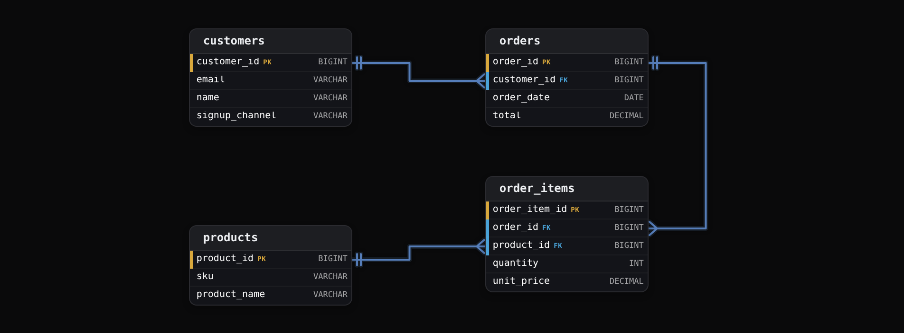
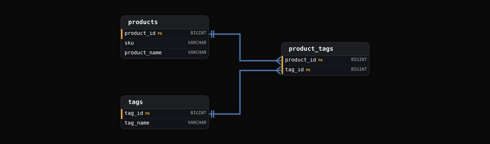
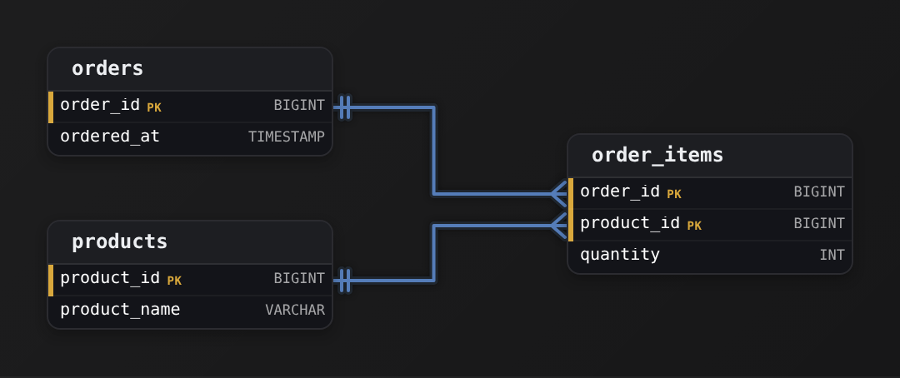
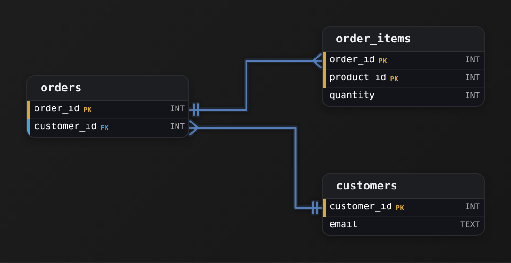
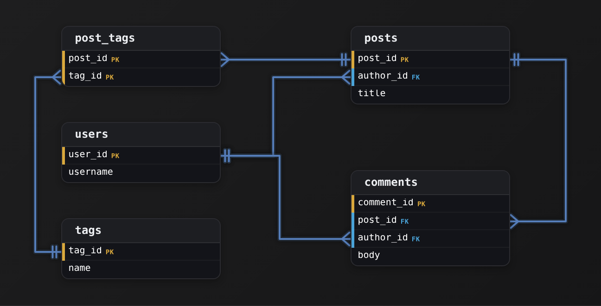

Intermediate·Data Modeling · 22 min · 10 challenges

# Keys & Identity

FreshCart closed March 2024 with revenue 11% higher than its payment processor settled. The cause was 2 `customers` rows for 1 person, 1 from the app and 1 from the website, and every order joined to both. Nothing in the schema said those rows had to be different people. Keys are how a schema says that, and this lesson is how to choose them.


<br>

---

## The Problem of Identity

A row in a relational table stands for 1 thing in the world: 1 customer, 1 product, 1 line on 1 order. The database holds the row's columns, and the modeller supplies the rule that says which thing the row stands for. Identity is that rule. When the rule is missing, the database stores 2 rows for 1 customer without complaint, and every query that assumes 1 row per customer returns wrong numbers with no error.


<br>

### Dorota Kaminski, Twice

FreshCart loaded its `customers` table from the mobile app and from the website checkout. Each source wrote a row per sign-up, and nothing in the table stopped 2 rows from describing the same person. Dorota Kaminski signed up on both.

| name | email | signup_channel | created_at |
| --- | --- | --- | --- |
| Priya Nair | priya.nair@example.com | app | 2024-02-03 |
| Priya Nair | Priya.Nair@example.com | web | 2024-02-19 |

The 2 rows differ by 1 capital letter and a channel. To the database they are 2 rows; to the business they are 1 customer with 6 orders in March totalling $412. The `orders` table stored the email she typed at checkout, so a revenue query joining on email matches each order against both rows.

```sql
SELECT
  c.name,
  COUNT(*) AS orders,
  SUM(o.total) AS revenue
FROM orders AS o
JOIN customers AS c
  ON LOWER(o.email) = LOWER(c.email)
WHERE o.order_month = '2024-03'
GROUP BY c.name
```

| name | orders | revenue |
| --- | --- | --- |
| Priya Nair | 12 | 824.00 |

Six orders became 12 and $412 became $824. The `LOWER()` that was meant to tolerate casing is what made both rows match, and the join multiplied every order row by the number of customer rows it found. Across 40 million customers, 1.8 million had a second row, and the March revenue report overstated the settled total by 11%.


<br>

### Updates and deletes go wrong the same way

Joins are the loudest symptom, and writes carry the same defect. An `UPDATE customers SET marketing_opt_in = false WHERE email = 'priya.nair@example.com'` changes 1 of her 2 rows, and the next campaign emails her anyway. A GDPR erasure `DELETE` removes 1 row and leaves the other for an auditor to find. A deduplication job keeping the newest row per name merges Dorota with every other Dorota Kaminski in the table.

Each failure traces to the same missing rule: no column, or set of columns, that the schema guarantees is unique per entity, so nothing can say 'this row and only this row'. Joins and writes need that rule to land on exactly 1 row, and deduplication needs it to know what 'same' means.


<br>

### Identity is a modelling decision

The database can't invent the rule, but it enforces one once declared: a `PRIMARY KEY` rejects a repeated value, and a `UNIQUE` index on `LOWER(email)` would have rejected Dorota's second sign-up. Whether 2 rows with the same email are 1 customer is the modeller's question, because a household can share an inbox and 1 person can hold 2 accounts, and it gets answered before any constraint is written. The answer starts from the grain, what 1 row is, and the identity column is whatever makes 1 row at that grain distinguishable from every other.

**FreshCart's orders table has 3 rows with order_number 'FC-88102', each with a different updated_at. A report that sums total per order shows triple revenue for that order. Which statement describes the defect?**

- **A.** The report should use MAX(total) instead of SUM(total).
- **B.** orders has no column that is unique per order, so the table cannot tell a new order from a new version of an old one.
- **C.** updated_at should be dropped so the rows become identical and can be deduplicated.
- **D.** The report needs DISTINCT on order_number.

<details>
<summary>Solution</summary>

**B.** orders has no column that is unique per order, so the table cannot tell a new order from a new version of an old one.

Three rows share the identifier the business uses for 1 order. Either the grain is 1 row per order version, and the key must include updated_at, or the grain is 1 row per order and 2 of these rows should never have been inserted.

**Why the others are wrong**

- **A.** That hides the symptom for this 1 report and leaves every other query exposed. The next join on order_number fans out exactly the same way.
- **C.** Removing a column does not create identity. The rows would still be 3 rows, and nothing would stop a 4th from arriving.
- **D.** DISTINCT collapses the rows in this 1 query, but nothing says which of the 3 versions is the order the business means, and the table keeps all 3.

</details>

The defect lives in the table, and every fix applied in a query is a patch over it. The column that carries identity, declared so the database enforces it, is the primary key, and choosing one that holds up is the next section.


<br>

---

## Primary Keys: Data Identity

A primary key is the column, or set of columns, the schema guarantees is unique and non-null for every row. The database enforces it with an index: an insert that repeats an existing key value fails before the row lands. Everything else leans on that guarantee: a join matches on it, a foreign key points at it, an `UPDATE ... WHERE id = ?` touches 1 row because of it, and a `MERGE` uses it to choose between update and insert.


<br>

### The 4 properties

> What a primary key must be
>
> - Unique: no 2 rows share the value, enforced by the index behind the constraint, so a duplicate insert fails rather than landing.
> - Non-null: NULL isn't equal to NULL in SQL, so a nullable key could never be matched by a join and could never fail the uniqueness check.
> - Immutable: a value that changes after insert has to change in every row that references it, and in every historical copy that will never be rewritten.
> - Minimal: no column can be dropped and leave the rest still unique. `customer_id` qualifies; `(customer_id, email)` is unique too, but `email` adds nothing.

Uniqueness and non-null are what the constraint enforces. Immutability and minimality are the modeller's choice, and so is width, since every foreign key and index entry copies the key: the database accepts a 120-character email as a primary key, and an `UPDATE` to it. A key that never collides stays unique across 3 boundaries: the rows in the table now, the rows it will hold over the years, and rows merged in from another system.


<br>

### Collision across time: the recycled SKU

FreshCart's `products` table used `sku` as its primary key. SKU `FC-0417`, a 6-pack of sesame bagels, was discontinued in January 2023, and merchandising reuses codes: in March 2024 `FC-0417` came back on a 1-litre oat milk. `order_items` referenced products by `sku`, so every bagel order since 2021 now joins to oat milk, and the bagels have no product row at all. The business needed both rows:

| sku | product_name | listed_from | discontinued |
| --- | --- | --- | --- |
| FC-0417 | Sesame Bagels 6pk | 2021-04-12 | 2023-01-31 |
| FC-0417 | Oat Milk 1L | 2024-03-18 | NULL |

- **21 months** — of bagel sales reported as oat milk

The table can't hold both rows, because the key says they are 1 product. `sku` was unique in 2021 and is unique today; it collided across time because the system minting it has a reuse policy the warehouse doesn't control. Emails fail the same way: customers change them, and some providers hand released addresses to new owners.


<br>

### Natural keys and surrogate keys

A natural key is a value from the business domain that identifies the entity: an email, a SKU, an ISO country code, a VIN. A surrogate key is a value the system generates purely to identify the row: a sequence integer, a UUID, a hash. Nothing in the business can edit or recycle it, which is where its immutability comes from. The natural key stays as an attribute, so a lookup by SKU still works, but other tables stop pointing at it.

| ✓ Natural key as PK | ✗ Surrogate key as PK |
| --- | --- |
| • Readable in every join and every log line<br><br>• Changes when the business changes it, and the change must reach every referencing row<br><br>• Reused by the source system without warning<br><br>• As wide as the email or name it holds, often 20 to 120 characters | • Meaningless integer or UUID, so nothing in the business can alter it<br><br>• Fixed at 8 or 16 bytes and copied into every foreign key<br><br>• Holds 2 rows for 1 natural key, such as both listings of FC-0417<br><br>• Needs the natural key kept UNIQUE at its true grain, or duplicates get in |

The decision turns on who controls the value. A `countries` table keyed on the ISO 3166 alpha-2 code is sound: the standards body changes a code about once a decade and the table is tiny. A `products` table keyed on a SKU that merchandising recycles is a collision waiting for a reorder. FreshCart moved to a `product_id BIGINT` surrogate: the bagels became 40817 and the oat milk 118204, each carrying `FC-0417`. Uniqueness moved to the grain the SKU is actually unique at, `UNIQUE (sku, listed_from)`, so each listing period appears once and a replayed product load can't insert the oat milk twice.

**FreshCart is adding a stores table for its 312 pickup locations. Each store has a store_code like 'LDN-014' assigned by operations, unchanged in 9 years. Which primary key is defensible?**

- **A.** store_code as the primary key, since it has been stable for 9 years.
- **B.** A store_id BIGINT surrogate, with store_code as a UNIQUE attribute.
- **C.** store_name as the primary key, since the business refers to stores by name.
- **D.** No primary key, since 312 rows are too few to matter.

<details>
<summary>Solution</summary>

**B.** A store_id BIGINT surrogate, with store_code as a UNIQUE attribute.

The surrogate never changes, the UNIQUE constraint keeps duplicate codes out, and a renumbering becomes 1 attribute update instead of a rewrite of every referencing row.

**Why the others are wrong**

- **A.** Stability so far isn't immutability. Operations has made no promise against renumbering, and a store that moves region gets a new prefix. Every orders.store_code would then need rewriting.
- **C.** A store name is the least stable value FreshCart has: 2 stores in 1 city share a naming pattern, and marketing renames stores at will.
- **D.** Row count has nothing to do with identity. A 312-row table referenced by 2.1 billion order items is the 1 place a collision costs the most.

</details>

A surrogate gives the row an identity the business can't disturb. What other tables do with that identity, and what the database does when the row behind it disappears, is the subject of foreign keys.


<br>

---

## Data Modeling

### Exercise 1 of 2

**● TASK**

Create a users table with a proper primary key. Members sign up with an email and a username, and both can be changed later; when an account is closed its row stays on the table, and its username may be claimed by a new member. Keep email and username on the table so members can still be looked up by them.

<details>
<summary><strong>Solution</strong></summary>

#### A key the business cannot touch

This table needs a **surrogate key**: a value the system generates only to identify the row, such as a sequence number in `user_id`. Neither natural candidate passes the primary key rules here. `email` breaks immutability, because a member can change it. `username` breaks collision across time, because a closed account keeps its row while a new member takes the same name. Generating the key is the only way to get one that is unique, never null and never edited.


*`user_id` is generated and owns identity; `email` and `username` stay as attributes for lookup.*

| Pitfall: Unique today is not unique forever |
| --- |
| Keying on `username` passes every check on day one. Then an account closes, its row stays, and a new member claims the same name. Now the insert either fails or the closed account has to be renamed, which rewrites history. This is the recycled-SKU problem in a new setting. |

| ✕ Natural key | ✓ Surrogate key |
| --- | --- |
| `email` or `username` is readable in every log line. But it changes when the member edits it, and every copy of the old value has to follow. A released name can also come back attached to a different person. | `user_id` means nothing to the business, so nothing in the business can edit or reuse it. `email` and `username` stay as plain columns, so a lookup by either still works. |

| Real world: Keep the natural key, demote it |
| --- |
| Production user tables almost always carry both: a generated `user_id` as the key, with the login handle and email as ordinary columns that support search. The handle is for people; the generated key is what the system relies on. |

**Follow-up questions**

1. The business now says no 2 open accounts may share an `email`. Does that make `email` a good primary key?\
   *Separates a uniqueness rule on an attribute from the immutability a key needs.*
2. A partner system sends a numeric member number it promises never to change or reuse. Would you still generate your own `user_id`?\
   *Weighs a trusted natural key against owning identity yourself.*

</details>


<br>

### Exercise 2 of 2

**● TASK**

Design an employees table with a primary key and basic profile columns.

<details>
<summary><strong>Solution</strong></summary>

#### One entity, one table, one key

This is the starting move of every schema: take a real-world thing you need to track and turn it into a table. Here the thing is an employee, so you get an `employees` table where **each row is exactly one employee**. That row-equals-one-entity rule is the whole game, and the primary key is what enforces it: `emp_id` is the column that promises every row is a distinct, addressable employee.


*One entity table: `emp_id` identifies the row, the rest are attributes describing it.*

1. **Name the entity as the table**

   The noun you are storing becomes the table: `employees`, plural, because it holds many of them. Everything you decide next hangs off this one choice, so get the grain right first: one row per employee, not one row per paycheck or per department.

2. **Give it a primary key**

   Add `emp_id` as the primary key. It is the column the database uses to tell rows apart and the handle other tables will point at later. A synthetic key like `emp_id` beats keying on a name, because 2 people really can both be 'Jordan Lee' and a good key must stay unique and never change.

3. **Hang the attributes off it**

   `first_name`, `last_name`, and `department` are attributes: facts that describe the employee the key identifies. Each one belongs here because it is true of the whole employee, not of some sub-thing. If a fact needed its own key someday, that is your signal it wants its own table.

| Pitfall: Common pitfall |
| --- |
| Keying on `first_name` + `last_name` instead of a dedicated `emp_id`. It looks unique until your second Jordan Lee is hired, and then the 'key' collides and rows blur together. A primary key must be unique and stable; a person's name is neither, which is exactly why you mint a `emp_id` the business never has to retype. |

| Key insight: PK vs. attribute is the core distinction |
| --- |
| `emp_id` answers 'which employee?'; `first_name`, `last_name`, and `department` answer 'what is this employee like?'. Every column you add later sorts into one of those 2 jobs. Getting that sort right is what keeps a table from turning into a junk drawer. |

**Follow-up questions**

1. If an employee can belong to more than one department, does `department` still belong in `employees`?\
   *Tests when a repeating attribute has outgrown its column and wants its own table plus a link.*
2. What would you use as the primary key if the company already issues a badge number to every hire?\
   *Natural vs. synthetic key: a stable, unique business identifier can serve as the PK directly.*

</details>


<br>

---

## Foreign Keys

A foreign key is a column in one table whose values are drawn from the primary key of another. `orders.customer_id` holds values that exist in `customers.customer_id`, and the rule that says so is referential integrity: every value in the child column matches a parent row, or is NULL. In a one-to-many relationship the foreign key sits on the many side: each order has exactly 1 customer, so the customer's id fits in 1 column of the order row.



`order_items` carries 2 foreign keys because a line sits in 1 order and names 1 product. Read from the many side, the diagram is the business: lines belong to orders, orders to customers. A `customers.order_id` column would instead say each customer has 1 order.


<br>

### What enforcement buys, and where it is missing

PostgreSQL checks the constraint on every write, as do MySQL and SQL Server: an insert into `orders` naming a nonexistent customer fails, and deleting a customer with orders fails or cascades according to the declared action. The cloud warehouses behave differently. BigQuery and Snowflake accept `FOREIGN KEY` declarations, as do Redshift and Databricks, and none of them checks at write time, which is where data engineers get caught. The declaration is metadata the optimizer may use to skip a join it can prove loses no rows, and nothing more.

```sql
INSERT INTO orders (order_id, customer_id, order_date, total)
VALUES (90117, 99999999, '2024-04-29', 48.20);
```


<br>

### Orphans corrupt aggregates without an error

An orphan is a child row whose foreign key matches no parent. FreshCart's deduplication job merged 3,400 duplicate customers like Dorota's second row by deleting the losing row, and 41,000 genuine April `orders` kept pointing at the deleted ids. An inner join drops those orders, so revenue by segment undercounts by $2.4 million with no error. A left join keeps them with NULL in every customer column, and the $2.4 million lands in a segment the dashboard labels 'Unknown'. Either way finance and sales disagree until someone finds the gap weeks later.

| join type | order rows | revenue reported | where the $2.4M went |
| --- | --- | --- | --- |
| inner join | 1,159,000 | $69.0M | dropped from the result |
| left join | 1,200,000 | $71.4M | segment NULL, shown as Unknown |


<br>

### Delete actions

| action | on parent delete | fits |
| --- | --- | --- |
| RESTRICT / NO ACTION | the delete fails while child rows exist | production OLTP; forces explicit cleanup |
| CASCADE | child rows are deleted too | tightly owned children, such as order_items under orders |
| SET NULL | the child's FK becomes NULL | child is meaningful without the parent, such as orders after a customer erasure |
| SET DEFAULT | the child's FK takes a declared default | rare; needs a real default parent row |

`CASCADE` from `orders` to `order_items` is reasonable, because a line has no meaning without its order. `CASCADE` from `customers` to `orders` deletes revenue history: the deduplication job would have taken 41,000 real orders with it. A merge re-points children to the surviving row before deleting the loser. `SET NULL` keeps the orders and loses only the link, which is what a GDPR erasure usually wants: the money stays, the person goes. In a warehouse these actions are pipeline logic, and the dimension load checks for referencing facts before it deletes.

> FK discipline in a warehouse
>
> - Declare the constraint anyway: the optimizer uses it, and the relationship is documented in the catalog.
> - Test it on every load: a dbt relationships test or an anti-join that counts orphans, failing the run above 0.
> - Never delete a dimension row without first counting the facts that point at it.
> - Load parents before children in the same run, or the test fails on rows that are late rather than wrong.

**FreshCart's nightly load into Snowflake rebuilds dim_product from the merchandising feed, and 40 products discontinued yesterday are absent from today's feed. fact_order_item has 2.1 billion rows, 900,000 of which reference those products. The FOREIGN KEY is declared. What happens tonight?**

- **A.** Snowflake rejects the rebuild because 900,000 facts still reference the 40 products.
- **B.** The 900,000 facts become orphans, and tomorrow's product sales report drops them or shows them under NULL, depending on the join.
- **C.** Snowflake sets product_id to NULL on the 900,000 facts.
- **D.** The optimizer uses the declared constraint to re-point the facts at current product rows.

<details>
<summary>Solution</summary>

**B.** The 900,000 facts become orphans, and tomorrow's product sales report drops them or shows them under NULL, depending on the join.

No error is raised. The missing product rows leave the facts pointing at nothing, and the join type decides whether their revenue vanishes or lands in 'Unknown'.

**Why the others are wrong**

- **A.** Snowflake does not check the constraint on write. The rebuild succeeds and the 40 dimension rows are gone.
- **C.** SET NULL is an action an enforcing engine performs. Snowflake performs no action on child rows, because it never looks at them.
- **D.** The optimizer may use a declared FK to eliminate a join; it never rewrites data.

</details>

The fix keeps discontinued products in the dimension with a status flag, so every fact keeps its parent. In a warehouse that rule lives in the pipeline, because nothing else will apply it.


<br>

---

## Data Modeling

### Exercise 1 of 2

**● TASK**

Design a customers table and an orders table where each order is linked to a customer through a foreign key.

<details>
<summary><strong>Solution</strong></summary>

#### One column that points at another table's key

A **foreign key** is a column that stores the primary key of a row in another table, and that one pointer is the whole relationship. Here `orders.customer_id` holds a value that must already exist in `customers.customer_id`. Every order names exactly one customer, and the database refuses an order that points at a customer who isn't there. Each table keeps its own primary key (`customer_id`, `order_id`) to fix its grain, and the link is the extra column on `orders`.


*`orders.customer_id` references `customers.customer_id`: many orders, one customer.*

Look at which side carries the key. Because `customer_id` lives on `orders`, one customer can appear on any number of order rows while each order holds just one customer. That placement is what makes it **one-to-many**: the row on the many side always holds the foreign key.

| Pitfall: An `order_id` on `customers` allows one order each |
| --- |
| Flipping the pointer and putting an `order_id` column on `customers` gives each customer room for a single order. The second one has nowhere to go except overwriting the first or duplicating the customer row. Ask 'which row can there be many of?' and put the key there. |

| Real world: Most app schemas are this shape repeated |
| --- |
| `users` and `sessions`, `posts` and `comments`, `invoices` and `line_items` all follow it. Declaring the constraint, rather than just naming a column `customer_id`, is what lets the database reject orphaned rows and lets a `JOIN` reassemble the tables through the key. |

**Follow-up questions**

1. How would you let an order contain many products while a product appears on many orders?\
   *Many-to-many needs a third table such as `order_items` holding 2 foreign keys.*
2. What should happen to a customer's orders when the customer row is deleted?\
   *Referential actions on the foreign key: `ON DELETE CASCADE` versus `ON DELETE RESTRICT`.*

</details>


<br>

### Exercise 2 of 2

**● TASK**

Create a users table and a posts table connected by a foreign key relationship.

<details>
<summary><strong>Solution</strong></summary>

#### The foreign key that turns 2 tables into one model

A **foreign key** is a column in one table that stores the primary key value of a row in another. Here `posts` carries `author_id`, and every value in it is a real `user_id` from `users`. The primary key names each user exactly once; the foreign key points back at that name. The 2 tables are never physically merged. The relationship is the promise that every `author_id` matches some `user_id`.


*`posts.author_id` references `users.user_id`: many posts, one author.*

One user can appear in many `posts` rows, since many rows can hold the same `author_id`. A single post has exactly one `author_id`, so it belongs to exactly one user. That asymmetry is **one-to-many**, and the foreign key always sits on the many side. Ask which thing there can be lots of, and put the pointer there.

| Pitfall: The link goes on the many side |
| --- |
| Adding a `post_id` column to `users` records only one post per user. The moment someone writes a second post there is nowhere to put it. Putting `author_id` on `posts` means `users` never has to grow a column per child. |

| Real world: The database enforces the promise for you |
| --- |
| Once `author_id` is declared a foreign key, an insert into `posts` with no matching `user_id` is rejected, and deleting a referenced user is blocked or cascades instead of orphaning posts. That referential integrity is why you model the link explicitly rather than keeping the numbers consistent by hand. |

**Follow-up questions**

1. How would you model a post that can have many tags, and a tag that applies to many posts?\
   *A single foreign key only expresses one-to-many; many-to-many needs a junction table holding 2 foreign keys.*
2. What should happen to a user's posts when that user is deleted?\
   *Delete behavior on `author_id`: cascade, restrict, or set null.*

</details>


<br>

---

## Composite Keys

A composite key is a primary key made of 2 or more columns, unique in combination where no single column is unique on its own. The database treats the combination as 1 value for enforcement: `(product_id, tag_id)` can appear once, while `product_id` 40817 may appear in 30 rows and `tag_id` 7 in 20,000. The shape appears wherever the entity being identified is a relationship between 2 other entities rather than a thing of its own.


<br>

### The junction table

FreshCart tags products for search: organic, gluten-free, local. A product has many tags and a tag many products, a many-to-many relationship no foreign key on either side can hold: a `product_id` column on `tags` would allow 1 product per tag. The junction table `product_tags` resolves it with 1 row per product-tag pair and a foreign key to each parent.



The composite key `(product_id, tag_id)` states the business rule directly: a product carries a given tag once. The grain is 1 row per product-tag pair, and the key is the grain written down. A surrogate `product_tag_id` here would still need `UNIQUE (product_id, tag_id)`, or the same pair could land twice; that constraint is the composite key under another name.


<br>

### When the relationship grows attributes

A junction table stays a bare pair until the business records something about the relationship itself, such as who applied a tag and when. The cost of a composite key shows once another table points at a row of `product_tags`, say a `tag_reviews` table of compliance checks on each assignment: its foreign key carries both `product_id` and `tag_id`, so every join on it is 2 columns wide, and so is the index behind it. At that width a surrogate starts to pay for itself.

The same pattern runs through dimensional modelling. A type 2 slowly changing dimension holds many versions of 1 customer, and the versions could be told apart by `(customer_id, valid_from)`. The standard choice is a surrogate `customer_sk` per version, because 2.1 billion fact rows each store 1 key column instead of a natural key plus a date.


<br>

### The partial dependency trap

If `product_tags` also stored `product_name`, that column would depend on `product_id` alone. That's a partial dependency, a non-key column depending on part of the key, and second normal form forbids it: a rename reaches `products` while 30 rows in `product_tags` keep the old name. Every non-key column in a composite-key table depends on the whole key, and anything depending on part of it belongs in that part's own table.


<br>

---

## Data Modeling

### Exercise 1 of 2

**● TASK**

Orders and products are many-to-many: one order holds many products, and one product appears on many orders. Model orders, products and the order lines that link them, with each line recording the quantity ordered. A product appears at most once per order, so the order and the product together identify a line.

<details>
<summary><strong>Solution</strong></summary>

#### The junction table and its composite key

Orders and products cannot point at each other directly. A product column on `orders` holds only one product, and an order column on `products` holds only one order. The many-to-many lives in a third table, a junction table, with one row per (order, product) pair. Each of its 2 columns is a foreign key to one side. Together they form a **composite primary key**: neither column is unique alone, but the pair is, and that pair is exactly the order line.



*`order_items` resolves the many-to-many: `order_id` and `product_id` each reference a parent, and together they are the key. `quantity` describes the pairing.*

Each key column has 2 jobs. As a foreign key, `order_id` must name a real order. As half of the primary key, it combines with `product_id` so the same product cannot land on one order twice. `quantity` is outside the key: it is a fact about the line, not part of what makes the line unique. Re-adding a product to an order updates that line's `quantity` and creates no second row.

**The junction table as DDL**

```sql
CREATE TABLE order_items (
    order_id   BIGINT NOT NULL REFERENCES orders (order_id),
    product_id BIGINT NOT NULL REFERENCES products (product_id),
    quantity   INT    NOT NULL,
    PRIMARY KEY (order_id, product_id)
);
```

*2 `REFERENCES` clauses make the pair point at both sides; `PRIMARY KEY (order_id, product_id)` makes the pair the identity.*

| Pitfall: A lone surrogate id drops the line's identity |
| --- |
| A common wrong version gives `order_items` a single `id` key and leaves `order_id` and `product_id` as plain columns. The database then accepts the same product twice on one order, because each copy gets its own `id`. A surrogate can sit beside the pair, but only together with a `UNIQUE (order_id, product_id)` constraint. Without that constraint, nothing says what one row is. |

| Key insight: Every many-to-many becomes a table keyed by its pair |
| --- |
| Students and courses (`enrollments`), users and roles (`user_roles`), and posts and tags (`post_tags`) all follow the same shape. Whenever 2 things relate many-to-many, the link gets its own table. Its key is the pair of foreign keys, and facts about the link (a grade, a `quantity`, an `assigned_at`) are non-key columns. |

**Follow-up questions**

1. What changes if the same product may appear on one order twice, each time at a different unit price?\
   *Relaxing the pair's uniqueness means the key needs a column that tells 2 lines apart, or a surrogate that sits beside a widened `UNIQUE` constraint.*
2. What if every time a product is added to an order must be kept as its own row, along with when it was added?\
   *Recording every re-add as its own row makes `added_at` part of what identifies a line, so the key grows to 3 columns or moves to a surrogate plus `UNIQUE`.*

</details>


<br>

### Exercise 2 of 2

**● TASK**

Students enroll in many courses and each course holds many students. Model students, courses and their enrollments so that an enrollment is identified by the student-course pair, and the same student can never be enrolled twice in the same course. Record when each enrollment happened.

<details>
<summary><strong>Solution</strong></summary>

#### One row per student-course pair

An enrollment has no identity apart from the 2 things it connects, so its primary key is a **composite key**: `student_id` and `course_id` taken together. A student shows up in many rows and a course shows up in many rows, but one student in one course shows up exactly once. Uniqueness lives on the combination, never on either column alone.

The table carrying that key is a **junction table**. Students and courses are many-to-many, and neither side can hold a single foreign key to the other, so the relationship gets a table of its own whose rows are the links. Each key column is also a foreign key: `student_id` points at `students` and `course_id` at `courses`. `enrolled_at` lives here too because it describes the enrollment, not the student or the course.


*`course_enrollments` sits between the 2 parents; its 2 foreign keys together form its primary key.*

| Pitfall: 2 separate keys is not a composite key |
| --- |
| Marking `student_id` unique and `course_id` unique on their own would let each student take only one course and each course hold only one student. A table has one primary key, and here it spans both columns: the tuple (`student_id`, `course_id`) is what must be unique. |

| ✕ Composite key | ✓ Surrogate beside the pair |
| --- | --- |
| Key is (`student_id`, `course_id`) directly. The pair that identifies an enrollment is the identifier, with no extra column. | Add an `enrollment_id` surrogate as the key and keep UNIQUE on (`student_id`, `course_id`). Useful when other tables must reference one enrollment column; the surrogate sits beside the pair constraint and never replaces it. |

**Follow-up questions**

1. What changes if a student may retake the same course in a later term?\
   *The pair stops being unique. You can extend the key with the term, but a composite that keeps growing is the signal to add a surrogate and demote the triple to UNIQUE.*
2. What goes wrong if `course_enrollments` has a surrogate key and no uniqueness on the pair?\
   *Nothing says what one row is, so a replayed load writes the same enrollment twice and no constraint rejects it.*

</details>


<br>

---

## Key Generation Strategies

The generator behind a surrogate key decides 3 things: how wide the key is, whether consecutive keys arrive in order, and whether 2 writers can mint keys without coordinating. The common options are a database sequence, a UUID, a hash of the natural key, and the natural key itself.


<br>

### Sequences: compact and ordered, until they run out

A sequence is an atomic counter the database maintains: `BIGSERIAL` in PostgreSQL, `IDENTITY` in SQL Server and Snowflake. Each call returns the next integer, so keys arrive in insert order and pack B-tree indexes tightly, every new key landing at the right-hand edge. The key's width is the column's type, 8 bytes for `BIGINT`, and that's where tables go wrong: `SERIAL` and `INT` are 32-bit signed and stop a little past 2.1 billion. FreshCart created `order_items` with `SERIAL` in 2021, and at around 2 million lines a day it crossed that limit in its 3rd year. The next insert failed and took checkout down with it. The repair took `ALTER SEQUENCE ... AS bigint` plus an `ALTER COLUMN ... TYPE BIGINT` that rewrote the table under an exclusive lock for 2 hours.

- **2,147,483,647** — the last key a 32-bit sequence can mint

A sequence's other limit is coordination: 1 counter in 1 database, so 400 Spark tasks writing a dimension can't each take the next value without serialising on it. `BIGINT` is the right default for anything that might pass 100 million rows; the extra 4 bytes a row come to 800 MB on 200 million rows, far cheaper than the outage FreshCart had.


<br>

### UUIDs: unique anywhere, at a cost in width

A UUID is 128 bits. Version 4 is random, so any process anywhere mints one with no coordination, and with 2^122 possible values a collision isn't worth planning for. A native `UUID` column stores 16 bytes and the text form 36, so 500 million keys take 18 GB as text against 4 GB as `BIGINT`, before every foreign key and index copies them. Random values also scatter inserts across the index, fragmenting it. Version 7, standardised in RFC 9562, leads with a 48-bit millisecond timestamp, so keys sort by creation time and inserts cluster at the index's right edge, keeping the coordination-free property without the fragmentation. It's the default for ids minted on clients or across services.


<br>

### Hash keys: deterministic and replayable

A hash key is `MD5` or `SHA-256` of the natural key, with a separator so ('ab','c') and ('a','bc') stay apart: `md5('FC-0417' || '|' || '2024-03-18')`. The same input yields the same key on every run and every worker, so a fact load computes `product_key` from the natural key in parallel with the dimension load, with no lookup. Sequence keys exist only after the dimension insert, so every fact load waits for it and looks them up. Data Vault builds its hubs and links this way. The costs: MD5 is 16 bytes like a UUID, SHA-256 is 32, and hex text doubles each; the values have no order; and 2 inputs can in principle collide, negligible for SHA-256 and the reason some teams avoid MD5. The key is only as stable as its input: the recycled SKU hashes alike for bagels and oat milk unless the listing date is included.


<br>

### Natural keys, kept where they belong

A natural key still fits as the primary key where the value is short and set by a standard the business doesn't control, so it rarely changes: ISO country and currency codes, a calendar `date_key` written as `20240318`. The test is unchanged: who can change or reuse the value, and how many rows would have to follow it.

| situation | strategy | reason |
| --- | --- | --- |
| OLTP table, 1 database writing | BIGINT sequence | 8 bytes, ordered, uniqueness guaranteed by the engine |
| Ids minted on clients or across services | UUID v7 | no coordination, time-ordered, 16 bytes |
| Warehouse dimension whose facts load in parallel | MD5 of the natural key | any worker derives it with no lookup |
| Date or calendar dimension | natural date_key integer | readable, never changes, 4 bytes |
| Reference data from a standard | natural code | tiny, stable, controlled outside the business |

**FreshCart loads dim_customer and fact_order into Snowflake from the same nightly extract, each with a Spark job of 400 tasks, and wants the fact job to run alongside the dimension job rather than after it. Which key generation fits dim_customer?**

- **A.** A Snowflake IDENTITY column, letting the warehouse assign keys on insert.
- **B.** UUID v4 generated inside each Spark task.
- **C.** md5(customer_natural_id) computed inside each task.
- **D.** row_number() over the input, offset by the current maximum key.

<details>
<summary>Solution</summary>

**C.** md5(customer_natural_id) computed inside each task.

Both jobs compute the same key from the same natural id, so facts carry the right customer_key without reading the dimension, and a re-run reproduces every key.

**Why the others are wrong**

- **A.** Correct with a MERGE on the natural key, so existing customers keep their keys, but the fact job must wait for the dimension and look up each customer's key before writing.
- **B.** Tasks mint keys freely, but the fact job cannot know which UUID the dimension job gave a customer, so it still needs a lookup.
- **D.** 400 tasks read the same offset and collide on one range, and the fact job still has to look up the numbers the dimension job assigned.

</details>

Hash keys are worth their width where separate jobs must agree on a key without talking to each other; a single writer is still best served by a `BIGINT` sequence. The habits below are what the 5 sections add up to.

| ✓ Do | ✗ Don't |
| --- | --- |
| • Give every table a primary key the business cannot change or reuse; keep natural keys UNIQUE at their grain.<br><br>• Default surrogate integers to BIGINT on any table that could pass 100 million rows.<br><br>• Put the foreign key on the many side, and test referential integrity in every warehouse load.<br><br>• Keep a UNIQUE constraint on the composite columns when a junction table gets a surrogate.<br><br>• Use hash keys where parallel jobs must agree on a key, and UUID v7 where services mint ids. | • Do not key a table on an email or SKU the source system can edit or recycle, and never on a name.<br><br>• Don't store UUIDs as 36-character text when the engine has a 16-byte UUID type.<br><br>• Do not CASCADE deletes from a parent whose children carry revenue history.<br><br>• Don't put a column in a composite-key table that depends on only part of the key.<br><br>• Don't assume a declared FOREIGN KEY in Snowflake, BigQuery or Redshift rejects anything. |


<br>

---

## Data Modeling

### Exercise 1 of 2

**● TASK**

Create a `sessions` table whose primary key is a system-generated UUID rather than a sequential integer. Each session belongs to a user and records the time it was created.

<details>
<summary><strong>Solution</strong></summary>

#### A surrogate key that isn't a counter

A **UUID surrogate key** moves key generation out of the database's sequence. Instead of the database handing out 1, 2, 3 in order, the primary key becomes a 128-bit value the system generates at random (or from a timestamp, depending on the UUID version). It is still a surrogate: `session_id` carries no business meaning, and its only job is to identify the row. What changes is who mints the key and what it looks like. That decision is what you modeled here; `user_id` and `created_at` are ordinary supporting columns.


*One user has many sessions. Each session is keyed by a system-generated `session_id` UUID, and `user_id` is the many-side foreign key back to `users`.*

| ✕ Sequential BIGSERIAL | ✓ UUID |
| --- | --- |
| `session_id BIGSERIAL PRIMARY KEY`. The database allocates the next number from a sequence, so keys are dense, ordered and small (8 bytes). The value is unique only within one table on one database, and it leaks volume: a session with id '10432' tells anyone who sees it roughly how many sessions exist, and lets them guess '10431'. | `session_id UUID PRIMARY KEY`. A generator produces a globally unique value with no central counter; it can be `gen_random_uuid()`, an app library or a client. There is nothing to enumerate, and 2 systems can mint keys at the same time without colliding. The cost is 16 bytes per key and no natural sort order. |

| Pitfall: A UUID key needs the UUID type |
| --- |
| A common mistake is typing `session_id` as `BIGINT` or `VARCHAR` and assuming a UUID will fit. A `BIGINT` cannot hold 128 bits. A `VARCHAR` wastes space, accepts malformed values and loses the fixed-width validation the `UUID` type gives you. Marking the column PK makes it the identifier; declaring it `UUID` makes it the **right kind of identifier** for a key minted outside the database. |

| Key insight: Keys can be minted before the row reaches the database |
| --- |
| Key generation is what this design turns on. A sequential key must come from the database, in order, through one central counter. A UUID can be minted anywhere: the app server before the row is written, an offline client that syncs later, or the database through a default. That is why UUIDs show up on entities created in distributed or client-first systems, where waiting on a central sequence would be a bottleneck or simply impossible. |

| Real world: Mixed generators across tables are normal |
| --- |
| Session and event tables are a classic home for UUIDs, because their rows are created fast, often at the edge, and should not be enumerable. `user_id` stays a `BIGINT` because users are minted centrally, where small, ordered keys pay off. A UUID key on `sessions` referencing an integer `user_id` on `users` is a normal one-to-many design, not an inconsistency to fix. |

**Follow-up questions**

1. What happens to insert locality on a huge table keyed by random UUID v4, and how does UUID v7 change that?\
   *Random UUIDs scatter inserts across the index, while time-ordered UUIDs keep new keys close together.*
2. If sessions were rebuilt by parallel jobs replaying the same raw events, would a random UUID still be the right generator, or would a hash key serve better?\
   *Compares a random UUID with a hash of the natural key when parallel jobs must agree on the same key.*

</details>


<br>

### Exercise 2 of 2

**● TASK**

Design an events table using a UUID primary key with basic event tracking columns.

<details>
<summary><strong>Solution</strong></summary>

#### A surrogate key, generated as a UUID

`event_id` is a **surrogate primary key**. It carries no business meaning. Its only job is to give every row one stable, unique handle. Generating it as a UUID means the key can be minted anywhere: by the app, by a queue consumer, or by the database, without asking a central sequence for the next number. That matters for an events table, because events arrive fast and from many places. A UUID lets each producer stamp an id without coordinating with anyone.


*One table: a UUID surrogate key plus the 3 columns that describe what happened, to whom, and when.*

| Key insight: A natural key breaks on the first collision |
| --- |
| It is tempting to key the table on something the event already carries, such as `(user_id, occurred_at)`. That natural key fails the moment one user fires 2 events in the same instant. A surrogate `event_id` avoids the problem entirely. It is unique by construction, and it never has to change, even if the meaning of the other columns does. |

| ✕ Auto-increment integer | ✓ UUID |
| --- | --- |
| A `BIGSERIAL` key is small and sorts in insert order. It also forces every writer through one sequence, so only the database can mint an id. That becomes a bottleneck when many producers ingest events at high volume. | A `uuid` is 16 bytes and unordered. Any producer can generate one independently, with no round trip to the database. For events streaming in from many services, that decentralized `event_id` generation is the whole point. |

| Pitfall: When it happened is not when it was written |
| --- |
| Don't drop `occurred_at` or merge it into a database `created_at`. The time the event happened and the time the row was written are different. For events, the first is the fact you actually care about. Keep `occurred_at` as its own column and let the producer set it. |

**Follow-up questions**

1. If the primary key also had to sort roughly in insertion order, what kind of UUID would you reach for?\
   *Time-ordered variants such as UUIDv7 keep decentralized generation and restore index locality.*
2. How would the schema change if `event_type` grew into a fixed set of a dozen known types you wanted to enforce?\
   *Carries the surrogate-key idea into a lookup table referenced by a foreign key.*

</details>


<br>

---

## Putting It All Together

FreshCart launches a loyalty programme. Members earn points from 3 services (checkout, delivery app, partner petrol stations), move between tiers over time, and the warehouse must report points per member per tier per month, with replays whenever a partner resends a day's file.

- The identity question comes first: 1 row in loyalty_members is 1 member, and 2 sign-ups with the same email are 1 member or 2 accounts by a rule written down before any constraint, so the March duplicate never recurs.
- The member's primary key is a surrogate member_id BIGINT , with the loyalty card number kept as a UNIQUE attribute, because cards are reissued and the number can't be trusted across time.
- points_events carries member_id as a foreign key on the many side, and since the warehouse is Snowflake, an anti-join test counts orphaned events on every load instead of relying on the declared constraint.
- Tier history is a relationship between a member and a tier that gains valid_from and valid_to , so it gets a surrogate member_tier_sk with UNIQUE on ( member_id , valid_from ) , the shape the tag assignment story ended on.
- Checkout and the delivery app mint event ids as UUID v7 so no service waits on a sequence, while the warehouse keys each event by md5 ( source || '|' || event_id ) , so a partner's resent file merges onto the same keys instead of creating a 2nd row.


<br>

---

## Data Modeling

### Exercise 1 of 2

**● TASK**

Design a small e-commerce schema demonstrating primary keys, foreign keys, and a composite key in a junction table.

<details>
<summary><strong>Solution</strong></summary>

#### 3 key types, one schema

This challenge asked you to place 3 kinds of keys correctly. A **primary key** uniquely identifies a row (`customer_id` in `customers`, `order_id` in `orders`). A foreign key points at another table's primary key to record a relationship (`orders.customer_id` referencing `customers.customer_id`). A composite primary key is a primary key made of more than one column at once, and it is the idiomatic way to model the many-to-many between orders and products inside the `order_items` junction table.



*customers -> orders is one-to-many; orders <-> products is many-to-many, resolved by the `order_items` junction table whose PK is the pair (`order_id`, `product_id`).*

| Key insight: The junction table is where the composite key lives |
| --- |
| An order can contain many products and a product can appear on many orders. A relational table cannot store that many-to-many directly, so you split it into a third table. `order_items` has one row per (order, product) pair, and the natural identity of that row IS the pair, so both `order_id` and `product_id` carry `PK`. Together they guarantee a product appears at most once per order; `quantity` then says how many. |

| ✕ Composite PK (`order_id`, `product_id`) | ✓ A surrogate `item_id` PK |
| --- | --- |
| Both columns are marked `PK`, so the database enforces one row per (order, product) pair for free. Add the same product twice to an order and the insert is rejected; you `UPDATE` the `quantity` instead. The key also states the business rule. | A single `item_id` `PK` makes every row unique on a meaningless number, so nothing stops the same `product_id` appearing twice under one `order_id`. You now need a separate `UNIQUE(order_id, product_id)` constraint to get back what the composite key gave you automatically. |

| Pitfall: Common pitfall: making the FK the PK by accident |
| --- |
| `orders.customer_id` is a foreign key, not a primary key. If you mark it `PK`, every customer could place at most one order, because the primary key must be unique per row. The row identity of an order is `order_id`; `customer_id` is just a `FK` pointer that may repeat as a customer places more orders. |

The same shape shows up any time 2 things relate through their pairing rather than one side owning the other: students to courses through an `enrollments` table, users to roles through `user_roles`, tags to posts through `post_tags`. Each is a junction table whose composite key is the pair of the 2 `FK`s it connects, often carrying its own attributes (a grade, a granted-at timestamp, a quantity) that belong to the pairing rather than to either side alone.

**Follow-up questions**

1. The same customer buys the same product on 2 different orders. Does the composite key on (`order_id`, `product_id`) allow that?\
   *Tests whether the learner sees that uniqueness is scoped to the pair, not to `product_id` alone: different `order_id` values make the pairs distinct.*
2. If you later needed to store a per-line discount, where would `discount` live, and would it change any of the keys?\
   *Reinforces that line-level attributes belong on `order_items` beside `quantity` and do not affect the composite `PK`.*

</details>


<br>

### Exercise 2 of 2

**● TASK**

Design the schema for a blogging platform. Users write posts, and users leave comments on posts. Each post can carry many tags and each tag can apply to many posts. Give every table a primary key, connect the related tables with foreign keys, and resolve the many-to-many relationship between posts and tags with a junction table whose composite primary key is the 2 foreign keys together.

<details>
<summary><strong>Solution</strong></summary>

#### Resolving a many-to-many with a junction table

The move this challenge trains is turning a many-to-many relationship into 2 one-to-many relationships. A post has one author, so `posts` just carries an `author_id` that points at `users.user_id`: a single foreign key column is enough for one-to-many. But a post has many tags AND a tag has many posts, and there is nowhere to put that. You cannot store many `tag_id` values in one `posts` column, and you cannot store many `post_id` values in one `tags` column. The relationship does not belong to either table, so it gets its own table: `post_tags`.



*One FK per one-to-many; the posts<->tags many-to-many is carried by the `post_tags` junction table.*

| Pitfall: The comma-list and repeated-column traps |
| --- |
| The 2 wrong answers people reach for first: a `tags` text column on `posts` holding 'sql,database,modeling', or fixed columns `tag1_id`, `tag2_id`, `tag3_id`. The comma list cannot be joined or indexed (you can't ask 'which posts have tag 7' without a substring scan, and 'sql' matches 'nosql'), and the numbered columns cap how many tags a post can have and leave most rows full of `NULL`. Both violate first normal form because one cell holds many values. The junction table is what keeps every cell atomic. |

**The five-table schema**

```sql
CREATE TABLE users (
    user_id  SERIAL PRIMARY KEY,
    username TEXT NOT NULL
);

CREATE TABLE posts (
    post_id   SERIAL PRIMARY KEY,
    author_id INT NOT NULL REFERENCES users(user_id),
    title     TEXT NOT NULL
);

CREATE TABLE comments (
    comment_id SERIAL PRIMARY KEY,
    post_id    INT NOT NULL REFERENCES posts(post_id),
    author_id  INT NOT NULL REFERENCES users(user_id),
    body       TEXT NOT NULL
);

CREATE TABLE tags (
    tag_id SERIAL PRIMARY KEY,
    name   TEXT NOT NULL
);

CREATE TABLE post_tags (
    post_id INT NOT NULL REFERENCES posts(post_id),
    tag_id  INT NOT NULL REFERENCES tags(tag_id),
    PRIMARY KEY (post_id, tag_id)
);
```

*`post_tags` is all key: its primary key IS the pair of foreign keys.*

Look closely at `post_tags`: it has no `id` of its own. Its 2 columns are each a foreign key, and together they are the composite primary key `PRIMARY KEY (post_id, tag_id)`. That composite key does real work: it says a given post can be linked to a given tag at most once, so you can never insert the same (post, tag) pair twice. Each single column still points many-to-one at its parent, so the one many-to-many became 2 clean one-to-many relationships pointing into the junction.

| ✕ Surrogate PK on posts | ✓ Composite PK on `post_tags` |
| --- | --- |
| `posts` gets a synthetic `post_id` because its natural identity (a title) isn't stable or unique. A surrogate key is the right call for a real entity. | `post_tags` has no identity of its own beyond the pair it links, so `(post_id, tag_id)` IS the key. Adding a surrogate `post_tag_id` here would be dead weight and would let duplicate pairs slip in unless you also add a UNIQUE constraint. |

| Real world: This shape is everywhere |
| --- |
| Any time you read 'each X can have many Y and each Y can have many X', a junction table is the answer: students to courses (`enrollments`), orders to products (`order_items`), users to roles (`user_roles`). The junction often grows its own attributes too, like an `enrolled_at` timestamp or a `quantity`, at which point the pattern earns even more of its keep. |

**Follow-up questions**

1. How would you record WHEN a tag was added to a post?\
   *Junction rows can carry their own attributes; add a `tagged_at` column to `post_tags` without touching the composite key.*
2. What breaks if you delete a `users` row that still has `posts`?\
   *Tests understanding of FK referential integrity and the ON DELETE choice (restrict vs cascade).*

</details>


<br>

---

## Key Takeaways

- Identity is a modelling decision: 1 row per entity at the table's grain, carried by a column the database can enforce as unique and non-null.
- A primary key never collides when the system controls its value: a surrogate for most tables, a natural key only for short, stable codes from an outside standard.
- The foreign key sits on the many side. Snowflake doesn't check it, and neither do BigQuery or Redshift, so the pipeline has to.
- A junction table's composite key states the relationship's grain; once the relationship gains attributes and history it becomes an entity with a surrogate.
- Generators differ in width and ordering, and in how much coordination they need: BIGINT sequences for 1 writer, UUID v7 across services, hash keys where parallel jobs must agree on a key.
