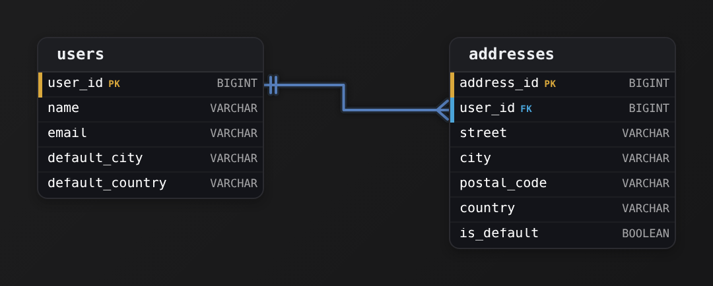
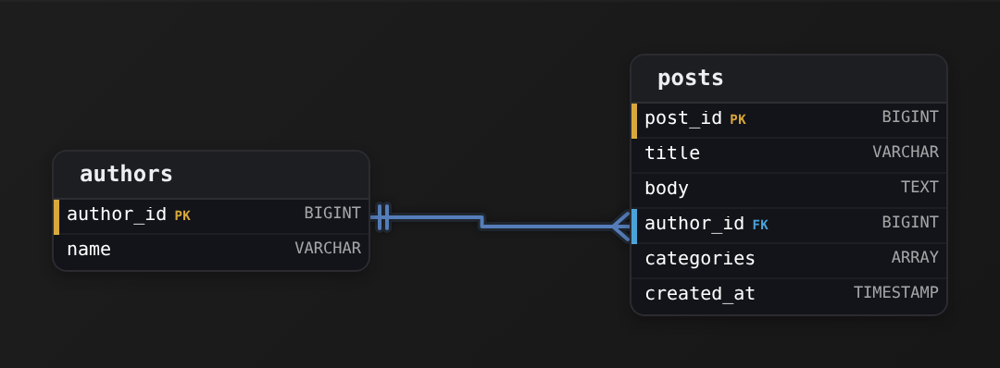
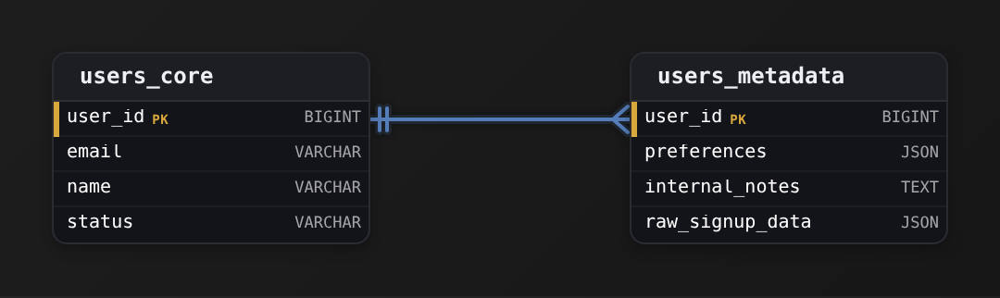
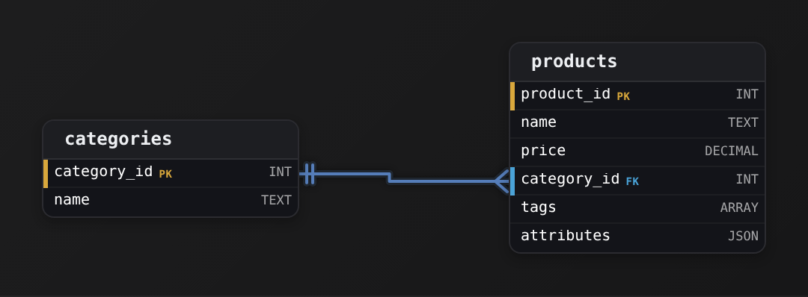
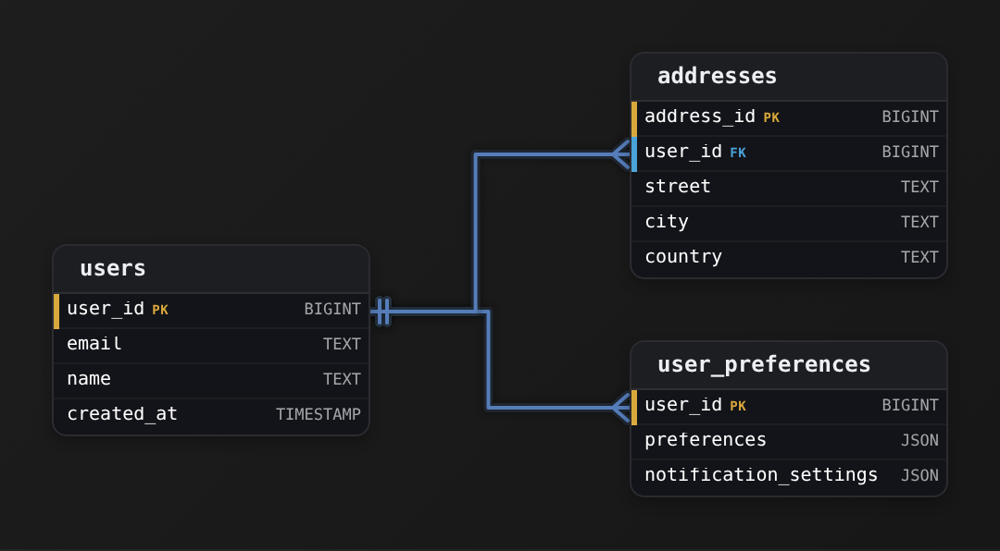

Intermediate·Data Modeling · 15 min · 12 challenges

# Nested Data

An Airbnb listing page shows a host, a location and a checklist of amenities: wifi, kitchen, free parking, 23 items on one listing and 4 on the next. A guest filters on 'has a dishwasher' and expects results in under a second. Whether those amenities live inside the listing row or in a table of their own decides how that filter runs and how the search index is rebuilt.


<br>

---

## The Nesting Decision

A nested column holds a structure where a flat column holds a single value. An order row in a flat schema stores `customer_id`, `order_date` and `total`, 1 value per column. The same order in a nested schema can also carry `items`, a list of 3 records, each with a sku, a quantity and a price. The list sits inside the row, so reading the order reads its items without a join.

orders

| order_id | customer_id | order_date |
| --- | --- | --- |
| 1001 | 77 | 2026-09-14 |
| 1002 | 12 | 2026-09-14 |

order_items

| order_id | sku | qty | price |
| --- | --- | --- | --- |
| 1001 | MUG-350 | 2 | 9.00 |
| 1001 | TEE-M | 1 | 24.00 |
| 1001 | CAP-BLK | 1 | 15.00 |
| 1002 | TEE-M | 3 | 24.00 |

Order 1001 occupies 1 row in `orders` and 3 rows in `order_items`, linked by `order_id`. Splitting a repeating part into its own table like this, 1 row per item, is called normalizing. The embedded version keeps the same facts in 1 table:

| order_id | customer_id | order_date | items |
| --- | --- | --- | --- |
| 1001 | 77 | 2026-09-14 | [{MUG-350, 2, 9.00}, {TEE-M, 1, 24.00}, {CAP-BLK, 1, 15.00}] |
| 1002 | 12 | 2026-09-14 | [{TEE-M, 3, 24.00}] |

Both versions answer every question about these orders. They differ in what a row means and therefore in which queries are cheap. In the normalized version, a row of `order_items` means 1 item of 1 order, so counting how many times `TEE-M` sold is a filter and a sum over 1 table. In the embedded version, a row means 1 complete order, so loading an order for the checkout page is 1 row read, and counting `TEE-M` sales means opening every list.


<br>

### Five questions that decide it

- **Ownership** *Does the child exist without the parent?*\
  A line item without its order means nothing, which argues for embedding. A product referenced by 10,000 orders has a life of its own, so it stays in a table.
- **Read pattern** *Are parent and child read together?*\
  Checkout loads an order with its items every time. A nightly report reads items alone, millions of them, and wants them as rows.
- **Update pattern** *Are children changed on their own?*\
  Amenities change when a host edits the listing, as a set. A review is edited by its author with no change to the listing, and belongs in its own table.
- **Size bound** *Does the list have a ceiling?*\
  Amenities come from a fixed list of 120 options, so a listing holds at most 120. Reviews on a popular listing pass 2,000 and keep growing, and a row that grows forever is a row you cannot embed.
- **Sharing** *Is the same child attached to many parents?*\
  A host with 5 listings is 1 host. Embedding the host in each listing makes 5 copies, and copies drift apart the first time the host changes their phone number.

Run the Airbnb listing through those 5 questions. Amenities exist only for the listing, load with it, change with it, stay small and belong to 1 listing: embed. Reviews are written and edited on their own, grow without a ceiling and are read in bulk by the ratings pipeline: normalize. The host is shared across listings, so the listing stores a `host_id` and the host table holds the facts, with at most a display name copied in for the search card.

| ✓ Embed when | ✗ Normalize when |
| --- | --- |
| • The child has no meaning outside this parent<br><br>• Parent and child are read together on the hot path<br><br>• The list has a small, known ceiling<br><br>• The child changes only when the parent changes | • The child is shared by many parents<br><br>• The child is queried in bulk across parents<br><br>• The list grows without bound<br><br>• The child is edited by a different process or team |

> **TIP**
>
> Ask the sharing question first. A shared child that gets embedded produces copies, and every later bug about stale data traces back to that one decision. The other 4 questions tune performance; this one decides correctness.

**A food delivery app models restaurants. Each restaurant has opening hours, menus, reviews and orders. Which of these belongs embedded in the restaurant row?**

- **A.** The orders placed at the restaurant, since each order belongs to exactly 1 restaurant
- **B.** The reviews, since they are shown on the restaurant page next to the menu
- **C.** The opening hours, 7 entries with an open and close time for each weekday
- **D.** The delivery drivers currently assigned, since dispatch reads them with the restaurant

<details>
<summary>Solution</summary>

**C.** The opening hours, 7 entries with an open and close time for each weekday

Opening hours pass all 5 questions: meaningless without the restaurant, read with it, changed by the owner as a set, capped at 7 entries and never shared. A list of 7 small records inside the row.

**Why the others are wrong**

- **A.** Orders belong to 1 restaurant, and that is the only question they pass. They grow without bound, are created by a different process and are read in bulk by finance, so they need their own table.
- **B.** Reviews load with the page, and that is their only yes. Each is edited by its author on its own, the list has no ceiling and the ratings job reads reviews across every restaurant as rows.
- **D.** Dispatch reads drivers with the restaurant, and that is the one yes. A driver serves many restaurants in a shift, so embedding copies the same driver into each, and the copies disagree the moment the driver's status changes.

</details>


<br>

---

## Data Modeling

### Exercise 1 of 2

**● TASK**

Model users and their saved addresses for an online shop. Each user (name, email) saves any number of addresses with street, city, postal code and country, and the delivery team queries addresses by postal code on their own. The page header shows the user's name with the city and country of their default address and must load from the user's row alone, without a join.

<details>
<summary><strong>Solution</strong></summary>

#### Normalize the collection, copy the hot fields

Every nesting decision is a question about how the data is read, and this model asks it twice. The full list of saved addresses has no upper bound and the delivery team queries it independently, so it gets its own table. The default address's city and country are read with the user on every page load, so they are **deliberately denormalized**: copied onto the user row even though the address table already holds them.



*`addresses.user_id` references `users.user_id`; `default_city` and `default_country` on `users` are deliberate copies of the default address.*

1. **Give the address list its own table**

   A user can save any number of addresses, and the delivery team filters them by `postal_code` without caring whose they are. Both facts put the list on the normalize side of the framework: the count is unbounded and the data is queried independently of the parent. So `addresses` gets its own `address_id` and a `user_id` foreign key back to `users`, and `is_default` marks the one the header shows.

2. **Copy the default city and country onto `users`**

   The header reads `name`, the default city and the default country on every page load. Joining to `addresses` and filtering on `is_default` for every one of those loads is the join this read pattern cannot afford, so `default_city` and `default_country` live on `users` too. That breaks third normal form on purpose: the same city now sits in 2 places, and you accept that so the hottest read is a single-row lookup.

| Pitfall: Flattening every address onto the user row |
| --- |
| Moving all the address fields onto `users` serves the header, but it caps a user at one address (or invents `street2`, `city2` columns), and the delivery team's postal-code filter now has to dig through user rows. Copy only the fields the hot read shows, and leave the collection normalized. |

| Key insight: A copied field is a promise the write path keeps |
| --- |
| When a user picks a different default, the same transaction flips `is_default` in `addresses` and rewrites `default_city` and `default_country` on `users`. That is the price of the duplicate: one extra write on a rare event, paid so a read that happens on every page view never joins. |

**Follow-up questions**

1. The header later needs the default street as well. Do you copy it too, or join?\
   *Weighs whether one more hot field still justifies widening the duplicate on `users`.*
2. How do you keep `default_city` correct if a user edits the address that is already their default?\
   *Checks that every write path touching the default address also updates the copy on `users`.*

</details>


<br>

### Exercise 2 of 2

**● TASK**

Design the embedded approach for user addresses: flatten address fields directly into the users table. Compare the trade-offs with normalization.

<details>
<summary><strong>Solution</strong></summary>

#### Embedding: keep the address in the row that owns it

Embedding is the gentlest form of **denormalization**. Addresses do not get their own table and a join. Their fields go straight onto `users` as `address_street`, `address_city` and `address_zip`. Each user has one address, it belongs to nobody else, and you almost always read it together with the user. So it is not an entity that needs a table. It is just more columns on the one you already have.


*One row per user, keyed by `user_id`. The address columns use that same key, so there is no second table and no join.*

The design has exactly one key, `user_id`, because the embedded address takes its identity from its owner. The `address_` prefix matters too. It marks the columns as one group, so a later `address_country` or a second group such as `billing_city` stays readable and never collides with `name` or `email`.

| ✕ Embedded (this design) | ✓ Normalized (separate table) |
| --- | --- |
| The address columns live on `users`. One lookup by `user_id` returns everything, and a write touches one row. This is the right choice when the relationship is strictly one-to-one and the data is read together. | An `addresses` table with its own key and a `user_id` foreign key back to `users`. Reads need `users JOIN addresses`. This is worth it when a user can have many addresses, when addresses are shared, or when you query addresses on their own. |

| Pitfall: A second address breaks the flat shape |
| --- |
| Embedding assumes each user has exactly one address. Once the product needs both shipping and billing, you end up with `shipping_street` next to `billing_street`, then more columns for every new kind of address. If more than one address per user is realistically coming, move addresses into their own table with a foreign key before the columns pile up. |

| Real world: Small, singular, fetched together: embed it |
| --- |
| The same pattern covers a product's dimensions and an order's snapshot of the price paid. Each is small, belongs to one owner and is read with that owner. Skipping the join means one less table to keep consistent and one less step on your busiest read path. Normalize when the child needs its own identity, not before. |

**Follow-up questions**

1. How would the design change if a user could store several addresses labelled 'home' and 'work'?\
   *Checks that one-to-many is the trigger for an `addresses` table keyed back to `user_id`.*
2. 2 users share the same physical address and it needs a correction. What does the embedded design force you to do?\
   *Checks the update anomaly that embedding accepts when it duplicates data.*

</details>


<br>

---

## STRUCT: Embedded Objects

A struct is 1 column holding a fixed set of named, typed fields. The field names and their types live in the table schema, the same as top-level columns, so the engine knows before reading a single row that `shipping_address` has a `city` of type VARCHAR. In the SQL used here the type is spelled `ROW`; the idea is the one most people call a struct.

```sql
CREATE TABLE orders (
  order_id BIGINT,
  customer_id BIGINT,
  order_date DATE,
  shipping_address ROW(
    street VARCHAR,
    city VARCHAR,
    postal_code VARCHAR,
    country VARCHAR
  )
)
```

| order_id | customer_id | order_date | shipping_address |
| --- | --- | --- | --- |
| 1001 | 77 | 2026-09-14 | {Torstrasse 1, Berlin, 10119, DE} |
| 1002 | 12 | 2026-09-14 | {Rua Augusta 20, Lisboa, 1100-053, PT} |
| 1003 | 91 | 2026-09-15 | NULL |

Order 1003 is a digital gift card and has no shipping address at all, so the whole struct is NULL. Reading a field uses dot notation, and a filter on a field works like a filter on any column:

```sql
SELECT
  order_id,
  shipping_address.city AS city
FROM orders
WHERE shipping_address.country = 'DE'
```


<br>

### Why a struct beats 4 prefixed columns

The same 4 facts could live in `shipping_street`, `shipping_city`, `shipping_postal_code` and `shipping_country`. The struct wins on 3 counts. The grouping is in the schema, so a reader sees 1 address rather than 4 columns that happen to share a prefix. Absence is 1 check: `shipping_address IS NULL` says the order has no address, where the prefixed version needs 4 checks and a rule about which columns may be missing on their own. And the shape is reusable: `billing_address` can be declared with the same `ROW(...)` and compared field by field with `shipping_address` in a single expression.

A separate `addresses` table loses here too. Every order has exactly 1 shipping address, it is read whenever the order is read, and it is a snapshot that never changes after shipment. A join would cost a lookup per order and buy nothing, since none of the 5 questions from the previous section point toward a table.


<br>

### Two kinds of NULL

```sql
SELECT
  order_id,
  shipping_address IS NULL AS no_address,
  shipping_address.city IS NULL AS no_city
FROM orders
```

| order_id | no_address | no_city |
| --- | --- | --- |
| 1001 | false | false |
| 1002 | false | false |
| 1003 | true | true |

A field read through a NULL struct is NULL, so order 1003 reports both. A pickup order could hold a struct with `country` set and `city` NULL, and would report `no_address = false` with `no_city = true`: a partial address, a different state from no address. The struct also separates no address from an address whose every field is NULL, where 4 flat columns, all NULL, could mean either one.


<br>

### Structs inside structs

Fields can themselves be structs. Adding `geo ROW(lat DOUBLE, lon DOUBLE)` inside `shipping_address` gives `shipping_address.geo.lat`, and the same NULL rule applies at every level. Building a value by hand uses `ROW(...)` with a cast to name the fields:

```sql
SELECT
  CAST(
    ROW('Torstrasse 1', 'Berlin', '10119', 'DE')
    AS ROW(street VARCHAR, city VARCHAR, postal_code VARCHAR, country VARCHAR)
  ) AS address
```

> Reach for a struct when
>
> - The fields always travel together and the set of fields is known in advance
> - The whole group can be absent as a unit
> - The same shape appears more than once, such as shipping and billing
> - The data is a snapshot: a copy of the facts at the time the row was written

**An orders table stores a customer struct with customer_id, name and email copied in at purchase time. The customer later changes their email. What do last year's orders show?**

- **A.** The old email, because each order holds its own copy of the struct and nothing links it back to the customer table
- **B.** The new email, because the struct references the customer row and reads the current value on every query
- **C.** The new email on orders from the last 90 days and the old email on anything older than that
- **D.** NULL, because the engine detects that the copied email no longer matches the customer table and clears it

<details>
<summary>Solution</summary>

**A.** The old email, because each order holds its own copy of the struct and nothing links it back to the customer table

Correct. A struct is a value stored in the row. That is right for a shipping address, which should record where the parcel went, and wrong for a live attribute like a contact email, which belongs in the customer table behind customer_id.

**Why the others are wrong**

- **B.** A struct holds values, with no link to any other table. Nothing in the orders table changes when the customer table changes.
- **C.** No rule like that exists. Every order row keeps whatever was written into it, regardless of age.
- **D.** The engine has no idea the 2 values ever matched. The copy stays as written until a job rewrites the row.

</details>


<br>

---

## Data Modeling

### Exercise 1 of 2

**● TASK**

Design a customers table for an analytics warehouse that keeps one row per customer with an id, a name and a signup date. Group the mailing address (street, city, state, zip) into one STRUCT column and the contact details (email, phone) into another, so a query reads them with dot notation such as address.city. Neither group gets its own table or its own loose top-level columns.

<details>
<summary><strong>Solution</strong></summary>

#### 2 structs, one row

A STRUCT lets one column hold a small named record. Here the mailing address is a single `address` column with the sub-fields `street`, `city`, `state` and `zip`, and the contact details are a single `contact` column with `email` and `phone`. The customer is still one row. The struct only organizes what sits inside that row, and a query reaches a sub-field with dot notation: `address.city`, `contact.email`.


*One row per `customer_id`. The `address` struct holds street, city, state and zip, and the `contact` struct holds email and phone. The canvas has no STRUCT word, so each struct is drawn as JSON.*

| ✕ Loose prefixed columns | ✓ STRUCT columns |
| --- | --- |
| `address_street`, `address_city`, `address_state`, `address_zip`, `contact_email` and `contact_phone` are 6 top-level columns that a reader has to group by eye. Only a naming habit keeps them together, and nothing stops a stray `city` from landing beside them. | `address` and `contact` are 2 columns, each a named group. The grouping lives in the type rather than in a naming convention, and selecting `address` returns the whole address as one value. |

| Key insight: A struct adds structure, not rows |
| --- |
| Folding 4 address fields into `address` does not change how many rows `customers` holds: there is still exactly one per customer. `COUNT(*)` returns the same number before and after the regroup, and reading the address needs no join. |

| Pitfall: Declared fields beat an untyped blob |
| --- |
| The value of the struct is its declared, typed sub-fields. A semi-structured column such as Snowflake's VARIANT accepts any shape, but it cannot be indexed or used for partition pruning. A field you filter on constantly, like `address.state`, should be a typed field and not something buried in a shapeless value. |

**Follow-up questions**

1. The business now wants a billing address next to the mailing one. What does that add to `customers`, and what sub-fields does it carry?\
   *Applies the same struct shape to a second field group.*
2. A dashboard filters on `address.state` in nearly every query. Would you keep it only inside the struct, or also extract it as its own typed column?\
   *Weighs the section's advice on pulling a frequently queried field out into a typed column.*

</details>


<br>

### Exercise 2 of 2

**● TASK**

Design an orders table for an online store. Each order records its customer, its total and the shipping address entered at checkout: street, city, postal code and country. Store that address as one struct column (drawn with the JSON type on the canvas) whose fields are read with dot notation, so each order stays a single row.

<details>
<summary><strong>Solution</strong></summary>

#### One column, 4 fields

A shipping address is a natural **struct**: 4 fields that only make sense together. Declaring it as a single `shipping_address` column with sub-fields `street`, `city`, `postal_code` and `country` keeps the group in one place. Each field is read as `shipping_address.city`, and the order is still exactly one row. In a warehouse you would declare it as `STRUCT<street, city, postal_code, country>`. The canvas has no STRUCT word, so it is drawn with the JSON type.


*One row per order; `shipping_address` holds street, city, postal code and country as one nested record.*

| Pitfall: Prefixed columns are not a struct |
| --- |
| 4 `ship_` columns look grouped, but the grouping lives only in their names. Add a billing address and a contact block and `orders` grows to a dozen flat columns that nobody can visually sort out. A struct makes the group a real column: 3 groups stay 3 columns. |

| Key insight: A struct adds structure, not rows |
| --- |
| Nesting the address inside the row leaves the row count of `orders` unchanged, and reading the city needs no join. The address also stays frozen as entered at checkout, because it belongs to this order and is not a shared row someone can edit later. |

| ✕ Flat prefixed columns | ✓ One struct column |
| --- | --- |
| `ship_street`, `ship_city`, `ship_postal_code` and `ship_country` sit beside every other column of `orders`, held together only by a naming habit. | `shipping_address` is one column whose fields are reached with dot notation, such as `shipping_address.country`, and the schema itself shows they belong together. |

| Real world: Typed beats an untyped blob for hot fields |
| --- |
| In Snowflake a semi-structured `VARIANT` accepts any shape but cannot be used for partition pruning. If reports filter orders by `shipping_address.country` all day, extract that field into its own typed column next to the struct. |

**Follow-up questions**

1. The order also needs a billing address. How does the table change?\
   *A second struct column with the same 4 fields, not 4 more flat columns.*
2. Finance filters every report by shipping country. What would you add?\
   *A typed column for the frequently filtered field, kept alongside the struct.*

</details>


<br>

---

## ARRAY: Ordered Collections

An array is 1 column holding an ordered list of values that share a type. The list can be empty, hold 1 value or hold 200, and each row decides its own length. Positions start at 1 in the SQL used here. Two shapes cover most uses: a list of scalars, such as a listing's amenities, and a list of structs, such as its photos, which is a child table folded into the parent row.

```sql
CREATE TABLE listings (
  listing_id BIGINT,
  title VARCHAR,
  amenities ARRAY(VARCHAR),
  photos ARRAY(ROW(url VARCHAR, caption VARCHAR))
)
```

| listing_id | title | amenities | photos |
| --- | --- | --- | --- |
| 501 | Loft near Alexanderplatz | [wifi, kitchen, dishwasher] | [{/p/501-1.jpg, Living room}, {/p/501-2.jpg, Kitchen}] |
| 502 | Studio in Alfama | [wifi] | [{/p/502-1.jpg, View}] |
| 503 | Cabin by the lake | [] | [] |

Reading an array in place covers 3 operations: how long it is, what sits at a position, and whether it contains a value.

```sql
SELECT
  listing_id,
  CARDINALITY(amenities) AS amenity_count,
  ELEMENT_AT(amenities, 1) AS first_amenity,
  CONTAINS(amenities, 'dishwasher') AS has_dishwasher
FROM listings
```

| listing_id | amenity_count | first_amenity | has_dishwasher |
| --- | --- | --- | --- |
| 501 | 3 | wifi | true |
| 502 | 1 | wifi | false |
| 503 | 0 | NULL | false |

> **TIP**
>
> `amenities[1]` and `element_at(amenities, 1)` return the same value when the element exists. On listing 503, whose array is empty, the subscript raises an error and the whole query fails, while `element_at` returns NULL. Use `element_at` on any array whose length you do not control.


<br>

### UNNEST: back to rows

The guest's dishwasher filter runs on the array in place, with `WHERE contains(amenities, 'dishwasher')`. A question across listings, such as which amenities are most common, wants 1 row per amenity instead. `UNNEST` produces exactly that, 1 output row per element, and the `CROSS JOIN` pairs each element with its parent listing:

```sql
SELECT
  l.listing_id,
  a.amenity
FROM listings AS l
CROSS JOIN UNNEST(l.amenities) AS a(amenity)
```

Input: 3 listings

| listing_id | amenities |
| --- | --- |
| 501 | [wifi, kitchen, dishwasher] |
| 502 | [wifi] |
| 503 | [] |

Output: 4 rows

| listing_id | amenity |
| --- | --- |
| 501 | wifi |
| 501 | kitchen |
| 501 | dishwasher |
| 502 | wifi |

Listing 503 contributes 0 rows and vanishes from the output, which is correct for counting amenities and a trap for counting listings. From the unnested rows, the most common amenities is an aggregate over those rows:

```sql
SELECT
  a.amenity,
  COUNT(*) AS listings_with_it
FROM listings AS l
CROSS JOIN UNNEST(l.amenities) AS a(amenity)
GROUP BY a.amenity
ORDER BY listings_with_it DESC
```


<br>

### Order is part of the data

The photos array is ordered because the host chose which picture comes first. Unnesting an array of structs spreads each struct's fields into columns, and `WITH ORDINALITY` adds the position so the order survives the trip to rows:

```sql
SELECT
  l.listing_id,
  p.url,
  p.pos
FROM listings AS l
CROSS JOIN UNNEST(l.photos) WITH ORDINALITY AS p(url, caption, pos)
```

Position 1 is the cover photo. Had the photos lived in a separate table, that fact would need a `sort_order` column, an `ORDER BY` on every read, and a uniqueness rule on (`listing_id`, `sort_order`) to keep 2 photos off position 1. The array gives all 3 by construction.


<br>

### What an array will not enforce

- Uniqueness: ARRAY['wifi', 'wifi'] is a valid value. Deduplicate on write with array_distinct.
- A ceiling: an embedded review list can reach 20,000 elements and make every read of that row expensive.
- Referential checks: an amenity is a string, and 'Wifi' and 'wifi' are 2 different values to contains.

**Listing 503 has amenities = ARRAY[]. What does CROSS JOIN UNNEST(l.amenities) produce for it?**

- **A.** One row with a NULL amenity, so the listing stays countable in the result
- **B.** One row with an empty string, since the array itself exists on the row
- **C.** An error, because UNNEST requires at least 1 element before it can expand
- **D.** Zero rows, so the listing disappears from the result entirely

<details>
<summary>Solution</summary>

**D.** Zero rows, so the listing disappears from the result entirely

Correct. A CROSS JOIN with 0 rows on one side yields 0 rows. To keep listings with empty arrays, write LEFT JOIN UNNEST(l.amenities) AS a(amenity) ON TRUE, which emits 1 row with a NULL amenity for them.

**Why the others are wrong**

- **A.** UNNEST produces 1 row per element and an empty array has 0 elements. Nothing is produced, NULL or otherwise.
- **B.** The array exists but holds nothing, and UNNEST emits elements rather than arrays.
- **C.** Empty arrays unnest without complaint. The result for that row is the empty set.

</details>


<br>

---

## Data Modeling

### Exercise 1 of 2

**● TASK**

Design an events table for an analytics warehouse. Each event has a unique event id, an event type such as 'click' or 'purchase', the user who triggered it, and a timestamp for when it occurred. Every event can also carry multiple tags. Following the lesson's array-over-junction pattern, store the tags as a single array column on the event row instead of creating a separate tag dimension and an event-tag junction table.

<details>
<summary><strong>Solution</strong></summary>

#### Array over junction: one column instead of 2 tables

Storing the tags as an array is **denormalizing a many-valued attribute onto its owner**. Many tags per event usually suggests a `tags` dimension plus an `event_tags` bridge. Here, though, a tag is only a label the event carries. Nothing joins to it and nothing maintains it separately, so the whole set lives inline as `tags` on the `events` row. Writing an event takes one insert, and reading its tags back takes no join.


*One table at event grain, keyed by `event_id`. Because `tags` is an `ARRAY` column, the many-tags relationship needs no second table and no edge.*

| Pitfall: The junction you did not need |
| --- |
| The reflexive design uses 3 tables: `events`, `tags`, and `event_tags` keyed on `(event_id, tag_id)`. Reading an event's tags then needs a join and an aggregate, and writing one needs N+1 inserts. That cost is worth paying only when a tag has its own columns or its own lifecycle. A bare label has neither. |

| Key insight: The rules move onto the row |
| --- |
| `event_id` is still the primary key, so each event is exactly one row. If tags must be unique or drawn from a fixed vocabulary, enforce that with a `CHECK` or a load-time validation on `tags`, not with a foreign key to a dimension. |

| Real world: Labels ride on the fact row |
| --- |
| Event warehouses store `tags`, `flags` and `labels` as arrays on the fact row because that matches how events arrive, with each payload carrying its own tags. An index on `tags` keeps filters like `'sale' = ANY(tags)` fast. |

**Follow-up questions**

1. Each tag now needs a description and a color. Does the array still hold up?\
   *Once a tag has attributes it is an entity, and the junction becomes the right call.*
2. What changes if you need to count events per tag across the whole table?\
   *Cross-row tag analytics need `UNNEST`. With a junction this would be a plain `GROUP BY`.*

</details>


<br>

### Exercise 2 of 2

**● TASK**

Model blog posts where each post can be tagged with several categories. Store the tags as one `categories` ARRAY column on the `posts` row holding the category values themselves, not as a separate categories table or a post-to-category bridge table. Add an `authors` table and connect each post to its author with a foreign key on `posts`. Each post also carries a `title`, a `body` and a `created_at` timestamp.

<details>
<summary><strong>Solution</strong></summary>

#### The array-replaces-junction pattern

An ARRAY column lets a single row hold many values at once. That is exactly what you leaned on here: instead of modeling the post-to-category many-to-many with its own bridge table, you stored the category values themselves inside one `categories` column on the `posts` row. One post, one row, and its whole tag set travels with it. The category values are just labels with no attributes of their own, so there is nothing a separate table would add except a join.



*The many-to-many (categories) collapses into the `categories` array; the one-to-many (author) stays a real FK on `author_id`.*

Notice the 2 relationships got different treatment on purpose. The link to an author is a genuine entity relationship: an author has a `name` and many posts point back to the same row, so `author_id` stays a real foreign key into `authors`. The tags are not entities, they are a list of values, so they fold into the array. The skill is telling those 2 cases apart, not applying the array to everything.

| Pitfall: The junction table you were tempted to draw |
| --- |
| The reflex from normalization drills is to add a `categories` table plus a `post_categories` bridge with `(post_id, category_id)`. That is correct and canonical for a many-to-many, but here it buys nothing: reading a post's tags now costs a join and a group, writing them costs multiple rows, and the category rows carry no attributes worth storing. When the related thing is a bare value, the array is the simpler model that reads and writes in one row. |

| Real world: In production the array earns its keep |
| --- |
| In Postgres a `text[]` column takes a GIN index, so `categories @> ARRAY['sql']` finds every post carrying a tag without touching a junction table. The array shines when the values are a closed, read-mostly set you filter by. Reach back for the junction the moment a category needs its own columns, a description, a color, a slug, or referential guarantees the array cannot enforce. |

| ✕ Array column | ✓ Junction table |
| --- | --- |
| Tags live in `categories` on the `posts` row. One row per post, no join to read them, containment queries via `@>`. Best when values are simple labels with no attributes. | A `categories` table plus a `post_categories` bridge. A join to read, a row per pairing to write, but each category can hold its own attributes and gets FK integrity. Best when a category is itself an entity. |

**Follow-up questions**

1. If a category later needs a `description` and a `color`, how does your model change?\
   *Tests knowing the array is only right while the values are attribute-free; attributes force a real `categories` table.*
2. How would you guarantee every value in `categories` is a known tag, the way an FK would?\
   *Surfaces the tradeoff: an array cannot reference-check its elements, so integrity moves to a CHECK constraint or back to a junction.*

</details>


<br>

---

## MAP: Dynamic Key-Value Pairs

A map is 1 column holding key-value pairs where each row chooses its own keys. All keys share a type and all values share a type, and the schema says nothing about which keys will appear. That makes it the shape for attributes that vary from record to record: a product catalog where a laptop has `ram_gb` and `screen_in`, a shirt has `size` and `color`, and a mug has `capacity_ml`. A struct would need a field for every attribute any product might have, hundreds of fields, nearly all NULL on every row.

```sql
CREATE TABLE products (
  product_id BIGINT,
  name VARCHAR,
  category VARCHAR,
  attributes MAP(VARCHAR, VARCHAR)
)
```

| product_id | name | category | attributes |
| --- | --- | --- | --- |
| 7 | Ultrabook 14 | laptop | {ram_gb: 16, screen_in: 14} |
| 8 | Linen shirt | apparel | {size: M, color: navy} |
| 9 | Stoneware mug | kitchen | {capacity_ml: 350, color: cream} |

Looking up a key uses `element_at`, which returns NULL when the key is absent, the same way it does for arrays. The subscript form `attributes['color']` raises an error on product 7, where no such key exists, and takes the query down with it.

```sql
SELECT
  product_id,
  ELEMENT_AT(attributes, 'color') AS color,
  CARDINALITY(attributes) AS attribute_count
FROM products
```

| product_id | color | attribute_count |
| --- | --- | --- |
| 7 | NULL | 2 |
| 8 | navy | 2 |
| 9 | cream | 2 |

Filtering on a key is the same call in a `WHERE` clause: `WHERE element_at(attributes, 'size') = 'M'` returns the shirt. Unnesting a map produces 1 row per pair, with the key and the value as 2 columns, which turns the question of which keys exist at all into an aggregate:

```sql
SELECT
  kv.attr_key,
  COUNT(*) AS products_with_key
FROM products AS p
CROSS JOIN UNNEST(p.attributes) AS kv(attr_key, attr_value)
GROUP BY kv.attr_key
ORDER BY products_with_key DESC
```

That query is the one to run every month on a map column. Keys that appear on most rows and show up in filters are candidates to move out of the map and into a column of their own, a point the next section makes concrete.


<br>

### What a map gives up

The flexibility costs 3 guarantees. First, type. Every value in `MAP(VARCHAR, VARCHAR)` is text, so `ram_gb` is stored as `'16'`, and `element_at(attributes, 'ram_gb') > '8'` compares 2 strings, where `'16'` sorts before `'8'` because `'1'` comes before `'8'`. The laptop fails the filter. Correct code casts every time: `CAST(element_at(attributes, 'ram_gb') AS INTEGER) > 8`. Second, the key set. Nothing stops 1 upstream team writing `color` and another writing `colour`, and both land in the table. Third, visibility. A reader of the schema learns that attributes exist and nothing about what they are, so documentation has to carry what the schema would otherwise say.

| Shape | Keys or fields | Values | Reach for it when |
| --- | --- | --- | --- |
| STRUCT | Fixed, named in the schema | Each field has its own type | Every row has the same fields |
| ARRAY | Positions 1, 2, 3, ... | All one type, order matters | A row holds a list of things |
| MAP | Vary per row, chosen at write time | All one type, no order | Attributes differ from row to row |

*A map whose values are numbers, dates and words all stored as text is a sign that the common fields want a struct, with the map kept for the rest.*

**The products table above is queried with WHERE attributes['ram_gb'] > '8'. What happens?**

- **A.** The laptop is returned, since 16 is greater than 8 and the comparison is numeric
- **B.** The query errors on the first product without a ram_gb key, and even on the laptop '16' > '8' is false
- **C.** The query errors because ram_gb is a map key and the engine only accepts column names
- **D.** The laptop is returned and the shirt and mug come back with a NULL comparison result

<details>
<summary>Solution</summary>

**B.** The query errors on the first product without a ram_gb key, and even on the laptop '16' > '8' is false

Correct. The subscript raises on a missing key, and element_at fixes that. The text comparison then drops the laptop, and a CAST to INTEGER fixes that. Both bugs come from the map storing every value as text.

**Why the others are wrong**

- **A.** Both sides are VARCHAR, so the comparison is on text, and '16' is less than '8'. The laptop fails the filter even before the subscript problem.
- **C.** The subscript is valid syntax for a map lookup. The error comes from rows where the key is absent, a different failure.
- **D.** That is the behaviour of element_at combined with a numeric cast. The subscript form raises instead of returning NULL.

</details>


<br>

---

## Data Modeling

### Exercise 1 of 2

**● TASK**

Design a products table with a dynamic attributes column (key-value map) for properties that vary across products.

<details>
<summary><strong>Solution</strong></summary>

#### One map column for the properties that refuse to stay the same

A product catalog is the classic home for a **map-type column**. It is one `attributes` column holding a key-value map (`JSONB` in Postgres, `MAP` in Spark) instead of one physical column per property. A t-shirt has `size` and `color`, a laptop has `ram_gb`, and a book has `page_count`. The columns every product shares (`product_id`, `name`, `category`) stay flat and typed, and the varying tail folds into `attributes`. That is deliberate denormalization: adding a key like `warranty_months` is a row write, not a schema migration.


*Shared columns stay flat and typed. The per-product tail lives in the `attributes` map.*

| Pitfall: The wide sparse table leaves most cells `NULL` |
| --- |
| One column per property (`size`, `color`, `ram_gb`, `page_count`) leaves every book row `NULL` for `ram_gb` and every laptop row `NULL` for `page_count`. Each new product line also means an `ALTER TABLE` on a live table. |

| ✕ EAV table | ✓ Map column |
| --- | --- |
| A `product_attributes(product_id, key, value)` row per property. Reading one product's spec needs a join plus a pivot, and every `value` is squeezed into one stringly-typed column. | The whole property set sits on the product row in `attributes`. Fetching a product is a single-row read with no join, and the engine can still index inside the map (a `GIN` index on `JSONB`). |

| Key insight: Filter columns stay flat, descriptive ones go in the map |
| --- |
| Anything you filter, sort or join on across all products earns a real column, which is why `category` is not a key inside `attributes`. The map type only makes the sparse side cheap. Deciding where that split falls is the actual design work. |

| Real world: Promote a key once you filter on it constantly |
| --- |
| Shopify metafields and Stripe's `metadata` follow this shape: a typed core plus a bag for whatever varies. When a key starts driving filters on most queries, move it out of the map into its own indexed column. |

**Follow-up questions**

1. How would you guarantee that every product in category 'laptop' has a `ram_gb` key?\
   *The map gives up per-key constraints, so you re-add them with a `CHECK` constraint or validation in the application layer.*
2. What changes if you need every product whose `color` is 'red', fast?\
   *Covers a `GIN` index or an expression index on `JSONB`, compared with a flat column.*

</details>


<br>

### Exercise 2 of 2

**● TASK**

Create a users table with a preferences map column for user-specific settings that vary per user.

<details>
<summary><strong>Solution</strong></summary>

#### A map column for settings that vary per user

A **map type** keeps a set of key-value pairs in a single column, so each row carries exactly the keys it has. On `users` that column is `preferences`. One user holds 'theme' and 'language', another holds only 'timezone', and a brand new setting becomes a new key, not a new column. The canvas has no separate map type, so the map is drawn as `JSON`: the column type that holds an arbitrary keyed object.


*One row per `user_id`; `preferences` holds that user's settings as keyed pairs in one `JSON` column.*

| ✕ A column per setting | ✓ One preferences map |
| --- | --- |
| Adding `theme`, `language` and `notifications` as their own columns means a migration every time a new setting ships, and most rows sit half `NULL` because few users set everything. | A single `preferences` column absorbs new settings as new keys with no DDL. Each user stores only the keys they actually set. |

| Pitfall: A side table is not a map |
| --- |
| The common reflex is a second table, `user_preferences(user_id, key, value)`, joined back to `users`. That is a valid key-value design, but it is not what this section taught. When the settings belong to one user and are always read with that user, the map keeps them on the same row and skips the join. |

| Key insight: The primary key anchors the bag |
| --- |
| `user_id` is the primary key: one stable identifier per row, so the settings bag is fetched and updated unambiguously. `username` and `email` feel unique but can change; the surrogate key never does. This is how user settings and feature flags are stored in practice, often as `jsonb` in Postgres: look up by `user_id`, read `preferences` in the same fetch. |

**Follow-up questions**

1. What if a preference value were itself a list, like '`blocked_users`'?\
   *Map values can be nested in `JSON`; when you need to query inside them, a child table may earn its place.*
2. How would you allow only known keys such as 'theme' and 'language' in `preferences`?\
   *A map trades schema-enforced validity for flexibility, so key validation moves to the application or a check constraint.*

</details>


<br>

---

## Columnar Storage & Nesting

Row storage writes each row's values next to each other, so reading 1 column means reading every row in full. Columnar storage writes each column's values together, in chunks, with the minimum and maximum of each chunk recorded in its footer. A query that touches 2 of 40 columns reads 2 streams, and a filter such as `WHERE country = 'PT'` skips every chunk whose min and max rule it out. Most analytical tables are stored this way, and nested columns get the same treatment, with a twist.


<br>

### Nested columns are stored as leaves

The file format splits every nested column into its leaf fields and writes each leaf as its own stream, the same way it writes a top-level column. Next to each value it records how many levels of nesting are present for that row and whether the value starts a new list, which is enough to rebuild the row and enough to read 1 leaf on its own.


| Declared column | Leaf streams on disk |
| --- | --- |
| listing_id BIGINT | listing_id |
| location ROW(city, country, geo ROW(lat, lon)) | location.city, location.country, location.geo.lat, location.geo.lon |
| amenities ARRAY(VARCHAR) | amenities.element |
| photos ARRAY(ROW(url, caption)) | photos.url, photos.caption |
| attributes MAP(VARCHAR, VARCHAR) | attributes.key, attributes.value |

- **10** — leaf streams in this listings table
- **1** — streams read by a city filter
- **2** — streams read by a map key lookup

The consequences follow from the table. `WHERE location.city = 'Lisbon'` reads the `location.city` stream and nothing else, and its chunk statistics let the engine skip chunks that hold no Lisbon. Counting photos with `CROSS JOIN UNNEST(photos)` reads at most the `photos.url` stream, since the list markers beside it say where each listing's photos begin and end. Reading a field of a struct costs the same as reading a top-level column of the same type.


<br>

### Maps break the pattern

A map has only 2 leaf streams, keys and values, shared by every key that will ever appear. To evaluate `element_at(attributes, 'color')` the engine reads the entire key stream, scans each row's keys for a match, and pulls the matching position from the value stream. The chunk statistics on the value stream cover ram sizes, shirt sizes and colors mixed together, so a filter on one key skips nothing. A struct field has its own stream and its own statistics, which is the whole difference.

| Operation | On a struct field | On a map key |
| --- | --- | --- |
| Read 1 field | Reads 1 leaf stream | Reads the key stream and the value stream |
| Filter on 1 field | Skips chunks by min and max | Scans every row in every chunk |
| Add a field | Schema change, old rows read NULL | Write the key, no schema change |

This is why the monthly key-frequency query from the previous section matters. A key like `pet_policy` that sits on 80 percent of listings and appears in the search filter has outgrown the map. Promoting it to a top-level column gives it a stream and statistics, and the map keeps the long tail of rare keys where flexibility earns its cost.


<br>

### JSON text is a different thing

A VARCHAR column holding JSON looks nested and stores as 1 stream of text. To answer `json_extract_scalar(payload, '$.location.city')` the engine reads every byte of every payload and parses it row by row, work that grows with the size of the whole document rather than the field asked for. Typed nested columns hand the engine the leaves; JSON text makes it dig for them on each query. A raw landing table can hold JSON text, and the first transformation should cast it into declared structs, arrays and maps.

| ✓ Do | ✗ Don't |
| --- | --- |
| • Declare structs for fields every row has, and read them by name<br><br>• Cast JSON text into typed nested columns in the first transformation<br><br>• Promote map keys that appear in filters to their own columns<br><br>• Cap embedded arrays, and move unbounded lists to a table | • Store numbers as text inside a MAP(VARCHAR, VARCHAR) and compare them<br><br>• Filter on a map key inside a hot query and expect chunk skipping<br><br>• Keep a 200-field struct where most fields are NULL on most rows<br><br>• Use array subscripts on arrays whose length you do not control |


<br>

---

## Data Modeling

### Exercise 1 of 2

**● TASK**

Design a wide, flat events table optimized for columnar storage. All fields should be at the top level for fast scans.

<details>
<summary><strong>Solution</strong></summary>

#### Flat on purpose: denormalizing for a columnar scan

In a transactional schema, denormalization is a trade you make reluctantly. On a columnar engine it is the default. Every attribute an analyst filters or groups by sits as its own top-level column on `events`. So `device_type`, `country` and `page_url` live inline on the row, not behind lookup tables you would have to join.


*One row per event, keyed by `event_id`. No dimension tables and no joins.*

1. **Pin the grain before adding columns**

   One row is one user interaction, so `event_id` is the key and `occurred_at` stamps it. Every other column must be true at the moment of that one event: the `device_type` the user was on, the `page_url` they hit. A column that is true for a whole session belongs to a different grain.

| Key insight: You only pay for the columns you read |
| --- |
| A columnar store keeps each column contiguous. `SELECT country, COUNT(*) FROM events WHERE device_type = 'mobile'` reads 2 columns and skips the rest, so a wide row costs nothing extra. Repeating 'mobile' millions of times is cheap too, because dictionary encoding compresses a low-cardinality column to almost nothing. |

| Pitfall: Splitting out dimensions brings the joins back |
| --- |
| The relational reflex is a skinny `events` table with `device_id` and `country_id` pointing at `devices` and `countries`. On a warehouse, every scan then pays for the joins that denormalization was meant to remove. The quieter trap is grain drift: a session-level `session_start_time` on the event row repeats across events and breaks per-event counts. |

| Real world: Partition by day, cluster on the common filter |
| --- |
| This is the standard clickstream fact table behind Parquet on S3, BigQuery or Snowflake. Teams partition it on a date derived from `occurred_at`, so a one-day query prunes whole files. Within each partition they cluster on a frequent filter such as `event_type`. |

**Follow-up questions**

1. A purchase event carries `amount` and a search event carries `query`. Do you add one column per property, or a single semi-structured column?\
   *A `JSON` column keeps the row flat without creating hundreds of mostly-null columns.*
2. How would you lay out this table so that 'last 7 days of mobile events' scans as little data as possible?\
   *Moves from logical grain to physical layout: partition on `occurred_at`, then cluster on `device_type`.*

</details>


<br>

### Exercise 2 of 2

**● TASK**

The users table below lives in a columnar warehouse: user_id, email, name and status are read by nearly every query, while preferences, internal_notes and raw_signup_data are bulky nested payloads that are rarely read. Redesign it so the frequently read columns sit in their own narrow table and the rarely read ones in a second table, with at most one row of rarely read data per user, each tied back to its user.

<details>
<summary><strong>Solution</strong></summary>

#### Splitting columns by how often they are read

Columnar storage already lets a query skip the columns it does not name, so why split the table at all? Because a skipped column still shapes the files the hot columns live in. `raw_signup_data` and `preferences` are bulky nested payloads: they fill each file and row group quickly, so the 4 hot columns end up spread thin across many small column chunks, and every update to `status` rewrites those payloads alongside it. Moving the cold columns into their own table under the same key is **vertical partitioning**: `users_core` stays narrow and dense, and `users_metadata` carries the payloads.



*`users_core` holds the hot columns; `users_metadata` holds at most one row per user, keyed and joined on `user_id`.*

| Key insight: The shared key is both PK and FK |
| --- |
| Each user has exactly one core row and at most one metadata row, which is why `user_id` is the primary key of BOTH tables. In `users_metadata`, `user_id` does double duty: it is the primary key (one metadata row per user) and it points back to `users_core`. A separate surrogate key on the cold table would let one user own 2 metadata rows, which breaks the one-to-one and the guarantee that the halves rejoin cleanly. |

| Pitfall: Pointing the foreign key the wrong way |
| --- |
| A common slip is to reference from the hot table to the cold one by adding something like a `metadata_id` column to `users_core`. That inverts the dependency: the hot table now cannot exist without a metadata row, and the table you were trying to keep lean gets a new column. The reference belongs on `users_metadata`, pointing at `users_core`, so the core row is the parent and the metadata row is the optional child. |

| ✕ One wide table | ✓ Hot / cold split |
| --- | --- |
| A query for `email` and `status` skips the payload columns, but those payloads still bloat every file and row group. The 2 hot columns end up spread across many small chunks, and changing a user's `status` rewrites `raw_signup_data` along with it. | `users_core` packs the hot columns into large, dense, well-compressed chunks. The payloads in `users_metadata` are read only when a query joins back on `user_id` to ask for them. |

The same shape shows up whenever a table mixes always-read attributes with bulky, seldom-read ones. A product catalog can split its core fields from a long `description` and a JSON `spec_sheet`. An orders table can peel audit and raw-payload columns off the fields that drive dashboards. In each case the parent's primary key is reused as the child's primary and foreign key, which preserves the one-to-one.

**Follow-up questions**

1. If most users never have any metadata at all, is the split still worth it, or would you keep the payload columns nullable in one table?\
   *Weighs the join back on `user_id` against the scan savings when the cold side is sparse.*
2. What has to be true about `user_id` values for the join between `users_core` and `users_metadata` to never drop or duplicate a user?\
   *The reference must point at a unique key, and every cold row needs a matching core row.*

</details>


<br>

---

## Putting It All Together

Picture the listings table behind Airbnb's search. A location struct feeds the map view and the country filter, an amenities array answers 'has a dishwasher' with 1 contains call, and a host-defined attributes map holds the long tail while pet_policy, set on most listings and filtered constantly, lives in its own column. Reviews, unbounded and edited by guests, stay in a separate table joined only by the ratings pipeline.

- The ownership and size questions from section 0 put amenities in the row and reviews in a table.
- The location struct from section 1 reads 1 leaf stream per field, so the country filter skips chunks by min and max as section 4 describes.
- The amenities array from section 2 serves the filter in place and the nightly popularity count through UNNEST.
- The map from section 3 absorbs new host attributes without schema changes, and the key-frequency query decides which keys earn a column.


<br>

---

## Data Modeling

### Exercise 1 of 2

**● TASK**

You are modeling a product catalog in a columnar analytical warehouse. Each product carries a small list of tags and a bag of flexible custom attributes whose keys vary from product to product, and both are always read together with the product. Categories, in contrast, are shared across many products and are filtered on their own. Design the catalog: keep categories in their own table linked by a primary-key to foreign-key relationship, and nest each product's tags as an ARRAY column and its varying attributes as a MAP (a JSON column on the canvas) directly on the product row, not in separate child tables.

<details>
<summary><strong>Solution</strong></summary>

#### Nest what is read together, normalize what is shared

The choice you just made has a name: **denormalization by access pattern**. In a columnar analytical warehouse you shape tables around how the columns are read, not around textbook normal forms. 2 rules did all the work here. Data that is always read together with its parent row gets nested onto that row. Data that is shared across many rows and filtered on its own gets its own table, joined back by key.



*`tags` and `attributes` live inline on the product row; `categories` is a shared parent joined by `category_id`.*

Look at the 2 nested columns on `products`. Each product's tags are a short, homogeneous list, so an `ARRAY` column holds them right on the row. The custom attributes are key-value pairs whose keys vary from product to product, so a map holds them on the row too; the canvas draws that map as a `JSON` column. Because both travel with the product, the engine reads them in the same column scan the query already pays for, with no join.

| Pitfall: The child-table reflex |
| --- |
| The instinct carried over from OLTP is to give tags a `product_tags` child table and attributes an EAV `product_attributes(product_id, key, value)` table. On a row store that is tidy. On a columnar warehouse it is a tax: every product read becomes a fan-out join, and the attribute table balloons into millions of skinny rows you then have to pivot back into columns. Nesting keeps the read as one scan, which is exactly why you were told not to split the read-together data. |

Categories go the other way on purpose. Many products share one category, you filter and group by category in its own right, and a category name should live in exactly one place so a rename touches one row. That is a classic one-to-many: `categories` stores each category once with `category_id` as its primary key, and `products.category_id` is a foreign key pointing back. Shared and independently filtered is the signal to normalize, not nest.

| Key insight: One question decides every column |
| --- |
| Ask of each field: is it read together with the row, or is it shared and filtered on its own? Read-together and per-row means nest it (`ARRAY` for a list, a map for varying keys). Shared and filtered alone means give it a table and link with a foreign key. That single test is the whole design, and it scales to any warehouse table. |

**Follow-up questions**

1. How would you find every product carrying the tag 'clearance' now that `tags` is an `ARRAY`?\
   *Tests whether you reach for `UNNEST` or an array-contains check rather than assuming a join table is needed to query nested data.*
2. If one attribute, say `warranty_months`, became mandatory and numeric for every product, would you keep it in the map?\
   *Tests knowing when a dedicated column beats a map entry: a stable, typed, filtered key earns its own column.*

</details>


<br>

### Exercise 2 of 2

**● TASK**

Build a user profile schema with flat core data for fast queries and nested supplementary data for flexible attributes.

<details>
<summary><strong>Solution</strong></summary>

#### Split by access pattern, not by tidiness

The move this challenge asks for is a deliberate split of one profile into 2 shapes: a flat `users` table for the fields you read on every request, and separate tables for the parts that are either optional, variable, or many-per-user. The core columns (`user_id`, `email`, `name`, `created_at`) sit in fixed, typed columns so the hot query stays a single-row lookup on the primary key. Everything softer moves out.



*Flat core in users; flexible attributes in `user_preferences` (jsonb, one row per user); many addresses per user via a foreign key.*

The 2 satellite tables solve 2 different problems. `user_preferences` keeps its own row keyed one-to-one to the user, with `preferences` and `notification_settings` as nested `jsonb` blobs, so product can add a new toggle without a migration. `addresses` is the one-to-many: a user can have several, so each address is its own row carrying a `user_id` foreign key back to `users`. Notice `addresses` gets its own surrogate `address_id` as primary key, while `user_preferences` reuses `user_id` as its key because there is exactly one row per user.

| Key insight: Denormalize the hot path, normalize the rest |
| --- |
| Keeping `email` and `name` as real columns on `users` is a small, deliberate denormalization: the fields you filter and display constantly live where the index is. Pushing preferences into `jsonb` and addresses into their own table is normalization for flexibility and cardinality. Same schema, 2 opposite instincts, each applied where it pays off. |

| Pitfall: The single fat table |
| --- |
| The tempting wrong answer is one `users` table with `preferences`, `notification_settings`, and `address_1`/`address_2`/`address_3` columns all inline. It reads fine until a user needs a fourth address, or a preference query has to scan a wide row on every login. Fixed columns for a many relationship is the tell: the moment the count is unbounded, it becomes a child table with a foreign key. |

| ✕ `user_preferences` | ✓ addresses |
| --- | --- |
| One row per user, so `user_id` is both the primary key and the foreign key. This is one-to-one: the split exists to isolate `jsonb` flexible attributes, not because the cardinality demands it. | Many rows per user, so it needs its own `address_id` primary key plus a `user_id` foreign key. This is one-to-many: the child table is the only way to hold an unbounded number of addresses cleanly. |

**Follow-up questions**

1. If you needed to enforce exactly one primary address per user, where would that constraint live?\
   *Tests whether they reach for a partial unique index on `addresses` rather than another inline column on `users`.*
2. When would you promote a field out of the `preferences` jsonb into its own column on `user_preferences`?\
   *Tests the judgment behind denormalization: a value you filter or sort on wants a real, indexable column.*

</details>


<br>

---

## Key Takeaways

- Embed a child when it has no meaning without its parent, loads with it, changes with it, stays small and belongs to it alone. A shared child goes in a table.
- A struct groups a fixed set of named fields into 1 column; the whole group can be NULL, and a field read through a NULL struct is NULL.
- An array stores an ordered list in a row; read it in place with contains and element_at , and unnest it when a question wants rows.
- A map stores keys that vary per row; every value shares 1 type, so numbers stored as text must be cast before comparison.
- Columnar files store each nested leaf as its own stream with its own statistics, except map values, which share 1 stream; promote hot map keys to columns.
