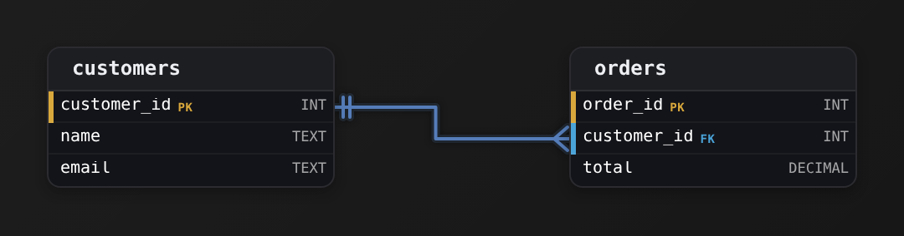
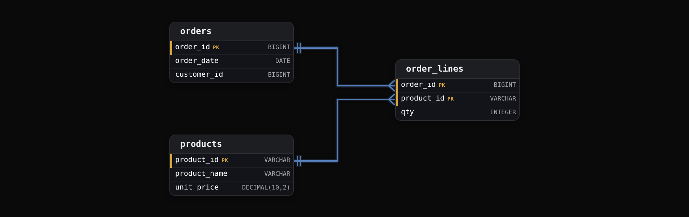
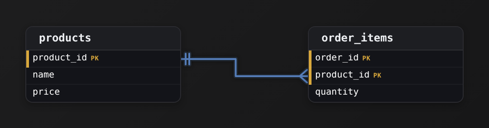
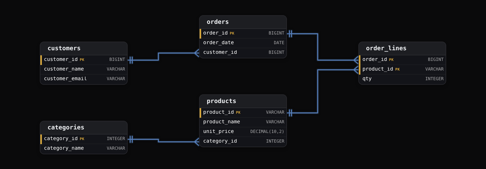
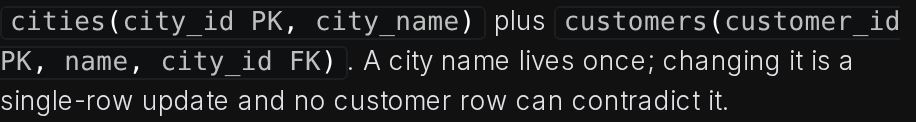
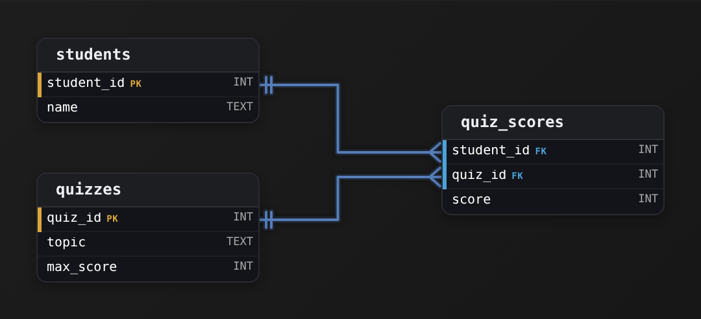
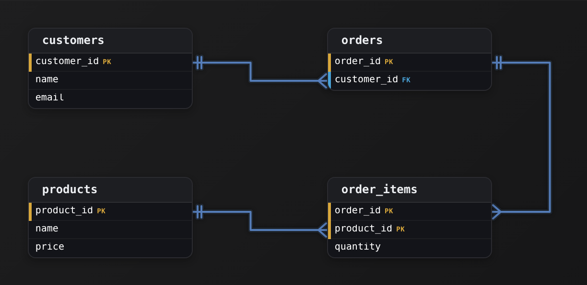
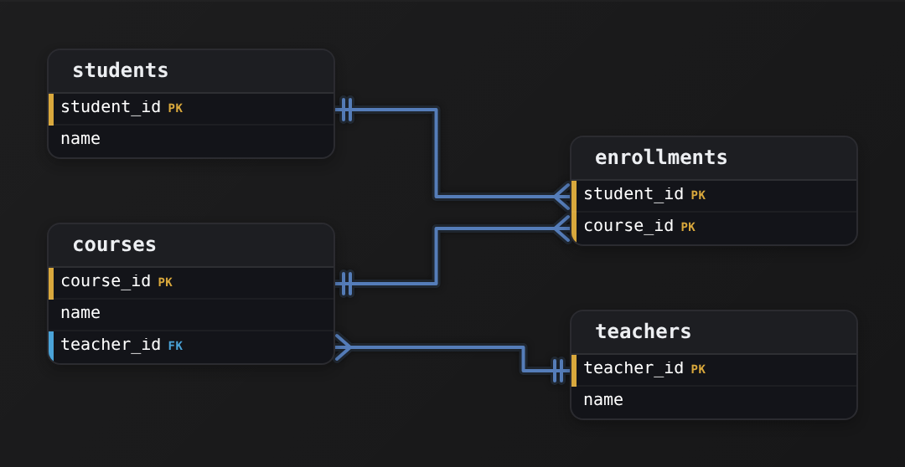

Intermediate·Data Modeling · 15 min · 12 challenges

# Normalization

Suppose each album row in Spotify's catalog carried its own copy of the artist name. When a band renamed itself, the rename would have to reach every album, and a script that missed 3 of them would leave search showing the old name. One fact, stored in 2 places, would disagree with itself. Normalization is the discipline that prevents that split.


<br>

---

## Data Gets Out of Sync

An online store's reporting team exported every order line into one wide table so analysts never need a second table. Each row is 1 product on 1 order, with customer and product details copied beside it.

| order_id | order_date | customer_id | customer_name | customer_email | product_id | product_name | unit_price | qty |
| --- | --- | --- | --- | --- | --- | --- | --- | --- |
| 1001 | 2024-03-02 | 42 | Priya Nair | priya@nair.io | P7 | Desk Lamp | 34.00 | 1 |
| 1001 | 2024-03-02 | 42 | Priya Nair | priya@nair.io | P2 | USB Cable | 9.00 | 3 |
| 1002 | 2024-03-05 | 17 | Tom Ola | tom@ola.dev | P7 | Desk Lamp | 34.00 | 2 |
| 1003 | 2024-03-06 | 42 | Priya Nair | priya@nair.io | P9 | Felt Pad | 4.50 | 10 |
| 1004 | 2024-03-09 | 42 | Priya Nair | priya@nair.io | P2 | USB Cable | 9.00 | 1 |

Every value on every row is true, yet customer 42's email is written 4 times, the Desk Lamp's price twice, the USB Cable's name twice. The disk this costs is cheap. The expensive part is that 4 copies of 1 fact can hold 4 different values, and nothing in the table prevents it.


<br>

### The update that lands halfway

Customer 42 changes their email to `priya@nair.dev`. The engineer updates the rows for order 1001, the order number on the ticket, and closes it. Rows 1 and 2 now carry the new address and rows 4 and 5 the old one, with no error raised. Where customer 42's receipts go now depends on which row a report reads first. This query finds the damage.

```sql
SELECT
  customer_id,
  COUNT(DISTINCT customer_email) AS email_versions
FROM order_report
GROUP BY customer_id
HAVING COUNT(DISTINCT customer_email) > 1
```

| customer_id | email_versions |
| --- | --- |
| 42 | 2 |

This is an update anomaly. The number of places a fact is stored is the number of ways an update to it can fail.


<br>

### Facts with nowhere to live

The store adds P12, a Monitor Arm at 59.00, which no order contains yet. Here a product exists only as part of an order line, so recording P12 means inventing an order line: an empty `order_id`, an empty customer, a quantity of 0, and a fake row every report must filter out. A customer who registers before buying hits the same wall. This is an insert anomaly: the table cannot hold a fact around 1 thing without asserting a fact about another.


<br>

### Deleting one thing erases another

Order 1003 is cancelled and its row deleted. It was the only row mentioning P9, so the Felt Pad's name and price leave with it: removing an order removed a product. This is a delete anomaly.

> The 3 anomalies of duplicated data
>
> - Update: a change must reach every copy of a fact, and each copy it misses becomes a contradiction.
> - Insert: a fact about a product or customer cannot be stored until an order exists to attach it to.
> - Delete: removing the last row that mentions something removes everything known about it.

All 3 anomalies share a cause. A fact is a single statement about a single thing: customer 42's email is `priya@nair.io`, product P7 costs 34.00. This table puts customer, product and order facts on 1 row, so each customer fact is copied once per order line. Normalization splits a table until each fact is stored once, in a table about the thing it describes, so changing a fact means changing 1 row.

A key is the column, or the set of columns, whose value picks out exactly 1 row. Neither `order_id` nor `product_id` does that alone here, since order 1001 has 2 rows and P7 appears on 2 orders; the pair (`order_id`, `product_id`) does. Each normal form is a rule about how the columns outside the key relate to the key.

> **TIP**
>
> When you inherit a wide table, pick a column that should have 1 value per entity, such as a customer's email, and run COUNT(DISTINCT) on it grouped by the entity's id. Any group above 1 is a fact that has already drifted.

**An employees table has 1 row per employee: employee_id, name, dept_name, dept_floor. The Finance department moves from floor 3 to floor 5. What happens to the table?**

- **A.** The insert anomaly applies: the new floor cannot be recorded until Finance hires at least 1 new employee.
- **B.** Every Finance employee's row must change, and any row the update misses leaves Finance on 2 floors at once.
- **C.** Nothing breaks, because dept_floor is a fact about the employee and each row holds its own correct copy.
- **D.** The delete anomaly fires: the move deletes the old Finance rows and recreates them on floor 5.

<details>
<summary>Solution</summary>

**B.** Every Finance employee's row must change, and any row the update misses leaves Finance on 2 floors at once.

dept_floor is a fact about the department, copied onto every employee row. One update per copy, and each missed copy is a contradiction: the update anomaly.

**Why the others are wrong**

- **A.** Finance already has rows, so the new floor has places to go. The trouble is that it has too many.
- **C.** The floor is where the department sits; an employee has it only through their department. A fact about a department belongs on a row about the department.
- **D.** A move changes values and deletes nothing. The delete anomaly would appear if the last Finance employee left and took the department's floor with them.

</details>


<br>

---

## Data Modeling

### Exercise 1 of 2

**● TASK**

An orders table stores customer name and email in every row. Changing a customer's email means updating hundreds of rows. Fix the redundancy.

<details>
<summary><strong>Solution</strong></summary>

#### The fix is a foreign key, not a bigger table

In the wide `orders` table, `name` and `email` sit in an order row but describe the customer. That is a **transitive dependency**: `order_id` determines `customer_id`, and `customer_id` determines `email`. Third normal form (3NF) says every non-key column must describe the key and nothing but the key. Here `email` describes `customer_id`, which is not the key of `orders`. That mismatch is why one email change rewrites hundreds of rows. The fix moves the customer facts into their own table and points at them with a foreign key.



*One row per customer in `customers`; every order references it through `orders.customer_id`.*

| Key insight: One fact, one place |
| --- |
| An email now lives in a single `customers` row. Updating it is a one-row `UPDATE`, and 2 orders can no longer disagree about the same customer's address. The `customer_id` foreign key is how you join name and email back onto a report when you need them. |

| ✕ Before (one wide table) | ✓ After (customers + orders) |
| --- | --- |
| `name` and `email` repeat on every order. A customer with 400 orders stores their email 400 times, so a change means 400 writes that can partially fail and leave the rows out of sync. | `email` sits once in `customers`. `orders` keeps `order_id`, `total` and the `customer_id` foreign key. A change is one write, and no order row is touched. |

| Pitfall: Copying the columns is not moving them |
| --- |
| A common half-fix adds a `customers` table but leaves `name` and `email` on `orders` as well. The redundancy is still there, now in 2 places. The split only works once `orders` keeps nothing about the customer except `customer_id`. |

This shape turns up everywhere: `line_items` repeating a product's name, `events` repeating a venue's address, `payroll` repeating a department name. The move is always the same: lift the repeating attributes into the table they describe and leave a foreign key behind.

**Follow-up questions**

1. Where would you store a shipping address that can differ per order?\
   *Separates attributes of the customer from attributes of the order.*
2. What can the `customer_id` foreign key make the database enforce that the wide table could not?\
   *Referential integrity: no order can point at a customer that does not exist.*

</details>


<br>

### Exercise 2 of 2

**● TASK**

A products table copies category name into every row. If a category name changes, thousands of rows need updating. Eliminate the duplication.

<details>
<summary><strong>Solution</strong></summary>

#### A repeating value is a table trying to escape

Duplicated data goes out of sync, and the starter's `category_name` column is the plainest case of it. The category name doesn't depend on the product, it depends on the category. That's the tell: a column whose value repeats across a group of rows is describing **something the table isn't really about**. When 'Kitchenware' is stamped onto every kitchen product, the row is storing a fact about the category in the wrong place, and every copy is one more row a rename can miss. The fix is to give the category its own table and point at it.


*The category name lives in exactly one row of `categories`; each product references it by `category_id`.*

Every category name now lives in exactly one place: one row of `categories`. A product no longer carries the name at all. It carries a `category_id` that points at the owning row. Renaming a category is a single `UPDATE` to one row, and every product sees the new name because it never held a copy. That is what eliminating the duplication means: not compressing the repeated text, but moving the fact to the one row that owns it.

| Trick: The reference ties the split back together |
| --- |
| Splitting the table is only half the work. `products.category_id` must be a foreign key referencing `categories.category_id`. That reference is what lets you join the name back on read, and it stops a product from pointing at a category that doesn't exist. Without it you have 2 disconnected tables. |

| Pitfall: Keeping the copied name 'for convenience' |
| --- |
| The common half-fix adds `categories` and a `category_id` reference but leaves `category_name` on `products` too, so reads skip the join. Now the reference and the copied string can disagree, and a rename still has thousands of rows to touch. If the name lives in `categories`, it must not also live in `products`. |

| ✕ Before (duplicated) | ✓ After (one copy) |
| --- | --- |
| One `products` table with `name`, `price` and a repeated `category_name` on every row. A category rename touches thousands of rows, and any missed row is silently wrong. | `categories` owns the name behind `category_id`; `products` holds `category_id` as a reference. A rename changes one row, and a join reconstructs the name on demand. |

The same move shows up constantly on the job: an `orders` table repeating a customer email, an `events` table repeating a venue address, a `line_items` table repeating a product name. Whenever a column's value is identical across a group of rows, ask which thing actually owns that fact, give it a table with a primary key, and replace the repeated column with a reference to it.

**Follow-up questions**

1. What should happen to a product's `category_id` when its category row is deleted?\
   *Extends the reference beyond drawing the arrow: block the delete, or clear the product's category.*
2. The `orders` table also repeats each customer's email on every order. Which table should own the email?\
   *Applies the same move to a second repeated fact.*

</details>


<br>

---

## First Normal Form (1NF)

Normalization starts with a table in the strict sense: every cell holds 1 value, and every row has the same columns. Spreadsheet and JSON exports break this rule constantly, and the result looks convenient until a query has to look inside a cell. Here are the same store's orders, exported that way.

| order_id | order_date | customer_id | product_ids | quantities |
| --- | --- | --- | --- | --- |
| 1001 | 2024-03-02 | 42 | P7,P2 | 1,3 |
| 1002 | 2024-03-05 | 17 | P7 | 2 |
| 1003 | 2024-03-06 | 42 | P9 | 10 |
| 1004 | 2024-03-09 | 42 | P2 | 1 |

One row is 1 order, and `product_ids` holds the basket as a comma-separated string, with a matching string of quantities beside it. The pairing is positional, and nothing enforces that the 2 lists have the same length. Counting the orders that contained a Desk Lamp means looking inside a string.

```sql
SELECT
  COUNT(*) AS orders_with_p7
FROM orders_flat
WHERE product_ids LIKE '%P7%'
```

The query counts orders 1001 and 1002, which is right today. Once product P71 launches, its orders count as Desk Lamp orders too, because the string P71 contains P7. Summing quantities is worse: split both strings, walk them in lockstep, convert the pieces to numbers, and a stray space in 1 cell breaks the conversion. That parsing logic gets written again in every report that touches the column.


<br>

### The same mistake laid out sideways

| order_id | product_1 | qty_1 | product_2 | qty_2 | product_3 | qty_3 |
| --- | --- | --- | --- | --- | --- | --- |
| 1001 | P7 | 1 | P2 | 3 |  |  |
| 1002 | P7 | 2 |  |  |  |  |
| 1003 | P9 | 10 |  |  |  |  |

Numbered columns remove the parsing and add a wall: at most 3 products per order, so a fourth item has nowhere to go. Counting Desk Lamp orders means checking 3 columns with OR, and a report written for 3 slots silently ignores a fourth slot added later. Columns like these are called a repeating group, and they hold a list spread sideways across the row.


<br>

### One value per cell, one row per item

| order_id | order_date | customer_id | product_id | qty |
| --- | --- | --- | --- | --- |
| 1001 | 2024-03-02 | 42 | P7 | 1 |
| 1001 | 2024-03-02 | 42 | P2 | 3 |
| 1002 | 2024-03-05 | 17 | P7 | 2 |
| 1003 | 2024-03-06 | 42 | P9 | 10 |
| 1004 | 2024-03-09 | 42 | P2 | 1 |

For both shapes, the fix is to turn the list into rows. A row now stands for 1 item in 1 basket, keyed by `order_id` together with `product_id`, and an order can have 1 item or 40. Each quantity sits on the same row as the product it counts, so the table enforces the pairing. The Desk Lamp question becomes a filter and a sum.

```sql
SELECT
  SUM(qty) AS desk_lamps_sold
FROM order_lines
WHERE product_id = 'P7'
```

The query needs no string parsing, cannot match P71 by accident, and reads the same for 1 line or 100. The split did cost something: `order_date` and `customer_id` are now written once per line, so order 1001's date appears twice. First normal form allows that; the next section deals with it.

> The 1NF test
>
> - Every cell holds exactly 1 value, never a list, a delimited string or a blob a query would have to parse.
> - No repeating groups: no item_1, item_2, item_3 columns standing in for a list.
> - Every row has the same columns and a key that identifies it.
> - A table that fails any line fails 1NF, and 2NF and 3NF can't be judged until it passes.

| ✓ Do | ✗ Don't |
| --- | --- |
| • Store a list as rows in a table keyed by the owner and the item<br><br>• Keep a quantity on the same row as the item it counts<br><br>• Ask what 1 row means before asking anything else about a table | • Store comma-separated ids and promise to parse them later<br><br>• Add item_4 when item_3 runs out<br><br>• Match ids with LIKE, which finds P71 when you asked for P7 |

**A playlists table has 1 row per playlist with a track_ids column holding values like T15,T2,T9. Which change puts the table in first normal form?**

- **A.** Store the track ids as a JSON array string instead, so the list structure is explicit and parsers agree on it.
- **B.** Split the list into track_1, track_2 and track_3 columns so that each cell holds exactly 1 id.
- **C.** Sort the ids inside the string so that LIKE matches are consistent and T2 can be found before T15.
- **D.** Create a playlist_tracks table with 1 row per playlist and track, keyed by (playlist_id, track_id).

<details>
<summary>Solution</summary>

**D.** Create a playlist_tracks table with 1 row per playlist and track, keyed by (playlist_id, track_id).

The list becomes rows. Counting tracks is a GROUP BY, finding playlists with T2 is an equality filter, and a playlist can hold any number of tracks.

**Why the others are wrong**

- **A.** A JSON array in a cell is still a list in a cell. The format changed; the query still has to open the cell to count tracks.
- **B.** Each cell now holds 1 value, but the numbered columns are a repeating group, and the fourth track has no column to go in.
- **C.** Sorting changes nothing about the shape. The cell still holds a list, and LIKE for T1 still matches T15.

</details>


<br>

---

## Data Modeling

### Exercise 1 of 2

**● TASK**

A contacts table stores multiple phone numbers as comma-separated text in one column, a 1NF violation. Fix it.

<details>
<summary><strong>Solution</strong></summary>

#### First normal form: one value per cell

First normal form (1NF) says every column holds a single, atomic value, never a list packed into one field. A `phones` column holding '555-1234,555-9876,555-0000' is really 3 facts crammed into one cell. The fix is to pull that **repeating group** out into its own table, one row per phone number, and link it back to the contact with a foreign key. That link is a one-to-many relationship: one contact, many phone rows.


*The comma-separated column becomes its own table, one row per phone, joined back on `contact_id`.*

1. **Give the parent a stable key**

   `contacts` keeps `contact_id` as its primary key and drops the phone list. What remains in the row is a fact about the contact alone, which is exactly what 1NF wants.

2. **Make each repeating value its own row**

   Create `phone_numbers` with its own `phone_id` primary key, a single `phone` column holding one number, and a `contact_id` foreign key back to `contacts`. The foreign key is what makes it one-to-many: many `phone_numbers` rows can carry the same `contact_id`.

| Pitfall: Numbered columns are still a list |
| --- |
| The tempting fix is to widen `contacts` with `phone1`, `phone2`, `phone3`. That is the same 1NF failure in disguise: the count is capped arbitrarily, most rows leave `phone3` as `NULL`, and searching by area code now means checking 3 columns. A child table removes the cap: a contact with 5 numbers is just 5 rows. |

| Real world: A delimiter in a column means a missing child table |
| --- |
| The same shape appears everywhere: a user with many emails, an order with many line items, a post with many tags. Whenever you see commas inside a value, or numbered columns like `option_a` and `option_b`, a child table with a foreign key back to its parent is waiting to be drawn. |

**Follow-up questions**

1. How would you stop the same number from being stored twice for one contact?\
   *Adds a composite unique constraint on (`contact_id`, `phone`).*
2. What changes if one phone number can belong to several contacts, like a shared household line?\
   *Turns one-to-many into many-to-many, which needs a junction table.*

</details>


<br>

### Exercise 2 of 2

**● TASK**

The `articles` table keys each row on `article_id`, keeps a `title`, and stores every tag in one `tags` cell as a comma-separated list like 'sql, indexes, performance'. Redesign it into first normal form so each cell holds a single tag, an article can carry any number of tags, and one tag can label many articles.

<details>
<summary><strong>Solution</strong></summary>

#### First normal form: one value per cell

A `tags` cell reading 'sql, indexes, performance' is the textbook break of **first normal form** (1NF): the cell holds a list where it should hold one atomic value. The fix is to give each value its own row. Because one article has many tags and one tag labels many articles, those rows belong in a separate table that pairs the two.


*`article_tags` holds one row per (article, tag) pair; its composite key includes `article_id`, which also references `articles`.*

1. **Leave `articles` holding one row per article**

   `articles` keeps `article_id` as its primary key and the columns that describe the article itself, like `title`. The `tags` column disappears entirely; its data moves out. Nothing that is true once per article changes.

2. **Create a table keyed on the pair**

   `article_tags` gets 2 columns, `article_id` and `tag`, and its primary key is both of them together. That lets the same `article_id` appear on many rows (one per tag) and the same `tag` appear against many articles, while forbidding the exact duplicate pair. `article_id` also points back to `articles.article_id`.

| Key insight: One row per tag replaces one list per article |
| --- |
| Each row of `article_tags` is one fact: 'this article carries this tag'. Adding a tag is an `INSERT`, removing one is a `DELETE` of a single row, and no other row is touched. |

| ✕ Comma-separated column | ✓ One tag per row |
| --- | --- |
| `WHERE tags LIKE '%sql%'` to find tagged articles, which can't use an index and matches 'nosql' by accident. Counting articles per tag means splitting strings first. | `WHERE tag = 'sql'` uses the index on `article_tags`, joins cleanly to `articles`, and `GROUP BY tag` counts usage in one line. |

| Pitfall: A surrogate `id` lets duplicate pairs in |
| --- |
| Giving `article_tags` its own `id` primary key works, but it lets the same (article, tag) pair be inserted twice unless you add a unique constraint anyway. Making the pair itself the primary key gets uniqueness and the lookup index in one move. |

**Follow-up questions**

1. How would you fix a `phone_numbers` column holding '555-1234, 555-5678'?\
   *The same move applies to any list-valued column: each phone number becomes its own row keyed by the person and the number.*
2. How would you list every article that has both 'sql' and 'performance'?\
   *Filter `article_tags` to the 2 tags, then `GROUP BY article_id HAVING COUNT(*) = 2`.*

</details>


<br>

---

## Second Normal Form (2NF)

The reporting team adds product names and prices to the 1NF table, `order_lines`. The key is still the pair (`order_id`, `product_id`); every other column is a non-key column.

| order_id | product_id | order_date | customer_id | product_name | unit_price | qty |
| --- | --- | --- | --- | --- | --- | --- |
| 1001 | P7 | 2024-03-02 | 42 | Desk Lamp | 34.00 | 1 |
| 1001 | P2 | 2024-03-02 | 42 | USB Cable | 9.00 | 3 |
| 1002 | P7 | 2024-03-05 | 17 | Desk Lamp | 34.00 | 2 |
| 1003 | P9 | 2024-03-06 | 42 | Felt Pad | 4.50 | 10 |
| 1004 | P2 | 2024-03-09 | 42 | USB Cable | 9.00 | 1 |


<br>

### What depends on what

Column B depends on column A when each value of A goes with exactly 1 value of B. Product P7 always means Desk Lamp at 34.00; order 1001 always means March 2 and customer 42. But order 1001 has 2 lines with different quantities, so `qty` needs both halves of the key. Writing down what each column depends on is the whole technique.

| Column | Determined by | Portion of the key |
| --- | --- | --- |
| order_date | order_id | half |
| customer_id | order_id | half |
| product_name | product_id | half |
| unit_price | product_id | half |
| qty | order_id and product_id | whole |

Of the 5 non-key columns, 4 depend on half the key: a partial dependency, and the mechanism behind section 0's duplication. `order_date` is copied once per line on the order, `product_name` and `unit_price` once per order containing the product. Raise the Desk Lamp's price and 2 rows must change; add P12 with no orders and there is no row to put it on.


<br>

### Give each half of the key its own table

Second normal form says: in a table with a multi-column key, every non-key column depends on the whole key. Columns that depend on `order_id` alone move to a table keyed by `order_id`. Columns that depend on `product_id` alone move to a table keyed by `product_id`. What depends on both stays where it is.



`order_lines` keeps both halves of the old key and nothing that depended on only 1 of them. `customer_id` moved with `order_date`, since the order alone determines which customer placed it. Against 5 order lines, `orders` holds 4 rows and `products` holds 3, so each date and each price appears once.

orders

| order_id | order_date | customer_id |
| --- | --- | --- |
| 1001 | 2024-03-02 | 42 |
| 1002 | 2024-03-05 | 17 |
| 1003 | 2024-03-06 | 42 |
| 1004 | 2024-03-09 | 42 |

products

| product_id | product_name | unit_price |
| --- | --- | --- |
| P7 | Desk Lamp | 34.00 |
| P2 | USB Cable | 9.00 |
| P9 | Felt Pad | 4.50 |

Each product's price now lives on 1 row. Repricing the Desk Lamp is a single-row change that every order line picks up through the join. P12 gets a row in `products` with no order attached. Deleting order 1003 removes 1 row from `orders` and 1 from `order_lines`, and P9 stays in `products`. The cost is that a report which read 1 table now reads 3.

```sql
SELECT
  o.order_id,
  o.order_date,
  SUM(l.qty * p.unit_price) AS order_total
FROM order_lines AS l
JOIN orders AS o
  ON o.order_id = l.order_id
JOIN products AS p
  ON p.product_id = l.product_id
GROUP BY o.order_id, o.order_date
```

| order_id | order_date | order_total |
| --- | --- | --- |
| 1001 | 2024-03-02 | 61.00 |
| 1002 | 2024-03-05 | 68.00 |
| 1003 | 2024-03-06 | 45.00 |
| 1004 | 2024-03-09 | 9.00 |

The join reads the price from `products` once per line, so a price that changes tomorrow changes every total computed tomorrow.

*If the store needs the price the customer actually paid, that's a fact about the line, since the catalog price can change after the sale. It belongs on order_lines as sale_price, next to qty. The catalog price and sale_price can match today and still be 2 different facts.*

> The 2NF test
>
> - The table is in 1NF.
> - For each non-key column, write down which key columns are needed to determine it.
> - If any column needs only some of the key's columns, that is a partial dependency and the table fails 2NF.
> - A table whose key is 1 column cannot have a partial dependency and passes 2NF the moment it passes 1NF.


**An exam_results table has the key (student_id, course_id) and columns student_name, course_title and score. Which columns break second normal form?**

- **A.** student_name and course_title: each depends on 1 column of the key rather than on both.
- **B.** score only: it is the one column that changes between rows that share the same student.
- **C.** student_name only: course_title is a fact about the course and each course has 1 title.
- **D.** None of them: every cell holds a single value, so the table is already in 2NF and 3NF.

<details>
<summary>Solution</summary>

**A.** student_name and course_title: each depends on 1 column of the key rather than on both.

A student's name is determined by student_id alone and a course's title by course_id alone. Both are partial dependencies; score needs both halves and stays.

**Why the others are wrong**

- **B.** Changing between rows is the sign of a column that depends on the whole key. score is the column that belongs in this table.
- **C.** Having 1 title per course is the dependency itself: course_title is determined by course_id, half of the key, so it's a partial dependency too.
- **D.** Single values per cell is the 1NF test. 2NF asks a different question, which 2 of these columns fail.

</details>


<br>

---

## Data Modeling

### Exercise 1 of 2

**● TASK**

An order-items table has a composite key but some columns depend on only part of that key, a 2NF violation. Separate out the partial dependency.

<details>
<summary><strong>Solution</strong></summary>

#### Second normal form, in plain terms

Second normal form says: when a table has a **composite key**, every non-key column must depend on the *whole* key, not just part of it. The table you were handed keyed each row on the pair (`order_id`, `product_id`), which is correct because a product appears on an order once and its `quantity` genuinely needs both halves to make sense. The trap is that `name` and `price` came along for the ride, and those describe the product alone. `price` depends on `product_id` and nothing else, so it hangs off only *part* of the key. That is the partial dependency you had to separate out.

| Pitfall: What the un-split table actually costs you |
| --- |
| Leaving `name` and `price` in `order_items` means the price of a product is stored once per order line it appears on. Sell the same item on 500 orders and you store its price 500 times. Change the price and you must update every one of those rows in lockstep, and if one update is missed the same product now has 2 prices. That inconsistency, the update anomaly, is the concrete symptom 2NF exists to prevent. |



*The partial-dependency columns move to products; `order_items` keeps only what needs the whole key, and points back with a foreign key.*

1. **Move the partially-dependent columns to their own table**

   Anything that depends on only `product_id` becomes a `products` table keyed on `product_id` alone: `name` and `price` land there, one row per distinct product. Now a price lives in exactly one place, which is the whole point.

2. **Leave `order_items` with only the full-key columns**

   `order_items` keeps its composite key (`order_id`, `product_id`) and `quantity`, because `quantity` really is a fact about *this product on this order*. `product_id` stays in the key and simultaneously becomes a **foreign key** referencing `products.product_id`, which is how the split row still knows which product it names.

| ✕ Before (2NF violation) | ✓ After (2NF) |
| --- | --- |
| One `order_items` table holding `order_id`, `product_id`, `quantity`, `name`, `price`. `name` and `price` repeat on every line for the same product and can drift out of sync. | `products` owns `name` and `price` once each; `order_items` keeps `quantity` and a `product_id` foreign key. Each fact is stored in exactly one place. |

| Key insight: The tell for a partial dependency |
| --- |
| You only ever look for a 2NF partial dependency when the key is composite. Scan each non-key column and ask which part of the key it truly needs. If a column is fully determined by a strict subset of the key (`price` by `product_id`), that subset wants to become its own table, and the leftover key column stays behind as a foreign key. |

**Follow-up questions**

1. What if the price a customer paid can differ from the current catalog price over time?\
   *Tests whether the learner sees that a historical `unit_price` genuinely depends on the whole (`order_id`, `product_id`) key and therefore belongs on `order_items`, not products.*
2. Where would order-level facts like `order_date` or `customer_id` live once you keep normalizing?\
   *Extends the concept toward an orders table, since those depend on `order_id` alone, another partial dependency.*

</details>


<br>

### Exercise 2 of 2

**● TASK**

A course-grades table has a composite key, but course name depends on only the course portion. Fix the partial dependency.

<details>
<summary><strong>Solution</strong></summary>

#### Partial dependency and second normal form

Splitting out `courses` is **second normal form** at work. Once a table has a composite primary key, every non-key column must depend on the whole key, not on part of it. The key here is (`student_id`, `course_id`), but the course `name` is fixed by `course_id` alone, because who the student is has no bearing on what the course is called. That is a partial dependency, and 2NF is the rule that forbids it.

| Pitfall: A half-key fact repeats on every enrollment |
| --- |
| If `name` stays in `course_grades`, it is copied once per student taking the course. Renaming 'Intro to CS' then means updating every one of those rows, and missing one leaves the table disagreeing with itself. A course with no enrollments yet also has nowhere to store its name. |

1. **Move course-only facts to `courses`**

   Every column that depends on `course_id` alone moves to a `courses` table keyed by `course_id`, with `name` as a plain attribute. The name is now stored once, next to the key it actually depends on.

2. **Keep whole-key facts on `course_grades`**

   `course_grades` keeps the composite key (`student_id`, `course_id`) and `grade`, since a grade depends on both the student and the course. Its `course_id` also becomes a foreign key to `courses`, so every grade still points at a real course and its name.


*`name` lives once in `courses`, and `course_grades` references it through `course_id`.*

| Real world: Junction tables attract one-sided columns |
| --- |
| Enrollments, order line items and team memberships all collect attributes that really belong to one side. For each column, ask whether it depends on the whole key or on just one part. A column that depends on one part moves to that part's own table and is referenced by foreign key. |

**Follow-up questions**

1. If this table also stored the student's `major`, where would it go?\
   *`major` depends on `student_id` alone, so it moves to a `students` table, mirroring the `courses` split.*
2. What if each grade carried a numeric `score` and a `letter` derived from that score?\
   *A non-key column depending on another non-key column is a transitive dependency, which third normal form addresses.*

</details>


<br>

---

## Third Normal Form (3NF)

The original export also carried the customer's name and email beside each order, and many teams keep them on `orders` to save a join on every receipt.

| order_id | order_date | customer_id | customer_name | customer_email |
| --- | --- | --- | --- | --- |
| 1001 | 2024-03-02 | 42 | Priya Nair | priya@nair.io |
| 1002 | 2024-03-05 | 17 | Tom Ola | tom@ola.dev |
| 1003 | 2024-03-06 | 42 | Priya Nair | priya@nair.io |
| 1004 | 2024-03-09 | 42 | Priya Nair | priya@nair.io |

The key is `order_id` alone, so 2NF is satisfied: a 1-column key has no part to depend on. Yet customer 42's email is written 3 times, and the halfway update from section 0 can happen again. This duplication runs through a column that is in no key at all.


<br>

### Dependencies that pass through a non-key column

Knowing the order tells you the email, but in 2 steps: `order_id` determines `customer_id`, and `customer_id` determines `customer_email`. The email is a fact about the customer, and the order knows it only because it knows the customer. That 2-step path is a transitive dependency, and every column at the far end of one is a copied fact waiting to drift.

The same shape hides in `products`. If a product row stores `category_id` and `category_name` together, the name reaches the key through the category, and renaming Lighting to Lamps means changing every product row in it. The signature is an id column beside the attributes that id determines.


<br>

### Move the fact to the thing it describes

Third normal form says: each column outside the key depends on the key directly, with no other column in between. The repair is the 2NF move with a different trigger: `customer_id` becomes the key of a new `customers` table, and the columns it determines go there. `orders` keeps `customer_id` as a reference, because who placed the order is a fact about the order. Categories get the same treatment.



Each table is now about 1 kind of thing: 1 row of `customers` is 1 customer, 1 row of `order_lines` is 1 product on 1 order. The old wide row is assembled at query time instead of stored. A wide table carrying `category_name` would answer revenue by category with a single GROUP BY; this schema needs 2 joins.

```sql
SELECT
  c.category_name,
  SUM(l.qty * p.unit_price) AS revenue
FROM order_lines AS l
JOIN products AS p
  ON p.product_id = l.product_id
JOIN categories AS c
  ON c.category_id = p.category_id
GROUP BY c.category_name
```

| category_name | revenue |
| --- | --- |
| Lighting | 102.00 |
| Cables | 36.00 |
| Accessories | 45.00 |

On billions of lines, 2 joins cost real time, and later lessons weigh when to keep copies on purpose. For now, the trade runs one way: a normalized schema can always be joined back into the wide shape, while a wide table can't be trusted to agree with itself. Rename a category and the report above is correct on its next run, with no update script.

> The key, the whole key, nothing but the key
>
> - The key: 1NF, every row has a key and every cell holds 1 value.
> - The whole key: 2NF, no column depends on only part of a multi-column key.
> - Nothing but the key: 3NF, no column depends on a non-key column.
> - The phrase comes from a 1983 paper by William Kent.

> **TIP**
>
> Column names often give the problem away. A `customer_name` column on `orders` announces that it describes a customer. Any column whose prefix names a different thing from the table's key is worth tracing: it usually sits at the end of a transitive dependency.

**An invoices table has the key invoice_id and columns issued_at, customer_id, customer_name, customer_tier and amount. A customer is promoted from the Silver tier to Gold. Which statement is right?**

- **A.** The table is in 3NF, because customer_tier is a single value and invoice_id is a 1-column key, so the promotion is safe.
- **B.** customer_tier breaks 2NF, because it depends on customer_id, which is half of the key of the invoices table.
- **C.** customer_tier depends on invoice_id only through customer_id, so it belongs in a customers table where the promotion changes 1 row.
- **D.** amount breaks 3NF, because it depends on customer_tier and tiers change the discounts that are applied to it.

<details>
<summary>Solution</summary>

**C.** customer_tier depends on invoice_id only through customer_id, so it belongs in a customers table where the promotion changes 1 row.

invoice_id determines customer_id, and customer_id determines the tier: a transitive dependency. On invoices the tier is copied once per invoice, and the promotion has to find every copy.

**Why the others are wrong**

- **A.** A 1-column key settles 2NF, and single values settle 1NF. The 3NF question is whether a non-key column depends on another non-key column, and customer_tier does.
- **B.** customer_id is a non-key column here; the key is invoice_id alone. A dependency on a non-key column is a 3NF problem, not a partial dependency.
- **D.** Knowing the tier doesn't tell you the amount; 2 Gold customers have different invoices. amount is a fact about the invoice and depends on the key directly.

</details>


<br>

---

## Data Modeling

### Exercise 1 of 2

**● TASK**

An employees table stores department name alongside department ID. The name depends on the ID, not the primary key. Remove the transitive dependency.

<details>
<summary><strong>Solution</strong></summary>

#### Every fact lives with the key it depends on

Third normal form removes **transitive dependencies**: a non-key column that depends on another non-key column instead of on the primary key. The department name says nothing about the employee. It is determined by `department_id`, which is in turn determined by `employee_id`. That chain is the signal. The repair moves the name to a table where its real determinant, `department_id`, is the primary key.


*The department name is stored once in `departments`. Each `employees` row points to it through `department_id`.*

1. **Give the department its own table**

   Create `departments` with `department_id` as the primary key and the department `name` as an ordinary column. The name now depends on the key of the table that holds it, and nothing else.

2. **Point `employees` at it with a foreign key**

   Keep `department_id` on `employees` and mark it as a foreign key to `departments.department_id`. Each employee row stores a reference to its department rather than a copy of the department name. A join retrieves the name when you need it.

| Pitfall: Keeping the copy in sync is the anomaly |
| --- |
| The tempting non-fix leaves the department name on `employees` and relies on keeping it in sync. Rename a department and every row still holding the old string is wrong. A department with no employees has nowhere to store its name. With the name stored once in `departments`, neither problem can occur. |

| Real world: Label columns beside their ids are the usual 3NF cleanup |
| --- |
| Status labels, category names and region names often sit next to their ids in real schemas. Normalizing them costs a join. In return, a rename becomes a single `UPDATE`, and the `FK` rejects ids that point at nothing. |

**Follow-up questions**

1. 2 departments in different regions share the same name. Does the design still hold?\
   *The name was never the identity. The surrogate `department_id` still keys the row.*
2. A report needs the department name on every employee row and can't afford the join. Where should the copy live?\
   *Deliberate denormalization belongs in a view or read model built from the normalized tables, not in the source table.*

</details>


<br>

### Exercise 2 of 2

**● TASK**

A products table stores category description alongside category ID, a transitive dependency. Normalize to 3NF.

<details>
<summary><strong>Solution</strong></summary>

#### The transitive dependency

Third normal form says every non-key column must depend on the key, the whole key, and nothing but the key. The starting `products` table breaks the last part: `product_id` decides `category_id`, but `category_id` decides the category `description`. So `description` depends on the key only **through** another non-key column, and that indirect chain is a transitive dependency. 3NF is the rule that removes it.

| Pitfall: Storing the description on the product |
| --- |
| The version most people write first keeps `description` right on `products` next to `category_id`. Now the same category text is copied onto every product in that category. Rename the category and you must update thousands of rows or leave some stale; a category with no products yet has nowhere to live at all. That duplication is exactly what the transitive dependency was warning you about. |


*3NF: description moves to categories; products keeps only a `category_id` foreign key.*

The fix is to give the dependent facts their own home. `description` is really a fact about the category, so it moves into a `categories` table keyed by `category_id`. `products` keeps `category_id` as a foreign key pointing at that table. Every non-key column now depends on its own table's key and nothing else: `description` on `categories.category_id`, `name` on `products.product_id`. The chain is gone.

| Key insight: The shape this creates |
| --- |
| Splitting on a transitive dependency almost always produces a one-to-many: one row in `categories` is referenced by many rows in `products` through the `category_id` foreign key. The category text is stored exactly once, and a category can exist before any product uses it. That is the payoff of 3NF, one fact in one place. |

**Follow-up questions**

1. What if a product could belong to several categories at once?\
   *Pushes past one-to-many to a many-to-many, which needs a junction table like `product_categories` rather than a single `category_id` column.*
2. Where would you put a category's parent category to build a hierarchy?\
   *Tests self-referencing foreign keys: a `parent_category_id` on `categories` pointing back at `category_id`.*

</details>


<br>

---

## Identifying Normal Form

Diagnosing a table is a fixed sequence of questions, and the first one that fails names the form. A table that fails an early question can't be judged on a later one.

The diagnosis, in order

- **1. Find the key** *the smallest set of columns that picks out 1 row*\
  If 2 rows can share every value, the table has no key and the diagnosis cannot start.
- **2. Any cell holding a list, or any numbered column group?** *fails 1NF*\
  Delimited strings, JSON blobs, item_1 through item_3. Stop here until the list becomes rows.
- **3. Multi-column key, and a non-key column that depends on part of it?** *1NF but not 2NF*\
  A 1-column key passes this step without further checking.
- **4. A non-key column that depends on another non-key column?** *2NF but not 3NF*\
  Look for an id column sitting beside the name or attribute that the id determines.
- **5. None of the above** *3NF*\
  Every non-key column is a fact about exactly the thing the key identifies.


<br>

### A worked diagnosis

| ticket_id | opened_at | agent_id | agent_name | agent_team | tags |
| --- | --- | --- | --- | --- | --- |
| 5001 | 2024-04-01 | A3 | Lena Koch | Billing | billing;urgent |
| 5002 | 2024-04-01 | A3 | Lena Koch | Billing | refund |
| 5003 | 2024-04-02 | A8 | Raj Mehta | Tech | login;urgent |

Step 1: `ticket_id` identifies a row. Step 2: `tags` holds a list, so the table fails 1NF and the diagnosis stops. Move tags to `ticket_tags`, 1 row per ticket and tag, and rerun. Step 2 passes, and step 3 passes on a 1-column key. Step 4: `agent_name` and `agent_team` depend on `agent_id`, which is in no key, so the table is in 2NF and fails 3NF. Split out `agents` and the third pass reaches step 5. The table took 3 passes and 2 splits, and ended as 3 tables.

**A shipments table has 1 row per shipment: shipment_id, shipped_at, warehouse_id, warehouse_city, carrier_code, tracking_number. Which normal form does it meet?**

- **A.** 1NF only, because warehouse_city depends on part of the key (shipment_id, warehouse_id) rather than all of it.
- **B.** 2NF but not 3NF, because warehouse_city depends on warehouse_id, which is a non-key column.
- **C.** 3NF, because every cell holds a single value and the key is 1 column, so both earlier steps pass.
- **D.** Below 1NF, because tracking_number is a string that carrier systems break into several parts.

<details>
<summary>Solution</summary>

**B.** 2NF but not 3NF, because warehouse_city depends on warehouse_id, which is a non-key column.

Every cell is 1 value and the key is 1 column, so steps 2 and 3 pass. Step 4 fails because the city reaches the key only through the warehouse. Split out warehouses.

**Why the others are wrong**

- **A.** The key is shipment_id alone, since 1 row is 1 shipment, so there is no partial dependency to find.
- **C.** Both earlier steps do pass, and the fourth does not. A warehouse that relocates would need every shipment row it ever sent updated.
- **D.** A tracking number is 1 value to this table, whatever a carrier's own system does with it.

</details>


<br>

### Repeated values that are not copied facts

A normalized schema still repeats values. The `orders` table holds `customer_id` 42 on 3 rows: 3 facts, each saying which customer placed that order. What 3NF forbids is 3 copies of the customer's email, which is 1 fact. To tell them apart, ask whether changing the value on one row should change it on the others. If yes, the column is a copied fact and belongs elsewhere. If no, it is a reference.

| ✓ Repetition that is a reference | ✗ Repetition that is a copied fact |
| --- | --- |
| • customer_id 42 on 3 order rows: 3 facts roughly 3 orders<br><br>• product_id P7 on 2 order lines<br><br>• agent_id A3 on 2 tickets | • ines@okoro.io on 3 order rows: 1 fact written 3 times<br><br>• unit_price 34.00 on every Desk Lamp line<br><br>• agent_team Billing on every one of Lena's tickets |


<br>

---

## Data Modeling

### Exercise 1 of 2

**● TASK**

A customers table stores city name alongside city ID, a transitive dependency. Fix it to reach 3NF.

<details>
<summary><strong>Solution</strong></summary>

#### The transitive dependency you just broke apart

Third normal form says every non-key column must depend on the key, the whole key, and **nothing but the key**. The `customers` table you started with violated that last clause: `city_name` doesn't depend on `customer_id` at all, it depends on `city_id`, which in turn depends on `customer_id`. That chain, `customer_id` to `city_id` to `city_name`, is a transitive dependency, and the fix is always the same shape, lift the dependent pair out into its own table and leave a foreign key behind.

Concretely: `city_id` and `city_name` travel together and are really a fact about a city, not about a customer. So they belong in a `cities` table keyed by `city_id`. The `customers` table keeps `city_id` as a foreign key and drops `city_name` entirely. Now `city_name` lives in exactly one place and depends only on its own key.



*The 3NF result: `city_name` moves to cities, customers references it by `city_id`.*

| Pitfall: Leaving `city_name` on both tables |
| --- |
| The tempting half-fix is to add a `cities` table but keep `city_name` on `customers` too, 'for convenience.' That reintroduces the exact anomaly 3NF exists to prevent: rename a city and you now have to update every customer row, and if you miss one, `cities.city_name` and `customers.city_name` disagree with no way to say which is right. The column must exist in exactly one place. `customers` gets `city_id` and only `city_id`. |

| Key insight: How to spot a transitive dependency in the wild |
| --- |
| Ask of every non-key column: 'does this describe the row's entity, or something the row merely points at?' `name` describes the customer, it stays. `city_name` describes a city the customer points at, it leaves. Any time 2 non-key columns always change together (`city_id` and `city_name` here, or `zip` and `city`, or `product_id` and `product_name`), you're looking at a hidden entity waiting to become its own table. |

| ✕ Before (2NF, not 3NF) | ✓ After (3NF) |
| --- | --- |
| `customers(customer_id PK, name, city_id, city_name)`. Every non-key column depends on the key, but `city_name` depends on it only through `city_id`. Updating a city name means touching many rows. | `cities(city_id PK, city_name)` plus `customers(customer_id PK, name, city_id FK)`. A city name lives once; changing it is a single-row update and no customer row can contradict it. |

**Follow-up questions**

1. What if 2 cities in different states share the same name, like Springfield?\
   *Tests whether the learner sees that `city_id` as a surrogate key already handles this, each Springfield is a distinct `cities` row, and that adding a `state_id` FK to `cities` would extend the same normalization one level further.*
2. Where does this pattern stop, could city itself have a transitive dependency?\
   *Probes the idea that normalization is recursive: if `cities` also stored `state_name`, you'd factor out a `states` table by the identical reasoning.*

</details>


<br>

### Exercise 2 of 2

**● TASK**

Create a fully normalized 3NF schema for tracking student quiz scores.

<details>
<summary><strong>Solution</strong></summary>

#### Third normal form: one fact, one home

**Third normal form** wants every non-key column to depend on the key, the whole key, and nothing but the key. In practice that is one habit: give each real thing its own table so a fact is stored once. There are 3 things here, a student, a quiz, and the `score` earned when a student sits a quiz. That score belongs to neither entity alone, so it lives in `quiz_scores` between them.



*2 entity tables and the junction that records who scored what.*

1. **Bridge the many-to-many with a composite-key junction**

   A student takes many quizzes and a quiz is taken by many students, so neither entity table can hold a foreign key to the other. `quiz_scores` breaks the tie: `student_id` and `quiz_id` are both foreign keys, and together they form its primary key. That composite key lets a student hold one `score` per quiz, and `score` depends on the whole pair, nothing less.

| Pitfall: One wide table repeats every fact |
| --- |
| Cramming `name`, `topic`, `max_score`, and `score` into one row means a name change must be edited in every attempt, and `max_score` is copied per row where the copies can silently disagree. Splitting out `students` and `quizzes` gives each fact one home: `max_score` is a property of the quiz, not of an attempt. |

**Follow-up questions**

1. What if a student may retake a quiz and you keep every attempt?\
   *The composite key blocks a second row for the same pair, so add `attempt_no` or `taken_at` into the key to make each attempt distinct.*
2. Where does the date a quiz was taken belong?\
   *It describes the attempt, so it sits on `quiz_scores`, not on `students` or `quizzes`.*

</details>


<br>

---

## Putting It All Together

An online marketplace stores each seller's display name and payout account on every order row so that the finance export needs no joins. A seller renames their shop; the rename script updates orders placed in the last 90 days and the older rows keep the old name, so the seller's annual statement lists 2 shops. Normalizing the export into sellers, orders and order_lines makes the rename a 1-row change and the statement a join.

- Section 0's update anomaly is the 2-shop statement: a fact copied onto every order drifted the moment 1 update reached only some of the copies.
- Section 1 sets the row grain first: once an order's items sit as a list in 1 cell, counts per item become string parsing, so 1 row per order line comes before anything else.
- Section 2 moves order_date and the seller reference off the (order_id, product_id) key because they depend on order_id alone, and product names off it because they depend on product_id alone.
- Section 3 moves the seller's name and payout account off orders because they depend on seller_id, a non-key column, and a sellers table stores each of them once.
- Section 4's diagnosis runs the 5 questions on the finance export, names the form it meets, and tells the team which split to make first.


<br>

---

## Data Modeling

### Exercise 1 of 2

**● TASK**

Take a fully denormalized orders dataset (with customer, product, and order info all in one flat table) and normalize it to 3NF.

<details>
<summary><strong>Solution</strong></summary>

#### Normalizing to 3NF: one fact, one place

You started with a single flat table where every row repeated the customer's `name` and `email`, the product's `name` and `price`, and the order's identity all together. Normalization is the disciplined act of splitting that one table into several so that every fact lives in exactly one place. Third normal form (3NF) is reached when every non-key column depends on the key, the whole key, and nothing but the key. The 4 tables you drew, `customers`, `products`, `orders`, and `order_items`, are what that rule produces here.



*The flat orders table split into 3NF: an entity table each for customers and products, an orders header, and an `order_items` junction resolving the many-to-many.*

1. **Pull each independent entity into its own table**

   The customer facts (`name`, `email`) depend only on who the customer is, not on any order, so they move to `customers` keyed by `customer_id`. Product facts (`name`, `price`) move to `products` keyed by `product_id` for the same reason. Leaving `price` on the order line would tie a product's identity to the order it happened to appear on, the exact transitive dependency 3NF forbids.

2. **Resolve the many-to-many with a junction table**

   One order contains many products, and one product appears in many orders, so no single foreign key can link them. `order_items` is the junction: its key is the composite `(order_id, product_id)`, with `order_id` referencing `orders` and `product_id` referencing `products`. `quantity` belongs here because it depends on the pair, not on the order alone or the product alone. The `orders` header keeps only what depends on the order itself: its `order_id` and the `customer_id` who placed it.

| Pitfall: Common pitfall: skipping the junction |
| --- |
| The tempting shortcut is to put `product_id` directly on `orders`. That silently assumes one product per order. The moment an order has 2 line items you either duplicate the whole order row or cram a list into one cell, which also breaks first normal form. The composite-key `order_items` table is what lets an order hold any number of distinct products cleanly. |

| Key insight: Why quantity lives on the line, not the order |
| --- |
| A quick test for where a column belongs: ask what it functionally depends on. `quantity` changes per product-within-an-order, so it depends on both halves of the `order_items` key. `email` depends only on `customer_id`. `price` depends only on `product_id`. Placing each column beside the key it actually depends on is the whole game of 3NF. |

| ✕ Denormalized (before) | ✓ Normalized 3NF (after) |
| --- | --- |
| One flat row repeats `customer_email` and `product_price` on every line. Update a customer's email and you must rewrite every order they ever placed; miss one and the data disagrees with itself. | `email` sits once in `customers`, `price` once in `products`. An update touches a single row, and `order_items` records only what a line item genuinely is: a `quantity` of a `product_id` on an `order_id`. |

**Follow-up questions**

1. If a product's `price` can change over time but historical orders must show the price charged at the time, where does that value go?\
   *Tests whether the learner sees that a point-in-time fact belongs on `order_items` (e.g. `unit_price`), separate from the current `products.price`.*
2. How would you extend this schema to let one order ship to a different address than the customer's default?\
   *Probes modeling an order-level attribute versus a customer-level one.*

</details>


<br>

### Exercise 2 of 2

**● TASK**

Normalize a flat school schedule dataset into 3NF, separating students, teachers, and courses.

<details>
<summary><strong>Solution</strong></summary>

#### What 3NF is asking you to do here

Third normal form means every non-key column depends on the key, the whole key, and nothing but the key. The flat schedule row mixes 4 different things in one place: a student, a teacher, a course, and the fact that the student is taking that course. Normalizing to 3NF is just the act of giving each of those its own table with its own primary key, then reconnecting them with foreign keys. Once you see the 4 entities, the shape almost writes itself.



*The flat row split into 3 entity tables plus one junction table.*

1. **Give each real-world thing its own table**

   A student, a teacher, and a course are 3 independent entities, so each gets a table and a surrogate key: `students(student_id)`, `teachers(teacher_id)`, `courses(course_id)`. The name lives with its entity and nowhere else, so a teacher renamed once is renamed everywhere. This is what kills the duplication where the teacher's name repeated on every schedule row.

2. **Model the one-to-many with a foreign key column**

   One teacher teaches many courses, but a course has exactly one teacher. That asymmetry means the key goes on the many side: `courses` carries a `teacher_id` foreign key pointing at `teachers.teacher_id`. You do NOT put a course list on the teacher, because a single column cannot hold many course ids without breaking first normal form.

3. **Model the many-to-many with a junction table**

   A student takes many courses and a course holds many students, so neither side can carry a foreign key to the other. The relationship itself becomes a row in `enrollments`, whose primary key is the composite `(student_id, course_id)`. That composite key is doing double duty: it links out to both parents AND it stops the same student being enrolled in the same course twice.

| Trick: The count-the-arrows test |
| --- |
| Decide the direction of every relationship before you place a single key. A one-to-many (`teachers` to `courses`) puts a foreign key on the many side. A many-to-many (`students` to `courses`) can never be a foreign key on either table; it always needs its own `enrollments` row. If you find yourself wanting to store a list in a column, that is the signal you actually needed a junction table. |

| Pitfall: Common pitfall: a junction table with a surrogate key |
| --- |
| It is tempting to give `enrollments` its own `enrollment_id` and leave `student_id` and `course_id` as plain columns. That technically works, but it lets a duplicate (`student_id`, `course_id`) pair sneak in unless you remember to add a separate unique constraint. Making the pair itself the composite primary key gets the uniqueness for free and states the intent: an enrollment IS a student-course pairing. |

| ✕ Flat (un-normalized) row | ✓ Normalized 3NF |
| --- | --- |
| One wide row repeats `teacher_name` and `student_name` for every enrollment. Rename a teacher and you must hunt down every row; delete a student's last enrollment and you lose the student entirely. | Each fact lives once. `teachers.name` is stored a single time, `enrollments` holds only ids, and a student with zero courses still exists as a row in `students`. No update or deletion anomalies. |

**Follow-up questions**

1. What changes if a course can be co-taught by 2 teachers?\
   *Turns the one-to-many between `teachers` and `courses` into a many-to-many, so the `teacher_id` FK on `courses` must become its own `course_teachers` junction table.*
2. Where would you store a per-enrollment grade or enrollment date?\
   *Tests whether they see `enrollments` as a real entity: attributes of the relationship belong on the junction table, not on `students` or `courses`.*

</details>


<br>

---

## Key Takeaways

- Each fact lives in exactly 1 row of 1 table; every extra copy is another row an update can miss, leaving the table contradicting itself.
- 1NF: 1 value per cell and 1 row per item, so lists become rows and numbered column groups disappear.
- 2NF: with a multi-column key, each non-key column depends on the whole key, or it moves to a table keyed by the part it depends on.
- 3NF: no non-key column depends on another non-key column; an id sitting beside the attribute it determines is the signature.
- Diagnose in order: key, lists, partial dependency, transitive dependency; the first question that fails names the form.
