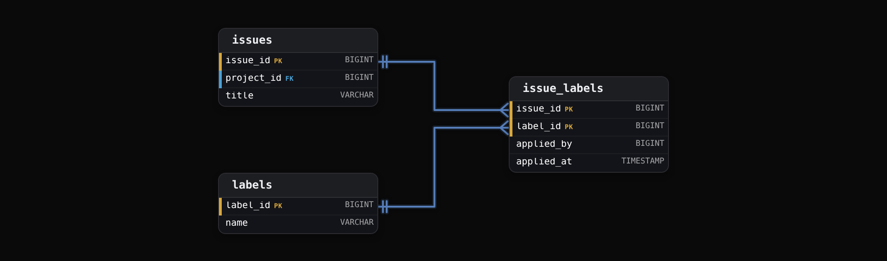
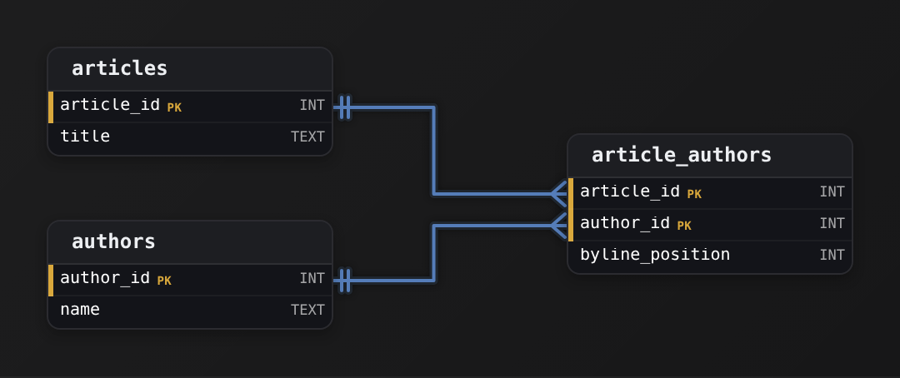
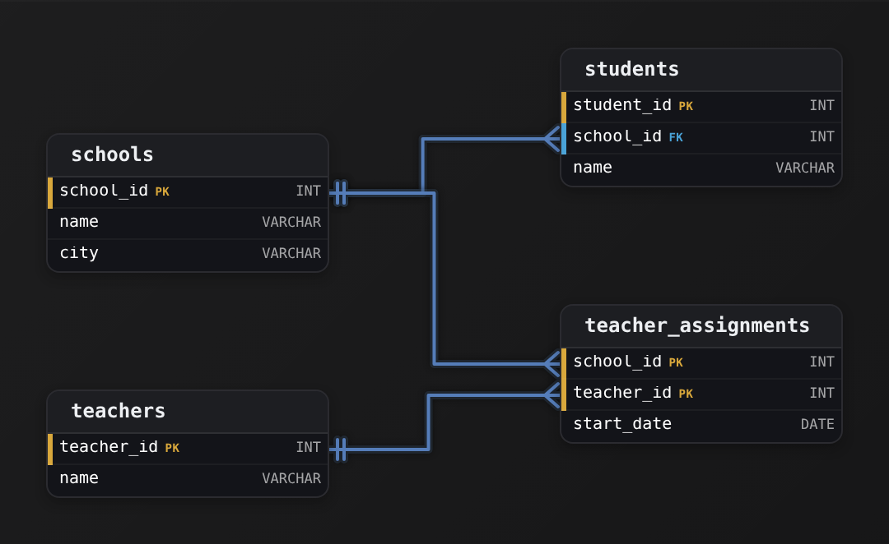
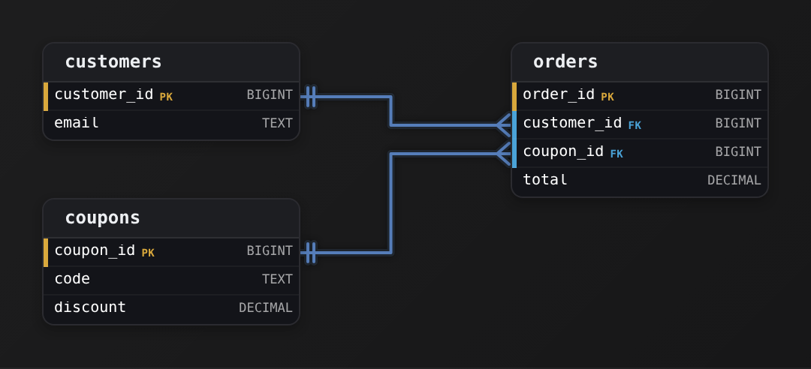
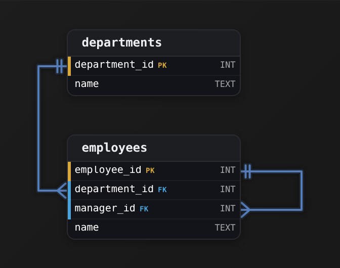
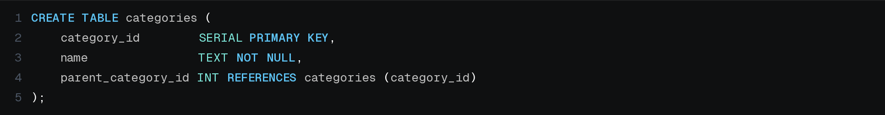
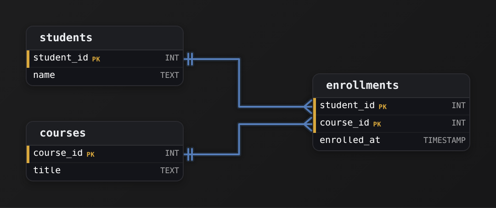
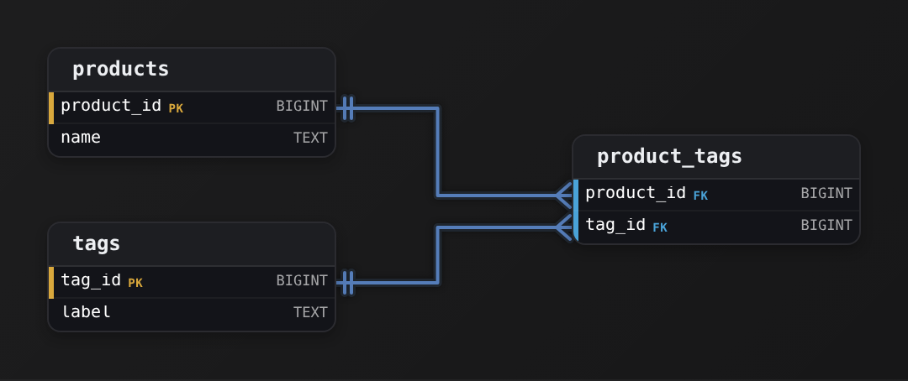
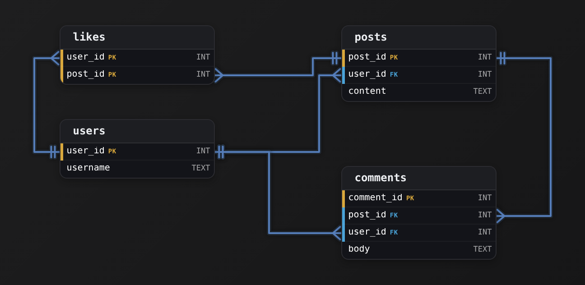
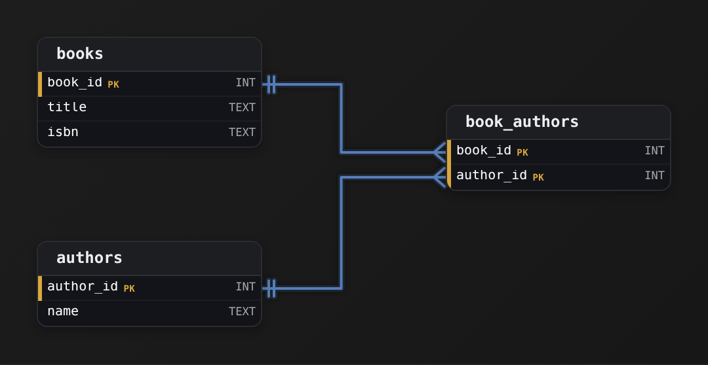

Intermediate·Data Modeling · 18 min · 12 challenges

# Relationships

A GitHub engineer is adding Discussions. Users already comment on issues and on pull requests, and now they will comment on discussions. One comments table for all 3, or one per kind? Teams nest inside teams, repositories fork other repositories, and one user belongs to many organizations. Each is a relationship, its model decides which queries stay cheap, and the last section weighs 3 answers to the comments question.


<br>

---

## What Are Relationships?

### A column that points at another table

A relationship is a column in one table whose values are drawn from the identifying column of another table. In an issue tracker every issue belongs to a project, so the `issues` table has a `project_id` column, and each value in it matches the `project_id` of exactly 1 row in `projects`. The issue row stores no project name and no project owner. It stores a reference, and the reference is the relationship.

projects

| project_id | name | owner |
| --- | --- | --- |
| 1 | Billing | Priya |
| 2 | Mobile App | Chen |

issues

| issue_id | project_id | title | status |
| --- | --- | --- | --- |
| 101 | 1 | Invoice totals wrong | open |
| 102 | 1 | Add refunds | closed |
| 103 | 2 | Crash on login | open |

Read issue 103 and you learn it belongs to project 2. Which project that is lives in the other table, and a join is how the database follows the reference back to it. The join condition names both ends of the relationship: the reference column on one side and the identifying column on the other.

```sql
SELECT
  i.issue_id,
  i.title,
  p.name AS project_name
FROM issues AS i
JOIN projects AS p
  ON i.project_id = p.project_id
WHERE i.status = 'open'
```

| issue_id | title | project_name |
| --- | --- | --- |
| 101 | Invoice totals wrong | Billing |
| 103 | Crash on login | Mobile App |


<br>

### Why not one wide table?

Copy the project name onto every issue row instead and the 3 issues carry 'Billing', 'Billing' and 'Mobile App'. Renaming the Billing project to Payments now means updating 2 issue rows, and a 4th issue inserted with 'billing' in lowercase quietly creates a 3rd project that nobody intended. With a reference column, the name lives in 1 row of `projects`: a rename touches that row alone, and a typo in `project_id` fails at insert time because no project 7 exists.

| issue_id | project_name | project_owner | title |
| --- | --- | --- | --- |
| 101 | Billing | Priya | Invoice totals wrong |
| 102 | Billing | Priya | Add refunds |
| 103 | Mobile App | Chen | Crash on login |
| 104 | billing | Priya | Tax rounding |

Row 104 is the failure in miniature. A report grouping by `project_name` now shows 3 projects, the Billing total is short by 1 issue, and the only clue is a lowercase letter. The wide table has no column whose value could be rejected, so the mistake is accepted and stored.

| ✓ Project name copied onto each issue | ✗ Issue holds project_id |
| --- | --- |
| • A rename touches every issue in the project<br><br>• A misspelling creates a phantom project<br><br>• No join needed to read the name<br><br>• Nothing stops an issue naming a project that was never created | • A rename touches 1 row<br><br>• An unknown project_id is rejected<br><br>• Reading the name costs 1 join<br><br>• Every issue points at a project that exists |


<br>

### PK and FK badges on a schema diagram

A schema diagram draws each table as a card. The column that identifies a row carries a PK badge, short for primary key, and a column holding another table's identifier carries an FK badge, for foreign key. The line between those 2 badges is the relationship. Everything that follows in this lesson is a question about that line: how many rows sit at each end, whether an end may be empty, and whether both ends can be the same table.


<br>

### One sentence per table

A relationship also fixes what one row of each table means. One row of `projects` is one project. One row of `issues` is one issue inside exactly one project. Say that sentence for every table in a schema and the relationships fall out of it: the phrase 'inside exactly one project' is the `project_id` column. When the sentence for a table needs the word 'several', the reference can't live on that table, which is the subject of the next section.

> **TIP**
>
> When you meet a new schema, find every FK column first. The list of FK columns is the list of relationships, and the relationships tell you which joins the schema was built to make cheap.

**An orders table has a customer_id column and a customers table has a customer_id column that identifies each customer. Which statement describes the relationship?**

- **A.** orders.customer_id references customers.customer_id, so each order row points at one customer row.
- **B.** customers.customer_id references orders.customer_id, so each customer row points at one order row.
- **C.** The 2 columns are unrelated until a query joins them, because tables cannot refer to each other.
- **D.** orders.customer_id references customers.customer_id, so the customer's name is copied into each order row.

<details>
<summary>Solution</summary>

**A.** orders.customer_id references customers.customer_id, so each order row points at one customer row.

The reference column sits on orders, and each of its values matches the identifying column of exactly 1 customer.

**Why the others are wrong**

- **B.** The direction is reversed. A customer places many orders, so a single column on customers couldn't hold them all.
- **C.** The relationship is declared in the schema and enforced at insert time. The join reads it, it doesn't create it.
- **D.** The order stores only the identifier. The name stays in customers and is reached through a join.

</details>


<br>

---

## Data Modeling

### Exercise 1 of 2

**● TASK**

Model a scenario where employees belong to departments. Design 2 tables connected by a relationship.

<details>
<summary><strong>Solution</strong></summary>

#### One department, many employees

Employees and departments are the textbook **one-to-many relationship**. One department holds many employees, and each employee sits in exactly one department. You model it with a foreign key on the many side, `employees.department_id`, that points at the primary key of the one side, `departments.department_id`. The child row carries the link. The parent never lists who points at it.


*The FK lives on the many side: `employees.department_id` references `departments.department_id`.*

1. **Give each table a primary key**

   `department_id` and `employee_id` set each table's grain: one row per department and one row per employee. A foreign key can land on a single row only because the column it references is unique, so the primary keys come first.

2. **Put `department_id` on `employees`**

   Say the relationship as 'one department has many employees'. The foreign key goes on the second noun. Many employee rows can share one `department_id` value, and that shared value is how a one-to-many relationship is stored.

| Pitfall: An `employee_id` on `departments` holds only one |
| --- |
| If you flip the key and put an `employee_id` column on `departments`, each department can record only one employee. Adding a second one means duplicating the department row, and `name` repeats. A plain text `department` column on `employees` fails the same way: renaming a department means rewriting every employee row. |

| Real world: Repeated text wants its own table |
| --- |
| Orders to a customer, comments to a post and line items to an invoice all have this same shape. When the same descriptive text repeats across many rows, that thing usually deserves its own table with an `*_id` primary key, and the rows reference it by foreign key. |

**Follow-up questions**

1. What changes if an employee can belong to several departments at once?\
   *It becomes many-to-many: a join table such as `employee_departments` holds 2 foreign keys, and `department_id` comes off `employees`.*
2. Should `employees.department_id` allow `NULL`?\
   *A nullable foreign key lets a new hire exist before being assigned. `NOT NULL` forces a department at insert time.*

</details>


<br>

### Exercise 2 of 2

**● TASK**

Design a publishers-and-books schema where each book belongs to exactly one publisher.

<details>
<summary><strong>Solution</strong></summary>

#### One-to-many, modeled with a foreign key

"Each book belongs to exactly one publisher" is the textbook definition of a **one-to-many** relationship: one publisher has many books, each book has one publisher. In a relational schema you record that not with a shared table or a list column, but by giving the child row a pointer back to its parent. That pointer is a foreign key: `books.publisher_id` holds the `publisher_id` of the one publisher that owns the row.


*The FK lives on the many side. `books.publisher_id` references `publishers.publisher_id`.*

The rule of thumb worth memorizing: in a one-to-many, the foreign key always lives on the **many** side. A book has one publisher, so `books` carries `publisher_id`. Publishers do not carry a book column, because a publisher can have any number of books and a single column could only hold one. Each row in `books` names its parent; the parent stays untouched no matter how many children point at it.

| Pitfall: Don't put the pointer on the one side |
| --- |
| The most common wrong answer flips the direction: adding a `book_id` column to `publishers`. That can only reference a single book, so a publisher with 3 books needs 3 rows or a comma-joined list, both of which break as soon as you query them. The other frequent miss is dropping the `publisher_id` FK entirely and hoping a `publisher_name` text column will do, that stores the same publisher spelled 5 ways with nothing linking the rows. |

| Key insight: Why every table needs its own PK |
| --- |
| Both tables get a **primary key** (`publisher_id`, `book_id`) because each row needs one stable, unique handle to be referenced by. The FK on `books` only works because `publishers.publisher_id` is guaranteed unique, that is what lets a `publisher_id` value identify exactly one publisher. PK on the parent, FK on the child pointing at it: that pair is the whole mechanism. |

| ✕ One-to-many (this problem) | ✓ Many-to-many (if a book had several publishers) |
| --- | --- |
| A single FK column, `books.publisher_id`, on the many side. No extra table. Each book points at one publisher; each publisher is pointed at by many books. | The FK-on-the-child trick stops working, because a book would need many `publisher_id` values. You add a third join table, `book_publishers`, holding one row per (`book_id`, `publisher_id`) pair, with an FK to each side. |

**Follow-up questions**

1. What would you change if a book could be co-published by 2 or more publishers?\
   *Tests whether the learner can recognize the jump from one-to-many to many-to-many and reach for a junction table.*
2. How do you make the database itself refuse a book whose `publisher_id` names a publisher that doesn't exist?\
   *Points at FK constraint enforcement (referential integrity), not just drawing the relationship.*

</details>


<br>

---

## Cardinality Explained

Cardinality is the answer to 2 questions asked about tables A and B: can one row of A relate to many rows of B, and can one row of B relate to many rows of A? The answers decide where the reference column lives, and in one case they decide that no single column can hold it.

| One A has many B? | One B has many A? | Cardinality | Example |
| --- | --- | --- | --- |
| no | no | one-to-one (1:1) | a user and their settings row |
| yes | no | one-to-many (1:N) | a project and its issues |
| yes | yes | many-to-many (M:N) | issues and labels |


<br>

### One-to-many: the reference sits on the many side

A project has many issues and an issue has one project. Try putting the reference on the project: `projects.issue_id` holds 1 value, so a project with 3 issues needs 3 columns, and a 4th issue needs a schema change. Put it on the issue and the problem disappears, because every issue has exactly 1 project to name. The reference column always lives on the many side, where each row has a single thing to point at. The Billing project in the previous section is 1 row; its 2 issues each carry `project_id = 1`.


<br>

### One-to-one: pick a side and declare it unique

A user has 1 settings row and a settings row belongs to 1 user. Either table could hold the reference, so put it on the table that is optional or arrived later: `user_settings.user_id` points at `users`, and `users` is untouched. The split is usually made to keep a narrow table that every request reads apart from wide columns that almost nothing reads. The database only knows the relationship is 1:1 if `user_settings.user_id` is declared unique. Without that declaration it is a 1:N that happens to have 1 row per user today, and nothing stops a 2nd settings row from appearing tomorrow.


<br>

### Many-to-many needs a third table

An issue can carry many labels and a label sits on many issues. Neither side has a single thing to point at, so neither table can hold the reference column. The tempting shortcut is a text cell on `issues` holding '3,7,12'. That cell cannot be joined and can't be indexed, so 'which issues carry label 7' becomes a full scan with string matching, and '7' also matches '17'. The structure that works is a 3rd table whose rows are the pairs.



One row of `issue_labels` means 'this issue carries this label'. The pair of columns together identifies the row, so issue 101 cannot carry label 7 twice. The table is often called a junction table, and it's a real table: it can hold columns of its own, such as who applied the label and when, that have nowhere else to live.

| issue_id | label_id | applied_by | applied_at |
| --- | --- | --- | --- |
| 101 | 3 | 12 | 2026-03-02 09:14 |
| 101 | 7 | 12 | 2026-03-02 09:15 |
| 103 | 7 | 40 | 2026-03-04 16:02 |

```sql
SELECT
  l.name,
  COUNT(*) AS issue_count
FROM issue_labels AS il
JOIN labels AS l
  ON il.label_id = l.label_id
GROUP BY l.name
ORDER BY issue_count DESC
```

The query never touches `issues`. The junction table already holds one row per issue and label pair, so counting its rows per label is the answer, and the join to `labels` only fetches the name. A many-to-many relationship makes 2 directions of question cheap at once, given an index for each: the pair key, led by `issue_id`, serves labels for an issue, and a second index on `label_id` serves issues for a label.

> Deciding the cardinality of any pair
>
> - Ask both questions, in both directions, about the business rule and not about today's data.
> - No and no: 1:1, put the reference on the optional side and declare it unique.
> - Yes and no: 1:N, put the reference on the many side.
> - Yes and yes: M:N, create a junction table holding the pairs.

*Today's data can mislead. A customer with 1 address this year is still a 1:N if the business allows a 2nd address, and a schema built on the 1:1 assumption breaks the day the 2nd address arrives.*

**A university schema has students and courses. A student enrolls in many courses and a course has many students. A teammate proposes adding a course_ids text column to students holding values like '201,305,410'. What should the model hold instead?**

- **A.** A course_id column on students, declared unique, so each student is tied to one course.
- **B.** A student_id column on courses, so each course points at the student taking it.
- **C.** An enrollments table with student_id and course_id, one row per student and course pair.
- **D.** An enrollments table with student_id and a course_ids text list, one row per student.

<details>
<summary>Solution</summary>

**C.** An enrollments table with student_id and course_id, one row per student and course pair.

Both directions answer yes, so the pairs need their own table. It can also carry the grade and enrollment date.

**Why the others are wrong**

- **A.** The column holds 1 course per student, so a student taking 3 has nowhere to record 2 of them, and uniqueness caps every course at 1 student.
- **B.** A course has many students, so a single column on courses cannot name them all.
- **D.** The text list moved tables but kept its problem: it can't be joined, and '41' still matches '410'.

</details>


<br>

---

## Data Modeling

### Exercise 1 of 2

**● TASK**

An author writes many articles, and an article can be co-written by several authors. Read that relationship from both directions and model authors and articles so every article lists all of its authors and every author all of their articles, recording each author's position in that article's byline.

<details>
<summary><strong>Solution</strong></summary>

#### When both sides say many

Reading cardinality from both directions is what turns this into a many-to-many relationship. From the author side, one author has many articles. From the article side, one article has many authors. A foreign key column holds exactly one value, so `author_id` on `articles` allows one author per article, and `article_id` on `authors` allows one article per author. Neither side can hold the relationship, so it gets **a table of its own**: `article_authors`, one row per author-article pairing.



*`article_authors` holds one row per pairing, with an FK to each side and `byline_position` on the pairing.*

1. **Split the many-to-many into 2 one-to-manys**

   Each row of `article_authors` points at exactly one article and exactly one author. So `articles` to `article_authors` is one-to-many, and so is `authors` to `article_authors`. The foreign keys sit on the many side, exactly as the previous section taught, and the composite key on (`article_id`, `author_id`) stops the same pairing from being listed twice.

2. **Put pairing facts on the pairing**

   A byline position belongs to neither the author nor the article alone: the same author is first on one paper and third on another. It describes one author on one article, so `byline_position` lives on `article_authors`. Asking 'whose fact is this?' tells you where a column goes.

| Pitfall: 2 foreign keys still mean one of each |
| --- |
| Adding `author_id` to `articles` and `article_id` to `authors` looks like it covers both directions, but each column still holds one value. The result is a single author per article and a single article per author, with the 2 columns free to contradict each other. |

| ✕ One-to-many | ✓ Many-to-many |
| --- | --- |
| Each article has one author, so a single `author_id` FK on `articles` is enough and no third table is needed. | Articles have several authors and authors have several articles, so a junction table such as `article_authors` carries an FK to each side, one row per pairing. |

**Follow-up questions**

1. How would you record which co-author is the corresponding author on each article?\
   *Another fact about the pairing, so it belongs on `article_authors`, not on `authors`.*
2. If articles could also carry many topic tags, how many new tables does that add?\
   *Read the article-to-tag relationship from both sides before deciding.*

</details>


<br>

### Exercise 2 of 2

**● TASK**

Design a schema for a school district where each student is enrolled at exactly one school and a school has many students. Teachers can work at several schools at once and each school employs many teachers; record the date each teacher started at each school.

<details>
<summary><strong>Solution</strong></summary>

#### Read each relationship from both sides

A relationship is many-to-many when both directions answer "many": a teacher works at several schools, and a school employs many teachers. Students are different. From the student side the answer is exactly one school, so that pair stays one-to-many, with a `school_id` foreign key on `students`. The teacher pair cannot be modeled that way, because one foreign key column holds one value. It needs **a junction table** with one row per teacher-school pair.



*`students` points at one school; `teacher_assignments` holds one row per teacher-school pair.*

The junction table's primary key is the pair `school_id` plus `teacher_id`, and each column points back to its parent. That table is also where `start_date` belongs. The date is not a fact about the teacher alone or the school alone. It belongs to one specific pairing, and the junction row is that pairing.

| Pitfall: A `school_id` on `teachers` caps every teacher at one school |
| --- |
| Copying the student pattern puts a `school_id` on `teachers`, which quietly limits every teacher to one school. Adding a `school_id_2` column or a comma-separated list does not fix that. A third school breaks the fixed columns, a list cannot be checked against `schools`, and neither one has a place for a start date per school. |

| ✕ Student and school | ✓ Teacher and school |
| --- | --- |
| One school per student, many students per school. The foreign key `school_id` lives on the many side, `students`. No third table is needed. | Many on both sides. Neither table can hold the other's key, so `teacher_assignments` carries both keys, and joining through it returns one row per pairing. |

**Follow-up questions**

1. A teacher leaves a school and later returns to it. What does that do to the key on `teacher_assignments`?\
   *Checks whether the pair alone is still unique once the same teacher-school pairing can occur twice.*
2. Each school keeps exactly one record of private accreditation details in a separate table. What is the cardinality, and where does the key go?\
   *Applies the one-to-one case from the same section.*

</details>


<br>

---

## Required vs Optional

Cardinality says how many rows can sit at each end of a relationship. The second question is the minimum: must a row exist at the other end at all? Every issue must belong to a project, so `issues.project_id` is required, the column rejects NULL, and an insert with no project fails. An issue can sit unassigned for days, so `issues.assignee_id` is optional, and NULL in that column means nobody yet.

| issue_id | project_id | assignee_id | title |
| --- | --- | --- | --- |
| 101 | 1 | 12 | Invoice totals wrong |
| 102 | 1 | NULL | Add refunds |
| 103 | 2 | 40 | Crash on login |


<br>

### The join changes with the minimum

The minimum is a fact about the data, and it decides which join is correct. Here is the issue list with the assignee's name attached.

```sql
SELECT
  i.issue_id,
  i.title,
  u.name AS assignee
FROM issues AS i
LEFT JOIN users AS u
  ON i.assignee_id = u.user_id
```

| issue_id | title | assignee |
| --- | --- | --- |
| 101 | Invoice totals wrong | Priya |
| 102 | Add refunds | NULL |
| 103 | Crash on login | Chen |

Swap `LEFT JOIN` for `JOIN` and issue 102 disappears, because an inner join keeps only rows with a match on both sides, and NULL matches nothing. A dashboard that counts open issues through an inner join to `users` undercounts by every unassigned issue, and no error is raised anywhere. The rule follows from the minimum: a required relationship can be inner-joined safely, and an optional relationship needs a left join or the unmatched rows vanish from the result.

| Relationship | Reference column | Allows NULL | Minimum at the other end |
| --- | --- | --- | --- |
| issue to project | issues.project_id | no | a project may have 0 issues |
| issue to assignee | issues.assignee_id | yes | a user may have 0 issues |
| settings to user | user_settings.user_id | no | a user may have 0 or 1 settings row |


<br>

### Minimums on the one side

A project can exist with 0 issues. That minimum sits at the other end of the line, and a column constraint can't enforce it, because there is no column on `projects` that turns NULL when its last issue is deleted or moved away. If the business rule is 'a project must have at least 1 issue', the rule lives in application code or in a check that runs at write time. The schema alone will not hold it, and a reviewer reading the schema can't see it, so write it down where the next engineer will look.


<br>

### Deleting the parent row

The minimum also decides what a delete does. When user 12 leaves the company, issue 101 can keep existing with `assignee_id` set back to NULL, because the relationship was optional from the start. When project 1 is deleted, its 2 issues cannot keep existing with a required `project_id` pointing at nothing. The usual choices are to block the delete until the issues move, or cascade it to the issues. Reassigning them to a default parent, such as an Archived project, is the other declared option.

| ✓ Required (NULL rejected) | ✗ Optional (NULL allowed) |
| --- | --- |
| • Inner join is safe<br><br>• Parent delete is blocked or cascades to the children<br><br>• Child row cannot be inserted before its parent<br><br>• Example: issue to project | • Left join or rows go missing<br><br>• Parent delete blocks by default, or can be declared to set NULL<br><br>• Child row can exist alone and be linked later<br><br>• Example: issue to assignee |

The decision is cheaper to make at design time than to reverse. Making a required column optional later means every existing query that inner-joins through it is now wrong. Making an optional column required later means finding a value for every NULL already stored, which may be thousands of rows with no right answer.

> **TIP**
>
> Before writing a join, check whether the reference column allows NULL. If it does, the question to answer is whether the report should include the rows with no match, and the answer picks the join.

**An employees table has department_id referencing departments. New hires spend their first 2 weeks in onboarding before a department is chosen. Headcount reports must count every employee. Which design is right?**

- **A.** Keep department_id required and create an 'Onboarding' department that new hires belong to for 2 weeks.
- **B.** Make department_id optional, and have headcount reports left join to departments.
- **C.** Make department_id optional, and have headcount reports inner join to departments.
- **D.** Keep department_id required and insert new hires only after their department is chosen.

<details>
<summary>Solution</summary>

**B.** Make department_id optional, and have headcount reports left join to departments.

The business rule says an employee can exist without a department, so the column allows NULL, and the left join keeps those employees in the count.

**Why the others are wrong**

- **A.** This works mechanically, but a placeholder department now appears in every department report and must be filtered out everywhere.
- **C.** The inner join drops every employee whose department_id is NULL, so the count is short by the number of people onboarding.
- **D.** For 2 weeks each new hire is absent from the table, so the headcount report cannot count them.

</details>


<br>

---

## Data Modeling

### Exercise 1 of 2

**● TASK**

Design an orders table where one foreign key is required (every order needs a customer) and another is optional (a coupon may or may not apply).

<details>
<summary><strong>Solution</strong></summary>

#### Required vs. optional relationships

Optionality is the minimum side of a relationship's cardinality: must a row link to a parent, or may it link to none? On a foreign key that choice comes down to one word, **nullable or NOT NULL**. Here `orders.customer_id` must always point at a real customer, so the link is many-to-exactly-one and the column is `NOT NULL`. `orders.coupon_id` points at a coupon only sometimes, so the link is many-to-zero-or-one and the column stays nullable. The 2 relationships use the same key machinery but have different cardinalities, and the diagram has to show the difference.



*`orders` to `customers` is many-to-exactly-one (required); `orders` to `coupons` is many-to-zero-or-one (optional).*

**The same design as DDL**

```sql
CREATE TABLE customers (
    customer_id  BIGINT PRIMARY KEY,
    email        TEXT NOT NULL
);

CREATE TABLE coupons (
    coupon_id    BIGINT PRIMARY KEY,
    code         TEXT NOT NULL,
    discount     NUMERIC(5,2) NOT NULL
);

CREATE TABLE orders (
    order_id     BIGINT PRIMARY KEY,
    customer_id  BIGINT NOT NULL REFERENCES customers(customer_id),  -- required: exactly one
    coupon_id    BIGINT     NULL REFERENCES coupons(coupon_id),      -- optional: zero or one
    total        NUMERIC(10,2) NOT NULL
);
```

*The cardinality shows up in 2 words: `customer_id` is NOT NULL and `coupon_id` is NULL.*

| ✕ `customer_id` (required) | ✓ `coupon_id` (optional) |
| --- | --- |
| Many orders to exactly one customer. Because the column is `NOT NULL`, an insert with no `customer_id` is rejected, and the foreign key guarantees the customer exists. No order can be an orphan. | Many orders to zero or one coupon. A row may leave `coupon_id` empty, but whenever it is set, the foreign key still forces it to match a real coupon. |

| Pitfall: Identical cardinality on both links hides the point |
| --- |
| If you draw both links as exactly-one, or mark both columns `NOT NULL` for symmetry, the model now says every order must carry a coupon, and every coupon-less checkout is rejected. Watch the read side too: an `INNER JOIN` from `orders` to `coupons` silently drops every order without one, so revenue totals from that join come out low. Use a `LEFT JOIN` instead. |

| Real world: In the warehouse the optional link gets an Unknown member |
| --- |
| The operational `orders` table spells absence as `NULL`. When this data lands in an analytical model, the usual move is a 'No coupon' member in the coupon dimension (for example `coupon_id = -1`). The fact key is then never null, and every fact row survives the join. |

**Follow-up questions**

1. How would you also guarantee that a coupon can't be applied to 2 different orders?\
   *This moves the coupon link from zero-or-many orders per coupon to zero-or-one: think about a unique constraint on the nullable `coupon_id` and how NULLs behave under it.*
2. If a coupon is deleted, what should happen to the orders that used it?\
   *Compare `ON DELETE SET NULL`, which only an optional link allows, with `ON DELETE RESTRICT` on the required customer link.*

</details>


<br>

### Exercise 2 of 2

**● TASK**

Create an employees table with a required department link and an optional manager link.

<details>
<summary><strong>Solution</strong></summary>

#### Required vs. optional, both as foreign keys

This design hangs on one distinction: a foreign key can be **mandatory or optional**, and you say which with nullability. Every employee must belong to a department, so `employees.department_id` is a foreign key that is `NOT NULL`. Not every employee has a boss, so `employees.manager_id` is a foreign key that is nullable. Same mechanism, 2 cardinalities, controlled by whether the column can hold `NULL`.



*`employees.department_id` is a required FK to departments; `manager_id` is an optional FK that points back into employees itself.*

1. **Give departments its own table and key**

   A department is an entity an employee points at, so it earns its own row and a stable `department_id` primary key. That key is what `employees.department_id` will reference. The alternative, storing the department name as a plain text column on `employees`, has no key to point at and lets the same department be spelled 2 ways.

2. **Make the department link required**

   `employees.department_id` is a foreign key to `departments.department_id`, declared `NOT NULL`. The `NOT NULL` is the whole 'required' requirement: it makes the database reject any employee row that has no department. This is the one-to-many 'each employee belongs to exactly one department' cardinality, enforced rather than hoped for.

3. **Point the manager link back at the same table**

   A manager is just another employee, so `manager_id` is a foreign key to `employees.employee_id`, the table's own primary key. That is a self-referential foreign key. It stays nullable so the top of the org chart, the person with no manager, is a legal row rather than a special case you have to fake.

| Key insight: Nullable is how a self-reference terminates |
| --- |
| A self-referential FK has to bottom out somewhere. Leaving `manager_id` nullable lets the top row set `manager_id` to `NULL` and end the chain cleanly. If you made it `NOT NULL`, you'd have no honest way to represent the person at the top, and you'd be tempted to point them at themselves, which quietly breaks any recursive walk up the chain. |

| ✕ Required department | ✓ Optional manager |
| --- | --- |
| `department_id` is `NOT NULL` and references `departments`. Every employee must resolve to a department; an insert with no `department_id` fails. This is mandatory participation. | `manager_id` is nullable and references `employees`. An employee may have a manager or none; `NULL` is a valid value meaning 'no manager'. This is optional participation. |

| Pitfall: Don't model manager as a name or a separate table |
| --- |
| The common miss is either putting the manager's `name` on the employee row or inventing a `managers` table. A manager is an employee, with the same columns and the same lifecycle, so a second table duplicates the entity. Reuse `employees` and let `manager_id` reference `employee_id`; that's what makes it self-referential. |

**Follow-up questions**

1. How would you find every employee who reports (directly or indirectly) to a given manager?\
   *Tests whether they see the self-referential `manager_id` as a tree you walk with a recursive CTE.*
2. What happens on delete if a manager row is removed while employees still point at it via `manager_id`?\
   *Probes referential-action choices: `ON DELETE SET NULL` vs. `RESTRICT` for an optional self-FK.*
3. If an employee could belong to several departments over time, how does the model change?\
   *Moves the required one-to-many into a many-to-many with a join table.*

</details>


<br>

---

## Self-Referential Tables

A reference column can point at the table it lives in. An employee has a manager, and the manager is an employee, so `employees.manager_id` holds the `employee_id` of another row in the same table. That is 1 table with 1 relationship, and both ends of the line sit on the same card. Org charts, folder trees and nested comment threads all use this pattern.

| employee_id | name | manager_id | title |
| --- | --- | --- | --- |
| 1 | Priya | NULL | CEO |
| 2 | Chen | 1 | VP Engineering |
| 3 | Dana | 1 | VP Sales |
| 4 | Eli | 2 | Engineer |
| 5 | Fatima | 2 | Engineer |

Ruth's `manager_id` is NULL because the CEO reports to nobody. Every tree has at least 1 root, and the root needs a marker for having no parent. A root pointing at itself passes the reference check too, but it plants a loop that every hierarchy query must guard against, so NULL, the optional minimum from the previous section, is the clear marker.


<br>

### Joining a table to itself

```sql
SELECT
  e.name AS employee,
  m.name AS manager
FROM employees AS e
LEFT JOIN employees AS m
  ON e.manager_id = m.employee_id
```

| employee | manager |
| --- | --- |
| Priya | NULL |
| Chen | Priya |
| Dana | Priya |
| Eli | Chen |
| Fatima | Chen |

The table appears twice under 2 aliases: `e` is the row being reported and `m` is the row it points at. Without the aliases the database cannot tell which `employees.name` is wanted. The left join keeps Ruth, whose `manager_id` matches no row.


<br>

### How deep does it go?

Going 2 levels up takes a 2nd alias and a 2nd join, and 3 levels takes a 3rd. Each join is a fixed step, so a query written with 3 joins reaches great-grandparents and never sees a 4th level. Eli's skip-level manager is 2 joins away.

```sql
SELECT
  e.name AS employee,
  m2.name AS skip_level
FROM employees AS e
JOIN employees AS m1
  ON e.manager_id = m1.employee_id
JOIN employees AS m2
  ON m1.manager_id = m2.employee_id
WHERE e.employee_id = 4
```

When the depth is unknown, a fixed number of joins can't answer 'everyone under Chen'. A recursive query can walk the tree at read time. Two stored columns trade write-time maintenance for cheaper reads. A `level` column stores the depth of each row, 0 for Ruth and 2 for Eli, so 'all employees 2 levels below the CEO' is a filter. A `path` column stores the chain of identifiers from the root, so Eli's path is `/1/2/4/`, and 'everyone under Chen' is `WHERE path LIKE '/1/2/%' AND employee_id <> 2`, since the pattern also matches Chen. The catch is that when Eli moves under Dana, his path and the path of everyone beneath him must be rewritten.

| employee_id | name | level | path |
| --- | --- | --- | --- |
| 1 | Priya | 0 | /1/ |
| 2 | Chen | 1 | /1/2/ |
| 4 | Eli | 2 | /1/2/4/ |
| 5 | Fatima | 2 | /1/2/5/ |


<br>

### Self-referential many-to-many

A user follows many users and is followed by many users. Both directions answer yes, so the pairs go in a junction table, and both of its columns reference `users`. One row of `follows` means 'this user follows that user'. The 2 columns together identify the row, so nobody can follow the same person twice, and a rule that `follower_id` differs from `followed_id` stops a user following themselves.


```sql
SELECT
  u.name,
  COUNT(f.follower_id) AS follower_count
FROM users AS u
LEFT JOIN follows AS f
  ON f.followed_id = u.user_id
GROUP BY u.user_id, u.name
ORDER BY follower_count DESC
```

Swapping `followed_id` for `follower_id` in the join turns the same query into 'how many people each user follows'. One junction table answers both directions, which is the point of holding the pairs rather than a list on either side.

**Comments on an issue can be replies to other comments, forming threads of any depth. A top-level comment replies to nothing. How should the comments table hold this?**

- **A.** Add a parent_comment_id column referencing comments.comment_id, with NULL rejected.
- **B.** Add a replies table holding a copy of each reply's body and the comment_id it answers.
- **C.** Add a parent_comment_id column referencing issues.issue_id, NULL for top-level comments.
- **D.** Add a parent_comment_id column referencing comments.comment_id, NULL for top-level comments.

<details>
<summary>Solution</summary>

**D.** Add a parent_comment_id column referencing comments.comment_id, NULL for top-level comments.

A self-referential column with an optional minimum: every reply points at one comment, and the roots of each thread hold NULL.

**Why the others are wrong**

- **A.** A top-level comment has no parent, so it must point at itself, a fake parent every thread query must exclude.
- **B.** A reply is a comment, and a reply to a reply has nowhere to go in this design. Copying the body also doubles the storage.
- **C.** The parent of a reply is a comment, so the column must reference comments, not issues.

</details>


<br>

---

## Data Modeling

### Exercise 1 of 2

**● TASK**

Design an employees table with a self-referencing relationship to model the manager hierarchy.

<details>
<summary><strong>Solution</strong></summary>

#### A self-referencing foreign key

The trick to modeling a manager hierarchy is that a manager IS an employee. You do not need a separate `managers` table. You put the `manager_id` column on `employees` itself and point it back at that same table's own primary key, `employee_id`. One table, one foreign key that references its own primary key. That is a **self-referential relationship**, and it is the standard way to store any tree that lives in a single kind of thing: employees under managers, categories under parent categories, comments under parent comments.


*One table. The edge leaves `manager_id` and lands back on `employee_id` in the same table, so the row for an employee points at the row for that employee's manager.*

1. **Give every employee a stable identity**

   `employee_id` is the primary key: one unique, non-null value per person. This is the value other rows will point AT, so it has to be stable and unique. Everything about the hierarchy hangs off this being trustworthy.

2. **Store the manager as a pointer, not a copy**

   `manager_id` is a foreign key back to `employees.employee_id`. You are not copying the manager's name into the row, you are storing the manager's id. To find who someone reports to, you match their `manager_id` to the `employee_id` of another row in the same table. That self-join is exactly what the foreign key promises is valid.

| Pitfall: The CEO's `manager_id` has to be nullable |
| --- |
| The most common miss here is making `manager_id` NOT NULL. Someone at the top reports to no one, so their `manager_id` is `NULL`. If you forbid nulls you either cannot insert the CEO at all or you invent a fake self-referencing row where the CEO is their own manager, which corrupts every hierarchy query. Leave `manager_id` nullable and the top of the tree is simply the row whose `manager_id` is `NULL`. |

| ✕ Separate managers table | ✓ Self-reference (correct) |
| --- | --- |
| A second `managers` table duplicates every manager who is also an employee. Now a promoted employee has to be copied across tables and kept in sync, and a manager who reports to another manager has nowhere clean to live. The model fights the fact that managers and employees are the same entity. | One `employees` table with `manager_id` referencing `employee_id`. A manager is just an employee that other rows point to. Promotions change no structure, and a chain of any depth (report to lead to director to CEO) is the same single column followed repeatedly. |

| Real world: In production, this is the adjacency-list tree |
| --- |
| This shape is called an adjacency list, and it is how org charts, threaded comments, and nested categories are stored in real schemas. Walking it more than one level deep is where a recursive CTE (`WITH RECURSIVE`) comes in, following `manager_id` up or down the tree. The table design you just built is the foundation every one of those queries stands on. |

**Follow-up questions**

1. How would you find every employee under a given manager, at any depth?\
   *Points toward a recursive CTE that follows `manager_id` down the tree, which only works because the foreign key is self-referential.*
2. What constraint would you add to stop an employee from being set as their own manager?\
   *Tests understanding that a CHECK (`manager_id` <> `employee_id`) guards a cycle the foreign key alone permits.*

</details>


<br>

### Exercise 2 of 2

**● TASK**

Create a categories table that references itself to model nested subcategories.

<details>
<summary><strong>Solution</strong></summary>

#### One table, pointing at itself

A category can hold other categories, and those can hold more, to any depth. The model for that is a **self-referential foreign key**: one `categories` table where each row can point at another row in the same table as its parent. `category_id` is the primary key, and `parent_category_id` is a foreign key back to `categories.category_id`. 'Electronics' is a root row. 'Laptops' carries a `parent_category_id` equal to the id of 'Electronics', and 'Gaming Laptops' points at 'Laptops'. The whole tree lives in one table.



*One table, and the edge loops back on itself: `parent_category_id` references `category_id` in the same table.*

| Pitfall: A table per level caps the depth |
| --- |
| The first instinct is a `categories` table plus a `subcategories` table with a `category_id` FK. That models exactly 2 levels. When the business adds a sub-subcategory, you need a third table, then a fourth. Nesting has no fixed depth, so the depth can't be built into the schema's shape. Put every level in one table and let `parent_category_id` carry the hierarchy. |

| Key insight: Roots need a nullable parent |
| --- |
| A top-level category has no parent, so `parent_category_id` must be **nullable**. A `NULL` there means the row is a root, and every row with a non-null `parent_category_id` is a child. That one nullable FK lets a single table hold the roots and the whole tree below them. |

**The DDL**

```sql
CREATE TABLE categories (
    category_id        SERIAL PRIMARY KEY,
    name               TEXT NOT NULL,
    parent_category_id INT REFERENCES categories (category_id)
);
```

*`REFERENCES` points back at the table being defined, and `parent_category_id` stays nullable so root rows have no parent.*

| Real world: Every tree fits this shape |
| --- |
| The same pattern models any tree in one table: `employees` with a `manager_id` pointing back at `employees`, threaded comments with a `parent_comment_id`, or folders in a file system. To read the tree, use a recursive CTE (`WITH RECURSIVE`) to walk from any node up to its root or down to its leaves. |

**Follow-up questions**

1. How would you stop a category from becoming its own ancestor and creating a cycle?\
   *A self-referential FK alone allows a loop like A to B to A. Preventing it takes an application check or a recursive guard.*
2. What should happen to child rows when you delete a parent category, and how would `ON DELETE` control it?\
   *Compares `CASCADE`, `SET NULL` and `RESTRICT` when the FK points back at its own table.*

</details>


<br>

---

## Complex Patterns

### Polymorphic: one column, several targets

Comments were attached to issues. Now the product wants comments on projects too, and the same `comments` table should serve both. A reference column points at 1 table, so a comment that might belong to an issue or to a project has no single column to hold the reference. Each of the workarounds below gives up a different amount of enforcement to get that flexibility.

| comment_id | target_type | target_id | body |
| --- | --- | --- | --- |
| 501 | issue | 101 | Reproduced on staging |
| 502 | project | 2 | Kickoff is Monday |
| 503 | issue | 103 | Fixed in build 4812 |

The table above is the first design: a `target_type` column saying which table, and a `target_id` saying which row. Any new target is a new string value and no schema change. The price is that the database cannot check `target_id` against anything, because one column cannot reference 2 tables. Comment 503 could name issue 999, which does not exist, and the insert succeeds. Deleting issue 103 leaves comment 503 behind with no error. Every join needs a filter on `target_type` first.

The second design gives each target its own column: `issue_id` and `project_id`, both optional, with a rule that exactly 1 of them is filled. Each column is a real reference, so an unknown issue is rejected and a deleted issue can clear its comments. Adding a 3rd target later means adding a 3rd column and extending the rule. Reading the target's name is 2 left joins and a `COALESCE`.

```sql
SELECT
  c.comment_id,
  c.body,
  COALESCE(i.title, p.name) AS target_name
FROM comments AS c
LEFT JOIN issues AS i
  ON c.issue_id = i.issue_id
LEFT JOIN projects AS p
  ON c.project_id = p.project_id
```

The third design splits the table: `issue_comments` with a required `issue_id`, and `project_comments` with a required `project_id`. Each is a plain one-to-many with the strongest enforcement, but a query that wants everything one user wrote now has to combine both tables with a `UNION ALL`.

| Design | Reference enforced | Adding a new target | All comments by a user |
| --- | --- | --- | --- |
| type + id pair | no | a new string value | 1 table |
| one nullable column per target | yes | a new column | 1 table |
| one table per target | yes | a new table | UNION ALL across tables |

> **TIP**
>
> Pick the type and id pair only when the set of targets changes often and orphaned rows are tolerable. When a comment pointing at a deleted issue is a bug, pick one of the designs the database can check.


<br>

### Circular: 2 tables that point at each other

Every employee belongs to a department, and every department has a head who is an employee. That gives `employees.department_id` referencing `departments` and `departments.head_employee_id` referencing `employees`. Make both required, with each checked immediately, and neither row can be inserted first: the first department needs a head who exists, and the first employee needs a department that exists. A database that defers the check to commit can insert both in one transaction. Without that, make one reference optional: a department is created with `head_employee_id` NULL, employees are inserted into it, and then the head is set. Or move the head into its own table, `department_heads` with `department_id` and `employee_id`, inserted last.


A circular pair hides a second rule the schema cannot state: the head of Sales should belong to Sales. Both references can be valid while Chen, an engineer, heads Sales. That check lives in code at write time, and it is worth a comment in the schema so the next reader knows the loop exists.

| ✓ Do | ✗ Don't |
| --- | --- |
| • Give every reference a single target table the database can check<br><br>• Make one side of a circular pair optional so the first rows can be inserted<br><br>• Write down rules the schema cannot enforce next to the tables they apply to<br><br>• Choose the polymorphic design by how bad an orphaned row would be | • Store a list of identifiers in a text cell<br><br>• Rely on a type column alone to keep references valid<br><br>• Make both halves of a circular pair required<br><br>• Assume today's row counts are the business rule |


<br>

### Capstone: design the reactions model


<br>

---

## Data Modeling

### Exercise 1 of 2

**● TASK**

Model a many-to-many relationship between students and courses using a junction table.

<details>
<summary><strong>Solution</strong></summary>

#### The junction table

A many-to-many relationship is one where each row on the left can pair with many rows on the right, and vice versa: one student takes many courses, one course holds many students. A relational table can't store that directly, because a single `students` row has no place to list an open-ended set of course IDs. The fix is a third table that exists only to hold the pairings. That table is the **junction table** (also called an associative or bridge table), and here it is `enrollments`: one row per (student, course) pair.



*2 one-to-many relationships that meet in the middle. `enrollments` fans out from both parents.*

Notice the shape: the many-to-many is really **2 one-to-many relationships** pointing at the junction from each side. `enrollments.student_id` is a foreign key to `students`, and `enrollments.course_id` is a foreign key to `courses`. Each parent has many enrollments; each enrollment names exactly one parent on each side. The junction is where those 2 fans cross.

| Trick: The primary key is the pair |
| --- |
| The junction's primary key is the 2 foreign keys together: `PRIMARY KEY (student_id, course_id)`. This **composite key** is what makes the pairing meaningful. It says a given student can enroll in a given course exactly once: the database rejects a duplicate (student, course) row for you, so you never have to dedupe in application code. `enrolled_at` and any other attributes of the enrollment hang off this key, not off either parent. |

| Pitfall: Don't stuff the list into one side |
| --- |
| The tempting wrong answer is a `course_ids` column on `students` holding something like '101,102,103'. It looks compact, but now you can't join, can't index a single course, can't enforce that 101 is a real course, and adding a drop means string-surgery. The relational answer is always a row per pair, never a delimited list in a cell. A single foreign key from `students` to `courses` is also wrong: that only models one-to-many, forcing a student into a single course. |

This pattern is everywhere once you see it. Authors and books (a `book_authors` junction), users and roles (`user_roles`), orders and products (`order_items`, which also carries `quantity` and `unit_price`). That last case is the payoff of a real junction table: because the pairing is its own row, it has room for its own attributes. `enrolled_at` lives on `enrollments` precisely because it describes the relationship, not the student and not the course.

**Follow-up questions**

1. What if a student can enroll in the same course again in a later term?\
   *Then (`student_id`, `course_id`) is no longer unique. Add `term` to the composite key, or introduce a surrogate `enrollment_id` PK and keep a UNIQUE constraint on the columns that must not repeat.*
2. Should the junction table have its own surrogate `enrollment_id`?\
   *Weighs a natural composite key against a single synthetic key. A surrogate simplifies child references and ORMs; the composite key enforces uniqueness for free and reads self-documenting.*

</details>


<br>

### Exercise 2 of 2

**● TASK**

Design a many-to-many relationship between products and tags.

<details>
<summary><strong>Solution</strong></summary>

#### The junction table

A many-to-many relationship means one product can carry many tags and one tag can label many products. No single foreign-key column can hold that: a column stores one value per row, so it can only ever point one way. The fix is a third table that exists purely to hold the pairings, the **junction table** (also called an associative or bridge table). Here that table is `product_tags`, and each of its rows says one thing: this `product_id` is linked to this `tag_id`.



*`product_tags` sits between the 2 entities; its 2 foreign keys together form its primary key.*

**The three-table design**

```sql
CREATE TABLE products (
    product_id  BIGINT PRIMARY KEY,
    name        TEXT NOT NULL
);

CREATE TABLE tags (
    tag_id  BIGINT PRIMARY KEY,
    label   TEXT NOT NULL
);

CREATE TABLE product_tags (
    product_id  BIGINT NOT NULL REFERENCES products(product_id),
    tag_id      BIGINT NOT NULL REFERENCES tags(tag_id),
    PRIMARY KEY (product_id, tag_id)
);
```

*The 2 entities own their own ids; `product_tags` owns only the pairing.*

| Key insight: The composite key is the whole point |
| --- |
| The primary key of `product_tags` is `PRIMARY KEY (product_id, tag_id)`, both columns together, not a new `id` column. That composite key does 2 jobs at once: it makes each pairing unique, so the same product can't be tagged 'sale' twice, and it declares that a row has no identity of its own beyond the 2 things it connects. Each column is also a foreign key back to its parent, so the database refuses a pairing that names a product or tag that doesn't exist. |

| Pitfall: The comma-separated column |
| --- |
| The tempting shortcut is a single `tags` column on `products` holding 'sale,new,clearance'. It looks compact, but it can't be queried: finding every product with the 'sale' tag means a `LIKE '%sale%'` scan that also matches 'sale-pending', you can't join to a real `tags` table, and nothing stops a typo'd tag. The junction table turns tag lookup into an indexed join and lets a tag carry its own attributes. |

| ✕ One-to-many (wrong here) | ✓ Many-to-many (correct) |
| --- | --- |
| Putting `tag_id` directly on `products` lets a product hold exactly one tag. That's a one-to-many shape, fine for 'a product has one category', useless when a product needs several tags. | The `product_tags` bridge lets both sides be many. Add a pairing row to tag a product; delete that row to untag it. The `products` and `tags` tables never change shape as links come and go. |

**Follow-up questions**

1. What if you need to know when a tag was applied, or who applied it?\
   *Add columns like `tagged_at` or `tagged_by` to `product_tags`. Once the junction row carries its own attributes, it stops being a pure bridge and becomes an entity in its own right.*
2. Would you add a surrogate `product_tag_id` primary key instead of the composite key?\
   *Tests the trade-off: a surrogate key eases FK references from other tables but still needs a UNIQUE constraint on (`product_id`, `tag_id`) to prevent duplicate pairings.*

</details>


<br>

---

## Putting It All Together

A Slack engineer is modeling a workspace. Users join many channels and channels hold many users. A message belongs to exactly 1 channel. A threaded reply points at the message it answers, and a thread can only run 1 level deep. Emoji reactions attach to messages, and a message may belong to a channel that has since been archived.

- Users and channels answer yes in both directions, so a channel membership table holds the pairs along with the join date.
- A message has 1 channel, so channel_id sits on the message, required, and the channel is never deleted while messages point at it.
- A reply points at another message through a self-referential parent_message_id , NULL for every message that starts a thread.
- Reactions are a junction between users and messages, and because they target only messages, a single checked reference column is enough.
- Archiving a channel keeps the parent row, so the required relationship holds and no message is orphaned.


<br>

---

## Data Modeling

### Exercise 1 of 2

**● TASK**

Design a social network schema that demonstrates one-to-many, self-referential, and many-to-many relationships.

<details>
<summary><strong>Solution</strong></summary>

#### 3 relationship shapes, one schema

Every schema you draw is really just a small number of relationship shapes repeated. This exercise asked you to place 3 of them side by side. A **one-to-many** relationship (a user writes many posts) lives as a foreign key on the many side. A many-to-many relationship (a user likes many posts, a post is liked by many users) needs a junction table. A self-referential relationship (a user follows another user) is a foreign key that points back at its own table. The trick is recognizing which shape a sentence in the prompt is describing before you draw a single box.



*users writes many posts and comments (one-to-many); likes is the junction that resolves the many-to-many between users and posts.*

1. **Put the foreign key on the many side**

   A user has many posts, so the key that ties them together lives on `posts`, not `users`. Each row in `posts` carries a `user_id` that points at exactly one row in `users`, and that single column already encodes "many posts belong to one user." The same reasoning gives `comments` 2 one-to-many parents at once: a `post_id` back to `posts` and a `user_id` back to `users`. There is no separate table and no list column: the FK on the child is the whole relationship.

| Trick: Many-to-many always becomes a junction table |
| --- |
| You cannot express "many users like many posts" with a foreign key on either side, because a like belongs to a (user, post) pair, not to one user or one post. The `likes` table IS that pair: its primary key is the composite `(user_id, post_id)`, and each of those columns is also a foreign key. That composite PK is doing double duty, it links both parents AND guarantees a user can like a given post only once. |

| Key insight: Self-referential is just a foreign key that points home |
| --- |
| The self-referential shape trips people up only because the FK's target is the same table it lives on. To model "a user follows another user," add a `followers` table with `follower_id` and `followed_id`, both foreign keys into `users`. It is a junction table like `likes`, except both sides resolve to the one table, which is exactly what makes it self-referential. The lighter-weight version is a single self-FK, like a `parent_comment_id` on `comments` that lets a comment reply to another comment. |

| ✕ The mistake | ✓ The fix |
| --- | --- |
| Trying to record likes by adding a `liked_by` column to `posts`, or a `liked_posts` column to `users`. A single column can hold only one value, so this caps each post at one liker (or forces a comma-joined string you can never query cleanly). | A `likes` junction with one row per (user, post) pair. Counting a post's likes is a `COUNT(*)` with a `WHERE post_id = ?`; listing a user's liked posts is a join. The relationship scales to any number of pairs because each is its own row. |

| Real world: In production, this is the whole feed |
| --- |
| These 4 shapes are the backbone of nearly every social product. The `likes` junction is where engagement analytics come from, the `posts.user_id` one-to-many is what powers a profile page, and the self-referential `followers` edge is what a feed-ranking job walks to decide whose posts you see. Getting the junction right early is what keeps those queries as plain joins instead of application-side loops later. |

**Follow-up questions**

1. How would you let a comment reply to another comment without adding a new table?\
   *Tests whether you can spot the single-column self-referential FK (`parent_comment_id` into `comments`).*
2. The `followers` relationship is directional: A follows B is not B follows A. How does the junction capture that, and what would you change to model a mutual friendship instead?\
   *Tests understanding that column naming (`follower_id` vs `followed_id`) encodes direction, and that a symmetric relationship needs a different convention.*
3. If a user is deleted, what should happen to their posts, comments, and likes?\
   *Extends the FK concept into referential actions (`ON DELETE CASCADE` vs `SET NULL`).*

</details>


<br>

### Exercise 2 of 2

**● TASK**

Build a library catalog schema with authors, books, and a many-to-many relationship between them.

<details>
<summary><strong>Solution</strong></summary>

#### Many-to-many needs a third table

A book can have several authors, and an author writes several books. That is a **many-to-many** relationship, and the one rule to carry away is this: a relational schema cannot store many-to-many in 2 tables. You need a third table that sits between `authors` and `books` and records one row per author-book pairing. That table is called a junction table (also a join, bridge, or associative table), and here it is `book_authors`.



*`book_authors` links the 2 entity tables. Its 2 foreign keys together form the primary key.*

Notice the shape of `book_authors`: it holds no facts of its own, just `book_id` and `author_id`. Each column is a **foreign key** pointing back at a real entity, `book_id` at `books.book_id` and `author_id` at `authors.author_id`. Together those 2 columns are the composite primary key, which is what stops the same author from being attached to the same book twice.

| Pitfall: The comma-separated author column |
| --- |
| The tempting wrong turn is to skip the third table and put an `authors` column on `books`, storing 'King, Straub' as text. It looks simpler until you try to answer "which books did Straub write?" That becomes a `LIKE '%Straub%'` string scan that also matches 'Straubenmuller', you cannot join to a real author row, and renaming an author means rewriting every string. The junction table turns all of that back into plain joins on indexed keys. |

| Key insight: How to spot it every time |
| --- |
| When both sides of a relationship can point at many of the other, neither entity's table can hold the foreign key, because a foreign-key column stores one value per row. The direction where "one row points at many" is exactly where the FK cannot fit. That mismatch is the tell that you need a junction table. A one-to-many (one author, many books) would instead just put `author_id` on `books`, no third table needed. |

| ✕ One-to-many | ✓ Many-to-many |
| --- | --- |
| One publisher, many books. Put `publisher_id` as a foreign key directly on `books`. 2 tables, one FK column, done. | Many authors, many books. No single FK column can hold the set, so introduce `book_authors` with a `book_id` FK and an `author_id` FK, keyed on the pair. |

**Follow-up questions**

1. Where would you store an author's ordering, so a book lists its primary author first?\
   *Tests that the junction table is the natural home for attributes ABOUT the relationship, e.g. an `author_order` column, not just the 2 keys.*
2. What breaks if you drop the composite primary key on `book_authors` and add a surrogate `id` instead?\
   *Tests understanding that without a uniqueness constraint on (`book_id`, `author_id`) the same pairing can be inserted twice.*

</details>


<br>

---

## Key Takeaways

- A relationship is a reference column whose values match the identifying column of another table, and a join follows it back.
- Ask 'can one A have many B' in both directions: no and no is 1:1, yes and no is 1:N with the reference on the many side, yes and yes is M:N with a junction table.
- Whether the reference column allows NULL decides the join: inner join for required, left join for optional, or unmatched rows vanish.
- A self-referential column models any hierarchy, the root row holds NULL, and unknown depth calls for a level or path column.
- A column cannot reference 2 tables, so polymorphic targets need either one column per target, one table per target, or an unchecked type and id pair.
- Two tables that reference each other need one side optional, or checks deferred to commit, or neither row can be inserted first.
