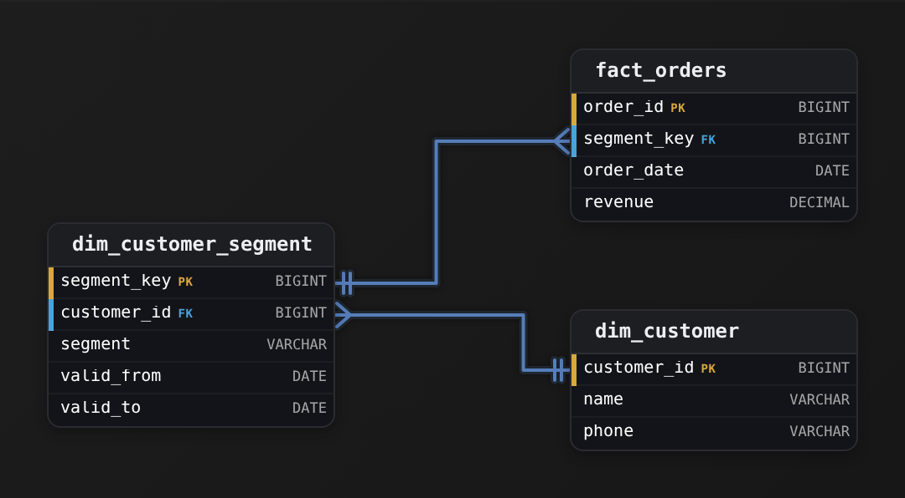
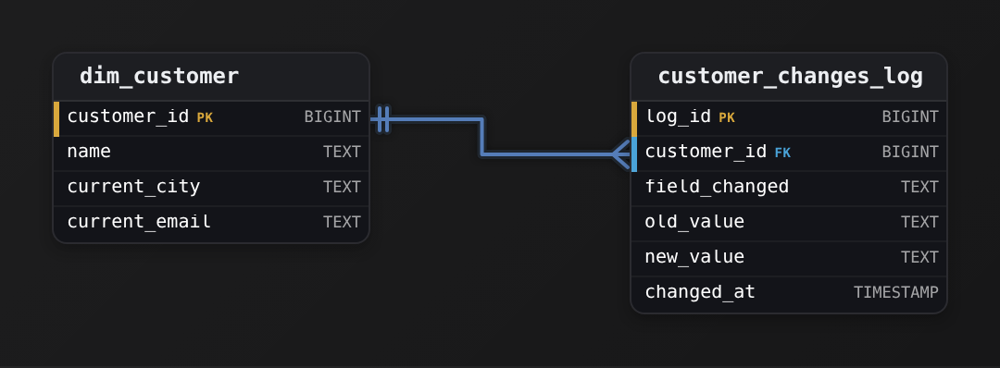
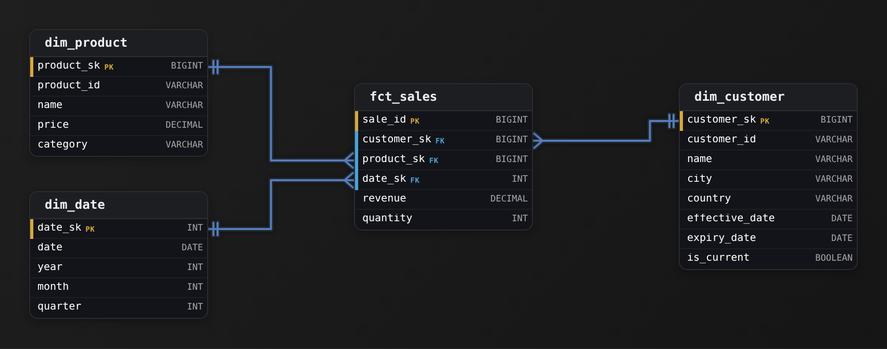
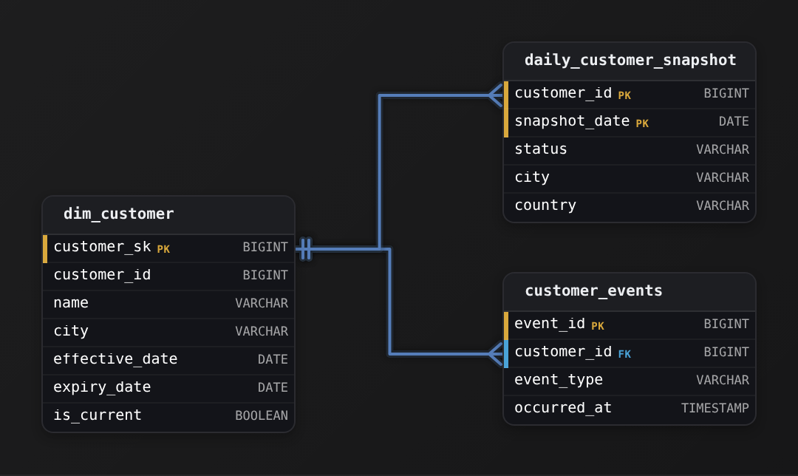

Intermediate·Data Modeling · 17 min · 12 challenges

# Change Tracking

Spotify's analytics team runs a monthly report: streams per subscription plan. On March 15, Ines upgrades from Free to Premium, and the customer table records her new plan. The next morning, February's Free stream count is lower than it was yesterday, and February's Premium count is higher. No February data changed. How the team stores Ines's plan change decides which report they can trust.


<br>

---

## The History Problem

A streaming service keeps 2 tables. The `customers` table holds one row per customer: who they are and which plan they pay for. The `streams` table holds one row per song play, and each play carries the `customer_id` of the person who pressed play. Finance asks one question every month: how many streams came from Free customers and how many came from Premium customers.

customers, as loaded on March 1

| customer_id | name | plan | country |
| --- | --- | --- | --- |
| 1042 | Maya Chen | Free | US |
| 2210 | Jonas Berg | Premium | SE |

streams

| stream_id | customer_id | streamed_at |
| --- | --- | --- |
| 501 | 1042 | 2024-02-10 |
| 502 | 1042 | 2024-02-27 |
| 503 | 2210 | 2024-02-14 |
| 504 | 1042 | 2024-03-20 |

The report joins the 2 tables on `customer_id`, groups by month and plan, and counts. Run on March 1, it says February had 2 Free streams and 1 Premium stream, which matches what happened.

```sql
SELECT
  DATE_TRUNC('month', s.streamed_at) AS month,
  c.plan,
  COUNT(*) AS streams
FROM streams AS s
JOIN customers AS c
  ON c.customer_id = s.customer_id
GROUP BY DATE_TRUNC('month', s.streamed_at), c.plan
```

Ines upgrades on March 15. The nightly load reads the source system, sees `plan = 'Premium'` for customer 1042, and writes that value into her row. The `customers` table has the same 2 rows it had before, with one cell changed. On March 16 the report runs again.

| report run on | February Free streams | February Premium streams |
| --- | --- | --- |
| March 1 | 2 | 1 |
| March 16 | 0 | 3 |

The load never touched the `streams` table, and both of Ines's February plays still sit there with their February dates. The join found her row, read Premium, and assigned her February listening to a plan she did not have in February. The one fact that would have kept the report stable, that Ines was Free until March 15, existed in the database right up to the moment the load wrote over it.

Overwriting feels harmless because the current value is right. The damage shows up in every question about the past:

> Questions one overwritten cell destroys
>
> - How many Free customers upgraded in March? Every upgrader already reads as Premium, so the count is 0.
> - Did the February ad campaign reach Free listeners? The campaign's audience now reads as partly Premium.
> - Why does the February report differ from the copy finance saved on March 1? The database holds no reason.

Tables like `customers`, which describe a thing that other tables point at by id, are called dimensions. Their values change rarely compared with the events that reference them: a customer changes plan a few times a year and streams a few songs an hour. A dimension with that pattern is a slowly changing dimension. When one of its values changes, you can overwrite the value (Type 1), add a new row for each version (Type 2), or keep the previous value in a second column (Type 3). The rest of this lesson builds each one on Ines's upgrade and shows which reports survive it.

> **TIP**
>
> Before overwriting any column, ask one question: will a report ever group or filter by this column's value on a past date? If yes, the overwrite rewrites that report.

**A products table holds one row per product with a price column, and an orders table records each sale with product_id and order_date, with no price stored on the order. On April 1 the price of product 77 rises from 20 to 25, and the load overwrites the price cell. Which statement about a revenue report built by joining orders to products is true?**

- **A.** Revenue for March orders of product 77 now reads 25 per unit, 5 higher than what customers paid.
- **B.** Revenue for March orders of product 77 still reads 20 per unit, because March orders happened before the change.
- **C.** Revenue for March is unchanged, and only orders placed after April 1 read 25 per unit.
- **D.** The report fails, because the join cannot match orders dated before the price changed.

<details>
<summary>Solution</summary>

**A.** Revenue for March orders of product 77 now reads 25 per unit, 5 higher than what customers paid.

The join reads today's price cell for every order regardless of its date, so every past sale of product 77 is restated at 25.

**Why the others are wrong**

- **B.** Nothing on the order row remembers 20. The only copy of the old price was the cell that was overwritten.
- **C.** That outcome requires the price to be versioned by date or stored on each order. A single overwritten cell has no date attached to it.
- **D.** The join matches on product_id and knows nothing about dates. It succeeds and returns restated numbers.

</details>


<br>

---

## Data Modeling

### Exercise 1 of 2

**● TASK**

Finance reports quarterly revenue by customer segment, and a customer's past orders must stay under the segment they held when ordering. Phone numbers change only when a typo is fixed, and support only ever needs the current one. Design the customer dimension and an orders fact, choosing for each attribute whether a change overwrites the old value or keeps it.

<details>
<summary><strong>Solution</strong></summary>

#### One question per attribute

A slowly changing dimension forces one decision for each attribute: when the value changes, do past facts still need the old one? Segment does. Finance reports revenue under the segment a customer held when they ordered, so if you overwrite it, an upgrade to 'enterprise' pulls every past 'consumer' order along with it. Phone does not. A fixed typo was never true, so the old value has nothing to tell any report.



*`segment` keeps dated rows in `dim_customer_segment`; `phone` is overwritten in place on `dim_customer`.*

1. **Ask what each old value still explains**

   For every attribute, picture an order from last year and ask whether it should still read the old value. If it should, the attribute needs versions: Type 2 in the section's list. If the old value was simply wrong, or no report groups by it, overwrite it: Type 1.

2. **Give the segment its own dated rows**

   Each change of segment adds a row to `dim_customer_segment` with `valid_from` and `valid_to`, and `fact_orders` points at the row in effect through `segment_key`. A later change adds a new row and can never move an old order. `phone` stays one column on `dim_customer` and is updated in place.

| Pitfall: An overwritten segment rewrites last quarter |
| --- |
| Keeping `segment` on `dim_customer` and updating it looks harmless until a customer is upgraded. Then every earlier order reports under 'enterprise': the same Portland-to-Seattle misstatement from the section. Versioning `phone` instead is the opposite mistake: it costs rows and buys nothing. |

**Follow-up questions**

1. Sales now wants each order shown with the segment at order time and the customer's segment today. What would you add?\
   *Reading the historical value and the current value side by side.*
2. A segment was keyed in wrong for a week. Should fixing it add a new `dim_customer_segment` row or correct the existing one?\
   *Telling a correction apart from a real change.*

</details>


<br>

### Exercise 2 of 2

**● TASK**

Create a customer dimension alongside a manual changes log table to track what changed and when.

<details>
<summary><strong>Solution</strong></summary>

#### Keep the dimension current, log the changes beside it

You just built the **audit-log approach to a slowly changing dimension**. `dim_customer` holds one row per customer, describing them as they are right now. History does not live in that row. Every edit is appended to `customer_changes_log`, which records which field moved, its old and new value, and when. The dimension answers "who is this customer today?" The log answers "what has happened to them over time?"



*One customer, many logged changes: the FK `customer_changes_log.customer_id` points back to the dimension's PK.*

One customer can change many times, so the log is the many side and carries a `customer_id` foreign key to `dim_customer.customer_id`. It needs its own `log_id` primary key because 2 events for the same customer can match on everything but `changed_at`. The log is field-level: an update that touches both city and email writes 2 rows, each with its own `old_value` and `new_value`.

| Pitfall: Don't version the dimension itself |
| --- |
| Adding `previous_city` and `previous_email` columns remembers only one step back. Turning `dim_customer` into SCD Type 2 with `valid_from`, `valid_to` and `is_current` gives it many rows per customer. Either way you lose the clean one-current-row read. A separate append-only log keeps the dimension simple and the trail complete. |

| ✕ SCD Type 2 (versioned rows) | ✓ Changes log (this design) |
| --- | --- |
| Every version is its own row with `valid_from` and `valid_to`. Facts can join to the customer as of their date, but current-state reads must filter `is_current = true`. | One row per `customer_id`, always current, plus a field-level trail in `customer_changes_log`. Current reads stay trivial. Point-in-time state means replaying the log. |

| Real world: Text values let one log cover every field |
| --- |
| This is the table behind an "account history" panel. The app updates `dim_customer` in place, and a trigger or the write path records the before and after. Because `old_value` and `new_value` are text, adding `current_phone` later needs no change to the log's schema. |

**Follow-up questions**

1. How would you reconstruct a customer's `current_city` as of a past date using only these 2 tables?\
   *Point-in-time state comes from replaying `customer_changes_log` ordered by `changed_at`.*
2. What would you add to record who made each change?\
   *A `changed_by` column, the natural growth of an audit table.*

</details>


<br>

---

## Type 1: Overwrite Old Value

Type 1 keeps one row per customer and replaces old values with new ones. The table always describes the present, and nothing in it says what came before. The load in the previous section was Type 1 by default, which is how most teams end up with it: a daily job reads the source, matches rows by `customer_id`, and writes whatever the source says now.

Written as a transformation, a Type 1 refresh takes the current dimension, left joins today's changed rows, and prefers the new value wherever one exists. The result has the same number of rows as the input, and the pipeline writes it back as the new `customers` table. Engines that support updating rows in place reach the same state with an UPDATE statement.

```sql
SELECT
  c.customer_id,
  COALESCE(u.name, c.name) AS name,
  COALESCE(u.plan, c.plan) AS plan,
  COALESCE(u.country, c.country) AS country
FROM customers AS c
LEFT JOIN todays_changes AS u
  ON u.customer_id = c.customer_id
```

This query handles changes to existing customers only. A customer who signs up today appears in `todays_changes` with no match in `customers` and drops out of the LEFT JOIN, so new rows are appended separately, or the join becomes a FULL OUTER JOIN that takes `customer_id` from whichever side has it. `COALESCE` also cannot clear a value: a source that sets a column to NULL looks the same as a source that sent no change, so a cleared value needs an explicit flag on the change row.

| state | customer_id | name | plan | country |
| --- | --- | --- | --- | --- |
| before March 15 | 1042 | Maya Chen | Free | US |
| after March 15 | 1042 | Maya Chen | Premium | US |

Type 1 is the right choice when the old value was wrong, or when no report will ever care what it used to be. Suppose the source had Ines's name as 'Ines Moreu' and support corrected the typo. Keeping 'Ines Moreu' as a historical version would preserve a mistake, and a report grouped by name would show 2 people where there is 1. The correct name should apply to every stream she ever played, which is what the overwrite does.

The same logic covers attributes that are looked up rather than reported on: email address, phone number, a marketing opt-in flag. Analysts filter by them today and never ask what they were last quarter. Type 1 also costs the least. The table holds one row per customer, joins match on `customer_id` alone, and no query needs date logic to find the right version.

Write the decision down. A table comment that says 'name, email: Type 1; plan, country: Type 2' tells the next engineer which overwrites are intended, and tells an analyst why a filter on name sees one value per customer while a filter on plan may see several.


<br>

### Where Type 1 breaks

Type 1 breaks the moment a reported column changes. The `plan` column appears in a report every month, so overwriting it restates every month. `country` has the same problem for any revenue-by-market report. A second, quieter cost: once a value is overwritten, no backfill can recover it. If finance decides in June that they want February streams by the plan each customer held in February, the data to rebuild that report no longer exists anywhere in the warehouse.

| ✓ Do | ✗ Don't |
| --- | --- |
| • Use Type 1 for corrections: the old value was wrong<br><br>• Use Type 1 for attributes no report groups or filters by<br><br>• Record which columns are Type 1 in the table's documentation<br><br>• Keep raw copies of source extracts so a decision can be revisited | • Overwrite a column that any report breaks down by<br><br>• Assume a column is harmless because it changes rarely<br><br>• Let a daily load overwrite every column without a per-column decision |

**The customers table has columns name, email, plan and country. Reports group streams by plan and revenue by country. Support recently fixed a misspelled last name, and one customer changed their email and their country in the same week. Which change is safe to apply as a Type 1 overwrite without restating any report?**

- **A.** The country change, because the customer moved and the new country is true now.
- **B.** The misspelled last name only, because an email change could matter to a report later.
- **C.** The misspelled last name and the email, because no report groups by either column.
- **D.** None of them, because any overwrite in a dimension rewrites history.

<details>
<summary>Solution</summary>

**C.** The misspelled last name and the email, because no report groups by either column.

Neither name nor email appears in a GROUP BY or a filter on past data, and the name fix corrects a mistake, so overwriting both leaves every report's numbers untouched.

**Why the others are wrong**

- **A.** Revenue by country reads this column for past months. Overwriting it moves the customer's earlier revenue into the new country.
- **B.** Email could become a reported column someday, and the raw extracts cover that case. Today it is a lookup attribute, and overwriting it changes no number.
- **D.** An overwrite rewrites the history of that one column. A column no report reads historically has no history that any number depends on.

</details>


<br>

---

## Data Modeling

### Exercise 1 of 2

**● TASK**

Design a Type 1 SCD customer dimension where updates simply overwrite the old values. No history is preserved.

<details>
<summary><strong>Solution</strong></summary>

#### Type 1 SCD: overwrite in place

A **Type 1 slowly changing dimension** keeps exactly one row per real-world entity and, when an attribute changes, updates that row in place. The old value is gone the moment the new one lands, no history is kept. That is the whole contract you were designing to: when a customer moves cities, `city` on their single `dim_customer` row is overwritten with the new value and the previous one is not recorded anywhere.


*One row per customer. `customer_sk` is the surrogate primary key; `customer_id` is the natural business key that survives an overwrite.*

The piece worth dwelling on is the 2 keys. `customer_sk` is a **surrogate key**: a warehouse-generated integer with no business meaning, and it is the primary key that fact tables point at. `customer_id` is the natural key, the identifier the source system knows (an account number, a CRM id). You keep both because they answer different questions: `customer_sk` gives every fact a stable, compact join target, while `customer_id` is how the load job finds the existing row to overwrite.

| Pitfall: Don't smuggle in history |
| --- |
| The most common miss on a Type 1 design is adding `valid_from`, `valid_to`, `is_current`, or a `version` column out of habit. Those belong to Type 2. The instant you add them you are preserving history, which is exactly what the requirement said not to do. Type 1 is deliberately flat: keys plus current attributes, nothing that timestamps a change. |

| ✕ Type 1 (this design) | ✓ Type 2 |
| --- | --- |
| One row per `customer_id`. A change UPDATEs the row in place; `city` becomes the new value and the old one vanishes. Queries always see the current state. Cheap to store, trivial to load. | A change INSERTs a new row and closes the old one with `valid_to` and `is_current = false`. History is preserved, so a fact joins to the version of the customer that was current at the time of the event. |

Why still bother with `customer_sk` if there is only ever one row per customer? Because the surrogate insulates the fact tables from the source system. If the business ever renumbers accounts or merges 2 CRMs, `customer_id` can change without breaking a single fact join, and if you later decide this dimension needs history after all, promoting it to Type 2 is far easier when facts already reference a surrogate rather than the natural key.

**Follow-up questions**

1. The business now wants to know what city a customer lived in when an order was placed. What has to change?\
   *Forces the Type 1 to Type 2 conversation: you can no longer overwrite `city`, you need versioned rows with `valid_from` and `valid_to`.*
2. How does the load job decide between an INSERT and an UPDATE for each incoming record?\
   *Tests that they see `customer_id` as the lookup key: a match means overwrite, no match means mint a new `customer_sk`.*

</details>


<br>

### Exercise 2 of 2

**● TASK**

Create a Type 1 SCD product dimension where price and category changes are overwritten in place.

<details>
<summary><strong>Solution</strong></summary>

#### Type 1: overwrite and forget

A **Type 1 slowly changing dimension** keeps exactly one row per real-world thing and overwrites attributes in place when they change. When a product's price moves from '9.99' to '12.99', you `UPDATE` the single `dim_product` row and the old value is simply gone. There is no history and that is the whole point: Type 1 is for attributes where only the current truth matters and nobody will ever ask "what was the price last March?". Your job here was to shape a dimension that supports that overwrite cleanly, which comes down to 2 decisions: what identifies a row, and what you deliberately leave out.


*One row per product. `product_sk` is the generated surrogate key; `product_id` is the business key the source system knows the product by.*

| Key insight: 2 keys, 2 jobs |
| --- |
| The surrogate key `product_sk` is a meaningless generated integer that the warehouse owns; it is what your fact tables join to. The business key `product_id` is the identifier the source system stamps on the product (a SKU, a catalog code). You need both: facts point at the stable `product_sk`, and your load job finds the row to overwrite by matching on `product_id`. Joining facts directly to `product_id` looks tempting but chains every fact to the source's key format forever. |

| Pitfall: Adding history columns turns it into Type 2 |
| --- |
| The most common miss is reaching for `effective_date`, `end_date`, or an `is_current` version flag. Those belong to a Type 2 dimension, which inserts a NEW row on every change and keeps the old one. The prompt asked for changes to be "overwritten in place", that is Type 1, so `price` and `category` are plain mutable columns with no versioning around them. `is_active` here is a soft-delete flag, not a history mechanism: it marks whether the product is still sold, and it too gets overwritten. |

| ✕ Type 1 (what you built) | ✓ Type 2 |
| --- | --- |
| One row per product. A price change is `UPDATE dim_product SET price = ... WHERE product_id = ...`. The old value vanishes. Facts always see current attributes. No `effective_date`, no row versions. | A price change INSERTs a new row and sets the old row's `end_date` / clears its `is_current`. Multiple rows share one `product_id`. Facts see the attribute value that was true when the event happened. Preserves history at the cost of a wider table and trickier loads. |

In real warehouses you rarely pick one type for the whole table; you pick per attribute. A product's `name` fixing a typo is a natural Type 1 overwrite, while `price` is often Type 2 because finance genuinely wants the historical value on old orders. This challenge kept every attribute Type 1 to isolate the pattern, but the design instinct to carry forward is: default to Type 1, and only pay for history on the columns someone will actually query over time.

**Follow-up questions**

1. If finance later insists on tracking historical `price` but everything else stays overwrite-in-place, how does the dimension change?\
   *Tests whether the learner can mix Type 1 and Type 2 attributes in one dimension (mini-dimension or Type 2 conversion).*
2. Why join fact tables to `product_sk` instead of `product_id`, given the surrogate is just a generated integer?\
   *Tests understanding of surrogate keys decoupling the warehouse from source key formats and enabling late-arriving / unknown-member rows.*

</details>


<br>

---

## Type 2: Preserve Full History

Type 2 keeps every version of a customer as its own row. When Ines upgrades, her Free row stays where it is and gets an end date, and a new Premium row is added beside it. 3 columns carry the versioning: `valid_from`, the first day the row's values were true; `valid_to`, the first day they no longer held, so the row covers only dates before it, or NULL while they still hold; and `is_current`, a flag that marks the latest row so the most common query stays short.

| customer_version_id | customer_id | name | plan | country | valid_from | valid_to | is_current |
| --- | --- | --- | --- | --- | --- | --- | --- |
| 7 | 1042 | Maya Chen | Free | US | 2022-06-01 | 2024-03-15 | false |
| 9 | 1042 | Maya Chen | Premium | US | 2024-03-15 | NULL | true |

Notice the first column. Once `customer_id` appears on 2 rows, it no longer picks out a single row, so each version gets its own number, `customer_version_id`. The date columns follow a half-open convention: a row is in effect from `valid_from` up to but excluding `valid_to`. March 15 belongs to the Premium row, and the 2 ranges touch without overlapping.


<br>

### Joining to the right version

The streams report now has to choose which of Ines's rows each play belongs to. The rule comes straight from the date columns: match the row whose range contains the stream date. The join condition carries that rule, and everything else about the query stays as it was.

```sql
SELECT
  DATE_TRUNC('month', s.streamed_at) AS month,
  d.plan,
  COUNT(*) AS streams
FROM streams AS s
JOIN customers AS d
  ON d.customer_id = s.customer_id
    AND s.streamed_at >= d.valid_from
    AND s.streamed_at < COALESCE(d.valid_to, DATE '9999-12-31')
GROUP BY DATE_TRUNC('month', s.streamed_at), d.plan
```

Trace Ines's 3 plays through it. Stream 501 on February 10 satisfies `2022-06-01 <= date < 2024-03-15`, so it matches version 7, plan Free. Stream 502 on February 27 matches the same row. Stream 504 on March 20 fails the first row's upper bound and matches version 9, plan Premium. February reads 2 Free and 1 Premium whenever the report runs, whether that is March 16, June 1 or any later day.


<br>

### Writing a change

A Type 2 refresh does 2 things to a changed customer: it closes the open row by setting `valid_to` to the change date, and it inserts a new open row. As a single transformation that rebuilds the table, that is every existing row, with the changed ones closed, stacked with UNION ALL on top of the new versions. The `COALESCE` closes a matched row, and the `is_current` expression turns the flag off for the same row. Each new version needs a fresh `customer_version_id`, which the load assigns before this step; here it arrives precomputed in `todays_changes` as `new_version_id`.

```sql
SELECT
  d.customer_version_id,
  d.customer_id,
  d.name,
  d.plan,
  d.country,
  d.valid_from,
  COALESCE(chg.changed_on, d.valid_to) AS valid_to,
  d.is_current
  AND chg.customer_id IS NULL AS is_current
FROM customers AS d
LEFT JOIN todays_changes AS chg
  ON chg.customer_id = d.customer_id
    AND d.is_current = TRUE

UNION ALL

SELECT
  chg.new_version_id,
  chg.customer_id,
  chg.name,
  chg.plan,
  chg.country,
  chg.changed_on,
  CAST(NULL AS DATE),
  TRUE
FROM todays_changes AS chg
```

With these columns in place, 2 more queries become short. The current state of every customer is `WHERE is_current = true`. The state on any past date, say the list of Premium customers on 2024-01-31, is the same range test used in the join with a literal date in place of the stream date. That second query is the one Type 1 can never answer, because Type 1 has no date to test.

> Type 2 pitfalls to check in review
>
> - Overlapping ranges: 2 open rows for one customer double-count every stream in the join.
> - Gaps between valid_to and the next valid_from: streams in the gap match no row and vanish from the report.
> - Fast-changing columns: a last_login_at column on a Type 2 table adds a row per customer per day.
> - Late changes: a plan change reported a week after it happened must split the open row at the real change date rather than today's date.

*The 'slowly' in the name is a limit on how often a column may change. Columns that change often belong in an events table rather than on a Type 2 dimension, where every change adds a row.*

**Using Ines's 2 rows above and the half-open convention, stream 505 for customer 1042 is dated 2024-03-15 and stream 506 is dated 2024-03-14. Which plan does the join assign to each?**

- **A.** Stream 505 to Free and stream 506 to Free, because the upgrade takes effect the day after valid_from.
- **B.** Stream 505 to Premium and stream 506 to Free.
- **C.** Stream 505 to both rows, because March 15 appears in valid_to of one row and valid_from of the other.
- **D.** Stream 505 to Premium and stream 506 to Premium, because both streams land in the month of the upgrade.

<details>
<summary>Solution</summary>

**B.** Stream 505 to Premium and stream 506 to Free.

The Free row covers dates from 2022-06-01 up to but excluding 2024-03-15. March 14 falls inside it. March 15 is excluded from it and falls in the Premium row, whose valid_from is 2024-03-15.

**Why the others are wrong**

- **A.** The Premium row starts on its valid_from, with >= in the join. A stream dated that day matches it.
- **C.** The join uses < on valid_to and >= on valid_from, so the shared date belongs to exactly one row.
- **D.** The join compares individual dates, and months play no part in it. March 14 is before the Premium row's valid_from.

</details>


<br>

---

## Data Modeling

### Exercise 1 of 2

**● TASK**

Design a Type 2 SCD customer dimension that preserves full history by creating a new row for each change, with date-range tracking.

<details>
<summary><strong>Solution</strong></summary>

#### Type 2 SCD: history as extra rows

A **Slowly Changing Dimension, Type 2** keeps the full history of a dimension by never overwriting a changed attribute. When a customer moves city, you do not update the `city` on their existing row, you close that row and insert a brand-new one carrying the new value. Over time one real-world customer becomes several rows in `dim_customer`, each describing what was true during a span of time. That is the whole idea the section asked you to model: change becomes a new row, not an edit.


*One dimension table. `customer_sk` is a synthetic surrogate key; `customer_id` is the durable business key that repeats across a customer's version rows. `effective_date`/`expiry_date` bound each version; `is_current` flags the live row.*

| Key insight: Why the surrogate key is separate from the business key |
| --- |
| The primary key `customer_sk` identifies a ROW-VERSION, not a customer. Because one customer now spans many rows, the natural key `customer_id` can no longer be unique, so it cannot be the PK. `customer_sk` (a meaningless generated integer) gives every version its own stable identity that fact tables point at, so a fact row is frozen to the customer's attributes as they were AT THAT TIME. |

| Pitfall: Modelling Type 1 when the prompt asked for Type 2 |
| --- |
| The common miss is a table keyed on `customer_id` with just `name` and `city` and no date columns. That is a Type 1 dimension: an update overwrites the old value and the history is gone. Type 2 needs 3 things the naive design lacks: a surrogate PK so versions can coexist, the durable `customer_id` to group them, and `effective_date`/`expiry_date` to say WHEN each version was valid. |

| ✕ Closing the old version | ✓ Opening the new version |
| --- | --- |
| Set the outgoing row's `expiry_date` to the change date and flip `is_current` to false. Its `name`/`city` stay untouched, that is the historical record. | Insert a fresh row: new `customer_sk`, same `customer_id`, the new `city`, `effective_date` = change date, `expiry_date` = a sentinel like '9999-12-31', and `is_current` = true. |

The `is_current` flag is redundant with the dates (the current row is the one whose `expiry_date` is the far-future sentinel) but it earns its place: `WHERE is_current = true` is the cheap, obvious way to get today's snapshot without date math, and it is the filter analysts reach for constantly. Keeping both the flag and the date range is standard practice, not duplication to feel guilty about.

| Real world: In production |
| --- |
| This is the backbone of a Kimball-style warehouse. Order and payment facts join to `dim_customer` on `customer_sk`, so a report on last year's revenue attributes each order to the customer's city AS IT WAS then, even if they have since moved. That time-correct join is exactly why the surrogate key and the date range exist together. |

**Follow-up questions**

1. How would you find a customer's full history and their current row from this one table?\
   *Current row is `WHERE customer_id = ? AND is_current = true`; full timeline is all rows for that `customer_id` ordered by `effective_date`.*
2. What changes if you only need to track history on `city` but treat a `name` change as a simple overwrite?\
   *Mixing Type 2 on `city` with Type 1 on `name` in one dimension, a common hybrid.*
3. Why store `expiry_date` as '9999-12-31' on the current row instead of leaving it NULL?\
   *Tests BETWEEN range queries and whether a NULL would silently drop the current version from a date filter.*

</details>


<br>

### Exercise 2 of 2

**● TASK**

Create a Type 2 SCD employee dimension that tracks department and title changes over time with effective/expiry dates.

<details>
<summary><strong>Solution</strong></summary>

#### History as rows, not overwrites

A **Type 2 slowly changing dimension** keeps history by inserting a new row whenever a tracked attribute changes. It never overwrites the old value. When someone moves from 'Engineering' to 'Platform', or goes from 'Analyst' to 'Senior Analyst', you close their current `dim_employee` row and open a fresh one. A fact table joined to this dimension can then answer what their title was at the time of the event, not only what it is today.


*One row per employee version: `employee_sk` is the surrogate PK, `employee_id` the business key that repeats across versions.*

| Key insight: The grain changed, so the key had to |
| --- |
| One person now owns several rows, so `employee_id` can't be unique any more. The table's grain is one row per version. A meaningless generated `employee_sk` is unique at that grain, and it is what facts point at, which pins each fact to the version that was live when it happened. `employee_id` stays on the row so you can still gather every version of one person. |

`valid_from` and `valid_to` bound the interval each version was true. `is_current` flags the live row. It is technically redundant, because the current row is the one whose `valid_to` is `NULL` or '9999-12-31'. It is still worth having: `WHERE is_current = true` is a far simpler filter for today's roster than a date-range predicate.

| Pitfall: Updating in place is Type 1 |
| --- |
| A table keyed on `employee_id` whose `department` and `job_title` get UPDATEd looks cleaner, but it is a Type 1 dimension. It only knows the present. Once a fact needs the title as of its event date, that history is already gone. |

| Real world: One MERGE closes the old row and opens the new |
| --- |
| The nightly load usually runs a `MERGE` that matches incoming rows to the current version on `employee_id`. When a tracked attribute differs, it stamps `valid_to` and `is_current = false` on the old row and inserts the new version. Volatile attributes like `salary` multiply versions, so teams often move them into a separate mini-dimension. |

**Follow-up questions**

1. How would you find each employee's title as of '2025-03-01'?\
   *Filters with the `valid_from`/`valid_to` interval instead of `is_current`.*
2. Should `valid_to` on the current row be `NULL` or '9999-12-31'?\
   *A sentinel keeps range predicates uniform; `NULL` needs `COALESCE` or an `OR`.*
3. If `salary` changes weekly but `department` rarely does, do both belong in one Type 2 dimension?\
   *Weighs row growth against history, and leads to the mini-dimension split.*

</details>


<br>

---

## Type 3: Keep Previous Value

Type 3 keeps one row per customer, as Type 1 does, and adds columns that remember the value before the latest change: `previous_plan` and `plan_changed_on`. Ines's row after the upgrade holds both plans side by side, and Jonas, who has never changed plan, carries NULL in both new columns.

| customer_id | name | plan | previous_plan | plan_changed_on |
| --- | --- | --- | --- | --- |
| 1042 | Maya Chen | Premium | Free | 2024-03-15 |
| 2210 | Jonas Berg | Premium | NULL | NULL |

The design exists for one kind of question: comparing the current state with the one before it, across the whole table, with no date arithmetic. The product team wants an upgrade funnel for March: how many customers moved from Free to Premium, from Premium to Family, and so on. On a Type 3 table that is a group by on 2 columns with a filter on the change date.

```sql
SELECT
  previous_plan,
  plan,
  COUNT(*) AS customers
FROM customers
WHERE plan_changed_on >= DATE '2024-03-01'
  AND plan_changed_on < DATE '2024-04-01'
GROUP BY previous_plan, plan
```

The same shape answers 'show this quarter's revenue under the old sales territories and the new ones', the example textbooks introduce the pattern with, and 'which customers were in market X before the regional split'. In each case the report wants 2 columns next to each other on one row, which takes a self-matching query on Type 2 and has no answer at all on Type 1.

Type 3 also handles the moment when a company changes everything at once. If every customer's region changes on the same day because the market map was redrawn, Type 2 doubles the table overnight with 1 new row per customer, while Type 3 adds 1 column and lets every report run both ways until the old grouping is retired.


<br>

### What Type 3 forgets

Type 3 remembers exactly one step back. If Ines moves from Premium to Family on June 1, `plan` becomes Family, `previous_plan` becomes Premium, and Free leaves the table. A funnel run in July cannot see that she was ever Free. The pattern suits attributes that change once, or where only the most recent transition matters to anyone.

It also leaves the February report from the first section broken. The streams join still matches `customer_id` to one row, and that row says Premium, so Ines's February plays still count as Premium. Type 3 records that a change happened and what the prior value was. The row carries no date range, so the join has nothing to test a stream date against.

| ✓ Type 3 answers | ✗ Type 3 cannot answer |
| --- | --- |
| • How many customers moved from Free to Premium this month?<br><br>• Which customers changed country in Q1, and from where?<br><br>• Revenue by current region next to revenue by prior region | • Which plan did Ines have on February 10?<br><br>• What were all 3 of her plans across the last 2 years?<br><br>• How do February streams split by the plan in force in February? |


**A Type 3 customers table has plan, previous_plan and plan_changed_on. Customer 3301 goes from Free to Premium on 2024-02-01, then from Premium to Family on 2024-05-10. On 2024-06-01, what does the row hold, and what can the funnel query learn from it?**

- **A.** plan Family, previous_plan Free, plan_changed_on 2024-05-10; the query sees a Free to Family move.
- **B.** plan Family, previous_plan Premium, plan_changed_on 2024-02-01; the query sees both moves.
- **C.** plan Premium, previous_plan Free, plan_changed_on 2024-02-01; the May change waits for the next version row.
- **D.** plan Family, previous_plan Premium, plan_changed_on 2024-05-10; the query sees the Premium to Family move only.

<details>
<summary>Solution</summary>

**D.** plan Family, previous_plan Premium, plan_changed_on 2024-05-10; the query sees the Premium to Family move only.

Each change overwrites the pair of columns. The February move sat in previous_plan until May 10, when the May move replaced it.

**Why the others are wrong**

- **A.** previous_plan holds the value immediately before the latest change, which was Premium. Free was 2 changes ago.
- **B.** The date column tracks the latest change, so it reads 2024-05-10, and one row cannot hold 2 transitions.
- **C.** Type 3 has no version rows. The May change overwrote the row on the day it was loaded.

</details>


<br>

---

## Data Modeling

### Exercise 1 of 2

**● TASK**

Design a Type 3 SCD customer dimension that retains only the current and previous value for a tracked attribute.

<details>
<summary><strong>Solution</strong></summary>

#### Type 3: current plus one step of history, side by side

A **Type 3 slowly-changing dimension** tracks change by keeping the current value and the immediately previous value in 2 columns of the SAME row. When the tracked attribute changes, you copy what was in `current_city` into `previous_city`, write the new value into `current_city`, and stamp `city_changed_at`. There is still exactly one row per customer, so the grain never moves; the history lives in columns, not in extra rows.


*One row per customer. `current_city` and `previous_city` hold the 2 values Type 3 retains; `city_changed_at` records when the swap happened.*

The `customer_sk` is the **surrogate key**: a warehouse-owned integer that the fact tables join on, separate from the source system's `customer_id` (the business key). Because Type 3 keeps a single row per customer, that surrogate stays stable through every change; unlike Type 2, you never mint a new key to represent a new version. `customer_id` is what you match on when a new load arrives to decide whether to swap the city columns.

| Pitfall: Type 3 is not Type 2 with fewer rows |
| --- |
| The common miss is reaching for Type 2 machinery, `valid_from`, `valid_to`, `is_current`, a new row per change. That models unlimited history as rows. Type 3 makes a deliberate trade: you only ever answer 'what is it now, and what was it just before?', so you spend 2 columns and keep one row. If the question is 'what was the city on any past date?', Type 3 cannot answer it and you want Type 2 instead. |

| ✕ Type 2 (row versioning) | ✓ Type 3 (column versioning) |
| --- | --- |
| New row per change, new `customer_sk` each version, bounded by `valid_from`/`valid_to`. Full history, but you must pick the right version at join time. | One row forever, stable `customer_sk`. `current_city` and `previous_city` sit together, `city_changed_at` timestamps the last swap. Only the latest transition survives. |

| Real world: Where this shows up |
| --- |
| Type 3 fits attributes that change rarely and where only the last state matters for reporting, a sales region realignment where analysts want 'old region vs new region' side by side, or a reclassified account tier. It keeps year-over-year comparisons trivial (`current_city` vs `previous_city` in one row) without the join gymnastics Type 2 forces. |

**Follow-up questions**

1. What changes if the business wants the 2 most recent previous cities, not just one?\
   *Type 3 generalizes to N columns (`previous_city_1`, `previous_city_2`), but each extra step is a schema change, a signal you may actually want Type 2.*
2. On the very first load, before any change has happened, what goes in `previous_city` and `city_changed_at`?\
   *Tests handling the no-prior-value case: usually NULL until the first real transition.*

</details>


<br>

### Exercise 2 of 2

**● TASK**

Create a Type 3 SCD product dimension that keeps current and previous price in separate columns.

<details>
<summary><strong>Solution</strong></summary>

#### Type 3 SCD: keep the prior value in its own column

A Type 3 slowly changing dimension tracks history **sideways** instead of downward. When an attribute changes you don't add a new row and expire the old one (that's Type 2) and you don't overwrite in place (that's Type 1). You keep the same row and shift the old value into a companion column. Here that means `dim_product` carries both `current_price` and `previous_price`, plus a `price_changed_at` stamp so you know when the shift happened. One row per product, always: the surrogate key `product_sk` identifies the row and the business key `product_id` identifies the product it stands for.


*One row per product. History lives in the extra column, not extra rows.*

The update is the whole trick. When a price changes you copy `current_price` into `previous_price`, write the new value into `current_price`, and set `price_changed_at` to now. The row's identity never moves, so every fact table that already points at `product_sk` keeps working, and a query compares old to new with a single subtraction, `current_price - previous_price`, no self-join required.

| Key insight: Why a surrogate key even in Type 3 |
| --- |
| The row is stable, so it's tempting to make `product_id` the primary key and drop `product_sk`. Keep the surrogate anyway. It insulates the fact tables from the source system's key (which can be reissued, reformatted, or go composite), and it keeps the dimension's join contract identical across Type 1, 2, and 3, so a downstream model never has to know which flavor it's joining to. |

| ✕ Type 2 (rows) | ✓ Type 3 (columns) |
| --- | --- |
| A new row per change, with `valid_from` / `valid_to` and an `is_current` flag. Full, unbounded history: every price the product ever had stays queryable. Costs a growing table, and every query must filter to the right version. | One row, an extra `previous_price` column and a `price_changed_at` stamp. Only the **most recent** change survives; the value before last is gone. Cheap, tiny, and a before/after comparison is a single-row read. |

| Pitfall: Type 3 only remembers one step back |
| --- |
| The common mistake is reaching for Type 3 when the requirement is really full history. A second price change overwrites `previous_price` with the value from the first change, so the original price is lost. Type 3 fits only when you genuinely need current-vs-prior (a realignment, a rebrand, a territory reassignment), not a full timeline. If a stakeholder says "we need every past price," that's Type 2. |

| Real world: In production, Type 3 columns come in pairs |
| --- |
| Teams rarely add `previous_price` alone. When an org restructures you'll see `current_region` / `previous_region` with an `effective_date`, so reports can run "as if" the old alignment still held while the new one takes over. The shape is always the one you built here: a live column, a one-deep prior column, and a timestamp marking the switch. |

**Follow-up questions**

1. How would you let the business compare sales under both the old and new price once a second change would overwrite `previous_price`?\
   *Nudges toward Type 2, or a hybrid Type 2 + Type 3, when one-deep history isn't enough.*
2. What would you add to `dim_product` to track name changes the same way?\
   *Tests whether the pair-of-columns pattern generalizes: `previous_name` plus its own changed-at stamp.*

</details>


<br>

---

## Choosing Your Strategy

The choice is made one column at a time, and the input is the list of questions reports ask. For each column that can change, find out whether any report groups, filters or joins by its value as of a past date. Overwrite the column if the answer is never, and version it if the answer is yes. If the only historical question is 'what was it right before this', 2 extra columns cost less than versions.

| Question the report asks | Type | Why |
| --- | --- | --- |
| Current value only, or correct a mistake | 1 | One row, no date logic, the old value had no reporting use |
| Value as of the date of each event | 2 | Date ranges let each event find its own version |
| Current value beside the one before it | 3 | Old and new values sit in 2 columns on one row, no join on dates |
| Full change history for a customer | 2 | Every version is a row; Type 3 keeps 1 step |

Applied to the `customers` table: `name` is Type 1, because the only change it sees is a correction. `email` is Type 1. `plan` is Type 2, because the monthly streams report depends on the plan in force on the stream date. `country` is Type 2 for the same reason, with a `previous_country` column added if the markets team wants a one-step migration report without a date join. That puts 3 policies on the one table.


<br>

### Mixing types in one table

A Type 2 table can carry Type 1 columns, with one rule: a Type 1 change applies to every version of that customer. When Ines's name is corrected, both version 7 and version 9 get the new spelling, so a report grouped by name sees one person. A Type 1 change that touches only the current row splits one customer into 2 names and looks exactly like a Type 2 change nobody intended.

A second common hybrid adds the current value to every version. A `current_plan` column on all of Ines's rows lets one join produce February streams by the plan she had then and by the plan she has now, which is how teams reconcile the old report with the restated one. The cost is that every plan change updates every historical row for that customer.

- Row growth: Type 2 rows per customer equal versions, so estimate changes per year before choosing
- Query authors: every join to a Type 2 table needs the date range, so document the convention
- Corrections: decide in advance whether a bad value gets a new version or a rewrite of all versions
- Late changes: Type 2 loads need logic to split a row at a past date
- Storage: Type 3 adds 2 columns, Type 2 adds rows, Type 1 adds nothing

**A products table has name, category, price and supplier_email. 2 reports exist: revenue by category per month, where each sale stores product_id and quantity only, and a quarterly list of products that moved categories, old category beside new. Which per-column assignment serves both reports at the least cost?**

- **A.** category Type 2, price Type 2, name Type 1, supplier_email Type 1; build the move list by pairing each version with the one before it.
- **B.** category Type 3, price Type 1, name Type 1, supplier_email Type 1; the previous_category column covers the move list.
- **C.** Every column Type 2, so that no question about the table is ever lost to an overwrite.
- **D.** category Type 2, price Type 1, name Type 1, supplier_email Type 1; price changes rarely so an overwrite is safe.

<details>
<summary>Solution</summary>

**A.** category Type 2, price Type 2, name Type 1, supplier_email Type 1; build the move list by pairing each version with the one before it.

Revenue by category per month needs the category on the sale date, and revenue itself needs the price on the sale date, so both are Type 2. Name and email are lookups. The move list comes from consecutive versions, so a Type 3 column is optional.

**Why the others are wrong**

- **B.** The move list works, and monthly revenue by category breaks: past sales join to the current category, and overwritten prices restate revenue.
- **C.** Supplier email changes add versions that no report reads and widen every join. The extra rows buy nothing.
- **D.** Revenue is quantity times the price at sale time. One overwrite restates every past sale of that product, however rare the change.

</details>

Change requests rarely arrive together. They come one at a time, months apart, against a table that already holds versions, so each one gets the same per-column test with the existing rows in mind. A column that changes often and that no report reads, such as a phone number, is overwritten across every version. Versioning it would add a row per change, and plan or tier reports would then scan versions that differ in nothing they group by.


<br>

---

## Data Modeling

### Exercise 1 of 2

**● TASK**

Design a production-ready Type 2 SCD customer dimension for a retail data warehouse, incorporating best practices you've learned.

<details>
<summary><strong>Solution</strong></summary>

#### Type 2 SCD: a dimension that remembers

A **Type 2 slowly changing dimension** keeps the full history of an entity by never overwriting a tracked attribute. When a customer moves cities or changes email, you don't UPDATE the existing row: you close it off and INSERT a brand-new row for the same customer. That way a fact recorded in 2023 still joins to the customer's 2023 city, and a fact from today joins to today's. The whole design you just drew exists to make that possible, and it hangs on 3 columns most people forget on their first pass: `effective_date`, `expiry_date`, and `is_current`.


*One customer can own many rows here, one per version of their attributes. `customer_sk` is unique per version; `customer_id` is shared across all versions of the same person.*

| Trick: The surrogate key is what makes history possible |
| --- |
| `customer_sk` is a meaningless generated integer that identifies a ROW, not a person. `customer_id` (the business key) identifies the person and repeats across every version. You need both: facts point at `customer_sk` so they lock onto the exact version that was current when the event happened, while `customer_id` is how you find all of a customer's history. If you made `customer_id` the primary key you could only ever store one row per customer, and there would be no history to keep. |

1. **Close the old version**

   When a tracked attribute changes, find the customer's current row (`WHERE customer_id = ? AND is_current = true`), set its `expiry_date` to today, and flip `is_current` to false. The row still exists; it just stops being the live one.

2. **Open the new version**

   INSERT a new row with the same `customer_id`, the updated attributes, a freshly minted `customer_sk`, `effective_date` set to today, `is_current` set to true, and `expiry_date` left open (a NULL or a sentinel like '9999-12-31'). New facts now join to this row.

| Pitfall: Overwriting in place is a Type 1, not a Type 2 |
| --- |
| The tempting shortcut is a single row per customer that you just UPDATE when something changes. That is a Type 1 dimension, and it silently rewrites the past: every historical fact suddenly reports the customer's NEW city as if it were always true. If a stakeholder asks 'what were sales by region last year,' a Type 1 dimension answers with this year's regions. The `effective_date`/`expiry_date` pair is exactly what a Type 1 throws away. |

| ✕ Type 1 (overwrite) | ✓ Type 2 (versioned) |
| --- | --- |
| One row per customer. Changing `city` does an in-place UPDATE. Simple and small, but history is lost. Use it for attributes where the past genuinely doesn't matter, like a corrected typo in `name`. | Many rows per customer, bounded by `effective_date`/`expiry_date` with one flagged `is_current`. Storage grows with change frequency, but every fact stays tied to the truth as of its own date. Use it for anything you'll slice history by, like `region`. |

| Real world: In production, `is_current` earns its keep |
| --- |
| You could derive the live row from the dates alone (`WHERE expiry_date IS NULL`), but the redundant `is_current` boolean makes the most common query, 'give me every customer as they are right now,' a cheap indexed lookup instead of a date comparison. It's denormalization on purpose, and it's standard in Kimball-style warehouses. |

**Follow-up questions**

1. What changes if some attributes should be Type 2 but `email` should only ever be Type 1?\
   *Mixed SCD types in one dimension, or splitting into a mini-dimension.*
2. How would you handle a late-arriving change, where you learn today that a customer moved cities 3 weeks ago?\
   *Backdating `effective_date` and re-stitching the version that was current in between.*

</details>


<br>

### Exercise 2 of 2

**● TASK**

Design a dim_customer dimension for customers identified by customer_id that picks its change-tracking strategy per attribute. Revenue reports must attribute each sale to the city the customer lived in on the sale date, so a move cannot erase the old city. Name and email changes are corrections nobody reports on historically. Choose the SCD type for each of these attributes and give the table the keys and columns that choice requires.

<details>
<summary><strong>Solution</strong></summary>

#### Hybrid SCD: 2 strategies in one dimension

A **hybrid slowly-changing dimension** picks the change strategy per attribute instead of for the whole table. Some columns keep history (Type 2: a change writes a new row), others are overwritten in place (Type 1: a change updates the existing value). The deciding question for each attribute is whether any report needs its past value. Revenue by city does, so `city` is Type 2; a corrected `name` or `email` does not, so both are Type 1. One table, 2 behaviors.


*`customer_sk` is the surrogate PK (unique per version); `customer_id` is the business key that repeats across versions. `city` plus `effective_date`, `expiry_date` and `is_current` carry Type 2 history; `name` and `email` are Type 1.*

| Key insight: Versioning forces a surrogate key |
| --- |
| Type 2 puts several rows per customer in the table, so `customer_id` can no longer be the primary key: it repeats. `customer_sk` is a meaningless generated integer that is unique per versioned row, so a fact table joins to one exact version of the customer. Keep the 2 keys separate: `customer_sk` identifies a version, `customer_id` identifies the person across all versions. |

| ✕ Type 2 (city) | ✓ Type 1 (name, email) |
| --- | --- |
| A move expires the current row (`expiry_date` set, `is_current` flipped to false) and inserts a NEW row with a fresh `customer_sk`, the new `city`, and `is_current = true`. The old `city` survives on the old row, so revenue stays attributed to where the customer lived at the time. | A correction overwrites the value on the existing row in place. No new row, no new `customer_sk`, no date change. The previous `name` or `email` is simply gone, which is exactly what you want for a typo fix. |

| Pitfall: Not every attribute earns history |
| --- |
| The easy mistake is applying Type 2 to every attribute, so fixing a misspelled `name` spawns a brand-new row and inflates the dimension with meaningless versions. History only belongs on attributes whose past values have analytical meaning, like `city`. A typo in `email` has no history worth keeping, so it stays Type 1. |

1. **Find the current version of a customer**

   Filter `WHERE customer_id = ? AND is_current = true`. The `is_current` flag is the fast path; without it you would have to compare against `expiry_date` on every read. The 2 are redundant on purpose: `is_current` is a convenience over the same fact the dates already encode.

2. **Reconstruct history as of a point in time**

   Use the date range: `WHERE customer_id = ? AND report_date BETWEEN effective_date AND expiry_date`. This is why Type 2 needs BOTH dates: the interval on each row tells you which `city` was true on any given day. Type 1 columns have no such interval because their past is not retained.

| Real world: Most real dimensions mix types |
| --- |
| Hybrid dimensions are the norm in real warehouses, not the exception. A customer or product dimension often has a handful of Type 2 attributes (address, segment, price tier) among dozens of Type 1 fields. Kimball calls it a Type 6 dimension when you also add a 'current value' column beside the historical one, so a query can pull either the version-at-time value or today's value without a re-join. |

**Follow-up questions**

1. If analysts often need a customer's CURRENT city while looking at a historical fact row, what one column would you add and why?\
   *Extends the per-attribute choice: a `current_city` column overwritten on every row for that customer lets one query answer both 'city then' and 'city now'.*
2. Your load job sees a customer whose city AND email both changed in the same batch. What happens to each?\
   *Shows the 2 strategies applied independently in one load: a new Type 2 row for the city move, with the new email written onto that same new row.*

</details>


<br>

---

## Putting It All Together

A subscription streaming service closes its quarter. Finance needs February streams by plan to match the figures it published on March 1, product wants the count of Free to Premium upgrades in March, and support has corrected 400 misspelled names since January.

- The plan column is Type 2, so February streams join to the plan in force in February and the published figures hold.
- The upgrade count comes from versions starting in March with plan Premium whose preceding version for the same customer had plan Free, or from a previous_plan column if the team added one.
- The 400 name fixes are Type 1 and are written to every version, so no customer appears under 2 spellings.
- Email and phone stay Type 1 on the same table, keeping the version count driven by plan changes alone.


<br>

---

## Data Modeling

### Exercise 1 of 2

**● TASK**

Design the dimension layer of a retail sales warehouse: a sales fact (one row per sale, with revenue and quantity) plus customer, product and date dimensions. Customers change home city, and revenue reports must keep each sale attributed to the city the customer lived in when it happened. Product price and category changes are corrections nobody reports on historically, and date attributes never change. Choose a change-tracking strategy for each dimension, give every dimension a surrogate primary key, and link the fact to each dimension through it.

<details>
<summary><strong>Solution</strong></summary>

#### 2 dimensions, 2 change strategies

Slowly changing dimension strategy is decided one dimension at a time, and this model needs 2 different answers. The customer's `city` feeds point-in-time revenue reports, so `dim_customer` is **Type 2**: every move adds a new row with its own surrogate key. Product `price` and `category` changes are corrections nobody reports on historically, so `dim_product` is Type 1 and overwrites in place. `dim_date` never changes at all. The fact, `fct_sales`, stays one row per sale with `revenue` and `quantity`.



*`fct_sales` joins to each dimension on a surrogate key, never on the business id.*

| ✕ Type 1 (product) | ✓ Type 2 (customer) |
| --- | --- |
| When a product's `price` or `category` changes, you overwrite the row in place. There is only ever one row per `product_id`, so the old value is gone, which is exactly right for a correction nobody reports on. There are no dating columns: just `product_sk` and the attributes. | When a customer's `city` changes, you expire the old row and insert a new one. Now `customer_id` maps to several rows over time, told apart by `effective_date`, `expiry_date` and `is_current`. The surrogate key `customer_sk` stays unique per version even though `customer_id` repeats. |

| Key insight: The fact points at a version, not a customer |
| --- |
| A sale recorded against `customer_sk = 42` is frozen to the version of the customer that was current then, so its `revenue` stays in the city where the customer lived. If `fct_sales` joined on the natural `customer_id`, every old sale would re-point at the latest city and regional totals would rewrite themselves on every move. |

| Pitfall: Dating columns belong only where history is kept |
| --- |
| A common slip is to add `effective_date`, `expiry_date` and `is_current` to every dimension "to be safe", or to the fact. The fact already carries time through `date_sk`. Giving `dim_product` a Type 2 structure keeps versions of corrections nobody wants and multiplies its rows for no report. |

**Follow-up questions**

1. A customer fixes a typo in their `name` and nobody needs the old spelling. Does that change add a new version of the row?\
   *The strategy is chosen per attribute, so one dimension can mix Type 1 and Type 2 columns.*
2. Marketing wants to compare each customer's current `segment` with the one before a migration. Which strategy fits that attribute?\
   *A single prior value is the case Type 3 keeps with a previous-value column.*
3. Why does `dim_date` never need any change tracking?\
   *A calendar day's attributes are fixed once the row exists.*

</details>


<br>

### Exercise 2 of 2

**● TASK**

Design a customer lifecycle data warehouse with a Type 2 dimension, a date dimension, and a fact table that references them.

<details>
<summary><strong>Solution</strong></summary>

#### One versioned dimension, 2 facts of different grain

A Type 2 slowly changing dimension keeps history by adding rows instead of overwriting them. When a tracked attribute changes, you close the customer's current version and open a new one. As a result, `dim_customer` holds every version a customer has ever had. That is why `customer_sk` is the primary key and `customer_id` is not. Once one customer can own several rows, the business key stops being unique, so each version gets its own surrogate key.



*A transaction fact (`customer_events`) and a periodic snapshot fact (`daily_customer_snapshot`) both reference the versioned `dim_customer`. Each fact row resolves to exactly one `customer_sk` version.*

3 columns do the Type 2 work: `effective_date`, `expiry_date` and `is_current`. Together they give each version a validity window. When a customer moves, you leave the old row's `city` alone. Instead, you set that row's `expiry_date` and flip its `is_current` to false. Then you insert a new row with the new `city`, a fresh `customer_sk` and an open `expiry_date`.

| Pitfall: Overwriting the row is Type 1, not Type 2 |
| --- |
| The first instinct is one row per customer, changed with an `UPDATE` when the `city` moves. That answers "where are they now?" but loses "where were they when that event happened?". Every past fact silently re-points at the new value. |

The 2 facts differ by grain. `customer_events` is a transaction fact: one immutable row per event, keyed by `event_id`. `daily_customer_snapshot` holds one row per customer per day, so its key is the composite of `customer_id` and `snapshot_date`.

| Key insight: The validity window picks the version |
| --- |
| A fact carries `customer_id`, and the window narrows it to a single `customer_sk`. To see the customer as they were, filter `occurred_at` between `effective_date` and `expiry_date`. To see the customer as they are now, add `is_current = true`. |

**Follow-up questions**

1. How would you move `occurred_at` and `snapshot_date` into a shared `dim_date`?\
   *Factoring calendar attributes into one conformed date dimension.*
2. What happens to the row count if `city` and a loyalty tier change on different days?\
   *Every tracked change opens a new version.*

</details>


<br>

---

## Key Takeaways

- An overwrite keeps the present and deletes the past: any report grouped by that column on a past date restates.
- Type 1 suits corrections and lookup attributes that no report breaks down by.
- Type 2 adds a row per version with valid_from and valid_to, and every join to it carries the date range.
- Type 3 keeps the current value and the one before it on a single row, for one-step comparisons.
- Decide one column at a time from the questions reports ask, and apply Type 1 fixes across all versions.
