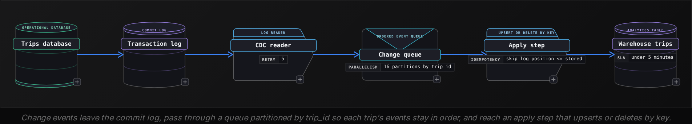
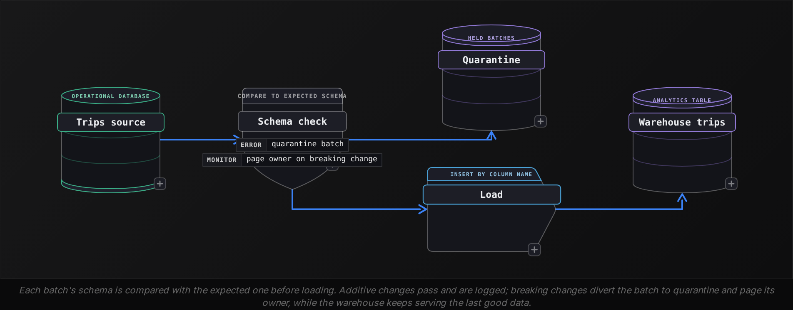
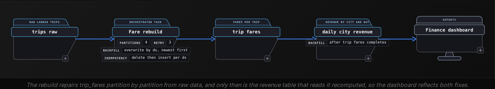

Beginner·Pipeline Architecture · 20 min · 4 challenges

# Keeping Data Fresh: Beginner

Ines is 40 minutes into a data engineering loop at Uber when the whiteboard question arrives. The interviewer sketches a trips table in the operational database: 2 billion rows, about 4 million edits a day as tips and corrections adjust fares and some trips get cancelled. Analysts want a dashboard that is never more than an hour behind. 'How do you keep the warehouse copy current?' Ines starts to say she would reload it every hour, then stops: copying 2 billion rows to pick up 4 million changes sounds wrong. But reading only the changes raises its own questions. How does the pipeline notice a cancelled trip that was deleted? What happens when a driver moves cities, when an engineer renames a column, or when a fare bug corrupts last month? Each follow-up is the same question in disguise: how does fresh data stay correct?


<br>

### What you will be able to do

Choose between full and incremental loading for a given table, and defend the choice with its cost and its failure modes

Explain how change data capture reads the transaction log and why it catches deletes that timestamp queries miss

Model a changing dimension as SCD Type 2 and write the point-in-time join that avoids double counting

Classify a schema change by whether it breaks readers, and whether it breaks them loudly or silently, then say what the pipeline should do in each case

Plan a backfill that can be rerun safely, and order its tables and partitions correctly


<br>

---

## Full vs Incremental Loading

Every freshness question starts with a single decision: on each run, how much of the source does the pipeline read? A full load reads the whole table and replaces the warehouse copy. An incremental load reads only the rows that changed since the previous run and merges them into the copy already in place. That choice sets the cost of each run and the way it fails. It also decides how much state the pipeline has to remember between runs.


<br>

### Full load: replace the whole copy

A full load runs the same query every time, reading every row of the source, and overwrites the target. Its strength is that it remembers nothing. If a run dies halfway, the next one starts from zero and still produces the right table. A row deleted in the source is absent from the new copy. A bug in yesterday's transform is repaired by today's run once the code is fixed. The price is that each run costs as much as the table is large, whether 10 rows changed or 10 million, and the source database carries that full read every time.


<br>

### Incremental load: read only what changed

An incremental load needs a column that moves forward whenever a row changes, usually updated_at. The pipeline stores a **watermark**, the highest updated_at it has loaded so far, and the next run asks only for rows above it. Those rows are then **upserted** into the target: a row whose key already exists replaces the old version, and a new key is inserted. Here is a run against 4 rows of the source, with the stored watermark at 09:00:00.

| trip_id | status | fare_cents | updated_at | Read this run? |
| --- | --- | --- | --- | --- |
| 101 | completed | 1850 | 2026-10-23 08:41:07 | No: below the watermark |
| 102 | completed | 2400 | 2026-10-23 09:12:30 | Yes: new trip, inserted |
| 103 | cancelled | 0 | 2026-10-23 09:47:02 | Yes: existing trip, replaced |
| 104 | completed | 3100 | 2026-10-23 07:15:55 | No: unchanged since 07:15 |

```sql
SELECT
  trip_id,
  status,
  fare_cents,
  updated_at
FROM trips
WHERE updated_at > TIMESTAMP '2026-10-23 09:00:00'
```

After the run, the new watermark is 09:47:02, the largest updated_at the run actually read. Setting it from the wall clock instead, say 09:48 when the run finished, opens a gap for any row stamped in between that the query did not see. Even the data-derived watermark has a gap of its own: a transaction that stamps a row 09:45:30 but commits at 09:50 was invisible to the 09:48 run, and it now sits below the watermark, so no later run will read it. The fix is a **lookback window**: each run reads from the watermark minus 30 minutes. Rows inside that window get read twice, which does no harm because the upsert replaces a row with itself.


<br>

### Where incremental loads break

- Late commitsLate dataA row whose updated_at is earlier than its commit time can land below the watermark. A lookback window re-reads recent rows so the next run catches it.
- Half-finished runsRetryA run that fails after writing part of its batch is retried with the same watermark. Appending would duplicate those rows; an upsert keyed on trip_id leaves 1 copy of each.
- Hard deletesInvisible changeA deleted row has no updated_at left to match, so the warehouse keeps it indefinitely. A full load or change data capture, the next section, is needed to see it.
- Writers that skip the columnTrustA one-off fix script that runs an UPDATE without setting updated_at changes data the watermark never sees. The pattern works only if every writer sets updated_at.


<br>

### Choosing between them

✓Full load

- Cost grows with table size
- No state kept between runs
- Sees deletes automatically
- A retry reruns from scratch
- Self-heals once a bug is fixed

✗Incremental load

- Cost grows with rows changed
- Stores a watermark per table
- Misses hard deletes
- A retry needs an upsert to avoid duplicates
- Needs a lookback window for late commits

A working rule: full-load a table when reading all of it fits comfortably inside the freshness target, or when deletes matter and nothing else reveals them. Load incrementally when the table is large, only a small fraction of it changes per run, and its change column is trustworthy. Dimension tables of a few thousand rows sit in the first group. The trips table, 2 billion rows with about 4 million inserted or edited per day, sits firmly in the second, and the gap is wide:

- **0.2%** — of trips rows touched on a typical day
- **500x** — less data read than a daily full load

> Try it: pick a strategy
>
> A `cities` table has 1,200 rows, is edited by hand a few times a month, and occasionally loses a row when a market closes. A `payments` table has 900 million rows, gains 3 million per day, and its rows are never updated after insert. Decide a load strategy for each, and the single failure you would design against, before reading the answer.

Cities: full load. Reading 1,200 rows costs almost nothing, and of the 2 strategies only the full copy notices the deleted market. Payments: incremental, and a cleaner case than trips, because insert-only rows mean `created_at` or an increasing `payment_id` works as the watermark and nothing needs replacing. The failure to design against is still the late commit, so payments keep a lookback window and an insert that skips payment ids already loaded.

> **TIP**
>
> Name the failure mode alongside the choice. 'Incremental on `updated_at` with a 30-minute lookback. The upsert is keyed on `trip_id`, so a late commit or a retry lands once.' That answer covers the next 2 follow-up questions before the interviewer asks them.


<br>

---

## Change Data Capture

The incremental query asks the source what its rows look like now. Change data capture, CDC, asks what happened. Before a relational database changes a table, it writes every row change to its transaction log, deletes included, so it can recover after a crash. A CDC reader follows that log as it grows and turns every entry into a change event the pipeline applies to its own copy.


<br>

### What the timestamp query cannot see

- Deletes and writers that skip updated_at: the 2 blind spots from the previous section.
- Intermediate states: a trip that goes requested, accepted, cancelled between 2 runs arrives as 1 row, its path lost.
- Source load: each run queries production while it serves live riders, and indexing updated_at slows every write.

Missed deletes decide most designs. A pipeline that misses deletes reports success on every run while the warehouse slowly fills with trips that no longer exist, and no error ever points at the cause.


<br>

### Anatomy of a change event

Each event carries the operation, the row's values after the change (many readers include the values before it as well), and a **log position**: a number the database assigns in commit order that only ever increases. Below are trip 103 from the previous section and a trip that is later deleted, as the reader emits them.

| log_position | op | trip_id | status | fare_cents |
| --- | --- | --- | --- | --- |
| 88120 | insert | 103 | requested | 2150 |
| 88131 | update | 103 | accepted | 2150 |
| 88140 | insert | 105 | requested | 1700 |
| 88152 | update | 103 | cancelled | 0 |
| 88167 | delete | 105 | (none) | (none) |

Applied in log order, these 5 events leave trip 103 cancelled with a fare of 0, and trip 105 gone from the warehouse. The timestamp query would have produced the first result and missed the second. It would also never have recorded that 103 was accepted before it was cancelled, which is exactly the fact a driver-cancellation metric needs.


<br>

### The pieces of a CDC pipeline



Freshness shrinks from the run interval to the time an event takes to cross the queue, typically seconds to minutes. The cost is operational: a reader that must stay connected to the database, a queue to run, and an apply step with rules of its own.


<br>

### Where CDC breaks

**Retries replay events.** The reader records the last log position it has handed off. Suppose the last offset it saved is 88120 and it crashes after sending 88131 through 88152. On restart it resends everything after 88120, so those 3 events arrive a second time. The apply step therefore has to be idempotent: store each row's log_position in the target and ignore any event whose position is not greater than the stored one. A delete must leave a **tombstone**, the key and its log_position with a deleted flag that queries filter out, in place of removing the row. Otherwise a replay that reaches back to 88140 finds nothing stored for trip 105 and recreates a trip the source deleted. Replayed events then change nothing.

**Order matters per key.** Applying 88152 before 88131 would leave trip 103 accepted. A queue split into partitions keeps order only within a partition, so it is partitioned by trip_id and all of a trip's events land together. **The log does not go back forever.** The database discards old log segments after a configured retention period, so a new CDC pipeline begins with a full snapshot of the table, notes the log position at the moment of the snapshot, and streams from there.

✓Timestamp-based incremental

- Queries current table state
- Misses hard deletes
- Depends on every writer setting updated_at
- Sees only the latest state between runs
- Freshness bounded by the run interval
- A query plus a stored watermark

✗Change data capture

- Reads the database's own commit log
- A delete arrives as an event
- Captures every committed change
- Keeps intermediate states, in order
- Freshness in seconds to minutes
- A log reader and a queue to operate, plus ordering rules and a snapshot

> Try it: replay after a restart
>
> The apply step holds trip 103 at log_position 88152, status cancelled, fare_cents 0. After a reader restart it receives, in order: 88131 update to accepted; 88152 update to cancelled; 88190 update to cancelled with fare_cents 500, a cancellation fee. What is trip 103's final row?

Cancelled, fare_cents 500, log_position 88190. The first 2 events carry positions at or below 88152 and are skipped; only 88190 is new. Without the position check, the replay would briefly move the trip back to accepted, and any query running at that moment would read a state the trip left long ago.

> **TIP**
>
> When asked 'why not query `updated_at`?', lead with deletes. It is the failure with no symptom: every run succeeds, and the warehouse is wrong with no error anywhere. Then mention replay and per-key ordering as the 2 rules CDC adds in exchange.


<br>

---

## Slowly Changing Dimensions

Trips are facts: each one happens once and stays put. Drivers are a dimension: they describe the facts, and their attributes change. Driver 42 drove in Austin until 2026-03-01, then moved to Denver. When an analyst asks for 2025 revenue by city, the answer depends on what the warehouse did with that move. The policy for that is called a slowly changing dimension, or SCD. Interviewers want to know which policy fits and what it costs.


<br>

### Type 1 overwrites, Type 2 keeps versions

Type 1 after the move

| driver_id | name | city |
| --- | --- | --- |
| 42 | Ana Ruiz | Denver |

Type 2 after the move

| driver_sk | driver_id | city | valid_from | valid_to | is_current |
| --- | --- | --- | --- | --- | --- |
| 9001 | 42 | Austin | 2024-06-10 | 2026-03-01 | false |
| 9377 | 42 | Denver | 2026-03-01 | 9999-12-31 | true |

Type 1 updates the row in place. It needs no extra columns and keeps 1 row per driver, but every past trip now reports as Denver, so 2025 revenue moves from Austin to Denver on the day the update lands. Type 2 closes the old row by setting its valid_to and inserts a new row under a new **surrogate key**, driver_sk, a warehouse-assigned id for a single version of the driver. History stays where it happened. Type 3, a previous_city column beside city, keeps exactly 1 prior value and mostly appears in interviews as a contrast.


<br>

### The Type 2 join

Once the dimension holds versions, a fact row has to join to the version that was true when the fact happened. There are 2 routes to that.


The first route stamps the surrogate key onto each fact as it loads: look up driver 42's current version and write its driver_sk into the trip row. Reports then join with a plain equality, and history is fixed at load time. The second route joins on the natural key driver_id plus a time range. That point-in-time join is the one interviewers ask candidates to write:

```sql
SELECT
  d.city,
  SUM(t.fare_cents) AS revenue_cents
FROM fact_trips AS t
JOIN dim_driver AS d
  ON t.driver_id = d.driver_id
    AND t.trip_ts >= d.valid_from
    AND t.trip_ts < d.valid_to
WHERE t.trip_ts >= TIMESTAMP '2025-01-01 00:00:00'
  AND t.trip_ts < TIMESTAMP '2026-01-01 00:00:00'
GROUP BY d.city
```

#### Two ways this join goes wrong

| Join condition | Rows per trip | Austin cents | Denver cents | Total cents |
| --- | --- | --- | --- | --- |
| driver_id only | 2 | 6,000 | 6,000 | 12,000 |
| driver_id and is_current = true | 1 | 0 | 6,000 | 6,000 |
| driver_id and the validity range | 1 | 6,000 | 0 | 6,000 |

Driver 42 completed 3 trips in 2025, fares of 1,800, 2,200 and 2,000 cents. Joining on driver_id alone matches each trip to both versions and doubles revenue, a **fan-out** that raises no error. Filtering on is_current repairs the total and repeats the Type 1 mistake. The second mistake happens at the boundary: with `BETWEEN`, a trip at exactly 2026-03-01 00:00:00 satisfies both versions, because Austin's valid_to equals Denver's valid_from. Half-open ranges, >= on the start and < on the end, place every instant in exactly 1 version.

> Try it: which version?
>
> Using driver 42's Type 2 rows above, which `driver_sk` does each trip join to? Trip A at 2026-02-28 23:59:59, trip B at 2026-03-01 00:00:00, trip C at 2026-10-23 14:00:00.

Trip A joins 9001, Austin: it falls before the boundary. Trip B joins 9377, Denver: it equals Denver's `valid_from` and fails Austin's strict less-than. Trip C also joins 9377, because 9999-12-31 is the open end of the current version, a far-future date that keeps the range comparison working without NULL checks.


<br>

### Where Type 2 loads break

- Reruns create phantom versionsRetryA load that opens a new version every time it sees a driver adds a duplicate on rerun. Compare the attributes, or a hash of them, with the current version and insert only on a real change.
- Changes arrive lateLate dataA move effective 2026-03-01 that reaches the warehouse on 2026-03-09 must close Austin at 03-01. The range join then re-resolves those 8 days; stamped surrogate keys keep the old key until reloaded.
- New attributes need a policySchema changeA column added to a Type 2 dimension forces a decision on whether its changes open a version. Choose per column: a phone number fix can be Type 1, a city change Type 2.

> **TIP**
>
> If asked 'Type 1 or Type 2?', answer with what the reports need. A corrected misspelling is Type 1. Type 2 is for attributes a report groups by over time, like city or pricing tier. The next question will be the join, so be ready to write the half-open range.


<br>

---

## Schema Evolution

The source tables a pipeline reads belong to other teams, and those teams change them to ship features. A schema change is safe when every existing reader and writer keeps producing correct results with no modification. It is breaking when any of them fails, or, worse, keeps running with wrong output. The interview question hands over a change and asks which kind it is and what the pipeline should do about it.


<br>

### Classifying the common changes

| Change to trips | Verdict | Why |
| --- | --- | --- |
| Add nullable column tip_cents | Safe | Readers that name their columns ignore it; old rows read as NULL |
| Widen fare_cents from INTEGER to BIGINT | Safe | Every existing value fits the wider type |
| Add NOT NULL column city_id, no default | Breaking for writers | The ALTER fails on 2 billion existing rows; once they are backfilled, inserts that omit it are rejected |
| Drop column promo_code | Breaking | Any query that names it fails |
| Rename status to trip_status | Breaking | Equivalent to a drop plus an add; the old name fails |
| Narrow driver_id from BIGINT to INTEGER | Breaking | Ids above 2,147,483,647 no longer fit |
| Start storing dollars in fare_cents | Breaking and silent | Same name and type, so nothing errors; revenue reads 100x low |

Bring up the last row by name in an interview. A **semantic change**, the same column carrying a new meaning, passes every type check, so the pipeline loads it without complaint and the dashboard shows revenue collapsing overnight. Only a check on values can catch it: a rule that the daily average fare stays within a band around last week's would fail on the first load and stop the bad data at the door.


<br>

### Safe can still break a careless pipeline

Whether an added column is harmless depends on how the load is written. A positional insert ties the target's column order to whatever the source happens to return.

```sql
INSERT INTO warehouse_trips
SELECT *
FROM staging_trips
```

```sql
INSERT INTO warehouse_trips (
  trip_id,
  status,
  fare_cents,
  updated_at
)
SELECT
  trip_id,
  status,
  fare_cents,
  updated_at
FROM staging_trips
```

Naming columns trades one risk for another: the new tip_cents column is safely ignored, and it is also missing from the warehouse until someone adds it. Pipelines that want new columns automatically add them to the target when they appear, which is a sound policy for nullable additions and for nothing else.


<br>

### Handling each kind



✓Do

- Compare each batch's schema with the expected one before loading it
- Add new nullable columns to the target and log the change
- Hold the batch and alert on any column drop or rename, or any type narrowing
- Check value ranges to catch meaning changes that types cannot reveal
- Agree with source owners to rename by adding, migrating, then dropping

✗Don't

- Write positional inserts or SELECT \* into a fixed target
- Let a failed type cast write NULLs and report success
- Load a renamed column as new and strand its history under the old name
- Drop a column the moment the source does while readers still query it

A rename handled well spans 3 releases. First the source adds trip_status and writes both columns. Next, every reader moves to the new name. Only then is status dropped. Throughout the overlap, every reader works. Describe this sequence when asked how a breaking change can ship without an outage.

> Try it: safe or breaking?
>
> - `surge_multiplier` changes from DOUBLE to VARCHAR
> - A new nullable column `pickup_zone` is added
> - `updated_at` is renamed to `modified_at`
> - `distance` starts arriving in kilometres instead of miles

Surge as text: breaking, since arithmetic on it fails or casts to NULL. Pickup zone: safe for named-column readers. The rename is breaking and worse than it looks: it removes the incremental load's watermark column, so the extraction query fails, or, if it falls back to a default, reloads all 2 billion rows. Kilometres: breaking and silent, caught only by a range check on average trip distance.


<br>

---

## Backfilling

A backfill recomputes data for past periods. Teams run one when a bug fix changes how a column is computed, a new column needs history, late data arrives for days already closed, or a new table needs its first year filled. The interview question is how to run it without corrupting the table or the live pipeline, and in what order.


<br>

### Running example: a September fare bug

Suppose a currency conversion bug wrote wrong values to `fare_cents` in the `trip_fares` table for every day of September 2026. The table is partitioned by `ds`, 1 partition per day, so the damage covers 30 partitions. The fix is merged; the history still has to be rebuilt.


<br>

### Overwrite, never append

| ds | Rows before | After appending the rerun | After overwriting |
| --- | --- | --- | --- |
| 2026-09-14 | 3,104,220 | 6,208,440 | 3,104,220 |
| 2026-09-15 | 2,987,615 | 5,975,230 | 2,987,615 |

Appending the rerun's output doubles every row, and a retry of that triples it. A backfill is safe when each unit of work, here a single partition, is **idempotent**: running it once or 5 times leaves the same result. Overwriting the partition gives that property, here as a delete followed by a rebuild.

```sql
DELETE FROM trip_fares
WHERE ds = '2026-09-14'
```

```sql
INSERT INTO trip_fares (
  trip_id,
  fare_cents,
  ds
)
SELECT
  r.trip_id,
  CAST(ROUND(r.fare_local_cents * x.usd_rate) AS BIGINT) AS fare_cents,
  r.ds
FROM trips_raw AS r
JOIN fx_rates AS x
  ON r.currency = x.currency
  AND r.ds = x.ds
WHERE r.ds = '2026-09-14'
```

The pair is safe to retry: if the insert fails, rerunning both statements removes whatever partial output landed and writes it again. What it lacks is atomicity. Between the delete and the end of the insert, readers see an empty or half-full day. Where that matters, write the rebuilt day to a staging table, compare its row count and fare total against expectations, and swap it in as a single operation, so readers see either the old day or the new one.


<br>

### Protecting the live pipeline

Today's daily job still has to meet its deadline while the backfill runs. Cap the backfill's concurrency, say 4 partitions at a time, and give it lower priority than the daily load. Launching all of September at once would compete for the same compute and could make today's data late in order to repair last month's.

- **8** — waves to rebuild all of September




<br>

### Choosing the order

Ordering rules, strongest first

- Upstream before downstreamdaily_city_revenue reads trip_fares. Rebuilding it first recomputes from still-broken data and has to be redone. Repair tables in dependency order.
- Oldest first when state carries forwardRunning totals, SCD Type 2 dimensions and anything built from the previous day's output need day N correct before day N+1 can be.
- Newest first when partitions stand aloneIndependent days can go from 2026-09-30 back to 2026-09-01, because recent days are queried most and matter most to the people waiting.

The rules only appear to conflict. Dependency order is never optional. Within a single table, state decides the direction: independent partitions go newest first for the fastest relief, and stateful ones go oldest first for correctness. Late data follows the same logic: a day that receives late trips is reprocessed like any other damaged partition, and so is everything downstream of it.

> Try it: plan the rebuild
>
> A `driver_lifetime_earnings` table adds each day's fares to the previous day's running total, and it reads `trip_fares`. The September fix merges today, 2026-10-24. Which tables need a backfill over which dates, and in what order should they run?

First `trip_fares`, all 30 September days, newest first since its partitions are independent. Then the 2 tables that read it. `daily_city_revenue` gets the same 30 September days, newest first, because each day's revenue stands alone. `driver_lifetime_earnings` runs oldest first from 2026-09-01 through today, because each running total from October onward carries the wrong September sums inside it. The repair window for a stateful table ends today, well past the end of the bug.

> **TIP**
>
> Before giving the plan, list the partitions and downstream tables the bug touched. Then say whether any of them carry state forward. Most backfill mistakes come from stopping at the table where the bug was, or at the last day the bug was live.


<br>

---

## Putting It All Together

A ride-hailing company's finance team reports that September revenue by city does not match the payment processor's totals. The investigation finds 3 causes at once: a currency conversion bug in trip fares, a city report that joins drivers on is_current, and cancelled trips deleted in the source that the hourly incremental load never removed.

- The deleted trips are a timestamp-loading blind spot: moving trips to CDC turns each deletion into an event, after an initial snapshot replaces the stale copy.
- The wrong cities are an SCD join error: the report switches from is_current to the half-open range join on dim_driver.
- The fare bug is a backfill: trip_fares is rebuilt by partition overwrite, then city revenue, then running totals oldest first through today.
- Switching to CDC means the team adds log_position to the warehouse trips table on purpose, a nullable additive column that named-column readers ignore.
- Each fix can be retried safely. Upserts on trip_id give the same result on a second run, and so do partition overwrites and an apply step that skips replay positions.


<br>

---

## Key Takeaways

- Full loads trade cost for self-healing; incremental loads trade state and edge cases for a cost that tracks change.
- An incremental load needs a change column it can trust and a watermark taken from the data. A lookback window and an upsert then pick up late commits without loading them twice.
- CDC reads the commit log, which means a delete or an intermediate state arrives as its own event. The apply step skips positions it has already seen.
- SCD Type 2 keeps versions with half-open validity ranges; join on the natural key plus the range, or on a stamped surrogate key.
- A schema change is breaking if any reader or writer fails or gives wrong answers without an error; meaning changes need value checks.
- Backfills overwrite whole partitions under a concurrency cap, go upstream first, and go oldest first when state carries forward.
