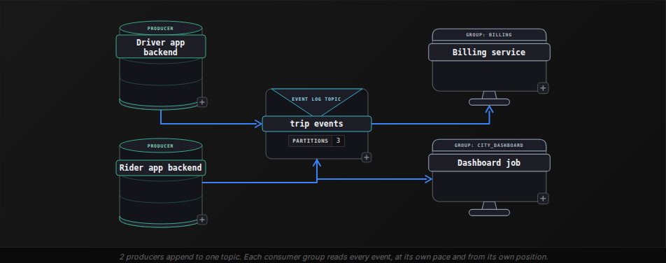
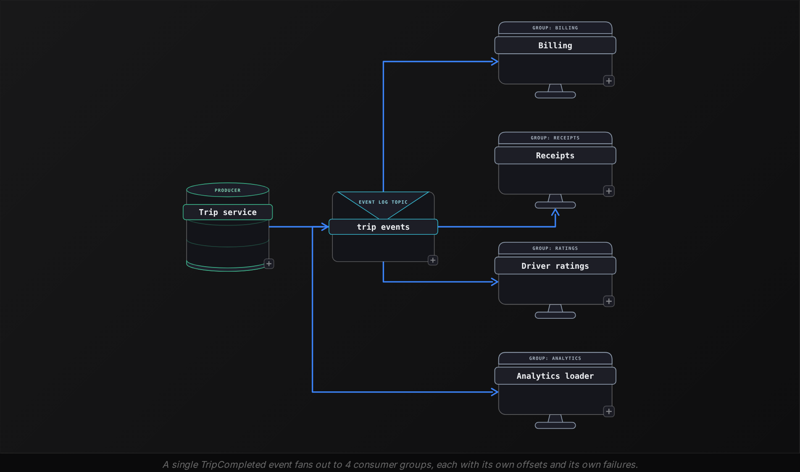
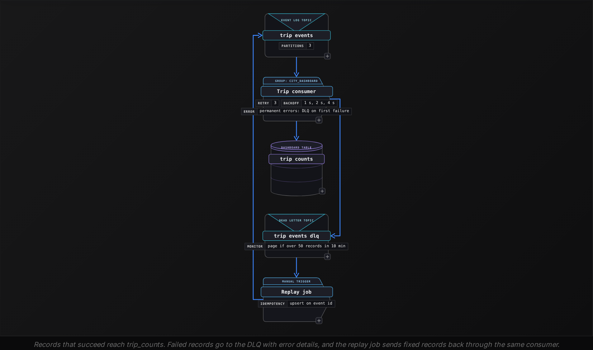

Beginner·Pipeline Architecture · 20 min · 4 challenges

# Streaming Systems: Beginner

Ines is 40 minutes into a data engineering loop at Uber when the interviewer draws a phone on the whiteboard. "Every driver app emits trip events: requested, accepted, started, completed. Operations wants completed trips per city per minute on a dashboard. Walk me through the pipeline." Ines sketches producers writing to a log, and a consumer that fills a table. Then the follow-ups come. A driver enters a tunnel, and the completed event lands 3 minutes 40 seconds after the trip ended: which minute counts it? One app release sends `fare` as text instead of a number: does every consumer stop? The dashboard team asks whether fresh numbers every 30 seconds are enough, or whether each event must be processed the moment it lands. Every follow-up probes one skill: naming the part of a streaming system that breaks, and the property that keeps it correct.


<br>

### What you will be able to do

Describe an event log with precise terms: topic, partition, offset, consumer group, retention

Decide when services should publish events and when they should keep calling each other

Trace how a watermark decides whether a delayed event is on time or late

Classify a processing failure as retry or dead letter queue, and list what the DLQ record must hold

Pick micro-batch or true streaming from a stated freshness requirement


<br>

---

## Event Platforms

An event platform is a durable, append-only log that sits between the services that produce events and the jobs that consume them. Producers add records to the end of the log, consumers read from any position they choose, and the log keeps every record for a fixed retention period whether or not anyone has read it. Retention is what separates the log from a work queue, where a message disappears once a worker takes it. Here, 5 teams can each read the same trip event, and a team that ships a bug on Tuesday can rewind and read Monday's events again.




<br>

### 8 terms an interviewer listens for

| Term | What it is | In the trip example |
| --- | --- | --- |
| Event | An immutable record of something that happened, stamped with when it happened | Trip 1002 completed at 08:04:30 with a fare of 14.20 |
| Producer | A process that appends events to a topic | The driver app's backend |
| Topic | A named log holding one kind of event | `trip_events` |
| Partition | One ordered, append-only slice of a topic, and the unit of both ordering and parallelism | `trip_events` has 3: partitions 0, 1 and 2 |
| Offset | A record's position inside its partition, counting up from 0 | Partition 2, offset 1 |
| Consumer group | Consumers sharing one subscription, where each partition is read by exactly one member | `city_dashboard`, with 3 members |
| Retention | How long records stay in the log, read or unread | Seven days, then the oldest records are deleted |
| Broker | A server that stores partitions and answers reads and writes | Three brokers, each holding copies of partitions |


<br>

### A key picks the partition, so the key sets order

When a producer writes an event it can attach a key. The platform hashes the key and takes the result modulo the partition count, so every event with the same key lands in the same partition. Inside a partition, records are read back in the order they were appended. Across partitions there is no order at all: partition 0 can be 2 seconds ahead of partition 1, and nothing in the log says which of their events came first.

```sql
NUM_PARTITIONS = 3


def partition_for(trip_id: int) -> int:
 return trip_id % NUM_PARTITIONS


for trip_id in [1001, 1002, 1003, 1004]:
 print(trip_id, partition_for(trip_id))
```

| Partition | Offset 0 | Offset 1 | Offset 2 |
| --- | --- | --- | --- |
| 0 | 1002 TripRequested | 1002 TripAccepted | 1002 TripCompleted |
| 1 | 1003 TripRequested | 1003 TripAccepted | 1003 TripCancelled |
| 2 | 1001 TripRequested | 1004 TripRequested | 1001 TripAccepted |

Keying by `trip_id` puts all of trip 1002's events in partition 0, so every consumer reads `TripRequested`, then `TripAccepted`, then `TripCompleted`. Partition 2 interleaves trips 1001 and 1004, which is harmless because the order that matters is within a trip. Had the producer sent no key, the platform would spread the events across partitions, and a consumer could read trip 1002's `TripCompleted` before its `TripAccepted`.

> Choosing a key: 3 questions
>
> - Which events must stay in order relative to each other? Give them the same key, such as `trip_id`.
> - Is one key value far bigger than the rest? Keying by `city` sends every event from the busiest city to one partition, and that partition limits the whole job.
> - Will the partition count change? Going from 3 partitions to 4 changes `trip_id % count`, so a trip's new events can land in a different partition from its old ones.


<br>

### Offsets and consumer groups

Each consumer group tracks, per partition, the offset of the next record it will read, and periodically saves that position, which is called committing the offset. 2 groups reading one topic keep separate offsets, so in the tables below `billing` has read everything while `city_dashboard` is 3 records behind across partitions 1 and 2. Within one group, each partition belongs to exactly one member, which caps the group's parallelism at the partition count: a 4th consumer joining a group that reads 3 partitions sits idle.

Group billing

| Partition | Next offset to read |
| --- | --- |
| 0 | 3 |
| 1 | 3 |
| 2 | 3 |

Group city_dashboard

| Partition | Next offset to read |
| --- | --- |
| 0 | 3 |
| 1 | 1 |
| 2 | 2 |


<br>

### What a crash does to offsets

The order of 2 steps decides what a crash costs. A consumer that writes its result and then commits the offset, and crashes between the 2 steps, restarts from the old offset and processes those records a second time. A consumer that commits first and writes second, and crashes in between, skips records that were never written. Most pipelines take the first order, known as at-least-once delivery, and accept that duplicates will arrive. The property that makes duplicates harmless is idempotency: writing the same event twice leaves the same result as writing it once, as an upsert keyed on `event_id` does.

*Retention is also the replay budget. With 7 days kept, a bug discovered on day 8 can no longer be fixed by rewinding the log, and the missing events must be rebuilt from an archive.*

> **TIP**
>
> Asked whether a topic is ordered, answer: within each partition only, so events sharing a key stay in order and events with different keys have no guaranteed order. Then name the key you would choose and why.


<br>

---

## Event-Driven Architecture

In a request-driven design, the service where something happens calls every service that cares about it. When a trip completes, the trip service calls billing, then receipts, then driver ratings, then the analytics loader, and waits for each answer. In an event-driven design, the trip service appends a single `TripCompleted` event to a topic and moves on, and each of the 4 systems reacts when its own consumer group reads the event.

✓Request-driven: 4 calls

- Completing a trip takes as long as all 4 calls added together, or as long as the slowest one if they run in parallel
- If receipts is down, the trip service either retries or gives up, and giving up means failing the trip or losing the receipt
- Adding a 5th consumer means changing and redeploying the trip service
- The caller gets each answer back, so it knows the work succeeded

✗Event-driven: 1 event

- Completing a trip takes a single write to the log
- If receipts is down, its group falls behind and catches up after restart
- A 5th consumer subscribes with a new group, and the trip service never changes
- The trip service cannot know when, or whether, each consumer finished



Replay is a benefit request-driven designs cannot offer. Because the log keeps 7 days of trip events, a new fraud model can start by reading the full week and building its features before it scores its first live trip. A service fed by direct calls has no history to read: it sees only the calls made after it goes live.


<br>

### An event states a fact in the past tense

Name events for what already happened: `TripCompleted`, `FareAdjusted`, `DriverWentOffline`. A message named `SendReceipt` is a command, an instruction to one specific receiver, and it couples the producer to that receiver again. The payload should carry what consumers need to act without calling the producer back, plus 3 fields every event needs: a unique `event_id` for deduplication, an `event_time` for when it happened in the real world, and a `schema_version` that tells consumers how to read it.

```sql
{
 "event_id": "9f1c2e7a-3b4d-4e8f-a1c2-5d6e7f809a1b",
 "event_type": "TripCompleted",
 "schema_version": 2,
 "event_time": "2026-03-14T08:04:30Z",
 "trip_id": 1002,
 "city": "Lisbon",
 "fare": 14.2,
 "currency": "EUR"
}
```


<br>

### Failure points in an event-driven design

Decoupling gives each failure a new place to happen. Each row below is a follow-up an interviewer can ask about any event-driven sketch.

| What happens | What breaks | Property that prevents it |
| --- | --- | --- |
| A consumer crashes after writing but before committing | The same `TripCompleted` is processed twice and the driver is paid twice | Idempotent consumer: upsert or dedupe on `event_id` |
| The producer renames `fare` to `fare_amount` | Every consumer reading `fare` gets nulls or fails | Schema contract: add fields, never rename or remove them in place |
| `FareAdjusted` is published to a different topic than `TripCompleted` | Billing can read an adjustment before the trip it adjusts | Put both in one topic keyed by `trip_id` |
| Receipts falls 2 hours behind | Riders get receipts late, and no error is raised anywhere | An alert on consumer lag: how far each group trails the newest offset |


<br>

### When to choose events, and when to refuse them

> Events fit when
>
> - Several independent consumers react to the same fact
> - Consumers can tolerate seconds of delay between the fact and their reaction
> - A new consumer should be able to build its state by reading the retained history
> - The producer must keep working while a consumer is down

> Keep a direct call when
>
> - The caller needs the answer before continuing, such as authorizing a card before dispatching a driver
> - Exactly one consumer exists and no second one is planned
> - Both sides must agree at once, such as reserving the last seat on a flight


<br>

### Try it: event or call?

Decide each case before reading the last 2 columns.

| Scenario | Choice | Reason |
| --- | --- | --- |
| A rider requests a trip and the app must show an assigned driver | Call | The rider is waiting on the answer |
| A completed trip updates the driver's weekly earnings, the tax ledger and a fraud model | Event | Three independent consumers, and seconds of delay are fine |
| A rider changes their home address and marketing wants it in the mailing list by tomorrow | Event | A day of lag is fine, and more teams will want the change later |
| A promo code is redeemed and must never be used twice | Call | Two redemptions arriving together must not both succeed |

> **TIP**
>
> Name the requirement before the pattern: 'billing can lag the completion by seconds, and so can receipts and ratings, so I would publish an event; card authorization blocks dispatch, so it stays a synchronous call.' One design using both is normal.


<br>

---

## Late-Arriving Data

Every event has 2 timestamps that matter. Event time is when the thing happened, stamped by the device at the moment the trip ended. Processing time is when the pipeline reads the event. On a good network the 2 timestamps differ by milliseconds. A driver's phone that loses signal in a tunnel holds its events until it reconnects, so the gap grows to minutes. A per-minute count grouped by processing time would credit that trip to the wrong minute, so correct streaming aggregations group by event time. The open question is how long the window for 08:01 should wait before it calls itself complete.


<br>

### A watermark states how complete the input is

A watermark is a timestamp the pipeline moves forward as events arrive, and it means: no more events with an earlier event time are expected. The common rule sets it to the largest event time seen so far minus an allowed lateness. With 2 minutes of allowed lateness, seeing an event stamped 08:04:30 moves the watermark to 08:02:30. When the watermark reaches a window's end, the window closes, which means it emits its result and frees its memory. An event whose window has already closed is late.


<br>

### Trace it: 1-minute windows, 2 minutes of lateness

| Arrives | Event time | Max event time seen | Watermark | What happens |
| --- | --- | --- | --- | --- |
| 08:01:05 | 08:01:00 | 08:01:00 | 07:59:00 | Counted in the 08:01 window |
| 08:02:10 | 08:02:05 | 08:02:05 | 08:00:05 | Counted in the 08:02 window |
| 08:03:20 | 08:03:15 | 08:03:15 | 08:01:15 | Counted in 08:03; the watermark has passed 08:01:00, so the 08:00 window closes |
| 08:04:40 | 08:04:30 | 08:04:30 | 08:02:30 | Counted in 08:04; the 08:01 window closes and emits its count |
| 08:05:10 | 08:01:30 | 08:04:30 | 08:02:30 | Late: the 08:01 window has already closed |
| 08:05:15 | 08:02:50 | 08:04:30 | 08:02:30 | On time: the 08:02 window stays open until the watermark reaches 08:03:00 |

Compare rows 5 and 6. The tunnel event in row 5 reached the pipeline 3 minutes 40 seconds after it happened and was late. The event in row 6 took 2 minutes 25 seconds and was counted. Lateness is decided by comparing the watermark with the end of the event's window, so a long delay only loses an event once that window has closed.

*The watermark moves only when events arrive. Pipelines usually take the minimum watermark across partitions, so if partition 1 receives nothing for 10 minutes, no window closes until an event reaches it or the pipeline marks the partition idle.*

> Try it
>
> - Same settings: 1-minute windows, 2 minutes of allowed lateness. The largest event time seen so far is 08:06:30.
> - An event stamped 08:03:40 arrives. Late or on time?
> - Right after it, an event stamped 08:04:20 arrives. Late or on time?

*Answers: the watermark is 08:04:30. The 08:03 window ended at 08:04:00 and has closed, so the first event is late. The 08:04 window ends at 08:05:00 and is still open, so the second event is counted.*


<br>

### 4 things to do with a late event

| Option | What readers of the result see | Choose it when |
| --- | --- | --- |
| Drop it and count the drop | The 08:01 total stays 1 short, and a metric records each drop | Small undercounts are acceptable and someone watches the metric |
| Route it to a late-events table | The live total stays as emitted, and the late row waits for a later correction | Live numbers must not change, but nothing may be lost |
| Update the window and re-emit | The 08:01 total changes from its first value to a corrected one. The job must keep each window's state for an extra period after it first emits, and that state costs memory just as raising allowed lateness does | Consumers can take a row that changes, such as an upsert by city and minute |
| Recompute in batch from raw events | A nightly job rewrites each minute from all events, grouped by event time | The live number is a preview and the nightly number is the record |

Allowed lateness is a dial with a cost on each side. Raising it from 2 minutes to 10 makes the live totals more complete, but every window emits its first result 8 minutes later, and the job keeps every window from the last 10 minutes open in memory instead of the last 2.

```sql
SELECT
 city,
 DATE_TRUNC('minute', event_time) AS event_minute,
 COUNT(*) AS completed_trips
FROM trip_events_raw
WHERE event_type = 'TripCompleted'
 AND event_time >= TIMESTAMP '2026-03-14 08:00:00'
 AND event_time < TIMESTAMP '2026-03-14 09:00:00'
GROUP BY city, DATE_TRUNC('minute', event_time)
ORDER BY city, event_minute
```

Allowed lateness should come from measured delays. The query below reads one day of raw events, where `arrived_at` is the time the pipeline read each event, and reports the delay 99% of events arrive within, along with the worst.

```sql
SELECT
 APPROX_PERCENTILE(DATE_DIFF('second', event_time, arrived_at), 0.99) AS p99_delay_seconds,
 MAX(DATE_DIFF('second', event_time, arrived_at)) AS max_delay_seconds
FROM trip_events_raw
WHERE event_date = DATE '2026-03-13'
```

> **TIP**
>
> When asked about late data, answer with a number, then say where anything later than that goes: 'allowed lateness of 2 minutes, chosen from the delays we measured on driver phones, and anything later goes to a late-events table that the nightly job folds back in.'


<br>

---

## Dead Letter Queues

A consumer reads partition 1 in offset order, and it cannot commit offset 42 until it has finished with offset 41. Suppose offset 41 is a `TripCompleted` event whose `fare` arrived as the text '14,20' from a bad app release. The parser throws, the consumer restarts, reads offset 41 again and throws again. Every event behind it in partition 1 waits, so a single malformed record freezes a third of the topic. That record is called a poison message, and handling it is the job of a dead letter queue.

A dead letter queue (DLQ) is a separate topic or table where the consumer writes any record it cannot process, together with the reason, and then commits past it. The main flow keeps moving, and the failed record waits where an engineer can inspect it and, once the cause is fixed, replay it.


<br>

### Retry or dead-letter: classify the error

The decision turns on one question: would the same record succeed if you tried again in a few seconds without changing anything? If yes, the error is transient and a retry is correct. If no, the error is permanent, each retry burns time while the partition waits, and the record should go to the DLQ on its first failure.

| Error | Class | Action |
| --- | --- | --- |
| Timeout writing to the dashboard table | Transient | Retry with backoff |
| HTTP 503 from the currency-rate service | Transient | Retry with backoff |
| HTTP 429: too many requests | Transient | Retry with a longer backoff |
| JSON fails to parse | Permanent | DLQ on first failure |
| `fare` is text where the schema says number | Permanent | DLQ on first failure |
| `schema_version` 3 when the consumer knows only up to 2 | Permanent for this code version | DLQ, replay after upgrading the consumer |
| `city` missing from the lookup table | Permanent until the lookup is loaded | DLQ, replay after loading the lookup |
| A transient error still failing after the last retry | Treated as permanent | DLQ |

```sql
TRANSIENT = {"timeout", "http_503", "http_429"}
MAX_RETRIES = 3


def next_action(error_class: str, attempt: int) -> str:
 if error_class in TRANSIENT and attempt <= MAX_RETRIES:
 return "retry"
 return "dlq"
```



In the diagram, the consumer retries a transient failure 3 times, waiting 1 second, then 2, then 4, before it gives up.

- **7 s** — longest backoff stall per record
- **0 s** — backoff stall from a parse error

Bounded retries put a ceiling on how long a record can hold up its partition. Retrying a permanent error without a limit removes that ceiling, which is how a bad app release turns into a dashboard that silently stops counting a third of all trips.


<br>

### Fields every DLQ record carries

| Field | Example | Why it is needed |
| --- | --- | --- |
| `original_payload` | The exact bytes the consumer read | Replay needs the input byte for byte, including the bad field |
| `source_topic`, `source_partition`, `source_offset` | `trip_events`, 1, 41 | Locates the record in the log and the events after it |
| `error_class` | `permanent_parse_error` | Lets you count and route failures by kind |
| `error_message` | could not convert '14,20' to number | Tells the engineer what to fix |
| `consumer_version` | 2.8.1 | Shows whether a deploy started the failures |
| `attempt_count` | 1 | Separates exhausted retries from first-failure rejects |
| `failed_at` | 2026-03-14 08:04:31 | Measures how long records have waited for replay |


<br>

### A DLQ needs an owner and a replay path

A DLQ that nobody reads is data loss with extra storage. Alert on its arrival rate, because a jump from 2 records a day to 2,000 an hour means a deploy or an upstream change broke something. And make replay safe: replayed records flow through the same consumer once the bug is fixed, so its writes must be idempotent, or a record that half-succeeded before failing gets written twice.

```sql
SELECT
 error_class,
 consumer_version,
 COUNT(*) AS failed_records,
 MIN(failed_at) AS first_seen
FROM trip_events_dlq
WHERE failed_at >= CURRENT_TIMESTAMP - INTERVAL '1' HOUR
GROUP BY error_class, consumer_version
ORDER BY failed_records DESC
```

Keep 2 kinds of record out of the DLQ. A late event is valid data and belongs on the late path from the previous section. A test trip filtered out by a business rule was handled correctly, so it gets dropped and counted. Mixing either into the DLQ buries the real failures under noise.

> **TIP**
>
> Sending a record to the DLQ changes ordering. If trip 1002's `TripCompleted` goes to the DLQ and its `FareAdjusted` succeeds, billing sees an adjustment for a trip it has never seen. Say how the consumer handles that, for example by parking later events for the same `trip_id` until the replay.


<br>

---

## Micro-Batch vs True Streaming

Both models read the same log and differ in when the work happens. A micro-batch engine wakes on a trigger interval, reads every record that arrived since the last trigger and processes them together as a small batch. Only after it writes the result does it commit the offsets. A true streaming engine, also called record-at-a-time or continuous processing, runs long-lived operators that push each event through as soon as it is read, updating state per event.

Micro-batch, 30 s trigger

| Clock | What runs |
| --- | --- |
| 08:00:00 | Batch 7 starts on events that arrived from 07:59:30 to 08:00:00 |
| 08:00:10 | Batch 7 writes results and commits offsets |
| 08:00:30 | Batch 8 starts on events from 08:00:00 to 08:00:30 |
| 08:00:40 | Batch 8 writes results and commits offsets |

True streaming

| Clock | What runs |
| --- | --- |
| 08:00:00.120 | Event read; the Lisbon count goes from 41 to 42 |
| 08:00:00.180 | Updated count written to the dashboard table |
| 08:00:00.410 | Next event read; the Porto count goes from 17 to 18 |
| 08:00:00.470 | Updated count written to the dashboard table |

The trigger sets the latency floor of micro-batch. With a 30-second trigger and 10 seconds of processing per batch, an event that arrives right after a batch starts waits for the next trigger and then for that next batch to finish.

- **40 s** — worst-case event-to-result delay
- **25 s** — average delay with even arrivals

True streaming removes the trigger wait, so a result can be ready within milliseconds of arrival, as in the right-hand timeline. That speed is paid for in the ways the comparison below lists.

✓Micro-batch

- Freshness floor set by the trigger: seconds to minutes
- Planning and the offset commit are fixed costs, paid once per batch
- A failure reruns the batch from its starting offsets
- Code reads like the batch jobs a team already runs

✗True streaming

- Results within milliseconds to about a second of arrival
- Both models keep per-window state; here it lives in long-running operators, so their memory must be sized and watched
- A failure restores state from the last checkpoint, a saved snapshot of state and offsets, and replays the log from there
- Timers, per-event state and watermarks need streaming-specific code and tests


<br>

### Pick from the freshness requirement

Start from a number the business can state: how stale may the result be when someone reads it? If the answer is under a second, micro-batch is the wrong tool, because its trigger wait eats most or all of the budget. A minute is within reach of both models, and micro-batch usually costs less to build and operate. A day calls for a nightly batch job with no streaming at all.

Ask what number someone means by 'real time'. Product teams often use the phrase for a dashboard that refreshes every minute, which micro-batch serves well, while a fraud check that blocks dispatch needs its score within 300 ms, as in the table below.


<br>

### Try it: choose the model

Cover the last 2 columns and choose for each requirement.

| Requirement | Choice | Reason |
| --- | --- | --- |
| Score each trip request for fraud before a driver is dispatched, within 300 ms | True streaming | A 1-second trigger alone would break the budget |
| Ops dashboard of trips per city, refreshed every minute | Micro-batch, 30 s trigger | Worst case 40 s fits inside a minute |
| Surge price per zone recomputed every 10 s | Micro-batch with a 5 s trigger, or true streaming | Either meets 10 s if each batch finishes within 5 s; pick what the team already runs |
| Driver payout totals for the finance close | Daily batch | Finance reads it once a day, after late events have arrived |


<br>

### Failure behaviour in both models

Retries look different in the 2 models but demand the same property. When a micro-batch fails, the engine reruns it from the batch's starting offsets, so rows the failed attempt already wrote get written again; overwriting the output by window, or upserting on `event_id`, makes the rerun harmless. A streaming job saves a checkpoint, a periodic snapshot of its state and offsets; when it fails, it restores the last checkpoint and replays the log from those offsets, re-sending every result produced since. Late data works the same way in both: windows keyed by event time and closed by a watermark.

✓Do

- Ask for the freshness requirement in seconds before choosing a model
- Compute micro-batch worst case as trigger interval plus processing time
- Make output writes idempotent so a rerun batch or checkpoint replay adds no duplicates
- Default to micro-batch when a minute of staleness is acceptable

✗Don't

- Choose true streaming because it sounds more current
- Set a 1 s trigger when each batch takes 8 s; batches queue and lag grows
- Assume either model removes the need for watermarks
- Promise sub-second results from a 30-second trigger

> **TIP**
>
> A complete answer has 3 parts: the freshness number, the model it implies, and the property that keeps retries correct. 'The dashboard tolerates a minute, so a 30-second micro-batch with idempotent upserts by city and minute' covers all 3.


<br>

---

## Putting It All Together

A food delivery marketplace shows its operations team orders delivered per restaurant in 5-minute windows, and the team accepts numbers up to a minute old. A fraud check must approve each new order within 300 ms. Courier phones drop signal in elevators and parking garages, a weekly courier-app release occasionally changes the event format, and the payments team must never pay a courier twice for one delivery.

- Key order_events by order_id , so each order's events share a partition and every consumer group reads them in order.
- Courier payouts and the operations panel each read with their own consumer group, and the restaurant rating model has a separate one, which is why a slow model never delays the panel.
- Payouts upsert on event_id , so a consumer that crashes before committing replays events without paying a courier twice.
- Windows group by event time with allowed lateness set from the measured courier delays; elevator events that miss their window go to a late table the nightly job folds back in.
- A release that sends order_total as text fails parsing, goes to the DLQ on its first failure with its source offset, and is replayed through the same idempotent consumer after the fix.
- The panel tolerates a minute, so a 30-second micro-batch serves it, while the fraud check's 300 ms budget on new orders requires true streaming.


<br>

---

## Key Takeaways

- A topic is ordered only within each partition, and the key picks the partition, so the key you choose decides which events stay in order.
- Committing offsets after writing gives at-least-once delivery; idempotent writes keyed on event_id make the resulting duplicates harmless.
- Publish past-tense events when several consumers react to one fact and can lag by seconds; keep a direct call when the caller needs the answer to continue.
- A watermark is the largest event time seen minus the allowed lateness; an event is late only when its window has already closed.
- Retry transient errors a bounded number of times and send permanent errors to the DLQ on the first failure. Each DLQ record keeps its payload, tagged with its source offset and error class.
- Choose micro-batch or true streaming from the freshness requirement; the micro-batch worst case is the trigger interval plus processing time.
