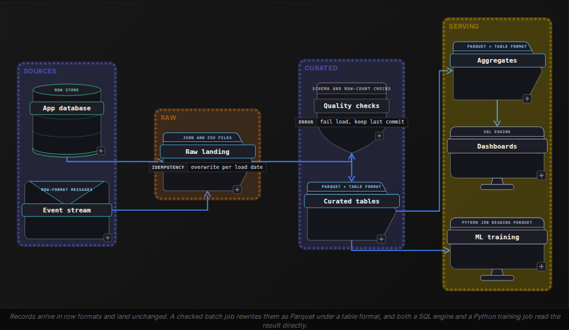

Beginner·Pipeline Architecture · 20 min · 4 challenges

# Where Data Lives: Beginner

Dalia is 40 minutes into a data engineering interview at Netflix, the company whose engineers created one of the open table formats this lesson covers. The interviewer pastes a schema: playback events, a row for every press of play or pause and another when the viewer stops, 40 columns wide and roughly 1 billion rows a day. 'These land as CSV today. Why would you store them as Parquet, and what would you partition by?' Dalia says Parquet is columnar, and stops. The interviewer waits for the rest: which bytes a query gets to skip, what compression does to the storage bill, what breaks if the table is partitioned by account, and what stops a dashboard from reading half a write. Each of those follow-ups has a reason behind it, and this lesson builds them decision by decision.


<br>

### What you will be able to do

Explain why a columnar file suits analytic queries, and name the write patterns it makes expensive

Choose a compression codec from how often data is read and whether the file can be split across workers

Pick a partition column, and spot over-partitioning and filters that defeat pruning

Tell a data lake from a warehouse by storage and schema checks, and say which write guarantees a lakehouse adds to the lake

Explain how a table format turns a directory of Parquet files into a transactional table, and what upkeep it needs


<br>

---

## Columnar vs Row

### What the screen is checking

'Why Parquet?' works as a screening question because the answer shows whether a candidate knows where bytes sit on disk. A full answer names the layout, the reads it makes cheaper, and the writes it makes expensive. Every section of this lesson uses the same table, `playback_events`: 40 columns, roughly 10 bytes per value, around 1 billion rows landing each day.


<br>

### Same 4 rows, 2 layouts

A file is a single long run of bytes, so a format has to pick an order. A row format writes every field of the first row, then every field of the second. A columnar format writes all the values of a column for a block of rows, then all the values of the next. Below, 4 playback events are stored both ways, listed in the order their values appear in the file.

Row layout, as in CSV

| order in file | values written |
| --- | --- |
| first | e1, a77, BR, mobile, 312 |
| second | e2, a12, US, tv, 1840 |
| third | e3, a77, BR, mobile, 95 |
| fourth | e4, a40, US, tv, 2210 |

Columnar layout, as in Parquet

| order in file | values written |
| --- | --- |
| first | event_id: e1, e2, e3, e4 |
| second | account_id: a77, a12, a77, a40 |
| third | country: BR, US, BR, US |
| fourth | device_type: mobile, tv, mobile, tv |
| fifth | watch_seconds: 312, 1840, 95, 2210 |

Now run the query analysts send most: total watch time by country for a single day. It needs `country` and `watch_seconds` along with `event_date`, which is 3 of the 40 columns. In the row layout those values are interleaved with 37 other fields, so the reader pulls every byte of every row off storage to reach them. In the columnar layout each needed column sits in its own contiguous run, and the reader fetches those runs and skips the rest. That skip is column pruning, and it's the first reason in any answer.

```sql
SELECT
  country,
  SUM(watch_seconds) AS total_watch_seconds
FROM playback_events
WHERE event_date = DATE '2026-10-01'
GROUP BY country
```

- **400 GB** — scanned per day, row layout
- **30 GB** — scanned per day, columnar layout


<br>

### What else the layout buys

- Compression works betterA column's values, side by sideValues of the same type and meaning sit together, which hands a codec long stretches of repeats to shrink. The next section works through how much that saves.
- Whole blocks get skippedMin and max per row groupParquet splits a file into row groups and stores each column's minimum and maximum for every group. A filter like watch_seconds > 3600 skips any group whose maximum is at or below 3600 without reading its data.
- The schema travels with the fileNames and types in the footerColumn names and types live in the file's footer, so no reader has to guess whether 0012 is a string or the number 12, a guess CSV forces on every consumer.

| row group | min watch_seconds | max watch_seconds | for watch_seconds > 3600 |
| --- | --- | --- | --- |
| 1 | 0 | 2900 | skipped |
| 2 | 4 | 7200 | read |
| 3 | 0 | 3400 | skipped |
| 4 | 12 | 9800 | read |

Here the filter reads 2 of 4 row groups. The skip depends on clustering: if long sessions are scattered across every group, every maximum sits above 3600 and nothing is skipped. Sorting rows by the filtered column before writing is what makes these statistics pay off.


<br>

### What columnar costs

The layout that speeds up reads slows down some writes, and a full answer says which. Appending 1 row means adding a value to 40 separate column runs, so writers buffer thousands of rows in memory and flush a whole row group at a time. Changing 1 row means rewriting its file, because a Parquet file can't be edited once it is closed. Reading 1 complete record means visiting 40 places in the file instead of 1.

✓Row formats fit

- An application database reading and writing a single order at a time
- A stream of events where each message is a complete record
- Landing files from a source as they arrive, before any query runs
- Lookups that need every field of a single record

✗Columnar formats fit

- Queries that aggregate a few columns across millions of rows
- Tables written in large batches and rarely changed afterwards
- Long histories where compressed size drives the storage bill
- Filters that can rule out whole row groups by statistics

> **TIP**
>
> Name the write cost before you are asked. 'Columnar is faster' leaves the interviewer to probe; 'columnar is faster for reads of a few columns, and costs me batched writes and no in-place edits' shows you know where the format stops fitting.


<br>

### Try it: pick the layout

> For each workload, row or columnar?
>
> - A mobile app saves each user's profile and reads the whole profile back at login.
> - Finance sums revenue by month over 3 years of orders.
> - Devices send a playback heartbeat every 10 seconds into a message queue.
> - A nightly job writes yesterday's events once, and analysts query them for a year.

Row, columnar, row, columnar. The profile and the heartbeats are complete records written and read individually. The revenue sum touches 2 or 3 columns over millions of rows. The nightly job is the shape Parquet was built for: written in a batch, read many times by column. Pipelines often use both, landing heartbeats in a row format and rewriting them into Parquet in a later batch step.


<br>

### The answer in 30 seconds

> A complete screening answer
>
> 'Parquet stores each column's values together, so a query that touches 3 of 40 columns reads roughly 3/40 of the bytes. Similar values side by side compress well. Each row group also stores min and max statistics, so the engine can skip any block a filter rules out. The schema is stored in the file. The cost is on the write side: rows have to be batched, and changing a row means rewriting its file, so I keep a row format wherever records are written or read individually.'


<br>

---

## Compression

Compression questions arrive in 2 forms: 'which codec would you use?' and 'why is this job so slow?' Both turn on 3 properties of a codec: how small it makes the data, how much CPU it spends getting there, and whether the compressed file can still be shared among many workers.


<br>

### Ratio against speed

Every codec trades ratio against speed. A higher ratio means fewer bytes stored and fewer bytes pulled from storage by each query. A faster codec means less CPU burned on every read and write. A table is usually written once and read many times, so for anything queried often, decompression speed outweighs compression speed.

| codec | ratio | decompression | where it fits |
| --- | --- | --- | --- |
| Snappy | lower | fast | Hot tables read all day; long a common default for Parquet writers |
| LZ4 | lower | fastest of these 4 | Data read seconds after it is written, such as between job stages |
| Gzip | higher | slow | Data written once and read rarely, or handed to other teams |
| Zstd | high, tunable by level | fast | A balanced default: low levels for hot data, high levels for archives |

Ratio depends on the data more than on the codec, so a quoted ratio is a measurement on someone's data. Suppose a day of `playback_events` as Parquet holds 400 GB of uncompressed column data, Snappy writes it as 100 GB, and Zstd at a moderate level writes it as 75 GB. Kept for a year, that difference is about 9 TB of storage, and every query scanning the year pulls a quarter fewer bytes.


<br>

### Why columns give a codec more to work with

A codec shrinks data by finding byte patterns it has seen recently and replacing each repeat with a short reference back. A Parquet page of the `country` column holds thousands of 2-letter codes, and the same handful of countries make up most of them, so references are short and frequent. A CSV row puts an event ID that never repeats next to a timestamp, then a device name and a number, so matching patterns sit far apart. Parquet records a codec for each column chunk, which lets a writer vary it by column, though most tables use a single codec throughout.


<br>

### The pitfall: a file only 1 worker can read

Engines go fast by cutting a large file into byte ranges and handing each range to a different worker. That requires a worker to be able to start decoding in the middle. A CSV compressed with Gzip as a whole is a single stream: byte 5,000,000 decodes only after every byte before it, so the engine gives the entire file to 1 worker.

✓events.csv.gz, 40 GB

- A single Gzip stream from first byte to last
- Can't be cut into ranges
- One worker reads all 40 GB while the rest wait
- Runtime grows with file size

✗events.parquet, 40 GB, Gzip codec

- Compressed page by page inside each column chunk
- Row groups decode independently of each other
- Each row group can go to a different worker
- Runtime grows with file size divided by worker count

The codec stayed the same and the container changed. Parquet compresses inside its own structure, so the file splits on row group boundaries whatever codec it uses, and at a common row group size of 128 MB a 40 GB file offers hundreds of ranges. Splittable codecs for plain text do exist, but the usual pipeline fix is to land raw files as they arrive and convert them to Parquet in the first transform.

- **1** — read range in the 40 GB gzip CSV
- **320** — row groups in the 40 GB Parquet file


<br>

### Matching the codec to the data

| data | how often it is read | pick |
| --- | --- | --- |
| Raw files landed from a source and kept for replay | Rarely, during a rerun or backfill | Gzip or high-level Zstd, written as many files so workers share the load |
| Curated playback_events queried all day | Thousands of times a day | Snappy or low-level Zstd |
| Intermediate data passed between stages of a job | Once, seconds after it is written | LZ4 or Snappy |
| Compliance archive kept for 7 years | Almost never | The highest-ratio setting the write budget allows |

> **TIP**
>
> Answer 'which codec?' with the access pattern first: how often the data is read, and by how many workers at once. The codec follows from that, so the interviewer hears a reason before a name.


<br>

### Try it: the 3-hour job

A nightly job runs for 3 hours. Its input is one 60 GB file, `clicks_2026-10-01.json.gz`. The cluster has 200 workers. What do you check first, and what would you change?

> One answer
>
> Check how many tasks read the input. A single Gzip stream yields 1 task, so 199 workers sit idle. Either have the source write the day as many smaller compressed files, or add a step that converts the landed file to Parquet once, after which every downstream job reads it in parallel. Swapping Gzip for Zstd on the same single stream leaves it unsplittable and the job still serial.


<br>

---

## Partitioning

Partitioning splits a table into directories by the value of a column, so a query that filters on that column opens only the directories that match. It's the cheapest speedup a file-based table offers and the most common way to slow one down. Interviewers ask you to choose a partition column, then probe whether you can name what makes that choice backfire.


<br>

### What the engine does with a partition filter

Partitioned by `event_date`, `playback_events` keeps a directory per day, and each directory's name carries its date. The engine compares the query's filter with those names and never lists or opens a directory that can't match. Inside a directory it does open, column pruning still applies, and so do the row group statistics. With Zstd, each day holds 75 GB in 96 files of about 780 MB.

| directory | files | opened for event_date = 2026-10-01 |
| --- | --- | --- |
| playback_events/event_date=2026-09-29/ | 96 | no |
| playback_events/event_date=2026-09-30/ | 96 | no |
| playback_events/event_date=2026-10-01/ | 96 | yes |
| playback_events/event_date=2026-10-02/ | 96 | no |
| 361 more directories | 34,656 | no |

- **1 of 365** — directories a 1-day query opens
- **27 TB** — stored data the same query skips

```sql
CREATE TABLE playback_events (
  event_id VARCHAR,
  account_id BIGINT,
  country VARCHAR,
  device_type VARCHAR,
  watch_seconds INTEGER,
  event_ts TIMESTAMP,
  event_date DATE
)
WITH (
  format = 'PARQUET',
  partitioned_by = ARRAY['event_date']
)
```


<br>

### Choosing the partition column

A good partition column has 3 traits. Most queries filter on it, or the pruning never fires. It has few enough values that each partition holds real volume: a common target is data files of 128 MB to 1 GB, so each partition should fill at least 1 such file. And its value is fixed when the row is written, so a row never has to move between directories. For an events table, the event date meets all 3, which is why it is the default answer.


<br>

### Pitfall 1: too many partitions

Adding `account_id` under `event_date` sounds selective, since a query roughly 1 account would open 1 directory. Say a day's 1 billion events come from 50 million active accounts. Each daily load then writes 50 million files averaging 20 events, about 1.5 KB apiece. The engine spends its time listing directories and opening files instead of reading data, and every file costs a storage request whatever its size. This is the small file problem, and over-partitioning is a frequent cause of it.

| partition by | partitions per year | data per partition |
| --- | --- | --- |
| event_date | 365 | 75 GB |
| event_date, country | about 69,000 | tens of GB for the largest country, a few KB for the smallest |
| event_date, account_id | about 18 billion | about 1.5 KB |


<br>

### Pitfall 2: filtering on the wrong column

The table is partitioned by `event_date`, and an analyst filters on `event_ts`, the full timestamp. To a person the 2 columns are related; to the engine they are unrelated. Directory names carry `event_date` values only, so a filter on `event_ts` rules none of them out. The result is correct, but the engine lists all 365 directories and reads every file's footer before row group statistics can skip anything.

```sql
SELECT
  country,
  SUM(watch_seconds) AS total_watch_seconds
FROM playback_events
WHERE event_ts >= TIMESTAMP '2026-10-01 18:00:00'
  AND event_ts < TIMESTAMP '2026-10-01 22:00:00'
GROUP BY country
```

```sql
SELECT
  country,
  SUM(watch_seconds) AS total_watch_seconds
FROM playback_events
WHERE event_date = DATE '2026-10-01'
  AND event_ts >= TIMESTAMP '2026-10-01 18:00:00'
  AND event_ts < TIMESTAMP '2026-10-01 22:00:00'
GROUP BY country
```

> **TIP**
>
> When a query on a partitioned table runs as slowly as on an unpartitioned one, read its WHERE clause for the partition column first. The usual cause is a filter on a related column, such as a timestamp, that the engine can't match to directory names.


<br>

### Late data lands in old partitions

Partitioning by event date has a pipeline consequence. An event from October 1 that arrives on October 3 belongs in the October 1 directory, so a daily job can't assume it only ever writes today's partition. If the job for October 1 is rerun and overwrites its directory, the rerun has to read every event for that date, including the late ones; otherwise it silently drops them. Partitioning by arrival date keeps old partitions closed, at the price of pruning, since analysts filter on when an event happened.


<br>

### Try it: an orders table

> Which partition column?
>
> An `orders` table holds 5 years of history, about 2 million orders a day across 30,000 stores. Dashboards filter by order date and sometimes by store. Which column do you partition by, and why not add store?

Order date: around 1,826 partitions of 2 million rows each, matching how dashboards filter. Adding store would make about 55 million partitions averaging around 67 orders, far below any healthy file size. Store filters still benefit if files within each day are sorted by store, since row group statistics then skip most of every file.


<br>

---

## Lake vs Warehouse

'How is a data lake different from a data warehouse?' sounds like a definitions question. The answer that lands compares them on 4 things a pipeline depends on: where the bytes sit, who controls their format, when the schema is checked, and what a write promises to a reader. Lakehouse questions get answered on the same 4 lines.

| property | data lake | data warehouse | lakehouse |
| --- | --- | --- | --- |
| Where bytes sit | Files in object storage | Storage the warehouse engine manages | Files in object storage |
| File format | Open: Parquet, JSON, CSV, images, anything | The engine's own internal format | Open, mostly Parquet |
| Schema checked | At read time, by each query | At load time, by the warehouse | At write time, against the table's metadata |
| Who reads it directly | Any engine that understands the files | The warehouse engine | Any engine that supports the table format |
| A write is | Files appearing as each is written | A transaction: all of it or none | A transaction committed through metadata |
| Cost shape | Cheapest storage; compute rented separately | Storage and compute billed by a single system | Lake storage prices with transactional writes |


<br>

### Where a plain lake breaks

A lake is a set of files any engine can read, which is both its strength and its exposure. Three failures come up in interviews, each tied to a pipeline event.

- A reader during a writePartial resultsA job writes 96 files for October 1. A dashboard query runs when 40 have landed and reports 40/96 of the day's watch time, with no error.
- A retry after a crashDuplicatesThe job dies after writing 60 files and is retried. Unless it clears its own output first, the directory holds 60 stale files plus 96 new ones, and the day's totals come out about 1.6 times too high.
- A schema change upstreamSilent nulls or failed readsThe source renames watch_seconds to watch_ms. New files carry the new name, and a query reading by name sees nulls for new rows or fails, depending on the engine.

A warehouse prevents all 3 by owning the write path. A load is a transaction, so readers see the table before it or after it. A failed load rolls back, so its retry inserts the rows once. A file whose columns do not match the table's schema is rejected at load. The price: data has to be loaded into the warehouse's storage before anything can query it, and other engines reach it only through that warehouse.


<br>

### The lakehouse: warehouse guarantees on lake files

A lakehouse keeps data as open files in object storage and adds a metadata layer recording which files make up the table at each moment. Writes become commits to that metadata, so readers never see half a write and a retry of a failed write cannot double a day. Lakehouse is the name of an architecture: a lake with a table format on top, read by whichever engines support that format. The next section opens that layer up.



Each layer answers a failure from the list above. Raw landing keeps source data unchanged, so a bad transform can be rerun from it. The quality check runs before the commit, so a renamed column stops the load instead of reaching dashboards. Curated tables commit atomically, so the dashboard never reads 40 of 96 files. Two kinds of consumer read the same curated files, which is why teams keep data in open formats instead of loading it into a single engine.

> **TIP**
>
> Asked 'lake or warehouse?', describe both, then name what decides between them: how many engines need the data, how structured it is on arrival, and what a reader may see while a write is in progress.


<br>

### Try it: place each dataset

> Lake, warehouse or lakehouse?
>
> - Raw camera images kept for a model that may be trained next year
> - Month-end revenue tables read by a single SQL engine and audited every quarter
> - Event tables queried by SQL dashboards and read directly by a Python training job

Lake for the images: they have no tabular schema and no SQL query reads them. Warehouse for the revenue tables: only one engine reads them, and they need a strict schema and transactional loads with an audit trail. Lakehouse for the event tables: 2 kinds of engine need the same files, and the dashboards need commits no reader can catch halfway.


<br>

---

## Table Formats

Table format questions run from 'what is it?' through 'why not plain Parquet?' to 'what does it cost to operate?' A single mechanism answers all 3: the table is defined by a list of files kept in metadata, and every change to the table publishes a new list.


<br>

### A table as a list of files

In a plain Parquet directory, the table is whatever files the directory holds right now. Under a table format, the table is whatever files the current metadata names. A commit writes its data files first, then writes new metadata that, read with the versions before it, defines the complete file set. Last, it makes that metadata current in 1 atomic step, such as swapping a pointer or creating the next numbered log file. A reader therefore gets the old list or the new one, never something in between.

| version | operation | data files in the table | what a reader sees |
| --- | --- | --- | --- |
| v1 | append September 30 | A1 to A96 | September 30, complete |
| v2 | append October 1 | A1 to A96, B1 to B96 | 2 complete days |
| none | append October 2, crashed after C1 to C60 | unchanged | still v2; C1 to C60 sit in storage, listed nowhere |
| v3 | retry of October 2 | A1 to A96, B1 to B96, D1 to D96 | 3 complete days, no duplicates |

Run the plain-lake failures through this table. A dashboard query during the crashed write read v2, a complete table. The retry committed 96 fresh files as v3, and the orphans from the crash appear in no version, so October 2 counts once. Atomicity covers a crash before the commit. If a job commits and then dies before reporting success, the orchestrator retries it, and the retry appends October 2 again as v4. The load itself has to be idempotent: it overwrites the October 2 partition instead of appending, or it checks whether that date's commit already exists before writing. The Parquet files themselves never changed; only the definition of the table did.


<br>

### What the metadata buys

- Atomic commitsNo partial reads, safe retriesShown above: a writer's files count only once its commit lands.
- Time travelQuery an older versionOlder metadata still names older file sets, so a query can read v2 to compare against v3, and a bad load can be rolled back by making v2 current again.
- Schema evolutionChanges without rewriting filesWhen the format tracks each column by an ID as well as a name, renaming watch_seconds changes metadata only, and old files still map to the right column.
- Planning without listingFile paths and statistics in metadataThe metadata already holds each file's path and partition values, plus column statistics for it, so the engine plans a query from metadata instead of listing directories.

```sql
SELECT
  snapshot_id,
  committed_at,
  operation
FROM "playback_events$snapshots"
ORDER BY committed_at DESC
LIMIT 3
```

| snapshot_id | committed_at | operation |
| --- | --- | --- |
| 7310259846612833005 | 2026-10-03 03:20:41 | append |
| 5126604783913204198 | 2026-10-02 02:11:05 | append |
| 2944118075530912416 | 2026-10-01 02:09:48 | append |

The 3 rows run newest first, from v3 down to v1. The crashed run on October 3 left no row, because it never committed.


<br>

### What it costs to run

The guarantees come with upkeep, and naming it is the practical awareness interviewers listen for. Every commit leaves metadata behind and keeps replaced data files alive for time travel, so storage grows until old versions are expired on a schedule. Files from failed writes stay in storage until a cleanup job deletes whatever no version names. Frequent small appends pile up small files, which a compaction job rewrites into larger ones. Two writers committing at once race for the atomic step; the first wins, and the other must retry its commit against the new version.

- **8,760** — snapshots a year at hourly commits
- **35,040** — snapshots a year at 15-minute commits

✓Do

- Expire snapshots on a schedule that matches how far back time travel must reach
- Run orphan-file cleanup so failed writes stop holding storage
- Compact tables fed by frequent small appends
- Retry a rejected commit against the latest version

✗Don't

- Copy files into a table's directory with a tool that skips the commit step
- Delete data files by hand to reclaim space
- Keep every snapshot forever because nobody set a retention
- Assume a plain Parquet directory gives readers transactional reads


<br>

### Answering 'which table format?'

Three open table formats are in wide use, and all share the mechanism above: metadata that names a set of data files, usually Parquet, and an atomic commit that makes that metadata current. They differ in metadata layout, in how they handle frequent row-level updates, and in which engines read and write them well. A practical answer starts from the team: which engines must read and write the table, whether writes are large daily appends or a steady stream of updates, and which format every one of those engines supports today.

> A complete answer, start to finish
>
> 'A table format adds metadata over Parquet files that names exactly which files form each version of the table. A commit writes data files and then makes new metadata current in an atomic step, so readers never see a partial write and a job that dies before committing can be retried without double-counting. For a crash after the commit, I make each load overwrite its date partition so a rerun replaces it. The same metadata gives time travel, schema changes without rewrites, and query planning without directory listing. In return I schedule snapshot expiry and orphan cleanup alongside compaction, and I pick the format the team's engines support well.'


<br>

### Try it: the copied files

A colleague loads yesterday's data by copying valid Parquet files straight into the table's data directory, bypassing the table format's write path. What does a query against the table return for yesterday, and why?

> Answer
>
> The query returns nothing for yesterday, because the copied files appear in no metadata version, so no reader sees them, and the next orphan-file cleanup may delete them. Data enters a table-format table only through a commit.


<br>

---

## Putting It All Together

A video streaming service ingests about 1 billion playback events a day as gzip-compressed JSON from its devices. Analysts query a year of history by date and country, a recommendations team trains models on the same events in Python, and the nightly load sometimes fails halfway and gets retried.

- The raw gzip JSON lands unchanged for replay, and the first transform rewrites it as Parquet so every later job reads it in parallel.
- Low-level Zstd keeps the curated table small without slowing the dashboards that scan it all day.
- Partitioning by event date lets a 1-day query open 1 of 365 directories, while late events make the daily job rewrite old dates with every row that belongs to them.
- Because both a SQL engine and a Python job read the events, they stay as open files in the lake instead of inside a warehouse.
- A table format makes each nightly load a single commit, so a failed run leaves the last good version visible and its retry counts the day once.


<br>

---

## Key Takeaways

- Columnar files read only the columns a query names and compress well. Min/max statistics let them skip row groups. They cost batched writes and whole-file rewrites.
- Codec choice follows the access pattern: decompression speed for data read often, ratio for data read rarely, and a container that stays splittable.
- Partition on the column most queries filter by, keep partitions large enough to hold full-size files, and filter on that column itself.
- A lake is open files read by any engine, a warehouse owns storage and enforces transactions, and a lakehouse adds a table format to the lake.
- A table format defines the table as the files its current metadata names, so commits are atomic and a retry is safe. In exchange, expiry and cleanup become routine jobs, along with compaction.
