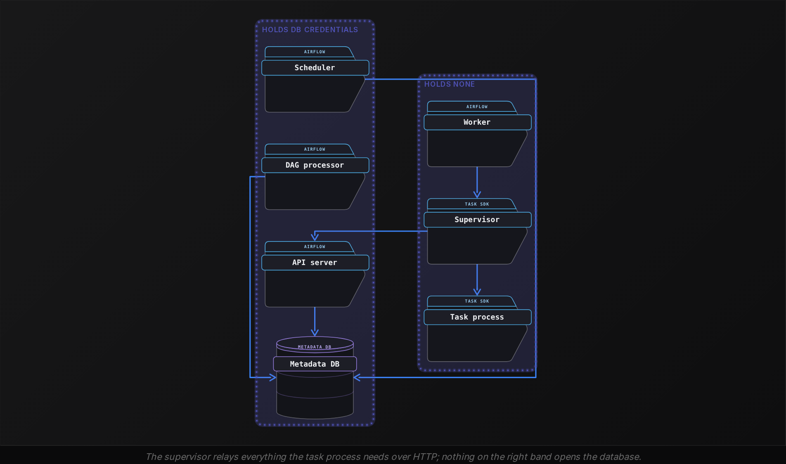

Advanced·[](https://airflow.apache.org/)·20 min · 6 challenges

# DAG Anatomy: Advanced

Airflow began at Airbnb, so take an overnight job there that pulls partner booking feeds. A Monday brings 4 files and a Friday 38. Over a holiday weekend, 112 arrive at once. The DAG file was written months ago and names none of them. This lesson decides whether tonight's run grows 112 loader cells, which code those cells execute after this afternoon's deploy, and what each one may touch.


<br>

---

## Dynamic Task Mapping

### The shape the file cannot know

Every DAG the earlier lessons built had its shape fixed in the file: 3 tasks written down means 3 cells in the grid on every run, whatever the data looked like that night. A partner feed job breaks that model. Some nights 3 files land and some nights 40. The file can't name a task for a file it has never seen. Dynamic task mapping keeps a single task definition in the file and lets the run decide how many copies of it exist, from a value produced upstream in that same run.

```sql
from airflow.sdk import dag, task


@dag(schedule=None)
def load_partner_feeds():
    @task
    def list_files():
        return ["feeds/acme.csv", "feeds/globex.csv", "feeds/initech.csv"]

    @task
    def load(path):
        print(f"loading {path}")
        return path.split("/")[-1]

    @task
    def report(names):
        print(sorted(names))

    report(load.expand(path=list_files()))


load_partner_feeds()
```

The one new call is `load.expand(path=list_files())` in place of `load(path=...)`. At parse time the processor sees 3 tasks and the graph draws 3 boxes, one each for `list_files`, `load` and `report`. Nothing has fanned out yet, because the parser never calls `list_files`. When a run is triggered and `list_files` finishes, the scheduler reads its return value. It finds 3 strings and creates 3 task instances of `load`, numbered 0 to 2 by `map_index`. Each copy receives one string as its `path`. The grid keeps `load` on a single row and labels the row with the count; opening it lists the copies with their indexes and states.

| map_index | path | return value | state |
| --- | --- | --- | --- |
| 0 | feeds/acme.csv | acme.csv | success |
| 1 | feeds/globex.csv | globex.csv | success |
| 2 | feeds/initech.csv | initech.csv | success |

`report` is an ordinary task that takes `names`. Because its argument is the output of a mapped task, it waits for all 3 copies to finish, then receives their return values as a sequence in index order: `['acme.csv', 'globex.csv', 'initech.csv']`. If 1 copy fails, `report` never runs, the same as it would behind a single failed task. A downstream task wired with `>>` and no argument from `load` waits for every copy in the same way, because the mapped task counts as done only when its last copy is.


<br>

### partial, expand, and the product of 2 lists

`expand` takes the arguments that vary per copy. Everything shared across copies goes in `partial`, which is also where a classic operator receives its `task_id`, since the operator is never constructed directly. Passing 2 lists to `expand` gives the cartesian product: 3 paths times 2 formats is 6 copies. When the values must stay paired, `expand_kwargs` takes a list of dicts, 1 dict per copy, each holding that copy's complete keyword set. A name given to `partial` cannot also be given to `expand`; the file fails to parse if it is.

```sql
from airflow.providers.standard.operators.bash import BashOperator
from airflow.sdk import dag, task


@dag(schedule=None)
def reshape_feeds():
    @task
    def convert(path, fmt):
        return f"{path}.{fmt}"

    @task
    def parse(path, delimiter):
        return path.split("/")[-1]

    BashOperator.partial(task_id="compress", env={"LEVEL": "9"}).expand(
        bash_command=["gzip -k feeds/acme.csv", "gzip -k feeds/globex.csv"],
    )

    convert.expand(path=["a.csv", "b.csv", "c.csv"], fmt=["parquet", "orc"])

    parse.expand_kwargs([
        {"path": "feeds/acme.csv", "delimiter": ","},
        {"path": "feeds/globex.csv", "delimiter": "|"},
    ])


reshape_feeds()
```

> How the run fixes the count
>
> - The count is fixed at the instant the mapped task is first scheduled; nothing that happens later in the run changes it.
> - An empty list produces 0 copies and the task is marked skipped rather than success, which every downstream task can see.
> - A list longer than the default cap makes the task that returned it fail at the moment it returns, before any copy exists.
> - A value that cannot be iterated cannot be expanded: a literal integer fails at parse time, an integer returned upstream fails when the run reaches the mapped task.

- **1,024** — default cap on copies per mapped task


<br>

### Knowing which copy you are

Inside a mapped task, `get_current_context()["ti"].map_index` returns the copy's index, which lets a copy write to a file or a partition named after itself without colliding with its siblings. An unmapped task reads `-1` there. The context holds no total, so a copy that must know how many siblings it has is handed the number: the upstream task returns 1 dict per file carrying both the path and `len()` of the list, and `expand_kwargs` passes each dict to its own copy. A task group can be mapped too: decorate it with `@task_group`, give it 1 argument, and call `.expand()` on the group; every task inside is copied once per value, and the grid shows the group with the count on its row, so a 3-step pipeline per file stays readable as 1 group with a number beside it.

```sql
from airflow.sdk import get_current_context, task


@task
def load(path):
    idx = get_current_context()["ti"].map_index
    out = f"staging/part-{idx:03d}.parquet"
    print(f"{path} -> {out}")
    return out
```

| Call | Copies | Each copy receives |
| --- | --- | --- |
| load.expand(path=[a, b, c]) | 3 | 1 path |
| convert.expand(path=[a, b, c], fmt=[x, y]) | 6 | 1 path and 1 fmt |
| parse.expand_kwargs([{...}, {...}]) | 2 | 1 full keyword set |
| load.expand(path=[]) | 0 | nothing, task is skipped |

> **TIP**
>
> Each copy has its own log, found under the task's row by map index. A failure in copy 17 of 40 leaves the other 39 untouched, and the grid shows which index failed, so the question to ask first is which path copy 17 received.


<br>

---

## DAGs Built from Config

### 14 loads that differ in the details

Mapping fits when the copies share a run and an owner and can sit on one row in the grid, which describes the partner feeds. The warehouse team's loads do not fit. The team extracts and then loads 14 source tables the same way, but the payments team owns 2 of them, the search team owns 5, each table has its own history to inspect, and when a source breaks the owning team wants to pause that 1 load and leave the other 13 running. That calls for 14 DAGs, each with its own `dag_id`, and nobody wants to maintain 14 near-identical files. The answer is 1 Python file that reads a config and produces a DAG object per entry.

```sql
- name: orders
  source: orders_db
  owner: payments
- name: listings
  source: listings_db
  owner: search
```

```sql
from pathlib import Path

import yaml
from airflow.sdk import DAG, task

CONFIG = Path(__file__).parent / "tables.yaml"


def build(entry):
    with DAG(dag_id=f"load_{entry['name']}", tags=[entry["owner"]]) as d:

        @task
        def extract():
            return f"SELECT * FROM {entry['source']}.{entry['name']}"

        @task
        def load(sql):
            print(sql)

        load(extract())
    return d


for entry in yaml.safe_load(CONFIG.read_text()):
    globals()[f"load_{entry['name']}"] = build(entry)
```

The processor imports this file like any other. The loop runs, `build` returns a `DAG` for each entry, and `globals()` places each under its own name at the top level of the module, which is where the processor collects DAG objects from. `airflow dags list` then shows `load_orders` and `load_listings` as 2 rows with the same file location. Each has its own pause switch, its own runs and its own grid; the shared file is invisible to anyone reading the UI. The `entry` dict is captured by the inner functions, so `extract` in `load_orders` builds its SQL from `orders_db` and nothing else, and adding a 3rd entry to the YAML produces a 3rd DAG on the next parse without touching the Python.

| dag_id | tags | file | tasks |
| --- | --- | --- | --- |
| load_orders | payments | dags/load_tables.py | extract, load |
| load_listings | search | dags/load_tables.py | extract, load |


<br>

### The price shows up in the parse loop

The intermediate lesson showed that the DAG processor re-imports every file on a cycle, 30 seconds apart by default, and that a file which raises on import is recorded as an import error. Config-driven generation multiplies both facts. The YAML read happens on every cycle, which costs nothing measurable for a local file of a few kilobytes. Replace it with a query against the warehouse's catalog and the parse loop now carries a network round trip on every cycle, the per-file timeout of 50 seconds becomes reachable on a slow night, and 1 timeout counts as a failed import of the whole file: none of the 14 DAGs takes a new definition until a parse of that file finishes.

An error has the same blast radius. One entry with a missing `source` key raises `KeyError` inside `build`. That fails the import, and the import errors page lists the file once. The 14 DAGs already registered stay in the list on their last good definitions and stop updating there: no fix to any of them lands, an entry added in the same edit never appears, and a worker that loads the file to run one of their tasks hits the same error. Validating the config before the loop doesn't unfreeze the other 13, but it turns a `KeyError` on a line inside `build` into a message that names the broken entry, which is the difference between a 1-minute fix and a 20-minute hunt.

```sql
REQUIRED = {"name", "source", "owner"}

entries = yaml.safe_load(CONFIG.read_text())
for entry in entries:
    missing = REQUIRED - entry.keys()
    if missing:
        raise ValueError(f"tables.yaml entry {entry!r} lacks {sorted(missing)}")

for entry in entries:
    globals()[f"load_{entry['name']}"] = build(entry)
```

The subtler cost is identity. A DAG's history lives under its `dag_id`. Change the naming scheme from `load_{name}` to `warehouse_{name}` and the processor registers 14 new DAGs with empty histories, while the 14 old ones are marked as no longer present in any file and keep their runs under the old names. Treat the id formula as a contract, and keep the config file in the same repository as the DAG file so that a change to one is reviewed beside the other.

| ✓ One DAG, mapped tasks | ✗ One file, many DAGs |
| --- | --- |
| • Copies share 1 run and 1 history<br><br>• Count decided inside the run, by data<br><br>• Pausing stops every copy<br><br>• 1 row in the DAG list | • Each DAG has its own history and pause switch<br><br>• Count decided at parse time, by config<br><br>• A broken config entry freezes every DAG in the file on its last good definition<br><br>• 14 rows, 1 file location |

> **TIP**
>
> Keep the loop body cheap and the config local. A generator that finishes in 40 milliseconds puts 14 DAGs on the board; one that waits on a service for 4 seconds makes every one of them 4 seconds slower to appear after any edit, on every cycle.


<br>

---

## DAG Versions and Bundles

### A bundle names where the files come from

Since Airflow 3, the DAG processor doesn't watch a bare folder. It watches bundles, each a named source of DAG files with a class that knows how to fetch them. A fresh install has 1 bundle, `dags-folder`, of class `LocalDagBundle`, pointing at the dags folder on disk, which is why every earlier lesson worked without mentioning one. The list lives in the `[dag_processor]` section of the configuration as `dag_bundle_config_list`, and `airflow dags list` prints a `bundle_name` column so you can see which bundle each DAG came from.

```sql
[
  {
    "name": "dags-folder",
    "classpath": "airflow.dag_processing.bundles.local.LocalDagBundle",
    "kwargs": {}
  },
  {
    "name": "pipelines",
    "classpath": "airflow.providers.git.bundles.git.GitDagBundle",
    "kwargs": {
      "git_conn_id": "pipelines_repo",
      "tracking_ref": "main",
      "subdir": "dags",
      "refresh_interval": 60
    }
  }
]
```

A `GitDagBundle`, shipped in the git provider, tracks a branch of a repository. Its `git_conn_id` names the Airflow connection that holds the repository's URL and credentials, and without it the bundle has nothing to clone. Its version is the commit hash it last fetched, and it checks for a newer commit every `refresh_interval` seconds, 60 here. A `LocalDagBundle` has no version, because a folder on disk holds no record of which copy of a file it contained at 02:00. That one difference decides everything else in this section.


<br>

### A version per change

Every time the processor serializes a DAG and finds the result differs from the stored one, it records a new DAG version with a rising version number, and the same happens when the bundle's version changes under an unchanged file. The UI's Code tab lets you pick any version and read the file as it was then. Each run records the version it was created against, and each task instance records the version it executed under, which is what lets the grid show a run and say what code it was meant to execute. Any change to the tasks or the arrows between them, a renamed task id included, changes the serialized form; editing the body of a function inside a `@task` does not, because the serialized DAG holds the function's name and not its code.

| Edit | New version, local bundle | New version, Git bundle |
| --- | --- | --- |
| Add a task named notify | Yes | Yes, with the commit |
| Rewire load >> verify to extract >> verify | Yes | Yes, with the commit |
| Fix a bug inside verify's function body | No, the serialized DAG is unchanged | Yes, the bundle version changed |
| Reformat whitespace in the file | No | Yes, the bundle version changed |


<br>

### The run that straddles a deploy

A run of `load_orders`, whose 3 tasks are now `extract`, `load` and `verify`, starts at 02:00 against version 3. At 02:10 `extract` has finished and `load` is running when a deploy lands version 4, which fixes a bug in `verify`'s body and adds an arrow from `extract` straight to `verify`. The question is which `verify` runs at 02:12, and the answer depends on the bundle.

| Clock | Event | Local bundle executes | Git bundle executes |
| --- | --- | --- | --- |
| 02:00 | Run created against version 3 |  | commit c41 recorded on the run |
| 02:01 | extract starts and finishes | version 3 file on disk | commit c41 |
| 02:04 | load starts | version 3 file on disk | commit c41 |
| 02:10 | Deploy lands version 4, commit 9fe | file on disk is now version 4 | bundle fetches 9fe within 60 seconds |
| 02:12 | load finishes, verify starts | version 4 body, the fixed one | commit c41, the old body |
| 02:30 | Next run created | version 4 | commit 9fe |

With the local bundle, the worker opens whatever file is on disk when `verify` starts, so it runs the fixed body even though the run was created against version 3. The run has mixed code: `extract` and `load` from version 3, `verify` from version 4, and the task instance detail shows the version each one executed under. With the Git bundle, the run recorded commit `c41`, the worker fetches that commit before starting `verify`, and the run finishes on version 3 code throughout, bug included. The fix reaches the 02:30 run, which is created against version 4. Neither behavior is wrong; one gives you the fix 18 minutes sooner, the other gives you a run whose code you can name with 1 hash.

> Deploys that change the shape
>
> - The scheduler plans from the newest serialized version it holds, so a task added at 02:10 can be scheduled into the run created at 02:00.
> - With a Git bundle, the worker then checks out a commit that never defined that task, and the task instance fails because its code can't be found.
> - Ship additions and removals of tasks when no run of that DAG is active, and keep body-only fixes for the moments a run is in flight.

Reading this back from the UI takes 2 clicks. The run's detail names the version it was created against; each task instance names the version it ran under; and a run showing 2 different numbers is a run that crossed a deploy. The Code tab, set to the older number, shows the file that run was planned from, which is the file to read when a task that passed yesterday fails tonight.

> **TIP**
>
> `airflow dags reserialize` runs the serialization step now instead of on the next processor cycle, so a version is recorded the moment you ask for it. Use it after changing the bundle list, when you want the version numbers to reflect the new source before the next run is created.


<br>

---

## The Task SDK Boundary

### A line through the middle of Airflow

Airflow 3 draws a line between the parts that own the metadata database and the parts that run your code. The scheduler and the DAG processor hold database credentials, and so does the API server; they sit on one side. Workers sit on the other with none. A worker's only route to Airflow's state is HTTP to the API server, through a set of endpoints called the Execution API, and every request carries a token issued for 1 task instance and 1 try. The Task SDK, the `airflow.sdk` package, is the code that lives on the worker side: the names a DAG file imports, plus the machinery that runs a task and talks to the API on its behalf.




<br>

### What a task process is handed

When a worker takes a task, it starts a supervisor process, and the supervisor starts the task itself in a child process. The supervisor asks the API server for the task's details, sends the heartbeat that tells the scheduler the task is alive, and relays any request the task makes. Each line the task prints passes to the supervisor, which writes it to the task's log file on the worker and, when the deployment has a remote log store, uploads that file there as the try ends; the UI's log view asks the API server, which fetches the lines from the worker or the remote store. The task sees a `context` dict whose entries are small objects built from the API's reply rather than database rows. `ti.task_id` and `ti.map_index` are attributes read from that reply; there's no session behind `ti`, and a call that assumes one fails.

| Key | What it holds |
| --- | --- |
| run_id | The run's identifier string |
| dag | The DAG object: dag_id, tags, the task list |
| task | The operator instance for this task |
| ti | The task instance: task_id, dag_id, state, and map_index, -1 if unmapped |

```sql
from airflow.sdk import get_current_context, task


@task
def describe():
    ctx = get_current_context()
    ti = ctx["ti"]
    print(ctx["run_id"], ti.task_id, ti.map_index)
```

The next file is what a task written for an older deployment often looks like. It opens a session and counts runs. On Airflow 3 the call to `create_session` raises `RuntimeError` with a message that direct database access from a task is not allowed, before any query is sent, because the worker has no connection string to send it on.

```sql
from airflow.models import DagRun
from airflow.sdk import task
from airflow.utils.session import create_session


@task
def count_runs():
    with create_session() as session:
        return session.query(DagRun).count()
```

Losing the session does not leave a task blind to the rest of its run. The Execution API answers a short list of read requests, and the supervisor relays them: the value an upstream task returned, the number of task instances that match a filter through `ti.get_ti_count`, and their states through `ti.get_task_states`. The API server runs each lookup against the database and sends back only the result. A task can ask these questions; it can't write its own query, and it cannot change the state of any task instance but its own.

| ✓ Reachable from a task | ✗ Kept away |
| --- | --- |
| • The context dict and its objects<br><br>• Its own return value, which flows downstream<br><br>• Values upstream tasks returned, relayed by the supervisor<br><br>• Counts and states of other task instances, asked through the API<br><br>• The task log<br><br>• Whatever the worker host has on disk or can reach over its network | • The metadata database and every ORM model<br><br>• A database session, even one a helper opens for you<br><br>• A query the Execution API doesn't offer<br><br>• The state of any task instance but its own, to change<br><br>• A token for any task instance but its own |


<br>

### Credentials, versioning and network reach

A worker runs whatever Python the DAG authors wrote, and a process that runs arbitrary code should not hold the credentials to a database that stores every DAG's state; the token scoped to 1 task instance is the smallest grant that still lets the task report back. `airflow.sdk` is also released as its own package, `apache-airflow-task-sdk`, with its own version number, so an operator written against it keeps working across core upgrades, and the database schema can change without any task noticing. And because a worker needs only HTTP to the API server, it can run on a host that cannot reach the database at all.

- dag and DAG, task and task_group, TaskGroup: the shape of a file
- BaseOperator: the class a custom operator extends
- get_current_context: the context dict from inside a function
- Everything else a task needs arrives through the supervisor

| ✓ Do | ✗ Don't |
| --- | --- |
| • Take dag and task from airflow.sdk, along with DAG and BaseOperator<br><br>• Read run_id from the context dict; task and ti.map_index are there too<br><br>• Pass what a downstream task needs as a return value<br><br>• Keep libraries a task imports installed on every worker | • Import from airflow.models or airflow.utils.session inside a task<br><br>• Open a session to inspect a sibling task's state<br><br>• Assume ti is backed by a database row<br><br>• Reuse one task's token or context in another |


<br>

---

## Writing a Custom Operator

### Promoting a function to an operator

A `@task` function covers most needs: write Python, return a value, done. A custom operator is worth writing when the same body with the same 2 or 3 parameters is being pasted into DAG after DAG, when the task should look and behave like a built-in in the graph with its own color and rendered fields, or when stopping it from outside must clean something up. Write the function first, and promote it to an operator the 3rd time you paste it. The example below counts the rows in a CSV file and fails the task when the count is below a floor, a check 14 feed loads all need.

```sql
import csv

from airflow.sdk import BaseOperator


class CsvRowCountOperator(BaseOperator):
    template_fields = ("path",)
    ui_color = "#dbeafe"

    def __init__(self, *, path, min_rows=1, **kwargs):
        super().__init__(**kwargs)
        self.path = path
        self.min_rows = min_rows

    def execute(self, context):
        with open(self.path, newline="") as f:
            count = sum(1 for _ in csv.reader(f)) - 1
        self.log.info("%s has %d rows", self.path, count)
        if count < self.min_rows:
            raise ValueError(f"{self.path}: {count} rows, need {self.min_rows}")
        return count
```

The class extends `BaseOperator` from `airflow.sdk`, which is what makes it a task the scheduler can plan and a worker can run. `__init__` takes its own arguments as keywords and stores them on `self`. Every other keyword, `task_id` included, goes to `super().__init__`. It opens no file and reaches no service, because `__init__` runs in the DAG processor on every parse cycle, 2 times a minute for as long as the file exists, and again on the worker each time it loads the file to run a task instance, once per try. A lookup placed there is paid by both processes on every one of those occasions. `execute` is the body: it runs once per try on a worker, receives the same `context` dict a `@task` function gets, and whatever it returns flows downstream the way a `@task` return value does. Raising any exception fails the try.

The contract a built-in operator keeps

- **__init__(self, \*, ..., \*\*kwargs)** *runs at parse time*\
  Keyword-only arguments, super().__init__(\*\*kwargs) first, attributes stored, nothing opened.
- **execute(self, context)** *runs on the worker*\
  The whole body. Return a value for downstream tasks, raise to fail the try.
- **template_fields** *a tuple of attribute names*\
  Strings stored under these names have their {{ }} placeholders filled in before execute runs, and the UI shows the rendered result.
- **ui_color** *a hex string*\
  The box color in the graph, so the eye finds every row-count check at once.
- **on_kill(self)** *runs when the task is stopped from outside*\
  Close what execute opened: a subprocess, a remote job, a lock.


<br>

### Using it, once and 40 times

A DAG file calls the operator with `CsvRowCountOperator(task_id="check_acme", path="feeds/acme.csv", min_rows=100)`, just as it would a built-in. Mapping it works the same way too. The file below checks every file `list_files` returns, which ties this section to the first one: `partial` carries `task_id` and `min_rows`, `expand` carries the paths, and the grid shows 1 row named `check` with the count of copies beside it.

```sql
from airflow.sdk import dag, task
from operators.csv_ops import CsvRowCountOperator


@dag(schedule=None)
def check_feeds():
    @task
    def list_files():
        return ["feeds/acme.csv", "feeds/globex.csv"]

    CsvRowCountOperator.partial(task_id="check", min_rows=100).expand(
        path=list_files()
    )


check_feeds()
```

Where the module lives matters because 2 different processes import it. The DAG processor imports it to build the task; the worker imports it to run `execute`. A module inside the bundle, `dags/operators/csv_ops.py` with an `__init__.py` beside it, reaches both, because both fetch the bundle and the bundle's root is on the import path. A package installed with `pip` on every host reaches both as well and is the right home once 2 bundles share the operator. A module that only the processor can see produces a DAG that parses and then fails on the worker with an import error at the top of every try.

| Need | @task function | Custom operator |
| --- | --- | --- |
| Used in 1 DAG | Yes | No |
| Same 3 parameters in 6 DAGs | Copies drift | 1 class, 6 calls |
| Own color in the graph | No | ui_color |
| Placeholders rendered and shown in the UI | Only through op_kwargs | template_fields |
| Cleanup when stopped from outside | No hook | on_kill |

| ✓ Do | ✗ Don't |
| --- | --- |
| • Extend airflow.sdk.BaseOperator and call super().__init__(\*\*kwargs) first<br><br>• List every attribute that holds a path or query in template_fields<br><br>• Return the result from execute so downstream tasks can use it<br><br>• Put the module where the processor and every worker can import it | • Open a file in __init__, or a socket or session<br><br>• Compute anything in __init__ that depends on the run<br><br>• Give the operator a positional argument<br><br>• Catch every exception in execute; a swallowed failure shows as success |

> **TIP**
>
> Test the operator the way the intermediate lesson tested a DAG: construct it with a task_id, call execute with a small dict, and assert on the return value. The class imports from the SDK alone, so the test needs no scheduler and no database.


<br>

---

## Putting It All Together

An Airbnb data platform team runs the nightly partner feed pipeline from a Git bundle. A feed-listing task fans out a custom CsvRowCountOperator across however many files landed, 14 per-partner load DAGs are generated from a YAML config beside the file, and at 02:10 a deploy fixes the operator's floor check while 3 runs are still in flight.

- The listing task returns 38 paths, so the mapped check gets 38 copies at 02:03, and the grid shows 1 row with the count rather than 38 rows the file never named.
- The operator does no work in __init__, so the 14 generated DAGs still parse in milliseconds on every 30-second cycle even though the config file now has 14 entries.
- The deploy lands as commit 9fe, but the 3 in-flight runs recorded commit c41, so their remaining copies run the old floor check and the 02:30 runs are the first on the fix.
- A copy that wants to know how many siblings exist can't query the metadata database from the worker; it reads ti . map_index from the context and takes the total from a value the listing task hands it alongside its path.


<br>

---

## Key Takeaways

- expand creates 1 task instance per value in a list produced upstream, counted when the run reaches the task, and the downstream task waits for every copy.
- partial holds what every copy shares, 2 expanded lists multiply, and expand_kwargs keeps arguments paired; an empty list skips the task and the default cap fails the producer.
- A file that loops over config registers 1 DAG per entry at module level, pays the loop on every parse cycle, and freezes every DAG it makes on its last good definition when 1 entry breaks.
- A new DAG version is recorded when the serialized DAG or the bundle version changes; a local bundle runs the file on disk, a Git bundle runs the commit the run recorded.
- Task code runs in a child of a supervisor that talks to the API server with a 1-task token, and any attempt to open the metadata database raises before a query leaves.
- A custom operator extends airflow.sdk.BaseOperator, does no work in __init__, puts the body in execute, lists rendered attributes in template_fields, and lives where both the processor and the workers can import it.

[](https://airflow.apache.org/)

Official Apache Airflow resourcesversion 3.3

"Platform created by the community to programmatically author, schedule and monitor workflows." [airflow.apache.org](https://airflow.apache.org/)

[Documentation](https://airflow.apache.org/docs/)[Install](https://airflow.apache.org/docs/apache-airflow/stable/installation/index.html)[Community](https://airflow.apache.org/community/)

Apache Airflow, Apache, Airflow, the Airflow logo, and the Apache logo are either registered trademarks or trademarks of The Apache Software Foundation.
