Beginner·[](https://airflow.apache.org/)·20 min · 5 challenges

# DAG Anatomy: Beginner

It is 3 a.m. at Airbnb and the job that recomputes every host's Superhost status for the quarter is due to start. It needs yesterday's bookings and reviews loaded first, and last night the review load ran 40 minutes long. Whether the Superhost job waits, or judges hosts while the newest reviews are still loading, comes down to how its tasks are wired into a DAG.


<br>

---

## What Airflow Is For

### 3 scripts and a timer

A marketplace team needs a report of yesterday's bookings and reviews on a dashboard by 09:00. The first version is 3 scripts on a server's timer: `export_bookings.py` at 01:00, `export_reviews.py` at 01:15, and `build_report.py` at 02:00. The 02:00 slot is a guess that the 2 exports take under 45 minutes. One night in December the bookings export runs for 70 minutes because a holiday weekend tripled the rows. `build_report.py` starts at 02:00 on schedule, reads a half-written bookings file, and finishes with no error. The dashboard shows a 40% drop in bookings at 09:00, and the on-call engineer spends the morning finding out why.

Moving the report to 03:00 buys a month. The timer still knows nothing about the exports: it fires at a clock time whether the work it depends on has finished. Every question the engineer asks that morning comes down to whether one step had finished before the next began, and the timer records none of it.

| Question that morning | What the timer can tell you |
| --- | --- |
| Did the bookings export finish before the report started? | Nothing; each timer fires on its own clock |
| Which night did this start? | Nothing; no record of past starts exists |
| Why did the export take 70 minutes? | Only the lines the script printed, if someone saved them to a file |
| Rerun the report for that one night | Edit a date in the script by hand and run it again |


<br>

### Airflow decides when work may start

Airflow takes over the decision the timer could never make: whether a piece of work may start yet. You write the 3 steps as tasks and say that build report comes after both export bookings and export reviews. Airflow starts the 2 exports at the scheduled time. It starts the report only once it has seen both finish with success. If the bookings export runs 70 minutes, the report starts at 02:10 instead of reading a half-written file. Airflow records when each attempt starts and ends and whether it succeeded. It keeps the log of every attempt beside that record, and the browser UI draws the whole history.

The rest of this lesson uses 3 words. A **DAG** is one described workflow: the tasks and the order between them, defined in one Python file. A **task** is one unit of work in it, such as running a shell command. A **run** is one execution of the whole DAG for one scheduled time, so the DAG for the nightly report has one run per night.

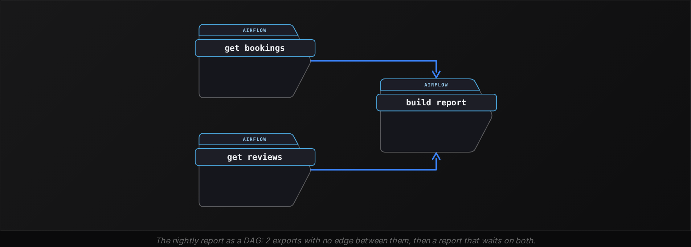


<br>

### Airflow is an orchestrator

Airflow is an orchestrator. It starts work on other systems and waits for the result. Then it records what happened and decides what may start next. The bookings rows live in the application database and the warehouse; the report is computed by the Python script and the SQL it sends; Airflow holds the schedule and the order of tasks, and keeps the history of every run. A task in Airflow is a command plus a place in the order, and the command runs on a machine Airflow controls while the data stays wherever the command points. That division is why an Airflow deployment can run 2,000 pipelines a night without holding a single row of business data.

| ✓ Airflow owns | ✗ The systems it calls own |
| --- | --- |
| • When each run begins<br><br>• Which task may start, given what has finished<br><br>• The record of every attempt and its log<br><br>• The picture of the whole, in one place | • The bookings and reviews themselves<br><br>• The query that aggregates them<br><br>• The file the export writes<br><br>• The dashboard that shows the result |

> Why it is called a DAG
>
> - Directed: every edge points one way, from the task that finishes first to the one that waits for it
> - Acyclic: following the arrows never returns to a task you have passed, so every run can finish
> - Graph: tasks are the nodes and dependencies are the edges, so the shape can fan out and join back


> **TIP**
>
> State the order the work needs and let Airflow derive the timing. A clock time chosen to be 'probably long enough' is the bug from the first paragraph waiting to recur on the next busy night.


<br>

---

## Where Airflow Fits

### 4 systems, one nightly report

Follow the nightly report end to end to see where the line between what Airflow owns and what its systems own falls. Bookings and reviews are written by the app into a transactional database. The exports land as files in object storage. A warehouse loads the files and runs the SQL that aggregates them into a daily table. A dashboard tool reads that table at 09:00. Each of those 4 systems stores data or computes on it. Every arrow between them is a command an Airflow task issues.

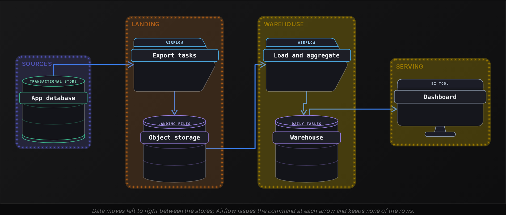

| Step | System that does the work | What Airflow does |
| --- | --- | --- |
| Export yesterday's bookings | App database, via a dump command | Starts the command at 00:00, waits, records the outcome |
| Export yesterday's reviews | App database, the same way | Starts it beside the bookings export, since no edge joins them |
| Load both files | Warehouse, via a load statement | Starts it once both exports show success |
| Aggregate into a daily table | Warehouse, via one SQL statement | Sends the statement, waits, records success or failure |
| Refresh the dashboard | Dashboard tool, via its API | Calls the API and records the response |


<br>

### Airflow's own record

Airflow's own territory is the metadata around the work: the graph of tasks and edges, the schedule, the decision at every moment of which task may start, and the record of every run and every attempt, with its start and end times and final state, plus the log it wrote. That record lives in a database Airflow runs for itself, separate from your warehouse. When a task runs, its command executes on a worker machine, and only its state and timestamps come back into that database, along with its log.

Kept in Airflow's own database

- Every DAG it has read, with its tasks and edges
- Every run, with its scheduled time and its state
- Every task attempt, with start, end, state and a pointer to its log
- Nothing from the tables your tasks read or write


<br>

### One orchestrator, many teams

A company usually runs one Airflow deployment and gives every team a place in its dags folder. The finance team's month-end DAG, the growth team's hourly attribution DAG and the machine learning team's weekly retrain DAG share one scheduler and one UI, and they write to the same record, while each calls its own systems. That shared record is what makes the orchestrator the place to stand when something is late: one screen lists all 300 DAGs and their latest nights, and the question of whether finance's load finished before growth's join started has an answer there without opening either team's warehouse.


<br>

### Heavy compute belongs in the warehouse

Storage and heavy compute belong to the systems built for them. A task can pull 40 million rows into Python on an Airflow machine and deduplicate them there, and it will work on the first night, but that compute now runs on the machine Airflow uses to run everything else, and when 2 such tasks overlap the whole deployment slows. The version that scales sends the warehouse one statement, an insert that selects distinct rows, and waits for it: the warehouse does the work it was sized for, and the task's own cost is one open connection. Small glue work fits in a task: reading a few thousand rows to decide a path, renaming a file, calling an API. The test is where the bytes go, and a task whose memory grows with the business is in the wrong place.

- Its memory grows with the business, month after month
- It runs for an hour on the orchestrator's machine while the warehouse sits idle
- Its log is full of row counts rather than one statement and one outcome
- Another team's tasks slow down whenever it runs

| ✓ Do | ✗ Don't |
| --- | --- |
| • Give each task one command to one system<br><br>• Keep Airflow's state and your business data in separate stores<br><br>• Let the warehouse aggregate; let Airflow wait and record<br><br>• Size a task's memory to stay flat as the data grows | • Load a full table into Python inside a task<br><br>• Treat Airflow's database as a place to keep business rows<br><br>• Compute in the task what the warehouse would do in one statement<br><br>• Chain systems by clock time outside the graph |

Everything the UI shows you in the coming sections is drawn from Airflow's own record, and nothing in it is a row of yours. When a run looks wrong, the record tells you which task ended how and when, and the data itself has to be inspected in the system that holds it.

*How a task opens a connection to a database or an API, and how it hands a value to the task after it, are covered in the Tasks and Data track.*


<br>

---

## Tasks in a DAG File

### One file, one graph

A DAG is defined in a Python file placed in Airflow's dags folder. Airflow reads the file and runs its top-level code. Every `DAG` object that exists when the file ends becomes a DAG Airflow knows about, along with the tasks and edges attached to it. Here is the nightly report as that file, with 4 tasks built from 2 operator types.

```sql
from datetime import datetime

from airflow.sdk import DAG
from airflow.providers.standard.operators.bash import BashOperator
from airflow.providers.standard.operators.python import PythonOperator


def build_report():
    print("aggregating bookings and reviews")


with DAG(
    dag_id="nightly_bookings",
    start_date=datetime(2026, 3, 1),
    schedule="@daily",
) as dag:
    get_bookings = BashOperator(
        task_id="get_bookings",
        bash_command="python export.py bookings",
    )
    get_reviews = BashOperator(
        task_id="get_reviews",
        bash_command="python export.py reviews",
    )
    report = PythonOperator(
        task_id="build_report",
        python_callable=build_report,
    )
    publish = BashOperator(
        task_id="publish_dashboard",
        bash_command="curl -X POST https://bi.internal/refresh",
    )

    [get_bookings, get_reviews] >> report >> publish
```

3 arguments fix the DAG's identity. dag_id names it, and the name must be unique across the deployment. start_date is the first date the DAG is allowed to run for, and schedule="@daily" asks for one run per day; the Scheduling track covers what both mean in detail. The with DAG(...) as dag: block is the registration: every operator created inside it belongs to this DAG.


<br>

### Operator in, task out

An operator is a class that describes one kind of work: run a shell command, call a Python function, send a SQL statement. Creating an instance of it inside the `with` block, with a `task_id`, creates one task on the DAG. The file above creates 3 tasks from `BashOperator` and one from `PythonOperator`. `get_bookings` and `get_reviews` are 2 tasks though they share a class, because each instance has its own `task_id` and its own command. A `task_id` must be unique within its DAG. Airflow's record identifies the task by it, and so do the UI and the logs, so the Python variable name `report` appears nowhere outside this file while `build_report` appears everywhere.

| Operator | What the task does when it runs | Argument that holds the work |
| --- | --- | --- |
| BashOperator | Runs a shell command and fails if the exit code is not 0 | bash_command |
| PythonOperator | Calls a Python function in the task's process | python_callable |
| EmptyOperator | Does nothing; marks a point in the graph | none |


<br>

### The file describes the work and does not do it

Airflow reads this file to learn the graph, and it reads it again on a timer to pick up changes. Reading means running the top-level Python: the imports, the function definition, the `with` block that creates 4 operator instances and 3 edges. The string `"python export.py bookings"` is stored as a task's argument; the export itself runs later, on a machine Airflow controls, when a run reaches that task. The same split holds for `build_report`: the function is defined at read time and called at run time. A line at the top of the file that queries the warehouse would run every time Airflow reads the file, dozens of times an hour, against a warehouse that has nothing to do with learning the graph.

| Line | When it runs | Where |
| --- | --- | --- |
| from airflow.sdk import DAG | Every time Airflow reads the file | The process that reads DAG files |
| get_bookings = BashOperator(...) | Every read; creates the task object | The process that reads DAG files |
| python export.py bookings | Once per run, when the task starts | A worker machine |
| print(...) inside build_report | Once per run, when build_report starts | A worker machine |
| conn.execute('SELECT ...') at top level | Every read, dozens of times an hour | The process that reads DAG files, by mistake |


<br>

### Wiring the order

>> reads as 'then'. a >> b makes b downstream of a: b may start only after a finishes with success. << is the same edge written from the other side. A list on either end fans out or fans in: [a, b] >> c draws 2 edges into c, and a >> [b, c] draws 2 edges out of a. Chains compose, so the last line of the file draws 3 edges in one expression.

| Expression | Edges drawn |
| --- | --- |
| get_bookings >> report | get_bookings -> build_report |
| report << get_reviews | get_reviews -> build_report |
| [get_bookings, get_reviews] >> report | get_bookings -> build_report, get_reviews -> build_report |
| report >> publish | build_report -> publish_dashboard |
| [get_bookings, get_reviews] >> report >> publish | All 3 of the edges above |

The acyclic rule is enforced at read time. Adding `publish >> get_bookings` to the file would make the arrows loop, so a run could never finish: `publish_dashboard` waits for `build_report`, which waits for `get_bookings`, which now waits for `publish_dashboard`. Reading the file raises an error that names the cycle, so the file fails to import: the UI lists it among the DAG import errors, with the cycle in the message, and no graph is loaded from it.


<br>

### Tasks with no path between them run side by side

2 tasks may run at the same time when no path of arrows joins them in either direction. `get_bookings` and `get_reviews` have no edge between them in `nightly_bookings`, so when a run begins at 00:00 both start at once. `build_report` has 2 edges in, so it starts when the later of the 2 finishes. With the bookings export taking 20 minutes and the reviews export 10, the report starts at 00:20. Had the file said `get_bookings >> get_reviews >> report`, the exports would run one after the other and the report would start at 00:30. The arrows you draw decide the night's length, so draw only the ones the data requires.

| Task | Fan-in file: starts | Serial file: starts | Finishes (fan-in file) |
| --- | --- | --- | --- |
| get_bookings | 00:00 | 00:00 | 00:20 |
| get_reviews | 00:00 | 00:20 | 00:10 |
| build_report | 00:20 | 00:30 | 00:35 |
| publish_dashboard | 00:35 | 00:45 | 00:36 |

> **TIP**
>
> Draw an edge only where one task reads what another wrote. An edge added 'to be safe' turns 2 side-by-side tasks into a chain and adds the first task's full duration to every night.


<br>

### Exercise 1 of 5: Repair the DAG

**● TASK**

Its `>>` lines loop, so this file never registers. Rewire them: `merge` needs both pulls, each check needs `merge`, `publish` needs both checks. Nothing else waits.

**Starter** — `dags/weekly_payroll.py`

```python
from airflow.sdk import DAG
from airflow.providers.standard.operators.bash import BashOperator

with DAG("weekly_payroll", schedule=None):
    pull_hr = BashOperator(task_id="pull_hr", bash_command="true")
    pull_time = BashOperator(task_id="pull_time", bash_command="true")
    merge = BashOperator(task_id="merge", bash_command="true")
    check_hrs = BashOperator(task_id="check_hrs", bash_command="true")
    check_pay = BashOperator(task_id="check_pay", bash_command="true")
    publish = BashOperator(task_id="publish", bash_command="true")

    pull_hr >> pull_time >> merge
    merge >> check_hrs >> check_pay
    check_pay >> publish >> merge

```

**Graph, deployed (your starter code)**

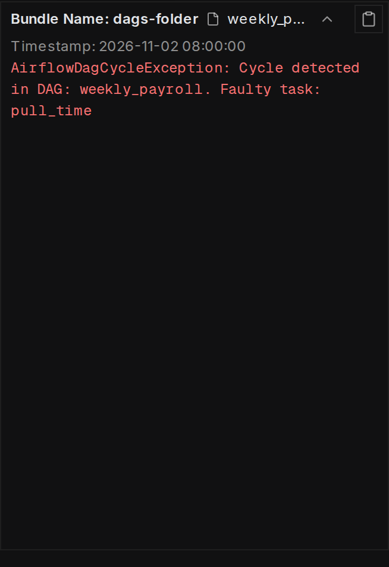

<details>
<summary><strong>Solution</strong></summary>

**Expected grid after the fix**

| task |  |
|---|---|
| `merge` | ✅ success |
| `publish` | 🟧 upstream_failed |
| `pull_hr` | ✅ success |
| `check_hrs` | ❌ failed |
| `check_pay` | ✅ success |
| `pull_time` | ✅ success |

#### Edges say who waits, and nothing more

Task dependencies are the edges of the graph, and every `a >> b` records exactly one rule: `b` waits for `a`. Put a list on one side of `>>` and the edge fans out to every task in it, so the 3 lines below record 6 edges, one per rule you were given, and not a single extra one.

**`dags/weekly_payroll.py`**

```python
from airflow.sdk import DAG
from airflow.providers.standard.operators.bash import BashOperator

with DAG("weekly_payroll", schedule=None):
    pull_hr = BashOperator(task_id="pull_hr", bash_command="true")
    pull_time = BashOperator(task_id="pull_time", bash_command="true")
    merge = BashOperator(task_id="merge", bash_command="true")
    check_hrs = BashOperator(task_id="check_hrs", bash_command="true")
    check_pay = BashOperator(task_id="check_pay", bash_command="true")
    publish = BashOperator(task_id="publish", bash_command="true")

    [pull_hr, pull_time] >> merge
    merge >> [check_hrs, check_pay]
    [check_hrs, check_pay] >> publish

```

*2 edges into `merge`, 2 out of it, 2 into `publish`.*

| Pitfall: A chain adds a wait you never asked for |
| --- |
| `merge >> check_hrs >> check_pay` reads naturally, but it also records `check_hrs >> check_pay`: the second check now waits for the first. On a good night that only makes the run slower. On the test run it shows: `check_hrs` fails and `check_pay` never starts, even though no rule tied the 2 checks together. |

| Key insight: A loop means there is no DAG at all |
| --- |
| `check_pay >> publish >> merge` closed a circle back to `merge`. Airflow refuses a cycle when it reads the file, so the DAG never registers and nothing runs. Deleting just that edge gets it to register, but the 2 extra waits from the chains would still be there. |

With the edges exact, you can read what runs side by side straight off the graph: 2 tasks may overlap when neither one is upstream of the other. `pull_hr` and `pull_time` start together, `merge` starts once the slower pull ends, then `check_hrs` and `check_pay` run together, and `publish` runs alone at the end. No more than 2 tasks ever run at once, and no task overlaps anything it waits on or that waits on it.

**Follow-up questions**

1. A third source, `pull_bonus`, also feeds `merge`. Which line changes, and what can now run side by side at the start?\
   *Growing a fan-in by editing one list.*
2. Someone adds `pull_hr >> publish`. Does `publish` ever start at a different moment than before?\
   *An edge that is already implied by a longer path adds no new wait.*

</details>


<br>

---

## The TaskFlow Decorators

### A function becomes a task

The TaskFlow style defines tasks as Python functions. `@task` on a function turns each call of it, inside a DAG, into a task. `@dag` on a function turns that function into the DAG definition, and the body of the function is where the tasks are created. Here is the nightly report in this style, with values flowing between the tasks.

```sql
from datetime import datetime

from airflow.sdk import dag, task


@dag(
    dag_id="nightly_bookings_flow",
    start_date=datetime(2026, 3, 1),
    schedule="@daily",
)
def nightly_bookings_flow():

    @task
    def get_bookings() -> str:
        return "/exports/bookings.csv"

    @task
    def get_reviews() -> str:
        return "/exports/reviews.csv"

    @task
    def build_report(bookings_path: str, reviews_path: str) -> int:
        print(f"joining {bookings_path} with {reviews_path}")
        return 18342

    @task
    def publish_dashboard(row_count: int) -> None:
        print(f"report has {row_count} rows")

    report_rows = build_report(get_bookings(), get_reviews())
    publish_dashboard(report_rows)


nightly_bookings_flow()
```


<br>

### The dependency comes from the arguments

No `>>` appears, and the graph is the same 4 tasks with the same 3 edges. The edges come from the arguments. Passing the result of `get_bookings()` into `build_report` tells Airflow that `build_report` needs a value `get_bookings` produces, and a task that needs another task's value waits for it: that is the edge. The 2 arguments draw the 2 edges in. Passing `report_rows` into `publish_dashboard` draws the third. When `get_bookings` finishes, Airflow stores its return value, the path string, in its own database; when `build_report` starts on a worker, Airflow reads that value back and passes it in as `bookings_path`. The values are serialized as JSON by default, so a value travels if JSON can hold it, which covers strings and numbers as well as lists and dicts. Keep them small, a path, a count, a date, because that database is the record of the run and was sized for records.

| Call in the DAG function | Task created | Edges drawn |
| --- | --- | --- |
| get_bookings() | get_bookings | none yet |
| get_reviews() | get_reviews | none yet |
| build_report(get_bookings(), get_reviews()) | build_report | get_bookings -> build_report, get_reviews -> build_report |
| publish_dashboard(report_rows) | publish_dashboard | build_report -> publish_dashboard |


<br>

### Reading the file creates the DAG

The last line, `nightly_bookings_flow()`, is the one that creates the DAG. `@dag` turns the function into a factory; calling it runs the body, and each `@task` call inside creates a task object. Delete that line and the file reads without error and defines no DAG, which is the most common reason a TaskFlow DAG is missing from the UI. Inside the body, `get_bookings()` runs none of the function's code at read time; it creates the task and returns a reference to the value the task will produce. `return "/exports/bookings.csv"` executes on a worker, once per run. The `print` in `build_report` runs on a worker too, so nothing in these 4 functions touches the process that reads the file.

A task's id defaults to the function name, so `build_report` the function becomes `build_report` the task. `@task(task_id="aggregate")` overrides it. Calling the same decorated function twice creates 2 tasks, and Airflow suffixes the second id: `get_bookings` and `get_bookings__1`. 2 calls of one function with different arguments is a common way to get 2 tasks from one definition.

> 3 lines that decide whether the DAG exists
>
> - The @dag decorator above the function, where the id and start_date are set along with the schedule
> - The call of that function at module level, with no indentation, at the bottom of the file
> - Each @task function called inside the body, since a function that is only defined creates no task


<br>

### Mixing both styles

Operators and decorated tasks live in one DAG. Inside the `@dag` function, `publish = BashOperator(task_id="publish_dashboard", bash_command="curl ...")` creates a task the same way it would in a `with` block, and `report_rows >> publish` orders it after `build_report` with no value passed, since this `publish` reads nothing from it. The reverse also works: `report_rows` can be fed into an operator's templated field. The Tasks and Data track covers how. Use `@task` where the work is Python you would write anyway; use an operator where a class already wraps the command you need.

Operator style

| Question | Answer |
| --- | --- |
| How a task is created | An operator instance inside with DAG |
| How an edge is drawn | a >> b, written by you |
| How a value moves | Not by default |
| Where the task id comes from | The task_id argument |

TaskFlow

| Question | Answer |
| --- | --- |
| How a task is created | A call of a @task function inside @dag |
| How an edge is drawn | Passing one call's result into another |
| How a value moves | Return it; the next task receives it |
| Where the task id comes from | The function name, unless overridden |

| ✓ Reach for @task when | ✗ Reach for an operator when |
| --- | --- |
| • The work is Python that returns a small value<br><br>• The next task needs that value as an argument<br><br>• You want the edge to follow the data | • A class already wraps the command, such as a shell command<br><br>• The task produces no value the next one needs<br><br>• You are ordering tasks with >> for timing alone |

> **TIP**
>
> Read a TaskFlow file bottom up: find the call at module level first, then trace each argument back to the call that produced it, since each argument is an edge.


<br>

### Exercise 2 of 5: Repair the DAG

**● TASK**

This TaskFlow file registers `row_report`, but a manual run only finds the file and counts its rows. The summary never runs. Fix the DAG body so the path feeds the count and the count feeds `summarize`, and all 3 tasks succeed in one manual run.

**Starter** — `dags/row_report.py`

```python
from airflow.sdk import dag, task
@dag(schedule=None)
def row_report():
    @task
    def find_file():
        return "orders.csv"
    @task
    def count_rows(path):
        return {"orders.csv": 120}[path]
    @task
    def summarize(n):
        print(f"orders.csv has {n} rows")
    count_rows(find_file())
row_report()

```

**Graph, deployed (your starter code)**

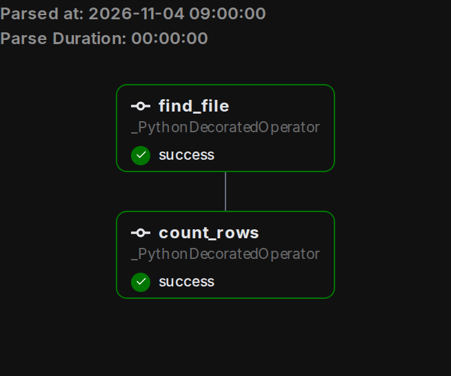

<details>
<summary><strong>Solution</strong></summary>

**Expected grid after the fix**

| task |  |
|---|---|
| `find_file` | ✅ success |
| `summarize` | ✅ success |
| `count_rows` | ✅ success |

#### Calls build the graph

With the TaskFlow decorators, a `@task` function becomes a task only when the body of the `@dag` function calls it. That call happens at read time, so what comes back is a placeholder standing in for the path or count the task will produce later. Passing that placeholder into the next call does 2 jobs at once: it adds the next task and it draws the edge. The bottom line, `row_report()`, is the call that creates the DAG object.

**The repaired `row_report.py`**

```python
from airflow.sdk import dag, task
@dag(schedule=None)
def row_report():
    @task
    def find_file():
        return "orders.csv"
    @task
    def count_rows(path):
        return {"orders.csv": 120}[path]
    @task
    def summarize(n):
        print(f"orders.csv has {n} rows")
    summarize(count_rows(find_file()))
row_report()

```

*One line changed: the count's placeholder now goes into `summarize`. The count is a stub lookup, so the run needs no real file.*

| ✕ At read time | ✓ At run time |
| --- | --- |
| `find_file()` returns a placeholder. `count_rows(...)` registers a task with an edge from `find_file`. `summarize(...)` registers a third task with an edge from `count_rows`. `row_report()` builds the DAG. | `find_file` returns 'orders.csv', which is stored in XCom. Airflow pulls it and passes it in as `path`. The count of 120 that `count_rows` returns is also stored in XCom, then arrives in `summarize` as `n`. |

| Pitfall: A defined function is not yet a task |
| --- |
| The broken file defined `summarize` with `@task` but never called it, so the DAG held 2 tasks and nothing printed. Calling `summarize(0)` would also register the task, but with no edge and a made-up count. The edge comes only from passing the real return value. |

| Key insight: Operators still wire with `>>` |
| --- |
| A decorated task's call result can sit on the left of `>>`. Writing `summarize(...) >> BashOperator(task_id='notify', bash_command='echo done')` runs the shell step after the summary, mixing both styles in one file. |

**Follow-up questions**

1. What `task_id` does `count_rows` get, and how would you give it a different one?\
   *The function name is the default task id.*
2. If you call `find_file()` twice in the body, how many tasks does the DAG hold?\
   *Each call registers a task.*

</details>


<br>

---

## Reading the Graph and Grid

### Graph: the shape of one run

The DAG page in the UI has 2 views of the same DAG, switched by a toggle. The graph draws the tasks as boxes and the edges as arrows, laid out left to right, so `nightly_bookings` shows `get_bookings` and `get_reviews` stacked on the left, `build_report` to their right with 2 arrows in, and `publish_dashboard` last. The shape alone answers 2 questions: which tasks can overlap, those with no arrow path between them, and what the longest chain is, which bounds how fast a run can finish. Select a run and each box takes the color of that task's state in that run, so the graph becomes a picture of where one night stands.


<br>

### Grid: the history of every run

The grid turns time into columns. Each column is one run, oldest on the left and newest on the right; each row is one task; the cell where they meet is colored by the state of that task in that run. Read down a column to see how one night went; read across a row to see how one task has behaved night after night. 3 nights of `bookings_report`, the 3-task cousin of `nightly_bookings` that the animation below plays, make 3 columns of 3 cells. The colors are Airflow's state names, and 7 of them cover everything you will see in this lesson.

| Color | State | What it says about the cell |
| --- | --- | --- |
| Green | success | The task finished and its command exited cleanly |
| Red | failed | The task ran and its command exited with an error |
| Orange | upstream_failed | A task upstream of it failed, so it will not run in this run |
| Lime | running | A worker is executing the command now |
| Grey | queued | Its upstream tasks are done; it waits for a worker to pick it up |
| Tan | scheduled | The run has reached it and it is about to be queued |
| No color | none | The run has not reached this task; an upstream task is still unfinished |

The bar over a column carries the run's own state: lime while any task is still running, green once every task has finished with success, red once a task at the end of the graph has failed. The bar's height is the run's duration relative to its neighbours, so a night that ran long stands out as a taller bar before you read a single cell.

**Exports side by side**

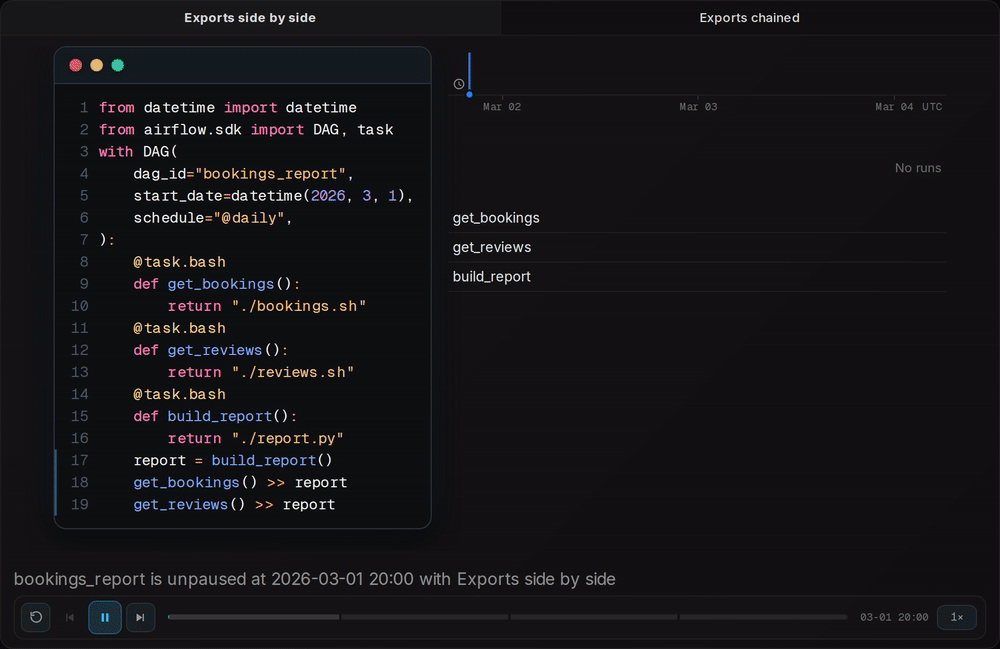

**Exports chained**

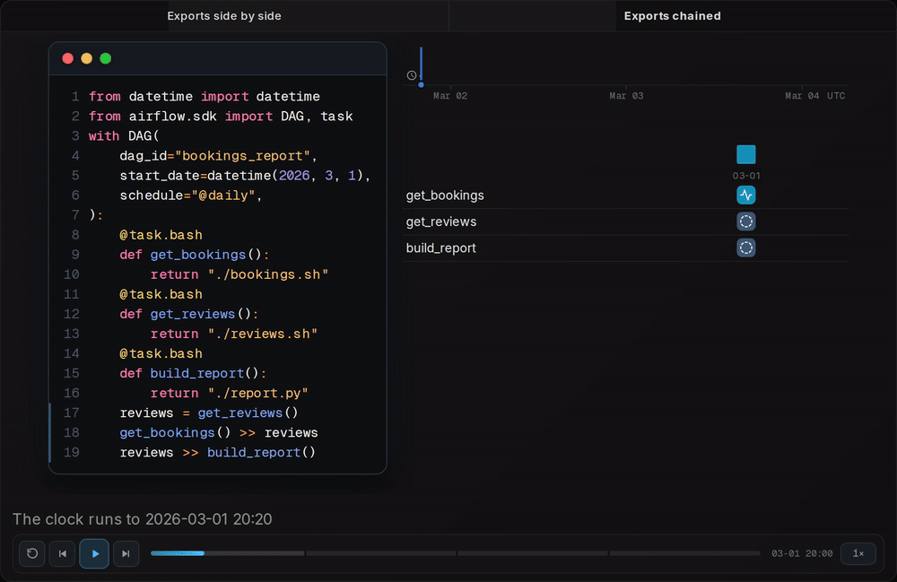

Play the night above. At 00:00 on March 2 the first column appears and `get_bookings` and `get_reviews` turn lime together. `build_report` stays blank: the cell has no state until both tasks above it finish. At 00:10 `get_reviews` turns green and `build_report` still waits, because one of its 2 edges is unmet. At 00:20 the second edge is met, `build_report` passes through scheduled and queued and runs, and the column is all green at 00:35. On the night of March 3 `build_report` turns red at 00:35 and the bar over that column turns red with it: a run fails when a task at the end of its graph fails. Switch the dependencies to the serial file and `get_reviews` stays blank until `get_bookings` finishes at 00:20, then runs from 00:20 to 00:30; `build_report` starts at 00:30 instead of 00:20, so every column finishes 10 minutes later, at 00:45.

Click a cell and a panel opens with that task's attempt in that run. It shows the attempt's state and its start and end times with the duration between them, and its Logs tab holds what the command printed. Use the grid to find the cell, the log to see what the command did, and the graph to see which other cells could have been affected by the one you are looking at.


<br>

### Reading a grid like a story

A grid is a record you read by shape. One red cell in an otherwise green row names a night that went wrong, and the log behind that cell is where to look. A whole row of red names a task that has been broken since a certain column, and the DAG file or command changed around that date is the suspect. A red cell with orange cells below it in the same column names a night where an early task failed and every task after it was marked upstream_failed; the red cell is the one to open, since the orange cells never ran. A column whose bar is lime right now is a run in progress, and the blank cells in it are tasks whose turn has not come.

| Pattern in the grid | What happened | Where to look first |
| --- | --- | --- |
| 1 red cell, rest of its row green | One night's command failed | That cell's log |
| Red across a row from one column onward | The task broke on that date and stayed broken | The DAG file or the command, as changed around that date |
| Red cell, orange cells below it in the column | An early task failed and nothing downstream ran | The red cell's log |
| 2 rows lime at the same time | Those tasks run side by side; no edge joins them | The graph view, to confirm the shape |
| Column bar lime, bottom cells blank | The run is still in progress | Wait, or watch the running cell |


<br>

### Exercise 3 of 5: Match the grid

**● TASK**

Match the target grid of `nightly_bookings`: March 2 all green; at 00:05 on March 3 the 2 fetches running, `build_report` and `publish_dashboard` with no state. Set the 2 marked trigger rules: `always` starts a task at once, `all_success` waits for its upstream tasks.

**Starter** — `dags/nightly_bookings.py`

```python
# in nightly_bookings(), daily 00:00 UTC
@task(trigger_rule="always")
def build_report(): ...
@task(trigger_rule="always")
def publish_dashboard(): ...

b, r = get_bookings(), get_reviews()
rep = build_report()
[b, r] >> rep >> publish_dashboard()
```

**Tasks**

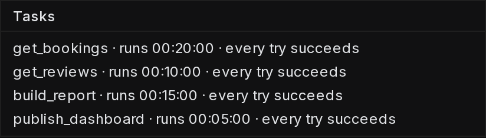

**airflow.cfg**

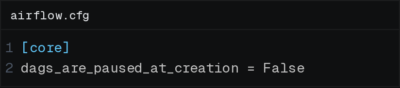

**Grid as given (your starter code)**

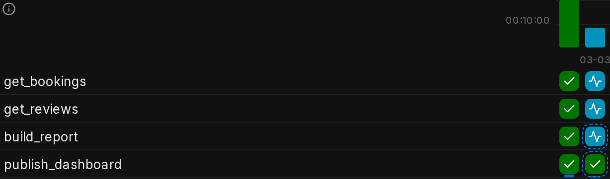

**Target grid (match this)**

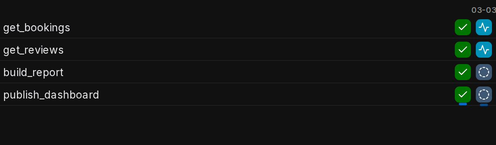

**Graph as given (your starter code)**

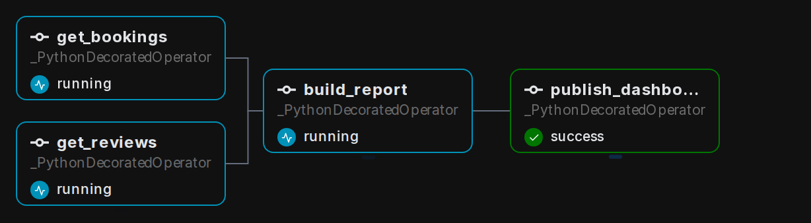

<details>
<summary><strong>Solution</strong></summary>

#### Blank cells are waiting tasks

Task dependencies are what keep a cell blank in a run that is still going. `build_report` has 2 upstream edges, and with the default `all_success` it gets no state until `get_bookings` and `get_reviews` both finish. With `trigger_rule="always"` those edges stop holding it back: it starts at 00:00 beside the fetches, and so does `publish_dashboard`, which is why the starter's March 3 column had no blank cell at 00:05.

**`nightly_bookings` with its waits restored**

```python
# in nightly_bookings(), daily 00:00 UTC
@task
def build_report(): ...
@task
def publish_dashboard(): ...

b, r = get_bookings(), get_reviews()
rep = build_report()
[b, r] >> rep >> publish_dashboard()
```

*A bare `@task` uses `all_success`, so each task waits for every task above it.*

| Pitfall: Fixing one task leaves the last cell started |
| --- |
| Setting only `build_report` back to `all_success` still leaves `publish_dashboard` on `always`. It starts at 00:00 and its cell has a state at 00:05, even though the task above it has not started. Every task whose cell should be blank needs its own wait restored. |

| Key insight: A finished column hides the order |
| --- |
| The March 2 column is all green with either rule, because every task succeeds in the end. The order shows in 2 places: the in-progress column, where blank cells name the tasks whose turn has not come, and the bar height. With `always` everything runs at once and the run ends at 00:20; with the waits it ends at 00:40, a bar twice as tall. |

**Follow-up questions**

1. With the fixed file, what does the March 3 column show at 00:15?\
   *`get_reviews` is green, `get_bookings` is still lime, and `build_report` stays blank on its one unmet edge.*
2. If `get_bookings` failed on March 3, what would the 2 cells below it show, and which cell would you open?\
   *Reading a red cell with orange cells under it in one column.*

</details>

> **TIP**
>
> When a dashboard is wrong at 09:00, open the grid before the data. The newest column tells you in one glance whether last night's run finished, and which cell to open if it did not.


<br>

### Exercise 4 of 5: Match the grid

**● TASK**

Rewire the dependency lines of `daily_totals` so its graph draws the target grid in every cell of all 4 runs.

**Starter** — `dags/daily_totals.py`

```python
@dag(schedule="0 2 * * *",
     start_date=pendulum.datetime(
         2026, 3, 1, tz="UTC"),
     catchup=False)
def daily_totals():
    # 4 @task defs, each a print(...)
    orders = fetch_orders()
    rates = fetch_rates()
    clean = clean_orders()
    totals = build_totals()
    orders >> [rates, clean]
    clean >> totals

```

**Tasks**

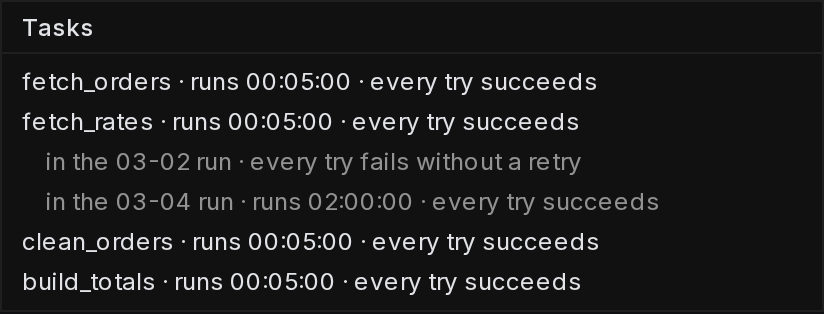

**Grid as given (your starter code)**

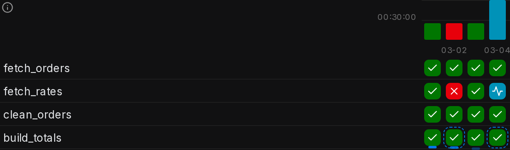

**Target grid (match this)**

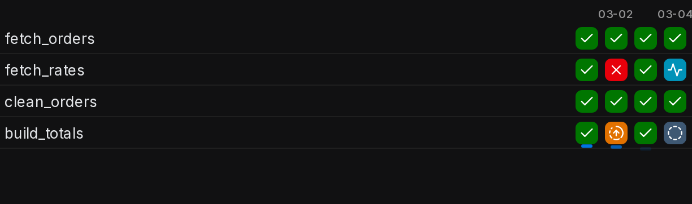

**Graph as given (your starter code)**

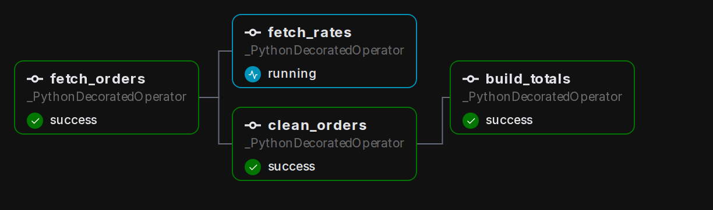

<details>
<summary><strong>Solution</strong></summary>

#### Reading edges off the grid

Every column of the grid is one run, and the states down that column are the task dependencies at work: a task starts only once everything upstream of it has succeeded. That lets you read the graph back out of the history. When a task fails, every cell marked upstream failed sits downstream of it, and every cell that still finishes green has no path from it.

1. **Read the column with the red cell**

   On Mar 2 `fetch_rates` is red and `build_totals` is marked upstream failed, so `build_totals` waits on it. `clean_orders` is green in the same column, so it finished without `fetch_rates` and cannot sit below it.

2. **Read the column still in progress**

   On Mar 4 `fetch_rates` is still running, yet `clean_orders` is already green: the 2 run side by side. `build_totals` is blank because one of its upstream tasks has not finished, the same edge the Mar 2 column showed.

3. **Write the edges the grid proves**

   `fetch_orders` feeds `clean_orders`, and `build_totals` waits for both `clean_orders` and `fetch_rates`. Nothing in the grid shows `fetch_rates` waiting on `fetch_orders`, so that edge goes.

**The dependency lines that draw the target grid**

```python
    orders >> clean
    [clean, rates] >> totals

```

*`build_totals` fans in from both branches, and `fetch_rates` starts at the top beside `fetch_orders`.*

| Pitfall: A missing arrow lets a task run on missing data |
| --- |
| The file's `orders >> [rates, clean]` hung the rate fetch under an orders fetch it never reads. It also gave `build_totals` no edge from `fetch_rates`, so on Mar 2 the totals would have built green without the rates they need. |

**Follow-up questions**

1. If `fetch_orders` had failed on Mar 2 instead, which cells in that column would change, and which edge would they prove?\
   *Using a different failure as evidence for a different edge.*
2. Which row would tell you `fetch_rates` is the task that keeps breaking night after night?\
   *Reading across a row instead of down a column.*

</details>


<br>

### Exercise 5 of 5: Repair the DAG

**● TASK**

`nightly_retail` should run 5 scripts, but its file has no `validate` task and `pull_orders` is unwired. Add it, then wire one chained line: both pulls feed `merge`, then `validate`, then `publish`, and nothing else waits. Run 1 fails `pull_orders`; run 2 fails `validate`.

**Starter** — `dags/nightly_retail.py`

```python
from datetime import datetime
from airflow.sdk import DAG
from airflow.providers.standard.operators.bash import BashOperator

with DAG("nightly_retail", schedule="@daily",
         start_date=datetime(2026, 11, 1)):
    o = BashOperator(task_id="pull_orders", bash_command="run orders")
    r = BashOperator(task_id="pull_returns", bash_command="run returns")
    m = BashOperator(task_id="merge", bash_command="run merge")
    p = BashOperator(task_id="publish", bash_command="run publish")
    r >> m >> p

```

**Graph, deployed (your starter code)**

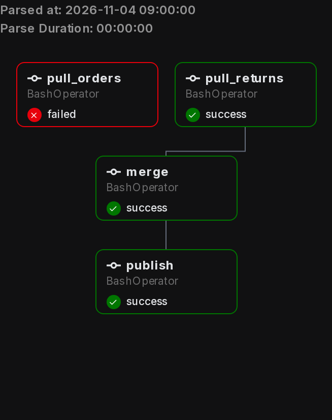

<details>
<summary><strong>Solution</strong></summary>

**Expected grid after the fix**

| task |  |  |
|---|---|---|
| `merge` | 🟧 upstream_failed | ✅ success |
| `publish` | 🟧 upstream_failed | 🟧 upstream_failed |
| `validate` | 🟧 upstream_failed | ❌ failed |
| `pull_orders` | ❌ failed | ✅ success |
| `pull_returns` | ✅ success | ✅ success |

#### One file, 2 moments

This repair puts both halves of a DAG definition to work at once. The first half declares one task per piece of work. The second half draws the dependencies that decide which task waits for which. Every line of the finished file belongs to one of 2 moments. When the dag processor imports the file, each top-level statement runs and builds a description. Each shell script runs later, only when a run reaches its task.

**`dags/nightly_retail.py`, repaired**

```python
from datetime import datetime
from airflow.sdk import DAG
from airflow.providers.standard.operators.bash import BashOperator

with DAG("nightly_retail", schedule="@daily",
         start_date=datetime(2026, 11, 1)):
    o = BashOperator(task_id="pull_orders", bash_command="run orders")
    r = BashOperator(task_id="pull_returns", bash_command="run returns")
    m = BashOperator(task_id="merge", bash_command="run merge")
    v = BashOperator(task_id="validate", bash_command="run validate")
    p = BashOperator(task_id="publish", bash_command="run publish")
    [o, r] >> m >> v >> p

```

*2 lines changed: the `validate` operator was added and the `>>` line was rewritten as one chain.*

1. **Give `validate` its own `BashOperator`**

   A script with no operator call has no task, so the old file let `publish` ship whatever `merge` produced. The new line creates a task named by its `task_id`, and 'validate' is what the graph and grid show. The `v` is only a Python handle that the chain line refers to.

2. **Draw the fan-in and the chain in one line**

   A list on the left of `>>` records an edge from each member, so `[o, r] >> m` gives `merge` 2 upstreams and puts no edge between the pulls. In run 1, `pull_orders` fails, `pull_returns` still succeeds, and `merge` goes '`upstream_failed`', which also stops `validate` and `publish`. In run 2, `validate` fails and `publish` never ships.

| ✕ Runs when Airflow reads the file | ✓ Runs only during a run |
| --- | --- |
| Lines 1 to 3 are the imports. Lines 5 and 6 are `DAG(...)` with its `dag_id`, `schedule` and `start_date`. Lines 7 to 11 are the 5 `BashOperator(...)` calls, and each one builds a task object. Line 12 is the chain, which records 5 edges. All of these lines run again every time the dag processor re-reads the file. | Only the 5 `bash_command` strings, such as 'run orders' and 'run validate'. Each string is stored at read time. A worker executes it only when that task's instance starts in a run. |

| Pitfall: A straight chain makes the pulls take turns |
| --- |
| `o >> r >> m >> v >> p` registers and looks tidy, but it adds an edge that nobody asked for. With that edge, `pull_returns` waits for `pull_orders`. In run 1 it ends '`upstream_failed`' when it should succeed, and every night the 2 pulls run one after the other instead of side by side. |

**Follow-up questions**

1. A third pull, `pull_stock`, must also finish before `merge`. What changes in the chained line?\
   *Growing a fan-in list without adding waits between its members.*
2. If the file called the validate script directly at the top level instead of inside a `bash_command`, how often would it run?\
   *Read time versus run time: the dag processor re-imports the file every few seconds.*

</details>


<br>

---

## Putting It All Together

A food-delivery company pays its couriers every morning. The payout job needs yesterday's completed orders, cancellations and tips loaded into the warehouse, then one SQL statement that nets them per courier, then a call to the payments provider; finance opens the payout dashboard at 08:00.

- The 3 loads have no edge between them, so they start together at 00:00 and the netting statement waits for the last of them: the order from the DAG file replaces the clock-time guesses the timer version relied on.
- The warehouse runs the netting statement and the payments provider moves the money; Airflow holds only the record of each attempt, which is the division between its own territory and the systems it calls.
- The netting task returns the number of couriers paid, and passing that result into the payments call draws the edge and hands over the count in one line of TaskFlow.
- When a courier reports a missing payout at 09:00, the newest grid column says whether the payments call ran, and its cell opens the log that says why it ended as it did.


<br>

---

## Key Takeaways

- Airflow is an orchestrator: it decides when work may start, runs commands on machines it controls, and records every attempt, while the data stays in the systems the commands point at.
- A DAG file is read to learn the graph; the commands and function bodies it names run later, once per run, on a worker.
- An operator instance with a task_id inside the DAG is a task; >> draws an edge, and tasks with no path between them run side by side.
- With @task, calling a decorated function creates the task, and passing its result into another call both draws the edge and carries the value.
- The graph is the shape of one run; the grid is every run as a column, every task as a row, and every cell a state you can read before opening a log.

[](https://airflow.apache.org/)

Official Apache Airflow resourcesversion 3.3

"Platform created by the community to programmatically author, schedule and monitor workflows." [airflow.apache.org](https://airflow.apache.org/)

[Documentation](https://airflow.apache.org/docs/)[Install](https://airflow.apache.org/docs/apache-airflow/stable/installation/index.html)[Community](https://airflow.apache.org/community/)

Apache Airflow, Apache, Airflow, the Airflow logo, and the Apache logo are either registered trademarks or trademarks of The Apache Software Foundation.
