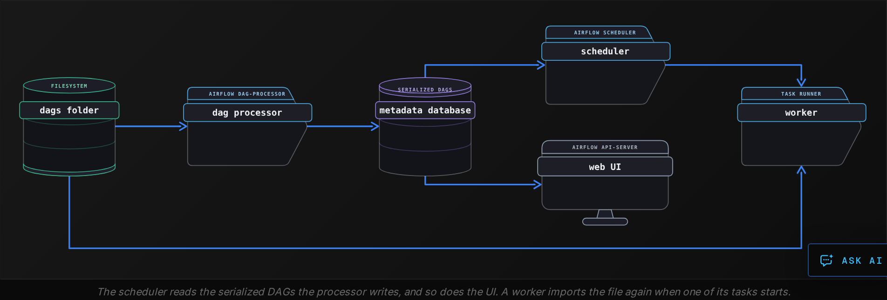

Intermediate·[](https://airflow.apache.org/)·20 min · 6 challenges

# DAG Anatomy: Intermediate

Airbnb open-sourced Airflow in 2015. Say a pricing team there is launching a new smart-pricing model: on launch morning an engineer drops a new DAG into the folder, refreshes the home page, and sees nothing. The scheduler is healthy, the file is there, the tests passed on her laptop. Whether the model ships today depends on knowing what happens between a file landing and a DAG appearing.


<br>

---

## The Parse Loop

In Airflow 3 one component owns your DAG files: the dag processor. It walks the dags folder, imports each `.py` file as a Python module, collects every DAG object that import produced, and writes a serialized copy of each DAG into the metadata database. The scheduler and the web UI read that serialized copy and never open the file. When the processor reaches the end of the folder it returns to the start and imports everything again, and it keeps doing that for as long as it runs. Everything in this lesson follows from that loop: what it costs, why a file can fall out of it, and why a test on your laptop can tell you what the processor will do.




<br>

### How often the loop comes back

The `[dag_processor]` section of the config has 3 settings that set the pace, and their defaults matter because most deployments keep them. A file is re-imported at most every 30 seconds, 2 processes import files side by side, and a single import that runs past 50 seconds is killed. On a small folder those numbers mean the top of your file runs around 2,880 times a day, and each of those runs has to finish inside 50 seconds or the DAG never reaches the database.

| Setting | Default | What it governs |
| --- | --- | --- |
| `min_file_process_interval` | 30 seconds | Shortest gap between 2 imports of the same file |
| `parsing_processes` | 2 | How many files import at the same time |
| `dag_file_processor_timeout` | 50 seconds | How long one import may run before it is killed |

After an import finishes, the processor looks through the module for DAG objects, serializes each one to JSON and writes the row. The scheduler picks up the new row within seconds. So the clock between saving a file and seeing the change in the UI runs like this: wait for the sweep to reach the file, pay the import, then a few seconds more. On a quiet folder that is under a minute. On a slow folder it is however long a sweep takes, which is the number the rest of this section works out.


<br>

### What top-level code costs

Every statement at module level runs on every import. The body of a `@task` function stays unexecuted, because constructing the task objects already gives the processor what it needs: which operator each task id uses, and what it depends on. So a file that opens a warehouse connection at module level, intending the task to reuse it, pays that handshake once per import, and the task never sees the connection anyway, because the task runs in a different process on a different machine.

```sql
from airflow.sdk import DAG, task
from warehouse_client import connect

conn = connect("analytics")

with DAG(dag_id="orders_health", schedule=None) as dag:
    @task
    def check_orders():
        rows = conn.execute("SELECT count(*) FROM orders WHERE status = 'open'")
        print(rows.fetchone()[0])

    check_orders()
```

Say the handshake takes 2 seconds and the folder holds 150 files that all open a connection this way. With 2 processes, one sweep of the folder takes 150 seconds, so each file is imported every 150 seconds rather than every 30, and the folder as a whole completes 1 import per second, around the clock. Each import opens a warehouse session no task will ever use. An edit you save to any file waits for the sweep to reach it, so a one-line fix can take 2 and a half minutes to show in the UI, and the warehouse team sees a steady stream of sessions from a cluster that is running nothing.

- **86,400** — warehouse sessions a day from parsing
- **576** — sweeps of the folder a day

```sql
from airflow.sdk import DAG, task

with DAG(dag_id="orders_health", schedule=None) as dag:
    @task
    def check_orders():
        from warehouse_client import connect
        conn = connect("analytics")
        rows = conn.execute("SELECT count(*) FROM orders WHERE status = 'open'")
        print(rows.fetchone()[0])

    check_orders()
```

> Where the file is imported
>
> - The dag processor, on every sweep, on the processor's host
> - Each worker, once per task start, on that worker's host
> - Your laptop, once per `python` run or test command
> - The scheduler and the UI read the database and import nothing

The processor is one of 2 places the file is imported. When a worker picks up a task, it imports the file again to find the task's code, so module-level work runs once more per task start, on the worker's host, with the worker's network access. Heavy imports belong inside the task body for the same reason: a numerical library that takes 4 seconds to import costs 4 seconds on every parse, and the processor needs none of it to build the DAG.

> **TIP**
>
> Run `airflow dags report` on the deployment. It prints every file with its parse duration, so the file eating your sweep is the top line, and the fix is usually a module-level statement that belongs inside a task.

| ✓ Do | ✗ Don't |
| --- | --- |
| • Keep module level to imports from airflow.sdk plus DAG and task construction<br><br>• Open connections and clients inside the task function that uses them<br><br>• Import heavy libraries inside the task body<br><br>• Measure parse time with airflow dags report after each large change | • Call any network service at module level<br><br>• Read large files or walk directories while the module imports<br><br>• Treat a 2-second import as harmless when the folder holds 100 files<br><br>• Raise the 50-second timeout before removing the work that hits it |


<br>

---

## Why a DAG Goes Missing

The file is in the folder, the processor has swept it a dozen times, and the home page shows no DAG with its id. Every cause leaves a different fingerprint, and a short, fixed order of checks finds it in a few minutes. The order matters because the first checks are cheap and rule out the common causes, and the later checks only make sense once the earlier ones have come back clean.


<br>

### Cause 1: the import raised

An exception at module level stops the import, and the processor records it against the file path in the import error table. The UI shows an import error notice on the home page, and `airflow dags list-import-errors` prints the file path with the full traceback. Missing modules and mistyped names land here, as does a `KeyError` on an environment variable the processor's host lacks. A file that errors produces no DAG, so a new DAG from a broken file is absent from the list rather than shown in red.

```sql
from airflow.sdk import DAG, tsk

with DAG(dag_id="orders_health", schedule=None) as dag:
    @tsk
    def check_orders():
        print("ok")

    check_orders()
```


<br>

### Cause 2: the file was never imported

The processor can skip a file without ever opening it, and it records no error when it does. Before importing, it scans the file's text for the strings `airflow` and `dag`, case-insensitive, and skips any file lacking either one. A file that gets its DAG by calling a factory function from another module can fail this test and sit there in silence. A `.airflowignore` file in the folder or any parent folder also holds glob patterns, and a file matching one is skipped, along with everything under a matching directory. And the folder the processor scans is whatever `airflow config get-value core dags_folder` prints, so a file 1 directory outside it does not exist to Airflow.

```sql
from pipelines.factory import build_orders_health

orders_health = build_orders_health()
```


<br>

### Cause 3: the DAG object never reached the module

The processor collects DAG objects from the module's global namespace after the import. A `@dag` decorated function that is defined and never called creates no DAG, because the decorator turns the function into a factory, and the DAG exists only when the factory runs. A `with DAG(...)` block inside a function the module never calls has the same effect. In both cases the import succeeds, there is no error to list, and the file parses in milliseconds, so this cause hides behind a clean report.

```sql
from airflow.sdk import dag, task

@dag(dag_id="orders_health", schedule=None)
def orders_health():
    @task
    def check_orders():
        print("ok")

    check_orders()
```


<br>

### Cause 4: another file owns the id

A `dag_id` is unique across the whole database. If 2 files define the same id, both import cleanly. The DAG then shows under whichever file the processor parsed last, with that file's tasks. The other file's tasks never appear, and the DAG's recorded file path can change from one sweep to the next. Copying a DAG file to start a new one and forgetting to change the id produces this exactly, and `airflow dags list` shows the id once, with a file path you did not expect.


<br>

### Cause 5: the import ran out of time

An import that passes 50 seconds is killed and the DAG is never written. The dag processor's log records it with a line like `Processor for dags/bucket_inventory.py with PID 4182 started 51 ago killing it.`, which names the file path and its age in seconds, past the 50-second limit. Causes 2 and 3 leave no line in that log at all, which is itself a clue. The usual source of a timeout is the module-level work from the previous section: a slow query, a listing of a large bucket, an import chain that pulls in a numerical library. The fix is the same as before, moving the work into a task, and the check is `airflow dags report`, which prints the file's parse duration next to its name.

| What you see | Run this | What a hit looks like |
| --- | --- | --- |
| No DAG, red import notice | `airflow dags list-import-errors` | Your file path with a traceback |
| No DAG, no notice | `grep -il airflow <file>` and `grep -il dag <file>` | One of the 2 words is missing |
| No DAG, no notice | `cat .airflowignore` in the folder and its parents | A pattern matches the path |
| No DAG, no notice | Read the file for a `@dag` function with no call below it | Import succeeds, no DAG is built |
| DAG exists, wrong tasks | `airflow dags list` | Your id under another file's path |
| No DAG, timeout in the processor log | `airflow dags report` | Duration near 50 seconds or above |

> The order of checks
>
> - 1. `airflow dags list-import-errors`: a traceback ends the search.
> - 2. `airflow dags list`: your id under another path means a duplicate.
> - 3. `grep` the file for `airflow` and `dag`: a missing word means it was skipped.
> - 4. Check `.airflowignore` up the tree, then `airflow config get-value core dags_folder`.
> - 5. Read the file for a `@dag` factory that is never called.
> - 6. `airflow dags report`: a duration near 50 seconds means the timeout killed it.

*A DAG that appears with its toggle off has arrived and is paused. New DAGs start paused by default, which is a different situation from a DAG that never arrived.*

After fixing the file, you can wait for the next sweep or force one. `airflow dags reserialize` reparses every file in the folder and rewrites the serialized DAGs, which is the quickest way to confirm a fix on a deployment where sweeps run slow. If the DAG still fails to appear after a forced reserialize, the cause is one of the 5 above, and the order of checks will find it.


<br>

---

## Operators from Providers

The `apache-airflow` package installs the scheduler and the dag processor, plus the API server behind the UI and the command line. It also installs the Task SDK: you import `DAG` from `airflow.sdk`, and `dag`, `task` and `TaskGroup` come from the same place. Operators live elsewhere, in provider packages named `apache-airflow-providers-<name>`, each released on its own schedule and installed with `pip`. Even `BashOperator` and `PythonOperator` live in a provider, `apache-airflow-providers-standard`. Core depends on that one, so it is always present, and its import paths show the pattern every other provider follows.

```sql
from airflow.sdk import DAG, task
from airflow.providers.standard.operators.bash import BashOperator
from airflow.providers.standard.operators.python import PythonOperator
from airflow.providers.http.operators.http import HttpOperator
from airflow.providers.common.sql.operators.sql import SQLExecuteQueryOperator
```

Each path's second segment names the package, so `standard` comes from `apache-airflow-providers-standard`. The same reading gives `apache-airflow-providers-http` for `http` and `apache-airflow-providers-common-sql` for `common.sql`. To reach a system the folder cannot reach today, you install its provider, and `airflow providers list` prints every installed provider with its version. The provider for a particular warehouse or object store carries the operators for that system plus the plumbing they use to connect, and most SQL providers build on `common-sql`, so installing one pulls the other in.

| Task you need | Provider package | Operator |
| --- | --- | --- |
| Run a shell command | standard | `BashOperator` |
| Run a Python callable | standard, or none | `PythonOperator`, or `@task` from `airflow.sdk` |
| Call an HTTP endpoint | http | `HttpOperator` |
| Run SQL on a warehouse | common-sql plus the warehouse's own provider | `SQLExecuteQueryOperator` |

The extras on the core package are a shortcut for the same install: `pip install "apache-airflow[http]"` brings in core and the http provider together, and the extra's name matches the provider's. Either route ends with the same package in the environment, so pick one route and use it everywhere.


<br>

### What installing changes

Installing a provider adds its import paths to one Python environment, but Airflow runs as several processes, and 2 of them import the DAG file. The dag processor imports it to build the DAG, and each worker imports it when a task starts. A provider installed in one environment and absent from the other produces 2 different failures, and both look like something else until you know what each process imports.

| ✓ On the workers, missing on the processor | ✗ On the processor, missing on the workers |
| --- | --- |
| • The import raises on the processor<br><br>• The file lands in list-import-errors<br><br>• The DAG never appears<br><br>• Looks like a broken file | • The DAG appears and its graph looks right<br><br>• The task fails at start with ModuleNotFoundError<br><br>• Every attempt fails the same way<br><br>• Looks like a bug in the task |

The cure is one image or one requirements file for every Airflow process, with the providers pinned. Pinning matters because providers release on their own cadence, and each release declares the oldest core version it supports. Airflow publishes a constraints file for each core release that lists tested provider versions, and installing with that file keeps the set consistent. Upgrading a provider on its own is allowed, and worth doing when the operator you need shipped last month, as long as the same version lands on every process.

- Add the provider to the one requirements file every process installs from
- Rebuild or reinstall the processor and every worker from that file
- Run airflow providers list on each and compare the versions
- Only then change the DAG file to import the new operator


<br>

### When to use a provider operator

A `@task` function runs any Python you write with the Task SDK alone, and for a transformation that is your own code it is the shortest route. A provider operator is the better choice when the work is a conversation with an outside system: it wraps that system's client with authentication and error handling already written, and it writes a task log that reads well, so a 20-line `@task` that hand-rolls an HTTP call usually loses to a 4-argument `HttpOperator`. Reading an unfamiliar operator starts with its constructor arguments, which are the knobs you set, and its `execute` method, which is what the worker runs. For `BashOperator`, `execute` runs the command and raises if the exit code is non-zero, so the task fails when the script fails.


> **TIP**
>
> Before adding an operator, run `airflow providers list` on a worker and on the processor and compare the 2 lists line by line. Any provider that appears on one and not the other is a failure waiting for the next deploy.


<br>

---

## Testing a DAG Locally

A DAG can be tried at 3 depths on a laptop, and each depth answers one question. Importing the file asks whether the DAG builds. Running one task asks whether that task's code works. Running the whole DAG asks whether the tasks work together in order. Each costs more than the one before, and knowing which question you are asking stops you paying for a 40-minute full run to find a typo that the import would have caught in a second.


<br>

### Depth 1: import the file

`python dags/orders_health.py` imports the module the way the processor does. Zero output and exit code 0 mean every module-level statement ran without raising. That alone does not prove a DAG exists: an uncalled `@dag` function imports cleanly and builds nothing, as cause 3 showed. `airflow dags list` naming `orders_health`, or the depth 3 run below, confirms the DAG was built. A traceback is the same one the processor would record, shown now rather than after the next sweep. Task bodies stay unexecuted during an import, so a passing import says nothing about whether `check_orders` works, and a slow import on your laptop predicts a slow parse on the deployment.


<br>

### Depth 2: run one task

`airflow tasks test orders_health check_orders 2026-11-03` runs that single task in your terminal. It ignores the task's dependencies, so upstream tasks do not run first. It prints the task log to the screen. And it records no state to the metadata database, so nothing appears in any grid afterwards. That makes it the command to iterate on one function: edit, run, read the log, repeat, on a 5-second loop. Its blind spot follows from the first point: anything the task expects to receive from an upstream task is absent, because upstream never ran.


<br>

### Depth 3: run the whole DAG

`airflow dags test orders_health 2026-11-03` builds the DAG, creates 1 run stamped with that date, and executes every task in dependency order inside the one process. No scheduler or worker takes part. Task logs stream to the terminal. This command does write to the metadata database: the run and its task states are saved, and the grid shows the run afterwards. A task that fails stops its downstream tasks from running, and the command exits non-zero, so a shell script or a CI job can act on the exit code.

*The date 2026-11-03 is the date the run is stamped with. What that date means for the data a run reads belongs to the scheduling lessons. When testing, reuse one date so that 2 runs can be compared.*

`--mark-success-pattern` takes a regular expression, and any task whose id matches is marked success without running, so `airflow dags test orders_health 2026-11-03 --mark-success-pattern "load_.*"` skips every load task while you check what comes after them. A 20-minute wait becomes 20 seconds, and the tasks you care about still run in their real order.

```sql
from airflow.sdk import DAG, task

with DAG(dag_id="orders_health", schedule=None) as dag:
    @task
    def check_orders():
        print("ok")

    check_orders()

if __name__ == "__main__":
    dag.test()
```

The processor imports the file as a module, so the `__main__` block never runs there and costs nothing. Once the file carries that block, running it directly becomes depth 3 with your debugger attached, and `python -c "import orders_health"` from inside the dags folder gives you depth 1 again.

| Question | Command | Dependencies | State written |
| --- | --- | --- | --- |
| Does the file import? | `python dags/orders_health.py` | No tasks run | Nothing |
| Does one task work? | `airflow tasks test orders_health check_orders 2026-11-03` | Ignored | Nothing |
| Do the tasks work together? | `airflow dags test orders_health 2026-11-03` | Honored, one task at a time | The run and its task states |


<br>

### What a green run proves

A full local run that ends green proves a specific list of things. It proves the file imports with the packages on this machine, every task's code runs to completion against the systems this machine can reach, and the dependency wiring produces an order in which that happens. All of that holds only for the machine the run happened on.

| ✓ A green dags test proves | ✗ It stays silent on |
| --- | --- |
| • The DAG builds with this machine's packages<br><br>• Each task completes against systems reachable from here<br><br>• The dependency order works end to end<br><br>• The task logs say what you meant them to | • What the deployment's processor and workers have installed<br><br>• How the tasks behave when several run at the same time<br><br>• Anything about when a scheduler would start a run<br><br>• Whether a worker can reach the same systems |

> **TIP**
>
> Point `AIRFLOW_HOME` at a scratch directory and run `airflow db migrate` once before testing. Every `dags test` run lands in that local SQLite database, so the shared grid stays clean and you can delete the directory whenever you like.

| ✓ Do | ✗ Don't |
| --- | --- |
| • Start with the import, then one task, then the whole DAG<br><br>• Use --mark-success-pattern to skip the slow tasks you are not debugging<br><br>• Give dags test an explicit date so 2 runs are comparable<br><br>• Keep the __main__ block, since the processor never runs it | • Treat tasks test output as a sign the DAG wires correctly<br><br>• Run dags test against the shared metadata database<br><br>• Read a green local run as proof the workers have the same packages<br><br>• Debug a parse error with a full run when the import shows it in a second |


<br>

---

## Grouping Tasks

A DAG with 30 tasks draws a graph nobody reads. If 12 of those tasks pull from source systems, 12 clean what arrived and 6 publish, the graph has 3 shapes in it, and a `TaskGroup` lets you draw those 3 shapes as 3 nodes. The group is a naming and drawing device: it changes task ids and how the UI folds the graph, and leaves what each task runs untouched.

```sql
from airflow.sdk import DAG, TaskGroup, task

with DAG(dag_id="orders_daily", schedule=None) as dag:
    with TaskGroup("extract") as extract:
        @task
        def pull_orders():
            print("orders")

        @task
        def pull_customers():
            print("customers")

        @task
        def pull_payments():
            print("payments")

        pull_orders()
        pull_customers()
        pull_payments()

    with TaskGroup("clean") as clean:
        @task
        def dedupe():
            print("dedupe")

        @task
        def cast_types():
            print("cast")

        dedupe() >> cast_types()

    extract >> clean
```

Each task inside a group got the group's name prefixed to its id, so the task you wrote as `pull_orders` is stored and shown as `extract.pull_orders`, and that full id is what every command takes, so testing it is `airflow tasks test orders_daily extract.pull_orders 2026-11-03`. `extract >> clean` also wired the groups: every task in `extract` with nothing downstream inside its group now points at every task in `clean` with nothing upstream inside its group. Here that is 3 tasks pointing at 1, since `cast_types` already has `dedupe` upstream, so the single arrow created 3 edges.

| Written as | Stored task id | Why |
| --- | --- | --- |
| `pull_orders` inside `extract` | `extract.pull_orders` | Group id prefixed with a dot |
| `dedupe` inside `clean` | `clean.dedupe` | Same rule |
| `pull_orders` with `prefix_group_id=False` | `pull_orders` | Prefix switched off on the group |
| `pull` inside `region` inside `extract` | `extract.region.pull` | Nested groups prefix in order |


<br>

### The decorator form

```sql
from airflow.sdk import DAG, task, task_group

with DAG(dag_id="orders_daily", schedule=None) as dag:
    @task_group
    def extract():
        @task
        def pull_orders():
            print("orders")

        @task
        def pull_customers():
            print("customers")

        pull_orders()
        pull_customers()

    @task_group(group_id="clean", tooltip="dedupe then cast")
    def clean_stage():
        @task
        def dedupe():
            print("dedupe")

        dedupe()

    extract() >> clean_stage()
```

`@task_group` wraps a function the way `@dag` wraps a DAG: the group exists when the function is called, and the call returns an object you can wire with `>>`. The decorator takes the same arguments as `TaskGroup`. `tooltip` shows when the pointer rests on the collapsed node. `prefix_group_id=False` keeps the inner ids bare, at the cost of making you keep them unique across the whole DAG yourself.

Arrows need not stop at group borders. `clean >> notify`, with `notify` a plain task, hangs that task off every leaf of the group, and an inner task can be wired on its own: keep the return value of `pull_orders()` in a variable and write `orders >> some_task` to join 2 tasks in different groups without touching the rest of either group.


<br>

### What the UI does with a group

In the graph, a group draws as one node that opens on a click to show the tasks inside, and closes again. In the grid, a group is one row with a chevron, and the row's color summarizes its tasks: the row goes red if any task inside failed, and expanding it shows which one. Nesting works the same way at each level, so a DAG of 60 tasks can open as 4 nodes, each opening into 3, each opening into 5.


<br>

### The rename nobody expects

Putting existing tasks into a group renames them. `pull_orders` becomes `extract.pull_orders`, and the metadata database has task history under `pull_orders` and nothing under the new id. The UI shows the old id as a removed task and the new one with an empty history, and any script that calls `airflow tasks test` with the old id now fails to find it. For a DAG with a long history worth keeping, `prefix_group_id=False` on the group gives you the folded graph with the ids unchanged. For a new DAG, let the prefix happen and keep group names short, since every task id carries them from then on.

> **TIP**
>
> If a command rejects a task id, copy the dotted id from the output of `airflow tasks list orders_daily`. Every command wants the stored id with its group prefixes.

| ✓ Do | ✗ Don't |
| --- | --- |
| • Group by purpose: extract, clean, publish, each with a one-word id<br><br>• Wire groups with one >> and let Airflow fan the edges out<br><br>• Use the full dotted id in every command and search<br><br>• Nest when a group passes 10 tasks of its own | • Group tasks that share nothing except position in the file<br><br>• Switch off the prefix on a new DAG to save typing<br><br>• Rename live tasks by grouping them without telling whoever reads their history<br><br>• Expect a group to change how or when its tasks run |


<br>

---

## Putting It All Together

Lyft has written publicly about running Airflow for its data platform. Picture a team there the week it takes on 60 DAG files from another group: the home page lags 5 minutes behind edits, 3 of the new DAGs never appear, 1 fails every task at start, and the largest DAG draws 70 tasks in a graph nobody can read.

- The 5-minute lag is the parse loop at work: airflow dags report names the files with module-level work, and moving that work into tasks brings a sweep back under 30 seconds.
- Of the 3 missing DAGs, 1 has a traceback in list - import - errors , 1 lacks the word airflow anywhere in its text, and 1 defines a @ dag factory that nothing calls.
- The DAG failing at task start imports a provider installed on the processor and absent from the workers, so the same pinned requirements file goes to both.
- Before each fix ships, airflow dags test against a scratch database shows the run green on a laptop, with the slow load group marked success to keep the loop short.
- The 70-task DAG folds into 4 groups, and the team accepts the rename to dotted ids because the DAG is new to this deployment and has no history to lose.


<br>

---

## Key Takeaways

- The dag processor imports every file in the folder on a loop, by default every 30 seconds with 2 processes and a 50-second limit per file, and a worker imports the file again at each task start.
- Module-level code runs on every import, so a 2-second call at the top of 150 files costs a warehouse session every second, all day, from a cluster running nothing.
- A missing DAG has 5 causes, each with its own fingerprint. The import raised, or the file was never imported, or it imported without building a DAG object; the other 2 are a duplicate id and a parse timeout. airflow dags list - import - errors is always the first check.
- Operators live in apache - airflow - providers - \* packages that you import as airflow . providers . < name > . A provider has to be installed on the processor and on every worker.
- Import the file, then airflow tasks test one task, then airflow dags test the DAG: each depth answers one question, and only the last one writes a run to the database.
- A TaskGroup folds tasks into one node, prefixes their ids with its name, and fans one >> into edges from every leaf of one group to every root of the next.

[](https://airflow.apache.org/)

Official Apache Airflow resourcesversion 3.3

"Platform created by the community to programmatically author, schedule and monitor workflows." [airflow.apache.org](https://airflow.apache.org/)

[Documentation](https://airflow.apache.org/docs/)[Install](https://airflow.apache.org/docs/apache-airflow/stable/installation/index.html)[Community](https://airflow.apache.org/community/)

Apache Airflow, Apache, Airflow, the Airflow logo, and the Apache logo are either registered trademarks or trademarks of The Apache Software Foundation.
