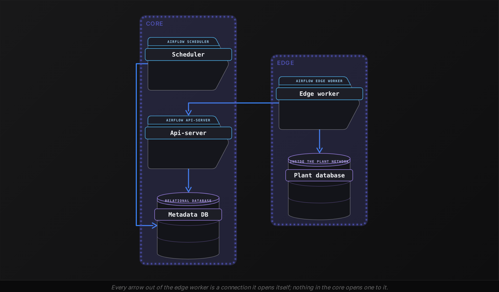
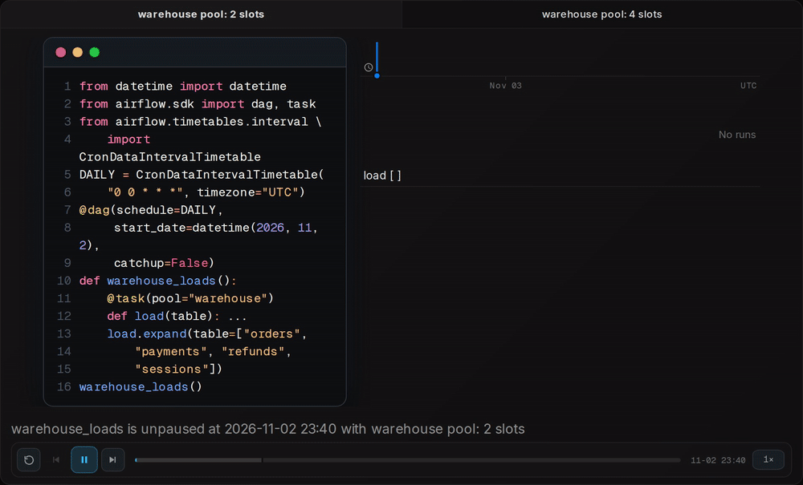
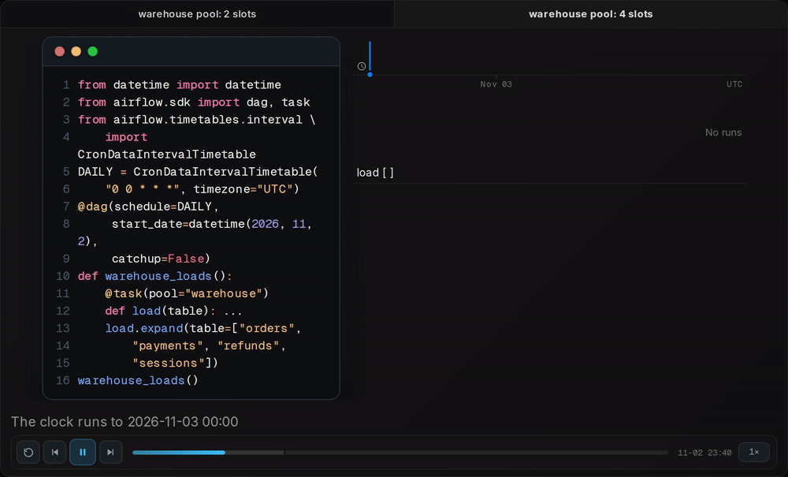

Advanced·[](https://airflow.apache.org/)·20 min · 7 challenges

# Executors and Capacity: Advanced

Airflow began at Airbnb in 2014, built by Maxime Beauchemin to run the company's data pipelines. When a scheduler there dies at 3am the night before a holiday, whether the morning's pricing dashboards load depends on a second scheduler finding the orphaned tasks, on a metadata database small enough to answer fast, and on caps sized for the night's real peak.


<br>

---

## Several Executors at Once

A deployment that runs every task on 1 executor pays that executor's price on every task. The Kubernetes executor starts a pod per task, and a pod takes 30 to 90 seconds to pull its image and reach the task's first line, while most hourly DAGs are made of tasks that submit a query and finish in 5 seconds. A Celery worker starts those in under a second, but with a concurrency of 16 it runs 16 of them side by side on 1 machine sharing its memory, and a feature build that needs 40GB can exhaust that memory and get the other 15 killed along with it. Airflow 3 lets 1 deployment list several executors and lets each task name the one it runs on.


<br>

### Listing the executors

The [core] executor setting takes a comma-separated list. The first entry is the default: every task that names no executor runs there. Each later entry is reachable by its class name, or by an alias written as alias:ClassName.

```sql
AIRFLOW__CORE__EXECUTOR: "CeleryExecutor,heavy:KubernetesExecutor"
```

With that list, every scheduler builds a Celery executor and a Kubernetes executor at startup. Both stay alive for the scheduler's whole life, and the scheduler polls each for finished tasks on every loop. The alias `heavy` is the name DAG authors use. The platform team can later put a different class behind it, or the same class with a different pod template, and no DAG changes.


<br>

### Pinning a task

```sql
from airflow.sdk import dag, task


@dag(schedule="@hourly")
def listings_refresh():
    @task
    def submit_merge():
        ...

    @task(executor="heavy")
    def rebuild_embeddings():
        ...

    submit_merge() >> rebuild_embeddings()


listings_refresh()
```

`submit_merge` names no executor, so it runs on Celery. `rebuild_embeddings` names `heavy`, so the scheduler hands it to the Kubernetes executor, which starts a pod for it. The executor's name is written on the task instance row when the task is queued, and that is how the scheduler knows which executor to ask about the task's state on every later loop. An `executor` value that matches no entry in the list raises when the file is imported, so the whole DAG goes missing from the UI with an import error naming the unknown executor, instead of 1 task failing at run time.

| Task | Executor | Why |
| --- | --- | --- |
| `submit_merge` | Celery (the default) | 5 seconds of work; a pod's startup would be 10 times the task |
| `rebuild_embeddings` | Kubernetes via `heavy` | Needs 40GB and its own image; must not share a worker |
| a `check_row_count` gate | Celery (the default) | Runs 1 query and compares 2 numbers |
| a weekly `train_ranker` | Kubernetes via `heavy` | Needs a GPU node, selected in its pod template |


<br>

### Slots and pools across executors

On each loop the scheduler asks every executor how many slots it has open and queues at most that many tasks to it. Each executor instance takes `[core] parallelism` as its own cap, so 2 executors can hold 2 times that many running tasks between them. A pool is counted once across all of them: a `warehouse` pool of 8 slots holds 8 tasks no matter which executor runs them. The executor decides where a task runs, the pool decides whether it may run yet, and the 2 answers come from different tables.

The split pays for itself when the 2 kinds of task differ by more than their runtime. A tenfold difference in memory, a dependency that only 3 tasks need and that bloats every worker image, or a security boundary that a few tasks must run inside are each enough. A difference only in runtime is not: a 2-hour Celery task costs a slot for 2 hours either way, and moving it to a pod adds a minute of startup and buys nothing.


<br>

### The scheduler must reach every executor's backend

Running 2 executors means the scheduler process carries both executors' requirements. The Celery executor needs the broker and the result backend; the Kubernetes executor needs a kubeconfig with rights to create pods in its namespace and watch them. A scheduler host that can reach the cluster but not the broker still starts and loads both executors. Then every Celery task sits queued while the Kubernetes ones run. When only half of a mixed deployment moves, the scheduler's reach is the first thing to check.

*The task-level executor argument lives on BaseOperator, so every operator, including a provider's, accepts it without doing anything.*

> What a task cannot choose
>
> - An executor outside the configured list: the scheduler loaded the list at startup and nothing else.
> - A pod template for a Celery task: `executor_config` is read only by the executor the task lands on.
> - A Celery queue for a Kubernetes task: `queue` is read by the Celery executor and ignored by the other.

> **TIP**
>
> Name aliases for what the work needs, such as gpu, isolated or heavy, and not for the executor class behind them. A DAG then says what it needs, and the platform decides how to supply it.


<br>

---

## Two Schedulers, One Database

One scheduler is both the ceiling on how fast runs get created and tasks get queued, and the single process whose crash stops the deployment. Airflow runs several `airflow scheduler` processes against 1 metadata database with no leader among them. The database's row locks decide which scheduler does which piece of work, and a scheduler that dies leaves work the survivors pick up within a few minutes.

*No setting says how many schedulers exist. The count is how many scheduler processes are alive, and you add one by starting it on another host.*


<br>

### Locks instead of a leader

Each loop starts by selecting DAG runs that need attention, up to `max_dagruns_per_loop_to_schedule` of them, with `SELECT ... FOR UPDATE SKIP LOCKED`. The `SKIP LOCKED` clause is the whole mechanism: a second scheduler issuing the same query at the same moment neither waits for the rows the first one holds nor receives them; it receives the next unlocked ones. The 2 schedulers examine different runs, move those runs' task instances to scheduled, and commit. Neither one knows the other exists, and no message passes between them.

Queuing tasks to executors needs more care, because a pool's free slot count is 1 number shared by both. That step runs as a critical section: the scheduler locks the rows of `slot_pool` with `FOR UPDATE NOWAIT`, counts the free slots, picks task instances by priority weight and hands them to its executors, up to `max_tis_per_query` at a time. If another scheduler already holds the pool rows, the lock fails at once, and this scheduler logs that it is skipping the critical section this loop and continues with the rest of its loop. At any instant at most 1 scheduler is handing out slots, which is what prevents 2 schedulers queuing the same task or both taking the last slot of a pool.

| Step | Lock | What the second scheduler does |
| --- | --- | --- |
| Create runs for DAGs that are due | `SKIP LOCKED` on `dag` rows, up to `max_dagruns_to_create_per_loop` | Creates runs for the DAGs the first one skipped |
| Pick runs to examine | `FOR UPDATE SKIP LOCKED` on `dag_run` | Takes the next unlocked runs |
| Move task instances to scheduled | Row locks on the task instances of its own runs | Works its own runs' tasks |
| Queue tasks to executors | `FOR UPDATE NOWAIT` on `slot_pool` | Skips the step this loop and tries again next loop |

- **20** — runs examined per loop
- **16** — task instances per queuing query
- **30s** — heartbeat gap marking a scheduler dead
- **300s** — between orphan checks


<br>

### Each scheduler owns its executors

Every scheduler process starts its own executor instances, so 2 schedulers with a Celery executor hold 2 Celery executor objects, each tracking only the tasks it queued. `[core] parallelism` caps each one, so with `parallelism = 32` the pair can have 64 tasks running. A task is queued by exactly 1 scheduler, and that scheduler's executor is the one that hears when it finishes, through the result backend or the pod watcher. When a scheduler dies, that knowledge dies with it: the tasks it queued keep running on the workers, but nobody is listening for their results.

The `job` table is what closes the gap. Each scheduler writes a heartbeat to its row every `scheduler_heartbeat_sec` (5 seconds). Every `orphaned_tasks_check_interval` (300 seconds), each scheduler looks for task instances in queued or running whose queuing scheduler's heartbeat is older than `scheduler_health_check_threshold`, and tries to adopt them. The Celery executor adopts a task by asking the result backend for the state of the task's Celery id, which the task instance row stored as its external executor id. The Kubernetes executor adopts by listing pods labelled with the dead scheduler's job id and relabelling them with its own. A task that neither can adopt is reset, and the next loop schedules it afresh.


<br>

### Databases that support multiple schedulers

`SKIP LOCKED` and `NOWAIT` make the whole arrangement safe, so more than 1 scheduler needs a database that has them: the PostgreSQL and MySQL versions Airflow 3 supports both do, and SQLite does not. `[scheduler] use_row_level_locking` defaults to `True` and must stay there with 2 or more schedulers; turning it off is a single-scheduler shortcut that lets 2 schedulers queue the same task twice. Going from 1 scheduler to 2 close to doubles the rate at which runs and tasks move, because the 2 loops run on disjoint rows in parallel. Going from 4 to 8 often gains little, because by then every loop waits on the same database. At that size, giving the database more CPU and disk helps more than adding a scheduler would.

- airflow jobs check --job-type SchedulerJob --allow-multiple --limit 2 exits 0 only while both are heartbeating
- Each scheduler's log shows loops examining runs, with critical section skips on 1 of them at a time
- On busy mornings the count of running task instances exceeds 1 scheduler's parallelism

> **TIP**
>
> Run schedulers on separate machines. 2 schedulers on 1 host survive a crashed process but not a lost host, and the lost host is the case that wakes someone at 3am.


<br>

---

## Keeping the Metadata DB Lean

Airflow deletes nothing on its own. Runs, task instances, finished tries, rendered templates and XCom values are all rows that stay until something deletes them, and the scheduler never does. A deployment that has run for 2 years carries 2 years of rows under every query the scheduler, the api-server and the UI make.

| Table | One row per | Removed by |
| --- | --- | --- |
| `dag_run` | run, whether scheduled, manual, backfill or asset-triggered | `airflow db clean` |
| `task_instance` | task in a run | deleting its run, or `db clean` |
| `task_instance_history` | finished try before the latest one of a task instance | `db clean` |
| `rendered_task_instance_fields` | task instance, capped at `max_num_rendered_ti_fields_per_task` per task | the cap evicting the oldest, or `db clean` |
| `xcom` | value pushed | clearing the task instance, or `db clean` |
| `log` | audit event: a UI action, a CLI command, an API call that changed something | `db clean` |
| `asset_event` | asset update | `db clean` |


<br>

### Growth at 400 hourly DAGs

Take a middle-sized deployment: 400 DAGs averaging 25 tasks, all hourly. That is 10,000 task instances an hour, 240,000 a day and 87.6 million a year in `task_instance` alone. Each task keeps its newest 30 rendered-field rows under the default cap, so that table stays at 300,000 rows however long the deployment runs. XCom has no such cap: at 2 pushes per task, 175 million rows a year. Each retry adds a `task_instance_history` row, and `log` grows with every action anyone takes.


<br>

### A large database slows the loop, the UI and upgrades

The scheduler's loop queries filter `task_instance` by state and are indexed on it, so a loop reads the few thousand rows in scheduled or queued and leaves the 87 million behind them untouched. The cost lands elsewhere. The index on a 100-million-row table stops fitting in the database's memory, so the loop's indexed reads start going to disk and each loop takes longer. Once PostgreSQL's autovacuum falls behind the write rate, every query has to scan past dead rows it has not yet removed. The grid page for a DAG with 20,000 runs pages through those runs by date and waits on the same cold cache. And `airflow db migrate` on the next upgrade rewrites tables of hundreds of millions of rows, holding locks the scheduler needs for as long as that takes, which at this size is measured in hours.


<br>

### Pruning with airflow db clean

The command and its options

- airflow db clean --clean-before-timestamp "2026-08-01T00:00:00+00:00" --dry-run prints how many rows each table would lose and deletes nothing.
- --tables dag_run,task_instance,log limits the sweep. Cleaning dag_run also removes the task instances, XComs and rendered fields of the deleted runs.
- Deleted rows move into archive tables in the same database, each named after its table and the moment of the clean, such as _airflow_deleted__dag_run__20261104120000, unless --skip-archive is given.
- airflow db export-archived --output-path /backup/airflow writes the archives to CSV, and airflow db drop-archived drops them.
- The newest scheduled run of every DAG is kept whatever the cutoff, so the scheduler keeps the point it schedules forward from.

#### A dry run with a 90-day cutoff, 1 year in

| Table | Rows older than the cutoff |
| --- | --- |
| `dag_run` | 2,640,000 |
| `task_instance` | 66,000,000 |
| `task_instance_history` | 2,100,000 |
| `xcom` | 132,000,000 |
| `log` | 9,500,000 |
| `rendered_task_instance_fields` | 0 |

*The rendered-field table shows 0 because its cap keeps only each hourly task's last 30 hours, all newer than any 90-day cutoff.*

Each table is judged by its own timestamp: `dag_run` and `task_instance` by `start_date`, `xcom` by when it was pushed, `log` by its event time. Deleting through the command rather than with your own SQL matters because the tables reference each other, and the command deletes in an order the foreign keys allow, in batches that hold locks briefly. A hand-written `DELETE FROM task_instance` across 66 million rows holds a lock the scheduler needs until it finishes.

Run it on a schedule. A DAG with 1 task that calls the command weekly with a 90-day cutoff removes roughly 1.7 million task instances a week on the arithmetic above and never lets a backlog form; the same command run once after 3 years deletes around 240 million task instances and twice as many XCom rows in 1 sitting, and that is the slow migration all over again.

> Keep the growth bounded by design
>
> - Leave `max_num_rendered_ti_fields_per_task` at 30; the logs already hold what older rows would show.
> - Push references in XCom, never payloads: a 2MB value per task is 480GB a day on the arithmetic above.
> - Use a custom XCom backend for anything over a few KB, so the row holds a pointer and the store holds the bytes.
> - Schedule `db clean` weekly, and run it with `--dry-run` after any change to its cutoff or table list.


<br>

---

## Workers at the Edge

Some tasks have to run where the scheduler cannot go: a database inside a factory's network that accepts no inbound connections, a machine in another region holding a dataset that may not leave it, a GPU box on a desk. A Celery worker needs a route to the message broker and a Kubernetes executor needs a cluster; a machine behind a firewall that allows outbound HTTPS and nothing else can be neither. The edge executor, from the `apache-airflow-providers-edge3` provider, is built for that machine: the worker dials out over HTTP to the api-server, and every other part stays home.




<br>

### Starting a worker

On the core side, [core] executor has to list EdgeExecutor and [edge] api_enabled has to be True. The endpoint goes in [edge] api_url, such as https://airflow.example.internal/edge_worker/v1/rpcapi. The far machine needs Airflow and the provider installed. There, airflow edge worker --queues plant_a --concurrency 4 starts a worker that registers with the api-server and begins polling for jobs, and it shows up on the Edge Worker page with its hostname and queues.

Queues are how the scheduler aims a task at a machine. A task sets `queue="plant_a"`, and only a worker started with that queue in its list takes it; a task that sets no queue goes to the `default` queue. One worker can serve several queues, and several workers can serve 1, which is how a plant with 2 machines shares its load.


<br>

### DAG files at the edge, calls through the api-server

| Message | Direction and timing | Carries |
| --- | --- | --- |
| Job poll | worker to api-server, every `job_poll_interval` (5 seconds) | The worker's hostname, its queues and its free slots |
| Job | api-server to worker, in the poll's reply | The DAG id, task id, run id, try number and the command to run |
| Heartbeat | worker to api-server, every `heartbeat_interval` (30 seconds) | The worker's state and the states of the jobs it holds |
| Secrets, XCom, run context | worker to api-server, whenever the task asks | The Task SDK's calls to the execution API, answered from the database |
| Log chunks | worker to api-server, as the task writes | Log lines in pieces of `push_log_chunk_size` (512KB) |
| Final state | worker to api-server, once | Success or failure and the try's end time |

The DAG file does not travel. The worker parses the file itself to build the task it runs, so DAG files must be deployed to the edge machine the same way they reach a Celery worker, and a file present in the core but missing at the edge fails there with an import error. The database connection does not travel either: in Airflow 3 no task talks to the metadata database, and the edge worker holds no credentials for it. A connection named in a hook is fetched through the execution API when the hook asks, in the same resolution order as on any other worker.

Every edge task depends on the api-server: a task that fetches 3 connections and pushes 1 XCom makes at least 4 round trips through it, and a worker in a region 150ms away waits 600ms on them. Log lines reach the UI in bursts, since each chunk travels when it fills or the push interval passes. And the worker hears about the core only through its own polls, so a worker that loses its route keeps running the task it holds and finishes it. The scheduler meanwhile sees the task's heartbeat go silent and, after `task_instance_heartbeat_timeout`, treats it as dead, exactly as it would a task killed without a log: the try is failed, or sent to up_for_retry if retries remain, and when the route returns the api-server refuses the worker's late report because that try is no longer running.

For each worker, the Edge Worker page shows its queues and free slots, when its last heartbeat arrived, and its state, which is starting, idle, running, offline or in maintenance mode. A worker whose heartbeats stop arriving moves to offline, and the tasks on its queue wait as queued, which is the same waiting state as a Celery queue nobody listens to.

Edge jobs also outlive the scheduler that queued them. The edge executor keeps each job's state in the `edge_job` table of the metadata database, which the api-server updates from the workers' polls and heartbeats, so nothing about a running edge job lives only in 1 scheduler's memory. When a scheduler dies, a survivor's orphan check, on the same `scheduler_health_check_threshold` and `orphaned_tasks_check_interval` as for Celery, adopts every edge task it finds, because its own edge executor reads the same table. The worker mid-run never notices the change.


<br>

### An edge worker is for a machine the core cannot reach

An edge worker makes sense for a machine the core cannot reach and that has a reason to run tasks, such as data that may not leave it or hardware only it has. It makes less sense as a general worker fleet: a Celery worker takes a task through the broker in milliseconds, while an edge worker learns of its task on its next poll, up to 5 seconds later, and pays an HTTP round trip for every connection and XCom. For 2,000 small tasks an hour, that latency is a cost; for 12 exports a night inside a plant, it is nothing.

> Maintenance without surprises
>
> A worker can be put into maintenance mode from the Edge Worker page: it finishes the jobs it holds and polls for no new ones, so the machine can be patched with nothing half-done. The scheduler keeps queuing to its queue meanwhile, and those tasks wait as queued until a worker on that queue returns.


<br>

---

## Sizing an Airflow Platform

Every number in a capacity setting is a guess until it comes from the workload. Each setting from the earlier tiers caps something: `parallelism`, `max_active_tasks_per_dag` and `max_active_runs_per_dag` do, and so do worker concurrency and pool slots. A cap set too low leaves tasks queued for hours, while a cap set too high lets a burst take down the system behind it. Sizing starts with 3 measurements and ends with every cap tied to 1 of them.


<br>

### Measure before you set

The first measurement is peak concurrency: the most tasks that were running in the same minute. The metadata database holds `start_date` and `end_date` for every task instance, and a warehouse copy of that table answers the question for the last 30 days in 1 query: expand each task instance into the minutes it covered, then count per minute.

```sql
SELECT
  minute_at,
  COUNT(*) AS running_tasks
FROM task_instance
CROSS JOIN UNNEST(SEQUENCE(
  DATE_TRUNC('minute', start_date),
  DATE_TRUNC('minute', end_date),
  INTERVAL '1' MINUTE
)) AS t(minute_at)
WHERE start_date >= CURRENT_TIMESTAMP - INTERVAL '30' DAY
  AND state IN ('success', 'failed', 'up_for_retry')
GROUP BY minute_at
ORDER BY running_tasks DESC
LIMIT 1
```

The top row is the minute the platform had to hold the most work; say it reads 212 for tasks on the Celery side and 23 for tasks on the Kubernetes side, found by adding the task instance's executor column to the grouping. The second measurement is queue wait, `start_date` minus `queued_dttm`, which shows whether the current caps bind and which tasks pay for it. The third is the widest run: the most tasks any single run had running at once, from the same query grouped by `dag_id` and `run_id`, because that is what `max_active_tasks_per_dag` caps.


<br>

### From measurement to setting

| Setting | Sized from | For the numbers above |
| --- | --- | --- |
| Celery `worker_concurrency` times worker count | peak concurrency plus headroom | 212 times 1.3 is 276 slots: 18 workers at 16 each |
| `[core] parallelism`, per scheduler | every slot the scheduler's executors could fill | 300, so either scheduler alone can drive the whole fleet |
| `max_active_tasks_per_dag` | the widest run, raised on that DAG rather than globally | widest run is 48: keep 16 globally, set 64 on that DAG |
| Pool slots | the limit of the system behind the pool, minus what others need | warehouse allows 40 queries: pool of 32, 8 left for analysts |
| `max_active_runs_per_dag` | how many windows may overlap without breaking the output | 1 for DAGs whose runs must go in order, higher for the rest |

Headroom is 30 percent because next quarter's DAGs are absent from last month's data, and because a backfill arrives whenever someone needs one. Workers are the cheap side of that trade: an 18-worker fleet at 60 percent busy is normal, while a 14-worker fleet at 100 percent is a queue that grows all night.

Database connections are sized from processes rather than tasks. In Airflow 3 no task opens a database connection; a task reaches the database through the api-server. The connection count is therefore `sql_alchemy_pool_size` plus `sql_alchemy_max_overflow`, 15 each at the defaults, summed over every scheduler process and every dag-processor, triggerer and api-server process. The api-server count grows with the fleet, since every worker's secret lookups, XCom pushes and heartbeats pass through it.

Schedulers are sized from the loop. Each scheduler logs how long its loop took, and a loop that grows past a few seconds while due runs wait to be created is the signal to add a scheduler on another host. A loop that stays short while tasks sit queued points at executor slots or pools instead, and the queued task's own reasons name which.


<br>

### Watching a pool bind

The smallest case shows the shape every undersized cap produces. A DAG runs 4 independent loads of 10 minutes each in a `warehouse` pool. With 2 slots the run takes 20 minutes and 2 of the tasks spend 10 minutes queued; with 4 slots it takes 10. Scrub the clock and pause on a queued cell to read the pool as its reason.

**warehouse pool: 2 slots**



**warehouse pool: 4 slots**



The Kubernetes executor is sized differently, because it has no worker fleet: each task is a pod, and the cap is the cluster's spare capacity, with `[kubernetes_executor] worker_pods_creation_batch_size` setting how many pods 1 loop may launch. A burst of 200 heavy tasks against a cluster with room for 40 pods leaves 160 pods pending and 160 tasks queued, in whatever order the cluster admits them. A pool of 40 on every task pinned to that executor turns that into a queue Airflow orders by priority weight and shows on the pool page.

| ✓ Do | ✗ Don't |
| --- | --- |
| • Size from the last 30 days of task instance rows, and re-run the query each quarter.<br><br>• Set parallelism per scheduler high enough that 1 surviving scheduler can fill the fleet.<br><br>• Size a pool from the system behind it and leave slots for people who use it by hand.<br><br>• Raise max_active_tasks_per_dag on the 1 DAG that needs it, with a comment saying why. | • Copy the defaults of 32 and 16 into production and wait for the first slow morning.<br><br>• Size workers to the average; peaks and backfills are the loads that matter.<br><br>• Raise a cap before reading the queued task's reason; the wrong cap changes nothing.<br><br>• Let a pool grow with the task count; it tracks the limit of the thing it protects. |


<br>

---

## Putting It All Together

A ride-hailing company's marketplace team runs its pricing features on Airflow: 1,800 DAGs of query-submitting tasks, 40 memory-heavy feature builds a night, and 6 city offices that each hold a regulator-mandated local copy of trip data that may not leave the city. They rebuild the platform with Celery as the default executor and a heavy alias on Kubernetes, 2 schedulers on separate hosts, 1 edge worker in each city office, a weekly db clean DAG, and every cap set from a 30-day query over task instance history.

- The heavy alias is counted against each scheduler's own parallelism, so the cap is set per scheduler and high enough that 1 survivor can drive the whole fleet on its own.
- The city edge workers read every secret and push every XCom through the api-server, so the api-server count grows with the number of offices, and the XCom rows their tasks push are among the rows the weekly clean prunes.
- The 30-day sizing query runs only while the task instance rows of the last 30 days still exist, so the db clean cutoff is set at 90 days, behind the sizing window.
- When 1 scheduler dies, the edge tasks it queued keep running in the city offices, and because their state sits in the edge_job table the survivor adopts them all, once scheduler_health_check_threshold has marked the dead scheduler and the next orphaned_tasks_check_interval comes round.


<br>

---

## Key Takeaways

- [ core ] executor is a list: the first entry is the default, later ones are reached by class name or alias, and every scheduler runs all of them with its own parallelism cap on each.
- Schedulers coordinate through row locks alone: SKIP LOCKED divides runs between them, NOWAIT on pool rows makes queuing exclusive, and heartbeats in the job table drive the adoption of a dead scheduler's tasks.
- The metadata database only grows; a weekly airflow db clean with a cutoff behind the longest run, dry-run first, is what keeps it lean, and references instead of payloads in XCom keep it from growing fast.
- An edge worker opens every connection itself. It polls for jobs through the api-server, and fetching secrets, pushing logs and reporting state go the same way, each call costing a round trip. The DAG files have to be on the worker's own disk.
- Caps come from measurements: peak concurrent tasks sets worker slots and parallelism, the widest run sets the per-DAG limit, and the system behind a pool sets its slots.

[](https://airflow.apache.org/)

Official Apache Airflow resourcesversion 3.3

"Platform created by the community to programmatically author, schedule and monitor workflows." [airflow.apache.org](https://airflow.apache.org/)

[Documentation](https://airflow.apache.org/docs/)[Install](https://airflow.apache.org/docs/apache-airflow/stable/installation/index.html)[Community](https://airflow.apache.org/community/)

Apache Airflow, Apache, Airflow, the Airflow logo, and the Apache logo are either registered trademarks or trademarks of The Apache Software Foundation.
