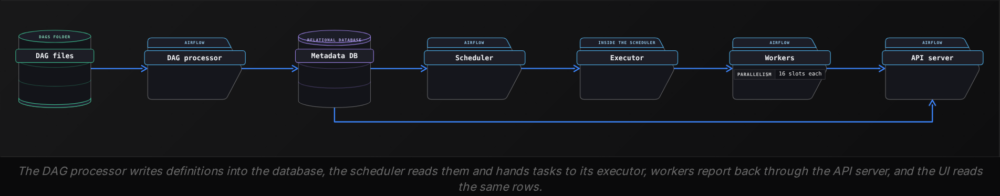
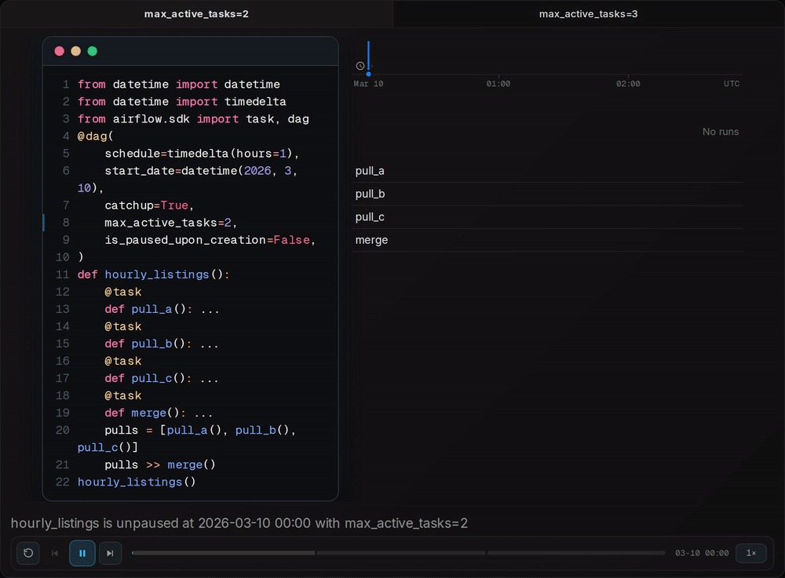
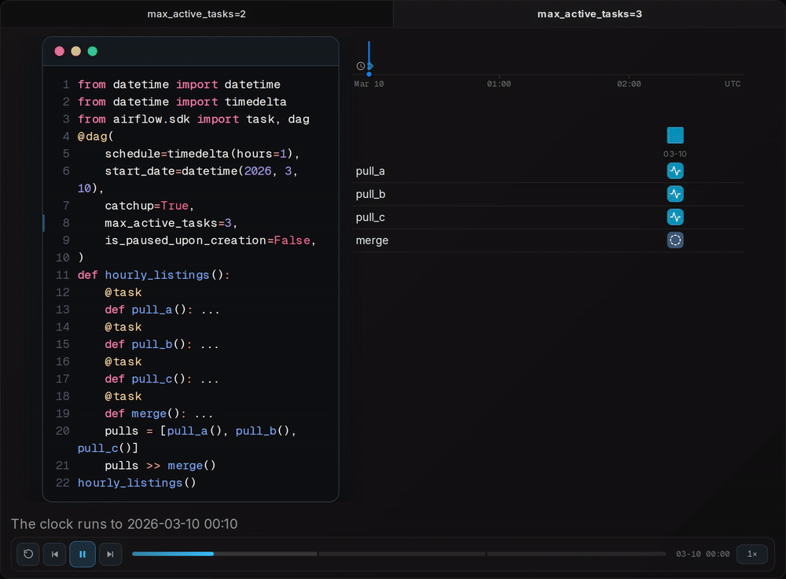
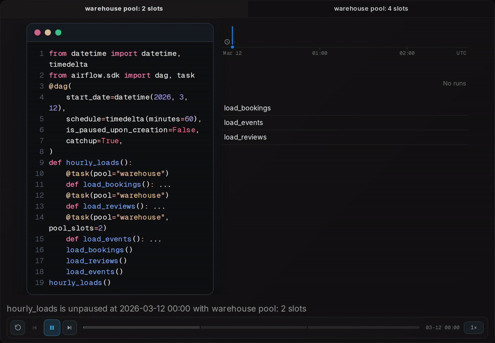
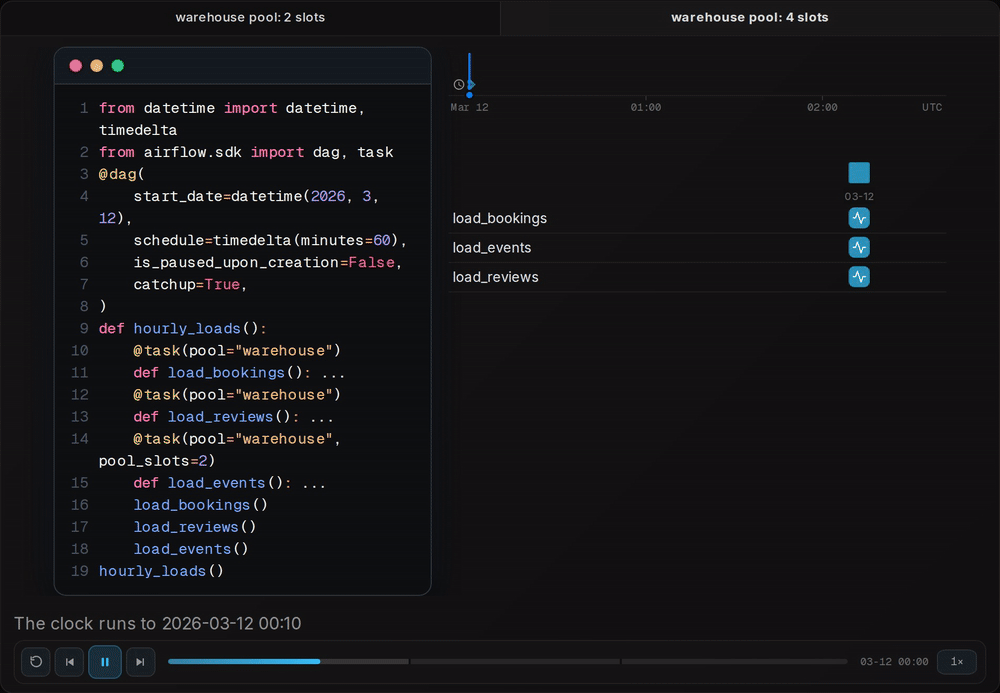

Beginner·[](https://airflow.apache.org/)·20 min · 8 challenges

# Executors and Capacity: Beginner

Suppose it is 06:00 on a Monday at Airbnb, the company where Airflow was written. 40 listing DAGs want their hourly run at once, every one loads into a warehouse that accepts 4 connections, and a sensor has waited on a partner feed since midnight. Which tasks start, which sit in `queued`, which wait in `scheduled`, and which process makes that call?


<br>

---

## Scheduler, Workers, Database

An Airflow deployment has to decide what should run next and then run it, and afterward it has to remember what happened. Each of those 3 jobs belongs to a different process, and the processes share exactly one thing, the metadata database. A task gets from `scheduled` to `success` by passing through every process in turn, and each handoff is a row changing in that database.



Here is the cast with the command that starts each part. The last column is the test that tells them apart: what stops happening when that one process dies while the rest stay up.

| Part | Started by | What it decides or does | If it dies |
| --- | --- | --- | --- |
| Scheduler | `airflow scheduler` | Creates a run when a window closes, picks tasks whose upstreams are done, offers them to the executor | Nothing new starts; running tasks still finish |
| DAG processor | `airflow dag-processor` | Reads every file in the dags folder and writes each DAG's definition to the database | Edits to DAG files never appear; old definitions keep running |
| Executor | lives inside the scheduler process | Takes each offered task and places it on a worker, local or remote | Dies with the scheduler |
| Workers | `airflow celery worker`, or subprocesses of the scheduler | Run one task instance per slot, write its log, report its end state | Tasks pile up in `queued` |
| Metadata database | `airflow db migrate` prepares it | Holds every run, task instance, state, XCom, pool, Variable and Connection | Every other part stops |
| API server | `airflow api-server` | Serves the UI, the REST API, and the channel workers report through | The UI goes dark and workers cannot report results |


<br>

### One task's trip through the parts

Follow `load_bookings` from a DAG written the way you already know. The DAG processor parsed its file minutes ago and wrote the definition to the database. At 01:00 the scheduler's loop reads the run rows, sees that the window from 00:00 to 01:00 has closed, and inserts a run. On a later loop it reads that run's task instances, finds `load_bookings` with every upstream in `success`, and sets its state to `scheduled`. It offers the task to the executor; once the executor accepts it, the row becomes `queued`. A worker with a free slot takes the task, the row becomes `running`, and the worker's process executes the operator and writes the log. When the function returns, the worker reports `success` through the API server and the row changes one last time. The green cell you see in the grid is the UI reading that row.

- The scheduler keeps nothing between loops: each decision is a row before the next loop begins.
- A worker knows only the task it is running now and the log it is writing.
- The database keeps every run, every try and every state change, which is why the grid can show last month.
- The DAG processor keeps the last parse of each file and rewrites the definition when a file changes.

> **TIP**
>
> Restarting the scheduler halfway through the night loses no runs: its decisions are rows, and the next loop reads the rows and carries on. Restarting the database is the one restart that halts everything.


<br>

### The same parts on a laptop

On a laptop, `airflow standalone` starts the scheduler and the DAG processor from a single terminal, along with the API server and a file-based database, and the workers are subprocesses of the scheduler. On a team's deployment the same parts run on separate machines, the database is a shared server, and the workers are 3 or 30 boxes. The picture stays the same; only the distance between the boxes changes, and with it the time a handoff takes.

Where to look when something stops

- queued for an hour on every DAG at once: a worker problem; check the worker processes and their free slots.
- A file edited an hour ago still runs the old code: a DAG processor problem, or a syntax error the processor is logging.
- No run appeared when a window closed: a scheduler problem, or a DAG that is paused.
- The UI will not load but runs keep finishing: an API server problem, and the workers will stall next.


<br>

---

## Where Executors Run Tasks

The executor is the part of the scheduler that answers one question: when a task has passed every check, on which machine does it run? Airflow ships several, you pick one with `executor` under `[core]` in `airflow.cfg` or the variable `AIRFLOW__CORE__EXECUTOR`, and the choice decides what the `queued` state means in your deployment.

| Executor | Where a task runs | What queued means | Capacity knob |
| --- | --- | --- | --- |
| `LocalExecutor` | A subprocess on the scheduler's own machine | A subprocess is about to start, usually within the same second | `parallelism` |
| `CeleryExecutor` | One of a fleet of worker machines, whichever pulls the message first | A message sits on the message queue until a worker with a free slot takes it | `worker_concurrency` on each worker |
| `KubernetesExecutor` | A container created for this one task and removed after it | The container has been requested and is starting | The cluster's capacity, covered in a later lesson |


<br>

### What a slot is

A slot is room for one task to run at once. Under `LocalExecutor` a slot is one of the subprocesses the scheduler is allowed to fork. Under `CeleryExecutor` a slot is one of the `worker_concurrency` processes inside one worker. A task holds its slot from the moment a worker starts it until the operator returns, however long that takes, and a task that sleeps for 3 hours holds its slot for 3 hours. The fleet's slots, summed across workers, cap how many tasks can run at once, whatever the other limits allow.


<br>

### A queued task under CeleryExecutor

Take a scheduler and 3 worker machines, each started with `airflow celery worker`. Every worker runs `worker_concurrency` slots, so 3 workers at the default can run 48 tasks at once. The scheduler moves a task to `queued` by publishing a message to the message queue that sits between it and the workers. Each worker with a free slot pulls the next message and starts the task, at which point the row becomes `running`. When all 48 slots are busy, message number 49 waits on the queue, and in the grid its cell keeps the queued label until a slot opens. The task is healthy; it is waiting for a worker, and the fix is a free slot.

- **16** — default worker_concurrency
- **32** — default parallelism


<br>

### Routing with queues

A Celery worker listens to named queues. Start one with `airflow celery worker --queues heavy` and it pulls only messages published to `heavy`; a worker started without the flag listens to `default`, which is where every task goes unless its definition says otherwise. A task picks its queue with the `queue` argument, which every operator accepts.

```sql
from airflow.sdk import task


@task(queue="heavy")
def train_model():
    ...
```

This is how a fleet mixes small and large machines: 2 workers with 64 GB of memory listen on `heavy`, 5 small ones on `default`, and `train_model` lands only on the large pair. A queue that no worker listens to strands its tasks. A task routed to `gpu` when no worker was started with `--queues gpu` sits in `queued` for as long as the deployment runs, because the scheduler has done its part and the message has nowhere to go.

| Task | queue | Workers that can take it |
| --- | --- | --- |
| `pull_listings` | `default` | worker-1 to worker-5 |
| `train_model` | `heavy` | worker-6, worker-7 |
| `score_images` | `gpu` | none started: stays in `queued` |

| ✓ LocalExecutor | ✗ CeleryExecutor |
| --- | --- |
| • Tasks run as subprocesses on the scheduler's machine<br><br>• Capacity is that machine's cores and memory<br><br>• No message queue to install or watch<br><br>• One box to restart, right for a laptop or a small team | • Tasks run on a fleet of worker machines<br><br>• Capacity grows by starting another worker<br><br>• A message queue sits between scheduler and workers<br><br>• Named queues send big tasks to big machines |

Choose by where the work has to happen. Under `LocalExecutor` with `parallelism` set to 8, one 8-core box runs 10 DAGs of small Python tasks well. Once tasks need more memory than one machine has, or you want to add capacity without touching the scheduler, `CeleryExecutor` lets you start another worker and the scheduler never notices the difference.


<br>

---

## Concurrency Limits

Several numbers cap how much runs at once, and each counts a different thing. A ready task must clear every one of them, so the limit that stops it is the smallest one at that moment. Knowing that one by name tells you which knob to turn, and the state the waiting task shows tells you where to look for it.

| Limit | Where it is set | What it counts | Default |
| --- | --- | --- | --- |
| `parallelism` | `[core]` in `airflow.cfg` | Task instances running across the whole deployment | 32 |
| `max_active_tasks` | `@dag` argument; default from `[core] max_active_tasks_per_dag` | Tasks of one DAG, counted across all of its runs | 16 |
| `max_active_runs` | `@dag` argument; default from `[core] max_active_runs_per_dag` | Runs of one DAG in the running state at once | 16 |
| `max_active_tis_per_dag` | `@task` argument | Instances of one task across runs, for a task that must not overlap itself | no limit |
| `worker_concurrency` | `[celery]` in `airflow.cfg` | Tasks one Celery worker executes at once | 16 |
| Pool slots | The pool, created in the UI or the CLI | Tasks holding a pool at once, across every DAG that names it | 128 in `default_pool` |


<br>

### Scheduled or queued: which side is waiting

The scheduler checks 3 of these before it offers a task to the executor: the DAG's `max_active_tasks`, the task's pool, and `parallelism`. A task blocked by any of them stays in `scheduled`. Worker slots are checked by the worker itself, so a task blocked there has already reached `queued`. The state therefore names the side that is waiting: `scheduled` means the scheduler is holding the task back by a limit it can see, and `queued` means every scheduler-side limit passed and no worker has a free slot. `max_active_runs` works one level up: when more windows have closed than it allows, the extra runs are created but held back from running until one of the active runs finishes.


<br>

### Which limit binds

Walk 4 mornings on a deployment with CeleryExecutor. In each, count the ready tasks, compare that count with every cap, and the smallest cap below the count is the binding one.

| Morning | Ready tasks | DAG cap | parallelism | Worker slots | Binding limit | Running / scheduled / queued |
| --- | --- | --- | --- | --- | --- | --- |
| 1 | 3, all in one DAG | 2 | 32 | 32 | DAG cap | 2 / 1 / 0 |
| 2 | 48 across 12 DAGs, 4 each | 16 | 32 | 32 | `parallelism` | 32 / 16 / 0 |
| 3 | 48 across 12 DAGs | 16 | 64 | 32, from 2 workers | worker slots | 32 / 0 / 16 |
| 4 | 48 across 12 DAGs | 16 | 64 | 64, from 4 workers | none | 48 / 0 / 0 |

Mornings 2 and 3 want the same 48 tasks and both run 32, yet the 16 that wait sit in different states. Raising `parallelism` for morning 3 moved the bottleneck from the scheduler to the workers without running one more task; only morning 4, which added workers, finished sooner. Reading the state of the waiting tasks before changing anything saves a restart that changes nothing.

**max_active_tasks=2**



**max_active_tasks=3**



Play the night. At 01:00 the run appears. `pull_a` and `pull_b` move through `queued` into `running` while `pull_c` stops at `scheduled`; pause on its cell and Airflow's reason names the DAG's limit. At 01:10 the first 2 finish and `pull_c` takes its turn, so `merge` starts 10 minutes later than it would with 3 slots. Switch the variant and the 3 pulls start together.

The run-level cap matters most when a DAG falls behind. With `catchup=True` and 6 closed windows, a DAG with `max_active_runs=1` creates all 6 runs and lets exactly one proceed, so the backlog drains in order, one window after the next. At the default of 16, all 6 start together and 6 copies of every task compete for the same pool and the same workers.

> Read the state before turning a knob
>
> - `scheduled`, and the DAG already has `max_active_tasks` tasks running: the DAG cap binds; raise it or let siblings finish.
> - `scheduled`, and the task's pool shows 0 open: the pool binds; resize it or move a task out.
> - `scheduled`, and the deployment has `parallelism` tasks running: raise `parallelism`, then check the workers can take more.
> - `queued`, and every worker slot is busy: add a worker or raise `worker_concurrency`.
> - `queued`, and slots sit idle: the task's queue has no listener, or the workers are down.

| ✓ Do | ✗ Don't |
| --- | --- |
| • Set max_active_tasks on a DAG whose tasks all hit one external system<br><br>• Set max_active_runs=1 on a DAG whose runs must never overlap<br><br>• Raise parallelism and worker slots together, and measure after each<br><br>• Check which limit binds from the waiting tasks' state and reasons | • Raise parallelism alone and expect more tasks to run<br><br>• Clear a queued task to hurry it; it is waiting for a slot<br><br>• Leave max_active_runs at 16 on a catchup DAG with a slow source<br><br>• Guess the binding limit from the DAG file alone |


<br>

---

## Pools and Slots

A pool is a named count of slots that tasks borrow while they run. It stands in for a resource outside Airflow: a warehouse that allows 4 concurrent connections, a partner API that accepts 2 calls at a time, a machine with 1 GPU. Every task borrows 1 slot from `default_pool`, which has 128 of them, unless its definition names another pool, so a deployment that never created a pool is still using one.

Create a pool from the command line with airflow pools set warehouse 4 "connections into the warehouse", or on the Pools page under Admin in the UI. The number is the one the external system tolerates, and it comes from that system's documentation or the person who runs it, never from Airflow's own defaults.

```sql
from datetime import datetime

from airflow.sdk import dag, task


@dag(start_date=datetime(2026, 3, 12), schedule="@hourly")
def reviews_sync():
    @task(pool="warehouse")
    def load_reviews():
        ...

    @task(pool="warehouse", pool_slots=2)
    def rebuild_review_stats():
        ...

    load_reviews() >> rebuild_review_stats()


reviews_sync()
```

`pool` names the pool and `pool_slots` says how many of its slots the task needs, 1 unless you say otherwise. `rebuild_review_stats` opens 2 connections, so it borrows 2, and it starts only when 2 slots are free at the same moment. A task borrows its slots when the scheduler moves it to `queued`, holds them through `running`, and returns them on any end state. While it sits in `up_for_retry` waiting out its retry delay, it holds nothing.


<br>

### One pool, 3 DAGs

The pool is shared across every DAG that names it, which is the whole point: 3 DAGs with no knowledge of each other cannot open more than 4 connections between them. Watch the `warehouse` pool through one hour. `listings` has 3 loads of 1 slot each, `reviews` has the 2 tasks above, and `pricing` has `pull_prices`, a 5-minute task in `default_pool`, followed by `refresh_prices`, which needs 2 warehouse slots. Every other task runs 10 minutes.

| Time | What happens | warehouse slots held | Waiting in scheduled |
| --- | --- | --- | --- |
| 01:00 | `load_a`, `load_b`, `load_c` and `load_reviews` each take 1 slot; `pull_prices` runs in `default_pool` | 4 of 4 | none |
| 01:05 | `pull_prices` finishes; `refresh_prices` needs 2 slots and 0 are open | 4 of 4 | `refresh_prices` |
| 01:10 | The 4 loads finish; `refresh_prices` and `rebuild_review_stats` take 2 each | 4 of 4 | none |
| 01:20 | Both finish | 0 of 4 | none |

At 01:05 the pool blocks `refresh_prices`, which shows `scheduled`; its details page names the pool as the reason. Nothing in the `pricing` DAG mentions `listings`, yet the listings loads decided when prices refreshed. That coupling is the reason to have the pool: the warehouse sees 4 connections, never 5, whichever DAG is asking.

**warehouse pool: 2 slots**



**warehouse pool: 4 slots**



Step through the hour from 01:00. `load_bookings` and `load_reviews` take both `warehouse` slots the moment the first run is created, and `load_events`, which asks for 2, waits in `scheduled` with the pool given as its reason. After 10 minutes the single-slot loads succeed, the pair of slots is free at once, and `load_events` starts. The 4-slot variant starts all 3 together.


<br>

### Slots are counted, never tasks

A pool of 4 can hold 4 single-slot tasks, 2 double-slot tasks, or 1 task of 3 beside 1 of 1. The scheduler walks the ready tasks and gives each one its slots if enough are open; a task asking for more than the open count is passed over, and smaller tasks behind it may be seated first. That is why a wide task like `load_events`, which asks for 2, can wait while single-slot neighbours keep arriving and leaving. If that task must not be starved, give it a pool of its own.

> The Pools page, read left to right
>
> - Open: slots nobody holds right now; 0 here with tasks waiting means the pool binds.
> - Running: slots held by tasks in `running`.
> - Queued: slots held by tasks the executor has accepted but no worker has started.
> - Scheduled: slots that waiting tasks are asking for and have not yet received.

> **TIP**
>
> A wrongly sized pool fails one of 2 ways. Too large, and the warehouse refuses connections and tasks fail. Too small, and tasks wait in scheduled while connections sit free. Size it to the external limit, then watch the open count during the busiest hour.

| ✓ Do | ✗ Don't |
| --- | --- |
| • Create one pool per external system with a connection or rate limit<br><br>• Name the pool on every task that touches that system, in every DAG<br><br>• Set pool_slots to the number of connections a task really opens<br><br>• Describe the limit's origin in the pool's description | • Use a pool as a general speed limit; use max_active_tasks for that<br><br>• Let default_pool stand in for a warehouse that allows 4 connections<br><br>• Put a sensor in the same pool as the loads it waits for<br><br>• Resize a pool without asking what the external system allows |


<br>

---

## Sensors in Poke Mode

A sensor is an operator whose whole job is to wait. Its check is called a poke. If the poke returns `False`, the sensor sleeps for `poke_interval` seconds and pokes again, until the check returns `True` and the task succeeds, or `timeout` seconds pass and it fails. In the default mode, `poke`, all of that happens inside one running task: the worker process stays alive and loops between sleeps, and the task instance shows `running` the entire time.

```sql
from datetime import datetime

from airflow.sdk import dag, task


@dag(schedule="@daily", start_date=datetime(2026, 3, 10))
def partner_feed():
    @task.sensor(poke_interval=300, timeout=6 * 3600, mode="poke")
    def feed_landed() -> bool:
        return partner_file_exists()

    @task
    def load_feed():
        ...

    feed_landed() >> load_feed()


partner_feed()
```

`@task.sensor` turns a function that returns a boolean into a sensor, and `partner_file_exists` is a helper of your own that asks the landing bucket whether the day's file is there. `feed_landed` pokes every 5 minutes for up to 6 hours. If the partner's file lands at 03:12, the sensor succeeds on its next poke, which returns `True`, and then `load_feed` runs. For those 3 hours the sensor held 1 slot of the worker it ran on, 1 slot of `default_pool`, and 1 of the DAG's `max_active_tasks`, all for a check that takes 1 second.


<br>

### What it blocks meanwhile

Take one worker with 4 slots and 4 partner DAGs that each begin with a poke-mode sensor at 00:05. The files they wait for are written by `export_feeds`, a task in a fifth DAG that becomes ready at 00:10.

| Time | Worker slots, 4 in all | export_feeds | What each sensor sees |
| --- | --- | --- | --- |
| 00:05 | 4 sensors, 1 slot each | not ready yet | file missing, poke returns `False` |
| 00:10 | 4 sensors | `queued`, no slot free | `False` |
| 03:00 | 4 sensors | `queued` | `False` |
| 06:05 | sensors reach timeout and fail, slots free | `running` at last | downstream tasks already `upstream_failed` |

No task failed. The sensors waited for a file that the task they displaced was going to write, and the worker spent 6 hours running 4 sleep loops. This is the shape of most sensor outages: enough waiting sensors to fill the slots the producer needed. The grid shows 4 long green-edged running cells and 1 grey queued one, and the queued one is the only task that mattered.

`timeout` is the sensor's own deadline, counted from its first poke. Leave it at the default and a sensor can keep its seat for a week before Airflow calls it failed; set it shorter than the gap to the next run and a late feed turns into a red cell you notice in the morning, and into a slot that comes back.


<br>

### Freeing the slot between pokes

`mode="reschedule"` changes what happens between pokes. When the check returns `False`, the task exits and gives back its worker and pool slots. Its row goes to `up_for_reschedule`. After `poke_interval` the scheduler schedules it again, it reaches `queued`, a worker runs one poke, and the loop repeats. The seat is held only for the seconds a poke takes. The price is that every poke travels through `scheduled` and `queued` again, so a reschedule sensor with a 10-second interval would spend more time in handoffs than in checks; reserve it for pokes minutes apart, which is most feeds.

| ✓ mode="poke" | ✗ mode="reschedule" |
| --- | --- |
| • One running task for the whole wait<br><br>• Keeps its worker slot, and its pool and DAG slots, until the wait ends<br><br>• Each poke costs a sleep and nothing else<br><br>• Right for waits of seconds to a few minutes | • A fresh short task per poke<br><br>• Holds slots only while a poke runs<br><br>• Each poke costs a trip through scheduled and queued<br><br>• Right for waits of many minutes to hours |

- **60** — default poke_interval, in seconds
- **604,800** — default sensor timeout, in seconds

> **TIP**
>
> Give sensors a small pool of their own, sized to how many you can afford to have asleep at once, and a timeout shorter than the next run's window. A sensor that cannot fail cannot tell you the feed is late.


<br>

---

## Putting It All Together

Picture a hypothetical Monday at Airbnb, the company where Airflow was written: 40 hourly listing DAGs close their windows at 06:00, 3 of them begin with a sensor on a partner feed that lands late, and every load goes into a warehouse that allows 4 connections, all on one scheduler with 3 Celery workers and parallelism left at its default of 32.

- The scheduler creates 40 runs at 06:00 from the rows the DAG processor wrote, and the API server shows them before a single task has started.
- The 3 workers offer 48 slots, but parallelism caps the deployment at 32, so at most 32 tasks run and the rest wait in scheduled : the scheduler is holding them, and no task sits in queued for want of a worker.
- The 4-slot warehouse pool seats 4 loads at a time across all 40 DAGs, and every other load waits in scheduled with the pool named as its reason.
- The 3 sensors in poke mode hold 3 of those 32 seats until the feed arrives; in reschedule mode they return them between pokes and 3 more ready tasks outside the warehouse pool start, while the loads still go 4 at a time.
- Raising parallelism to 48 starts 16 more tasks outside the warehouse pool and makes the workers the ceiling, but it moves no load sooner, because the 4-slot pool binds the loads first.


<br>

---

## Key Takeaways

- The scheduler decides and the executor places, then a worker runs the task. The database remembers each step, since every handoff between these processes is a row changing in it.
- A task in scheduled is held by a limit the scheduler can see; a task in queued has cleared those and waits for a worker slot.
- The binding limit is whichever of 4 numbers is smallest at that moment: max_active_tasks, pool slots, parallelism or worker slots. Raising a different one runs nothing extra.
- A pool stands for an external resource, is sized to that resource's limit, and is shared by every DAG that names it.
- A poke-mode sensor holds its worker and pool slots for its whole wait; reschedule mode holds them only while a poke runs.

[](https://airflow.apache.org/)

Official Apache Airflow resourcesversion 3.3

"Platform created by the community to programmatically author, schedule and monitor workflows." [airflow.apache.org](https://airflow.apache.org/)

[Documentation](https://airflow.apache.org/docs/)[Install](https://airflow.apache.org/docs/apache-airflow/stable/installation/index.html)[Community](https://airflow.apache.org/community/)

Apache Airflow, Apache, Airflow, the Airflow logo, and the Apache logo are either registered trademarks or trademarks of The Apache Software Foundation.
