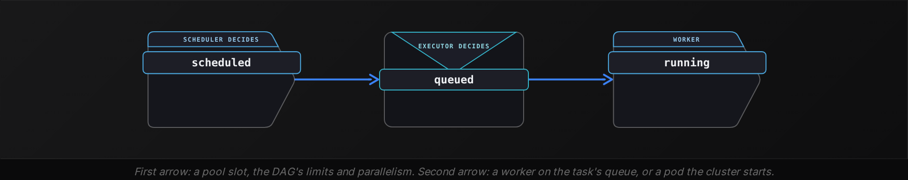
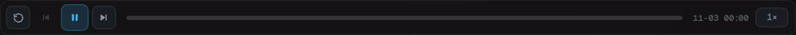
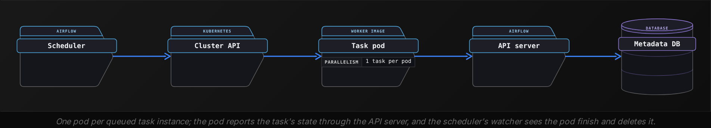

Intermediate·[](https://airflow.apache.org/)·20 min · 7 challenges

# Executors and Capacity: Intermediate

Here is a night that could happen at Airbnb, where Airflow was first written. At midnight, 300 sensors on Celery workers wait for partner payout files in poke mode, each holding a worker slot while it sleeps. The booking loads queue behind them, and the warehouse sits idle. By 03:00 no load has started, and the morning's booking numbers arrive hours late.


<br>

---

## Deferrable Tasks

A sensor in poke mode sleeps inside a worker process. For the whole wait it holds 1 worker slot and 1 pool slot, and all that slot does is count down `poke_interval`. If 20 sensors wait 2 hours for upstream partitions, they tie up 20 slots for 2 hours; on a Celery worker whose concurrency is 16, that is the whole worker and more, while every task with real work queues behind them. Reschedule mode returns the worker slot between pokes, but each poke is a full trip through `scheduled`, `queued` and `running`, so the scheduler pays seconds of overhead per poke per sensor. A deferrable task takes a third route: it leaves the worker entirely, and a separate process, the triggerer, does the waiting.

| Mode | Where the wait happens | Worker slot held | Pool slot held | Cost of each check |
| --- | --- | --- | --- | --- |
| poke | inside the worker process | for the whole wait | for the whole wait | a function call, inside a process holding 2 slots for the whole wait |
| reschedule | nowhere, the task is rescheduled between pokes | during each poke only | during each poke only | a trip through scheduled, queued and running: a few seconds of scheduler and worker time |
| deferrable | in the triggerer's event loop | before and after the wait only | no, unless the pool includes deferred | an await in the triggerer: no slot, a few KB of triggerer memory per waiting task |


<br>

### The hand-off to the triggerer

When a sensor runs with `deferrable=True`, its `execute` does 1 check and, if the condition is not yet met, calls `self.defer(trigger=..., method_name="execute_complete")`, which raises `TaskDeferred`. The worker catches it, writes the trigger's class and arguments to the metadata database, sets the task instance to `deferred` and exits, so its slot is free. The triggerer process, started with `airflow triggerer`, reads that row, builds the trigger and runs it as a coroutine in 1 asyncio event loop beside hundreds of others. A trigger spends almost all of its life awaiting a timer or a socket, which is why 1 triggerer holds up to 1000 waiting tasks by default, its `triggerer.default_capacity`. When the condition holds, the trigger yields a `TriggerEvent`. The event is recorded, the task goes back to `scheduled`, and it passes through `queued` and `running` a second time, now calling `execute_complete(context, event)` with the event's payload rather than `execute`. The task resumes on whichever worker takes it, which need not be the one that deferred it, so nothing the first half kept in memory survives; what the second half needs travels in the trigger's arguments and in the event.

```sql
from datetime import datetime
from airflow.sdk import DAG, task
from airflow.providers.standard.sensors.date_time import DateTimeSensor

with DAG(
    dag_id="morning_report",
    start_date=datetime(2026, 11, 1),
    schedule="@daily",
) as dag:
    wait_for_0600 = DateTimeSensor(
        task_id="wait_for_0600",
        target_time="{{ data_interval_end.add(hours=6) }}",
        deferrable=True,
        pool="warehouse",
    )

    @task
    def build_report():
        ...

    wait_for_0600 >> build_report()
```

In Airflow 3 a preset such as `@daily` is read by `CronTriggerTimetable`, so the run created at midnight on 2026-11-03 carries logical date 2026-11-03T00:00 and a data interval that starts and ends at that instant. Its sensor resolves `target_time` to 06:00 that morning. Here is where the task is, and what it holds, through that night:

| Clock on 2026-11-03 | State of wait_for_0600 | Where it lives | Slots held |
| --- | --- | --- | --- |
| 00:00:03 | scheduled, then queued | metadata database | pool slot |
| 00:00:09 | running: 1 check, then defer | a worker | worker slot and pool slot |
| 00:00:10 | deferred | the triggerer, as a DateTimeTrigger | none |
| 06:00:00 | scheduled, then queued | metadata database | pool slot |
| 06:00:04 | running: execute_complete | a worker, possibly a different one | worker slot and pool slot |
| 06:00:05 | success, build_report becomes scheduled | metadata database | none |


<br>

### What the pool counts

By default a deferred task occupies no pool slot, which is the point: a pool limits load on some system, and a task waiting in the triggerer loads nothing. The exception is a pool whose slots stand for something the waiting itself holds, such as a connection kept open across the wait. Such a pool is created with `include_deferred` (`airflow pools set warehouse 4 "warehouse loads" --include-deferred`), and then its deferred tasks count against its slots. Check the pool page before assuming: a deferrable sensor in an `include_deferred` pool frees the worker and still holds the pool slot, so 4 such sensors deferred in a 4 slot pool block every load behind them exactly as poke mode would.

> Prerequisites for a deferrable task
>
> - A triggerer running, started with `airflow triggerer`. With none, the task sits in `deferred` until its deferral timeout, or forever when it has none.
> - An operator that knows how to defer: `deferrable=True` on a sensor that supports it, or `operators.default_deferrable = True` to turn it on for every operator that does.
> - A worker slot twice: once to start and defer, once to resume. A pool of 1 slot still serializes the resumes of 50 sensors that all wake at 06:00.

A deferral carries a timeout when the operator passes one, and sensors pass their own `timeout` through as `self.defer(..., timeout=timedelta(hours=8))`. When the clock passes it, the triggerer fires a failure event and the task fails like any other, with `retries` honoured. The trigger row in the database is the trigger, so a triggerer restart picks every waiting trigger back up and no task is lost; what a restart costs is a few seconds while the new process reloads them.

> **TIP**
>
> A deferrable task writes 2 pieces of log for 1 try: the part before `defer` and the part after resume, often on different workers. When the second half is missing, the trigger has not fired yet, or no triggerer is running.


<br>

---

## Stuck in Queued

A task instance crosses 2 gates on its way from `scheduled` to `running`, and a different process keeps each one. The scheduler keeps the first: it moves a task to `queued` only when the pool has a free slot, the DAG is under `max_active_tasks`, the task is under `max_active_tis_per_dag`, and the deployment is under `core.parallelism`. The executor keeps the second: it moves a queued task to `running` only when something can run it, which for the Celery executor means a worker consuming the task's queue with spare concurrency, and for the Kubernetes executor a pod the cluster agrees to start. A task that never starts is held at exactly 1 of the 2 gates, and its state names which.




<br>

### Which gate holds it

The state is the first thing to read, because it halves the search. A task that stays `scheduled` while others around it move has been refused a slot by the scheduler, and the limit is one the scheduler can see: a pool, a DAG setting, or parallelism. A task that reaches `queued` and stays there has passed every scheduler check and is waiting on the executor, which the scheduler can't hurry.

| Symptom | Gate | What is full | Where to look |
| --- | --- | --- | --- |
| `scheduled` for minutes while other tasks in its pool run | scheduler | the pool's slots | the pool page: running, queued and open slots |
| `scheduled`, pool has open slots, other runs of the DAG busy | scheduler | `max_active_tasks` or `max_active_runs` on the DAG | the DAG's grid: count running tasks and active runs |
| `scheduled`, pool open, DAG under its limits, nothing anywhere moves | scheduler | `core.parallelism` | running tasks across the deployment against the setting |
| `queued` for minutes while every worker reports idle | executor | nobody consumes the task's `queue` | the worker's `-q` list against the task's `queue` |
| `queued` while workers are busy | executor | worker concurrency | running tasks per worker against its concurrency |
| `queued` on the Kubernetes executor, pod Pending | executor | cluster CPU, memory or quota | the pod's Pending reason in the cluster |


<br>

### A queue nobody listens to

The most common executor-side hold is a Celery queue with no consumer. A task declares `queue="gpu"` and the scheduler sends it there without checking that anything reads it; the message sits in the broker until a worker started with `-q gpu` picks it up. Every worker consumes `operators.default_queue`, named `default` unless configured, so a task with no `queue` set always has a taker, and a task with one set has a taker only if some worker's `-q` list names it. The symptom is a task `queued` for an hour while every worker reports nothing to do.

```sql
from datetime import datetime
from airflow.sdk import DAG, task

with DAG(
    dag_id="train_models",
    start_date=datetime(2026, 11, 1),
    schedule="@daily",
) as dag:

    @task(queue="gpu", pool="training")
    def train():
        ...

    train()
```

Under this file the scheduler puts `train` on the `gpu` queue as soon as the `training` pool has a slot. A worker started as `airflow celery worker -q default,gpu` takes it; one started as `airflow celery worker` consumes only `default`, and `train` stays `queued` while that worker idles. The pool page reports the slot as queued, which is true and tells you nothing about the cause.


<br>

### The scheduler's own timeout

The scheduler doesn't let a queued task sit forever. Every queued task is checked against `scheduler.task_queued_timeout`, 600 seconds by default. Past it, the scheduler asks the executor to drop the task and puts it back to `scheduled`, so it is queued again with both gates re-evaluated, up to `scheduler.num_stuck_in_queued_retries` times, 2 by default. After that the task is failed, and its own `retries` then decide whether it gets a new try. A task that fails with an empty log and no worker having started it was held at the executor gate. The scheduler's timeout failed it before any of its code ran, so the fix is more executor capacity, and editing the DAG will not help.

> Order of checks when a task never starts
>
> - Read the state: `scheduled` means the scheduler gate, `queued` means the executor gate.
> - For `scheduled`: the pool page first, then the DAG's `max_active_tasks` and `max_active_runs`, then `core.parallelism`.
> - For `queued`: is a worker alive, does it consume the task's queue, is its concurrency full, can the pod be placed.
> - Treat `deferred` apart: a task there with no triggerer running is held by a third process, and no pool or worker change frees it.


<br>

---

## Priority Weights

When more task instances are schedulable than there are open slots, the scheduler sorts them and hands out the slots from the top of the list. The sort key is each task instance's effective `priority_weight`, descending, then its run's logical date, ascending: the heaviest task wins, and among equal weights the oldest run wins. The sort ignores the DAG's name, the time a task has spent waiting and the order in which DAGs were triggered. A task that is already running is never displaced; priority decides who takes the next free slot and nothing more.


<br>

### The effective weight

The number the scheduler sorts on comes from 2 task arguments: `priority_weight`, 1 by default, and `weight_rule`, which decides how weights combine. Both are set per task, and `default_args` sets them for every task in a DAG at once. The effective weight is computed from the serialized DAG when the task instance is created. Under the default rule, `downstream`, a task's effective weight is its own weight plus the weights of every task downstream of it, so a task with a long chain behind it outranks a leaf, and the scheduler favours starting the work that unblocks the most. Under `upstream` the sum runs the other way, favouring tasks near the end, which finishes runs that are nearly done before new ones get going. Under `absolute` the effective weight is the parameter alone, with no summing, which also spares the scheduler a walk over the graph in a DAG with thousands of edges.

```sql
from datetime import datetime
from airflow.sdk import DAG, task

with DAG(
    dag_id="orders_etl",
    start_date=datetime(2026, 11, 1),
    schedule="@daily",
    default_args={"pool": "warehouse"},
) as dag:

    @task
    def extract():
        ...

    @task
    def clean():
        ...

    @task
    def enrich():
        ...

    @task(priority_weight=5)
    def load():
        ...

    extract() >> [clean(), enrich()] >> load()
```

The table gives what the scheduler stores for each task when every task carries the rule its column names, as 1 line in `default_args` would set it. Under `downstream`, `extract` carries 8 because the whole run sits behind it; under `upstream`, `load` carries 8 because the whole run sits before it. A sum never reaches into another DAG's tasks.

| Task | Own weight | downstream | upstream | absolute |
| --- | --- | --- | --- | --- |
| extract | 1 | 1 + 1 + 1 + 5 = 8 | 1 | 1 |
| clean | 1 | 1 + 5 = 6 | 1 + 1 = 2 | 1 |
| enrich | 1 | 1 + 5 = 6 | 1 + 1 = 2 | 1 |
| load | 5 | 5 | 5 + 1 + 1 + 1 = 8 | 5 |


<br>

### A pool of 1 slot, 3 tasks waiting



With 1 slot in `warehouse` and 3 tasks ready at the same instant, the slot goes to `load_revenue` at weight 10, then to `refresh_dim` at 5, then to `archive_logs` at 1. While `archive_logs` waits, the reason it reports is the pool: the weight set its place in the line, and the 1-slot pool is why there is a line at all.


<br>

### Across DAGs and across runs

The sort covers every schedulable task instance in the deployment, so weights compete across DAGs that share a pool. When 2 DAGs with default weights share 1 pool, they are served oldest logical date first, which means a backfill of 30 old runs queued at once takes every slot ahead of tonight's run, because every one of its dates is older. Raise tonight's weights, or give the backfill a pool of its own, and the order changes. Within a run the same sort applies: when 8 tasks are ready and 3 slots are open, the 3 largest effective weights go first, which under `downstream` means the tasks with the most work behind them. Suppose `backfill_orders` is a copy of `orders_etl` with every weight 1, 30 of its runs are waiting, and tonight's `load` is raised to 50. The pool has 2 slots:

| Task instance | Logical date | Effective weight | Place in line |
| --- | --- | --- | --- |
| orders_etl.extract, tonight | 2026-11-03 | 1 + 1 + 1 + 50 = 53 | 1st |
| backfill_orders.extract, run of 2026-10-04 | 2026-10-04 | 4 | 2nd |
| backfill_orders.extract, run of 2026-10-05 | 2026-10-05 | 4 | 3rd, waits |
| orders_etl.clean, once extract is done | 2026-11-03 | 51 | ahead of every backfill task still waiting |

A `priority_weight` set in `default_args` lifts a whole DAG at once, and `weight_rule` also accepts a `PriorityWeightStrategy` subclass, whose method computes the effective weight from the task instance itself, for cases such as weighting by `try_number` so that a retry goes ahead of first attempts.

| ✓ Do | ✗ Don't |
| --- | --- |
| • Give the task the deadline depends on a higher weight, and let downstream lift its ancestors<br><br>• Use absolute when the number in the file must be the number the scheduler sorts on<br><br>• Check the pool page: a weight changes the order only when slots are short | • Expect a weight to stop or displace a task that is already running<br><br>• Set the same weight everywhere and expect a predictable order beyond logical date<br><br>• Compare weights across pools, because each pool hands out its own slots |


<br>

---

## One Pod per Task

The Kubernetes executor runs no long-lived workers. For each task instance it moves to `queued`, the scheduler asks the cluster for a pod built from a template, with that task's run command as the container's command. The pod starts, runs its 1 task, reports the task's state to the API server, which records it in the metadata database, and is deleted. The next task gets a fresh pod. A deployment with nothing to do has 0 worker pods, and a night with 400 tasks ready at once asks the cluster for as many pods as it will grant.




<br>

### The cost of starting a pod

| Step | Who does it | Time |
| --- | --- | --- |
| The scheduler submits the pod spec | scheduler | under 1 second |
| The cluster places the pod on a node | the cluster's scheduler | 1 to 5 seconds, longer when no node has room |
| The node pulls the image | the node | 0 seconds when cached, minutes for a 2 GB image on a fresh node |
| The container starts and imports Airflow | the pod | 5 to 20 seconds |
| The task's own code runs | the pod | the task's own time |
| The pod reports its state and is deleted | the pod, then the scheduler | a few seconds |

The fixed cost is paid per task, and it is paid before the task's first line. A task whose work takes 2 seconds and whose pod takes 30 seconds to be ready spends over 90 percent of its wall time waiting for its own container. A DAG of 200 such tasks that ran in 4 minutes on a Celery worker now needs the cluster to start many pods at once to finish in anything like that time, and even then each task's gap between `queued` and `running` is tens of seconds rather than under 1. The executor fits long tasks with specific needs and fits a swarm of tiny tasks poorly; the usual answer for the swarm is to merge small tasks into fewer, larger ones, so the startup cost is paid once per batch of work rather than once per step.


<br>

### Sizing a pod for its task

Because every task gets its own pod, every task can get its own shape. `executor_config` on a task carries a `pod_override`, a pod object whose fields are merged over the template, so 1 task asks for 16 GB and a batch node while its neighbour takes the default. The image can differ per task too, which is how a task that needs a library the rest of the deployment lacks runs without that library being installed everywhere. The base template is the `pod_template_file` named in the executor's configuration, and the default image is `kubernetes_executor.worker_container_repository` with its tag. The container to override is named `base`, which is the name the template gives the one that runs the task.

```sql
from kubernetes.client import models as k8s
from airflow.sdk import task


@task(
    executor_config={
        "pod_override": k8s.V1Pod(
            spec=k8s.V1PodSpec(
                containers=[
                    k8s.V1Container(
                        name="base",
                        image="analytics/scoring-runner:3.5",
                        resources=k8s.V1ResourceRequirements(
                            requests={"cpu": "4", "memory": "16Gi"}
                        ),
                    )
                ],
                node_selector={"workload": "batch"},
            )
        )
    }
)
def score_customers():
    ...
```

| ✓ What a pod per task buys | ✗ What it costs |
| --- | --- |
| • Isolation: a task that eats 16 GB cannot starve its neighbour<br><br>• Per-task image and resources through executor_config<br><br>• No idle workers: capacity goes to 0 between runs<br><br>• A task that crashes takes down only its own pod | • Seconds to minutes of startup before any task code runs<br><br>• Cluster quota becomes one more gate holding tasks in queued<br><br>• A deleted pod's log is gone unless remote logging ships it first<br><br>• Hundreds of tiny tasks pay the startup cost hundreds of times |

The Kubernetes executor and the `KubernetesPodOperator` share a name, so they're easy to confuse. The executor decides where every task in the deployment runs. The operator is 1 task that launches a pod running whatever image you name, and it works under any executor, local and Celery included. Under the Kubernetes executor, a `KubernetesPodOperator` task is a pod that launches a second pod. The executor is a platform decision and the operator is a task-level decision, and the 2 are chosen separately.

When a pod can't be placed, the task is `queued` and the pod is `Pending`, and both wait on the cluster. This is the executor gate from the previous section, with the cluster's room as the limit, and 2 timeouts watch it. The executor's own `kubernetes_executor.worker_pods_pending_timeout`, 300 seconds by default, acts first: it deletes a pod `Pending` longer than that and fails the task, whose own `retries` then decide whether a new pod is asked for. The scheduler's `task_queued_timeout` of 600 seconds acts first only when the pending timeout is raised above it. Either way, a cluster short of room produces tasks that fail without ever having run a line.

> **TIP**
>
> Measure the startup cost on your own cluster before moving a DAG: time a task whose work is a single print, from `queued` to `success`. That number, times the tasks in the DAG, divided by the pods the cluster starts at once, is the overhead the move adds.


<br>

---

## Waiting on Another DAG

A task in 1 DAG can wait for a task in another with `ExternalTaskSensor`. It is a sensor like any other, with `poke_interval`, `timeout`, `mode` and `deferrable`, but what it pokes is Airflow's own record of task states, which it reads through the API server: it looks for a task instance of `external_task_id` in `external_dag_id` whose state is in `allowed_states`, which is `success` alone by default. The lookup is keyed on logical date. The sensor asks for the other DAG's run with the same logical date as its own, and if no such run exists it keeps waiting, because a run that doesn't exist can't have succeeded. That's why the 2 DAGs' dates must line up, and why a sensor on the wrong date never errors: it waits until `timeout`.

```sql
from datetime import datetime, timedelta
from airflow.sdk import DAG, task
from airflow.providers.standard.sensors.external_task import ExternalTaskSensor

with DAG(
    dag_id="orders_daily",
    start_date=datetime(2026, 11, 1),
    schedule="0 2 * * *",
) as orders:

    @task
    def load_orders():
        ...

    load_orders()

with DAG(
    dag_id="revenue_report",
    start_date=datetime(2026, 11, 1),
    schedule="0 6 * * *",
) as report:
    orders_ready = ExternalTaskSensor(
        task_id="orders_ready",
        external_dag_id="orders_daily",
        external_task_id="load_orders",
        execution_delta=timedelta(hours=4),
        failed_states=["failed"],
        deferrable=True,
        timeout=3 * 3600,
    )

    @task
    def build_report():
        ...

    orders_ready >> build_report()
```

Both DAGs run once a day, and their logical dates differ by 4 hours. A cron string is read by `CronTriggerTimetable`, so each run's logical date is the instant it fires, and its data interval starts and ends there. The table follows one morning:

| Clock when it fires | DAG | Logical date | Data interval |
| --- | --- | --- | --- |
| 2026-11-04 02:00 | orders_daily | 2026-11-04T02:00 | starts and ends at 2026-11-04 02:00 |
| 2026-11-04 06:00 | revenue_report | 2026-11-04T06:00 | starts and ends at 2026-11-04 06:00 |

`execution_delta` is subtracted from the sensor's own logical date, so `timedelta(hours=4)` turns 2026-11-04T06:00 into 2026-11-04T02:00, the date of the load that fired at 02:00 that morning, and the sensor succeeds at its first check once that load is done. Without the delta, the sensor asks for an `orders_daily` run at 2026-11-04T06:00, a date that schedule never produces, and waits 3 hours before failing. A negative delta points at a later run, which is rarely what anyone wants: a report should wait on a load that precedes it.


<br>

### When one run needs many

`execution_date_fn` replaces the delta with a function of the logical date that returns 1 date or a list of them. Take a daily report at 06:00 that depends on an hourly `events_hourly` DAG on `0 * * * *`, whose run at each hour loads the hour before it. The report needs the 24 runs that fired since the previous report: logical dates from 07:00 the day before to 06:00 today, and the sensor succeeds only when every task instance at every returned date is in `allowed_states`. The last of those runs fires at 06:00, the same instant the report starts, so the first check usually finds it still running and the sensor waits 1 more `poke_interval`. The function receives the logical date and the context as keyword arguments, and its result must be exactly the dates the other schedule creates; 1 date it never produces leaves the sensor waiting to `timeout`.

```sql
def hourly_runs_in_window(logical_date, **context):
    return [logical_date.subtract(hours=h) for h in range(24)]
```

> What the sensor checks, in order
>
> - With `check_existence=True`, fail at once when `external_dag_id` or `external_task_id` is unknown to the database, instead of waiting out `timeout` on a typo.
> - Compute the target logical dates from `execution_delta` or `execution_date_fn`; with neither, use the sensor's own logical date.
> - Count task instances at those dates whose state is in `failed_states`: any at all, and the sensor fails now rather than waiting.
> - Count task instances in `allowed_states`: all of the targets, and the sensor succeeds; fewer, and it pokes again after `poke_interval`.

The sensor is a sensor, so everything from the earlier sections applies. In poke mode it holds a worker slot while the other DAG runs; with `deferrable=True` the wait moves to the triggerer, and the task resumes only when the database shows every target instance done. Its pool and weight decide when it starts, and a stuck `ExternalTaskSensor` is held at the same 2 gates as any task. The failure specific to it is silent: a date mismatch waits rather than erroring, and the line to read is the sensor's poking line in its log, which names the dag, the task and the logical dates it is asking for. Compare those dates with the other DAG's grid, and a mismatch shows as a date with no run under it.

`TriggerDagRunOperator` is the push-side alternative: the upstream DAG's last task starts the downstream DAG. The triggered run doesn't inherit the caller's logical date on its own; pass `logical_date="{{ logical_date }}"` and the 2 runs carry the same date, so no date arithmetic lives in the downstream file. Pull with the sensor when the downstream DAG must keep its own schedule and other consumers; push with the trigger when the downstream DAG exists only to follow the upstream one.

```sql
from airflow.providers.standard.operators.trigger_dagrun import TriggerDagRunOperator

start_report = TriggerDagRunOperator(
    task_id="start_report",
    trigger_dag_id="revenue_report",
    logical_date="{{ logical_date }}",
)
```


<br>

---

## Putting It All Together

At Airbnb, picture the 06:00 host payouts report waiting on the 02:00 bookings load through an ExternalTaskSensor, on a night that runs under the Kubernetes executor with a warehouse pool of 6 slots shared with a month-long backfill.

- The sensor runs deferrable with execution_delta of 4 hours, so it holds no pod and no pool slot while the bookings load runs, and its lookup lands on the 02:00 run of the same day.
- The backfill's 30 old runs sort ahead of tonight's load on logical date alone, so the payouts tasks carry priority_weight 50, and under downstream the whole chain outranks every backfill task.
- When the report's tasks sit in queued at 06:10, the pod startup cost and the cluster's room are the gate, and worker_pods_pending_timeout fails any pod still Pending after 300 seconds, before task_queued_timeout's 600 seconds come into play.
- Each pod is sized by executor_config, so the 16 GB scoring step gets its batch node while the sensor's resume pod stays at the template's default.


<br>

---

## Key Takeaways

- A deferrable task leaves the worker and waits in the triggerer's event loop; it takes a worker slot twice, and a pool slot only in a pool created with include_deferred.
- A task stuck in scheduled was refused a slot by the scheduler: a pool, a DAG limit or parallelism. A task stuck in queued is waiting on the executor: no consumer for its queue, a full worker, or a pod the cluster cannot place.
- The scheduler fills open slots by effective priority_weight descending, then oldest logical date first, and no weight ever displaces a task that is running.
- A pod per task buys isolation and per-task sizing through executor_config, and costs seconds to minutes of startup before every task's first line.
- ExternalTaskSensor looks up the other DAG's run by logical date; execution_delta or execution_date_fn must produce dates the other schedule creates, or the sensor waits in silence until its timeout.

[](https://airflow.apache.org/)

Official Apache Airflow resourcesversion 3.3

"Platform created by the community to programmatically author, schedule and monitor workflows." [airflow.apache.org](https://airflow.apache.org/)

[Documentation](https://airflow.apache.org/docs/)[Install](https://airflow.apache.org/docs/apache-airflow/stable/installation/index.html)[Community](https://airflow.apache.org/community/)

Apache Airflow, Apache, Airflow, the Airflow logo, and the Apache logo are either registered trademarks or trademarks of The Apache Software Foundation.
