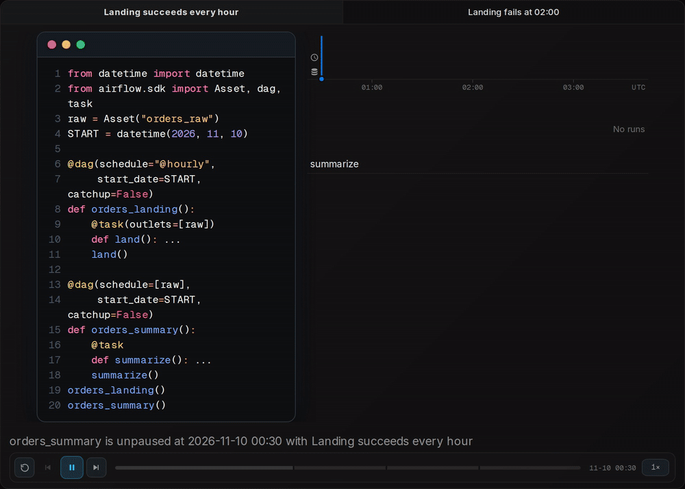
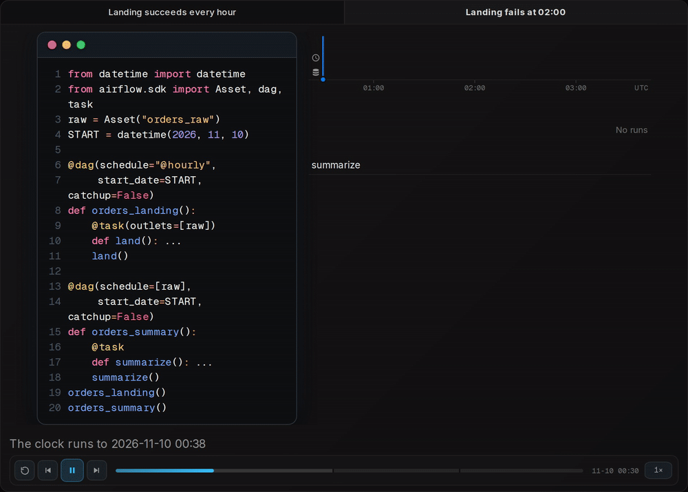
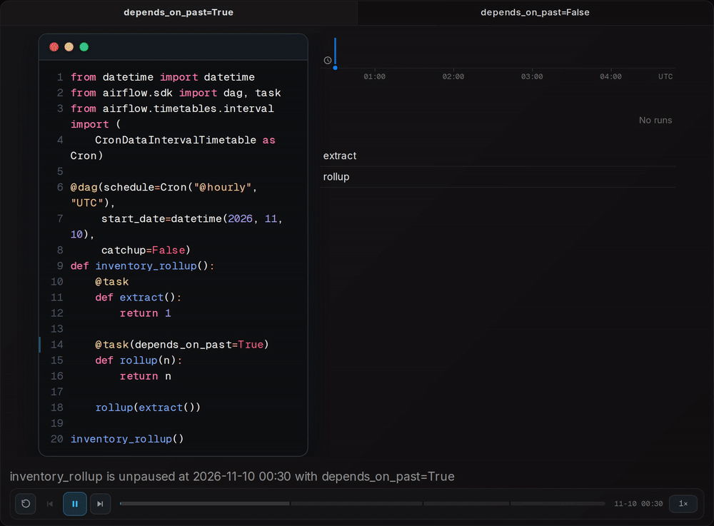
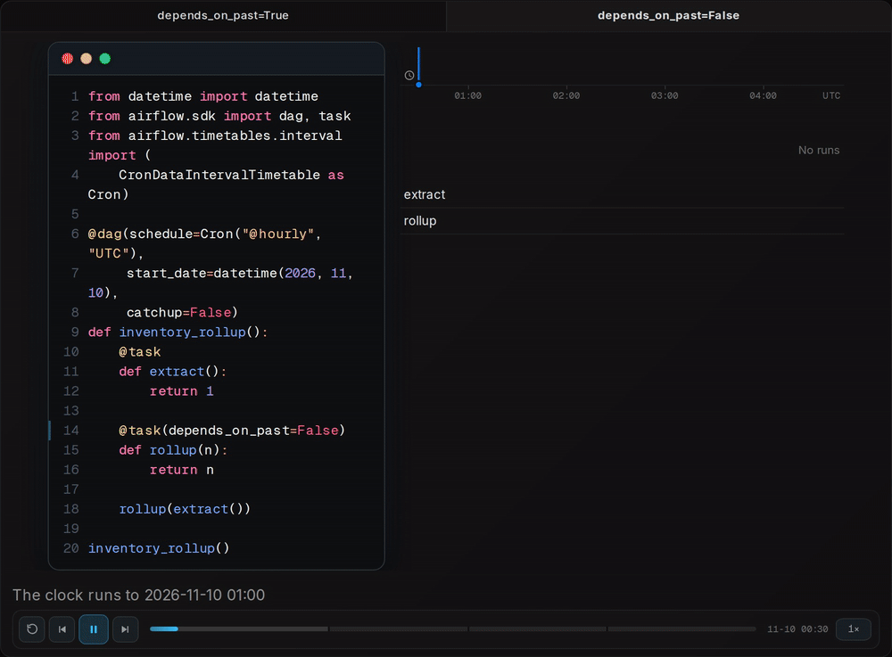

Advanced·[](https://airflow.apache.org/)·20 min · 7 challenges

# Scheduling: Advanced

Shopify shows a live globe of sales every Black Friday Cyber Monday weekend, Friday through Monday. This lesson builds the batch pipeline behind a globe like it in Airflow. Regional checkout files land at unpredictable minutes, the weekend's summary windows follow a retail calendar, a running total must never count an hour twice, and a mid-weekend schedule change must not drop an hour. Each is a scheduling decision.


<br>

---

## Asset-Triggered DAGs

A cron schedule is a guess about when data is ready. An hourly orders feed that lands anywhere between 10 and 40 minutes past the hour forces the consumer DAG to pick a time: run at :45 and sit idle for most of each hour, or run at :20 and miss the late files. Assets replace the guess with a signal: the producing task tells Airflow when it finished, and the consumer runs then.


<br>

### An asset is a declared name for data

An Asset is a name and a URI standing for data that Airflow never opens. Declaring one changes nothing in storage; it gives 2 DAGs a shared word for the same table or file. The task that updates the data lists the asset in outlets, and a DAG that should run after each update puts the same asset in schedule, in place of a cron string or a timetable.


When `land` reaches success, Airflow writes an asset event: the asset, the instant, and the producing DAG, task and run. On its next loop the scheduler reads the new events, finds that `orders_summary` is scheduled on `orders_raw`, and creates a run of it, usually within seconds of the event. Nothing in this path reads a clock, and nothing inspects storage: the event means that a task declaring the outlet succeeded. A task that declares the outlet and writes nothing still fires it, and a task that writes the file and then fails fires nothing.

**Landing succeeds every hour**



**Landing fails at 02:00**




<br>

### Asset-triggered runs carry events instead of a window

A scheduled run names a window, and its tasks read that window. An asset-triggered run has no window to name, because it exists for an update, and an update has no start and end of its own. Its `logical_date` is None, its `data_interval_start` and `data_interval_end` are None, and its run id starts with `asset_triggered__` followed by the instant Airflow created it. A task that reads `data_interval_start` to pick a partition gets None and must be written for that. What the run does carry is `triggering_asset_events` in the task context: for each asset in the schedule, the list of events that caused the run, each holding its `timestamp`, `source_dag_id`, `source_run_id` and `source_task_id`. A consumer that needs the producer's window follows `source_run_id` back to the producing run and reads the window from there.

| Run attribute | Scheduled run | Asset-triggered run |
| --- | --- | --- |
| Created when | Its window closes | An event on a scheduled asset lands |
| run_type | scheduled | asset_triggered |
| logical_date | Start of the window | None |
| Data interval | The window | None |
| Run id | scheduled__ and the logical date | asset_triggered__ and the creation instant |
| What the task reads | data_interval_start and data_interval_end | triggering_asset_events |


<br>

### Events wait until a run consumes them

Events are kept until a run consumes them. If `orders_summary` is paused while the landing DAG succeeds 3 times, 3 events wait in its queue; on unpause the scheduler creates 1 run, and `triggering_asset_events` in that run lists all 3. The same batching happens whenever several events arrive between 2 scheduler loops. A consumer written to process everything since its last run handles this without noticing, and one written as if each run carried exactly 1 event reads the first and leaves 2 updates unprocessed.

> Sources of asset events
>
> - A task with the asset in outlets reaching success, from a scheduled run or a manual one alike
> - A person on the Assets page of the UI creating an event by hand, which fires a consumer without rerunning its producer
> - A failed task writes no event, and a file arriving in storage with no Airflow task behind it writes none either

The Assets page in the UI draws the graph the declarations imply: each asset in the middle, the DAGs whose tasks list it in outlets on one side, the DAGs scheduled on it on the other, and the time of its last event. In the grid of `orders_summary`, each run carries the asset-triggered marker in place of the clock, and the run's details list the events it consumed.

*A producer whose whole job is 1 asset can be written with the @asset decorator from airflow.sdk, which builds a DAG of 1 task around the function and declares the asset as its outlet in the same step.*

> **TIP**
>
> Name an asset for what the data is, never for who produces it: orders_raw survives a rename of the landing DAG and a move of the landing task, and every consumer scheduled on it keeps firing.


<br>

---

## Asset Conditions and Aliases

A daily revenue table needs orders and refunds together, and a fraud scorer needs either a new order batch or a new rule set. Asset schedules combine for both: `&` builds a schedule that waits for every asset in it, `|` builds one that fires on any of them, and parentheses nest the 2. Airflow keeps, per consumer DAG and per asset, a flag saying whether an event has arrived since that consumer last ran, and tests the expression against those flags on each scheduler loop.

```sql
from datetime import datetime
from airflow.sdk import Asset, dag

orders = Asset("orders_raw")
refunds = Asset("refunds_raw")
rules = Asset("fraud_rules")
START = datetime(2026, 11, 10)


@dag(schedule=(orders & refunds), start_date=START)
def daily_revenue():
    ...


@dag(schedule=(orders | rules), start_date=START)
def fraud_scores():
    ...


@dag(schedule=((orders & refunds) | rules), start_date=START)
def nightly_audit():
    ...


daily_revenue()
fraud_scores()
nightly_audit()
```


<br>

### An AND schedule waits for 1 event per asset

`daily_revenue` needs 1 event from each of its 2 assets since its last run. Counts beyond 1 change nothing: 2 orders events and 0 refunds events leave it waiting. When the refunds event arrives, the run is created with all 3 events in `triggering_asset_events`, and both flags reset to waiting. `fraud_scores` fires on every single event of either asset, so 2 orders events 15 minutes apart give it 2 runs.

| Time | Event on | daily_revenue (orders & refunds) | fraud_scores (orders | rules) |
| --- | --- | --- | --- |
| 02:10 | orders_raw | waiting: orders yes, refunds no | run 1, carrying 1 event |
| 02:25 | orders_raw | waiting: orders yes, refunds no | run 2, carrying 1 event |
| 02:40 | refunds_raw | run 1, carrying 3 events; both flags reset | no change |
| 03:10 | fraud_rules | no change | run 3, carrying 1 event |
| 03:50 | refunds_raw | waiting: refunds yes, orders no | no change |
| 04:05 | orders_raw | run 2, carrying 2 events | run 4, carrying 1 event |

`nightly_audit` is satisfied by the pair or by a rules event alone. Over the same night it runs at 02:40 on the pair, at 03:10 on the rule set by itself, and at 04:05 on the pair again. Each run consumes every event queued for that DAG, whichever side of the expression matched. Had a rules event arrived at 03:55, after the 03:50 refunds event, it would have created a run carrying both and cleared the refunds flag, and the 04:05 orders event would then have left the pair waiting.


<br>

### Time and data together

A report due at 06:00 whether the feed arrived mixes the 2 kinds of trigger. AssetOrTimeSchedule takes a timetable and an asset expression and creates a run when either side is satisfied, and the clock side fires every day whether or not the assets landed. With CronTriggerTimetable as the clock side, the 06:00 tick creates a scheduled run whose logical date is 06:00 and whose data interval starts and ends at 06:00, a point with no span to read. The asset side creates an asset-triggered run with no logical date at all. So the task branches: when triggering_asset_events holds events it reads them, and otherwise it builds the 24 hours ending at the logical date itself.

```sql
from datetime import datetime, timedelta
from airflow.sdk import Asset, dag, task
from airflow.timetables.assets import AssetOrTimeSchedule
from airflow.timetables.trigger import CronTriggerTimetable


@dag(
    schedule=AssetOrTimeSchedule(
        timetable=CronTriggerTimetable("0 6 * * *", timezone="UTC"),
        assets=(Asset("orders_raw") & Asset("refunds_raw")),
    ),
    start_date=datetime(2026, 11, 10),
)
def revenue_by_six():
    @task
    def build(triggering_asset_events, logical_date):
        if triggering_asset_events:
            return [e.source_run_id for evs in triggering_asset_events.values() for e in evs]
        return (logical_date - timedelta(days=1), logical_date)

    build()


revenue_by_six()
```


<br>

### Aliases for names known only at run time

A producer that writes 1 directory per day, `file:///lake/orders/2026-11-10/`, cannot declare that path as an outlet: the path differs in every run, and the DAG file is parsed before any run exists. An `AssetAlias` is a fixed name a task can attach any asset to while it runs. The task declares the alias in `outlets`, and inside its body adds the concrete asset to `outlet_events[alias]`. When the task succeeds, Airflow records an event on that concrete asset, records that the alias produced it, and triggers 2 kinds of consumer: DAGs scheduled on the alias, which fire for any asset added through it, and DAGs scheduled on that exact path.

```sql
from datetime import datetime
from airflow.sdk import Asset, AssetAlias, dag, task

daily_orders = AssetAlias("daily_orders")
START = datetime(2026, 11, 10)


@dag(schedule="@daily", start_date=START)
def orders_partition():
    @task(outlets=[daily_orders])
    def write(outlet_events, data_interval_start):
        day = data_interval_start.strftime("%Y-%m-%d")
        outlet_events[daily_orders].add(Asset(f"file:///lake/orders/{day}/"))

    write()


@dag(schedule=daily_orders, start_date=START)
def any_partition_report():
    ...


@dag(schedule=Asset("file:///lake/orders/2026-11-10/"), start_date=START)
def one_partition_report():
    ...


orders_partition()
any_partition_report()
one_partition_report()
```

After the run for Nov 10 succeeds, the Assets page shows `file:///lake/orders/2026-11-10/` as a real asset with `daily_orders` as its producer. `any_partition_report` runs for it as it runs for every day, and `one_partition_report` runs for this day only. Airflow records the alias-to-path resolution at the event, and the dependency lines in the UI catch up at the next parse of the file. A task that adds 4 assets through one alias writes 4 events, 1 per concrete asset, all at its success, so a consumer scheduled on the alias gets 1 run whose `triggering_asset_events` lists all 4, each event naming its own concrete path.

| ✓ Schedule on the alias | ✗ Schedule on the exact asset |
| --- | --- |
| • Fires for every asset the alias adds<br><br>• The name is fixed in the DAG file<br><br>• Fits a consumer that handles whatever partition landed | • Fires for 1 concrete path only<br><br>• The path is known only once the producer has added it<br><br>• Fits 1 consumer per partition or per region |

> **TIP**
>
> An alias with nothing added fires nothing: a task that declares outlets=[alias] and never calls outlet_events[alias].add() produces no asset event, and a consumer scheduled on the alias waits forever.


<br>

---

## Custom Timetables

A close-of-day run for a trading desk happens at 18:00 New York on each day the market is open, and its window runs from the previous close to this one. Weekdays are a cron matter. The 9 or so exchange holidays a year are a list no cron string holds, and the window after a Thursday holiday has to span 48 hours. When neither built-in cron timetable can say when the next window ends, you write the rule as a `Timetable` subclass, and the scheduler calls it exactly the way it calls the built-in ones.


<br>

### The 2 questions a timetable answers

| Method | When the scheduler calls it | What you return |
| --- | --- | --- |
| next_dagrun_info(last_automated_data_interval, restriction) | Each time it needs the next window, passing the last window it created, or None on the first call | A DagRunInfo holding the next window, or None if there will never be another |
| infer_manual_data_interval(run_after) | When a person triggers a run at run_after | The DataInterval that run should read |
| serialize() and deserialize(data) | Writing the DAG to the metadata database and reading it back | A JSON-safe dict, and the timetable rebuilt from it |

`restriction` carries the DAG's bounds: `earliest` is the start_date, `latest` is the end_date or None, and `catchup` is the DAG's catchup flag. With catchup on, the first window starts at the first close on or after start_date; with it off, the first window starts at the most recent close before now, the same jump to the latest window the built-in timetables make.

```sql
from pendulum import DateTime, timezone
from airflow.timetables.base import DagRunInfo, DataInterval, Timetable

NY = timezone("America/New_York")
HOLIDAYS = {"2026-11-26", "2026-12-25"}


def is_trading_day(day: DateTime) -> bool:
    return day.weekday() < 5 and day.to_date_string() not in HOLIDAYS


class TradingCloseTimetable(Timetable):
    description = "Close of each trading day, 18:00 New York"

    def _close_after(self, moment: DateTime) -> DateTime:
        day = moment.in_timezone(NY).start_of("day")
        while True:
            close = day.at(18, 0)
            if close > moment and is_trading_day(day):
                return close
            day = day.add(days=1)

    def _close_before(self, moment: DateTime) -> DateTime:
        day = moment.in_timezone(NY).start_of("day")
        while True:
            close = day.at(18, 0)
            if close <= moment and is_trading_day(day):
                return close
            day = day.subtract(days=1)

    def infer_manual_data_interval(self, *, run_after):
        end = self._close_before(run_after)
        return DataInterval(start=self._close_before(end.subtract(seconds=1)), end=end)

    def next_dagrun_info(self, *, last_automated_data_interval, restriction):
        if last_automated_data_interval is not None:
            start = last_automated_data_interval.end
        elif restriction.earliest is None:
            return None
        elif restriction.catchup:
            start = self._close_after(restriction.earliest.subtract(seconds=1))
        else:
            start = self._close_before(DateTime.utcnow())
        end = self._close_after(start)
        if restriction.latest is not None and end > restriction.latest:
            return None
        return DagRunInfo.interval(start=start, end=end)

    def serialize(self):
        return {}

    @classmethod
    def deserialize(cls, data):
        return cls()
```

The 2 private helpers walk the calendar a day at a time, which is slow in theory and instant in practice: a loop that skips a 3-day weekend and a holiday runs 5 iterations. `serialize` returns an empty dict because this timetable has no settings; a version that took the holiday list as a constructor argument would return it there and rebuild from it in `deserialize`.


<br>

### Registering and using the timetable

```sql
from datetime import datetime
from airflow.plugins_manager import AirflowPlugin
from airflow.sdk import dag

from trading_calendar import TradingCloseTimetable


class TradingCalendarPlugin(AirflowPlugin):
    name = "trading_calendar"
    timetables = [TradingCloseTimetable]


@dag(
    schedule=TradingCloseTimetable(),
    start_date=datetime(2026, 11, 23),
    catchup=True,
)
def close_of_day():
    ...


close_of_day()
```

The plugin must be present wherever the DAG is read: the DAG processor parses the file and needs the class to build the DAG, the scheduler needs it to call `next_dagrun_info`, and the API server needs it to show the description in the UI. The serialized DAG stores the class's import path and the dict from `serialize`, and a timetable class that is not registered through a plugin fails at parse time, with the DAG shown as broken in the UI.


<br>

### The windows around Thanksgiving 2026

| Run | Window (New York) | Logical date | Created at | Hours covered |
| --- | --- | --- | --- | --- |
| 1 | Mon Nov 23 18:00 to Tue Nov 24 18:00 | Nov 23 18:00 | Tue Nov 24 18:00 | 24 |
| 2 | Tue Nov 24 18:00 to Wed Nov 25 18:00 | Nov 24 18:00 | Wed Nov 25 18:00 | 24 |
| 3 | Wed Nov 25 18:00 to Fri Nov 27 18:00 | Nov 25 18:00 | Fri Nov 27 18:00 | 48 |
| 4 | Fri Nov 27 18:00 to Mon Nov 30 18:00 | Nov 27 18:00 | Mon Nov 30 18:00 | 72 |

Thursday Nov 26 is in `HOLIDAYS`, so `_close_after(Wed 18:00)` steps past Thursday and returns Friday's close, and run 3 covers 48 hours of trades. The weekend gives run 4 a 72-hour window. The logical date is the window's start, as it is for every data interval timetable, so run 3's logical date is Wednesday evening even though it is created on Friday. A person who triggers the DAG by hand on Saturday gets `infer_manual_data_interval(Saturday)`: the window from Friday's close back to the close before it, the same window run 3 read.

> **TIP**
>
> Test the arithmetic without a scheduler: construct the timetable, call next_dagrun_info in a loop feeding each result's interval back in as last_automated_data_interval, and print 20 windows across a holiday. A timetable that returns the last window again leaves the DAG stuck on it, and one whose end precedes its start is rejected when the run is created.


<br>

---

## Runs That Wait on Past Runs

An inventory rollup table holds a running stock count per warehouse: each hourly run reads the count the previous run wrote and adds this hour's movements. If the run for 01:00 fails and the run for 02:00 goes ahead, 02:00 adds its movements to the count from 00:00, and every later hour inherits the gap. The run for 02:00 has to wait until 01:00 has finished, and finished well.

depends_on_past=True is a task setting, set on 1 task or through default_args for all of them. Before the scheduler starts an instance of that task, it looks at the same task in the DAG's previous run, the run with the latest logical date before this one. If that instance reached success or skipped, this one may start. If it failed, or has not finished, this one waits with no state, and the scheduler checks again on every loop. The first run of the DAG has no previous run and starts without waiting, and the tasks without the setting in a later run proceed as usual.

**depends_on_past=True**



**depends_on_past=False**



| Run (logical date) | Created at | extract | rollup | Run state |
| --- | --- | --- | --- | --- |
| 00:00 | 01:00 | success | success | success |
| 01:00 | 02:00 | success | failed | failed |
| 02:00 | 03:00 | success | no state, waiting on the 01:00 rollup | running |
| 03:00 | 04:00 | success | no state, waiting on the 02:00 rollup | running |


<br>

### Recovery runs in order

The failed instance in the 01:00 run is the only thing holding the chain. Fix the cause, then clear that one instance from the grid, an action the Task Lifecycle lessons cover in depth; here it means the instance runs again. When it succeeds, the 02:00 run's rollup becomes eligible on the next scheduler loop, the 03:00 run's rollup becomes eligible only once the 02:00 one has succeeded, and so on down the grid. Each rollup starts after the one before it finishes, so 6 blocked hours take 6 rollup durations to drain. Marking a later instance success by hand lets the run after it start, and leaves the hole in the data that the setting exists to prevent.


<br>

### A 6-hour outage of the rollup store

Say the store the rollup writes to is down from 02:00 to 08:00. The rollup created at 02:00 fails; the 6 runs created from 03:00 to 08:00 arrive on time, their `extract` instances succeed, and their 6 rollups wait. No other task fails, since the tasks after each waiting rollup never start. At 08:10 the 02:00 rollup is cleared and succeeds, and the 6 waiting rollups run back to back, oldest first, each reading the count the previous one wrote. With `depends_on_past=False`, the 6 rollups that started inside the outage would have failed, the one created at 08:00 would have succeeded on a count missing 6 hours, and clearing the failed 6 would run them in parallel, each reading whatever count happened to be there.

- A column of empty cells under a failed one in the same task row is a depends_on_past chain
- Runs stuck in running with every other task green are waiting runs, not slow ones
- The oldest failed cell in the row is the one to fix; the rest drain by themselves

| ✓ depends_on_past=True | ✗ max_active_runs=1 |
| --- | --- |
| • Per task<br><br>• Checks the outcome of the previous run's instance<br><br>• A failure holds every later run's instance of that task<br><br>• Other tasks in later runs still proceed | • Per DAG<br><br>• Counts runs still in progress, whatever their outcome<br><br>• A failed run is finished, so the next run starts<br><br>• Nothing in the next run proceeds until the whole previous run ends |

wait_for_downstream=True tightens the rule by 1 step: the task waits until the previous run's instance of itself and of every task immediately downstream of it have reached success or skipped. It covers the case where the previous run's rollup succeeded but its publish did not, and this run's rollup would otherwise overwrite rows publish has not read yet. Setting it turns depends_on_past on for that task too.

> **TIP**
>
> A backfill of 30 days through a DAG with this setting is serial by construction: backfill runs are created in logical date order and each rollup waits for the one before it, so estimate the backfill as 30 rollups one after another, whatever the parallelism.


<br>

---

## Changing a Live Schedule

A deployed DAG runs hourly, and a request arrives to make it daily. You edit `schedule`, the DAG processor parses the file on its next pass, and the new serialized DAG replaces the old one as a new DAG version. The runs that already exist stay exactly as they are: their windows, logical dates and states came from the old timetable, and nothing rewrites them. The open question is where the new timetable puts the next run, and the answer comes from the method every timetable implements.

```sql
from datetime import datetime
from airflow.sdk import dag
from airflow.timetables.interval import CronDataIntervalTimetable


@dag(
    schedule=CronDataIntervalTimetable("0 0 * * *", timezone="UTC"),
    start_date=datetime(2026, 11, 1),
    catchup=True,
)
def metrics_sync():
    ...


metrics_sync()
```

The scheduler hands the new timetable last_automated_data_interval, the window of the latest run it created itself (scheduled or backfill, never manual or asset-triggered), and reads the next window from next_dagrun_info. The built-in data interval timetables align that window's end down to the previous tick of the new schedule and start the next window there. That one rule, plus the fact that 2 runs of a DAG cannot share a logical date, explains every case in the table.

| Change, deployed 10:30 Nov 10, catchup on | Last run's window | Next window under the new schedule | Effect on coverage |
| --- | --- | --- | --- |
| Daily to hourly | Nov 9 00:00 to Nov 10 00:00 | Nov 10 00:00 to 01:00, then each hour | Clean: 10 hourly runs are created at once, then 1 per hour |
| Hourly to every 15 minutes | Nov 10 09:00 to 10:00 | Nov 10 10:00 to 10:15, then each quarter hour | Clean: no gap and no overlap |
| Daily at 02:00 to daily at 06:00 | Nov 9 02:00 to Nov 10 02:00 | Nov 9 06:00 to Nov 10 06:00, created at once | Nov 9 06:00 to Nov 10 02:00 is processed twice |
| Hourly to daily | Nov 10 09:00 to 10:00 | Nov 10 00:00 to Nov 11 00:00, whose logical date the hourly run for 00:00 already holds, so it is skipped and Nov 11 to Nov 12 comes next | Nov 10 10:00 to midnight is processed by no run at all |


<br>

### The hourly-to-daily collision

Hourly to daily is the switch that loses data. The aligned next window is Nov 10 00:00 to Nov 11 00:00, whose logical date is Nov 10 00:00, and the run `scheduled__2026-11-10T00:00:00+00:00` already exists: the hourly run for the first hour of the day holds that id. When the window closes at midnight, the scheduler finds the logical date taken, creates no run, writes a log line saying so, and moves the DAG's next window on to Nov 11 to Nov 12. Hours 00:00 to 10:00 were processed by hourly runs, and hours 10:00 to midnight by nobody. No dialog produces a 14-hour window for a daily timetable, so the recovery is a run of the task by hand over those hours, and the cheap path is to deploy the switch at a moment where no collision can happen.


<br>

### Edits other than the cron string

How each edit moves the next window

- **start_date moved later** *earliest changes*\
  The next window starts at the later of the aligned last end and the new start_date; the runs before it stay untouched
- **catchup off to on** *shows at the next unpause*\
  Nothing fills history before the first run; while paused, every missed window is now created on unpause instead of the latest one alone
- **A cron string to an asset list** *no window to align*\
  The existing scheduled runs stay, and the first event on the asset creates the first asset-triggered run
- **An asset list to a cron string** *last scheduled window*\
  If the DAG never had a scheduled or backfill run, the timetable starts as a new DAG would, from start_date under the catchup rule; otherwise it aligns from the last scheduled window as usual
- **A data interval cron to a trigger cron** *same tick, no span*\
  CronTriggerTimetable fires at the first tick after the last window's end, with a zero-length interval and that tick as logical date, so the logical date one tick earlier is never created
- **A custom timetable replacing a cron** *your alignment*\
  Its next_dagrun_info receives the cron run's window as last_automated_data_interval and must align it itself; a logical date already taken is skipped
- **A timezone change on the cron** *ticks move*\
  The aligned window shifts with the ticks, and the first new window overlaps the last old one by part of a day

Each of these edits produces a new DAG version, and the grid shows which version each run executed under. Runs created before the deploy keep the old version's windows and task list; a run created after the deploy for a window in the past, as the daily to hourly switch creates 10 of, runs the new code over the old hours. The DAG list's Next Run column shows the window the new timetable chose, so read it after the parse and before any run is created.

| ✓ Do | ✗ Don't |
| --- | --- |
| • Pause, deploy, read Next Run on the DAG list, and unpause only if the window shown is the one you meant<br><br>• Switch to a coarser schedule right after the last fine window closes, so no logical date collides<br><br>• Work out the aligned next window from the last run's window on paper before you deploy<br><br>• Keep every task safe to run twice over the same window | • Change schedule and start_date in one deploy and then guess which of the 2 moved the next run<br><br>• Expect existing runs' windows to be recomputed by the new schedule<br><br>• Trust that a skipped collision will page anyone: it is a line in the scheduler log |


<br>

---

## Putting It All Together

Shopify shows a live globe of BFCM sales each year, and in 2026 that weekend runs Nov 27 to Nov 30. Picture a batch pipeline behind a globe like it, split by what each part needs. Each regional checkout loader adds its hourly file to an alias, and a globe-refresh DAG scheduled on that alias reacts to every file as it lands. A separate running-total DAG runs on an hourly data interval timetable, its total task depending on its past so no hour is counted twice or skipped. A weekend summary DAG runs on a custom retail-calendar timetable, and the one change made mid-weekend moves the running-total DAG from hourly to every 15 minutes.

- The alias from section 1 lets regional loaders name files the globe-refresh DAG never saw at parse time, and the asset events from section 0 fire it the moment each lands, with every file since its last run in triggering_asset_events.
- depends_on_past from section 3 is set in the running-total DAG, which runs on a clock because the previous run is found by logical date and an asset-triggered run has none; its cost is the waiting chain, where one failed hour holds every later total until it is cleared.
- The custom timetable from section 2 gives the weekend summary windows that match the retail calendar, with logical dates the team can reason about on Monday.
- The move from hourly to every 15 minutes from section 4 is clean whenever it is deployed, because every hourly window ends on a quarter-hour tick; a move to a coarser daily schedule would need deploying in the hour after midnight, before the hourly run for 00:00 claims that logical date.


<br>

---

## Key Takeaways

- An asset event is written when a task listing the asset in outlets reaches success; it carries no proof that data changed.
- Asset-triggered runs have no logical date and no window; they carry triggering_asset_events, and a paused consumer collects its events into a single run.
- & waits for 1 event per asset since the last run, | fires on any event, and AssetOrTimeSchedule adds a clock to either.
- An alias lets a task attach a path it only knows at run time, and consumers can schedule on the alias or on the resolved path.
- A custom Timetable answers 2 questions, the next window after the last one and the window for a manual trigger, and lives in a plugin everywhere the DAG is read.
- depends_on_past serializes 1 task across runs and turns a failure into a waiting chain that drains oldest first.
- A schedule change keeps every existing run and aligns the next window down to the new schedule's previous tick; a logical date already taken is skipped without a run.

[](https://airflow.apache.org/)

Official Apache Airflow resourcesversion 3.3

"Platform created by the community to programmatically author, schedule and monitor workflows." [airflow.apache.org](https://airflow.apache.org/)

[Documentation](https://airflow.apache.org/docs/)[Install](https://airflow.apache.org/docs/apache-airflow/stable/installation/index.html)[Community](https://airflow.apache.org/community/)

Apache Airflow, Apache, Airflow, the Airflow logo, and the Apache logo are either registered trademarks or trademarks of The Apache Software Foundation.
