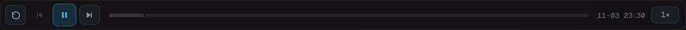
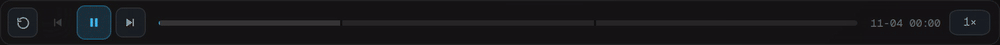
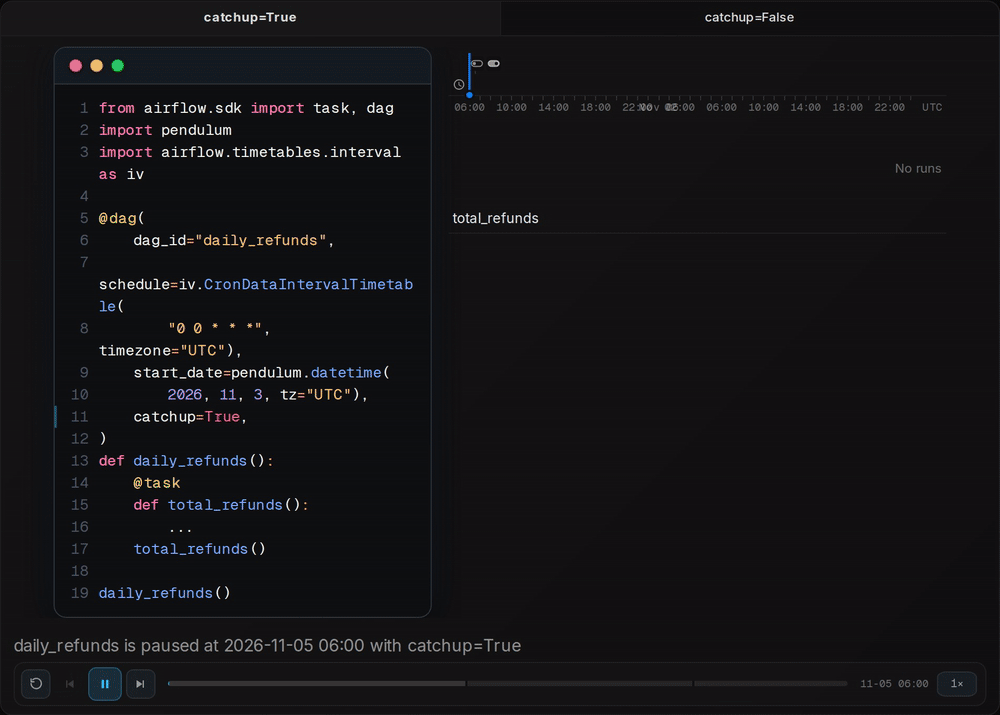
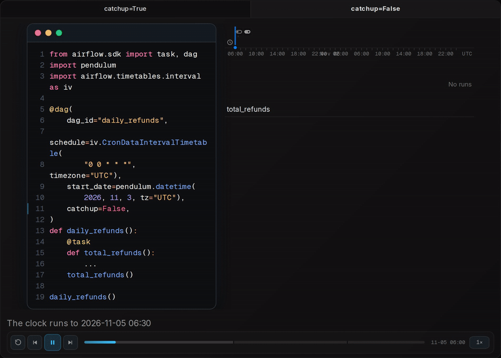

Beginner·[](https://airflow.apache.org/)·20 min · 8 challenges

# Scheduling: Beginner

Airbnb built Airflow in 2014 for its data warehouse jobs. An engineer there who deploys a weekly bookings DAG on Wednesday 4 November 2026, with a start date of that same day and a schedule of Sundays at midnight, and promises the pricing team a report by the weekend, will miss the weekend: the scheduler creates the first run on Sunday 15 November, once the first whole week has closed.


<br>

---

## A Run Covers a Slice of Time

### One run, one window

A scheduled run of a DAG answers one question: what happened in this slice of time? The slice has a start and an end, and Airflow calls it the run's data interval. A DAG that runs once an hour owns 1 hour per run, and the tasks inside that run read the rows that landed within that hour and nothing outside it. 3 time values ride along with every run: `data_interval_start`, `data_interval_end` and `logical_date`. For every scheduled run `logical_date` equals `data_interval_start`, so the run is named after the moment its window opened; runs triggered by hand, covered in the last section, follow a different rule.

Airflow creates the run when the window closes. The run that owns 09:00 to 10:00 on 4 November 2026 is created at 10:00, because by then every click from that hour has been written and the hour can be counted whole. A run created at 09:00 for the same hour would count an hour that had hardly begun, and the figure it produced would be stale by the time anyone read it.

| Window opens | Window closes | Run is created | run_id |
| --- | --- | --- | --- |
| 2026-11-04 09:00 | 2026-11-04 10:00 | 2026-11-04 10:00 | scheduled__2026-11-04T09:00:00+00:00 |
| 2026-11-04 10:00 | 2026-11-04 11:00 | 2026-11-04 11:00 | scheduled__2026-11-04T10:00:00+00:00 |
| 2026-11-04 11:00 | 2026-11-04 12:00 | 2026-11-04 12:00 | scheduled__2026-11-04T11:00:00+00:00 |

Read down the table and the pattern holds in every row: the name inside the run_id is the time under Window opens. Window closes and Run is created always hold the same moment seen from 2 sides, the end of one window and the first moment the run for it can exist. Whenever this lesson asks which runs exist at a given moment, the answer comes from reading a table like this one.



Watch where each cell appears in the animation above: the run named 00:00 lights up at 01:00, the run named 01:00 lights up at 02:00, and so on down the grid. The file names a `start_date` of midnight and a `schedule` of 1 hour, and Airflow lays the hours end to end from there. Nothing in the file states when a run starts; that follows from where its window ends.

This gives you a way to read any moment on the clock. At 11:40 on 4 November, the runs that exist are the ones whose windows closed at or before 11:40: the runs named 10:00, 09:00 and every hour back to `start_date`. The 11:00 window is still open, so there is no run named 11:00 yet, and there will be none until 12:00. A grid that ends with the 10:00 column at 11:40 is a grid that is exactly up to date.

*Every time in this lesson is UTC, which is what tz="UTC" on each start_date declares. Other time zones change where the boundaries fall and are covered in a later lesson.*


<br>

### Reading the window inside a task

A task gets its run's window by asking for it. With TaskFlow, name a parameter `data_interval_start` or `data_interval_end` and Airflow fills it with the run's value when the task starts, so the same function reads a different hour in every run with no change to the file. Compare that with `datetime.now()` called inside the task, which returns the moment the task happened to execute, 10:03 in one run and 10:07 in a slower one, and returns something else again if the task is run a second time.

```sql
@task
def count_clicks(data_interval_start=None, data_interval_end=None):
    print(f"counting {data_interval_start} to {data_interval_end}")
```

| run_id | data_interval_start | data_interval_end | The task prints |
| --- | --- | --- | --- |
| scheduled__2026-11-04T09:00:00+00:00 | 2026-11-04 09:00 | 2026-11-04 10:00 | counting 09:00 to 10:00 |
| scheduled__2026-11-04T10:00:00+00:00 | 2026-11-04 10:00 | 2026-11-04 11:00 | counting 10:00 to 11:00 |
| scheduled__2026-11-04T11:00:00+00:00 | 2026-11-04 11:00 | 2026-11-04 12:00 | counting 11:00 to 12:00 |

Naming the run by its window is what makes a second run of it meaningful. Run `scheduled__2026-11-04T09:00:00+00:00` again a week later and it is handed the same 2 values, counts the same hour and writes the same answer. The clock time it ran at has moved by 7 days and nothing it reads has moved at all. A task that trusted the clock instead would count a different hour on every attempt.

> 2 clocks on one run
>
> - Its name, the logical date, is the moment the window opened: 09:00.
> - Its creation time is the moment the window closed: 10:00.
> - Everything the run reads sits between those 2 moments.
> - The moment it was created is stored on the run as well, separate from the name.


> **TIP**
>
> When a run looks like it ran an hour late, check its window before anything else. A run named 09:00 that was created at 10:00 is on time; 10:00 is the only moment it could have come into being.


<br>

---

## Schedule Strings and Presets

### The 4 kinds of schedule value

`schedule` takes 4 kinds of value. A `timedelta` lays windows of 1 fixed length end to end, the first opening at `start_date`. A cron string, written inside a `CronDataIntervalTimetable`, pins every window boundary to a time on the clock. A preset such as `@daily` is a cron string with a short name and goes in the same place. `None` means no schedule at all: the DAG runs only when a person triggers it, and a DAG that leaves `schedule` out is treated as `None` in Airflow 3.

```sql
import pendulum
from airflow.sdk import dag, task
from airflow.timetables.interval import CronDataIntervalTimetable


@dag(
    dag_id="weekday_report",
    start_date=pendulum.datetime(2026, 11, 2, tz="UTC"),
    schedule=CronDataIntervalTimetable("0 6 * * 1-5", timezone="UTC"),
)
def weekday_report():
    @task
    def build():
        ...

    build()


weekday_report()
```


<br>

### Reading a cron string

A cron string has 5 fields separated by spaces: minute, hour, day of month, month and day of week. A `*` means every value the field allows, a number means that value only, `1-5` means a range and `*/15` means every 15th value. Fields are checked together, so `30 2 1 * *` fires only when the minute is 30, the hour is 2 and the day of the month is 1 at the same moment. The string names a set of instants on the clock, and Airflow uses each instant as a boundary between 2 windows.

| Field | Values | 0 6 \* \* 1-5 reads |
| --- | --- | --- |
| minute | 0 to 59 | 0, on the hour |
| hour | 0 to 23 | 6, so 06:00 |
| day of month | 1 to 31 | every day |
| month | 1 to 12 | every month |
| day of week | 0 to 6, Sunday is 0 | 1 to 5, Monday to Friday |

| Cron string | Instants it names |
| --- | --- |
| `0 6 \* \* \*` | 06:00 every day |
| `30 2 1 \* \*` | 02:30 on the 1st of each month |
| `\*/15 \* \* \* \*` | every 15 minutes, at :00, :15, :30 and :45 |
| `0 0 \* \* 0` | 00:00 every Sunday |
| `0 \*/6 \* \* \*` | 00:00, 06:00, 12:00 and 18:00 every day |


<br>

### From instants to windows

Take `0 6 * * 1-5` through the week of 2 November 2026. Its instants fall at 06:00 on Monday through Friday. The window that opens at 06:00 on Monday closes at 06:00 on Tuesday, and the run named for Monday is created at that moment. The window that opens at 06:00 on Friday 6 November has no Saturday or Sunday instant to close it, so it stays open until 06:00 on Monday 9 November: 72 hours in a single window, and its run is created on Monday morning carrying the whole weekend's data.

| Window opens | Window closes | Run created | Length |
| --- | --- | --- | --- |
| Mon 2 Nov 06:00 | Tue 3 Nov 06:00 | Tue 3 Nov 06:00 | 24 hours |
| Tue 3 Nov 06:00 | Wed 4 Nov 06:00 | Wed 4 Nov 06:00 | 24 hours |
| Wed 4 Nov 06:00 | Thu 5 Nov 06:00 | Thu 5 Nov 06:00 | 24 hours |
| Thu 5 Nov 06:00 | Fri 6 Nov 06:00 | Fri 6 Nov 06:00 | 24 hours |
| Fri 6 Nov 06:00 | Mon 9 Nov 06:00 | Mon 9 Nov 06:00 | 72 hours |

That is the whole method for predicting a cron schedule: list the instants, pair each with the one after it, and the run for a pair is created at the later instant and named for the earlier. Windows come out equal when the instants are evenly spaced and unequal when the string skips days, and the data each run reads stretches or shrinks to match. A task in `weekday_report` that reads from `data_interval_start` to `data_interval_end` handles the 72 hour window without a line of special code.


<br>

### Presets

| Preset | Cron string | Window |
| --- | --- | --- |
| `@hourly` | `0 \* \* \* \*` | 1 hour, opening on the hour |
| `@daily` | `0 0 \* \* \*` | 1 day, opening at midnight |
| `@weekly` | `0 0 \* \* 0` | 7 days, opening Sunday 00:00 |
| `@monthly` | `0 0 1 \* \*` | 1 month, opening on the 1st |
| `@yearly` | `0 0 1 1 \*` | 1 year, opening 1 January |
| `@once` | none | a single run at `start_date`, then never again |

Each cron preset is read exactly as the cron string beside it, so `CronDataIntervalTimetable("@daily", timezone="UTC")` and the same call with `"0 0 * * *"` produce identical windows and identical run names. `@once` is the exception: it names no cron string, so it is a schedule value of its own, written as `schedule="@once"` and never placed inside the timetable. Pick the preset when it says what you mean and the cron string when it does not; a daily report at 06:00 has no preset and needs `0 6 * * *`.

*A bare string such as schedule="0 6 \* \* \*" is accepted too. How a deployment reads a bare string is a setting on that deployment, so this lesson writes the timetable out by name and leaves the other reading to a later lesson.*

> **TIP**
>
> Write a cron string with a calendar in front of you. Say the rhythm in words first, every weekday at 06:00, then fill the 5 fields and list the next 3 instants by hand. If the third instant lands on a day you did not expect, the string says something other than what you meant.


<br>

---

## start_date and the First Run

### The first boundary

`start_date` is the first boundary the schedule may use. The first window opens there and the first run is created when that window closes, 1 full period later. Most people read `start_date` as the moment the DAG first runs, deploy at 09:00 with a `start_date` of midnight that morning, and then watch an empty grid for 15 hours wondering what they broke.

Take `daily_sales`, a midnight cron with `start_date` 4 November 2026 00:00 UTC, deployed and unpaused at 09:00 on 4 November. Its first window is 4 November 00:00 to 5 November 00:00. That window is still open at 09:00, at 15:00 and at 23:59. At 00:00 on 5 November it closes, and the first run appears, named `scheduled__2026-11-04T00:00:00+00:00`. Nothing was wrong during the wait; the DAG had no complete day to count.



- 09:00 on 4 November: file read, DAG unpaused, no window closed yet, no run.
- 15:00 on 4 November: still inside the first window, still no run.
- 00:00 on 5 November: the first window closes and the run named 2026-11-04 is created.
- 00:00 on 6 November: the second window closes and the run named 2026-11-05 is created.

When `start_date` does not land on one of the cron's instants, the first window opens at the first instant at or after it. The same `start_date` of midnight with `0 6 * * *` gives a first window of 4 November 06:00 to 5 November 06:00, and a first run at 06:00 on 5 November. A `start_date` set in the future behaves the same way: 10 November with a midnight cron yields a first run at 00:00 on 11 November.

| start_date | Schedule | First window | First run created |
| --- | --- | --- | --- |
| 2026-11-04 00:00 | `0 0 \* \* \*` | 4 Nov 00:00 to 5 Nov 00:00 | 5 Nov 00:00 |
| 2026-11-04 00:00 | `0 6 \* \* \*` | 4 Nov 06:00 to 5 Nov 06:00 | 5 Nov 06:00 |
| 2026-11-04 00:00 | `0 0 \* \* 0` | 8 Nov 00:00 to 15 Nov 00:00 | 15 Nov 00:00 |
| 2026-11-10 00:00 | `0 0 \* \* \*` | 10 Nov 00:00 to 11 Nov 00:00 | 11 Nov 00:00 |

The weekly row is the one that surprises most. A `start_date` on Wednesday 4 November with a Sunday schedule sits 4 days before the first instant, so the first window opens on Sunday 8 November and its run arrives on Sunday 15 November, 11 days after deployment. The future row is the cleanest way to launch on a chosen day: set 10 November, unpause whenever you like before then, and the first run arrives at midnight on the 11th with no older windows to think about.


<br>

### Paused on arrival

A DAG that appears for the first time arrives paused unless the deployment is set otherwise, and while a DAG is paused Airflow creates no runs for it, however many windows close. Unpause it before its first window closes and the first run appears exactly when that window ends, as in the animation. Unpause it after one or more windows have closed and the next section decides what happens to them. Either way, the unpause itself creates nothing on the spot when no window has closed.


<br>

### A start_date that moves

Airflow re-reads every DAG file on a timer while it runs, so a `start_date` of `datetime.now()` is a different moment at every read. The first window opens at the latest read, and before it can close the file is read again and the window opens later still. It never closes, and the DAG never runs, with nothing in the logs to say why. Fix the date to a literal, `pendulum.datetime(2026, 11, 4, tz="UTC")`, and the first boundary stays put from one read to the next.

| ✓ Do | ✗ Don't |
| --- | --- |
| • Give every DAG a fixed, time zone aware start_date with pendulum.datetime.<br><br>• Expect the first run 1 full period after start_date, at the first boundary after it.<br><br>• Unpause a new DAG before its first window closes if you want that window's run on time. | • Use datetime.now() or any value that changes between reads as start_date.<br><br>• Read start_date as the clock time the first run begins.<br><br>• Set start_date to a cron instant and expect a run at that same instant. |


> **TIP**
>
> To see a run the moment you unpause a new DAG, put `start_date` 1 full period in the past: a midnight cron with a `start_date` of yesterday has a window that closed at midnight, and its run is created straight away under either catchup setting.


<br>

---

## Catchup On and Off

### Windows that closed while nobody was watching

Unpause a DAG later than its `start_date` and some windows have already closed with no run created for them. `catchup` decides what happens to them. With `catchup=True`, Airflow creates 1 run for every closed window, oldest first, the moment the DAG is unpaused, and the runs execute side by side. With `catchup=False`, only the most recently closed window gets a run; the older windows never run, and nothing marks them in the grid.

Take `daily_refunds`, which runs at 00:00 every day from a `start_date` of 3 November 2026, unpaused at 06:30 on 5 November. 2 windows have closed by then: 3 to 4 November and 4 to 5 November. With catch-up on, both runs are created at 06:30 and start together. With it off, Airflow creates only the 2026-11-04 run, and 3 November is never counted. From midnight on 6 November the 2 settings behave the same, 1 run as each window closes.

| Window | catchup=True | catchup=False |
| --- | --- | --- |
| 3 Nov 00:00 to 4 Nov 00:00 | run created 5 Nov 06:30 | no run, ever |
| 4 Nov 00:00 to 5 Nov 00:00 | run created 5 Nov 06:30 | run created 5 Nov 06:30 |
| 5 Nov 00:00 to 6 Nov 00:00 | run created 6 Nov 00:00 | run created 6 Nov 00:00 |
| 6 Nov 00:00 to 7 Nov 00:00 | run created 7 Nov 00:00 | run created 7 Nov 00:00 |

**catchup=True**



**catchup=False**



The animation shows the 06:30 moment from both sides. The 2 variants have the same file apart from 1 line, and that line decides whether 3 November exists in the table the DAG writes. Airflow 3 defaults `catchup` to `False`, so a DAG that says nothing about it skips to the latest window; write the setting out either way so a reader of the file knows what will happen the day it is unpaused.

In the grid, catch-up runs appear as a block of columns created within the same minute, their names stepping back a day at a time, with the newest at the right. Each is handed its own window, so the run named 3 November reads 3 November's rows even though it executes on the 5th. Because runs are named by window, a run can execute days late and still read the rows it was meant to read.

The same rule applies every time a DAG is unpaused, with the gap measured from its last scheduled run instead of from `start_date`. Pause `daily_refunds` for a week of maintenance and unpause it with `catchup=True`, and 7 runs are created at once; with `catchup=False`, 1 run is created and the other 6 days are skipped for good.


<br>

### Counting the backlog before unpausing

The number of catch-up runs is the number of closed windows between `start_date` and now, and that number grows fast with a short period. Catch-up runs begin several at a time, so a DAG with a long history behind it can occupy the workers for hours while the current day's run waits in the queue behind them. Count before you unpause.

- **17,520** — hourly windows in 2 years
- **730** — daily windows in 2 years
- **104** — weekly windows in 2 years


<br>

### Choosing a setting

| ✓ Turn catch-up on when | ✗ Leave it off when |
| --- | --- |
| • each window's rows are kept, 1 row or 1 partition per day, and a missing day is a hole<br><br>• the DAG rebuilds history and every window must exist exactly once<br><br>• start_date is recent and the backlog is a handful of runs | • the run reads the current state of a source and older windows would read the same rows<br><br>• the backlog is months of windows nobody asked for<br><br>• the DAG is new and 1 run today is enough, with history handled another way |

> Runs the catchup setting does not affect
>
> - Windows before `start_date`: no setting creates runs for them.
> - The run for the latest closed window: created under both settings.
> - Every window that closes after unpausing: 1 run each, under both settings.
> - Runs a person triggers by hand, which the next section covers.

> **TIP**
>
> Before unpausing a DAG with `catchup=True`, count the windows between its `start_date` and now. If the count is larger than you want executing today, move `start_date` forward first, because Airflow creates every one of those runs the moment you unpause.


<br>

---

## Triggering a Run by Hand

### Pressing Trigger

Every run so far was created by the scheduler at the moment a window closed. A person can create one too, at any moment, by pressing the trigger button on the DAG's page in the UI or from a terminal. The result is a run like any other: it has a run_id, a logical date, a data interval and 1 task instance per task, and it moves through the same states in the grid. Its run_id begins with `manual__` where a scheduled run's begins with `scheduled__`, and the grid marks it with its own symbol so the 2 kinds are told apart at a glance.

From a terminal, the same run comes from airflow dags trigger daily_sales. The command returns as soon as the run is created, and the run appears in the grid within a few seconds.


<br>

### The window a manual run is handed

The trigger dialog asks for a logical date and fills in the moment you opened it. Keep that value and the run's logical date is the trigger moment, 14:20 on 5 November, and its run_id is `manual__2026-11-05T14:20:00+00:00`. Its data interval follows a rule of its own: the most recent window that had already closed at that moment. For `daily_sales` with its midnight cron, that is 4 November 00:00 to 5 November 00:00, the same window the scheduled run created at midnight was handed.

| Run | Created at | logical_date | Window |
| --- | --- | --- | --- |
| `scheduled__2026-11-04T00:00:00+00:00` | 5 Nov 00:00 | 4 Nov 00:00 | 4 Nov 00:00 to 5 Nov 00:00 |
| `manual__2026-11-05T14:20:00+00:00` | 5 Nov 14:20 | 5 Nov 14:20 | 4 Nov 00:00 to 5 Nov 00:00 |
| `scheduled__2026-11-05T00:00:00+00:00` | 6 Nov 00:00 | 5 Nov 00:00 | 5 Nov 00:00 to 6 Nov 00:00 |

In the table, the manual run's logical date and the start of its window differ, where in a scheduled run they coincide: the name says when a person pressed the button, and the window says what data the run reads. The scheduled run at midnight on 6 November is untouched as well. It owns the window that closed at that moment, exactly as if nobody had pressed anything in between.


<br>

### The schedule does not count manual runs

A manual run changes nothing about the rhythm. The scheduler works out the next scheduled run from the last scheduled one, so triggering at 14:20 neither delays midnight's run nor replaces it, and triggering 3 times in an afternoon leaves 3 extra runs in the grid and the same midnight run on its way. If the DAG is paused when you trigger it, the run is created and sits waiting; its tasks start only once the DAG is unpaused.

| ✓ Scheduled run | ✗ Manual run |
| --- | --- |
| • Created by the scheduler when a window closes.<br><br>• run_id is scheduled__ plus the logical date.<br><br>• Logical date equals the window's start.<br><br>• Counted by the scheduler when it works out the next run. | • Created when a person presses Trigger or runs the CLI command.<br><br>• run_id is manual__ plus the logical date.<br><br>• Logical date is the trigger moment; the window is the latest closed one.<br><br>• Ignored by the scheduler when it works out the next run. |


<br>

### 2 uses for a manual trigger

Trigger by hand on the day a DAG is deployed. Section 2 showed a first run that arrives 15 hours after deployment; a manual trigger at 09:00 produces a run at once, so every task goes green or red long before the first scheduled run. Its window is the latest closed one, 3 November, which lies before `start_date`, so no scheduled run will ever own it. Read the run as a check that the tasks work, and expect the scheduled run at midnight to write 4 November, the DAG's first window.

A manual trigger also repeats a window that went wrong, where a source was late or a task failed. Type the logical date you want into the dialog and the window follows the same rule, the most recent window closed before that date, so a logical date of noon on 2 November hands the run 1 November to 2 November. Later lessons cover re-running an existing run in place and refilling many windows at once; a single manual run with a chosen date is the first tool for a single bad day.

#### A DAG with no schedule

A DAG with `schedule=None` has only manual runs. Since it has no windows to pick from, each run is handed a window of zero length, both ends at the trigger moment, so `data_interval_start` and `data_interval_end` are equal and `logical_date` matches them. Such a DAG suits a job someone runs on demand, a one-off load or a cleanup, where the moment of the run is the only time worth recording.

```sql
import pendulum
from airflow.sdk import dag, task


@dag(
    dag_id="reload_products",
    start_date=pendulum.datetime(2026, 11, 1, tz="UTC"),
    schedule=None,
)
def reload_products():
    @task
    def reload():
        ...

    reload()


reload_products()
```

- Its run_id starts with manual__ and carries the trigger moment.
- Its window is the latest closed one before its logical date, so read both values.
- The next scheduled run is still due at the next boundary.
- A run triggered on a paused DAG waits until the DAG is unpaused.

> **TIP**
>
> A manual run and the scheduled run for the same window both write that window's rows. If the task appends without replacing what is there, the second run doubles the day; a task that overwrites its own window is safe to trigger as often as you like.


<br>

---

## Putting It All Together

Airbnb created Airflow in 2014 to run the jobs behind its data warehouse. Picture a daily DAG there that summarizes each day's bookings for the pricing team: a CronDataIntervalTimetable at 02:00 UTC so every late booking has landed, a start_date of 1 November 2026, and a deployment on the morning of 4 November.

- Section 0: the run created at 02:00 on 5 November is named 2026-11-04T02:00 and reads bookings from 02:00 on the 4th to 02:00 on the 5th.
- Section 1: the cron 0 2 \* \* \* pins every boundary to 02:00 UTC, so the pricing team can state the window of any run from its name alone.
- Section 2: with a start_date of 1 November, the first window opens at 02:00 on 1 November and closes at 02:00 on 2 November; by the deployment on the 4th, 3 windows have already closed.
- Section 3: unpausing at 10:00 on 4 November with catchup = True creates 3 runs at once, for the 1st, 2nd and 3rd; with catchup = False only the run for the 3rd is created.
- Section 4: a manual trigger at 10:00 on 4 November to check the deployment is handed 3 November 02:00 to 4 November 02:00, the same window as the latest scheduled run, and the run at 02:00 on 5 November arrives regardless.


<br>

---

## Key Takeaways

- A scheduled run is named for the start of its window and created at its end; the 2 are 1 period apart only when the schedule's boundaries are evenly spaced.
- A cron string names instants; each pair of neighbouring instants is 1 window, and the run for it is created at the later instant.
- start_date is the first boundary the schedule may use, so the first run is created when the first window opening at or after it closes.
- catchup = True creates 1 run per closed window when a DAG is unpaused; catchup = False , the Airflow 3 default, creates 1 run for the latest closed window only.
- A manual run carries manual__ and the trigger moment as its logical date, is handed the latest closed window, and leaves the schedule untouched.

[](https://airflow.apache.org/)

Official Apache Airflow resourcesversion 3.3

"Platform created by the community to programmatically author, schedule and monitor workflows." [airflow.apache.org](https://airflow.apache.org/)

[Documentation](https://airflow.apache.org/docs/)[Install](https://airflow.apache.org/docs/apache-airflow/stable/installation/index.html)[Community](https://airflow.apache.org/community/)

Apache Airflow, Apache, Airflow, the Airflow logo, and the Apache logo are either registered trademarks or trademarks of The Apache Software Foundation.
