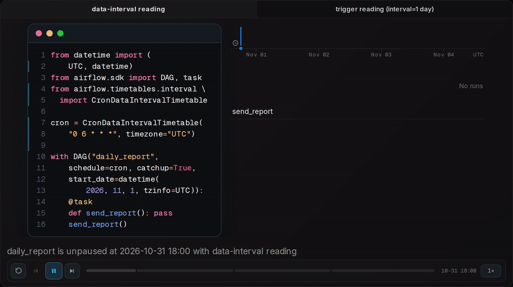
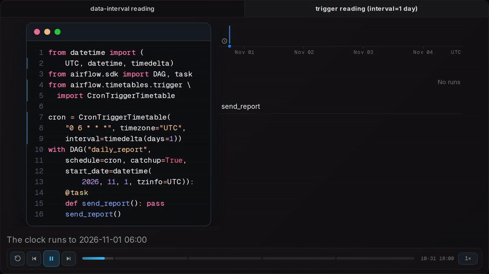
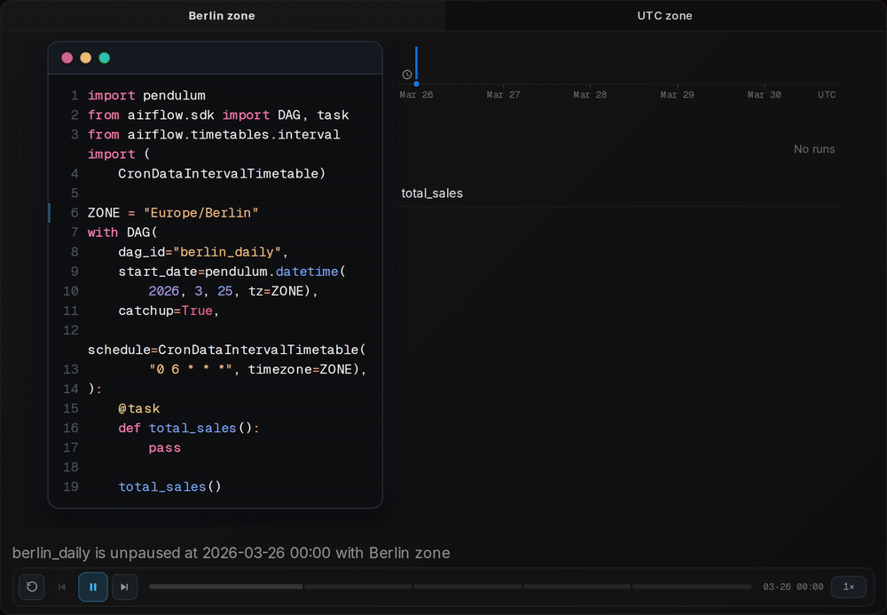
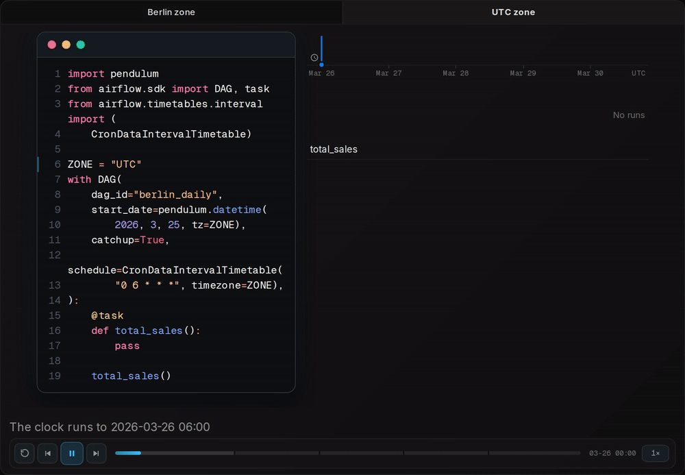
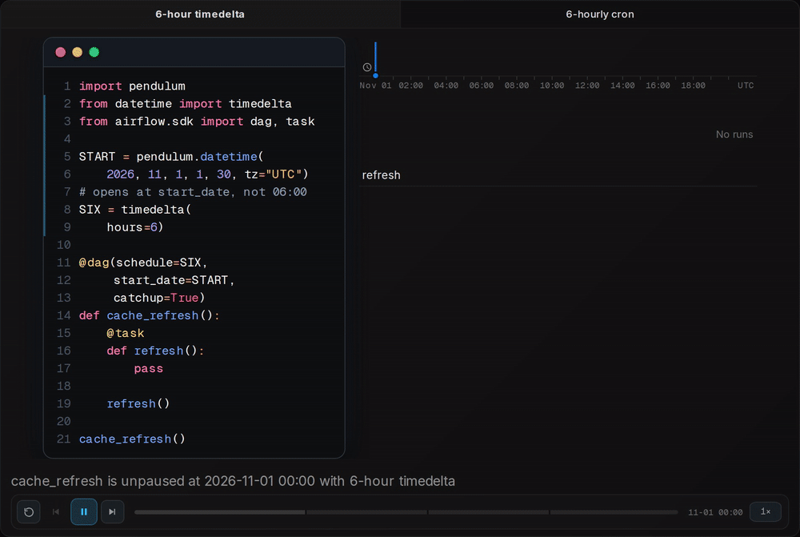
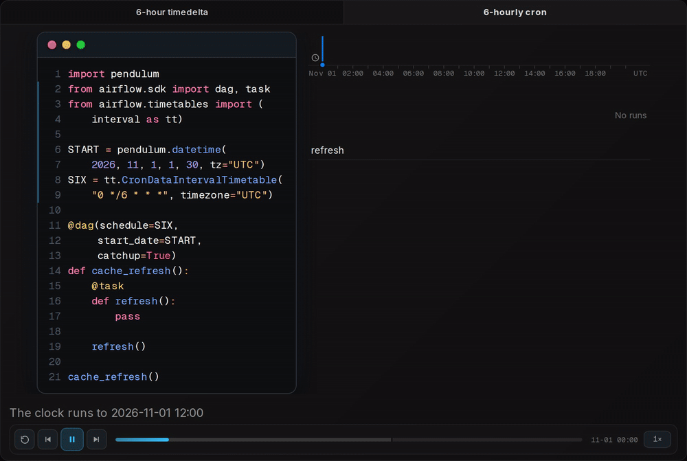

Intermediate·[](https://airflow.apache.org/)·20 min · 11 challenges

# Scheduling: Intermediate

The example this lesson follows is a finance DAG at Airbnb, where Airflow was first written, that totals host payouts once a day at 06:00 Pacific. On the Sunday the clocks spring forward, the total comes in short, and a request lands to rerun the last 3 weeks. Whether that rerun reads the right hours depends on what each run's logical date names.


<br>

---

## What the Logical Date Names

Take a DAG whose schedule is CronDataIntervalTimetable("0 6 \* \* \*", timezone="UTC"), with a start_date of 1 November 2026 and catchup on. At 06:00 UTC on 4 November the scheduler creates a run for the window from 3 November 06:00 to 4 November 06:00. That run's logical_date is 2026-11-03T06:00:00+00:00, the instant the window opened, and its run_id is scheduled__2026-11-03T06:00:00+00:00. The clock reads the 4th; the run is named for the 3rd.

The logical date names which slice of the schedule a run stands for. What is unique per DAG is the run id, and a scheduled run's id is built from its logical date, so the scheduler can tell from the id alone whether that slice already has a scheduled run and never creates a second. A fourth field, `run_after`, records the earliest instant the run was allowed to start: on this timetable, the moment the window closed. The table below is the run list after 3 scheduled runs, and in every row the logical date and the window's start agree while `run_after` sits 24 hours later.

| run_id | logical_date | data_interval_start | data_interval_end | run_after |
| --- | --- | --- | --- | --- |
| scheduled__2026-11-01T06:00:00+00:00 | 2026-11-01 06:00 | 2026-11-01 06:00 | 2026-11-02 06:00 | 2026-11-02 06:00 |
| scheduled__2026-11-02T06:00:00+00:00 | 2026-11-02 06:00 | 2026-11-02 06:00 | 2026-11-03 06:00 | 2026-11-03 06:00 |
| scheduled__2026-11-03T06:00:00+00:00 | 2026-11-03 06:00 | 2026-11-03 06:00 | 2026-11-04 06:00 | 2026-11-04 06:00 |

Where the logical date shows up

- In the run id, after the scheduled__ prefix, written in UTC with its offset.
- As the column header of each run in the grid, so the grid reads one period behind the clock on this timetable.
- In the dialog that picks a run to clear or inspect, which lists runs by it.


<br>

### Name and window diverge

What the logical date equals depends on the timetable. A data-interval timetable makes it the window's start. A trigger timetable, which section 1 builds, makes it the instant the cron fired, and the window has zero length. A run triggered by hand in 3.3 may have no logical date at all, and a run created without one carries `data_interval_start` and `data_interval_end` of `None` as well. A task that derives its window from `logical_date` has assumed a timetable. A task that reads the 2 window fields has been told the window by whichever timetable is in force, and keeps working when someone changes it.

```sql
from airflow.sdk import task


@task
def load_orders(data_interval_start=None, data_interval_end=None):
    start = data_interval_start.strftime("%Y-%m-%d %H:%M:%S")
    end = data_interval_end.strftime("%Y-%m-%d %H:%M:%S")
    return {"start": start, "end": end}
```

The run named 3 November returns a start of `2026-11-03 06:00:00` and an end of `2026-11-04 06:00:00`. The filter they drive is half-open: rows at or after the start and strictly before the end. A row stamped exactly 06:00:00 on the 4th therefore belongs to the next run and to no other, and 2 neighbouring runs never count the same row twice or drop one between them.

```sql
SELECT
  COUNT(*) AS orders
FROM orders
WHERE created_at >= TIMESTAMP '2026-11-03 06:00:00'
  AND created_at < TIMESTAMP '2026-11-04 06:00:00'
```


<br>

### Where ds goes wrong

`ds` is the logical date's calendar day, `2026-11-03` for this run. Read as the day this run is for, it names a day whose first 6 hours this run never touches, and it leaves out the 6 hours of 4 November the run does read. `ds` matches the window only when the window is a calendar day in the timetable's zone. On a trigger timetable it names the firing day while the window is empty. Reading `data_interval_start` and `data_interval_end` gives the same answer under every timetable, so a task written that way survives a schedule change with no edit, and a backfilled run of it reads the old window rather than today's.

> The question each field answers
>
> - logical_date answers which slice of the schedule this run stands for: it heads the grid's columns and sits inside scheduled run ids.
> - data_interval_start and data_interval_end answer what the run reads: the half-open window.
> - run_after answers when the run could first start: the window's close on a data-interval timetable.


> **TIP**
>
> A function that needs to know its period should get data_interval_start and data_interval_end from the task that calls it. Given ds or the logical date instead, it has only a name and has to guess the window.


<br>

---

## Two Timetables for One Cron

Write schedule="0 6 \* \* \*" in a 3.3 DAG and Airflow builds a CronTriggerTimetable: one run at each 06:00, named for that 06:00, with a window that starts and ends at the same instant. Write schedule=CronDataIntervalTimetable("0 6 \* \* \*", timezone="UTC") and each 06:00 closes a window 24 hours long, and the run that appears at that moment is named for the 06:00 before it. Both grids show a new run at 06:00 on 4 November. One calls it the 4th, the other the 3rd.

The string is the same; the reading differs. A trigger timetable answers the question of when the DAG should fire. A data-interval timetable answers the question of which slice of time has become complete. A deployment can be configured to read bare strings the second way, so a file that spells out its timetable class behaves the same on every deployment that parses it. Presets take the same route: `@daily` is `0 0 * * *` and gets whichever reading a bare string gets.

```sql
from airflow.timetables.interval import CronDataIntervalTimetable
from airflow.timetables.trigger import CronTriggerTimetable

fires_at_six = CronTriggerTimetable("0 6 * * *", timezone="UTC")
closes_at_six = CronDataIntervalTimetable("0 6 * * *", timezone="UTC")
```

CronTriggerTimetable: run appearing 4 Nov 06:00

| field | value |
| --- | --- |
| logical_date | 2026-11-04 06:00 |
| data_interval_start | 2026-11-04 06:00 |
| data_interval_end | 2026-11-04 06:00 |
| run_after | 2026-11-04 06:00 |
| run_id | scheduled__2026-11-04T06:00:00+00:00 |

CronDataIntervalTimetable: run appearing 4 Nov 06:00

| field | value |
| --- | --- |
| logical_date | 2026-11-03 06:00 |
| data_interval_start | 2026-11-03 06:00 |
| data_interval_end | 2026-11-04 06:00 |
| run_after | 2026-11-04 06:00 |
| run_id | scheduled__2026-11-03T06:00:00+00:00 |


<br>

### What the scheduler does at 06:00

Both runs that appear at 06:00 on the 4th carry a `run_after` of 06:00 on the 4th and can start at that second. On the trigger reading `run_after` equals the logical date; on the data-interval reading it equals the window's end, a day after the name. Their windows are what differ. Point section 0's half-open filter at the trigger run and it asks for rows at or after 06:00 and strictly before 06:00. No row satisfies both, so the count comes back 0. The task still succeeds, and the grid shows green over an empty load.

| ✓ CronTriggerTimetable | ✗ CronDataIntervalTimetable |
| --- | --- |
| • Fires at the cron instant<br><br>• logical_date is that instant<br><br>• Window has zero length unless you pass interval<br><br>• First run with catchup: the first cron instant after start_date<br><br>• Suits work done at a time: sends, pokes, snapshots | • Runs when a window closes<br><br>• logical_date is the window's start<br><br>• Window spans one cron period<br><br>• First run with catchup: one period after the first instant after start_date<br><br>• Suits work done on a slice: loads, aggregates, partitions |


<br>

### Telling them apart from a run

Open any scheduled run in the UI. When `data_interval_start` equals `data_interval_end`, the DAG has a trigger timetable. When the run that appeared at 06:00 is named for the 06:00 of the day before, it has a data-interval timetable. The first run after a `start_date` tells too. With catchup on and a `start_date` of 1 November, the trigger version's first run appears at 06:00 on the 1st and is named 1 November 06:00. The interval version's first window opens at 06:00 on the 1st and its first run appears at 06:00 on the 2nd, also named 1 November 06:00, so the 2 first runs share a name and appear 1 day apart.


<br>

### A trigger with a window

```sql
from datetime import timedelta

from airflow.timetables.trigger import CronTriggerTimetable

schedule = CronTriggerTimetable(
    "0 6 * * *",
    timezone="UTC",
    interval=timedelta(days=1),
)
```

`interval` gives a trigger run a window that ends at the firing instant while its logical date stays that instant. The run at 06:00 on the 4th now has a window from the 3rd at 06:00 to the 4th at 06:00 and a name of the 4th at 06:00. Name and window start differ by a day, which is the case section 0 warned about: a task that treats `logical_date` as the window's start is wrong by 24 hours here, and one that reads `data_interval_start` is right. Use this form when a DAG must fire at a wall-clock time and also report on the period behind it.

**data-interval reading**



**trigger reading (interval=1 day)**



> **TIP**
>
> Pick the timetable by the sentence that describes the DAG. 'At 06:00, email yesterday's figures' is a trigger with an interval. 'Whenever a day of events is complete, load it' is a data interval.


<br>

---

## Backfilling a Date Range

Catchup fills windows the scheduler missed while a DAG was paused or did not yet exist, and it fills each one once. A backfill reruns windows on purpose: you pick a date range, runs are created for it whether they ran before, and it works with catchup on or off. In 3.3 the scheduler owns backfills. You open one from the DAG's page or with `airflow backfill create`, the request is stored, and the scheduler creates the runs at the pace you set, beside the live schedule rather than in place of it.

The command form carries the same choices as the dialog: airflow backfill create --dag-id orders_daily --from-date 2026-10-01 --to-date 2026-10-04 --reprocess-behavior none --max-active-runs 2.


<br>

### Which runs it creates

The scheduler walks the timetable's schedule points from the from date forward and creates a run for every point whose window has already closed, provided its logical date falls on or between the 2 dates you gave. Both dates are instants: a bare date is midnight UTC at the start of that day. Take the 06:00 UTC DAG from section 0 and the backfill above. The schedule points are 06:00 on each day. The points from the 1st of October through the 3rd fall inside the range. The point at 06:00 on the 4th sits 6 hours past the to date and is left out, so the last window the backfill covers ends at 06:00 on the 4th. Each created run has a run type of backfill and an id of `backfill__` followed by its logical date, and each task in it reads the window of its own point, which is why section 0 insisted on the window fields.

| schedule point | inside 2026-10-01 to 2026-10-04? | window | run created |
| --- | --- | --- | --- |
| 2026-10-01 06:00 | yes | 10-01 06:00 to 10-02 06:00 | backfill__2026-10-01T06:00:00+00:00 |
| 2026-10-02 06:00 | yes | 10-02 06:00 to 10-03 06:00 | backfill__2026-10-02T06:00:00+00:00 |
| 2026-10-03 06:00 | yes | 10-03 06:00 to 10-04 06:00 | backfill__2026-10-03T06:00:00+00:00 |
| 2026-10-04 06:00 | no, 6 hours past the to date | 10-04 06:00 to 10-05 06:00 | none |


<br>

### Dates that already have a run

The reprocess behavior decides what happens when a point inside the range already has a run. `none`, the default, creates nothing for that point and records it as already existing, so the backfill touches only dates with no run. `failed` clears and reruns the points whose existing run failed and leaves successful ones alone. `completed` goes further and reruns the successful ones too, so every finished run in the range is cleared and run again. A run that is still running is left alone under every setting. Runs are created from the oldest point forward, and `--run-backwards` reverses that order, which helps when the newest dates matter most to whoever is waiting on them.

| existing run for the point | none | failed | completed |
| --- | --- | --- | --- |
| no run | created | created | created |
| failed | left alone | cleared and rerun | cleared and rerun |
| succeeded | left alone | left alone | cleared and rerun |
| still running | left alone | left alone | left alone |

`--max-active-runs` caps how many of the backfill's runs can be in flight at once; the rest wait as earlier ones finish, so a 90-day backfill with a cap of 2 occupies 2 slots of worker capacity and takes 45 rounds. `--dry-run` lists the logical dates the backfill would create without creating anything, which is the check to run whenever the to date is a bare date and the cron fires later than midnight. To pause a backfill in progress, pass its id to `airflow backfill pause`; `airflow backfill unpause` resumes it and `airflow backfill cancel` cancels it. `airflow backfill list` shows the backfills that exist and their state.

> The dialog on the DAG page
>
> - From and To: 2 instants; a date picked without a time is midnight UTC.
> - Reprocess Behavior: one of the 3 reprocess settings described above, applied to points that already have a run.
> - Max Active Runs: how many backfill runs may be in flight at once.
> - Run Backwards: newest point first.
> - Config: a JSON object handed to every run the backfill creates.

| ✓ Do | ✗ Don't |
| --- | --- |
| • Run --dry-run first and read the logical dates it prints<br><br>• Set the to date at or after the last logical date you want, such as 06:00 on that day<br><br>• Cap active runs below what the source system tolerates<br><br>• Choose failed over completed when successful runs are still correct | • Assume a bare to date includes that day's 06:00 point<br><br>• Backfill a task that reads today's date instead of its window<br><br>• Leave the reprocess behavior at none when the data was restated<br><br>• Start a wide backfill without checking the live schedule shares the workers |


<br>

---

## Time Zones and Daylight Saving

A start_date of pendulum.datetime(2026, 3, 1, tz="Europe/Berlin") gives the DAG a time zone. A bare cron string reads its hours in that zone; a timetable class reads them in the timezone you pass it. Inside Airflow every instant is stored in UTC, so the run named 06:00 Berlin on 28 March has the id scheduled__2026-03-28T05:00:00+00:00, and the UI shows its times in whichever zone the page is set to.

On 29 March 2026, Berlin moves from CET, UTC+1, to CEST, UTC+2, at 02:00. A cron at 06:00 local keeps firing at 06:00 local, which is 05:00 UTC up to the 28th and 04:00 UTC from the 29th. The window that closes on the 29th opened at 05:00 UTC on the 28th and closed at 04:00 UTC on the 29th: 23 hours. On 25 October the clocks go back at 03:00, and the window closing that morning runs 25 hours. Every other window of the year is 24 hours. A daily sum over the 23-hour window is short by an hour's worth of rows, and a per-hour rate that divides the day's total by 24 is wrong twice a year.

| 06:00 local on | instant in UTC | run id of the run appearing then | window closing here |
| --- | --- | --- | --- |
| 28 Mar 2026, CET | 05:00 | scheduled__2026-03-27T05:00:00+00:00 | 24 hours |
| 29 Mar 2026, CEST | 04:00 | scheduled__2026-03-28T05:00:00+00:00 | 23 hours |
| 30 Mar 2026, CEST | 04:00 | scheduled__2026-03-29T04:00:00+00:00 | 24 hours |
| 25 Oct 2026, CET | 05:00 | scheduled__2026-10-24T04:00:00+00:00 | 25 hours |

```sql
from airflow.sdk import task


@task
def window_hours(data_interval_start=None, data_interval_end=None):
    seconds = (data_interval_end - data_interval_start).total_seconds()
    return seconds / 3600
```

The window fields carry the length, so a task that divides a total by `window_hours` instead of by 24 gives the true hours of that day: 23 or 25 on the 2 change days, 24 on all the others. The run ids in the table show the other effect: the UTC instant inside the id moves from 05:00 to 04:00 on the 29th, so anything that parses run ids and expects a fixed hour breaks on that morning, while anything that reads the window keeps working.


<br>

### What the grid shows across the change

With the UI set to Berlin time, the column headers read 06:00 on every day and the only trace of the change is the shorter bar for the 28th's window. With the UI set to UTC, the headers read 05:00 up to 27 March and 04:00 from 29 March, and the 28th reads 05:00 because that run is named for the instant its window opened, before the clocks moved. Both views describe the same 4 runs; reading the one your teammates use saves an argument about whether the schedule slipped. A `timedelta(days=1)` schedule in the same DAG does something else entirely: it keeps a fixed 24 hours, so after the 29th it fires at 07:00 Berlin time, which section 4 takes up.


<br>

### The hour that exists twice

Between 02:00 and 03:00 on 29 March there is no Berlin time at all; between 02:00 and 03:00 on 25 October every Berlin time occurs twice. A cron inside that hour names an instant the zone either lacks or names twice, and what happens to that run depends on the cron library's rules rather than on anything in your file. Keep schedules in a DST zone outside 02:00 to 03:00. A `timezone` of UTC removes the question: UTC has no clock change and every window is 24 hours. The price is that a 06:00 UTC schedule reads 07:00 on a Berlin clock in winter and 08:00 in summer, which is fine for a warehouse load and wrong for a report promised at 06:00 local.

| ✓ Cron in a local zone | ✗ Cron in UTC |
| --- | --- |
| • Fires at the same local time all year<br><br>• One 23-hour and one 25-hour window a year<br><br>• UTC instant in run ids shifts twice a year<br><br>• Right when the business defines the day locally | • Fires at the same UTC instant all year<br><br>• Every window is 24 hours<br><br>• Run ids keep one hour all year<br><br>• Right when downstream wants equal windows |

**Berlin zone**



**UTC zone**



> **TIP**
>
> Write the zone in the timetable rather than relying on start_date alone. A reader of the file then sees the zone next to the cron it applies to, and a later change of start_date cannot silently move the schedule.


<br>

---

## Fixed Intervals vs Clock Times

schedule=timedelta(hours=6) builds a DeltaDataIntervalTimetable. Its first window opens at start_date to the second, and every window after that opens where the previous one closed, 6 hours later, with no reference to the clock on the wall. schedule=CronDataIntervalTimetable("0 \*/6 \* \* \*", timezone="UTC") opens windows at 00:00, 06:00, 12:00 and 18:00 UTC. With a start_date of 1 November 2026 at 01:30 UTC, the interval DAG's first window is 01:30 to 07:30 and its first run appears at 07:30. The cron DAG's first window opens at the first aligned point at or after start_date, 06:00, and its first run appears at 12:00. The 4 and a half hours between 01:30 and 06:00 belong to no window of the cron DAG, ever.

| window | timedelta(hours=6) | run appears | 0 \*/6 \* \* \* | run appears |
| --- | --- | --- | --- | --- |
| 1 | 1 Nov 01:30 to 07:30 | 1 Nov 07:30 | 1 Nov 06:00 to 12:00 | 1 Nov 12:00 |
| 2 | 1 Nov 07:30 to 13:30 | 1 Nov 13:30 | 1 Nov 12:00 to 18:00 | 1 Nov 18:00 |
| 3 | 1 Nov 13:30 to 19:30 | 1 Nov 19:30 | 1 Nov 18:00 to 2 Nov 00:00 | 2 Nov 00:00 |
| 4 | 1 Nov 19:30 to 2 Nov 01:30 | 2 Nov 01:30 | 2 Nov 00:00 to 06:00 | 2 Nov 06:00 |

The interval DAG carries `start_date`'s minute forever: change `start_date` to 01:45 and every window moves by 15 minutes, and every logical date with it. The cron DAG ignores the minute and aligns to the clock, so the same change moves nothing. Under a clock change the 2 part ways: a 6-hour `timedelta` stays 6 hours through the night of 29 March, while `0 */6 * * *` in Europe/Berlin fires at 00:00, 06:00, 12:00 and 18:00 local, so the window from midnight to 06:00 local that night holds 5 hours of UTC time and the matching window in October holds 7.


<br>

### The step that wraps at midnight

`0 */5 * * *` reads as every hour divisible by 5, from 00 through 20. After 20:00 the next match is 00:00, 4 hours on, because the hour field restarts at 0 each day. `timedelta(hours=5)` keeps a 5-hour step and walks through the clock: 00:00, 05:00, 10:00, 15:00, 20:00, 01:00, 06:00. Over a week the cron fires 35 times at the same 5 clock times each day; the interval closes 33 windows and visits every hour of the day. Every 6 hours and `0 */6 * * *` agree only because 24 divides by 6. Every 5 hours and `0 */5 * * *` are 2 different schedules, and only one of them is the one the owner meant.

| step | 0 \*/5 \* \* \* fires at | gap | timedelta(hours=5) window closes at | gap |
| --- | --- | --- | --- | --- |
| 1 | 1 Nov 05:00 | 5 h | 1 Nov 05:00 | 5 h |
| 2 | 1 Nov 10:00 | 5 h | 1 Nov 10:00 | 5 h |
| 3 | 1 Nov 15:00 | 5 h | 1 Nov 15:00 | 5 h |
| 4 | 1 Nov 20:00 | 5 h | 1 Nov 20:00 | 5 h |
| 5 | 2 Nov 00:00 | 4 h | 2 Nov 01:00 | 5 h |
| 6 | 2 Nov 05:00 | 5 h | 2 Nov 06:00 | 5 h |


<br>

### Presets are crons

The presets `@hourly` and `@daily` expand to cron strings, as does `@weekly`, so they align to the clock and follow section 1's rule about which reading a bare string gets. `timedelta(days=1)` is a different schedule from `@daily`: it opens its first window at `start_date` rather than at the next midnight, keeps 24 hours through a clock change, and if `start_date` is 1 November at 09:15 UTC, every run of it is named for 09:15. When a reviewer sees a `timedelta` where a cron would do, the question to ask is whether the odd minute in the logical dates is intended.

> **TIP**
>
> With catchup off, a timedelta timetable anchors its first window to the moment the scheduler first evaluates the DAG minus the delta. Every later window inherits that minute. If the minute matters, turn catchup on and put start_date at the minute you want.

- The data has a clock: business days, partner drops at 06:00 local, hourly partitions. Use a cron in the right zone.
- The work has a cadence: poll every 15 minutes, refresh every 6 hours, whatever the hour. Use a timedelta.
- The cadence divides 24 and DST is irrelevant: either works, and the cron reads better in the grid.
- The cadence does not divide 24: a timedelta, or accept the short step at midnight on purpose.

**6-hour timedelta**



**6-hourly cron**




<br>

---

## Putting It All Together

Picture a payouts team at Airbnb running a settlement DAG at 06:00 Pacific that totals the previous day's host payouts for the bank file. On 8 March 2026 the clocks spring forward, the window is 23 hours, and the total comes in short. The upstream ledger is then restated for the 3 weeks before, and the team must rerun those days without reprocessing the 2 consecutive days in the middle of that range that were already corrected by hand.

- Because the task reads data_interval_start and data_interval_end rather than ds, each rerun recomputes the window it is named for, including the 23-hour one, and the per-hour checks divide by the window's real length.
- Because the schedule is a CronDataIntervalTimetable in America/Los_Angeles, the run that appears at 06:00 on 8 March is named 7 March 06:00 and its id carries 14:00 UTC, while the next day's id carries 13:00 UTC.
- Because the backfill's from and to dates are instants, the team sets each to date at or after the last logical date it wants rerun and confirms the list of logical dates with --dry-run before creating it.
- Because the restatement makes every successful run in those 3 weeks stale, the team uses reprocess behavior completed and splits the range into 2 backfills, one ending before the hand-corrected days and one starting after them, so those 2 runs stay as they are; a cap on active runs keeps the live 06:00 schedule from starving.
- Had the schedule been timedelta(days=1) instead, the windows would have stayed 24 hours and the bank file would have drifted to 07:00 Pacific after the clock change, which is the trade section 4 lays out.


<br>

---

## Key Takeaways

- The logical date names the slice of the schedule a run stands for and is built into a scheduled run's id, which is unique per DAG; data_interval_start and data_interval_end are what the run reads; run_after is the earliest instant it could start.
- A bare cron string in 3.3 builds a CronTriggerTimetable whose window has zero length; CronDataIntervalTimetable turns the same string into closed windows named for their start, and interval= gives a trigger a window without changing its name.
- A backfill creates a backfill__ run for every schedule point whose logical date lies between the 2 instants you give it and whose window has closed; reprocess behavior decides what happens to points that already have a run.
- A cron in a local zone keeps its local hour across a clock change, so one window a year is 23 hours and one is 25, while a cron in UTC keeps every window at 24.
- A timedelta window opens at start_date and keeps its length; a cron window aligns to the clock, leaves the hours before the first aligned point uncovered, and a \*/n step wraps at midnight when n does not divide 24.

[](https://airflow.apache.org/)

Official Apache Airflow resourcesversion 3.3

"Platform created by the community to programmatically author, schedule and monitor workflows." [airflow.apache.org](https://airflow.apache.org/)

[Documentation](https://airflow.apache.org/docs/)[Install](https://airflow.apache.org/docs/apache-airflow/stable/installation/index.html)[Community](https://airflow.apache.org/community/)

Apache Airflow, Apache, Airflow, the Airflow logo, and the Apache logo are either registered trademarks or trademarks of The Apache Software Foundation.
