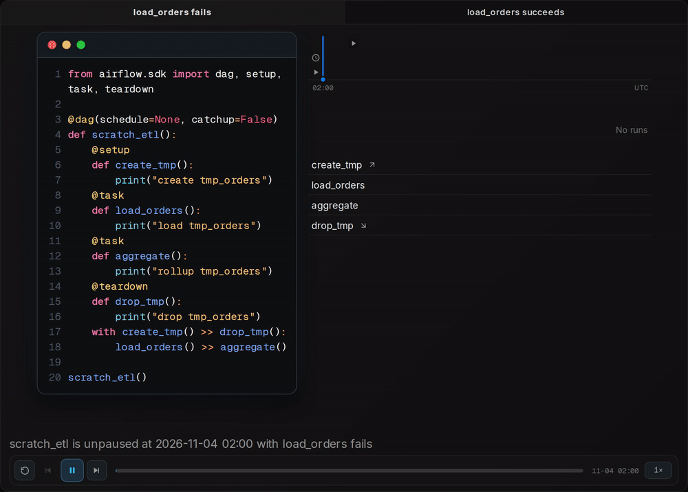
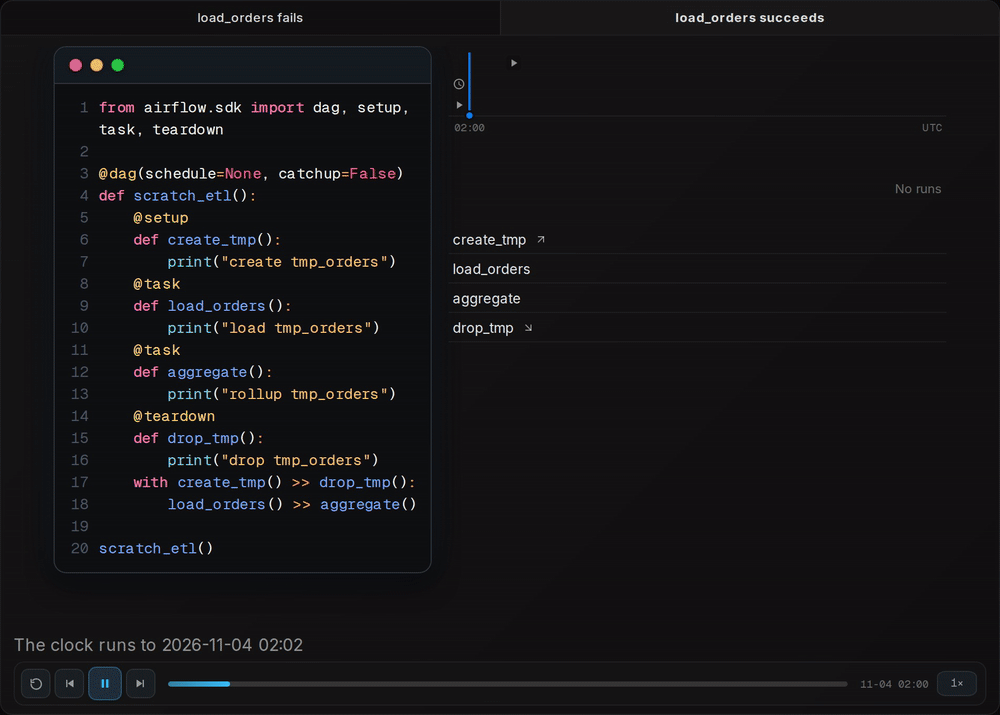

Advanced·[](https://airflow.apache.org/)·20 min · 7 challenges

# Task Lifecycle: Advanced

Airflow began at Airbnb in 2014. This lesson follows a hypothetical nightly pricing run there: it spins up a scratch cluster, pulls listings from a rate-limited service, waits for an analyst to sign off, and must publish before a 07:00 dashboard. Tonight the pull hits its limit at 03:10 and a worker pod dies mid-load. Each event leaves a different trace in the grid, and this lesson reads each one.


<br>

---

## Retry Policies and Backoff

`retries` and `retry_delay` give every failed try the same wait, and a fixed wait fits one kind of failure: a service that blinks for 20 seconds. A rate limit that lifts after 10 minutes, or a warehouse queue that drains over half an hour, outlasts a fixed policy. With 3 retries 1 minute apart, every retry lands inside the outage, so the task fails after roughly 3 minutes of waiting with 4 identical tracebacks. This section builds a policy that spaces its tries out, and gives up at once on the errors no wait can fix.


<br>

### Doubling the wait

`retry_exponential_backoff=True` makes each wait longer than the one before it. Airflow computes the wait at the moment a try fails. The base is `retry_delay` multiplied by 2 raised to one less than the number of the try that failed, so the first wait is 1 base, the second 2 bases, the third 4. On top of the base it adds a jitter of between 0 and the base, taken from a hash of the DAG id and task id combined with the logical date and the try number. The hash is fixed for one task instance and differs across instances, so 200 mapped tasks that hit one rate limit together come back spread over a window rather than as a single wave that trips the limit again. `max_retry_delay` caps the result, jitter included.

```sql
from datetime import timedelta

from airflow.sdk import task


@task(
    retries=4,
    retry_delay=timedelta(minutes=5),
    retry_exponential_backoff=True,
    max_retry_delay=timedelta(minutes=30),
)
def pull_listings():
    ...
```

| Try that failed | Base wait | Window before the cap | Window after the 30 min cap |
| --- | --- | --- | --- |
| 1 | 5 min | 5 to 10 min | 5 to 10 min |
| 2 | 10 min | 10 to 20 min | 10 to 20 min |
| 3 | 20 min | 20 to 40 min | 20 to 30 min |
| 4 | 40 min | 40 to 80 min | 30 min |

Add the last column and the fifth try starts between 65 and 90 minutes after the first failure, where a fixed 5 minute policy would have spent all 4 retries in 20 minutes. The wait is measured from the moment the try ended, so a try that runs for 20 minutes and then fails comes back 25 to 30 minutes after it began, which matters when a deadline downstream is close. In the grid the cell sits in `up_for_retry` for the whole wait: the scheduler stores the try's end time plus the wait as the earliest start and ignores the task until the clock reaches it. `on_retry_callback` fires as the cell enters that state, once per failed try, which is where a counter of how often each source needs a second try belongs.


<br>

### Failures no wait will fix

A retry assumes the next try can end differently. A revoked API key, a file whose header names a column the warehouse lacks, a query with a typo in it: 5 tries of those cost up to 90 minutes, produce one traceback 5 times, and the person on call hears about it up to 90 minutes late. Airflow lets the task say that a wait would be wasted. Raising `AirflowFailException` moves the task instance straight to `failed`, however many retries remain. Any other exception moves it to `up_for_retry` while retries remain and to `failed` when they run out. The task body classifies the error it caught and raises the kind that fits.

```sql
from datetime import timedelta

import requests
from airflow.exceptions import AirflowFailException
from airflow.sdk import task
from etl import write_batch

LISTINGS_URL = "https://partner.example/v2/listings"


@task(retries=4, retry_delay=timedelta(minutes=5), retry_exponential_backoff=True)
def pull_listings():
    response = requests.get(LISTINGS_URL, timeout=30)
    if response.status_code in (400, 401, 403, 404):
        raise AirflowFailException(f"rejected: {response.status_code}")
    response.raise_for_status()
    write_batch(response.json())
```

Status codes 400 and 404 say the request itself was wrong, and so do 401 and 403; the next try would send the same request. A 429 is also a 4xx, but it says the request was fine and the caller should come back later, so the code leaves it off the list. It falls through to `raise_for_status()` with the 5xx answers, which say the server was wrong, and raises an ordinary exception; a timeout raises one from `requests.get` itself, and in each case the backoff policy takes over. For a source that has nothing to give today, `AirflowSkipException` ends the try as `skipped`, and the try is neither retried nor failed. A try that overruns `execution_timeout` is killed and counted as a failed try, so a task with 4 retries and a 10 minute timeout can hold a worker for 50 minutes of running time before it fails for good.

> What each ending does to the try
>
> - Ordinary exception: `up_for_retry` while retries remain, then `failed` on the last one
> - `AirflowFailException`: `failed` at once, with the remaining retries never used
> - `AirflowSkipException`: `skipped` without a retry, after which the downstream trigger rules decide what runs
> - `execution_timeout` reached: the try is killed and counted as failed, then retried like any failure
> - Return without raising: `success`, and the retry count is never consulted

| ✓ Do | ✗ Don't |
| --- | --- |
| • Set backoff and a cap together so the last wait still fits before the run's deadline<br><br>• Raise AirflowFailException on 4xx, auth and schema errors the next try would repeat<br><br>• Keep retries in default_args and override them on the tasks that call flaky services | • Retry a task that writes without a way to redo the write cleanly<br><br>• Lean on retries to cover a memory limit the task exceeds on every try<br><br>• Set retry_delay in seconds against a rate limit measured in minutes |


<br>

---

## Setup and Teardown Tasks

A DAG that works in a scratch table runs 4 tasks in one chain. The first 2 create the table and load it; the last 2 roll it up and drop it. The chain has a hole in it. When `load_orders` fails, `drop_tmp` sits downstream of a failure and goes `upstream_failed`, so the table stays until a person notices. On a scratch cluster the same hole bills by the hour all night. The repair the trigger rules lesson suggests, `trigger_rule="all_done"` on the drop, opens a second hole: the run's state follows its leaf tasks, `drop_tmp` is the only leaf, and once it succeeds the run turns green with a failed load inside it, so the failure callback never fires.


<br>

### Marking the pair

```sql
from airflow.sdk import dag, setup, task, teardown
from etl import warehouse


@dag(schedule=None, catchup=False)
def scratch_etl():
    @setup
    def create_tmp():
        warehouse.create("tmp_orders")

    @task
    def load_orders():
        warehouse.load("tmp_orders")

    @task
    def aggregate():
        warehouse.rollup("tmp_orders")

    @teardown
    def drop_tmp():
        warehouse.drop("tmp_orders")

    with create_tmp() >> drop_tmp():
        load_orders() >> aggregate()


scratch_etl()
```

`@setup` and `@teardown` replace `@task` on the 2 tasks that frame the work, and the `with` block wires everything created inside it after the setup and before the teardown, so the 4 tasks form the same chain as the plain version. The marking changes 3 things about `drop_tmp`. Its trigger rule becomes `all_done_setup_success`: it runs once every upstream task has finished, in any state, provided the setup it belongs to succeeded. Its own state stops counting toward the run's state, so a green teardown under a failed load leaves the run `failed`. And clearing any task between the pair clears the pair with it, so a rerun of `aggregate` recreates the table before it and drops it after.

Play the night below. A manual trigger at 02:02 creates the run; `create_tmp` runs for 2 minutes and succeeds; `load_orders` runs for 4 minutes and fails; `aggregate` goes `upstream_failed` without starting; and `drop_tmp`, with its setup green and every upstream cell settled, is scheduled, runs for 1 minute and succeeds. The run closes as `failed` with the teardown green inside it. Switch the variant to a night where the load succeeds and the only difference is the 2 cells in the middle.

**load_orders fails**



**load_orders succeeds**



| What fails | load_orders | aggregate | drop_tmp | Run |
| --- | --- | --- | --- | --- |
| Nothing | success | success | success | success |
| load_orders | failed | upstream_failed | success | failed |
| create_tmp | upstream_failed | upstream_failed | upstream_failed | failed |
| drop_tmp only | success | success | failed | success |
| drop_tmp only, on_failure_fail_dagrun=True | success | success | failed | failed |

The last 2 rows show the default for a teardown that fails on its own: the work succeeded, the run reports success, and the undropped table shows only as the teardown's red cell. For a cluster that bills until it is deleted, that default hides the cost. `@teardown(on_failure_fail_dagrun=True)` makes the teardown's failure fail the run, which routes it to the same `on_failure_callback` as any other failure. Choose per teardown: a temp table nobody pays for can stay a red cell, a cluster cannot.


<br>

### Classic operators and several setups

Operators from providers take the same marking through 2 methods. `create.as_setup()` returns the task marked as a setup, and `delete.as_teardown(setups=create)` returns the teardown tied to it. `setups` takes a list when one teardown closes several setups, and the teardown then waits for all of its upstream tasks and runs when its setups succeeded. The work tasks between the pair need no marking at all; the chain through the teardown places them.

```sql
from airflow.providers.standard.operators.bash import BashOperator

create = BashOperator(task_id="create_cluster", bash_command="cluster-cli create etl-scratch")
run_job = BashOperator(task_id="run_job", bash_command="cluster-cli submit etl-scratch job.py")
delete = BashOperator(task_id="delete_cluster", bash_command="cluster-cli delete etl-scratch")

create.as_setup() >> run_job >> delete.as_teardown(setups=create, on_failure_fail_dagrun=True)
```

Clearing follows the pair as a unit. Clear `run_job` after fixing its bug and the grid clears `create_cluster` and `delete_cluster` with it, because the rerun needs a cluster that exists and must delete it afterwards. Clear `delete_cluster` alone and only the delete reruns, which is the move when the job finished and the delete was the task that failed. A clear of the setup alone also clears the work and the teardown, since work that ran on the old cluster cannot be kept once a new one is made.

> **TIP**
>
> A teardown that runs after a failed run sees whatever the failed work left behind: a half-loaded table, a cluster with a job still queued on it. Write it to clean up from any state, because the state of the work is the one thing it cannot assume.


<br>

---

## Human Approval Steps

Some steps belong to a person. A pricing model that moves 8 percent of listings by more than 5 percent goes live only when an analyst says so, and the analyst wants to see the numbers first. Before Airflow 3.1 the usual workaround was a task that failed on purpose until someone cleared it, with the decision living in a chat thread rather than in the run. The standard provider now ships operators that put the question inside the run: the task posts a subject and a body, waits for one of a fixed set of answers, records who gave it and when, and carries the answer into the tasks after it.

```sql
from datetime import timedelta

from airflow.providers.standard.operators.hitl import ApprovalOperator

approve_prices = ApprovalOperator(
    task_id="approve_prices",
    subject="Publish tonight's prices?",
    body="Model v12 moves 8 percent of listings by more than 5 percent.",
    defaults="Reject",
    execution_timeout=timedelta(hours=4),
)

score_listings >> approve_prices >> publish_prices
```

When `approve_prices` starts, it records the question and leaves the worker: the cell turns to `deferred`, a state that means the task is waiting on an event outside any worker, with its wait held by the triggerer, a long-lived Airflow process beside the scheduler. A later lesson covers that state in depth; for now, read it as a wait that costs no worker slot, so 30 runs waiting on 30 analysts occupy nothing. The question appears on the Required Actions page of the UI, showing the subject and body above its 2 buttons, next to the run it belongs to. Any user with access to the DAG can answer, unless `assigned_users` names who may. The task instance stores the answer along with who gave it and when.

| What happens | approve_prices | publish_prices | Run |
| --- | --- | --- | --- |
| Analyst picks Approve | success | runs | success |
| Analyst picks Reject | success | skipped | success |
| 4 hours pass, defaults="Reject" | success | skipped | success |
| 4 hours pass, no defaults | failed | upstream_failed | failed |

Reject ends the task in `success`, because the task did its job of asking, and skips the tasks after it. By default `ignore_downstream_trigger_rules` is `False`: it skips the tasks directly downstream, here `publish_prices`. Tasks further down follow their own trigger rules, so a `notify_team` after `publish_prices` with `trigger_rule="all_done"` still runs on a Reject. Setting it to `True` skips every task downstream whatever its trigger rule, as a short-circuit does by default. `fail_on_reject=True` makes Reject fail the task instead, for a run that should turn red when the answer is no. Approve returns and the chain continues. The option the person chose is stored with the task, so a task further down can read which answer was given, which belongs to the lessons on passing values between tasks.


<br>

### When nobody answers

`execution_timeout` bounds the wait, the same argument that bounds any task. With `defaults` set, the timeout picks that answer and the task ends as if a person had chosen it, which is the shape for a decision with a safe side: an unreviewed price list stays unpublished. Without `defaults`, the timeout fails the task, and the retry policy from the first section applies to it like any failure, so `retries=1` asks the question a second time 4 hours later. Clearing the task from the grid asks again at once, with a fresh 4 hours.


<br>

### More than yes or no

`HITLBranchOperator` offers a list of task ids as its options and runs the one the person picks, the branching pattern from the intermediate lesson with a person in place of the function. `HITLOperator` takes any list of `options`, and `multiple=True` lets the person pick several. `HITLEntryOperator` collects typed values through form fields. `subject` and `body` work the same way in all 4, and so do `defaults`, `execution_timeout`, `notifiers` and `assigned_users`.

```sql
from datetime import timedelta

from airflow.providers.standard.operators.hitl import HITLBranchOperator

choose_rollout = HITLBranchOperator(
    task_id="choose_rollout",
    subject="How far should model v12 roll out?",
    options=["publish_all", "publish_sample", "hold"],
    defaults="hold",
    execution_timeout=timedelta(hours=4),
)

choose_rollout >> [publish_all, publish_sample, hold]
```

A question on a page nobody opens waits for its timeout. `notifiers` takes a list of notifier objects, the kind a failure callback can be, and runs them when the task starts waiting, passing them the subject and body along with a link to the response page. A chat notifier from a provider puts the question in the analysts' channel at 05:10 with a button that opens the page, and the 4 hour clock runs from then. The timeout should match how the team works: 4 hours covers a morning, and a question posted at 02:00 with a 4 hour timeout answers itself before anyone is awake.

> What the run keeps about the decision
>
> - The subject and body as the person saw them, rendered for that run
> - The option chosen; after a timeout, that is the default, marked as chosen by the timeout
> - The user who answered and the instant they answered
> - The states that followed: `skipped` downstream on Reject, `failed` on a timeout without a default


<br>

---

## Deaths Without a Log

A task's log usually ends with a verdict. A success ends with the task's own last line and a return code of 0; a failure ends with a traceback, the exception's name, and a line from the task runner saying the task failed. Some logs end mid-sentence, with `loaded 1,200,000 of 3,400,000 rows` as the last line, neither a traceback nor a return code after it, and a state that stays unchanged for 5 minutes. A log that stops without a verdict means the process that would have written the verdict is gone, and Airflow has 3 ways of noticing, each leaving a different trace. The intermediate lesson's `execution_timeout` belongs with the failures that leave a log: the runner raises `AirflowTaskTimeout` inside the task, so the traceback is there and the state changes at once.

| Last lines in the log | What happened | Who records the failure, and when |
| --- | --- | --- |
| A traceback, then the runner's line that the task failed | The task's code raised | The task's own runner, at once |
| A single runner line giving a negative return code, -9 for a kill | The kernel killed the task process; the worker is alive | The supervisor on the worker, at once |
| The log stops mid-line; later a line names the instance a zombie | The worker, pod or host died | The scheduler, after the heartbeat timeout |
| A line that the state was externally set, then termination | A person marked it failed or cleared it while running | The supervisor, on its next heartbeat |


<br>

### The heartbeat

Every running task has 2 processes on its worker: the task process and a supervisor that started it. The supervisor sends a heartbeat to the API server on a short interval, `[workers] min_heartbeat_interval`, 5 seconds by default, and each heartbeat updates the task instance's last heartbeat time. The scheduler looks for running task instances whose last heartbeat is older than `[scheduler] task_instance_heartbeat_timeout`, 300 seconds by default. Each one it finds is treated as a failed try: a line naming the instance a zombie goes into its log, and the instance passes through the same failure handling a raised exception gets, so the cell goes to `up_for_retry` if retries are left and to `failed` if not. The matching callback, `on_retry_callback` or `on_failure_callback`, fires.

| Clock | On the worker | In Airflow |
| --- | --- | --- |
| 02:14:03 | The node loses power; task and supervisor stop | Last heartbeat on record: 02:14:00 |
| 02:14:00 to 02:19:00 | Nothing | Cell stays `running`, log unchanged |
| 02:19:10 | Nothing | Scheduler finds the heartbeat 5 min 10 s old, marks the try failed, cell to `up_for_retry` |
| 02:24:10 | Try 2 starts on another worker | Cell to `running`, `retry_delay` of 5 min served |

The 5 minutes are the price of telling a dead worker from a slow network, and the retry's wait starts after them. The gap applies only when the supervisor dies with the task: a host that loses power, an evicted pod, a container killed whole at its memory limit. A retry treats the cause as transient, which fits an evicted pod and does not fit a task that exceeds its memory limit, because the next try is killed at the same row count. With `retries=3` and the default 5 minute `retry_delay`, one death becomes 4, each noticed 5 minutes after it happened: 20 minutes of detection plus 15 minutes of waits, 35 minutes on top of the running time before anyone is paged. The pattern to read for is a kill at the same point in the log on every try, which names the task's memory as the problem and the retry count as noise. A kill at a different point each time, on different workers, points at the hosts instead.


<br>

### Killed with the worker still alive

When the kernel's out-of-memory killer takes only the task process, the supervisor survives it, sees the child end on a signal rather than a return code, and reports the try as failed at once with a line giving the negative code, `-9` for a kill. The log still has no traceback, because no Python ran after the signal. The worker's own logs, or the pod's events on a container platform, carry the reason: an `OOMKilled` event with the limit it hit. A termination signal instead of a kill, which is what a worker shutdown sends, lets Python run: the task raises on the signal, the log ends with a traceback naming SIGTERM, and the try fails through the ordinary path with its retries intact.


<br>

### Killed on purpose

Marking a running task failed in the UI, or clearing it, changes the state in the database first. The supervisor learns of the change on its next heartbeat, because the API server answers a heartbeat for a task whose state is no longer `running` by telling the supervisor to stop. It terminates the task and writes that the state was set externally. The log therefore carries a verdict, written within about 5 seconds of the click, and the next try number belongs to the clear. A log that ends with that line, next to an audit log entry with a person's name, belongs to a task that someone stopped by hand.

> Reading a dead task
>
> - Last log line: a traceback, a negative return code, an externally set state, or nothing at all
> - Gap between the last log line and the state change: seconds for a kill, 5 minutes for a lost worker
> - The same stopping point on every try points at memory; a different point each time points at the hosts
> - The worker's logs and the pod's events name the signal and the limit the task hit

*Lowering task_instance_heartbeat_timeout below 300 seconds buys faster detection at the cost of failing healthy tasks during a slow network or a busy API server; raise it only for workers that are known to pause, and change neither without watching the zombie count for a week.*


<br>

---

## Deadline Alerts

A failed run calls `on_failure_callback` the moment it fails. A run that is still going at 07:00, when the pricing dashboard refreshes from its output, calls nothing, because nothing has failed: `pull_listings` hit its rate limit at 03:10, backed off 4 times, and is on its fifth try with every other cell green or waiting. The people at the dashboard find stale prices and ask the data team at 09:00, 2 hours after the point at which a page could have changed the outcome. A deadline alert is Airflow's answer for that run: a time the run must be finished by, and a callback that runs when the clock passes it with the run still open.

```sql
from datetime import timedelta

from airflow.sdk import dag
from airflow.sdk.definitions.deadline import AsyncCallback, DeadlineAlert, DeadlineReference
from airflow.timetables.trigger import CronTriggerTimetable


@dag(
    schedule=CronTriggerTimetable("0 2 * * *", timezone="UTC"),
    catchup=False,
    deadline=DeadlineAlert(
        reference=DeadlineReference.DAGRUN_LOGICAL_DATE,
        interval=timedelta(hours=5),
        callback=AsyncCallback(
            "pricing.alerts.page_oncall",
            kwargs={"channel": "#pricing-oncall"},
        ),
    ),
)
def nightly_pricing():
    ...


nightly_pricing()
```

The deadline is a reference plus an interval, computed once when the run is created and stored with it. `DAGRUN_LOGICAL_DATE` anchors to the run's logical date, and with `CronTriggerTimetable` that is the 02:00 the run fired at, so the deadline is 07:00 the same morning for every scheduled run. With `CronDataIntervalTimetable` the logical date would be the previous day's 02:00, and the same 5 hours would name a deadline already past when the run is created, so the alert fires as the run starts; the timetable lesson's distinction decides whether the alert means anything. `DAGRUN_QUEUED_AT` anchors to the moment the run was created, which measures how long the run took regardless of when it was due, and `FIXED_DATETIME` names one instant for a run that must land before a specific meeting.

| Reference | Anchor for the 2026-11-04 run | Deadline with a 5 hour interval |
| --- | --- | --- |
| DAGRUN_LOGICAL_DATE with CronTriggerTimetable | 2026-11-04 02:00 | 2026-11-04 07:00 |
| DAGRUN_LOGICAL_DATE with CronDataIntervalTimetable | 2026-11-03 02:00 | 2026-11-03 07:00, already past at creation |
| DAGRUN_QUEUED_AT | When the run was created: 02:00 on schedule, 11:30 for a manual trigger at 11:30 | 5 hours after creation |
| FIXED_DATETIME(2026-11-04 02:00 UTC) | The instant given | 2026-11-04 07:00 for every run, however it was created |

| Clock | The run | The alert |
| --- | --- | --- |
| 02:00 | Run created; deadline stored as 07:00 | Pending |
| 03:10 | `pull_listings` fails try 1 on a rate limit; backoff begins | Pending |
| 07:00 | Try 5 still running; run open | Scheduler sees the deadline passed; callback handed to the triggerer; page sent to #pricing-oncall |
| 07:25 | Run succeeds | Already fired; nothing more |

The scheduler checks pending deadlines on each loop, and a deadline whose run is still open when the clock passes it fires once. `AsyncCallback` names an `async def` in a module the triggerer can import, and the triggerer runs it with the `kwargs` you set alongside details of the run that missed, so the page can link to the grid. Running it in the triggerer matters because a late run is often late for lack of workers; a callback that needed a worker slot would queue behind the tasks it is reporting on. The alert fires whether the run then succeeds at 07:25 or fails at 09:00, since what it measures is lateness, and a run that fails before 07:00 reaches a terminal state and never fires it.

| ✓ dagrun_timeout | ✗ DeadlineAlert |
| --- | --- |
| • A duration measured from the run's start<br><br>• Fails the run when exceeded, killing its running tasks<br><br>• Fires on_failure_callback through the failure<br><br>• Answers: has this run gone on too long? | • An instant computed from a reference plus an interval<br><br>• Changes nothing about the run; it keeps going<br><br>• Runs its own callback in the triggerer, once<br><br>• Answers: will the people waiting get it on time? |

> When the deadline stays silent
>
> - The run finished before the deadline, whether it succeeded or failed: its deadline record is removed and nothing fires
> - The DAG is paused: a paused DAG creates no scheduled runs, so nothing holds a deadline for them; a fixed-time check lives outside Airflow
> - The callback's module can't be imported by the triggerer: the error shows in the triggerer's log, and no page goes out

Set the interval from the consumer's clock, then subtract the retry policy's worst case. A deadline at 07:00 with `pull_listings` able to wait 90 minutes across its retries means a first failure after 05:30 cannot finish in time, which is a fact to carry back to the backoff section: cap the waits so the last retry still fits. A DAG whose runs are late on most nights has a capacity problem, and the alert will report it every morning until the platform has room for that DAG; the alert only reports the lateness, and the fix lies in the platform's capacity.

> **TIP**
>
> Write the consumer the deadline serves in the DAG's docstring next to the reference and interval. When the dashboard moves to 06:30, the person editing the interval should see why the number was 5 hours and not have to ask.


<br>

---

## Putting It All Together

The hypothetical Airbnb pricing run from the opening starts at 02:00 with its deadline stored as 07:00 and a scratch cluster created by a setup task. At 03:10 the listings pull hits a rate limit and backs off: 5 to 10 minutes, then 10 to 20. At 03:40 the pod running the retry is evicted mid-load; the log stops, and at 03:45 the scheduler marks the try failed and the next one starts elsewhere. The scoring finishes at 05:40 and an approval task asks the analyst, who answers Approve at 06:20. Publishing is still running at 07:00, so the deadline callback pages the on-call channel; the run succeeds at 07:12, and the teardown deletes the cluster.

- The backoff windows from the first section set the earliest and latest moments the pull could come back, which is what the deadline's interval had to leave room for.
- The evicted pod left a log without a verdict, and the 5 minute gap before the state changed is the heartbeat timeout, after which the retry policy treated it as one more failed try.
- The approval task spent 40 minutes in deferred without holding a worker, and its 4 hour timeout with a default of Reject meant an unanswered question would have left prices unpublished rather than wrong.
- The deadline fired on a run that later succeeded, because it measures lateness rather than failure, and the page at 07:00 reached the on-call engineer before the dashboard's users noticed.
- The cluster was deleted on a night that also saw a failed try, because the teardown's trigger rule waited only for the work to be done and the setup to have succeeded.


<br>

---

## Key Takeaways

- Exponential backoff doubles the base wait each try and adds a hashed jitter of up to one base; max_retry_delay caps it, and AirflowFailException skips the retries altogether.
- A teardown runs once its setup succeeded and the work between them is done in any state, and its own result stays out of the run's state unless on_failure_fail_dagrun says otherwise.
- An approval task waits in deferred, holding no worker, until a person answers on the Required Actions page or the timeout takes the default; Reject skips the tasks downstream.
- A log that stops without a verdict means the process is gone: the supervisor reports a killed process at once, and the scheduler reports a lost worker after the 300 second heartbeat timeout.
- A deadline alert fires once when the clock passes reference plus interval with the run still open, in the triggerer rather than a worker, and a late run that later succeeds fires it all the same.

[](https://airflow.apache.org/)

Official Apache Airflow resourcesversion 3.3

"Platform created by the community to programmatically author, schedule and monitor workflows." [airflow.apache.org](https://airflow.apache.org/)

[Documentation](https://airflow.apache.org/docs/)[Install](https://airflow.apache.org/docs/apache-airflow/stable/installation/index.html)[Community](https://airflow.apache.org/community/)

Apache Airflow, Apache, Airflow, the Airflow logo, and the Apache logo are either registered trademarks or trademarks of The Apache Software Foundation.
