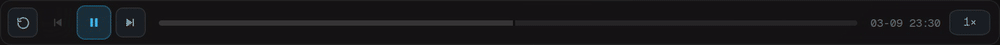
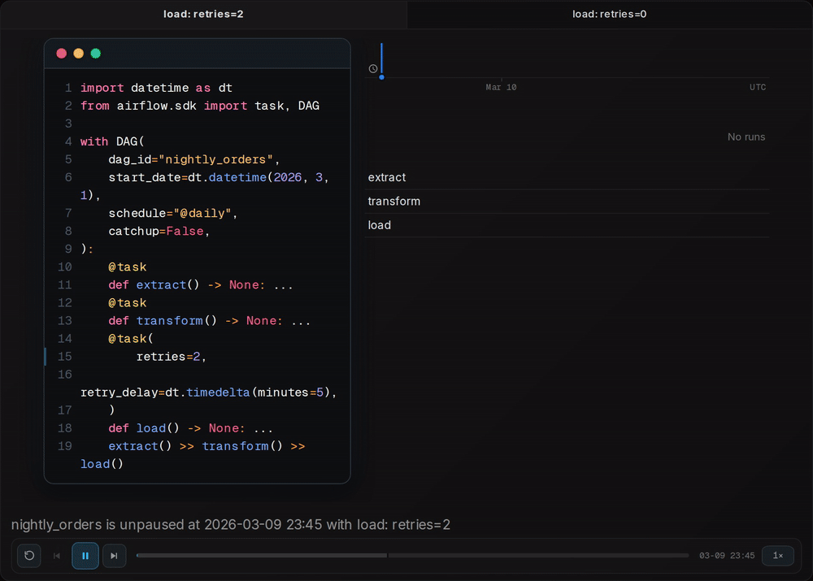
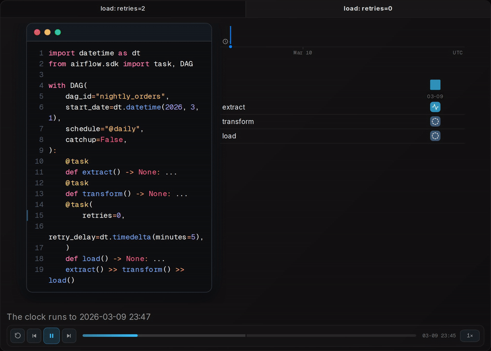
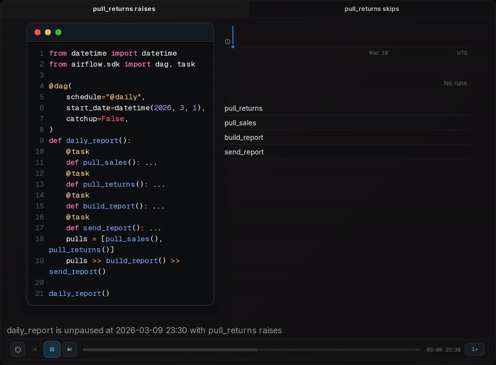
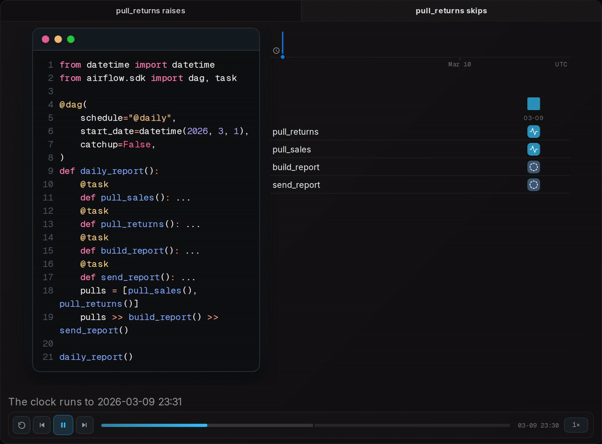
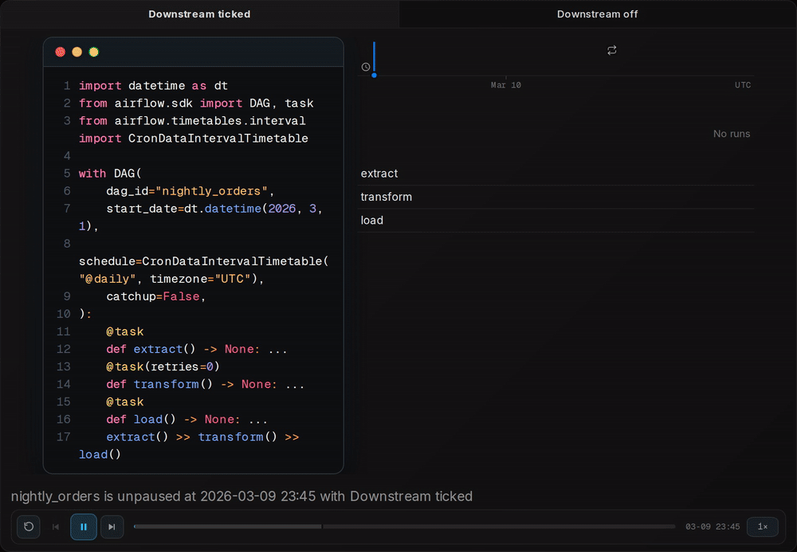
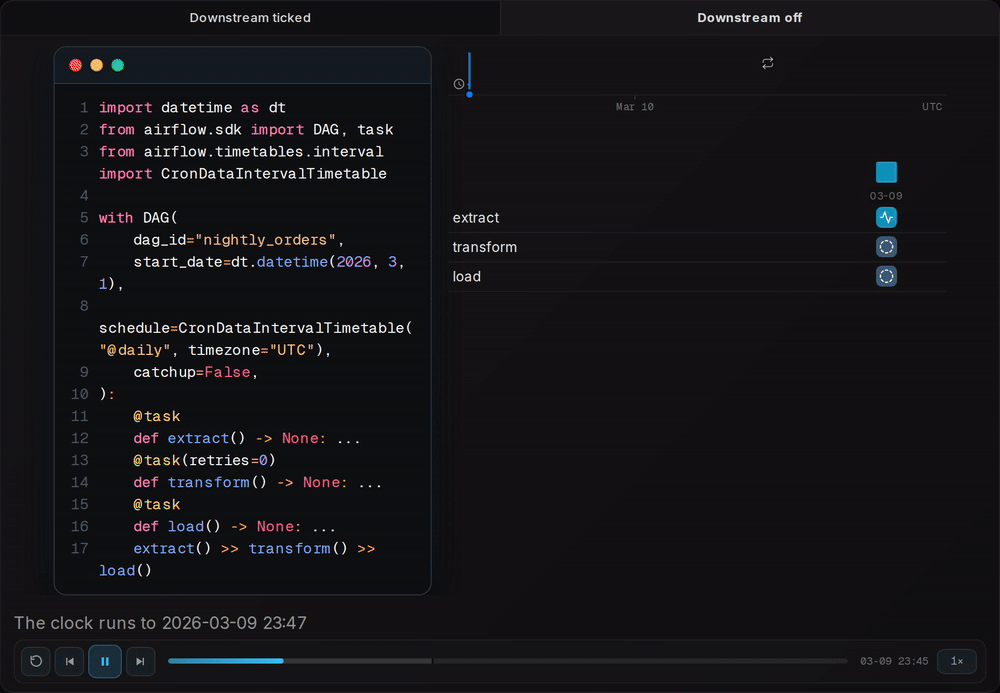

Beginner·[](https://airflow.apache.org/)·20 min · 8 challenges

# Task Lifecycle: Beginner

Airflow began at Airbnb, so picture a nightly host payout refresh there: 2 pull tasks, a compute step and a publish to the host dashboard. At 00:08 the compute task raises because the warehouse dropped its connection, after both pulls finished. Whether that cell waits 5 minutes and tries again, or goes red and takes the publish task down with it, decides what hosts see in the morning.


<br>

---

## The Life of a Task Instance

A DAG file names tasks. A task instance is the thing Airflow runs: one task, inside one run, for one window of time. The `nightly_orders` DAG in this section has 3 tasks, `extract`, `transform` and `load`, so every run it creates holds 3 task instances, and the grid draws each one as a cell, the run down the column and the task along the row. Every state in this lesson belongs to a cell. The DAG file itself has no state.

3 names pin a cell down: the dag_id, the task_id and the run_id, which for a scheduled run is the word scheduled, 2 underscores and the window's logical date, such as scheduled__2026-03-09T00:00:00+00:00. A fourth number rides along: the try number, which counts how many times a worker has started this cell's code. The first start is try 1, and the number only ever grows.


<br>

### 6 states on the way to done

| State | Who writes it | What it means |
| --- | --- | --- |
| none | the scheduler, when the run is created | The cell exists and nothing has looked at it yet. The grid draws it blank. |
| scheduled | the scheduler | Every task this one depends on ended in success, so it may run as soon as a worker is free. |
| queued | the scheduler, handing it off | It is in the line for a worker. None of the task's code has run. |
| running | the worker | The task's code is executing right now, in whatever try this is. |
| success | the worker, reporting back | The code returned without raising. Final. |
| failed | the worker, reporting back | The code raised and no tries are left. Final. |

2 parties move a cell. The scheduler owns the top half of the table: it creates the cell as `none` when the run appears, moves it to `scheduled` once the tasks above it are done, and to `queued` when it hands the task to the worker pool. A worker owns the bottom half: it takes the task from the queue, writes `running`, executes the Python, and reports `success` or `failed` when the code returns or raises. The scheduler decides when a cell may run; the worker decides how it ends. Every later state in this lesson is one of these 2 parties telling the other something about a cell.




<br>

### The order of events, cell by cell

| Event | extract | transform | load |
| --- | --- | --- | --- |
| Window closes, run appears | none | none | none |
| Scheduler looks at the run | scheduled | none | none |
| extract handed to the worker pool | queued | none | none |
| A worker picks it up | running | none | none |
| extract returns | success | scheduled | none |
| transform handed off, picked up | success | running | none |
| transform returns | success | success | scheduled |
| load picked up, returns | success | success | success |

Put clock times on those rows. The window for 2026-03-09 closes at midnight, so the run appears at 00:00. `extract` spends a few seconds in `scheduled` and `queued` while the scheduler hands it off and a worker picks it up, then runs for 2 minutes. `transform` starts near 00:02 and ends near 00:05, and `load` ends near 00:07. The start and end times you read when you pause on a cell cover `running` only: a cell that waited 4 minutes in `queued` before a 2 minute run shows a 2 minute duration and a start time 4 minutes after its run appeared.

`success` and `failed` are final states. The scheduler never moves a final cell on its own, and the run takes its own state from its cells: a run stays `running` while any cell is not final, ends `success` when every cell is final and none of them is `failed`, and ends `failed` otherwise. The rest of this lesson is about the 3 things that bend the straight line in the table above: a task that gets another try, a failure that spreads to the cells below it, and a person clearing a final cell so the scheduler sees it as new.

> Where a cell's state shows
>
> - The grid: one colour per state, each run's cells stacked in its column.
> - The pointer paused on a cell: state, try number, start time and end time.
> - A click on the cell: the task instance panel, with its Logs tab per try.

> **TIP**
>
> For a cell that looks stuck, the state names which party you are waiting on. A long stay in scheduled or queued is the scheduler and the worker pool; a long stay in running is the task's own code.

*A cell that sits in queued for minutes is waiting on a free worker; a later lesson on executors and capacity covers why that happens and how to size for it.*


<br>

---

## Retries and Retry Delay

Picture the `nightly_orders` run at 00:08. `extract` took 2 minutes and `transform` took 3, both ended `success`, and `load` has been running for 3 minutes when the warehouse drops its connection and the task raises. The 2 cells above it did their work, and the failure says nothing about their output. If the unit of a retry were the whole run, the fix would redo 5 minutes of finished work to reach the 1 task that broke. So Airflow retries the task instance alone: the 2 green cells stay green, and only `load` gets another try.

2 settings on a task control this. retries is how many extra tries the task may take after the first one raises, and it defaults to 0. retry_delay is how long the scheduler waits between a try that raised and the next one, a timedelta that defaults to 300 seconds. With retries=2 a task can run 3 times in total; the count names the extra tries, never the first one.


<br>

### Between one try and the next

When `load` raises, the worker reports the failure along with the try number, 1, and the report is checked against the task's `retries`, 2. Tries remain, so the cell is recorded as `up_for_retry` instead of `failed`, along with the time of the raise. For the next 5 minutes the cell sits in `up_for_retry`: no worker holds it, nothing of the task is executing, and the grid shows the cell in the waiting colour. The scheduler's part is the wait: once `retry_delay` has elapsed it moves the cell back to `scheduled`, then `queued`, and a worker takes it to `running` as try number 2. In the night below, try 2 returns, the cell ends `success`, and the run ends `success` about 8 minutes later than it would have without the outage. Had try 2 raised as well, the same loop would run once more, and try 3 would be the last one `retries=2` allows: a raise there is recorded as `failed`, which is final.

**load: retries=2**



**load: retries=0**



| Try | Ends by | Tries left after it | State the cell gets |
| --- | --- | --- | --- |
| 1 | raising | 2 | up_for_retry, then wait retry_delay |
| 2 | raising | 1 | up_for_retry, then wait retry_delay |
| 3 | raising | 0 | failed |
| any | returning |  | success |

Set the pair once on the DAG with default_args={"retries": 1, "retry_delay": timedelta(minutes=2)} and every task inherits it; a task that passes its own retries overrides the inherited value for itself only. The order Airflow reads is the task's own argument, then default_args, then its built-in default. In the DAG above, extract and transform carry the built-in 0, so a raise in either of them is final on the first try.


<br>

### Choosing the numbers

The worst case a retry setting creates is the time until the cell is finally `failed`: every try's running time plus every wait. `load` runs about 3 minutes before it raises, so `retries=2` with a 5 minute delay means 3 tries of 3 minutes and 2 waits of 5 minutes, 19 minutes from the first start to a red cell. Pick the delay from the outage you are covering: a warehouse that drops connections for a minute at a time is served by a short delay, and a service that restarts over 10 minutes needs a delay longer than that or every try lands inside the same outage.

> What a retry does not change
>
> - The tasks above it: extract and transform keep their success cells and never run again.
> - The window: try 2 reads the same logical date and the same data interval as try 1.
> - A bug in the code: a task that raises on a typo raises the same way on every try.

| ✓ Do | ✗ Don't |
| --- | --- |
| • Give tasks that cross a network a retry; a dropped connection heals on its own.<br><br>• Make retry_delay longer than the outage you expect, or every try fails inside it.<br><br>• Set the pair in default_args once and override on the few tasks that differ. | • Retry a task whose failure is a code bug; every try fails the same way.<br><br>• Read retries=3 as 3 tries; it is 4.<br><br>• Leave a critical task at the default of 0 and discover it on the first bad night. |

> **TIP**
>
> A cell in up_for_retry is waiting, and you do not have to wait with it. Clearing the cell, covered in a later section, sends it back to the scheduler at once instead of at the end of retry_delay.


<br>

---

## Upstream Failed and Skipped

Every task so far waited for the one above it. The rule behind that waiting is the default rule for every task: a cell moves to `scheduled` only when every cell it depends on has ended `success`. The rule has a second half. When an upstream cell ends `failed`, the condition can never be met, so the scheduler does not leave the dependent cell waiting for the rest of the night: it writes `upstream_failed` straight into it, without ever sending it to a worker. That cell is now final, so the cells that depend on it get the same treatment, and the state walks down the chain until it reaches a task with nothing below it.

The `daily_report` DAG below has 2 tasks feeding a third. `pull_sales` and `pull_returns` both run when the run appears, because neither depends on the other. `build_report` depends on both, and `send_report` depends on `build_report`. When `pull_returns` raises with no retries, the scheduler writes `upstream_failed` on `build_report` the moment it sees the red cell, then on `send_report`. `pull_sales` keeps running and ends `success`, because its own upstream condition has nothing to do with the failure.

Spreading follows the arrows and nothing else. Add an `archive_sales` task that depends on `pull_sales` alone, and on the night `pull_returns` raises it still runs and ends `success`, because none of the cells above it failed. The run still ends `failed`, since 1 of its cells is `failed`, but the work that never needed the returns file is done. The arrows you draw decide how much of a bad night survives: a task wired below every other task loses whenever any of them fails.


<br>

### Skipped spreads the same way

A task can also end without failing and without doing anything. `pull_returns` reads a returns file that the finance system produces only on days with returns. On a day with none, the task raises `AirflowSkipException`, and the worker reports `skipped`. Under the same default rule, `skipped` is a final state other than `success`, so `build_report` becomes `skipped` as well, and then `send_report`. The shape of the spread is identical to a failure. The meaning is the opposite: nothing went wrong, and there was nothing to do.

```sql
from airflow.exceptions import AirflowSkipException
from airflow.sdk import task


@task
def pull_returns():
    if not returns_file_exists():
        raise AirflowSkipException("no returns file today")
    copy_returns_file()
```

**pull_returns raises**



**pull_returns skips**



pull_returns raised

| Task | State |
| --- | --- |
| pull_sales | success |
| pull_returns | failed |
| build_report | upstream_failed |
| send_report | upstream_failed |

pull_returns skipped itself

| Task | State |
| --- | --- |
| pull_sales | success |
| pull_returns | skipped |
| build_report | skipped |
| send_report | skipped |


<br>

### What the run says afterwards

The 2 grids look alike and the runs end differently. On the left, 1 cell is `failed`, so the run ends `failed`, the DAG's run list shows a red run, and anyone watching for failed runs hears about it. On the right, no cell is `failed`: the run ends `success` with 3 grey cells inside it. A report that was never built and never sent sits under a green run. That is correct by the rule, and it is why a skipped chain deserves a check of its own, because the run state will never raise it.

| ✓ failed | ✗ skipped |
| --- | --- |
| • The code raised and no tries were left<br><br>• Spreads down as upstream_failed<br><br>• The run ends failed<br><br>• Fix the cause, then clear the cell | • The code chose to stop by raising AirflowSkipException<br><br>• Spreads down as skipped<br><br>• The run ends success<br><br>• Check it was meant, then leave it |

Reading a run with a wall of orange or grey cells, the cells that spread tell you nothing about the cause, because no worker touched them. Walk up the dependencies from any `upstream_failed` cell until you reach a `failed` one; that cell had a try, and its log holds the error. Retries belong to that cell as well: a cell in `upstream_failed` never had a try, so `retries` on it has nothing to count.

*The default rule can be changed per task, so a task can run after a failure above it or after a skip. A later lesson covers those rules; everything in this lesson assumes the default.*


<br>

---

## Clearing Tasks to Rerun

Clearing a cell erases its state. The run goes back to `queued`, and the scheduler sees a `none` cell in a run whose other cells are final, so it does what it does with any `none` cell: checks the upstream condition, writes `scheduled`, and hands the task to the worker pool. The old try is never replayed. The task's code runs again from the start, as a new try with the next try number. Clearing works on any final cell, `failed`, `upstream_failed`, `skipped` and `success` alike, which is why it is the one tool you reach for both after a fix and when a green cell wrote the wrong thing.


<br>

### The 5 boxes in the clear dialog

In the grid, a click on a cell opens its panel, and the Clear Task Instance button opens a dialog. The cell you clicked is always cleared. The boxes widen the selection.

- **Past** *same task, earlier runs*\
  Also clears this task's cell in every run before this one.
- **Future** *same task, later runs*\
  Also clears this task's cell in every run after this one.
- **Upstream** *same run, tasks above*\
  Also clears every task this one depends on, so they run again first.
- **Downstream** *same run, tasks below*\
  Also clears every task that depends on this one. Ticked by default.
- **Only Failed** *a filter on the selection*\
  Of the cells selected, clears only those in failed or upstream_failed, leaving success cells as they are.

Downstream is the box that decides whether the run recovers. Take `nightly_orders` on a night when `transform` raised with no retries: `transform` is `failed` and `load` is `upstream_failed`. Clear `transform` alone and it reruns and ends `success`, and then nothing else happens, because `load` is still a final cell and the scheduler does not revisit final cells. The run ends `failed` a second time. Clear `transform` with Downstream ticked and `load` goes back to `none` in the same action, waits for `transform` to end `success`, and runs. Switch the setting under the night below to watch the 2 outcomes.

**Downstream ticked**



**Downstream off**



| Cell | Before the clear | Right after, Downstream ticked | Right after, Downstream off | End of night, ticked | End of night, off |
| --- | --- | --- | --- | --- | --- |
| extract | success | success | success | success | success |
| transform | failed | none | none | success | success |
| load | upstream_failed | none | upstream_failed | success | upstream_failed |
| the run | failed | queued | queued | success | failed |

The same action from a terminal: airflow tasks clear nightly_orders -t transform -s 2026-03-09 -e 2026-03-09 --downstream --yes picks the task by a regular expression on its id, the runs by a range of logical dates, and --downstream ticks the box. The --only-failed flag is the Only Failed box, and leaving out --yes prints the list of cells about to be cleared and asks first, which is the form to use on a range wider than 1 day.

Past and Future reach along a task's row, across runs, where Upstream and Downstream reach down one run's column. Clear `transform` in the 2026-03-09 run with Future ticked, and its cells in the 2026-03-10 and 2026-03-11 runs are cleared too, if those runs exist, and each one reruns against its own window. That is the box for a code bug that wrote bad output on several nights in a row. On a one-night failure such as a dropped connection, it reruns later cells that were already right, along with everything Downstream adds below each of them.


<br>

### Clearing a green cell

Clearing a `success` cell is the same action with a different consequence. The scheduler reruns the task, and with Downstream ticked, everything after it. A `load` that appends the window's rows to a table appends them a second time, and a `transform` that writes a file by date overwrites it with the same content. Before clearing a green cell, read what the task writes and ask whether running it twice leaves the data the same as running it once. A later lesson is about writing tasks so the answer is always yes.

Try numbers keep counting across a clear. A `load` that raised on tries 1, 2 and 3, was cleared, and raised again shows try 4 in its cell, and all 4 logs stay where they were written. The next section is about those logs.

> **TIP**
>
> Only Failed is the safe box for a fan-in. Select the join with Upstream and Only Failed ticked, and the feeder that raised is rerun while the feeders that succeeded keep their cells.


<br>

---

## Logs, Tries, and Attempts

Every try writes its own log file, and nothing overwrites it. The worker opens the file as the cell turns `running`, writes a header naming the task instance and the try number, streams every line the task's code logs or prints, and closes with the state it reported. A cell that reached `success` on try 3 therefore has 3 files, and the 2 earlier ones hold 2 tracebacks that the green cell never mentions.

The default path under the log folder spells out the 4 names from the first section: dag_id=nightly_orders/run_id=scheduled__2026-03-09T00:00:00+00:00/task_id=load/attempt=2.log. The attempt segment is the try number, so the files of one cell sit side by side in one folder, and a listing of that folder is a history of the cell.

| The night | File on disk | State the file ends with |
| --- | --- | --- |
| Try 1 raised, 2 retries left | attempt=1.log | up_for_retry |
| Try 2 raised, 1 retry left | attempt=2.log | up_for_retry |
| Try 3 raised, none left | attempt=3.log | failed |
| Cleared, try 4 returned | attempt=4.log | success |


<br>

### Which attempt to open

The task instance panel's Logs tab opens on the latest attempt and offers the others in a selector. The latest one tells you how the story ended: the final traceback for a `failed` cell, or the normal output for a cell that recovered. The first one tells you how it started, with the original error and its timestamp, which matters when a later try failed for a different reason, such as a lock left behind by try 1. Read the last, then the first, then compare.

- Open the latest attempt and read the last 30 lines: the state line and the traceback above it.
- Open attempt 1 and find the first line with a traceback; that is the original cause.
- Same error on every try: the fault is in the code or the data, and retries bought nothing.
- Different error on later tries: try 1 is the cause and the rest are its side effects.
- A success on the last try after failures: read attempt 1 anyway and decide if it will recur.

Take a `load` cell that is red after 3 tries, with `retries=2` and a 5 minute delay. `attempt=3.log` ends on a `TimeoutError` raised while waiting for a lock on the orders table, and read alone it points at a slow warehouse. `attempt=1.log` tells a different story: try 1 wrote half its rows, then raised `ConnectionResetError` at 00:08 when the connection dropped. The warehouse had not yet noticed the dead connection, so the transaction try 1 opened still held the table lock when tries 2 and 3 started, and both timed out waiting on it. The fix belongs in how `load` handles a dropped connection; a longer `retry_delay` would only have hidden the cause.

attempt=1.log

| Part | What it shows |
| --- | --- |
| Header | try 1, started 00:05 |
| Task lines | rows written up to the drop |
| Traceback | ConnectionResetError |
| Closing state | up_for_retry |

attempt=3.log

| Part | What it shows |
| --- | --- |
| Header | try 3, started 00:21 |
| Task lines | waiting for the table lock |
| Traceback | TimeoutError on the lock |
| Closing state | failed |

A task can tell its own log which try it is in, which turns a stack of similar files into a readable sequence. `get_current_context()` returns the running cell, and its `try_number` is the same number the grid shows.

```sql
import logging
from datetime import timedelta

from airflow.sdk import get_current_context, task

log = logging.getLogger(__name__)


@task(retries=2, retry_delay=timedelta(minutes=5))
def load():
    ti = get_current_context()["ti"]
    log.info("starting try %s", ti.try_number)
    write_rows()
```

| Part of one attempt's log | What to read from it |
| --- | --- |
| Header lines | dag_id, task_id, run_id, try number and the start time of this try |
| Lines the task logged or printed | How far the code got before it stopped, in your own words |
| Traceback, if any | The exception type and the line of your code that raised |
| The closing state line | success, up_for_retry or failed, with the end time of the try |

> A red cell with an empty log
>
> A failed cell whose latest attempt holds only the header, or no file at all, means the code never ran far enough to write anything: the worker was lost or the process was killed from outside. The grid state is the same red as a raise, and the log is what tells the 2 apart. An advanced lesson covers those deaths.


<br>

---

## Putting It All Together

Picture an illustrative nightly host payout refresh at Airbnb, where Airflow began: a 4-task DAG that pulls bookings, pulls adjustments, computes payouts and publishes them to the host dashboard. At 00:08 the compute task raises on a dropped warehouse connection, and the on-call engineer wants fresh payouts on the dashboard before hosts start their day.

- The compute cell goes to up_for_retry because it carries retries=2, while the 2 pull cells above it stay success and never rerun.
- Try 2 raises as well and try 3 ends failed, so the scheduler writes upstream_failed on the publish cell and the run ends failed, which is what pages the engineer.
- The engineer opens the latest attempt, sees the connection error, opens attempt 1 and finds the same traceback, so the fault is the warehouse and the code needs no change.
- Once the warehouse is back, clearing the compute cell with Downstream ticked sends it and the publish cell back to none; try 4 succeeds and publish runs for the first time.
- The 4 attempt files stay in the compute cell's folder, so tomorrow's review can measure how long the outage lasted from the first header to the last state line.


<br>

---

## Key Takeaways

- A task instance is one task in one run, and every state belongs to that cell, moved by the scheduler up to queued and by a worker from running onward.
- retries counts extra tries and retry_delay sets the wait between them; a raise with tries left is recorded as up_for_retry, a raise with none left as failed.
- Under the default rule a failed cell turns every dependent cell upstream_failed and a skipped cell turns them skipped, with no worker involved and the run ending failed or success accordingly.
- Clearing erases a cell's state so the scheduler treats it as new, and the Downstream box decides whether the cells below it come along.
- Each try writes its own attempt log and try numbers never reset, so the latest file shows the ending and attempt 1 shows the cause.

[](https://airflow.apache.org/)

Official Apache Airflow resourcesversion 3.3

"Platform created by the community to programmatically author, schedule and monitor workflows." [airflow.apache.org](https://airflow.apache.org/)

[Documentation](https://airflow.apache.org/docs/)[Install](https://airflow.apache.org/docs/apache-airflow/stable/installation/index.html)[Community](https://airflow.apache.org/community/)

Apache Airflow, Apache, Airflow, the Airflow logo, and the Apache logo are either registered trademarks or trademarks of The Apache Software Foundation.
