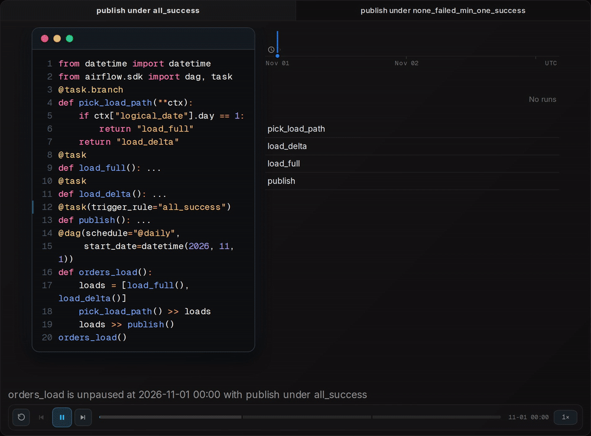
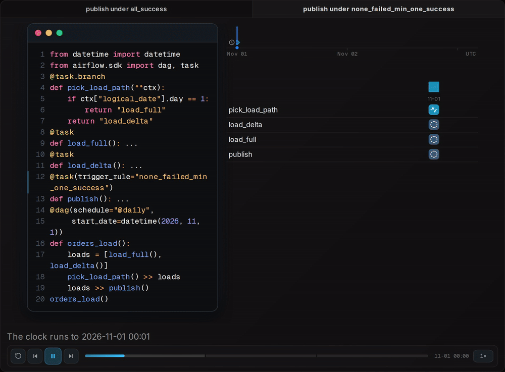
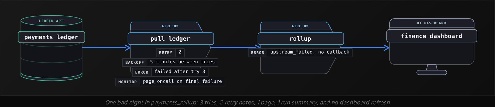
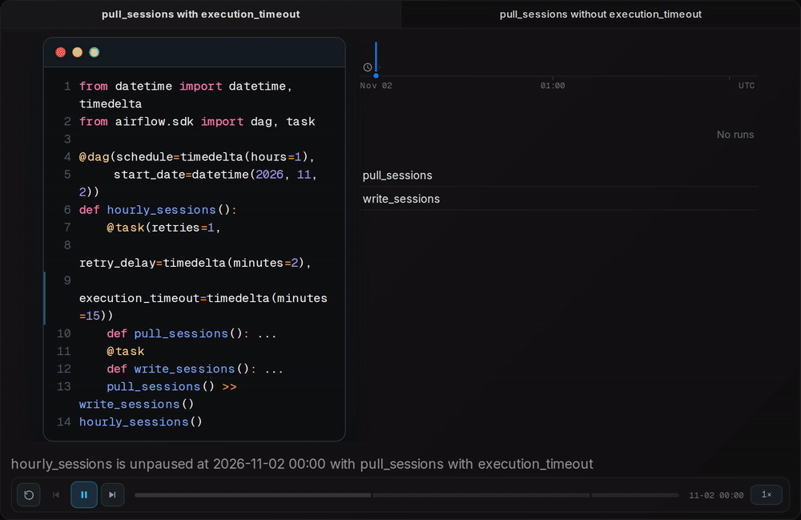
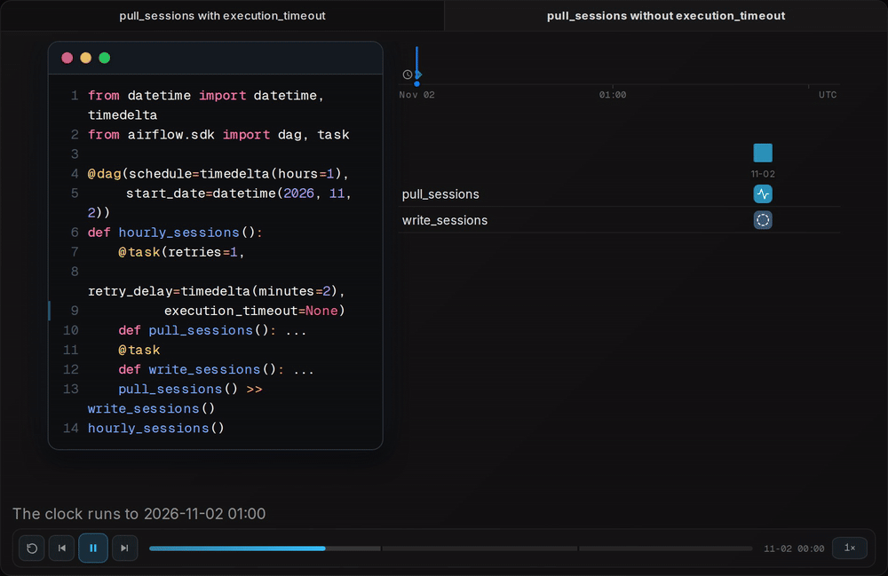

Intermediate·[](https://airflow.apache.org/)·20 min · 8 challenges

# Task Lifecycle: Intermediate

Take a nightly pricing DAG at Airbnb, where Airflow was first written. At 02:14 it finishes with a green badge. A feed task failed at 01:50, the merge behind it went orange, and the cleanup after the merge ran anyway. That cleanup is the DAG's only leaf task, so the run reports success and nobody is paged. Trigger rules and the leaf tasks decided each of those outcomes.


<br>

---

## Trigger Rules

Before the scheduler moves a task to scheduled, it reads the task's trigger rule against the final states of every task directly upstream. The default rule is `all_success`: each upstream must have ended in success. Under it, 1 failed upstream puts the task in upstream_failed and 1 skipped upstream puts it in skipped, so a single failure near the top of a DAG paints the column below it orange without any of those tasks starting. The other rules change what counts as enough, and some of them stop waiting for the remaining upstream the moment their condition is met.

```sql
from datetime import datetime

from airflow.sdk import dag, task


@dag(schedule="@daily", start_date=datetime(2026, 11, 1), catchup=False)
def nightly_inventory():
    @task
    def pull_warehouse_counts():
        print("warehouse counts pulled")

    @task
    def pull_store_counts():
        raise ValueError("store feed empty")

    @task
    def merge_counts():
        print("counts merged")

    @task
    def publish_report():
        print("report published")

    @task(trigger_rule="one_failed")
    def page_oncall():
        print("a count feed failed")

    @task(trigger_rule="all_done")
    def drop_staging():
        print("staging dropped")

    warehouse = pull_warehouse_counts()
    store = pull_store_counts()
    [warehouse, store] >> merge_counts() >> publish_report()
    [warehouse, store] >> page_oncall()
    [warehouse, store] >> drop_staging()


nightly_inventory()
```

`merge_counts` keeps the default rule and needs both feeds green. `page_oncall` carries `one_failed`, so the scheduler evaluates it the instant either feed fails, while the other feed may still be pulling. `drop_staging` carries `all_done`, which waits for both feeds to reach a final state of any kind and then runs. A trigger rule is set per task, as a keyword on `@task` or on any operator, and it looks only 1 level up: `publish_report` reads the state of `merge_counts` and never sees the feeds behind it.

| Rule | The task runs when | Waits for every upstream | Otherwise set to |
| --- | --- | --- | --- |
| all_success | every upstream succeeded | yes | upstream_failed on a failure, skipped on a skip |
| all_failed | every upstream failed or upstream_failed | yes | skipped |
| all_done | every upstream reached a final state | yes | always runs |
| all_skipped | every upstream was skipped | yes | skipped |
| one_success | at least 1 upstream succeeded | no | upstream_failed on a failure, else skipped |
| one_failed | at least 1 upstream failed or upstream_failed | no | skipped |
| one_done | at least 1 upstream succeeded or failed | no | skipped |
| none_failed | no upstream failed or upstream_failed | yes | upstream_failed |
| none_failed_min_one_success | no failure and at least 1 success | yes | upstream_failed on a failure, skipped when all skipped |
| none_skipped | no upstream was skipped | yes | skipped |
| always | immediately, upstream states ignored | no | always runs |

*A twelfth rule exists for a task type covered later in the track; the 11 above cover every ordinary task.*

- **4** — rules that do not wait for all upstream
- **2** — states a rule counts as failed


<br>

### One failed feed, 6 different cells

Play the run for the 1 November window, which appears at 00:00 on 2 November. Both feeds start at 00:01. `pull_store_counts` raises at 00:06 and, with 0 retries, goes to failed. The scheduler now evaluates the 3 tasks behind the feeds. `page_oncall` sees 1 failed upstream and starts at 00:06 while the warehouse feed is still running. `drop_staging` waits, because `all_done` needs every upstream final, and starts at 00:09 when `pull_warehouse_counts` succeeds. `merge_counts` sees a failure under `all_success` and is set to upstream_failed without a worker ever picking it up, and `publish_report` follows at the same moment, because an upstream in upstream_failed counts as failed.

| Task | Rule | State at 00:10 | Why |
| --- | --- | --- | --- |
| pull_warehouse_counts | all_success, no upstream | success | finished at 00:09 |
| pull_store_counts | all_success, no upstream | failed | raised at 00:06, 0 retries |
| merge_counts | all_success | upstream_failed | 1 upstream failed |
| publish_report | all_success | upstream_failed | merge_counts counts as failed |
| page_oncall | one_failed | success | ran at 00:06 on the first failure |
| drop_staging | all_done | success | ran at 00:09 once both feeds ended |

> The run's state is read from its leaf tasks
>
> A run is marked success when every leaf task, a task with nothing downstream, ends in success or skipped, and failed when any leaf ends in failed or upstream_failed. The leaves above are publish_report, page_oncall and drop_staging, and publish_report's upstream_failed makes the run failed. Remove publish_report alone and merge_counts becomes a leaf whose upstream_failed still fails the run. Remove both merge_counts and publish_report and the leaves are page_oncall and drop_staging, both success: the run turns green although a feed failed, and only the red cell in the middle of the grid shows it.

> **TIP**
>
> Give every cleanup task that runs under all_done a sibling leaf that keeps all_success. The cleanup still runs on a bad night, and the sibling carries the failure up to the run's state where the grid and the callbacks can see it.


<br>

---

## Branching and the Skipped Join

A branch task returns the task id of the path to take, or a list of ids when more than 1 path should run. Airflow then sets each task directly downstream of the branch that was not returned to skipped, and the skip spreads: a task behind a skipped task under `all_success` is skipped as well, all the way down the DAG. The decorator form is `@task.branch`; `BranchPythonOperator` does the same from a `python_callable`. The function can read anything in the run's context, and most branches check `logical_date`: the 1st of the month rebuilds, every other day appends.

```sql
from datetime import datetime

from airflow.sdk import dag, task


@dag(schedule="@daily", start_date=datetime(2026, 11, 1), catchup=False)
def orders_load():
    @task.branch
    def pick_load_path(**context):
        if context["logical_date"].day == 1:
            return "load_full"
        return "load_delta"

    @task
    def load_full():
        print("orders table rebuilt from scratch")

    @task
    def load_delta():
        print("one day of orders appended")

    @task(trigger_rule="none_failed_min_one_success")
    def publish():
        print("orders table published")

    pick_load_path() >> [load_full(), load_delta()] >> publish()


orders_load()
```

On the run for 1 November the branch returns `load_full`, so `load_delta` is marked skipped and `load_full` runs. On the run for 15 November it returns `load_delta` and `load_full` is the one skipped. Either way `publish` sees 1 succeeded upstream and 1 skipped upstream. With the default rule in place of the one above, that's not enough: a skipped upstream leaves `all_success` unmet, and the scheduler sets `publish` to skipped. The orders table is loaded and never published, and the run badge is green, because its only leaf ended in skipped and a skipped leaf counts toward success.

publish under all_success, 15 November

| Task | State |
| --- | --- |
| pick_load_path | success |
| load_full | skipped |
| load_delta | success |
| publish | skipped |

publish under none_failed_min_one_success

| Task | State |
| --- | --- |
| pick_load_path | success |
| load_full | skipped |
| load_delta | success |
| publish | success |


<br>

### Choosing the join's rule

`none_failed_min_one_success` is the rule a join wants: it runs when no upstream failed and at least 1 succeeded, so the skipped path is ignored and a failed path still blocks the publish. `none_failed` is close, with 1 difference that matters: it also runs when every upstream was skipped, which is what happens when a branch returns an empty list to say that nothing should load this run. `all_done` would run `publish` after `load_full` failed, announcing a table that was never rebuilt. `one_success` starts the join the moment 1 path succeeds, which is fine with 2 exclusive paths and wrong once the branch can return 2 ids, because the join would begin while the second path is still loading. When the chosen path fails, every one of these rules except `all_done` leaves `publish` in upstream_failed and the run in failed, which is the outcome you want.

| Run | all_success | none_failed | none_failed_min_one_success | all_done |
| --- | --- | --- | --- | --- |
| chosen path succeeds | skipped | runs | runs | runs |
| chosen path fails | upstream_failed | upstream_failed | upstream_failed | runs |
| branch returns an empty list | skipped | runs | skipped | runs |

**publish under all_success**



**publish under none_failed_min_one_success**




<br>

### The branch skips only its direct downstream

The branch itself touches only its direct downstream. A task wired directly behind the branch whose id the branch never returns is skipped on every run. Say someone hangs `notify_which_path` off `pick_load_path` to report the choice: the branch returns `load_full` or `load_delta`, never `notify_which_path`, so that cell is grey every night and nothing is reported. Put that task behind the join instead, where the join's rule decides, or return its id from the branch along with the chosen path. The branch's own cell is success on every run, including a run where it chose nothing; the choice it made is in its log, and the grid shows it only through which cells turned grey.

> **TIP**
>
> A branch may return only ids of tasks directly downstream of it. Any other id fails the branch task with an exception that names the invalid ids, and the whole column below goes upstream_failed.


<br>

---

## Short-Circuits and LatestOnly

A short-circuit task runs a function and reads its return value as a verdict. A truthy value lets the run continue. A falsy value skips every task downstream of the short-circuit, direct or not, whatever trigger rule each carries, and the short-circuit itself ends in success. The run finishes green with most of its column grey, which is the right shape for an hour in which there was nothing to do. The decorator form is `@task.short_circuit`; `ShortCircuitOperator` takes a `python_callable` and does the same.

```sql
from datetime import datetime

from airflow.sdk import dag, task
from clicks_landing import landed_click_count


@dag(schedule="@hourly", start_date=datetime(2026, 11, 1), catchup=False)
def hourly_clicks():
    @task.short_circuit
    def clicks_arrived(**context):
        landed = landed_click_count(context["data_interval_start"])
        return landed > 0

    @task
    def aggregate_clicks():
        print("hour aggregated")

    @task
    def refresh_dashboard():
        print("dashboard refreshed")

    clicks_arrived() >> aggregate_clicks() >> refresh_dashboard()


hourly_clicks()
```

On an hour with 0 landed clicks, `clicks_arrived` returns `False` and ends in success, and `aggregate_clicks` and `refresh_dashboard` are set to skipped by the short-circuit itself, before the scheduler evaluates any rule. That reach past the direct downstream is the parameter `ignore_downstream_trigger_rule`, which defaults to `True`. Set it to `False` and the short-circuit skips only `aggregate_clicks`; `refresh_dashboard` is then left to its own rule, so under `all_success` it is skipped as well, and under `none_failed` it runs on the empty hour. On an hour with clicks, the function returns `True`, nothing is skipped, and the verdict cost 1 short task.

An early return inside `aggregate_clicks` would give the same result for less code, and a worse grid. With the separate check, the empty hour is visible as grey cells, the 2 tasks behind it never take a worker, and a task wired behind them with `ignore_downstream_trigger_rule=False` and `none_failed` can still post the message that nothing landed.


<br>

### LatestOnly: rebuild history, refresh once

`LatestOnlyOperator` answers 1 question when its task runs: is this run the newest one the schedule has produced? It takes the run's window, asks the timetable for the window after it, and checks whether the current clock time falls inside that next window. If it does, this run is the latest and the operator lets every downstream task proceed. If the clock has moved past that next window, a newer run exists or is due, and the operator skips its direct downstream; from there the skip cascades through trigger rules in the usual way, so a task behind the gate under `none_failed` would still run.

```sql
from datetime import datetime

from airflow.providers.standard.operators.latest_only import LatestOnlyOperator
from airflow.sdk import dag, task


@dag(schedule="@daily", start_date=datetime(2026, 10, 1), catchup=True)
def daily_prices():
    @task
    def build_price_history():
        print("one day of prices written")

    @task
    def refresh_price_cache():
        print("live price cache refreshed")

    latest_only = LatestOnlyOperator(task_id="latest_only")

    build_price_history() >> latest_only >> refresh_price_cache()


daily_prices()
```

Say the DAG was paused for 3 days and unpaused at 00:10 on 2 November. Catch-up creates the 3 missing runs, and each reaches `latest_only` by 00:15. The operator works the same arithmetic in all 3, against the same clock:

| Run | Its window | Next window | Clock at the check | Verdict |
| --- | --- | --- | --- | --- |
| 30 October | 30 Oct 00:00 to 31 Oct 00:00 | 31 Oct 00:00 to 1 Nov 00:00 | 2 Nov 00:15 | older run, refresh skipped |
| 31 October | 31 Oct 00:00 to 1 Nov 00:00 | 1 Nov 00:00 to 2 Nov 00:00 | 2 Nov 00:15 | older run, refresh skipped |
| 1 November | 1 Nov 00:00 to 2 Nov 00:00 | 2 Nov 00:00 to 3 Nov 00:00 | 2 Nov 00:15 | latest, refresh runs |

`build_price_history` ran in all 3, so 3 days of history were written; `refresh_price_cache` ran once, from the run whose next window holds the clock. The 31 October run lost by 15 minutes: its next window closed at 2 November 00:00, and the check happened after that. A run you trigger by hand is exempt: the operator reads the run's type, sees manual, and lets everything proceed, because a person asked for that run. A run created by a backfill carries the backfill run type instead, so the check applies and old dates skip the refresh, which is the reason to place the operator ahead of anything that only makes sense once.

| ✓ Short-circuit | ✗ LatestOnlyOperator |
| --- | --- |
| • Verdict comes from your function's return value<br><br>• Skips everything downstream by default<br><br>• The skip ignores trigger rules unless you turn that off<br><br>• Fires on any run, including a manual one | • Verdict comes from the clock and the next window<br><br>• Skips its direct downstream only<br><br>• The skip cascades through trigger rules<br><br>• Lets a manual run through untouched |

| ✓ Do | ✗ Don't |
| --- | --- |
| • Put the short-circuit first, so an empty hour costs 1 small task and 0 workers downstream<br><br>• Place latest_only directly ahead of the task that must happen once, after the history writers<br><br>• Read the verdict in the short-circuit's log when a grey column surprises you | • Put latest_only at the top of a DAG you plan to backfill, or the backfill writes nothing<br><br>• Rely on all_done behind a short-circuit while expecting the empty hour to skip it<br><br>• Return None from a short-circuit by accident; None is falsy and skips the run |


<br>

---

## Callbacks on Failure

A callback is a Python function that Airflow calls with the task's context at a fixed moment in a try's life. A task has 5 of them: `on_execute_callback` as a try starts, `on_success_callback` when a try ends in success, `on_retry_callback` when a try fails and a retry remains, `on_failure_callback` when the last allowed try fails and the task reaches failed, and `on_skipped_callback` when the task's own code raises `AirflowSkipException`. Each accepts 1 function or a list of them, and each runs in the task's own process on the worker, right after the try ends. A task that never ran a process fires none of them.

```sql
from datetime import datetime, timedelta

from airflow.sdk import dag, task


def page_oncall(context):
    ti = context["task_instance"]
    print(f"{ti.dag_id}.{ti.task_id} failed on try {ti.try_number}: {context['exception']}")


def note_retry(context):
    ti = context["task_instance"]
    print(f"{ti.task_id} try {ti.try_number} failed, retry queued")


def summarize_run(context):
    run = context["dag_run"]
    print(f"run {run.run_id} of {run.dag_id} failed")


@dag(
    schedule="@daily",
    start_date=datetime(2026, 11, 1),
    catchup=False,
    on_failure_callback=summarize_run,
    default_args={
        "retries": 2,
        "retry_delay": timedelta(minutes=5),
        "on_retry_callback": note_retry,
        "on_failure_callback": page_oncall,
    },
)
def payments_rollup():
    @task
    def pull_ledger():
        raise ConnectionError("ledger API 503")

    @task
    def rollup():
        print("payments rolled up")

    pull_ledger() >> rollup()


payments_rollup()
```

`context['task_instance']` is the instance that ran, carrying its `dag_id`, `task_id` and `try_number`, and `context['exception']` is the exception the try raised, so the page reads `payments_rollup.pull_ledger failed on try 3: ledger API 503`. `default_args` hands every task in the DAG the same retries and the same callbacks, so a task added next month is paged without anyone remembering to wire it. The `on_failure_callback` passed to `@dag` itself is a different hook: it fires once when the run is marked failed, receives the run through `context['dag_run']` rather than a task, and is executed by the dag processor rather than by a worker, so it fires even when the failure was an upstream_failed leaf that never ran.

| Callback | Fires when | How often |
| --- | --- | --- |
| on_execute_callback | a try is about to start | once per try |
| on_success_callback | a try ends in success | once per successful try |
| on_retry_callback | a try fails with retries left | once per retried try |
| on_failure_callback | the last allowed try fails | once per task |
| on_skipped_callback | the task raises AirflowSkipException | once per task |
| DAG on_failure_callback | the run is marked failed | once per run |
| DAG on_success_callback | the run is marked success | once per run |


<br>

### A night with 3 failed tries

| Clock | Event | State after | Callback |
| --- | --- | --- | --- |
| 00:01 | try 1 of pull_ledger starts | running | none set |
| 00:02 | try 1 raises ConnectionError | up_for_retry | note_retry |
| 00:07 | try 2 starts after the 5-minute delay | running | none set |
| 00:08 | try 2 raises | up_for_retry | note_retry |
| 00:13 | try 3 starts | running | none set |
| 00:14 | try 3 raises, no retries left | failed | page_oncall |
| 00:14 | rollup evaluated under all_success | upstream_failed | nothing |
| 00:14 | run state recalculated from its leaf | failed | summarize_run |

The task made 3 tries and fired 3 callbacks, and the run fired 1. `note_retry` fires twice because 2 retries were allowed, `page_oncall` fires once when the third try exhausts them, and `summarize_run` fires when the run is marked failed. `rollup` was set to upstream_failed by the scheduler and, since no try of it ever ran, fires nothing, which is the behavior you want: 1 page for the root cause rather than 1 per orange cell. A task the scheduler skips through a trigger rule or a branch fires nothing for the same reason.

A callback is the right place for a side effect that needs the failure's details: a page with the task id, a message in a chat channel, a row in an incidents table. It is the wrong place for work the pipeline depends on, because an exception inside the callback is written to the task's log and otherwise ignored, so the task's state stays where it was and nothing downstream notices. A cleanup that must happen belongs in an `all_done` task, where its own cell shows whether it ran.

> What a callback does not do
>
> - Change the task's state: an exception inside the callback is logged and the state stays as it was
> - Fire for a state the scheduler assigned: upstream_failed and rule-driven skips ran no process
> - Fire twice for 1 try: a failed try gets on_retry_callback or on_failure_callback, never both
> - Fire for a run that was never marked failed: a green badge with a buried failure stays silent



> **TIP**
>
> Keep a callback to a few lines that hand the details to something else. The function runs inside the task's process, so a callback that takes 3 minutes to post a message holds that worker for 3 minutes after the task's real work ended.


<br>

---

## Timeouts and Hung Tasks

A task that never returns stays in running. Its process holds the worker it was given, it keeps reporting that it is alive, and the scheduler has no reason to interfere: as far as Airflow can see, a 9-hour try is a long try. The run stays in running with it, and the log stops after the last line printed. `execution_timeout` on the task and `dagrun_timeout` on the DAG put a clock on that.

```sql
from datetime import datetime, timedelta

from airflow.sdk import dag, task
from sessions_api import fetch_sessions


@dag(
    schedule="@hourly",
    start_date=datetime(2026, 11, 1),
    catchup=False,
    dagrun_timeout=timedelta(minutes=50),
)
def hourly_sessions():
    @task(
        execution_timeout=timedelta(minutes=15),
        retries=1,
        retry_delay=timedelta(minutes=2),
    )
    def pull_sessions():
        fetch_sessions()

    @task(execution_timeout=timedelta(minutes=10))
    def write_sessions():
        print("sessions written")

    pull_sessions() >> write_sessions()


hourly_sessions()
```

`execution_timeout` is a `timedelta` measured per try from the moment the try starts running. When it elapses, the task runner raises `AirflowTaskTimeout` inside the task's process, and the try ends as a failure. Retries and callbacks treat it like any other failure: with `retries=1`, the first timed-out try goes to up_for_retry and `on_retry_callback` fires if one is set; after `retry_delay` a second try starts with its own fresh 15 minutes; if that one times out as well, the task reaches failed and `on_failure_callback` fires. `write_sessions` becomes upstream_failed and the run is marked failed at 01:32, 32 minutes after it began, rather than never.

| Clock | Event | State after |
| --- | --- | --- |
| 01:00 | run for the 00:00 window appears, try 1 of pull_sessions starts | running |
| 01:15 | 15 minutes elapsed, AirflowTaskTimeout raised | up_for_retry |
| 01:17 | try 2 starts with a fresh 15 minutes | running |
| 01:32 | AirflowTaskTimeout again, no retries left | failed |
| 01:32 | write_sessions evaluated under all_success | upstream_failed |
| 01:32 | run state recalculated from its leaf | failed |
| 01:50 | dagrun_timeout would have fired | never reached |

**pull_sessions with execution_timeout**



**pull_sessions without execution_timeout**




<br>

### The run's own clock

`dagrun_timeout` is measured from the run's start, the moment it moved to running, which for a catch-up run is long after its logical date. When a run has been running longer than that, the scheduler marks it failed, sets every unfinished task in it to skipped, and fires the DAG's `on_failure_callback`; a task that was mid-try sees its state change on its next heartbeat and its process is stopped. The parameter is documented as enforced for scheduled runs, so a run you trigger by hand keeps going. In `hourly_sessions` the 50-minute limit sits behind the task limits as a backstop: the worst case for `pull_sessions` alone is 32 minutes, `write_sessions` adds at most 10, so a run that meets the backstop has something wrong that the task limits did not cover.

| Setting | Set on | Measured from | When it elapses |
| --- | --- | --- | --- |
| execution_timeout | a task | the start of each try | the try fails with AirflowTaskTimeout; retries and task callbacks apply |
| dagrun_timeout | the DAG | the run's start, when it entered running | the run is marked failed, unfinished tasks are set to skipped, the DAG failure callback fires |

Without either setting, a hung task shows up in the grid as a cell that has been light green for hours while its neighbours in older runs took 4 minutes, with a log whose last line is older than the run. Marking it failed from the grid stops the process and ends the try as failed, after which the run's state recalculates and the usual callbacks fire; clearing it starts a fresh try instead. Both are a person doing by hand at 09:00 what a 15-minute limit would have done at 01:15.

| ✓ Do | ✗ Don't |
| --- | --- |
| • Give every task that calls out of Airflow an execution_timeout a few times its normal duration<br><br>• Set retries alongside the timeout, so a slow remote gets a second chance before the task fails<br><br>• Set dagrun_timeout longer than the sum of the task limits, so it only fires on what they missed | • Set execution_timeout shorter than a healthy try on a slow day, or the timeout becomes the failure<br><br>• Expect dagrun_timeout to stop a run you triggered by hand<br><br>• Read a long-running cell as progress without opening its log |

> **TIP**
>
> A timed-out try is logged with the AirflowTaskTimeout traceback at the point the task was interrupted, so the log of the failed try tells you which call never returned.


<br>

---

## Putting It All Together

At Airbnb, where Airflow was first written, picture a nightly pricing DAG: a branch rebuilds the full price history on the 1st of each month and appends 1 day otherwise, a join publishes either way, a latest-only gate keeps a 30-day catch-up from refreshing the live cache 30 times, every task pages on-call on its final failure, and the remote pricing API that sometimes never answers is cut off after 20 minutes.

- The join under none_failed_min_one_success behaves only because trigger rules read 1 level up: the publish task sees 1 green and 1 grey cell and never sees the branch that made them.
- The latest-only gate skips its direct children and the skip cascades by the same rules a branch relies on, so the cache refresh ends skipped in 29 runs and the run badges stay green.
- A try cut off by execution_timeout is a failed try, so it fires on_retry_callback and then on_failure_callback exactly as a raised exception would, and the page carries the timeout traceback.
- The pager stays silent for the path the branch skipped and for the task behind a failed one, because a skipped or upstream_failed cell never ran a process to fire a callback from.


<br>

---

## Key Takeaways

- A trigger rule reads only the final states 1 level upstream; the default all_success turns a failure into upstream_failed and a skip into skipped.
- A run's state comes from its leaf tasks, so a cleanup leaf under all_done can turn a failed night green unless a sibling leaf keeps the default rule.
- A branch skips its unchosen direct children and the skip cascades; a join needs none_failed_min_one_success to run after a skipped path and still block on a failed one.
- A short-circuit skips every task below it on a falsy verdict; LatestOnlyOperator skips its direct children unless the clock falls in the next window or the run was triggered by hand.
- Callbacks fire only for a try that ran: a retried try fires on_retry_callback, the final failure fires on_failure_callback, and an upstream_failed cell fires nothing.
- execution_timeout ends a try with AirflowTaskTimeout and counts as a failure for retries and callbacks; dagrun_timeout marks the run failed and skips what is left.

[](https://airflow.apache.org/)

Official Apache Airflow resourcesversion 3.3

"Platform created by the community to programmatically author, schedule and monitor workflows." [airflow.apache.org](https://airflow.apache.org/)

[Documentation](https://airflow.apache.org/docs/)[Install](https://airflow.apache.org/docs/apache-airflow/stable/installation/index.html)[Community](https://airflow.apache.org/community/)

Apache Airflow, Apache, Airflow, the Airflow logo, and the Apache logo are either registered trademarks or trademarks of The Apache Software Foundation.
