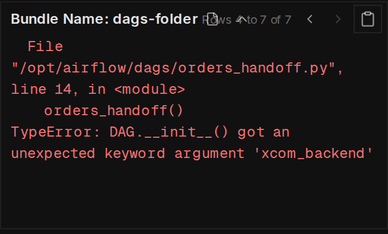
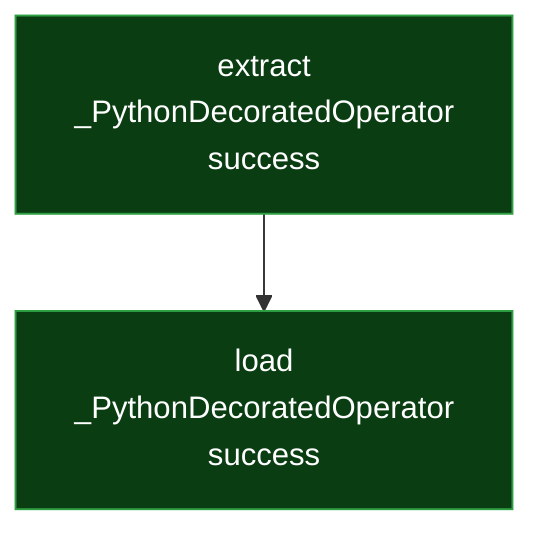
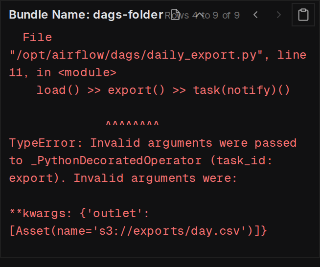
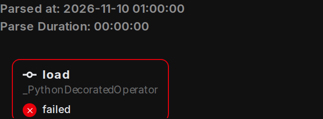
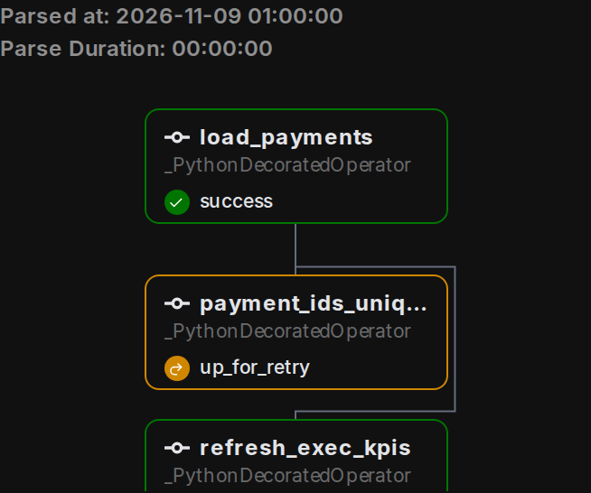
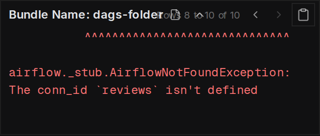
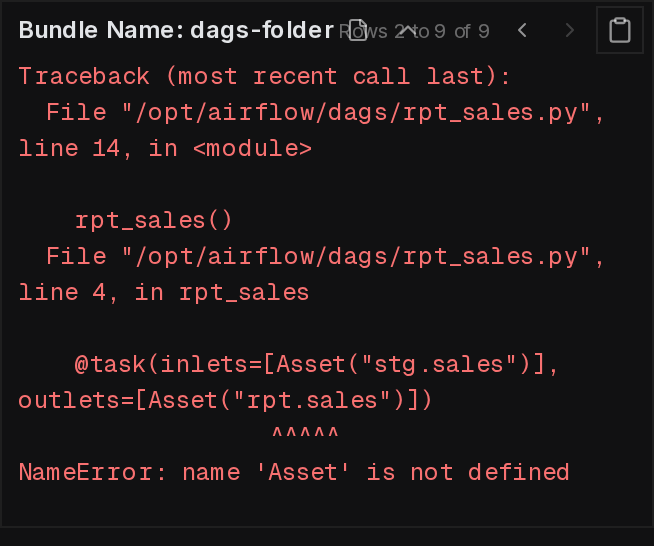

Advanced·[](https://airflow.apache.org/)·20 min · 7 challenges

# Tasks and Data: Advanced

Airflow started at Airbnb in 2014, so picture a nightly pipeline there feeding a bookings dashboard. One night the loader writes a day's bookings twice, a check task counts 2 rows per booking and fails, and publish never runs: the dashboard shows the previous day, correct, rather than the new day, doubled. 5 pieces make that night uneventful: what tasks pass, report, remember, check and call.


<br>

---

## Custom XCom Backends

Every value a task returns or pushes goes through an XCom backend. The default backend serializes the value to JSON and stores it in the `xcom` table of the metadata database, and every `xcom_pull` reads it back from that table. The intermediate lesson had tasks pass a path for this reason: a 40MB list serialized into 1 row slows a database that the scheduler, the API server and every other DAG share.

A custom backend changes what happens between the push and the row. The task still returns its value and the downstream task still pulls it, but the backend's `serialize_value` decides what the row holds, and its `deserialize_value` decides what the puller receives. Both methods run inside the task process on the worker, through the Task SDK, so the database sees only what `serialize_value` returns, and the worker needs the credentials to wherever the real value goes.


<br>

### The backend a provider ships

The common.io provider includes `XComObjectStorageBackend`. It writes any value whose JSON form exceeds a threshold to a path in object storage and keeps that path in the row, while values under the threshold stay in the database as before. 4 settings switch it on, and every worker reads them.

| setting | example value | effect |
| --- | --- | --- |
| [core] xcom_backend | airflow.providers.common.io.xcom.backend.XComObjectStorageBackend | the class every push and pull goes through |
| [common.io] xcom_objectstorage_path | file:///data/xcom | where values above the threshold are written; a bucket path carries its connection id as scheme://conn_id@bucket/prefix |
| [common.io] xcom_objectstorage_threshold | 65536 | bytes above which a value goes to the store; -1 keeps every value in the database, 0 sends every value to the store |
| [common.io] xcom_objectstorage_compression | gzip | compresses each written object; blank writes plain JSON |

With the threshold at 65536, a task that returns a list of 12 file names writes a row holding the 12 names, and a task that returns 300,000 order records writes a row holding the name of the object the records went to. The downstream task calls `xcom_pull` as before and receives the 300,000 records, because `deserialize_value` reads the object back before handing anything to task code. Task code on both sides is unchanged; what changed is what 1 row costs the database.


<br>

### Writing your own

A backend of your own subclasses `BaseXCom` from the Task SDK and overrides 2 static methods. The one below keeps small values in the database, writes large ones to object storage under the pushing task's identity, and stores a marker in the row so that `deserialize_value` can tell the 2 apart.

```sql
import json

from airflow.sdk import ObjectStoragePath
from airflow.sdk.bases.xcom import BaseXCom

STORE = ObjectStoragePath("file:///data/xcom")
THRESHOLD_BYTES = 65536


class SpillingXComBackend(BaseXCom):
    @staticmethod
    def serialize_value(
        value, *, key=None, task_id=None, dag_id=None, run_id=None, map_index=None
    ):
        encoded = json.dumps(value)
        if len(encoded) <= THRESHOLD_BYTES:
            return BaseXCom.serialize_value(value)
        target = STORE / dag_id / run_id / task_id / f"{map_index}-{key}.json"
        target.parent.mkdir(parents=True, exist_ok=True)
        target.write_text(encoded)
        return BaseXCom.serialize_value({"__spilled_to__": str(target)})

    @staticmethod
    def deserialize_value(xcom):
        value = BaseXCom.deserialize_value(xcom)
        if isinstance(value, dict) and "__spilled_to__" in value:
            return json.loads(ObjectStoragePath(value["__spilled_to__"]).read_text())
        return value

    @staticmethod
    def purge(xcom, *args):
        value = BaseXCom.deserialize_value(xcom)
        if isinstance(value, dict) and "__spilled_to__" in value:
            ObjectStoragePath(value["__spilled_to__"]).unlink(missing_ok=True)
```

The identity arrives as keyword-only arguments: `dag_id`, `run_id`, `task_id`, `key` and `map_index`, and the path uses all 5, so 2 mapped instances of 1 task never overwrite each other's object. `BaseXCom.serialize_value` turns the marker into the JSON string the row stores, and `BaseXCom.deserialize_value` turns the row back into Python before the marker check, so a value that never spilled passes through untouched. The class path goes into `[core] xcom_backend` in place of the provider's.

> **TIP**
>
> Airflow calls the backend's `purge` with the row's XCom when it deletes that row, which happens when a task starts a new try and when you clear it. The `purge` above reads the marker and deletes the object it names; a backend without `purge` leaves every spilled object behind, and the store grows with every run.

> What a storage-backed XCom changes
>
> - A task can return a 200MB result and its database row stays under 1KB.
> - The puller still loads the whole value into memory, so a 2GB value needs 2GB of RAM on that worker.
> - Serialization runs on the worker, so the worker holds the store's credentials and the scheduler needs none.
> - A row is a reference, so the store needs the same retention as the XCom rows that point into it.
> - Passing the dataset itself through XCom is still the wrong design: the lesson on data by reference holds, and the backend is for results that happen to be large.


<br>

### Exercise 1 of 6: Repair the DAG

**● TASK**

The object storage XCom backend is already on in `airflow.cfg`, spilling any value over 1KB to the bucket, yet 2 mistakes keep `orders_handoff` from registering. Fix them so `load` receives, as `rows`, the 5,000 ids `extract` returns, leaving both task bodies as they are.

**Starter** — `dags/orders_handoff.py`

```python
from datetime import datetime
from airflow.sdk import dag, task
@dag(schedule=None,
     start_date=datetime(2026, 11, 1),
     xcom_backend="objectstorage")
def orders_handoff():
    @task
    def extract():
        return list(range(5_000))
    @task
    def load(rows):
        print(len(rows))
    extract() >> load()
orders_handoff()
```

**Graph, deployed (your starter code)**



<details>
<summary><strong>Solution</strong></summary>

**Graph after the fix** (drawn from the solution code and the expected task states)



**What changes** (`-` starter, `+` solution)

```diff
 @dag(schedule=None,
-     start_date=datetime(2026, 11, 1),
-     xcom_backend="objectstorage")
+     start_date=datetime(2026, 11, 1))
 def orders_handoff():
         print(len(rows))
-    extract() >> load()
+    load(extract())
 orders_handoff()
```

#### The backend is a deployment setting

A custom XCom backend changes where an XCom value is stored; tasks still push and pull it exactly as before. Here the backend comes from the deployment. In `airflow.cfg`, `xcom_backend` names the object storage backend that the `airflow.providers.common.io` provider ships, `xcom_objectstorage_path` points at the bucket, and `xcom_objectstorage_threshold` is 1024 bytes. With those set, any push over 1KB goes to the bucket and its row holds a short reference. Smaller values stay in the database, so they still read back cheaply. Many deployments draw that line at 64KB; this one draws it lower. No DAG argument turns the backend on, so the extra keyword was the first thing stopping `orders_handoff` from registering.

1. **Drop the argument the `DAG` never had**

   `xcom_backend` is not a `DAG` parameter, so calling `orders_handoff()` raises a `TypeError` and the file never registers. Delete the line and close the decorator on the `start_date` line. The setting in `airflow.cfg` already covers this DAG and every other DAG on the deployment, and neither task body has to change.

2. **Hand the value over through the call**

   `extract() >> load()` sets the order, but it calls `load` with no `rows`. The decorator checks each call against the function's signature while the file is read, so this line also keeps the DAG from registering. An arrow orders tasks; it moves no data. `load(extract())` sets the dependency and hands `load` the XCom of the return value. The backend then decides whether that value lives in the row or in the bucket.

**`dags/orders_handoff.py`, repaired**

```python
from datetime import datetime
from airflow.sdk import dag, task
@dag(schedule=None,
     start_date=datetime(2026, 11, 1))
def orders_handoff():
    @task
    def extract():
        return list(range(5_000))
    @task
    def load(rows):
        print(len(rows))
    load(extract())
orders_handoff()
```

*The tasks are unchanged. The 1KB threshold in config sends the roughly 30KB result to the bucket.*

| Pitfall: The puller receives the whole list of records |
| --- |
| Inside `load`, `rows` is the full list of 5,000 ids. The backend reads the value back from the bucket before `load` runs. That means the worker needs memory for the whole value and needs the store's credentials. The scheduler needs neither. |

| Real world: Keep the backend for results that happen to be large |
| --- |
| The bucket has to keep objects for as long as the XCom rows that point at them, so give it the same retention. If the result grows into the dataset itself, write it to storage yourself and pass only its path. The backend is meant for results that happen to be large. |

**Follow-up questions**

1. What would `load` need from its worker if `extract` returned 2GB?\
   *The backend reads the full value back into memory before the task runs.*
2. Why not set `xcom_objectstorage_threshold` to 0?\
   *Every small push would then cost a round trip to the bucket.*

</details>


<br>

---

## Lineage Events

Lineage is the record of which task run wrote a table and what that run read. Airflow already keeps half of it: a task that lists an `Asset` in `outlets` records an asset event when it succeeds, and the asset-triggered DAGs from the scheduling lessons fire on that event. The event names the asset and the run that produced it, and nothing else. It says nothing about what the task read, it stays inside the metadata database, and a table the task wrote without declaring an outlet never appears.

The OpenLineage provider turns that half into a full record. For every task try it emits a run event: the job, named `dag_id.task_id`, the run's id, the datasets the task read, the datasets it wrote, and facets with details such as the SQL text or the error. A listener in the task process sends each event over a transport, an HTTP endpoint, a file or the console, to the lineage catalog the platform runs. The event leaves Airflow, and the catalog, which other systems feed as well, is where a reader traces a table across tools.

| event | when it is sent | what it carries |
| --- | --- | --- |
| START | the try begins | job, run id, the DAG run as parent, and the inputs the operator knows before running |
| COMPLETE | the try succeeds | inputs, outputs and their facets: schema, SQL text, row counts where the operator reports them |
| FAIL | the try fails | the same, plus an error facet with the exception message |

| record | who writes it | where it lives | what it drives |
| --- | --- | --- | --- |
| asset event | the task's success, for each outlet | the metadata database | asset-triggered DAGs in this deployment |
| lineage event | the listener, for each try | the catalog behind the transport | tracing across every tool that feeds the catalog |


<br>

### Where the inputs and outputs come from

3 sources fill the datasets in an event, and a task that uses none of them reports a job with empty inputs and outputs.

- **The operator's own method** *get_openlineage_facets_on_complete*\
  An operator can report what it touched. SQLExecuteQueryOperator parses its SQL and names every table the query reads and the table it writes, with the connection's host and database as the dataset namespace.
- **inlets and outlets** *Asset objects on the task*\
  Each Asset in inlets becomes an input dataset and each in outlets an output, with the asset URI split into namespace and name. This is the source a TaskFlow function relies on, since a Python function tells Airflow nothing about what its client read.
- **Nothing** *a plain @task with a client call and no declarations*\
  A task that reads a table through its own client and declares no inlet reports no input. The catalog then shows the table it wrote with no upstream, which is wrong and which it cannot detect.

```sql
from datetime import datetime

from airflow.providers.common.sql.operators.sql import SQLExecuteQueryOperator
from airflow.sdk import Asset, dag, task

orders_daily = Asset("warehouse://analytics-db/analytics.orders_daily")
orders_export = Asset("file:///data/exports/orders_daily.csv")


@dag(schedule="@daily", start_date=datetime(2026, 1, 1), catchup=False)
def orders_lineage():
    build = SQLExecuteQueryOperator(
        task_id="build_orders_daily",
        conn_id="warehouse",
        sql="""
            INSERT INTO analytics.orders_daily
            SELECT
                order_id,
                customer_id,
                amount
            FROM staging.orders
            WHERE order_date = DATE '{{ data_interval_start | ds }}'
        """,
        outlets=[orders_daily],
    )

    @task(inlets=[orders_daily], outlets=[orders_export])
    def export_csv():
        ...

    build >> export_csv()


orders_lineage()
```

For the run whose window is 2 March 2026, the build task's COMPLETE event names `staging.orders` as its only input and `analytics.orders_daily` as its output, both parsed from the query with `warehouse://analytics-db` as their namespace, and its SQL facet carries the rendered text with the real date in it. The operator's own method wins: inlets and outlets fill an event only when that method reports nothing, so the build task's outlet adds nothing to its lineage and stays for the asset event it records. The export task's inlet splits into namespace `warehouse://analytics-db` and name `analytics.orders_daily`, the same pair the build task reported, and its outlet gives the CSV path as output. The catalog joins the 2 events on that pair and draws staging table, daily table, file, with the run id on each edge. An asset URI that split to any other pair, such as `warehouse://analytics/orders_daily`, would leave 2 unconnected nodes.

```sql
{
  "eventType": "COMPLETE",
  "eventTime": "2026-03-03T00:04:12.000Z",
  "job": {
    "namespace": "airflow-prod",
    "name": "orders_lineage.build_orders_daily"
  },
  "run": {
    "runId": "0195e3b4-7c21-7a1e-9f3d-2c4b7a9e1f05",
    "facets": {
      "parent": {
        "job": {
          "namespace": "airflow-prod",
          "name": "orders_lineage"
        }
      }
    }
  },
  "inputs": [
    {
      "namespace": "warehouse://analytics-db",
      "name": "staging.orders"
    }
  ],
  "outputs": [
    {
      "namespace": "warehouse://analytics-db",
      "name": "analytics.orders_daily"
    }
  ]
}
```


<br>

### A custom operator reports its own

An operator you wrote reports nothing until it says what it touched. The method takes the task instance and returns an `OperatorLineage`, and because it runs after `execute`, it can name the file the task wrote rather than the one it planned to write.

```sql
from airflow.providers.openlineage.extractors import OperatorLineage
from airflow.sdk import BaseOperator
from openlineage.client.event_v2 import Dataset

from segments.io import write_segment


class ExportSegmentOperator(BaseOperator):
    template_fields = ("segment", "target_path")

    def __init__(self, segment, target_path, **kwargs):
        super().__init__(**kwargs)
        self.segment = segment
        self.target_path = target_path

    def execute(self, context):
        self.written_path = write_segment(self.segment, self.target_path)

    def get_openlineage_facets_on_complete(self, task_instance):
        return OperatorLineage(
            inputs=[Dataset(namespace="warehouse://analytics-db", name="marketing.segments")],
            outputs=[Dataset(namespace="file://", name=self.written_path)],
        )
```

| setting | example value | effect |
| --- | --- | --- |
| [openlineage] transport | {"type": "http", "url": "http://lineage-api:5000"} | where every event is sent |
| [openlineage] namespace | airflow-prod | the job namespace on every event, so 2 deployments stay apart in the catalog |
| [openlineage] disabled_for_operators | airflow.providers.standard.operators.empty.EmptyOperator | operators that emit no event at all |

*The listener catches its own errors and writes them to the task log, so a lineage endpoint that is down never fails a task; it costs a gap in the catalog instead.*


<br>

### Exercise 2 of 6: Repair the DAG

**● TASK**

`daily_export` never appears, and the catalog shows `s3://exports/day.csv` with no parent. `load` already declares that it reads `stg.day` and writes `rpt.day`. Fix the `export` task so the DAG loads and the file traces through `rpt.day` back to `stg.day`.

**Starter** — `dags/daily_export.py`

```python
from airflow.sdk import DAG, Asset, task
STG = Asset("postgres://db/wh/stg/day")
RPT = Asset("postgres://db/wh/rpt/day")
OUT = Asset("s3://exports/day.csv")
with DAG("daily_export", schedule=None):
    @task(inlets=[STG], outlets=[RPT])
    def load(): ...
    @task(outlet=[OUT])
    def export(): ...
    def notify(): ...
    load() >> export() >> task(notify)()

```

**Graph, deployed (your starter code)**



<details>
<summary><strong>Solution</strong></summary>

**What changes** (`-` starter, `+` solution)

```diff
     def load(): ...
-    @task(outlet=[OUT])
+    @task(inlets=[RPT], outlets=[OUT])
     def export(): ...
```

#### Where each task's datasets come from

A lineage event carries the datasets a task read and wrote. Those datasets come from one of 3 places: the operator's own lineage method (a SQL operator, for example, parses its statement), the task's `inlets` and `outlets`, or nothing at all. Read the file with that in mind. `load` declares `STG` as its input and `RPT` as its output, so its event already names both tables. `export` reads through its own client, which the listener cannot see, so it reports only what it declares. `notify` declares nothing and reports a job with empty inputs and outputs. That is accurate for a task that only sends a message.

1. **Use the argument names the operator accepts**

   `outlet` is not an argument of any operator. The task rejects it when the file is parsed, the file fails to load, and `daily_export` never registers, so no lineage event is sent at all. The argument names are plural: `inlets` and `outlets`.

2. **Declare the table the task actually reads**

   A catalog links events together by matching dataset names. `load` lists `RPT` as an outlet, so when `export` declares the same `RPT` as an inlet, the catalog gets the link it needs: the file comes from `rpt.day`, which came from `stg.day`. Reusing the one `Asset` object keeps the 2 names from drifting apart.

**`dags/daily_export.py`, repaired**

```python
from airflow.sdk import DAG, Asset, task
STG = Asset("postgres://db/wh/stg/day")
RPT = Asset("postgres://db/wh/rpt/day")
OUT = Asset("s3://exports/day.csv")
with DAG("daily_export", schedule=None):
    @task(inlets=[STG], outlets=[RPT])
    def load(): ...
    @task(inlets=[RPT], outlets=[OUT])
    def export(): ...
    def notify(): ...
    load() >> export() >> task(notify)()

```

*One line changes: the `export` decorator now declares what the task reads and what it writes.*

| Pitfall: Pointing the export at staging skips a step |
| --- |
| It is tempting to put the staging table in `export`'s `inlets` because staging is the true origin, but that draws the wrong graph. The file appears to skip `rpt.day`, and a change to `load` no longer shows up as affecting the export. Each task reports only its own reads and writes; the catalog builds the chain from them. |

| Real world: A down lineage endpoint costs a gap, not a failure |
| --- |
| The listener catches its own errors and writes them to the task log. If the lineage collector is down, `export` still succeeds; the catalog simply has no event for that run. |

**Follow-up questions**

1. If `export` built its file name from the logical date inside the function, how would you report the path that actually exists?\
   *A custom operator can report its own lineage, reading the output name after `execute` runs.*

</details>


<br>

---

## The Task State Store

Each try starts clean. When a task instance begins a new try, the API server deletes every XCom row that task instance pushed, so a retry that pulls its own key from the previous try receives `None`. XCom carries a result to another task after this one succeeds, and it keeps nothing for the task itself. The retry lessons treated the try as a unit of work that repeats whole, and that is what a retry does: a task that loads 10 files and fails on file 7 loads files 1 to 6 again on try 2.

Whether that repeat matters depends on the work. A task that deletes the day's partition and reloads it changes nothing by running twice, so a retry from the start is correct and the cheapest design. The repeat matters when a unit of work is slow or cannot be undone: 10 files that each take 20 minutes, or 2,000 calls to an outside billing system that each cost money. For that task, a second design keeps a record the task owns of what is already done, written after each unit, read at the start of every try, and deleted when the task succeeds.


<br>

### A key the task owns

The record needs a key that is the same across tries and different across everything else. 4 fields give that: `dag_id`, `run_id`, `task_id` and `map_index`. Together they name 1 task instance, every try of it shares them, and a backfill or a manual run of the same day gets a new `run_id` and therefore a fresh record.

| field | the same across | different across |
| --- | --- | --- |
| dag_id | every run and task of the DAG | DAGs |
| run_id | every task and try of 1 DAG run | runs, including a backfill of the same window |
| task_id | every try and mapped instance of 1 task | tasks |
| map_index | every try of 1 mapped instance | mapped instances; -1 when the task is not mapped |

```sql
import json
from datetime import datetime, timedelta

from airflow.sdk import ObjectStoragePath, dag, task

from exports import list_export_files, load_export_file

CHECKPOINTS = ObjectStoragePath("file:///data/checkpoints")


@dag(schedule="@daily", start_date=datetime(2026, 1, 1), catchup=False)
def load_exports():
    @task(retries=3, retry_delay=timedelta(minutes=2))
    def load_files(**context):
        ti = context["ti"]
        marker = CHECKPOINTS / ti.dag_id / ti.run_id / f"{ti.task_id}-{ti.map_index}.json"
        done = set(json.loads(marker.read_text())) if marker.exists() else set()
        for name in list_export_files(context["data_interval_start"]):
            if name in done:
                continue
            load_export_file(name)
            done.add(name)
            marker.parent.mkdir(parents=True, exist_ok=True)
            marker.write_text(json.dumps(sorted(done)))
        if marker.exists():
            marker.unlink()

    load_files()


load_exports()
```

| try | marker at start | what runs | marker at end | state |
| --- | --- | --- | --- | --- |
| 1 | absent | files 1 to 6 load; file 7 raises | 6 names | up_for_retry |
| 2, 2 minutes later | 6 names | files 1 to 6 skipped; files 7 to 10 load | deleted | success |

Try 1 writes the marker 6 times, once after each file, and raises on the 7th. Try 2 starts 2 minutes later, reads the 6 names, makes no second load for them, loads 4 files and deletes the marker. The log of try 2 shows 4 loads; the log of try 1 shows 6 and a traceback, and `ti.try_number` printed in each line tells the 2 apart.


<br>

### Where the record lives

| ✓ Works as a state store | ✗ Does not |
| --- | --- |
| • A path in object storage keyed by the 4 fields, as above<br><br>• A row in a warehouse table with the 4 fields as its key<br><br>• Either, as long as the write after each unit is durable before the next unit starts | • XCom: deleted when the next try begins<br><br>• A Variable: shared by every run and every DAG, read through the API server on each access, and never deleted<br><br>• A file on the worker's disk: the next try may run on another worker |


<br>

### What clearing does to it

Success deletes the marker, so it outlives the task only when every try has failed: 4 tries with `retries=3`. Clearing a task that succeeded starts from a blank record and loads all 10 files. Clearing a task that failed for good starts a new try that finds the marker and resumes at the first file missing from it. That is right when the failure was file 7's own and the first 6 loads were good, and wrong when the failure came from a loader bug that also wrote files 1 to 6 badly. The marker is the task's memory, and a person who clears a failed task has to decide whether that memory is still true. A loader whose first step per file deletes what that file loaded before makes the restart safe: delete the marker, clear the task, and every file is loaded again exactly once.

> **TIP**
>
> A teardown task from the lifecycle lessons can own the marker's deletion: it runs after the loader reaches its final state, success or failed after every retry, so a later clear of the whole group starts from a blank record while retries inside the task still resume.


<br>

### Exercise 3 of 6: Repair the DAG

**● TASK**

`load` in `load_files` keeps its file progress in the Variable `load_files`, so 2 overlapping runs would share one record, and this deployment has none, so `load` fails. Repair the file so the marker key `load` receives belongs to its own run and stays the same across that run's tries.

**Starter** — `dags/load_files.py`

```python
from airflow.sdk import dag, task

@dag(schedule=None)
def load_files():
    @task(retries=2)
    def load(marker: str):
        print(f"resume from {marker}")

    load(marker="{{ var.value.load_files }}")

load_files()

```

**Graph, deployed (your starter code)**



<details>
<summary><strong>Solution</strong></summary>

**What changes** (`-` starter, `+` solution)

```diff

-    load(marker="{{ var.value.load_files }}")
+    load(marker="state/{{ dag.dag_id }}/{{ ti.task_id }}"
+         "/{{ run_id }}/{{ ti.map_index }}")

```

#### A record only one task instance reads

A task state store works when its key names exactly one task instance. Here that takes 4 fields: `dag_id`, `task_id`, `run_id` and `map_index`. Every try of the instance renders the same key, so a retry reads the marker the last try wrote and resumes after the last finished file. Any other run, or any other mapped copy of `load`, renders a different key and never sees that progress.

**`load_files` with a per-instance marker key**

```python
from airflow.sdk import dag, task

@dag(schedule=None)
def load_files():
    @task(retries=2)
    def load(marker: str):
        print(f"resume from {marker}")

    load(marker="state/{{ dag.dag_id }}/{{ ti.task_id }}"
         "/{{ run_id }}/{{ ti.map_index }}")

load_files()

```

*The key is templated into `op_kwargs`, so it renders per run at execution time.*

| ✕ One Variable per DAG | ✓ One key per task instance |
| --- | --- |
| 2 overlapping runs read and write the same `load_files` Variable, so the second run skips files the first one loaded for a different day. After a fix, a cleared run finds the old 10 of 10 marker, because a Variable is never deleted, and loads nothing. | Each run renders its own path from `run_id`. A cleared run that had failed resumes from its own marker; one that had succeeded deleted its marker on success and starts clean. |

| Pitfall: Adding `try_number` to the key breaks resume |
| --- |
| The key must stay the same across tries. Put `try_number` in it and every retry reads an empty record and starts again at file 1, which is the repeat the store exists to prevent. |

| Real world: The marker write must be durable before the next file |
| --- |
| Hold the record at an object storage path or in a warehouse row keyed by the 4 fields. XCom is cleared when the next try begins, and a file on the worker's disk is gone if the retry lands on another worker. |

**Follow-up questions**

1. If `load` is mapped over 10 files, what keeps each mapped copy's progress apart?\
   *Why `map_index` is one of the 4 fields.*
2. The fix changes which files exist. Should a cleared run trust its old marker?\
   *When to delete the record by hand before clearing.*

</details>


<br>

---

## Check Operators as Gates

A gate is a task whose job is to fail. It runs a query over the rows the previous task wrote, and when the answer is wrong it raises, the task fails, and every task downstream of it under the default `all_success` rule becomes `upstream_failed`. The table the dashboard reads keeps the previous day's rows, the failure callback pages a person, and the run shows red at the check rather than green at publish. A check that cannot stop publish is a report, and reports get read the next morning.

| operator | arguments | fails when |
| --- | --- | --- |
| SQLCheckOperator | sql | the query returns no row, or any value in its first row is NULL, 0, empty or false |
| SQLValueCheckOperator | sql, pass_value, tolerance | the first value differs from pass_value by more than tolerance, a fraction of pass_value |
| SQLIntervalCheckOperator | table, metrics_thresholds, days_back, date_filter_column | a metric on the run's date and the date days_back earlier differ by a ratio over its threshold |
| SQLTableCheckOperator | table, checks, partition_clause | any check_statement, a boolean expression over the rows, evaluates to false |
| SQLColumnCheckOperator | table, column_mapping, partition_clause | a per-column aggregate such as null_check, min, max, distinct_check or unique_check breaks its bound |

All 5 live in the common.sql provider and run through the connection's hook, so a single import serves every SQL warehouse your connections point at. The 2 table-shaped operators take a `partition_clause`, and since each run covers 1 window, the clause carries the window's date: a run checks the rows it wrote and nothing older.

```sql
from datetime import datetime

from airflow.providers.common.sql.operators.sql import (
    SQLColumnCheckOperator,
    SQLTableCheckOperator,
)
from airflow.sdk import dag, task


@dag(schedule="@daily", start_date=datetime(2026, 1, 1), catchup=False)
def daily_orders():
    @task
    def load_orders(data_interval_start=None):
        ...

    table_checks = SQLTableCheckOperator(
        task_id="table_checks",
        conn_id="warehouse",
        table="analytics.orders_daily",
        partition_clause="order_date = DATE '{{ data_interval_start | ds }}'",
        checks={
            "has_rows": {"check_statement": "COUNT(*) > 0"},
            "one_row_per_order": {"check_statement": "COUNT(*) = COUNT(DISTINCT order_id)"},
        },
        retries=0,
    )

    column_checks = SQLColumnCheckOperator(
        task_id="column_checks",
        conn_id="warehouse",
        table="analytics.orders_daily",
        partition_clause="order_date = DATE '{{ data_interval_start | ds }}'",
        column_mapping={
            "amount": {"null_check": {"equal_to": 0}, "min": {"geq_to": 0}},
            "customer_id": {"null_check": {"equal_to": 0}},
        },
        retries=0,
    )

    @task
    def publish():
        ...

    load_orders() >> [table_checks, column_checks] >> publish()


daily_orders()
```

`SQLTableCheckOperator` folds every `check_statement` into 1 query of `CASE` expressions, so 1 round trip evaluates all of them, and it logs each check by name with its result. The second check, `COUNT(*) = COUNT(DISTINCT order_id)`, is a boolean expression and runs as written. `SQLColumnCheckOperator` also sends 1 statement: a `UNION ALL` of 1 aggregate `SELECT` per column and check, evaluated in 1 round trip, where `null_check` counts nulls and compares with `equal_to: 0`, and `min` takes the smallest amount and asserts `geq_to: 0`. Both operators list every failing check in the log before raising, so the log answers which rule the data broke.

A rule that compares a day with an earlier one uses `SQLIntervalCheckOperator`. It runs each metric twice, once for the run's `ds` and once for `ds` minus `days_back` days, filtering on `date_filter_column`, and combines the 2 results by its `ratio_formula`. The default, `max_over_min`, divides the larger by the smaller, and the check fails once that ratio reaches the metric's threshold, so a threshold of 2 fails a day with half the rows of the reference day or fewer.

```sql
from airflow.providers.common.sql.operators.sql import SQLIntervalCheckOperator

week_over_week = SQLIntervalCheckOperator(
    task_id="week_over_week",
    conn_id="warehouse",
    table="analytics.orders_daily",
    date_filter_column="order_date",
    days_back=7,
    ratio_formula="max_over_min",
    metrics_thresholds={"COUNT(*)": 2},
    retries=0,
)
```

With 25,000 rows on the reference day, a day of 11,800 rows gives a ratio of 2.12 and fails, and a day of 15,000 gives 1.67 and passes. The ratio is 2-sided, so a day of 60,000 rows gives 2.4 and fails as well. A rule that must fail only on a drop is a `SQLCheckOperator` query whose `CASE` returns 0 when the day's count is under half of last week's.


<br>

### The night the gate closes

| task | state | reason |
| --- | --- | --- |
| load_orders | success | wrote 48,210 rows for the window |
| table_checks | failed | one_row_per_order returned false: 48,210 rows, 24,105 distinct orders |
| column_checks | success | no nulls; smallest amount 0.99 |
| publish | upstream_failed | table_checks failed and the rule is all_success |

Publishing never ran, so the dashboard shows the previous window's rows. Both checks ran because each depends on the loader alone, and the log of `table_checks` names the failing check. The fix is in the loader, which wrote each order twice, and after the fix the recovery is the one from the lifecycle lessons: clear `load_orders` with its downstream, and all 4 tasks run again against the corrected rows.


<br>

### Retries and the outlet

A check inherits the DAG's `retries`, and with 3 retries a failed check reruns the same query against the same rows 3 more times and fails the same way each time; the only effect is 3 retry delays before anyone hears. The checks above set `retries=0`. The exception is a warehouse whose connection drops, where 1 retry covers the drop and a second covers nothing.

The gate also decides where `outlets` go. An outlet on the loader records an asset event the moment the loader succeeds, before any check has run, and every asset-triggered DAG downstream starts on rows that may be wrong. The outlet belongs on `publish`: the event then exists only on a night the gate stayed open.

| ✓ Do | ✗ Don't |
| --- | --- |
| • Scope every check to the run's window with partition_clause or a date predicate<br><br>• Give the check retries=0, or 1 when the connection itself is known to drop<br><br>• Name each check for what it asserts, so the log reads as a verdict<br><br>• Put the outlet on the task after the gate | • Check the whole table on a daily run; yesterday's bug then fails every night<br><br>• Let a check carry the DAG's default retries<br><br>• Wire the check with a rule that lets publish run on failure<br><br>• Put the outlet on the loader |

A task meant to run only when the gate closes, such as one that posts the failing check's name to the on-call channel, sits beside `publish` with `trigger_rule="one_failed"`. It starts as soon as any task directly upstream fails, and on a night every check passes it ends `skipped`, so the grid shows the alert only on a night there was something to alert about.


<br>

### Exercise 4 of 6: Repair the DAG

**● TASK**

On a night `payments` holds duplicated rows, `payments_daily` refreshes the executive table anyway, and `payment_ids_unique` is still retrying at 01:12 UTC. Repair the file so the check holds back the refresh and has failed by 01:12, leaving `refresh_exec_kpis` `upstream_failed`.

**Starter** — `dags/payments_daily.py`

```python
import pendulum
from airflow.sdk import DAG, task
with DAG("payments_daily", schedule="@daily",
         start_date=pendulum.datetime(2026, 11, 9, tz="UTC"),
         default_args={"retries": 3}):
    @task
    def load_payments(): ...
    @task
    def payment_ids_unique(ds=None):
        """No payment_id twice where ds = {ds}."""
    @task
    def refresh_exec_kpis(): ...
    load_payments() >> [payment_ids_unique(), refresh_exec_kpis()]

```

**Graph, deployed (your starter code)**



<details>
<summary><strong>Solution</strong></summary>

**What changes** (`-` starter, `+` solution)

```diff
     def load_payments(): ...
-    @task
+    @task(retries=0)
     def payment_ids_unique(ds=None):
     def refresh_exec_kpis(): ...
-    load_payments() >> [payment_ids_unique(), refresh_exec_kpis()]
+    load_payments() >> payment_ids_unique() >> refresh_exec_kpis()
```

#### A check only guards what stands behind it

A check task works as a gate on the data. It asserts one thing about the run's rows and fails when that assertion is false. The failure protects only the tasks downstream of the check. In the broken file `payment_ids_unique` was a sibling of `refresh_exec_kpis`, and both hung off `load_payments`. The refresh never waited for the verdict, so the dashboard read the duplicated rows while the check was still trying.

1. **Put the check between the load and the refresh**

   `load_payments() >> payment_ids_unique() >> refresh_exec_kpis()` makes the refresh depend on the check. Under the default `all_success` rule, a failed check marks the refresh `upstream_failed` and it never starts. The executive table keeps yesterday's good numbers instead of tonight's doubled ones.

2. **Give the check its own retry count**

   The DAG's `default_args` give every task 3 retries, 5 minutes apart. A duplicated row is still duplicated on the 4th try, so the check would sit in `up_for_retry` for 15 minutes and the refresh could not settle. `@task(retries=0)` turns a bad night into a failed task right away. Use 1 only when the warehouse connection is known to drop.

**The gated payments DAG**

```python
import pendulum
from airflow.sdk import DAG, task
with DAG("payments_daily", schedule="@daily",
         start_date=pendulum.datetime(2026, 11, 9, tz="UTC"),
         default_args={"retries": 3}):
    @task
    def load_payments(): ...
    @task(retries=0)
    def payment_ids_unique(ds=None):
        """No payment_id twice where ds = {ds}."""
    @task
    def refresh_exec_kpis(): ...
    load_payments() >> payment_ids_unique() >> refresh_exec_kpis()

```

*`payment_ids_unique` sits between the load and the refresh, scoped to the run's `ds`, with no retries.*

| Pitfall: A whole-table check fails every night after a bad load |
| --- |
| The check asserts over the run's own day, `ds`. If it asserts over all of `payments`, duplicates loaded on an earlier day fail tonight's run as well, and every run after it, until someone cleans them out by hand. |

| Real world: The task name is the verdict |
| --- |
| When `payment_ids_unique` turns red, the grid and the alert already say what went wrong. In production the same gate is often a `SQLCheckOperator` with the assertion in its `sql`. It is wired and given retries the same way. A second rule, such as the row count against the same weekday 7 days earlier, gets its own task and its own name. |

**Follow-up questions**

1. Where does a row-count check against last week's same weekday go, and how is it wired?\
   *A second gate beside `payment_ids_unique`, with both upstream of `refresh_exec_kpis`.*
2. What would the grid show if `refresh_exec_kpis` carried `trigger_rule='all_done'`?\
   *The refresh runs after a failed check and publishes the duplicated rows.*

</details>


<br>

---

## Writing a Custom Hook

A hook is the client Airflow code uses to talk to 1 outside system. It reads a connection by id, builds the client from the connection's host, login, password and extras, and exposes the methods a task calls. Every operator from a provider you have used leans on one: the check operators from the last section call `get_first` and `get_records` on the connection's `DbApiHook`, and never open a cursor themselves.

A hook of your own belongs at the moment 2 tasks reach the same system. Without it, each task reads the connection, builds the session, sets the auth header and walks the pages, and a change to the auth scheme is edited in 4 copies across 2 DAGs, of which 3 get the edit and the 4th keeps sending the old header until it fails at night. With it, the operator and the TaskFlow function call `hook.list_tickets(since)` and the system's shape lives in 1 file.


<br>

### What the hook owns

```sql
import requests
from airflow.sdk import BaseHook


class TicketDeskHook(BaseHook):
    conn_name_attr = "ticketdesk_conn_id"
    default_conn_name = "ticketdesk_default"
    conn_type = "ticketdesk"
    hook_name = "Ticket Desk"

    def __init__(self, ticketdesk_conn_id=default_conn_name):
        super().__init__()
        self.ticketdesk_conn_id = ticketdesk_conn_id
        self._session = None
        self._base_url = None

    def get_conn(self):
        if self._session is None:
            conn = self.get_connection(self.ticketdesk_conn_id)
            version = conn.extra_dejson.get("api_version", "v2")
            self._base_url = f"https://{conn.host}/api/{version}"
            self._session = requests.Session()
            self._session.headers["Authorization"] = f"Bearer {conn.password}"
        return self._session

    def list_tickets(self, updated_since, page_size=200):
        session = self.get_conn()
        page = 1
        while True:
            response = session.get(
                f"{self._base_url}/tickets",
                params={"updated_since": updated_since, "page": page, "per_page": page_size},
                timeout=30,
            )
            response.raise_for_status()
            body = response.json()
            yield from body["tickets"]
            if not body["has_more"]:
                return
            page += 1

    def test_connection(self):
        try:
            self.get_conn().get(f"{self._base_url}/me", timeout=10).raise_for_status()
        except requests.RequestException as error:
            return False, str(error)
        return True, "Connection to Ticket Desk succeeded"

    @classmethod
    def get_ui_field_behaviour(cls):
        return {
            "hidden_fields": ["schema", "port", "login"],
            "relabeling": {"password": "API token", "host": "Account domain"},
        }
```

4 class attributes name the hook to Airflow: `conn_name_attr` says which `__init__` argument holds the connection id, `default_conn_name` is the id used when a task passes none, and `conn_type` with `hook_name` label the connection form. `get_conn` resolves the connection the first time it is called and caches the session, so a task that lists 40 pages opens 1 session and reads the secret once. `list_tickets` owns paging, the timeout and the status check; the caller receives tickets and never sees a page number. `test_connection` is what the form's Test button runs where the platform enables connection testing, and `get_ui_field_behaviour` hides the fields the system has no use for and relabels the ones it does.

| ✓ The hook owns | ✗ The task owns |
| --- | --- |
| • Resolving the connection and building the client<br><br>• Auth, base URL, API version, timeouts<br><br>• Paging, rate limit waits, status codes<br><br>• A test the connection form can run<br><br>• Plain Python arguments and return values | • Which window to ask for, from the run's context<br><br>• Templated fields and their rendering<br><br>• What to return, push or write, and where<br><br>• Whether a failure is retried, and how often<br><br>• Outlets, lineage and the check that follows |


<br>

### Where it is built

`self.get_connection` asks the Task SDK, which asks the API server, which walks the secrets chain from the intermediate lesson; the hook never reads an environment variable or a secrets store on its own, so the same class runs against an `AIRFLOW_CONN_` variable on a laptop and a vault in production. That call needs a running task. An operator's `__init__` runs at parse time on the DAG processor, once per parse loop, with no task context and no connection access. Constructing `TicketDeskHook` there touches nothing, since its `__init__` only stores the id, but a hook whose constructor resolves its connection, or an `__init__` that calls `get_conn`, fails or stalls every parse. Building the hook in `execute`, or as a `cached_property` that `execute` is the first to touch, keeps the connection out of parse time without relying on each hook's constructor staying idle.

```sql
from functools import cached_property

from airflow.sdk import BaseOperator

from ticketdesk.hook import TicketDeskHook
from ticketdesk.io import write_tickets


class ExportTicketsOperator(BaseOperator):
    template_fields = ("updated_since", "target_path")

    def __init__(self, updated_since, target_path, ticketdesk_conn_id="ticketdesk_default", **kwargs):
        super().__init__(**kwargs)
        self.updated_since = updated_since
        self.target_path = target_path
        self.ticketdesk_conn_id = ticketdesk_conn_id

    @cached_property
    def hook(self):
        return TicketDeskHook(ticketdesk_conn_id=self.ticketdesk_conn_id)

    def execute(self, context):
        tickets = list(self.hook.list_tickets(self.updated_since))
        write_tickets(tickets, self.target_path)
        return len(tickets)
```

The operator's `updated_since` is a templated field, so a DAG passes `{{ data_interval_start }}` and each run asks the system for its own window. The hook receives the rendered string and nothing about runs, which is what makes the same hook usable from a TaskFlow function: `TicketDeskHook().list_tickets(since)` inside a `@task` body gives the same tickets with no operator at all.

| ✓ Do | ✗ Don't |
| --- | --- |
| • Build the client lazily in get_conn and cache it on the instance<br><br>• Give every outside call a timeout and raise on a bad status<br><br>• Return plain Python from hook methods: lists, dicts, generators<br><br>• Keep the hook free of run ids, windows and XCom | • Construct a hook in an operator's __init__<br><br>• Read credentials from anywhere but the connection<br><br>• Hide a page loop inside each task that calls the system<br><br>• Log the token, even at debug level |

*The connection type ticketdesk appears in the form's type list only when a provider package declares it under connection-types in its get_provider_info. Until then, create the connection with the generic type, fill host and password, and the hook reads it the same way.*


<br>

### Exercise 5 of 6: Repair the DAG

**● TASK**

`reviews_daily` builds `ReviewsHook` in the `@dag` body, so the `reviews` connection is resolved on every parse. Repair the file so parsing reads no connection and the triggered run's `pull` task still succeeds.

**Starter** — `dags/reviews_daily.py`

```python
from airflow.sdk import BaseHook, dag, task

class ReviewsHook(BaseHook):
    def get_conn(self):
        return self.get_connection("reviews")

@dag(schedule=None)
def reviews_daily():
    conn = ReviewsHook().get_conn()
    @task
    def pull():
        return conn.host
    pull()
reviews_daily()

```

**Graph, deployed (your starter code)**



<details>
<summary><strong>Solution</strong></summary>

**What changes** (`-` starter, `+` solution)

```diff
 def reviews_daily():
-    conn = ReviewsHook().get_conn()
     @task
     def pull():
+        conn = ReviewsHook().get_conn()
         return conn.host
```

#### Where a custom hook is first built

A custom hook owns the link to an outside system. It resolves the connection, builds the client and hands back plain Python. Everything a DAG file runs at import time runs again each time the DAG processor parses it, about every 30 seconds, and that includes the body of the `@dag` function. A hook built there looks up `reviews` on every parse. That means a call to the secrets store each time, and on a processor that cannot read the connection, an import error that keeps `reviews_daily` from registering at all.

| Pitfall: The `@dag` body is parse-time code |
| --- |
| `conn = ReviewsHook().get_conn()` sits inside `reviews_daily()`, so it looks like task code, but it runs at parse. A custom operator's `__init__` has the same problem: a hook constructed there runs on every parse, once for each operator the file declares. |

**The repaired file**

```python
from airflow.sdk import BaseHook, dag, task

class ReviewsHook(BaseHook):
    def get_conn(self):
        return self.get_connection("reviews")

@dag(schedule=None)
def reviews_daily():
    @task
    def pull():
        conn = ReviewsHook().get_conn()
        return conn.host
    pull()
reviews_daily()

```

*The hook is first built inside `pull`, so `reviews` resolves only on a worker, once per try, and parsing reads no connection.*

A classic operator follows the same rule. `__init__` stores only plain arguments, such as `conn_id`, the window and the output path. `execute` is the first place the hook is built, with `hook = ReviewsHook(self.conn_id)`. Inside `get_conn`, the hook builds its client lazily and caches it on the instance, so every page request in that try shares one session.

| Real world: Copied auth code collapses into one hook |
| --- |
| Say 4 tasks each repeat the same login, paging and timeout code. That code moves into the hook's methods. Each task keeps only what concerns its own run: the window it asks for, where the result goes, and how often a failure is retried. |

**Follow-up questions**

1. What goes wrong if `get_conn` opens a fresh session on every call instead of caching it on the instance?\
   *Why the hook builds its client lazily and keeps it.*
2. Where would a `test_connection` method live so the connection form can run it?\
   *Why the hook, and nothing else, reads the connection's fields.*

</details>


<br>

### Exercise 6 of 6: Repair the DAG

**● TASK**

`rpt_sales` never appears, and once it does, `publish` still runs on a night when `check` fails. Repair the file so a failed check holds `publish` back, the `rpt.sales` asset updates only when `publish` succeeds, and `build` still reports `stg.sales` as its input.

**Starter** — `dags/rpt_sales.py`

```python
from airflow.sdk import dag, task
@dag(schedule=None)
def rpt_sales():
    @task(inlets=[Asset("stg.sales")], outlets=[Asset("rpt.sales")])
    def build():
        print("rpt.sales rebuilt from stg.sales")
    @task
    def check():
        print("counting the day's rows in rpt.sales")
    @task(trigger_rule="all_done")
    def publish():
        print("dashboard refreshed")
    build() >> check() >> publish()
rpt_sales()

```

**Graph, deployed (your starter code)**



<details>
<summary><strong>Solution</strong></summary>

**What changes** (`-` starter, `+` solution)

```diff
-from airflow.sdk import dag, task
+from airflow.sdk import Asset, dag, task
 @dag(schedule=None)
 def rpt_sales():
-    @task(inlets=[Asset("stg.sales")], outlets=[Asset("rpt.sales")])
+    @task(inlets=[Asset("stg.sales")])
     def build():
         print("counting the day's rows in rpt.sales")
-    @task(trigger_rule="all_done")
+    @task(outlets=[Asset("rpt.sales")])
     def publish():
```

#### Lineage says what ran, the asset says what is ready

This DAG sends 2 kinds of record, and each answers a different question. The lineage event a task sends when it finishes lists the datasets it read and wrote. `build` declares `inlets=[Asset("stg.sales")]`, so the catalog shows it reading staging. The asset event on `rpt.sales` is the signal consumers schedule on, and it should mean the table has passed its check.

1. **Import `Asset` so the DAG registers**

   The `@task` arguments use `Asset` without importing it. Those arguments are evaluated when `rpt_sales()` runs at parse time, so the parse raises a `NameError`. The file then becomes an import error, and `rpt_sales` never appears.

2. **Move the outlet onto `publish`**

   With the outlet on `build`, the `rpt.sales` asset event fires as soon as the rebuild finishes. That happens before `check` has looked at the day's rows, so anything scheduled on the asset reacts to unverified data. On `publish`, the event fires only after the gate passes. `build` keeps its `inlets`, so the catalog still shows staging feeding it.

3. **Drop `trigger_rule="all_done"` from `publish`**

   Under `all_done`, `publish` runs once `check` finishes in any state, so a failed check gates nothing. The default `all_success` turns that failure into `upstream_failed` on `publish`, and the gate closes.

**`dags/rpt_sales.py`, repaired**

```python
from airflow.sdk import Asset, dag, task
@dag(schedule=None)
def rpt_sales():
    @task(inlets=[Asset("stg.sales")])
    def build():
        print("rpt.sales rebuilt from stg.sales")
    @task
    def check():
        print("counting the day's rows in rpt.sales")
    @task(outlets=[Asset("rpt.sales")])
    def publish():
        print("dashboard refreshed")
    build() >> check() >> publish()
rpt_sales()

```

*`build` reports `stg.sales` through its `inlets`, `check` sits between the rebuild and the publish, and only `publish` carries the outlet.*

| Key insight: A failed night still shows the build |
| --- |
| For the 2026-11-08 run, the catalog holds a COMPLETE event for `build` with `stg.sales` as its input, because the rebuild really ran. It also holds a FAIL event for `check`. `publish` ends `upstream_failed` without starting, so it sends no lineage event and no `rpt.sales` asset event. Anything scheduled on the asset stays on the 2026-11-07 data. |

**Follow-up questions**

1. What `retries` setting should `check` have, and when would you give it 1?\
   *A retry reruns the same count against the same rows, so it only helps when the connection drops.*
2. If a dashboard DAG is scheduled on `rpt.sales`, what does it do on the night `check` fails?\
   *Follows the asset event from `publish` to its consumer.*

</details>


<br>

---

## Putting It All Together

Picture the Airbnb bookings pipeline from the intro on a full night. It pulls a day of reservations from the booking service, loads them into a staging table, builds the daily table the finance dashboard reads, and publishes it. The loader pages through the service with a hook and resumes after a crash without re-pulling a page, a second task pulls the day's 180,000 price changes and returns them to the task that applies them, 2 check gates stand before publish, and every try leaves a lineage event in the catalog the analysts open when a number looks wrong.

- The hook owns the booking service's auth and paging, so the loader's code is the window and the write; the checkpoint under dag_id, run_id, task_id and map_index is what lets a retry skip the pages already pulled.
- The checks scope themselves to the run's window with partition_clause and carry retries=0, and publish carries the outlet, so the finance DAG that waits on the daily table fires only on a night the gate stayed open.
- The lineage catalog shows staging table, daily table, dashboard extract, with the run id on each edge, because the SQL operator parsed its query and the publish task declared its inlet and outlet.
- The storage-backed backend decides per value: the row count the loader returns is a few bytes and stays in the database under the threshold, while the 180,000 price changes cross it, spill to object storage, and reach the applying task through the same xcom_pull, with neither task's code aware of the difference.


<br>

---

## Key Takeaways

- A custom XCom backend moves a value out of the metadata database at push time and back at pull time, on the worker, with no change to task code.
- A lineage event is emitted per task try with inputs and outputs that come from the operator's own method or from inlets and outlets; a task that declares neither reports a blank.
- Each new try deletes the task instance's XComs, so a task that must resume keeps its own record under dag_id, run_id, task_id and map_index.
- A check operator fails when the data is wrong, and all_success turns that failure into upstream_failed on everything downstream; it keeps 0 retries and sits before the publish task that carries the outlet.
- A hook owns the connection, the client and the protocol; a task owns the window, the templates, the retries and what to return; and the hook is built in execute, never at parse.

[](https://airflow.apache.org/)

Official Apache Airflow resourcesversion 3.3

"Platform created by the community to programmatically author, schedule and monitor workflows." [airflow.apache.org](https://airflow.apache.org/)

[Documentation](https://airflow.apache.org/docs/)[Install](https://airflow.apache.org/docs/apache-airflow/stable/installation/index.html)[Community](https://airflow.apache.org/community/)

Apache Airflow, Apache, Airflow, the Airflow logo, and the Apache logo are either registered trademarks or trademarks of The Apache Software Foundation.
