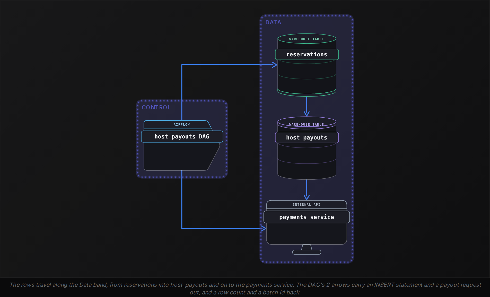
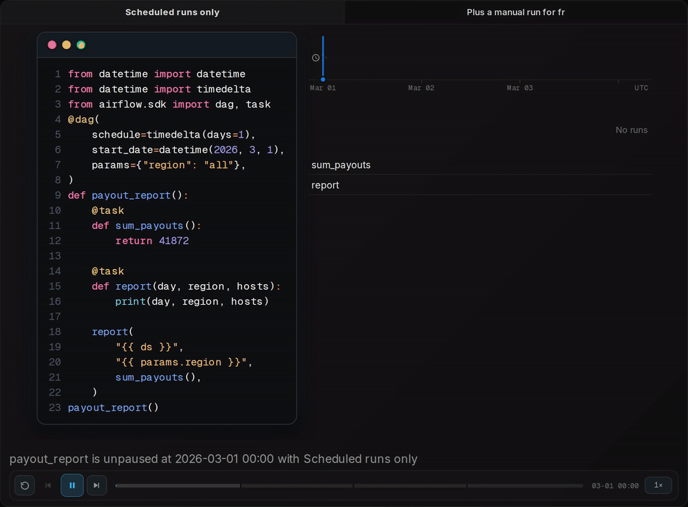
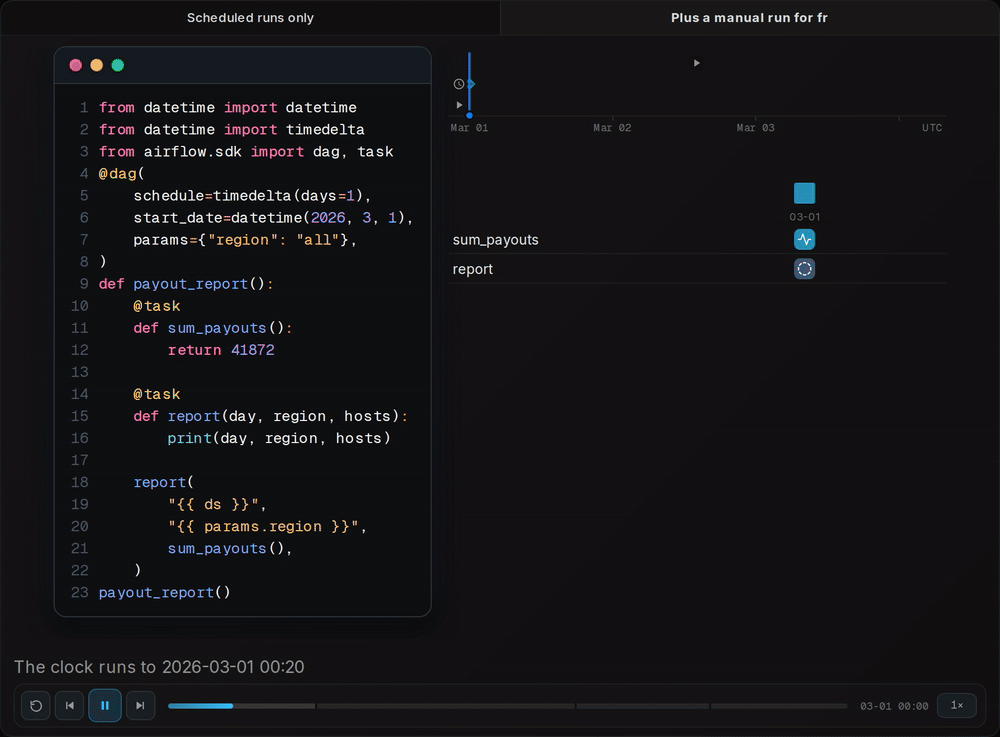

Beginner·[](https://airflow.apache.org/)·20 min · 7 challenges

# Tasks and Data: Beginner

Airflow began at Airbnb as a data engineering tool, and a nightly host payout job is the kind of pipeline it schedules. A host_payouts DAG totals yesterday's checkouts, sends the figures to the payments service, and records how many hosts got paid. Carrying those rows through its workers or telling the warehouse to sum them decides whether it finishes by 6am or dies at 3am out of memory.


<br>

---

## Commands, Not Data

Every task Airflow starts is a Python process on a worker, a machine with a fixed amount of memory shared by every task running on it. The warehouse that holds the reservation rows was built to hold them: it keeps them on its own disks with indexes over them, and its query engine sums 60 million rows across many cores without loading them into any one process. A task that copies those rows over the network into its own memory discards all of that and takes on the job with a single core and a few gigabytes. A task that asks the warehouse for the sum and waits for the answer leaves the summing to the engine built for it. This lesson is built on that division: Airflow decides when and in what order, and the systems that own the data do the moving.


<br>

### 2 ways to write the same task

```sql
from airflow.sdk import task

@task
def carry_the_rows():
    rows = warehouse.fetch(
        "SELECT host_id, amount FROM reservations "
        "WHERE checkout_date = DATE '2026-03-01'"
    )
    totals = {}
    for row in rows:
        totals[row["host_id"]] = totals.get(row["host_id"], 0) + row["amount"]
    warehouse.write("host_payouts", totals)


@task
def command_the_warehouse():
    job = warehouse.submit(
        "INSERT INTO host_payouts "
        "SELECT host_id, SUM(amount) AS amount FROM reservations "
        "WHERE checkout_date = DATE '2026-03-01' GROUP BY host_id"
    )
    job.wait()
    return job.rows_written
```

Put sizes on the 2 versions. A reservation row of 8 columns serializes to about 120 bytes, so 60 million rows is 7.2GB crossing the network into one process, and Python dicts take several times that once the rows are loaded into them. The warehouse scans the same rows from its own disks in parallel and keeps the result, a table of 41,872 host totals, on its own disks too. The commanding task sends one statement out and gets one integer back. The carrying task pulls 7.2GB in, and its memory grows with the day's bookings: a quiet Tuesday fits, and the Saturday after a holiday fails the task on the day the figures matter most.

The difference shows up again when a try fails halfway. The commanding task retries by resubmitting one statement, and before it does, it can ask the warehouse for the state of the job the first try submitted. That statement has to be safe to run twice. If the first try's `INSERT INTO host_payouts` had already committed when the worker died, a plain resubmit adds the 41,872 host totals a second time, and the table holds 83,744 rows with every host listed twice. A later lesson in this track writes the statement so a rerun replaces the day's rows instead of appending them. The carrying task retries by starting the 7.2GB download from the beginning, inside a worker that may be sitting under the same memory ceiling that ended the first try.

| ✓ Carrying rows through the worker | ✗ Commanding the system that owns them |
| --- | --- |
| • Memory grows with the size of the day<br><br>• A retry downloads everything again<br><br>• One core does work built for a cluster<br><br>• The worker becomes the slowest machine in the pipeline | • Memory holds a job handle and a count<br><br>• A retry resubmits one statement<br><br>• The warehouse uses its own cores and indexes<br><br>• The task waits, then reports a number |


<br>

### What Airflow keeps for itself

| Thing | Where it lives | Size |
| --- | --- | --- |
| The 60 million reservation rows | the warehouse | 7.2GB |
| The host totals | the warehouse, in host_payouts | 41,872 rows |
| The INSERT statement | the DAG file, sent by the task | 1 statement |
| The job handle | the task's memory, until the try ends | 1 object |
| The row count | the task, then the xcom table | 1 value |
| The task's state and log | the metadata database and the log store | a few KB |

What Airflow stores is small and about the work rather than the data: which runs exist and what state each task is in, plus the task logs and the few values that tasks hand each other. That division decides what the rest of this lesson has to cover. For a task to command another system, it needs the address and credentials of that system, the settings that tune the command, the window of time the run covers, and a way to pass a small result to the next task. Those 4 needs map onto the 4 sections that follow. XCom carries the result and connections hold the credentials. The settings come from variables and params, and the window comes from templated fields.



> **TIP**
>
> When you read a task, find the largest object in its memory. If it is a job id or a file path, or a single count, the task commands. If it is a list of rows or a dataframe of the day's data, the task is carrying the data, so its memory now depends on the size of the day.

*The hard-coded date in both tasks is a flaw. The last section of this lesson replaces it with a value each run fills in for itself.*


<br>

---

## Passing Values with XCom

XCom, short for cross-communication, is the channel one task uses to hand a small value to another task in the same run. The value is a row in the `xcom` table of Airflow's metadata database. Airflow finds that row by the run id and task id it belongs to, together with the DAG id and a key. When `sum_payouts` finishes, Airflow writes that row; when `notify` starts, on whatever worker it lands, it reads the row back. The 2 processes share only that row, which is why the value has to be small enough to sit in a database and plain enough to serialize.

```sql
from datetime import datetime, timedelta
from airflow.sdk import dag, task

@dag(schedule=timedelta(days=1), start_date=datetime(2026, 3, 1))
def host_payouts():

    @task
    def sum_payouts():
        job = warehouse.submit("INSERT INTO host_payouts SELECT ...")
        job.wait()
        return job.rows_written

    @task
    def notify(paid_hosts: int):
        print(f"{paid_hosts} hosts paid")

    notify(sum_payouts())

host_payouts()
```

In the last line of that DAG function, passing the result of `sum_payouts()` into `notify(...)` draws the edge from `sum_payouts` to `notify`, the same dependency `>>` would draw. The same line also moves the value at run time: the integer `sum_payouts` returns is pushed to the `xcom` table under the key `return_value`, and when `notify` begins its try, Airflow pulls that row from the same run and passes it in as `paid_hosts`. The function bodies never mention XCom, because the return statement and the argument stand in for the push and the pull. A task that returns `None` pushes nothing.

| dag_id | task_id | run_id | key | value |
| --- | --- | --- | --- | --- |
| host_payouts | sum_payouts | scheduled__2026-03-01T00:00:00+00:00 | return_value | 41872 |
| host_payouts | sum_payouts | scheduled__2026-03-02T00:00:00+00:00 | return_value | 43105 |


<br>

### Pushing and pulling by hand

```sql
@task
def sum_payouts(ti=None):
    job = warehouse.submit("INSERT INTO host_payouts SELECT ...")
    job.wait()
    ti.xcom_push(key="job_id", value=job.id)
    return job.rows_written

@task
def notify(ti=None):
    hosts = ti.xcom_pull(task_ids="sum_payouts")
    job_id = ti.xcom_pull(task_ids="sum_payouts", key="job_id")
    print(f"{hosts} hosts paid by job {job_id}")

sum_payouts() >> notify()
```

`ti` is the task instance, which Airflow hands to any `@task` function that declares a `ti` parameter. `xcom_push` writes a row under the key you choose, so one task can publish 2 values: the count under `return_value` and the job id under `job_id`, which adds a second row per run to the table above. `xcom_pull` reads by task id and key, and the key defaults to `return_value`, so the first pull in `notify` fetches the count. A pull for a key nobody pushed returns `None` rather than raising, so a missing push surfaces as a `None` further down. Because nothing is passed as an argument now, the dependency has to be drawn with `>>`; without it, `notify` could start first and pull a row that does not exist yet.

The 4 rules of an XCom value

- JSON only. A dict, list, string, number or boolean serializes; a dataframe or a database cursor fails at push time with a serialization error, and the task fails with it.
- Small. A count, a path, a job id, a list of 20 file names. Every run of every DAG adds its rows to the same table, in the same database the scheduler uses.
- Scoped to the run. notify in the 2026-03-02 run pulls the 2026-03-02 row and cannot see the 2026-03-01 one, so the value a task reads came from this run's upstream.
- Wiped per try. When a task instance starts a try, its own XComs from earlier tries are deleted first, so a retry never reads a half-result left by the try that failed.


<br>

### Predicting what a rerun reads

Say the 2026-03-01 run succeeded with `sum_payouts` pushing 41872. A week later someone clears `notify` alone to resend the message. `notify` reruns and pulls 41872, the same row, because the row belongs to `sum_payouts` and that task was not touched. Now say they clear `sum_payouts` instead. Clearing it deletes its XCom rows along with its state, and `notify` is cleared with it as a downstream task. When `sum_payouts` reruns it pushes a fresh count, 41880 if 8 late reservations landed in the meantime, which `notify` then pulls. In both cases the XCom row exists exactly as long as the task instance that pushed it keeps its state.

> Where to see an XCom
>
> Open a task instance in the UI and pick its XCom tab: it lists every key the task pushed in that run with its value. A key you expected and do not see there means the push never happened, which usually means the function returned None or failed before the return.

> **TIP**
>
> Pass a table name or an object storage path instead of the data itself; a job id or a count is also fine to pass. If a task needs the rows a previous task produced, the previous task writes them somewhere durable and hands back the address.


<br>

---

## Connections and Hooks

The commanding task in the first section called `warehouse.submit(...)`, which means something built that client from a host and port plus a username and password. Writing those into the DAG file puts a production password into a Python file that is committed to git, copied to every machine that parses DAGs, and printed in any traceback that includes the line. A connection moves those facts out of the file and into a named record that the task fetches by name at run time, so the file says `warehouse` and nothing more.

A connection record has a fixed set of fields. `conn_id` is the name tasks use and `conn_type` is the kind of system. The 5 fields `host`, `port`, `login`, `password` and `schema` hold what their names say, and `extra` is a JSON blob for anything they do not cover, such as a timeout or an SSL flag. The record lives in the metadata database, with the password encrypted with the deployment's key before it is stored, so a database backup holds no plain-text credential.

| conn_id | conn_type | host | port | login | password | extra |
| --- | --- | --- | --- | --- | --- | --- |
| warehouse | generic | wh.internal | 5439 | airflow_etl | \*\*\* | {"timeout_seconds": 600} |
| payments_api | http | api.payments.internal | 8443 |  | \*\*\* | {"Content-Type": "application/json"} |

The UI lists records like these under Admin and Connections, with passwords shown as `***`, and a record can be typed in there field by field. The command line does the same job: `airflow connections add payments_api --conn-type http --conn-host api.payments.internal --conn-port 8443 --conn-password tok_live_8f3a`. And an environment variable named `AIRFLOW_CONN_PAYMENTS_API` on the worker, holding the record as JSON, is read as the connection `payments_api`, which suits deployments where secrets arrive through the environment, though a record set that way does not show in the UI's list.

```sql
{
  "conn_type": "http",
  "host": "api.payments.internal",
  "port": 8443,
  "password": "tok_live_8f3a",
  "extra": {
    "Content-Type": "application/json"
  }
}
```


<br>

### A hook opens the client for you

A hook is a Python class, shipped with the package for a kind of system, that takes a `conn_id`, fetches the record, builds a client from its fields, and exposes methods that use it. Every hook does those 3 things, which is what makes one worth more than a hand-built client: the task names the connection and calls a method, the record supplies where to connect and how to log in, and the hook handles the requests. The `HttpHook` below reaches the payments service; a hook for a warehouse looks the same from the task's side, with `run` replaced by a method that executes a statement.

```sql
from airflow.sdk import task
from airflow.providers.http.hooks.http import HttpHook

@task
def send_payouts(paid_hosts: int):
    hook = HttpHook(method="POST", http_conn_id="payments_api")
    response = hook.run(
        endpoint="/v1/payout-batches",
        json={"paid_hosts": paid_hosts, "day": "2026-03-01"},
    )
    return response.json()["batch_id"]
```

When no hook exists for a system, the task fetches the record itself with `BaseHook.get_connection` and builds the client by hand. The password still never appears in the file, and Airflow still masks it in the task log: any value held in a connection's password field is replaced by `***` wherever it would be printed, so a traceback that dumps the client's settings shows `password='***'`.

```sql
from airflow.sdk import BaseHook

conn = BaseHook.get_connection("warehouse")
client = WarehouseClient(
    host=conn.host,
    port=conn.port,
    user=conn.login,
    password=conn.password,
    timeout=conn.extra_dejson["timeout_seconds"],
)
```

What a named record buys you

- One DAG file runs in staging and in production, because each deployment holds its own warehouse record with its own host
- Rotating a password edits one record; no DAG file changes and nothing is redeployed
- A task that cannot reach the host fails at the hook call, and its log names the conn_id it tried
- A log that prints the client's settings shows \*\*\* where the password would be

| ✓ Do | ✗ Don't |
| --- | --- |
| • Name a connection for what the task does with it: payments_api, warehouse<br><br>• Call the hook inside the task function, where it runs once per try<br><br>• Keep structured settings in extra as JSON, with a key per setting | • Paste a password or a token into a DAG file<br><br>• Fetch a connection at the top of the file, outside any task<br><br>• Reuse one record for 2 systems because the login happens to match |


<br>

---

## Variables and Params

A variable is a key and a value stored in the metadata database for the whole deployment, readable from any task in any DAG. It holds a setting that changes on its own timetable, slower than a run and faster than a deploy: the minimum payout below which a host waits for next week, the addresses a report goes to, the number of days of history to rebuild. `Variable.get` returns the value as a string, and `deserialize_json=True` parses a JSON value into a dict or a list.

```sql
from airflow.sdk import task, Variable

@task
def sum_payouts():
    min_amount = int(Variable.get("payout_min_amount"))
    report_cfg = Variable.get("payout_report", deserialize_json=True)
    print(min_amount, report_cfg["recipients"])
```

Variables are set in 3 places. The UI has a Variables page under Admin where a key and a value are typed in. From the command line it is `airflow variables set payout_min_amount 20`, and `airflow variables get payout_min_amount` reads it back. The worker's environment is the third place: `AIRFLOW_VAR_PAYOUT_MIN_AMOUNT` is read as the variable `payout_min_amount`, which suits values that differ by deployment, though a variable set that way is missing from the UI's list. If a key contains `password` or `secret`, its value is masked in the UI and in logs, and the same goes for `token` and `api_key`. That makes a variable an acceptable home for a lone API key, though a connection is the better one as soon as a host goes with it.

> **TIP**
>
> `Variable.get` is a call to Airflow's API. Put it in the function body, so each try reads it once and gets the value current at that moment. Written at module level, it runs on every parse of the file, many times an hour even when no task runs.


<br>

### Params: values a run is given

A param is a setting that belongs to one DAG and can differ per run. The file declares each param with a default, and a scheduled run gets the defaults. A run triggered by hand gets whatever the person triggering it fills in. The UI's trigger form asks for each param in its own field, using the type and description the file gave it. `region` in the DAG below defaults to `all`, so the nightly run pays every host, and a rerun for one country is a hand trigger with `region` set to `fr`.

```sql
from datetime import datetime, timedelta
from airflow.sdk import dag, task, Param, Variable

@dag(
    schedule=timedelta(days=1),
    start_date=datetime(2026, 3, 1),
    params={
        "region": Param("all", type="string", description="2-letter code or all"),
        "dry_run": Param(False, type="boolean"),
    },
)
def host_payouts():

    @task
    def sum_payouts(params=None):
        min_amount = int(Variable.get("payout_min_amount"))
        print(params["region"], params["dry_run"], min_amount)

    sum_payouts()

host_payouts()
```

`params` arrives in the task the same way `ti` did, as a parameter the function declares, and holds this run's values as a dict. `Param` gives each setting a type, so a trigger form that receives `dry_run` as the word `yes` is refused before any run is created, and a plain value such as `"all"` works where no validation is needed. From the command line the same trigger is `airflow dags trigger host_payouts --conf '{"region": "fr", "dry_run": true}'`, and the values pass through the same validation.

| run_id | started by | region | dry_run | payout_min_amount read |
| --- | --- | --- | --- | --- |
| scheduled__2026-03-01T00:00:00+00:00 | the schedule | all | false | 20 |
| manual__2026-03-02T14:05:11+00:00 | a hand trigger with values | fr | true | 20 |
| scheduled__2026-03-02T00:00:00+00:00 | the schedule | all | false | 20 |
| scheduled__2026-03-03T00:00:00+00:00 | the schedule | all | false | 25 |

On the afternoon of 2026-03-03 an analyst set `payout_min_amount` to 25 in the UI, and the last row shows the consequence. The 2026-03-02 run's task ran at midnight at the start of the 3rd and read 20; the 2026-03-03 run's task ran at midnight on the 4th and read 25. The variable keeps no history, so the value a run used is in its log and nowhere else. And if the 2026-03-01 run's `sum_payouts` is cleared on the 5th and reruns, it reads 25, the current value, because `Variable.get` executes when the try runs with no memory of what an earlier try read. Params behave in 2 different ways on a rerun. The values a person gives at trigger time are stored with the run when it is created, so a cleared task in the `fr` run still sees `fr` and `true` a month later. A scheduled run is given no values, so it stores none, and each try reads the defaults in the DAG file as the file stands then. Change the file's `region` default from `all` to `us` on the 5th, clear the 2026-03-01 run's `sum_payouts`, and the rerun's log shows `us`. Which of the 2 a cleared task sees is decided by how its run was started, and the run_id's `manual__` or `scheduled__` prefix tells you which.

| ✓ Variable | ✗ Param |
| --- | --- |
| • One value for the whole deployment<br><br>• Set from the UI or CLI; an environment variable works too<br><br>• Read when the task runs, so a rerun sees the current value<br><br>• For settings that drift: thresholds, recipients, switches | • Declared per DAG, each with a default<br><br>• Set per run by the trigger form or --conf<br><br>• Trigger values are stored with the run; a scheduled rerun reads the file's defaults<br><br>• For choices made at trigger time: a region, a dry run, a date to redo |


<br>

---

## Templated Fields

A templated field is an operator argument whose string Airflow treats as a Jinja template: anything inside `{{ }}` is an expression, evaluated against the run's context, and the result replaces it. The DAG file holds one task with `--day {{ ds }}`; each run gets a task instance whose command carries its own date. Rendering happens on the worker, at the start of the try, after the task instance exists and before its code executes, which is why a template can reach XComs pushed by upstream tasks of the same run and the current value of a variable.

```sql
from airflow.providers.standard.operators.bash import BashOperator

report = BashOperator(
    task_id="payout_report",
    bash_command=(
        "payout-report"
        " --day {{ ds }}"
        " --region {{ params.region }}"
        " --min {{ var.value.payout_min_amount }}"
        " --hosts {{ ti.xcom_pull(task_ids='sum_payouts') }}"
    ),
)
```

| run | ds | params.region | payout_min_amount | XCom from sum_payouts | rendered command |
| --- | --- | --- | --- | --- | --- |
| scheduled__2026-03-01 | 2026-03-01 | all | 20 | 41872 | payout-report --day 2026-03-01 --region all --min 20 --hosts 41872 |
| scheduled__2026-03-02 | 2026-03-02 | all | 20 | 43105 | payout-report --day 2026-03-02 --region all --min 20 --hosts 43105 |
| scheduled__2026-03-03 | 2026-03-03 | all | 25 | 42710 | payout-report --day 2026-03-03 --region all --min 25 --hosts 42710 |

4 values in that command came from 4 different places, and the template reached all of them with one syntax. `ds` is the run's own date, the start of the window it covers, as a `YYYY-MM-DD` string. `params.region` is this run's param. `var.value.payout_min_amount` fetches the variable as the task runs, which is why the 2026-03-03 run renders 25. `ti.xcom_pull(...)` reads the count `sum_payouts` pushed in this run, so the command line carries a number computed 20 minutes earlier by another task, on another worker.

| In a template | What it renders to | For the 2026-03-01 run |
| --- | --- | --- |
| {{ ds }} | the window's start date | 2026-03-01 |
| {{ data_interval_start }} | the window's start, as a datetime | 2026-03-01T00:00:00+00:00 |
| {{ data_interval_end }} | the window's end | 2026-03-02T00:00:00+00:00 |
| {{ run_id }} | the run's id | scheduled__2026-03-01T00:00:00+00:00 |
| {{ params.region }} | this run's param | all |
| {{ var.value.payout_min_amount }} | a variable, as a string | 20 |
| {{ var.json.payout_report.sender }} | a field of a JSON variable | finance@example.com |
| {{ conn.warehouse.host }} | a field of a connection | wh.internal |
| {{ ti.xcom_pull(task_ids='sum_payouts') }} | an XCom from this run | 41872 |
| {{ macros.ds_add(ds, -1) }} | a helper: the date 1 day earlier | 2026-02-28 |


<br>

### Which arguments get rendered

Only some arguments are templates. Each operator lists the names it renders in a tuple called `template_fields`, and for `BashOperator` that tuple holds `bash_command` and `env` plus `cwd`. A `{{ ds }}` in any other argument, or in `task_id`, stays as 8 literal characters. In a `@task` function, strings passed as arguments to its call are rendered, because they travel as the operator's `op_kwargs`, which is a templated field, while a string written inside the function body is Python source, which the renderer never reads. The next example prints both, and the 2026-03-01 run prints `2026-03-01 {{ ds }}`. Declaring a `ds=None` parameter is the cleaner route to the same value.

```sql
@task
def report(day):
    inside = "{{ ds }}"
    print(day, inside)

report("{{ ds }}")
```

**Scheduled runs only**



**Plus a manual run for fr**



The UI keeps the result. Open a task instance and pick Rendered Templates: it shows every templated field with the string the worker produced for that run, which is the fastest check that `{{ params.region }}` rendered to `fr` rather than `all`, or that the XCom pull found a number rather than `None`.

> **TIP**
>
> A template renders to a string. A list pulled from XCom lands in a command line in its Python form, with the square brackets and quotes still in it, so a list that must become arguments needs the join filter: {{ ti.xcom_pull(task_ids='list_files') | join(' ') }}.


<br>

---

## Putting It All Together

Airbnb's nightly host payouts: a DAG that sums yesterday's checkouts per host in the warehouse, sends the batch to the payments service, and emails finance how many hosts were paid, with a hand-triggered rerun for one country when a bank holiday delays that region's transfers.

- The sum runs as an INSERT the warehouse executes (section 0), and the task keeps the job id and the row count rather than the rows.
- The row count and the batch id reach the email task through XCom (section 1), one row per run in the xcom table.
- The warehouse and the payments service are reached through 2 connections by name (section 2), so the same file runs in staging against staging records.
- The payout threshold is a variable finance changes without a deploy, and the country is a param set on the hand trigger (section 3).
- The INSERT's date and the email's figures are templated (section 4), so the 2026-03-01 run and the fr rerun each render their own values.


<br>

---

## Key Takeaways

- A task commands the system that owns the data and holds a job id and a count; the rows never cross into the worker.
- An XCom is a row in the metadata database keyed by the task instance that pushed it and a key name: JSON, small, scoped to its run and wiped on every try.
- A connection is a named record that stores host and port next to login and password, with extra for the rest; a hook turns the name into a client, and the DAG file holds only the name.
- A variable is one value for the whole deployment, read when the task runs; a param belongs to a DAG, and the values a trigger gives it are stored with that run.
- A templated field is rendered on the worker at the start of each try from the run's context, so one file yields a different command for every run.

[](https://airflow.apache.org/)

Official Apache Airflow resourcesversion 3.3

"Platform created by the community to programmatically author, schedule and monitor workflows." [airflow.apache.org](https://airflow.apache.org/)

[Documentation](https://airflow.apache.org/docs/)[Install](https://airflow.apache.org/docs/apache-airflow/stable/installation/index.html)[Community](https://airflow.apache.org/community/)

Apache Airflow, Apache, Airflow, the Airflow logo, and the Apache logo are either registered trademarks or trademarks of The Apache Software Foundation.
