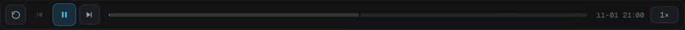

Intermediate·[](https://airflow.apache.org/)·20 min · 8 challenges

# Tasks and Data: Intermediate

At Airbnb, where Airflow was written, picture a nightly bookings pipeline whose Monday miscount was fixed on Thursday. The team wants to rewrite Monday alone, without touching Tuesday or Wednesday, without dragging 40 million rows through the metadata database, and with the fix hitting the production warehouse rather than the staging host one worker still points at. Every choice in this lesson decides whether that works.


<br>

---

## One Run, One Partition

### The window is the partition

A daily run whose window opens at 2026-11-03 00:00 UTC and closes at 2026-11-04 00:00 UTC has a claim on a single slice of the warehouse: the rows stamped inside that day. Build the run so that it reads only those rows and writes only the partition that day names, and the run becomes a function of 2 things: its window and the source rows that fall inside it. Execute it tonight, again tomorrow, or 2 weeks later after a bug fix, and the partition holds whatever the source holds for that day at that moment. If nothing changed, that is the same rows as before. If a fix corrected some rows or late events landed, the rerun picks them up for that day and for no other.

The write has 2 halves. The first clears the partition the run owns, so that a second attempt starts from an empty slot, and it needs only data_interval_start, rendered as a date, to name that partition. The second fills the slot from the source rows inside the window, so it takes both bounds: data_interval_start below and data_interval_end above. Neither half consults the clock. Clearing and then filling is the overwrite mode for a partition. A write that only inserts is in append mode, and in append mode every second attempt adds a second copy of the day.

```sql
DELETE FROM analytics.orders_daily
WHERE order_date = DATE '{{ data_interval_start | ds }}'
```

```sql
INSERT INTO analytics.orders_daily
SELECT
    CAST(order_ts AS DATE) AS order_date,
    customer_id,
    SUM(amount) AS revenue
FROM raw.orders
WHERE order_ts >= from_iso8601_timestamp('{{ data_interval_start | ts }}')
    AND order_ts < from_iso8601_timestamp('{{ data_interval_end | ts }}')
GROUP BY
    CAST(order_ts AS DATE),
    customer_id
```

For the run whose window starts on 2026-11-03, the first statement renders to DATE '2026-11-03' and the second to a range from 2026-11-03T00:00:00+00:00 up to, and excluding, 2026-11-04T00:00:00+00:00. Closed at the bottom and open at the top means a row stamped at exactly midnight belongs to the later day and to no other, so 2 neighbouring runs never claim the same row. Every run of this DAG, whatever day it covers, renders to the same shape with 1 date swapped in.

| Logical date | Rows read | Partition rewritten | Partitions left alone |
| --- | --- | --- | --- |
| 2026-11-01 | order_ts in [Nov 1 00:00, Nov 2 00:00) | order_date = 2026-11-01 | every other day |
| 2026-11-02 | order_ts in [Nov 2 00:00, Nov 3 00:00) | order_date = 2026-11-02 | every other day |
| 2026-11-03 | order_ts in [Nov 3 00:00, Nov 4 00:00) | order_date = 2026-11-03 | every other day |
| 2026-11-02, rerun on Nov 20 | order_ts in [Nov 2 00:00, Nov 3 00:00) | order_date = 2026-11-02 | every other day |

The same shape serves an hourly DAG over a table partitioned by hour: the ds filter becomes ts_nodash, the partition column holds an hour instead of a day, and the range narrows to 60 minutes. The rule underneath does not move. The partition key is a function of the window, and the filter is the window itself.


<br>

### 2 ways to lose the property

| ✓ Owns its partition | ✗ Leaks across partitions |
| --- | --- |
| • Boundaries come from data_interval_start and data_interval_end<br><br>• Clears its own partition before it writes<br><br>• A rerun for Nov 1 on Nov 20 still produces Nov 1<br><br>• 3 runs in parallel touch 3 different partitions | • The filter reads current_date, so a rerun writes whatever day it is now<br><br>• Appends without clearing, so every retry doubles the rows<br><br>• Clears the whole table, so a backfill of Nov 1 erases Nov 2 and Nov 3<br><br>• Writes a partition another run also writes, so 2 runs race |

The clock-reading version fails in a way that looks like success. Suppose the clear still names the window's day but the fill's filter is WHERE order_ts >= current_date - INTERVAL '1' DAY AND order_ts < current_date. On the night of Nov 3 it reads Nov 2, which happens to match the window. Rerun the Nov 2 task on Nov 20 and the clear empties the Nov 2 partition, the filter reads Nov 19, and the insert labels those rows Nov 19, because the partition column comes from CAST(order_ts AS DATE). The task turns green. Nov 2 is left empty, and Nov 19 now holds 2 copies of every row, the first written by its own run. No log line says so, because every statement completed without an error.

Ownership also decides whether a backfill can run several days at once. If each run touches only its own partition, 3 runs in flight at the same moment write 3 different slots and never see each other. The animation below plays a daily DAG whose start_date sits 3 days before the night begins, so catchup creates 3 runs the instant the scheduler looks, and the 3 extract cells, then the 3 load cells, move together. Nothing in the file serializes them and nothing needs to, because the Oct 29 run and the Oct 31 run have no partition in common. A fourth run appears when the Nov 1 window closes at midnight.



> **TIP**
>
> Put the window into the storage path or partition key, never the run's wall-clock time. A path built from now() changes on every retry, and a partition built from the window changes only when the window does.


<br>

---

## Big Data by Reference

### What an XCom row costs

When a task returns a value, Airflow serializes it to JSON and inserts it as a row in the xcom table of the metadata database, the same database the scheduler queries on every loop to decide what runs next. Every downstream pull selects that row and deserializes the whole value. The mechanism scales with the number of values a DAG passes around, and it was never built to scale with their size.

Picture an extract that returns 2,000,000 order rows as a list of dicts. Each row serializes to about 120 bytes, so the value weighs about 240 MB. The producing task holds 240 MB in memory to serialize it, the database stores 240 MB in 1 row, and 3 consumers each read 240 MB back, 720 MB of traffic through the database that is also scheduling every other DAG in the deployment. A slow query there slows every scheduling decision queued behind it, so one careless return value taxes DAGs that never touch orders.

| Payload | Serialized size | Where it belongs |
| --- | --- | --- |
| A row count, 184233 | 6 bytes | XCom |
| A storage path of 49 characters | 51 bytes | XCom |
| A list of 40 column names | about 600 bytes | XCom |
| 2,000,000 order rows | about 240 MB | Storage, with its path in XCom |


<br>

### Write the data, pass the address

The pattern that holds up is to write the result where large data lives, object storage or a warehouse table, at a location that names the run's window, and to push only that location. The downstream task pulls a short string and opens it. The rows never pass through the metadata database, and because the location comes from the window, a rerun writes the same object over the old one, which carries the section 0 guarantee into storage: 1 run, 1 file, replaced in place.

```sql
from airflow.sdk import ObjectStoragePath, dag, task
from pendulum import datetime

LAKE = ObjectStoragePath("file:///var/lake/orders/")


@dag(schedule="@daily", start_date=datetime(2026, 11, 1), catchup=False)
def orders_by_reference():
    @task
    def extract(data_interval_start) -> str:
        target = LAKE / f"{data_interval_start:%Y-%m-%d}" / "orders.parquet"
        target.parent.mkdir(parents=True, exist_ok=True)
        with target.open("wb") as f:
            f.write(fetch_orders(data_interval_start))
        return str(target)

    @task
    def load(path: str) -> int:
        with ObjectStoragePath(path).open("rb") as f:
            return write_partition(f.read())

    load(extract())


orders_by_reference()
```

Here fetch_orders stands for the source read and write_partition for the warehouse write. What crosses XCom is file:///var/lake/orders/2026-11-03/orders.parquet, 49 characters. The 2,000,000 rows go straight from the extract process to storage and from storage to the load process, which works only because both processes reach the same storage: /var/lake here is a network mount every worker shares. On a disk local to 1 worker, the load fails whenever it runs on a different worker from the extract. ObjectStoragePath reads the scheme to pick the storage behind it, so swapping the shared mount for a bucket URI changes 1 line and nothing downstream. The mkdir line creates the dated folder, which a filesystem will not make on its own when the file is opened.

Rerun the Nov 3 run and extract writes the same path again, so load opens the fresh file and the stale one is gone. 2 tasks that read the same path must agree on the window that built it, so either derive the path from data_interval_start in both or, as above, pass it once from the task that wrote it. A path with a timestamp of when the task ran would break both properties: no 2 tries would agree on it, and the old file would linger beside the new.

Writing the file also splits the cost of a failure between the 2 tasks. If load fails on its first try, the retry opens the path the extract already filled, so the second attempt costs 1 read of the file and the source is not queried again. Clear the extract instead, and it rewrites the file at the same path, so a load cleared along with it reads the fresh rows and never a mix of old and new.

The address works in templated fields too. A SQL task downstream can write {{ ti.xcom_pull(task_ids='extract') }} into its statement and load from that path, so the reference flows from a Python task into a SQL one without either side knowing how big the file is.

| ✓ By value | ✗ By reference |
| --- | --- |
| • The rows themselves ride through the metadata database<br><br>• Cost grows with the size of the result and the number of readers<br><br>• A retry serializes everything again<br><br>• Fine for a count, a flag or a short list | • A path or table name rides through the metadata database<br><br>• Cost stays at a few dozen bytes whatever the result holds<br><br>• A retry overwrites 1 object at 1 window-keyed path<br><br>• The right choice for anything measured in megabytes |

> What belongs in an XCom
>
> - A count, a flag, a status word
> - A path or table name the next task opens
> - A short list of partition keys to process
> - Anything of a few kilobytes that describes data rather than being it

*A SELECT that returns rows is a value too. Section 3 shows how a SQL operator pushes its result, and the same size rule applies to it.*


<br>

---

## Where Secrets Resolve From

### 3 homes, one order

A connection id or variable name can be defined in 3 places: a secrets backend, if the deployment configures one, the environment variables of the process running the task, and the metadata database, which is where the UI and the CLI write. When a task asks for warehouse, Airflow checks the secrets backend first, then the environment, then the database, and stops at the first home that answers. A definition further down the list is invisible while one above it exists.

| Checked | Home | How it gets there | Listed in the UI |
| --- | --- | --- | --- |
| 1st | Secrets backend | Whatever store the backend reads, such as a vault or a parameter store | No |
| 2nd | Environment variable | AIRFLOW_CONN_WAREHOUSE or AIRFLOW_VAR_REGION set on the worker process | No |
| 3rd | Metadata database | The Admin pages in the UI, airflow connections add, airflow variables set | Yes |

A secrets backend is a store outside Airflow that Airflow reads through a class named in its configuration under [secrets] backend. When one is configured it answers before anything else, which is the point: a deployment that keeps every production password there can leave the environment and the database holding nothing secret at all. With none configured, the chain starts at the environment.


<br>

### When 2 of them disagree

Say the warehouse connection in the database points at wh-prod.internal, and 1 of the 4 workers was started with AIRFLOW_CONN_WAREHOUSE set to this JSON:

```sql
{
  "conn_type": "postgres",
  "host": "wh-staging.internal",
  "login": "etl",
  "password": "staging-pw",
  "port": 5432
}
```

A task that lands on that worker connects to wh-staging.internal, because the environment answers before the database is asked. The Connections page shows wh-prod.internal, because the page lists the database and nothing else. The other 3 workers connect to prod. The same DAG, the same connection id, 2 destinations, and the UI vouching for the one that a quarter of the tasks never reach. The symptom is a staging table that fills on roughly every fourth night.

The environment's names follow a fixed pattern. A connection id becomes AIRFLOW_CONN_ followed by the id in capitals, so warehouse is AIRFLOW_CONN_WAREHOUSE, and its value is the connection as a JSON object like the one above. A variable becomes AIRFLOW_VAR_ and its name in capitals, so AIRFLOW_VAR_REGION=us defines region. Nothing records either one in the metadata database, which is why no page in the UI can list them.

| Where region is defined | What {{ var.value.region }} renders | What the Variables page shows |
| --- | --- | --- |
| Database only, eu | eu | eu |
| Environment only, us | us | nothing |
| Environment us and database eu | us | eu |
| Backend ap, environment us, database eu | ap | eu |

The CLI resolves through the same 3 homes in the same order as a task: airflow connections get warehouse prints the connection that won, host and login included, and airflow variables get region prints the winning value of a variable. It prints the winner and not the home it came from, so run it on the worker in question, note the host, and then look in each home in turn. The environment it reads is that process's own, so a result from your laptop says nothing about the worker.

| Check | On worker 3 | On workers 1, 2 and 4 |
| --- | --- | --- |
| airflow connections get warehouse | host wh-staging.internal | host wh-prod.internal |
| airflow config get-value secrets backend | empty, no backend configured | empty, no backend configured |
| printenv AIRFLOW_CONN_WAREHOUSE | the JSON above, host wh-staging.internal | nothing |
| Admin, Connections, warehouse in the UI | host wh-prod.internal | host wh-prod.internal |

Read the homes in the order a task asks them. With no backend configured, the environment comes first, and on worker 3 it holds the id with host wh-staging.internal, the same host the CLI printed, so the environment supplied the connection and the database was never consulted. On workers 1, 2 and 4 the environment holds nothing, so the database answers, and its wh-prod.internal matches their CLI output. When a backend is configured, look the id up in the store it reads first: a hit there is the answer, whatever the 2 homes below it hold.

Templates resolve the same way. A field holding {{ var.value.region }} or {{ conn.warehouse.host }} is looked up when the field renders, on the worker, through the same chain. A variable set in the UI and overridden in 1 worker's environment renders differently depending on which worker picks the task up, which reads as a flaky template until someone prints the environment of each worker.

> Signs the environment is winning
>
> - Editing the connection in the UI changes nothing for the task
> - The same task behaves differently on 2 workers
> - airflow connections get prints a host the Connections page never shows
> - A variable renders a value nobody set in the UI

> **TIP**
>
> Pick 1 home per deployment for anything secret and write the choice down. A deployment that keeps secrets in a backend and lets nobody set AIRFLOW_CONN_\* on a worker has nothing left to disagree.


<br>

---

## Running SQL from a Task

### One operator, a list of statements

SQLExecuteQueryOperator, from the common SQL provider, runs SQL through whatever hook the connection's type selects. It takes a conn_id, a sql field that holds a string, a list of strings, or the name of a .sql file, and a do_xcom_push flag. The sql field is templated, so the 2 statements from section 0 go in as written, each in its own file.

```sql
from airflow.providers.common.sql.operators.sql import SQLExecuteQueryOperator
from airflow.sdk import dag
from pendulum import datetime


@dag(
    schedule="@daily",
    start_date=datetime(2026, 11, 1),
    catchup=False,
    template_searchpath="/opt/airflow/sql",
)
def orders_daily_sql():
    SQLExecuteQueryOperator(
        task_id="write_partition",
        conn_id="warehouse",
        sql=["clear_partition.sql", "fill_partition.sql"],
        do_xcom_push=False,
    )


orders_daily_sql()
```

Each file under template_searchpath holds one of the 2 statements, braces included, and the operator renders every file before it runs the first one, then executes them in order on a single connection. The list form keeps the clear and the fill as 2 statements the driver sees separately, which some databases require. The do_xcom_push=False line matters on a write: without it the operator pushes whatever the last statement returned, which for an INSERT is nothing useful and for a SELECT is the entire result set.

The operator also takes parameters, a dict or list the driver binds into placeholders at execution. Use it for values, a customer id or a threshold, and keep templating for structure such as a partition literal or a table name that the window decides. A bound value can never be read as SQL, which is the safety a template cannot give.


<br>

### What a statement hands back

| Statement | What the hook returns | In XCom when do_xcom_push is True |
| --- | --- | --- |
| DELETE or INSERT | None | None |
| SELECT returning 1 row | a list holding 1 tuple | [[184233]] |
| SELECT returning 2,000,000 rows | a list of 2,000,000 tuples | the whole list, the section 1 problem again |
| A list of statements, return_last=True (the default) | the last statement's result | that result alone |

The last row is the one that surprises. With return_last=True, the default, a list of statements pushes only the result of its final statement. Put a SELECT COUNT(\*) first and the clear and fill after it, and XCom holds None, the fill's result, however many rows the count found. Set return_last=False and the operator pushes 1 result per statement instead, a list of 3 here, which is safe only when every statement in the list returns little.

A SELECT is where the 2 halves of this lesson meet. For a 1-row check, pushing the result is the whole point: the next task reads the count. For a result of millions of rows, pushing it rebuilds the section 1 problem with a SQL task as the culprit, so a big SELECT either writes its rows into a table through an INSERT and pushes nothing, or runs inside a Python task that streams rows to storage and pushes the path.


<br>

### The hook inside a Python task

For logic that reads a value and acts on it, a Python task with a hook reads more directly than an operator plus a pull. BaseHook.get_connection("warehouse").get_hook() returns the hook for the connection's type, resolved through the section 2 chain, and get_first returns 1 row as a tuple.

```sql
from airflow.sdk import BaseHook, task


@task
def check_partition(data_interval_start):
    hook = BaseHook.get_connection("warehouse").get_hook()
    day = data_interval_start.strftime("%Y-%m-%d")
    (count,) = hook.get_first(
        f"SELECT COUNT(*) FROM analytics.orders_daily WHERE order_date = DATE '{day}'"
    )
    if count == 0:
        raise ValueError(f"no rows landed for {day}")
    return count
```

The task fails with a message naming the day when the partition is empty, and otherwise returns the count, 6 bytes in XCom that a reporting task can read. Both the check and the write take their day from the window, so the check inspects exactly the partition the write produced, and a rerun of the Nov 3 write is followed by a check of Nov 3 and nothing else.

| Hook method | Returns | Reach for it when |
| --- | --- | --- |
| get_first(sql) | 1 tuple, or None | 1 row answers the question |
| get_records(sql) | a list of tuples | a few hundred rows at most |
| run(sql) | None | the statement writes and you want no result |

| ✓ Do | ✗ Don't |
| --- | --- |
| • Set do_xcom_push=False on every write<br><br>• Keep statements in .sql files under template_searchpath<br><br>• Read a value with get_first and raise on what you will not accept<br><br>• Build the filter from the window, the same as the write | • Push a SELECT of more than a few hundred rows<br><br>• Build a table name from a value a user typed<br><br>• Put the SELECT you need first in a list and expect its result in XCom<br><br>• Hard-code the connection host inside the task |


<br>

---

## Debugging a Rendered Template

### 2 places to read the render

Every task instance keeps the rendered value of each templated field from its latest try. In the UI, open the task instance for a run and its Rendered Templates tab lists every templated field beside the string it became, so the sql of the Nov 3 write shows DATE '2026-11-03' and the Nov 4 write shows DATE '2026-11-04'. From a shell, airflow tasks render orders_daily_sql write_partition 2026-11-03T00:00:00+00:00 prints the same fields for the run with that logical date, without running anything.

| Field | Written in the file | Rendered for 2026-11-03 |
| --- | --- | --- |
| sql[0] | DELETE ... WHERE order_date = DATE '{{ data_interval_start | ds }}' | DELETE ... WHERE order_date = DATE '2026-11-03' |
| sql[1], lower bound | from_iso8601_timestamp('{{ data_interval_start | ts }}') | from_iso8601_timestamp('2026-11-03T00:00:00+00:00') |
| sql[1], upper bound | from_iso8601_timestamp('{{ data_interval_end | ts }}') | from_iso8601_timestamp('2026-11-04T00:00:00+00:00') |
| conn_id | warehouse | warehouse |

The 2 views differ in when they look. The tab holds the render of the task instance's latest try and nothing older: clear the task and let it run again, and the new try writes its render over the old one, so the string the failed try used is gone from the tab once the next try starts. Read it before clearing, or recover it afterwards from the try's log or from the database's error, which usually quotes what it rejected. The CLI renders now, on the machine you run it from, with today's file, variables and environment, so it shows what the next try would see, and it is the view that checks a fix before anything is cleared.


<br>

### 5 renders that went wrong

| What you see rendered | Why | Fix |
| --- | --- | --- |
| DATE '{{ ds }}' with the braces still in it | The value sits in a field that is not templated, or in a string a TaskFlow function built in its body | Move it into a templated field, or take data_interval_start as a function parameter |
| DATE '2026-11-03T00:00:00+00:00' and the database rejects it | data_interval_start rendered as a full datetime | Filter it: | ds for a date, | ts for an ISO timestamp, or strftime for a custom shape |
| The try failed before its first log line, with a KeyError | The template asked for var.value.region and no home defines region | Define it, or give the lookup a default with var.value.get('region', 'us') |
| A date 1 day earlier than the night it ran | ds names the window's start, and the run that covers Nov 3 runs on Nov 4 | Decide whether the field wants the window's start or its end, and render the end as data_interval_end | ds |
| The same field renders 2 ways on 2 workers | A variable in the template lives in 1 worker's environment | Section 2: airflow variables get on each worker |

The variable case fails earliest. Rendering happens before the task's own code starts, so a missing variable ends the try at render, the log opens with the traceback, and there is no completed render for that try to show. The date case fails latest and loudest: the render looks plausible, the statement reaches the database, and the database rejects a DATE literal that carries a T, a time and an offset, so the clue sits in the database's error, which quotes the string it received.

The off-by-a-day case renders without any error. The run with logical date 2026-11-03 covers Nov 3 and starts shortly after midnight on Nov 4. A field built from {{ ds }} renders 2026-11-03, the day the rows belong to. A field naming a file the source drops each night under the date it lands, orders_2026-11-04.csv, needs {{ data_interval_end | ds }}, and a template that used ds there opens the previous night's file and succeeds.

TaskFlow tasks render nothing that their body builds. A string assembled inside the function with {{ ds }} in it is Python, so the braces survive into the SQL and the database sees them. The context arrives as parameters instead, data_interval_start and logical_date among them, and the function formats them with Python.

```sql
@task
def write_day_wrong():
    hook.run("DELETE FROM analytics.orders_daily WHERE order_date = DATE '{{ ds }}'")


@task
def write_day(data_interval_start):
    day = data_interval_start.strftime("%Y-%m-%d")
    hook.run(f"DELETE FROM analytics.orders_daily WHERE order_date = DATE '{day}'")
```

The habit that shortens every one of these is to render first. Before clearing a failed run, print its fields with airflow tasks render for that logical date, read the SQL as the database read it, and run that exact string by hand against the warehouse. A render that reads right and a task that still fails has moved the problem out of the template and into the data or the connection, which is section 2's territory.

> Before clearing a failed run
>
> - Read the Rendered Templates tab now, because the next try overwrites it
> - Render the same logical date from the CLI on a worker
> - Compare the 2 strings: a difference means the file, a home or a variable changed
> - Run the rendered SQL by hand before trusting a clear


<br>

---

## Putting It All Together

A food delivery company discovers on Thursday that a currency bug skewed Monday, Tuesday and Wednesday in its daily order revenue table, and the finance close is Friday morning.

- Because each run's write clears and fills only the partition its window names, the 3 bad days are 3 cleared runs, and Thursday's partition stays untouched while they rebuild in parallel.
- The repaired extract writes each day's rows to storage at a path built from the window and pushes the path, so the 3 reruns overwrite 3 files and the metadata database carries 3 short strings.
- Before anyone clears anything, airflow connections get warehouse on each worker confirms that every rerun will land in production, because a worker's environment outranks the connection the UI displays.
- Running airflow tasks render on a worker for each of the 3 logical dates prints the 3 date literals the repaired SQL task will send, so the fix is checked before the clear, while the Rendered Templates tab still holds the string each original run used.
- The Python check that follows each write reads the rebuilt partition's count through the hook and fails loudly for any day that came back empty.


<br>

---

## Key Takeaways

- A run that reads and writes only the slice its window names can be rerun or backfilled in any order without harming another day.
- Large results go to storage at a window-keyed path, and the path alone rides through XCom.
- A connection or variable resolves from the secrets backend, then the environment, then the database; the first answer wins while the UI shows only the last.
- SQLExecuteQueryOperator renders its sql field, runs a list of statements in order, and pushes the last result unless told not to.
- The Rendered Templates tab and airflow tasks render show the exact string a field became for one run, which is where a template bug is read.

[](https://airflow.apache.org/)

Official Apache Airflow resourcesversion 3.3

"Platform created by the community to programmatically author, schedule and monitor workflows." [airflow.apache.org](https://airflow.apache.org/)

[Documentation](https://airflow.apache.org/docs/)[Install](https://airflow.apache.org/docs/apache-airflow/stable/installation/index.html)[Community](https://airflow.apache.org/community/)

Apache Airflow, Apache, Airflow, the Airflow logo, and the Apache logo are either registered trademarks or trademarks of The Apache Software Foundation.
