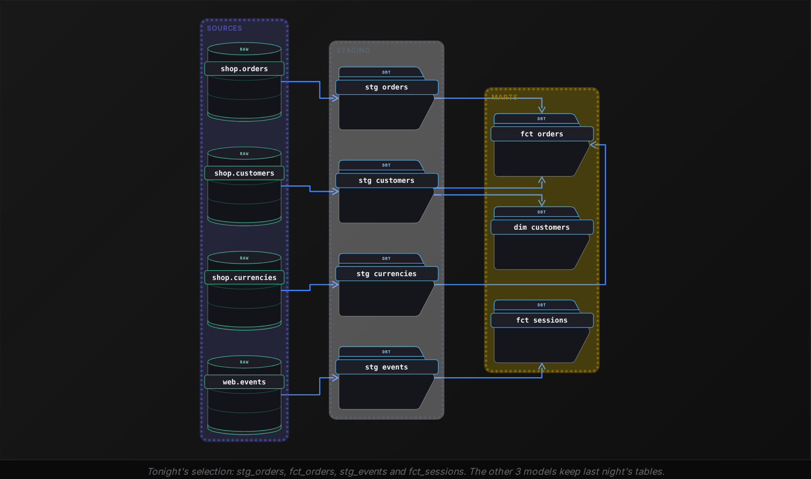
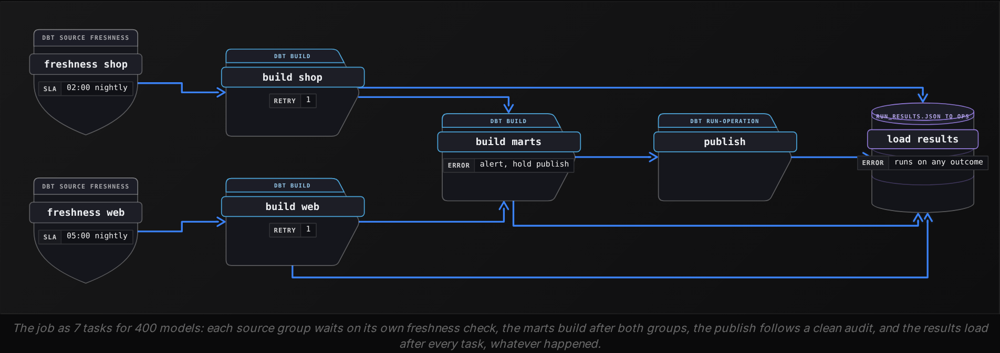

Advanced·[](https://www.getdbt.com/)·20 min · 8 challenges

# Deploying dbt: Advanced

Picture a night at GitLab, whose data team runs its dbt project as a set of scheduled jobs. The first job fires at 02:00 before every source has landed: the Salesforce extract is in, the Zuora extract is 3 hours late, and a finance dashboard reads a mart built from both. Tonight's build has to decide what to run, how fast, and when anyone gets to see the result.


<br>

---

## Building Only Fresh Sources

A nightly job that builds all 300 models of a project rebuilds 290 of them for nothing on a night when only the orders extract delivered rows. The models under the other sources run the same SQL over the same rows and write the tables they wrote the night before. dbt already measures which sources received rows, in the freshness check, and a selector turns that measurement into the build's scope: the models under sources with new rows, and no others.


<br>

### Freshness writes a record of every source

```sql
sources:
  - name: shop
    schema: raw
    tables:
      - name: orders
        loaded_at_field: loaded_at
        freshness:
          warn_after: {count: 12, period: hour}
          error_after: {count: 36, period: hour}
      - name: customers
        loaded_at_field: loaded_at
        freshness:
          warn_after: {count: 24, period: hour}
      - name: currencies
```

`dbt source freshness` sends 1 query per table that declares a `loaded_at_field`: the maximum of that column, with the warehouse's current time beside it. The command writes the answers to `target/sources.json`, 1 entry per source table, holding `max_loaded_at`, the age in seconds, and the status the thresholds give it. The `currencies` table declares no freshness and no `loaded_at_field`, so it gets no query and no `max_loaded_at`.

```sql
{
  "unique_id": "source.shop.shop.orders",
  "max_loaded_at": "2026-11-04T01:52:10+00:00",
  "snapshotted_at": "2026-11-04T02:00:04+00:00",
  "max_loaded_at_time_ago_in_s": 474,
  "status": "pass",
  "criteria": {
    "warn_after": {
      "count": 12,
      "period": "hour"
    },
    "error_after": {
      "count": 36,
      "period": "hour"
    }
  }
}
```


<br>

### Fresher means later than the record you kept

`dbt build --select source_status:fresher+ --state prior/` reads 2 copies of that file: the one the freshness command wrote into `target/` a moment ago, and the one in `prior/`, which the job saved from the previous night. A source is fresher when its `max_loaded_at` in the new file is later than in the prior one. A source present in the new file and absent from the prior one counts as fresher too, which is why a newly declared source builds on its first night. A source with no `max_loaded_at` in either file can never be fresher. The `+` after the method adds every descendant of each fresher source, so the selection is the fresher sources and everything that reads from them, through any number of layers.

| Source | prior max_loaded_at | tonight max_loaded_at | Fresher |
| --- | --- | --- | --- |
| shop.orders | 2026-11-03 01:49 | 2026-11-04 01:52 | yes |
| shop.customers | 2026-11-03 01:49 | 2026-11-03 01:49 | no |
| shop.currencies | none | none | no |
| web.events | absent from the file | 2026-11-04 01:10 | yes |



`fct_orders` is built because `stg_orders` is under a fresher source, and it joins `stg_customers`, which was not rebuilt. That join reads the table `stg_customers` already holds, and that table is the right one: its source received no rows, so a rebuild would have written the same rows again. The selection stays correct because an unselected model's table is the table its unchanged source and unchanged code produce, and that holds only when the build that read the source's last rows completed. A model that errored last night kept its old table, so its source has to count as fresher again tonight. The job below covers both halves of that condition: the code that changed, and the build that did not finish.


<br>

### The job, step by step

> A nightly job with fresh-source selection
>
> - 1. Copy the previous night's `sources.json` and `manifest.json` into `prior/`, outside `target/`.
> - 2. `dbt source freshness`, which writes a new `target/sources.json`.
> - 3. `dbt build --select source_status:fresher+ state:modified+ --state prior/`
> - 4. Only when step 3 exits 0: save `target/sources.json` and `target/manifest.json` as the next night's prior.
> - 5. On any other code: keep the old prior, so tomorrow's check still finds tonight's sources fresher, or run `dbt retry` and save once it exits 0.

Step 1 matters because the freshness command writes into `target/`; if the prior file sat there, the new one would replace it and no source could ever be fresher than itself. Step 3 unions 2 selectors with a space: models under a fresher source, plus models whose code changed since the prior manifest, each with its descendants. Without the second selector, a model edited during the day would keep its old table until its source happened to deliver rows, and the edit would show up on a night nobody expected it.

The freshness command exits with a failure code when any source is past its `error_after` threshold. A scheduler that stops the job on that code skips the build for every source that did land, so the job either treats that step's code as information and runs the build anyway, or sets `error_after` only on the sources whose absence should halt everything.

> **TIP**
>
> A source that is fresher by 1 late row rebuilds every model below it in full, unless those models are incremental. Fresh-source selection decides which models run; incremental models decide how much each one does. Together they make the nightly build proportional to what arrived.


<br>

---

## Threads and the Critical Path

The `threads` setting in `profiles.yml`, or `--threads` on the command line, is the number of nodes dbt keeps in flight at once. dbt holds a queue of nodes whose parents have all finished, and whenever a thread is free it takes the next one. A node whose parent is still running cannot start no matter how many threads sit idle, so the shape of the graph sets a floor on the build's duration that threads cannot lower.


<br>

### A build of 8 models

| Model | Parents | Minutes |
| --- | --- | --- |
| stg_orders | a source | 2 |
| stg_customers | a source | 1 |
| stg_products | a source | 1 |
| stg_events | a source | 6 |
| int_order_items | stg_orders, stg_products | 3 |
| dim_customers | stg_customers | 1 |
| fct_orders | int_order_items, stg_customers | 4 |
| fct_sessions | stg_events | 5 |

With 1 thread, the build takes the sum of the minutes column, because every model waits for the one before it. With more threads the question changes: what is the longest chain of parent-to-child dependencies, measured in minutes? That chain is the critical path. `stg_events` then `fct_sessions` is one chain; `stg_orders`, `int_order_items`, `fct_orders` is another; the longer of the 2 is the floor, and no thread count brings the build under it. The table below walks the schedule at 4 threads, minute by minute; which thread takes which node is dbt's choice, and the intervals are not.

| Minutes | Thread 1 | Thread 2 | Thread 3 | Thread 4 |
| --- | --- | --- | --- | --- |
| 0 to 1 | stg_events | stg_orders | stg_customers | stg_products |
| 1 to 2 | stg_events | stg_orders | dim_customers | idle |
| 2 to 5 | stg_events | int_order_items | idle | idle |
| 5 to 6 | stg_events | fct_orders | idle | idle |
| 6 to 9 | fct_sessions | fct_orders | idle | idle |
| 9 to 11 | fct_sessions | idle | idle | idle |

- **23 min** — build with 1 thread
- **11 min** — build with 4 threads
- **11 min** — build with 16 threads

From 3 threads upward the build stops getting shorter. In the 4-thread schedule, after the first 2 minutes there are never more than 2 nodes ready at the same time, and threads 3 and 4 do 3 minutes of work between them: `stg_customers` and `dim_customers` on thread 3, `stg_products` on thread 4. A third thread alone can take all 3 minutes, running `stg_products` in minute 1 to 2 and `dim_customers` in minute 2 to 3, and the build still ends at the floor. With 2 threads the work splits at best into 2 halves of 11.5 minutes, longer than the floor, so 3 is the smallest count that reaches it, and 4, 8 or 16 only add threads that sit idle.


<br>

### Finding the critical path in a real project

`run_results.json` records each node's `execution_time` in seconds, and `manifest.json` records its parents under `depends_on`. The critical path through a node is its own duration plus the longest path among its parents, so a walk from the sources upward computes it for every node, and the largest value in the graph is the build's floor. Comparing that floor with the run's `elapsed_time` says where the time went. A build whose elapsed time sits close to its floor is waiting on a chain of slow models, and only making those models faster shortens it. A build far above its floor is short of threads, or waiting in the warehouse's queue.

| Model | Own minutes | Longest path into it | Path through it |
| --- | --- | --- | --- |
| stg_events | 6 | 0 | 6 |
| fct_sessions | 5 | 6 | 11 |
| stg_orders | 2 | 0 | 2 |
| stg_customers | 1 | 0 | 1 |
| stg_products | 1 | 0 | 1 |
| int_order_items | 3 | 2 | 5 |
| fct_orders | 4 | 5 | 9 |
| dim_customers | 1 | 1 | 2 |


<br>

### When threads cost time

Each thread holds its own connection to the warehouse and sends 1 statement at a time, so 16 threads put up to 16 statements in front of the warehouse at once. A warehouse that executes 8 statements concurrently queues the other 8, and that queue is outside dbt, so a node's `execution_time` grows to include the wait while nothing in the logs says why. Past the warehouse's concurrency, more threads move the waiting from dbt's queue into the warehouse's, and heavy models that share the warehouse's memory slow each other down, so the build at 32 threads can take longer than the build at 8.

| ✓ More threads help when | ✗ More threads change nothing when |
| --- | --- |
| • A layer is wide: 80 staging views, all ready at the same moment<br><br>• The warehouse executes more statements at once than you have threads<br><br>• Elapsed time sits far above the critical path | • The build is a chain: each model waits for the one before it<br><br>• Elapsed time already matches the critical path<br><br>• Threads already exceed what the warehouse runs concurrently |

*Tests are nodes too. Each test takes a thread for the time its query runs, and a model's tests sit between it and its children on every path through it, so a slow test on a staging model lengthens the critical path as surely as a slow model does.*

> **TIP**
>
> Measure before resizing. Run the build at the current count and compare elapsed_time with the critical path computed from the artifacts. Raise threads only when the gap is wide and the warehouse has room; when the gap is narrow, shorten the slowest chain instead.


<br>

---

## Write, Audit, Publish

`dbt build` writes a model into the schema the dashboards read, then runs its tests. When a test on `fct_orders` fails, dbt skips the children, and `fct_orders` itself already holds the rows the test rejected, because the table was written before the test ran. Every query against it until someone fixes the data returns those rows. Write, audit, publish moves the writing to a place no one reads, runs the tests there, and copies into the readable schema only when every test passed.


<br>

### Write: a target that lands beside production

```sql
shop:
  target: prod
  outputs:
    prod:
      schema: analytics
      threads: 8
    audit:
      schema: audit
      threads: 8
```

The 2 outputs differ in `schema` and nothing else. The default `generate_schema_name` macro joins the target's schema with a model's custom schema, so a mart configured with `schema: marts` lands in `analytics_marts` under `prod` and in `audit_marts` under `audit`. The job builds under `audit`, so the whole project, staging through marts, is written next to the production copy, in the same warehouse, by the same SQL. An incremental mart lives in the audit schema permanently: `this` resolves to `audit_marts.fct_orders`, each night's run merges into it there, and dbt never writes the production copy at all.


<br>

### Audit: the exit code is the verdict

`dbt build --target audit` runs every model, test, seed and snapshot into the audit schemas. Its exit code is 0 only when no node errored and no test failed; a test that warns leaves the code at 0. The scheduler reads the code and runs the publish step only on 0. The project's existing tests, at every layer, are the audit, so a failed test on a staging model blocks publication of the marts above it as surely as a failed test on the mart itself.


<br>

### Publish: copy, then swap by name

Publishing copies each mart from its audit schema into its production schema under a temporary name, then renames the copy to the live name. A rename changes an entry in the warehouse's catalog, so a reader running at that moment sees the previous table complete or the new table complete, never a half-written one.

```sql

  
  
  
    
    
    
    
    
    
    
      
    
    
    
  

```

Each model takes 6 statements, and the copy is the costly one: it writes the full table, so publishing a 300 GB mart writes 300 GB a night on top of the build. Publish only the models readers query, which is usually the marts; staging and intermediate models stay in the audit schema, where their tests already ran. The 2 renames leave an instant in which the live name has no table, and a query arriving in that instant fails; a warehouse that swaps 2 tables in 1 statement closes it, and this macro is where that statement goes. The scheduler runs `dbt run-operation publish --args '{model_names: [fct_orders, dim_customers]}' --target audit`, and because the macro connects under `audit`, `target.database` names the database the build wrote to.

On the night a test fails, the publish step never runs, and `analytics_marts.fct_orders` keeps the previous night's rows. Readers see data 1 day older than usual, and the morning's first job is fixing the audit copy and rerunning the publish. Without the pattern, readers would have seen the wrong rows, and the fix would have raced the dashboards. A job that also selects by fresh sources leaves its prior `sources.json` unsaved that night, so the rerun after the fix still treats the same sources as fresher and rebuilds what failed.

> The job, 3 steps
>
> - `dbt build --target audit`: writes and tests everything in the audit schemas.
> - On exit code 0 only: `dbt run-operation publish`, which swaps the marts into production.
> - On any other code: alert, leave production as it was, keep the audit tables for the investigation.

| ✓ Build straight into production | ✗ Write, audit, publish |
| --- | --- |
| • A model's table holds the failed rows until someone fixes it<br><br>• No extra storage and no extra copy<br><br>• Readers meet a failure as wrong numbers | • Readers keep yesterday's rows until the audit passes<br><br>• Marts exist twice, and each publish writes them once more<br><br>• Readers meet a failure as staleness, which the next section turns into an alert |


<br>

---

## Monitoring from Run Results

A build leaves `run_results.json` in `target/` with 1 entry per node: its `unique_id`, its `status`, its `execution_time` in seconds, the rows the warehouse reported under `adapter_response` where the adapter reports them, and the `message` the warehouse returned. The file's `metadata` carries an `invocation_id` and the time it was generated, and the top-level `elapsed_time` is the whole run. Tomorrow's build overwrites the file. Monitoring begins by keeping every copy, which means loading it into a table before the next run.

```sql
{
  "unique_id": "model.shop.fct_orders",
  "status": "success",
  "execution_time": 212.4,
  "adapter_response": {
    "rows_affected": 48213
  },
  "message": "SUCCESS",
  "thread_id": "Thread-3",
  "timing": [
    {
      "name": "execute",
      "started_at": "2026-11-04T02:41:10Z",
      "completed_at": "2026-11-04T02:44:42Z"
    }
  ]
}
```


The last task of the job reads the file and inserts 1 row per entry into `ops.dbt_run_results`, and 1 row per run into `ops.dbt_runs`, keyed on the `invocation_id` the file already carries; the run's start time is copied onto each result row so the trend queries need no join. That task has to run whether the build succeeded or failed, because the nights worth alerting on are the failed ones, so a scheduler that skips later tasks after a failure needs this one marked to run on any outcome. A row per node per night is tiny: a project of 400 nodes writes 146,000 rows a year.


<br>

### Alerts ask about the latest run

```sql
SELECT
  unique_id,
  status,
  message
FROM ops.dbt_run_results
WHERE invocation_id = (
    SELECT
      invocation_id
    FROM ops.dbt_runs
    ORDER BY started_at DESC
    LIMIT 1
  )
  AND status IN ('error', 'fail')
```

A model's status is `success`, `error` or `skipped`; a test's is `pass`, `fail`, `warn` or `error`. The query fires on the 2 statuses that mean work did not complete. `skipped` deserves a count of its own, because 1 error upstream skips every descendant, and the number skipped is the size of the blast radius. The `message` column holds the warehouse's error text, which is what the person paged wants to read first.

```sql
SELECT
  MAX(started_at) AS last_run,
  DATE_DIFF('hour', MAX(started_at), NOW()) AS hours_since
FROM ops.dbt_runs
WHERE command = 'build'
```

The first query cannot catch a run that never happened, because a run that never happened wrote no rows. The second one can, and it is the alert that catches a scheduler outage, a credential that expired, or a job someone paused and forgot. A daily job gets a threshold of 25 hours, 1 hour of slack past its period, so a late start pages before the morning's dashboards are read.


<br>

### Trends ask about every run

```sql
WITH recent AS (
  SELECT
    unique_id,
    execution_time,
    run_started_at
  FROM ops.dbt_run_results
  WHERE status = 'success'
    AND run_started_at >= NOW() - INTERVAL '14' DAY
)

SELECT
  unique_id,
  APPROX_PERCENTILE(execution_time, 0.5) AS median_seconds,
  MAX_BY(execution_time, run_started_at) AS latest_seconds
FROM recent
GROUP BY unique_id
HAVING MAX_BY(execution_time, run_started_at) > 2 * APPROX_PERCENTILE(execution_time, 0.5)
```

| unique_id | median_seconds | latest_seconds |
| --- | --- | --- |
| model.shop.fct_sessions | 240 | 610 |
| model.shop.stg_events | 180 | 395 |

`fct_sessions` took 610 seconds last night against a median of 240 across 2 weeks, and `stg_events` above it doubled too, which points at the events source growing rather than at the mart's SQL. Nothing failed, so no status alert fired, and a job that finished within its window would have passed unnoticed for weeks while the model crept toward the window's edge. The same query over `rows_affected`, with the comparison reversed to flag a latest value below half the median, catches the opposite drift: an incremental model that wrote 0 rows on a night its source was fresh has a filter that excludes everything, and a success status to hide it.

> Four alerts that cover most nights
>
> - A node with status `error` or `fail` in the latest run, with its `message`.
> - No run started in the last 25 hours.
> - `elapsed_time` of the latest run above the window the job has to finish in.
> - A model whose latest `execution_time` is above twice its 14-day median.

> **TIP**
>
> Store the failing rows of tests with the store_failures config and put the table's name in the alert next to the message. The person paged opens the rows the test rejected instead of rerunning the test to find them.


<br>

---

## One Task or One per Model

A scheduler outside dbt runs each task as a process, and a task is 1 dbt command. The choice is how many tasks the project becomes: 1 task running `dbt build`, a handful running selectors, or 1 task per model, generated from `manifest.json`. Each layout sends the same SQL to the warehouse, so the difference lies in what the scheduler can see, retry and time, and in what each task costs to start.


<br>

### What a task costs to start

Every dbt invocation starts a process, parses the project (partial parsing reuses the previous parse of unchanged files, and the process still has to load it), opens its connections, and writes its own `target/` directory. Call that 5 seconds. A project of 400 models as 400 tasks pays it 400 times, and the payments along the critical path add up in series: a chain of 6 models gains 30 seconds of starting on top of its queries. The same project as 4 tasks pays 20 seconds in total. Tasks also run on the scheduler's workers, which have a concurrency limit of their own, so a per-model layout replaces dbt's threads with the scheduler's pool and inherits the critical path from the second section unchanged.

| Layout | Tasks for 400 models | Retry unit | Parallelism from | Where tests run |
| --- | --- | --- | --- | --- |
| 1 task | 1 | `dbt retry` resumes at the failed node | dbt threads | beside each model, inside build |
| Task per group | 3 to 10 | the group, or `dbt retry` inside it | threads inside each task, groups in parallel | inside each group's build |
| Task per model | 400 | 1 model | the scheduler's workers | each model's own build |


<br>

### Split along what differs

A boundary between tasks earns its cost when the 2 sides differ in something the scheduler controls: when they run, what they wait for, or what happens when they fail. Models under the shop source wait for the shop extract; models under the web events wait for a different extract that lands 3 hours later. The hourly models run 24 times a day and the rest once. A group that may fail without stopping the morning's finance marts belongs in a task whose failure the scheduler records and moves past. Everything that shares a schedule, a wait and a failure rule stays in 1 task, where `dbt build` orders it, threads parallelize it and `dbt retry` resumes it.




<br>

### The model that reads from both

`fct_orders` reads `stg_orders` from the shop group and `stg_events` from the web group. If the shop task's selector is `source:shop+`, it includes `fct_orders`, and builds it at 02:10 from a `stg_events` table the web task has not refreshed yet. The web task's selector `source:web+` includes it again at 05:00 and builds it correctly, so the mart was built twice and was wrong for 3 hours. The fix is in the selectors: the 2 group tasks build only their staging layer, and a third task builds everything downstream of both after both have finished.

| Task | Selector | Runs when |
| --- | --- | --- |
| build_shop | `--select source:shop+1` | the shop extract has landed |
| build_web | `--select source:web+1` | the web extract has landed |
| build_marts | `--select source:shop+ source:web+ --exclude source:shop+1 source:web+1` | both staging tasks finished |

`+1` after a selector takes 1 level of descendants, which is the staging layer and nothing below it. The marts task unions both sources with their whole lineage and excludes the staging the first 2 tasks already built. Checking a split: `dbt list --select` with each task's selector prints the nodes it takes, and the 3 lists together should name every model once. A model in 2 lists is built twice; a model in none is never built, and nothing in the scheduler will say so. Each task also needs its own `--target-path`, so that 2 tasks running at the same minute do not write the same `run_results.json`, and `dbt retry` inside a task finds the file that task wrote. The results loader then reads the `run_results.json` in each task's own directory.

| ✓ Do | ✗ Don't |
| --- | --- |
| • Start at 1 task per schedule and split only along waits and failure rules<br><br>• Give each task its own --target-path so dbt retry finds the right run_results.json<br><br>• Verify the split with dbt list so every model lands in exactly 1 task<br><br>• Put the results loader after every task, set to run on any outcome | • Generate a task per model to see models in the scheduler; the artifacts already show them<br><br>• Let a group task's selector reach into a model another group also builds<br><br>• Retry a whole group when dbt retry inside it would resume 1 node<br><br>• Tune threads for a per-model layout, where each task runs 1 node |


<br>

---

## Putting It All Together

GitLab's data team schedules its dbt project in jobs that run as extracts from Salesforce, Zuora and its own product land through the night, and a finance mart joins rows from more than 1 of them. On a night the Zuora extract lands late, the freshness check marks only the sources that delivered, the tasks for those sources build their staging layer in an audit schema, the marts task waits for both groups before it runs, and a failed test in the audit holds the publish so the finance dashboard keeps yesterday's rows. In the morning the results table shows which node failed, how long the chain above it took, and whether the late extract made the whole night slower.

- Fresh-source selection decides which models run; the task split decides which process runs them, and the prior sources.json has to be saved by the same task that will read it next.
- The critical path computed from run_results.json sets the floor for every task, whether dbt's threads or the scheduler's workers provide the parallelism.
- Write, audit, publish turns a failed test into staleness, and the 25-hour and elapsed_time alerts are what turn that staleness into a page.
- The results loader runs after every task on any outcome, so the failed audit, the skipped descendants and the late extract all appear in the same table the trend queries read.


<br>

---

## Key Takeaways

- source_status:fresher+ with a saved sources.json builds only the models under sources whose max_loaded_at advanced, and state:modified+ beside it covers the models whose code changed.
- Threads cannot bring a build under its critical path, the longest chain of durations through the graph, and past the warehouse's concurrency they move waiting rather than remove it.
- An audit target writes the whole project beside production, the build's exit code is the verdict, and a publish macro swaps only the marts in by rename when the code is 0.
- run_results.json loaded into a table every night, on any outcome, answers both the alert questions about the latest run and the trend questions about every run before it.
- Split a project into scheduler tasks only along differences in schedule, waits and failure rules, and let dbt build, threads and dbt retry handle everything inside a task.

[](https://www.getdbt.com/)

Official dbt resources

"dbt enables data analysts and engineers to transform their data using the same practices that software engineers use to build applications." [github.com/dbt-labs/dbt-core](https://github.com/dbt-labs/dbt-core)

[Documentation](https://docs.getdbt.com/)[Get started](https://docs.getdbt.com/docs/get-started-dbt)[Source](https://github.com/dbt-labs/dbt-core)

dbt and the dbt logo are trademarks of dbt Labs, LLC.
