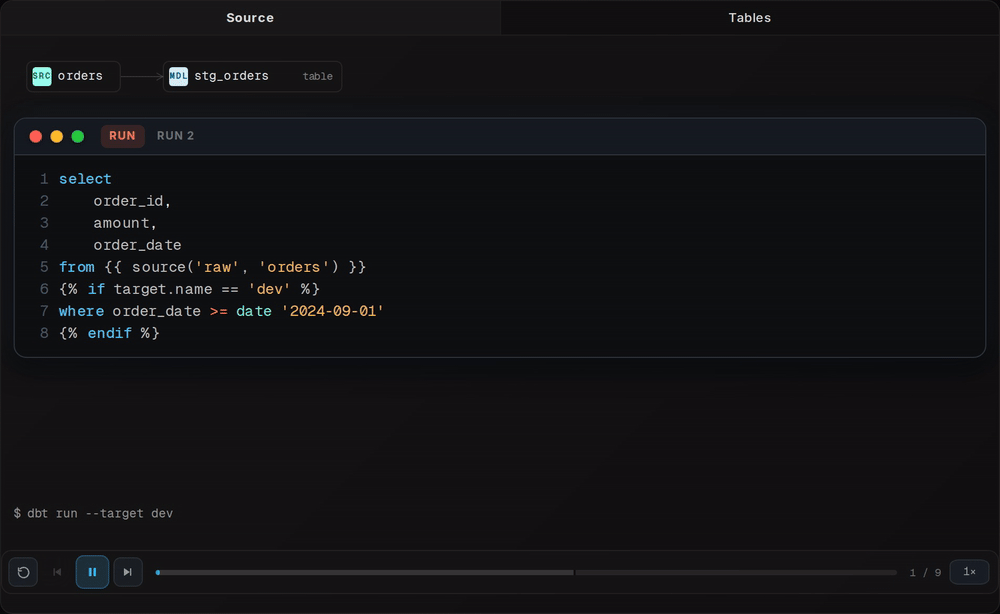
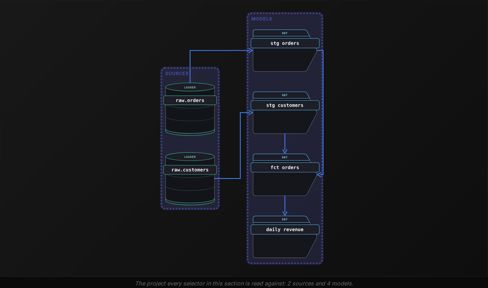
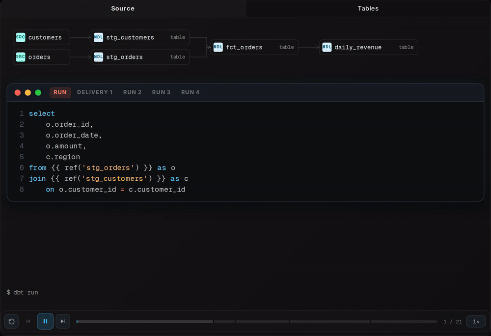
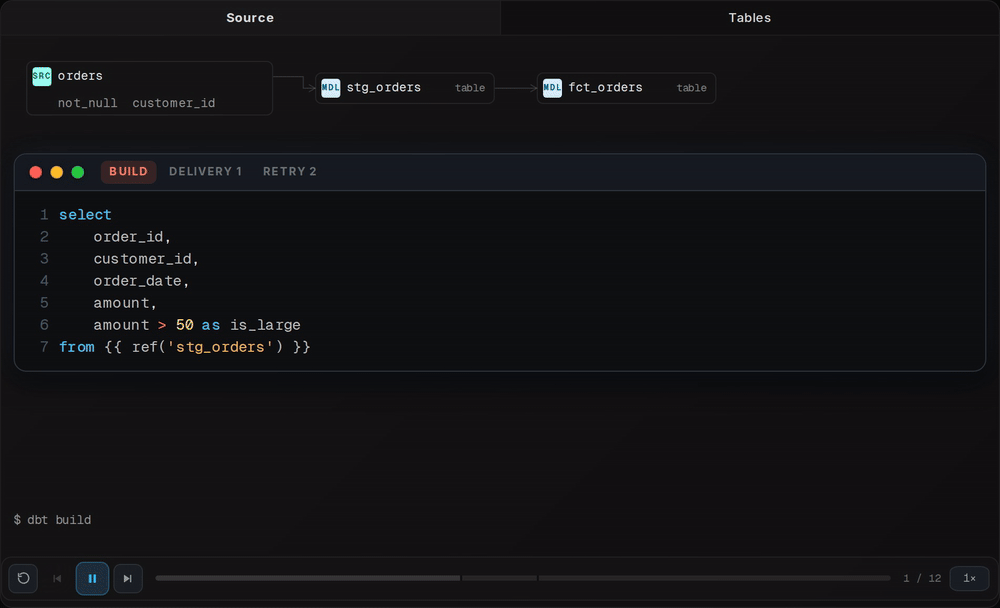
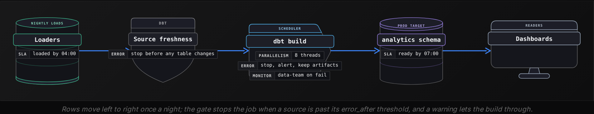

Beginner·[](https://www.getdbt.com/)·20 min · 9 challenges

# Deploying dbt: Beginner

GitLab's data team keeps its dbt project in a public repository, and changes reach it through merge requests. Take one that edits an orders model. Before merge, that model and the models reading it build in the author's own schema. After merge a scheduled run builds it into production, and if a test fails there, the next step decides what dashboards show.


<br>

---

## Dev and Prod Targets

### One project, 2 destinations

Every build you have run so far landed in one schema, because the connection you were using pointed there. A project that other people depend on needs 2 places to land: a private workspace where a half-finished model can break without anyone noticing, and a production schema that dashboards read and that only a finished, tested build may touch. dbt names each place a target, and keeps both out of the models, so the file that defines stg_orders never says where stg_orders goes.

The link between code and place is a single line in dbt_project.yml, profile: shop. The profile lives in profiles.yml, in the ~/.dbt/ directory of whoever runs the command, outside the repository, so a password never sits next to the code it protects. A profile holds outputs, each a full connection plus the schema it builds into, and a target: key naming the output a command uses when none is given.

```sql
shop:
  target: dev
  outputs:
    dev:
      schema: dbt_maria
      threads: 4
    prod:
      schema: analytics
      threads: 8
```

Each output also carries the keys that open the connection: the warehouse type and host, plus a user with its password. They are left out above because they differ from one warehouse to the next and change nothing about what dbt does once connected. The 3 settings shown decide how every build runs. schema says where each model lands. threads says how many nodes dbt builds at the same time; prod gets 8 because a scheduled run shares the warehouse with nobody at 5 am, while a developer's 4 leaves room for other people's queries. target: dev says a bare dbt build goes to dev. Adding --target prod to any command sends it to prod instead, and that one flag is the whole difference between a developer's run and a production run.

|  | dev | prod |
| --- | --- | --- |
| Who runs it | Maria, from her laptop | The scheduler, every night |
| Schema | dbt_maria | analytics |
| Threads | 4 | 8 |
| Who reads the tables | Maria | Dashboards and other teams |
| ref('stg_orders') resolves to | dbt_maria.stg_orders | analytics.stg_orders |
| The model files | models/ | models/, the same files |

Notice what the table does not list: the SQL. ref('stg_orders') resolves to dbt_maria.stg_orders on dev and analytics.stg_orders on prod because ref() reads the schema from the target as it compiles, so one file compiles into a different create table statement on each. A model that names a schema in its own text ignores the target. A hard-coded analytics.orders in a from clause makes every dev build read production's table: the dev model quietly builds on prod rows, or fails with a permission error where dev credentials cannot read the analytics schema. Writing ref() and source() in its place is what lets one file serve both targets, which is why hard-coded names are the first thing to fix in a project that has only ever had one place to build.

*You choose a target's name. Most projects call theirs dev and prod, and so does the rest of this lesson. A third target often appears once a project checks pull requests automatically, and its schema is thrown away after each check.*


<br>

### Reading the target from Jinja

Jinja can see the target a run is on through target.name and target.schema. The common use is keeping dev builds small: a developer checking a join does not need 3 years of orders, so the model drops older rows when, and only when, the target is dev. The animation pins the cutoff to a fixed date so its rows are the same each time you play it; a real project writes current_date - interval '30' day in its place.



*$ dbt run --target dev*

Play both steps. The dev run rendered the if block into a where clause and built stg_orders with 3 rows. The prod run rendered the same block to nothing and built all 5. The file produced 2 different statements, and the target was the only input that changed between them. Prod never pays for the filter, dev never waits for the full table, and a model downstream needs no change at all, because ref('stg_orders') finds a smaller table on dev and a complete one on prod.

> **TIP**
>
> A target is a place and a set of permissions. Give the dev credentials no write access to the prod schema, so a mistyped --target prod from a laptop fails at the warehouse instead of overwriting a table a dashboard reads.

> What a target never changes
>
> - Which models exist and how ref() connects them
> - Which tests run and which children a failing test holds back
> - Whether a model is materialized as a view or as a table, and whether that table is incremental
> - The compiled SQL, except where Jinja reads target.name on purpose


<br>

---

## Selecting Part of the DAG

### Naming the nodes a command touches

dbt build with no arguments builds every node in the project in DAG order. On a project with 400 models that takes an hour, and a developer who changed 1 model does not want to wait for the other 399. --select takes a list of node names and limits the command to them. dbt run --select stg_orders runs 1 model. dbt build --select stg_orders runs that model and every test declared on it, because build treats a model's tests as part of the model. Nodes outside the selection drop out of the command entirely: the dbt run above counts 1 of 1 in the terminal, and its artifacts list 1 result.

The plus sign extends a name along the DAG. Placed before the name, it adds everything upstream of it, walking back through parents to the sources; placed after the name, it adds everything downstream; on both sides, it adds both directions. --exclude takes the same forms and removes nodes from whatever --select chose, so --select +daily_revenue --exclude stg_customers builds the lineage of daily_revenue with 1 parent left out. Several names separated by spaces select each of them, --select stg_orders stg_customers, with no walk along the DAG unless a name carries its own plus.



| Command | Nodes dbt runs, in order |
| --- | --- |
| dbt run --select fct_orders | fct_orders |
| dbt run --select +fct_orders | stg_orders, stg_customers, fct_orders |
| dbt run --select stg_orders+ | stg_orders, fct_orders, daily_revenue |
| dbt run --select +fct_orders+ | stg_orders, stg_customers, fct_orders, daily_revenue |
| dbt run --select stg_orders stg_customers | stg_orders, stg_customers |
| dbt run --select +daily_revenue --exclude stg_customers | stg_orders, fct_orders, daily_revenue |

Inside a selection dbt keeps DAG order and keeps the parallelism from threads. --select +daily_revenue on 8 threads builds stg_orders and stg_customers at the same time, then fct_orders once both exist, then daily_revenue. A selection changes which nodes run, never the order in which 2 selected nodes that depend on each other run. The last row of the table shows the other side of that: fct_orders runs even though one of its parents was excluded, and reads whatever stg_customers held before the command.


<br>

### What a partial build leaves behind

A node left out of a selection keeps whatever its table held before the command. That sounds harmless until a new row arrives in a source. The animation starts with a full run, then inserts an order and runs only fct_orders, then widens the selection in each direction. Watch the row counts of the 2 tables after each step.



*$ dbt run*

Step 2 is the surprise. dbt run --select fct_orders ran 1 node, yet fct_orders still shows 4 rows, because it reads stg_orders, a table nobody rebuilt, and that table never saw order 5. Step 3 selected +fct_orders, so stg_orders was rebuilt first and fct_orders picked up the fifth row, but now daily_revenue disagrees with the table it is summed from. Step 4 selected fct_orders+ and brought the child back in line. A selected model is only as current as the parents it reads, and every model downstream of it that was left out keeps the old rows until it is selected too. After new rows land in a source, stg_orders+ does the work of steps 3 and 4 in one command and leaves stg_customers, which saw no new rows, alone.

> Where the plus goes
>
> - New rows in a source? The model reading it and everything below are stale: select stg_orders+
> - Edited a model's code? Its children are stale: select model+
> - Building a model that must read fresh parents? Select +model, which rebuilds what it reads first
> - Both edited and fed new rows? +model+ covers both directions
> - Not sure? A full dbt build is never wrong, only slow

The same flag works on test. dbt test --select stg_orders runs only the tests declared on stg_orders, the quickest check after an edit, and dbt test --select +fct_orders runs the tests of the model and of everything it reads. --exclude applied to a test removes it from the run, which makes a build pass without making it correct.

| ✓ Do | ✗ Don't |
| --- | --- |
| • Select the model reading a changed source with a trailing plus, as in stg_orders+<br><br>• Select model+ after editing a model, so the children see the change<br><br>• Select +model when a model must read freshly built parents<br><br>• Use dbt build --select, so the selected model's tests run with it<br><br>• Run the full DAG once before trusting any selection | • Run --select model alone and expect new source rows to appear in it<br><br>• Exclude a failing test to make a build pass<br><br>• Leave a partial run as the last run on prod |


<br>

---

## Run Artifacts

### The target folder

Every command writes a folder called target/ next to dbt_project.yml. You have opened one corner of it already, target/compiled/, to read the SQL Jinja rendered. The rest of the folder is the run's record: which nodes exist, which of them ran, what each one returned and how long it took. dbt calls these files artifacts. The 2 that matter most here are manifest.json and run_results.json, because the retry in the next section reads them, and so does every deployment feature after it.

| File | Written by | What it records |
| --- | --- | --- |
| target/manifest.json | every command that parses the project | every node, its config, its compiled SQL, its parents and its children |
| target/run_results.json | build, run, test, snapshot, retry | 1 entry per node that ran: status, timing, message |
| target/compiled/ | compile, run, build, test | the SELECT each model renders to |
| target/run/ | run, build | the statement sent: the SELECT wrapped in create table, create view or insert |
| target/sources.json | source freshness | each source's newest loaded_at and whether it passed |
| logs/dbt.log | every command | every statement sent and every line printed, in order |


<br>

### run_results.json, the record of one run

The excerpt below is the file after a dbt build --target prod in which a test on stg_orders failed. It's cut to 3 entries; a real file holds 1 entry for every node that was selected, including the ones that were skipped.

```sql
{
  "metadata": {
    "dbt_version": "2.0.0",
    "invocation_id": "c7e1-4f0a"
  },
  "results": [
    {
      "unique_id": "model.shop.stg_orders",
      "status": "success",
      "execution_time": 1.42,
      "message": "CREATE TABLE (5 rows)"
    },
    {
      "unique_id": "test.shop.not_null_stg_orders_customer_id.8a3f",
      "status": "fail",
      "execution_time": 0.31,
      "failures": 1,
      "message": "Got 1 result, configured to fail if != 0"
    },
    {
      "unique_id": "model.shop.fct_orders",
      "status": "skipped",
      "execution_time": 0,
      "message": null
    }
  ],
  "elapsed_time": 4.8,
  "args": {
    "command": "build",
    "select": [],
    "target": "prod"
  }
}
```

Each entry names its node by unique_id: the resource type and project name followed by the node name, all joined by dots, which is how every artifact refers to a node. status records the outcome in lower-case words that differ from the terminal's labels: success for a model the terminal showed as OK; for a test, pass and fail where the terminal showed PASS and FAIL, with warn for WARN; error for a node the terminal showed as ERROR; and skipped for a child held back by a failure, shown as SKIP. execution_time is seconds for that node. message is what the warehouse or the test returned, so for the failed test it holds the failing count, and failures holds the same count as a number. The args block repeats the command line, so the file on its own says what was asked for, and elapsed_time is the whole run. The next command overwrites the file, which means a run worth studying must be copied aside before anything else is typed in that project.


<br>

### manifest.json, the record of the project

```sql
{
  "nodes": {
    "model.shop.fct_orders": {
      "name": "fct_orders",
      "resource_type": "model",
      "schema": "analytics",
      "config": {
        "materialized": "table"
      },
      "depends_on": {
        "nodes": [
          "model.shop.stg_orders",
          "model.shop.stg_customers"
        ]
      }
    }
  },
  "parent_map": {
    "model.shop.daily_revenue": [
      "model.shop.fct_orders"
    ]
  },
  "child_map": {
    "model.shop.stg_orders": [
      "model.shop.fct_orders",
      "test.shop.not_null_stg_orders_customer_id.8a3f"
    ]
  }
}
```

The manifest is the DAG written down: every model and source plus the tests declared on them, their configs after the project file and each model's own config() block have been merged, the schema each will land in on the target that parsed it, and the edges ref() and source() declared. parent_map and child_map are the 2 directions of the graph, and they are what --select +name and name+ walk. Every command writes a manifest, even dbt compile, because every command parses the project first. It describes the project as parsed, never the warehouse: a model listed in the manifest may never have been built at all, or may have failed or been skipped.

target/compiled/ and target/run/ hold the same model twice. The compiled file is the SELECT, what you read when a query returns the wrong rows. The run file is that SELECT inside the statement dbt sent, create table analytics.fct_orders as (...), what you read when the warehouse rejected it.

#### Reading a failed run from its files

After a failure, 3 files answer 3 questions in order. run_results.json says which node failed and with what status and message. The node's file under target/run/ holds the statement that failed, which you can paste into a query window and run by hand. logs/dbt.log holds the warehouse's full reply, in case the message in run_results.json was cut short.

*target/ and logs/ are rebuilt on every command and belong in .gitignore; dbt clean deletes them. The one copy worth keeping is the manifest of the last production run, which later lessons use to compare a change against what prod holds.*

> Who reads the artifacts
>
> - You, after a failed run: run_results.json gives each node's status along with its message
> - dbt retry: it reads run_results.json to find the nodes to run again
> - dbt docs: it draws the lineage graph from manifest.json
> - A monitor: it reads elapsed_time and each status without parsing terminal output


<br>

---

## Retrying a Failed Build

### A failure in the middle of the DAG

A nightly build of 40 models runs for 25 minutes. At minute 12 a not_null test declared on the orders source fails, because the loader wrote a row with no customer. You know what follows from the testing lesson: stg_orders is skipped along with fct_orders and daily_revenue, every node that does not depend on that source builds as usual, and the run ends with 37 successes beside the failed test and its 3 skipped children. The loader is fixed by 9 am. The question is how to finish the build.

| Node | Status in run_results.json |
| --- | --- |
| stg_customers | success |
| source_not_null_raw_orders_customer_id | fail |
| stg_orders | skipped |
| fct_orders | skipped |
| daily_revenue | skipped |
| 36 other models | success |

Running dbt build again rebuilds all 40 models, 37 of which are already correct, and takes another 25 minutes. dbt retry instead reads target/run_results.json and collects the nodes marked fail or error along with those marked skipped. It runs the same command with the same arguments on that list only. Here that is 4 nodes: the test, then the 3 skipped models in DAG order, because the test passing is what releases them. The 37 successes stay as they are, and the terminal counts 4 of 4.



*$ dbt build*

Step 1 is the failed build: the source test found order 4 with no customer, so both models were skipped and fct_orders is empty. Before step 2 the loader's fix deletes that row, and dbt retry runs. It parsed the project again, read the previous results, and ran exactly the 3 nodes that had not passed, in DAG order: the test, now passing, then stg_orders, then fct_orders with 3 rows. The retry then writes a fresh run_results.json holding those 3 entries, so a second retry would find nothing to do.

| Status in run_results.json | Does dbt retry run it again? |
| --- | --- |
| success (a model built) | No |
| pass (a test found 0 rows) | No |
| warn | No |
| fail (a test found rows) | Yes |
| error (the warehouse rejected a statement) | Yes |
| skipped (held back by a parent) | Yes |


<br>

### What retry will not do

4 limits to know before you rely on retry

- It reruns the same command with the same flags. A build started with --select +fct_orders retries with that selection; you cannot add --full-refresh or change the list.
- It never reruns a node that succeeded, even one you edited after the failure. A fix inside a succeeded parent needs dbt build --select parent+, never a retry.
- It reads only the latest run_results.json. A dbt test typed in between replaces the file, and the retry then resumes that run instead.
- It runs current code. A model that errored on a typo and was fixed in its file is retried with the fix, because the project is parsed again before the retry starts.

Now move the not_null test from the source onto stg_orders and replay the same night in your head. The model builds first and succeeds, holding the row with no customer. Its test fails and the children are skipped. The loader deletes the bad source row, and a retry runs the test and the children. Nobody rebuilt the stg_orders table, so the test finds the same row there and fails again; the children are skipped again. The repair is dbt build --select stg_orders+: a retry only helps when the fix lies in a node that did not pass, or in the source that such a node reads.


<br>

---

## Running dbt on a Schedule

### A job is a list of commands

A schedule is a machine typing the commands you typed by hand, at a fixed time, with the prod target. Whatever runs it, a cron entry on a server or a workflow scheduler, the job holds the same 3 things: when to start, which commands to run in order, and what to do when one of them fails. Here is a nightly job written the way a scheduler might store it.

```sql
name: nightly_dbt
schedule: "0 5 * * *"
steps:
  - dbt source freshness --target prod
  - dbt build --target prod
on_failure:
  - alert: data-team
  - keep: target/run_results.json
```

The first command checks each source against the freshness rule declared in its YAML: a loaded_at_field and thresholds such as error_after of 12 hours on raw.orders. A source past error_after makes the command exit with an error and stops the job, so the build never runs on yesterday's rows to publish them under today's date. A source past only warn_after prints a warning and the build goes ahead. The second command builds every model and its tests on prod in one step rather than dbt run followed by dbt test, because only build stops a child when its parent's test fails; a separate run would have published every model before the first test looked at any of them. A failure stops the job, keeps the artifacts so a retry can resume, and tells someone. The hour is chosen from the loaders: orders finish loading at 4 am, so 5 am leaves an hour of margin and still has tables ready before the first dashboard opens at 7.




<br>

### What has to be true before the schedule is switched on

5 conditions before the schedule is switched on

- **Prod is out of a developer's reach** *separate credentials and schema*\
  Developer credentials have no write access to the analytics schema, and the job runs with its own credentials scoped to it, so only the scheduled job and its retry change the tables dashboards read.
- **The build can run twice** *a rerun does no harm*\
  A table rebuilds from scratch and an incremental model filters to rows newer than what it holds, so a retry leaves the same tables as one clean run, and so does a second run after a crash.
- **Tests stand between sources and readers** *skipped models keep yesterday's rows*\
  A failing test holds back every model downstream of it, and those tables keep yesterday's rows. The model the test sits on was rebuilt before the test ran, so a test guarding a dashboard's table belongs on its source or a parent.
- **The job builds the merged code** *main branch, fresh checkout*\
  The scheduler clones the repository each night, so the models it builds are the ones that passed review, and a half-finished branch never reaches prod.
- **Someone is told** *an alert on failure, artifacts on every run*\
  run_results.json is kept from each night, and a failure wakes a person who can read it and choose between a retry and leaving yesterday's tables in place.

| ✓ By hand, on dev | ✗ On a schedule, on prod |
| --- | --- |
| • You choose the moment and watch the output<br><br>• A broken model breaks your own schema<br><br>• --select narrows the work to your change<br><br>• A full refresh happens when you decide it should | • The clock chooses, and nobody watches<br><br>• A broken model breaks what others read, so tests gate it<br><br>• The full DAG every night, so nothing stays stale<br><br>• No --full-refresh in the nightly job; a refresh is its own job with its own reason |

The retry needs one more condition: the failed night's artifacts. dbt retry reads target/run_results.json, and a job that clones the repository fresh starts with no target/ folder at all, while a laptop's holds only its own last dev run. So the scheduler gets a second job, triggered by a person once the cause is fixed: it checks out the repository, copies the kept run_results.json into target/, and runs dbt retry --target prod before any other dbt command can overwrite that file. The retry parses whatever code the job checked out, so a fix merged in the meantime is the code it runs. It rebuilds the skipped models with the prod credentials, and the morning's run_results.json is replaced by one in which every entry passed.

| ✓ Do | ✗ Don't |
| --- | --- |
| • Run source freshness before the build, every night<br><br>• Use one dbt build on prod, so tests gate their children<br><br>• Keep run_results.json from every scheduled run<br><br>• Give the job its own credentials, scoped to the prod schema | • Point the scheduler at a developer's branch<br><br>• Split the night into dbt run and a later dbt test<br><br>• Retry from a laptop against prod<br><br>• Schedule --full-refresh inside the nightly job |

The job this section built starts with a freshness gate and runs one build on prod; when that build fails, an alert goes out and a retry resumes from the kept artifacts. Each piece rests on an earlier section. The build uses the prod target and the full DAG, with no selection narrowing it, and the retry reads the run_results.json that the alert keeps. Together they let a failed night be finished by running only the nodes that did not pass.


<br>

---

## Putting It All Together

A retailer's revenue dashboard is opened by 300 store managers at 7 am. Its tables come from a dbt project of 40 models that a scheduler builds on the prod target at 5 am, after checking that the overnight order load is fresh. During the day the developers build the same project into their own schemas, selecting the models around whatever they changed.

- A developer's dbt build --select stg_orders+ on dev and the scheduler's dbt build on prod send the same compiled SQL to different schemas, because the target picks the schema and the code never does.
- The 5 am job keeps its run_results.json, so when the source test fails the on-call engineer restores it into the retry job's target/ and runs dbt retry there: only the failed test and the models it held back run instead of all 40.
- Because the failing source test held back every model that reads that source, those tables still hold yesterday's complete rows at 7 am, and a manager sees a stale date instead of a wrong number.
- The freshness check before the build is what makes that stale date honest: a build on sources that had not loaded would have passed every test and published old rows as new.


<br>

---

## Key Takeaways

- A target is a connection plus a schema, chosen with --target; the models never name a schema, so one project builds into dev and prod from the same files.
- --select limits a command to named nodes, +name adds the parents, name+ adds the children, and anything unselected keeps the rows it had before.
- Every command leaves target/manifest.json, the project as parsed, and target/run_results.json, one status per node that ran, overwritten by the next command.
- dbt retry reads the last run_results.json and reruns the nodes that failed or errored, along with the ones they caused to be skipped, with the same command and flags, and leaves every success alone.
- A schedule is the same commands on the prod target, freshness before build, with tests gating children and artifacts kept so a failed night can be resumed.

[](https://www.getdbt.com/)

Official dbt resources

"dbt enables data analysts and engineers to transform their data using the same practices that software engineers use to build applications." [github.com/dbt-labs/dbt-core](https://github.com/dbt-labs/dbt-core)

[Documentation](https://docs.getdbt.com/)[Get started](https://docs.getdbt.com/docs/get-started-dbt)[Source](https://github.com/dbt-labs/dbt-core)

dbt and the dbt logo are trademarks of dbt Labs, LLC.
