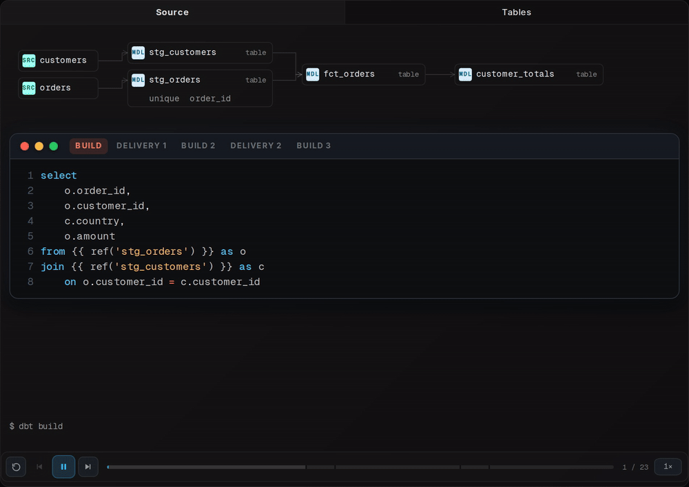
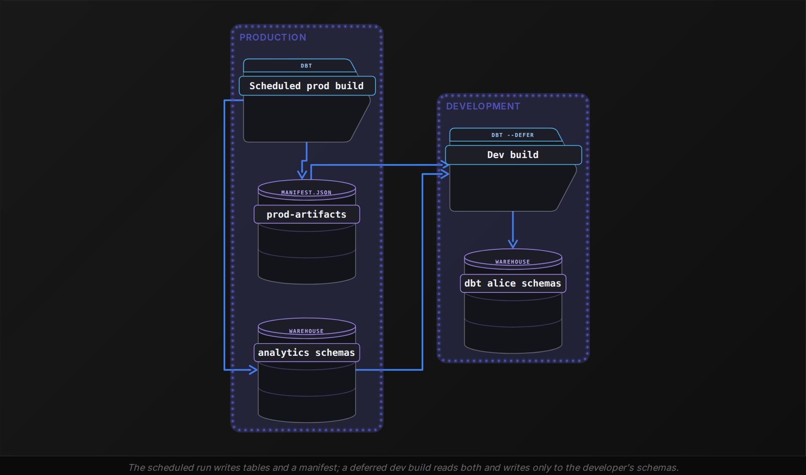
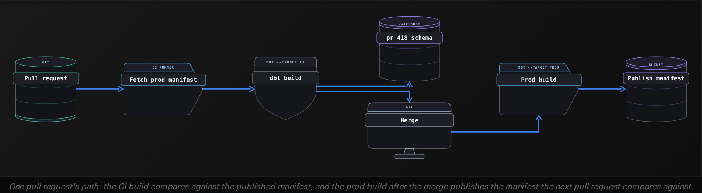

Intermediate·[](https://www.getdbt.com/)·20 min · 8 challenges

# Deploying dbt: Intermediate

GitLab's data team keeps its dbt project in a public repository, and every change arrives as a merge request. An analyst renames a column in 1 staging model with hundreds of models below it. The CI job has minutes, not an hour: it must build the changed model and its descendants, borrow everything else from production, and report back before the reviewer finishes reading the diff.


<br>

---

## Graph Operators and Unions

A selector is a query over the DAG: it names a set of nodes, and dbt builds that set in dependency order and nothing outside it. The beginner lesson used a bare model name and a trailing `+`. This section adds the operators that shape a set and the algebra that combines sets. The running project is `shop`. Its sources are `raw.orders` and `raw.customers`. The staging models `stg_orders` and `stg_customers` feed `fct_orders`, which joins them, and `customer_totals` sums `fct_orders` per customer. A `unique` test sits on `stg_orders.order_id`.


<br>

### Graph operators

| selector | nodes picked | rule |
| --- | --- | --- |
| stg_orders+ | stg_orders, fct_orders, customer_totals, the unique test | the node and every descendant |
| +fct_orders | raw.orders, raw.customers, stg_orders, stg_customers, fct_orders | the node and every ancestor |
| stg_orders+1 | stg_orders, fct_orders, the unique test | descendants at most 1 edge away |
| 2+customer_totals | stg_orders, stg_customers, fct_orders, customer_totals | ancestors at most 2 edges away |
| @stg_orders | stg_orders, stg_customers, fct_orders, customer_totals, raw.orders, raw.customers, the unique test | the node, its descendants, and every ancestor of those descendants |

The `@` operator exists because `stg_orders+` picks `fct_orders` without `stg_customers`. Selection decides what dbt builds; the compiled SQL of `fct_orders` still reads `stg_customers`, so in a schema where that table has never been built, the join fails with a database error. `@stg_orders` adds every ancestor of each descendant, which brings in `stg_customers` and both sources, so the whole chain can build from nothing. The numbered forms matter when a mart has 6 layers above it and the job only needs the 2 nearest.

A test joins the set through its parents. With the default indirect selection, called eager, dbt includes a test when at least one of its parents is selected, which is why the `unique` test is selected along with `stg_orders+` and with `stg_orders+1`. A `relationships` test between `fct_orders` and `stg_customers` would be selected with `fct_orders` alone, and would fail in the same empty schema for the same reason the join did.



*$ dbt build*


<br>

### Unions, intersections, exclusions

A space between 2 selectors is a union, a comma is an intersection, and `--exclude` subtracts a set after the selection is formed. dbt expands each selector together with its graph operators before it combines any of them, so `+fct_orders,tag:daily` means the ancestors of `fct_orders` that also carry the tag, and the tag never travels up the graph. Methods beside a node name pick by attribute: `tag:daily`, `path:models/staging`, `source:raw`, `config.materialized:table`, `resource_type:seed`.

--select and --exclude each accept several space-separated pieces, so --select tag:daily path:models/marts is a union of 2 sets and --exclude customer_totals stg_customers removes 2 nodes from whatever the selection produced.

| expression | set it names |
| --- | --- |
| stg_orders stg_customers | both staging models |
| +fct_orders,tag:daily | ancestors of fct_orders that carry tag daily |
| path:models/staging --exclude stg_customers | every node under models/staging except stg_customers |
| tag:daily,config.materialized:table | nodes tagged daily and materialized as a table |
| @stg_orders --exclude resource_type:source | the @ set without the 2 sources |

> Reading a combined selector
>
> - Expand each piece first: a graph operator applies to the piece it is attached to, never to the whole expression
> - Then combine: a space unions and a comma intersects. One expression can use both
> - Then subtract: --exclude runs on the combined set, so it can remove a node a graph operator brought in
> - Tests follow last: a test joins when one of its parents is in the final set


<br>

### Naming a set in selectors.yml

A job that runs every night shouldn't carry a 60-character expression in the scheduler. `selectors.yml` at the project root gives a set a name, and `--selector nightly` uses it. The file writes the same algebra as keys. Each of `union`, `intersection` and `exclude` takes a list. `parents` stands in for a leading `+` and `children` for a trailing `+`; `childrens_parents` replaces `@`, and `parents_depth` takes the number. To change the set, you edit the file, and the scheduler's command stays the same.

```sql
selectors:
  - name: nightly
    description: Everything stg_orders feeds and all it reads, minus customer_totals
    definition:
      union:
        - method: fqn
          value: stg_orders
          childrens_parents: true
        - exclude:
            - method: fqn
              value: customer_totals
```

A selector changes the set, never the order. Inside the set, dbt still builds parents before children and still holds back a child whose parent's test failed. Outside the set, nothing is checked at all: a model left out is assumed to exist with current rows, which is the assumption the next sections replace with a comparison against production.

> **TIP**
>
> Quote a selector in the shell when it holds a comma or an asterisk: --select "+fct_orders,tag:daily". A bare space reaches dbt as 2 arguments, which is still a union, while an unquoted asterisk is expanded by the shell against file names before dbt ever sees it.


<br>

---

## Where Schemas Come From

Every model is written to a schema, and that name comes from 2 inputs. The first is the target's `schema` in profiles.yml, which the deployment lesson set to `dbt_alice` for dev and `analytics` for prod. The second is an optional custom schema from a config: `+schema:` on a folder in dbt_project.yml, or `schema=` in a model's config block. dbt passes both to the macro `generate_schema_name`. The string it returns is where the table lands and what every `ref` to the model compiles to.

```sql
models:
  shop:
    staging:
      +schema: staging
    marts:
      +schema: marts
```

The custom name follows the config rules the Jinja lessons covered: a `schema=` in a model's config block beats the folder's `+schema:`, which beats nothing. The macro receives only the winner, as `custom_schema_name`; when no level set one, it receives `none`. The default macro ships inside dbt, and its 2 branches are short: with no custom schema it returns the target's schema unchanged, and with one it appends _ and the custom name to the target's schema.

```sql

    
    
        {{ default_schema }}
    
        {{ default_schema }}_{{ custom_schema_name | trim }}
    

```

| target | target.schema | custom schema | model lands in |
| --- | --- | --- | --- |
| dev | dbt_alice | none | dbt_alice |
| dev | dbt_alice | staging | dbt_alice_staging |
| dev | dbt_alice | marts | dbt_alice_marts |
| prod | analytics | staging | analytics_staging |
| prod | analytics | marts | analytics_marts |

So the config said `marts` and production writes `analytics_marts`. The prefix is deliberate. If 2 developers both build the marts folder, without it they would write to the same `marts` schema and overwrite each other's `fct_orders`; prefixing with the target's schema keeps Alice's copies under `dbt_alice_marts` and Bob's under `dbt_bob_marts`. The cost is that production inherits the same prefix, because the default macro never looks at which target is running.

| ✓ Default macro | ✗ Override that drops the prefix in prod |
| --- | --- |
| • Every developer's tables sit under their own prefix<br><br>• Prod schemas carry analytics_ in front of each custom name<br><br>• No macro for the project to maintain | • Prod schemas match the names written in dbt_project.yml<br><br>• Downstream tools read marts.fct_orders as the config promised<br><br>• Dev keeps its prefix, so isolation holds<br><br>• One more macro the project owns and tests |


<br>

### Overriding the macro

A macro with the same name in the project's `macros/` folder replaces the built-in one. This version keeps the prefix for every target except prod, where the custom name is used as written.

```sql

    
        {{ target.schema }}
    
        {{ custom_schema_name | trim }}
    
        {{ target.schema }}_{{ custom_schema_name | trim }}
    

```

| target | custom schema | before override | after override |
| --- | --- | --- | --- |
| dev | staging | dbt_alice_staging | dbt_alice_staging |
| prod | staging | analytics_staging | staging |
| prod | marts | analytics_marts | marts |
| prod | none | analytics | analytics |

`ref` runs the same macro, so the change shows up in every compiled file at once. Before the override, `customer_totals` in prod read `analytics_marts.fct_orders`; after it, the same model reads `marts.fct_orders` and is itself written to `marts.customer_totals`. The old `analytics_marts.fct_orders` stays in the warehouse, because dbt only writes the relations it is building. A production run after this change builds every model into a fresh set of schemas, and anything that queried the old names keeps reading tables that no longer update.

```sql
SELECT
  customer_id,
  country,
  SUM(amount) AS total_amount
FROM marts.fct_orders
GROUP BY customer_id, country
```

Stored test failures go through the same macro. The `store_failures` config writes failing rows to a schema named by calling `generate_schema_name` with `dbt_test__audit` as the custom name, so prod holds `analytics_dbt_test__audit` under the default macro and `dbt_test__audit` under the override. The alias of a relation has a twin macro, `generate_alias_name`, which returns the model's name unless an `alias` config says otherwise, and it can be overridden the same way.

> What the macro can see
>
> - custom_schema_name: the configured value, or none when no config level set one
> - node: the model itself, with node.name, node.fqn and node.resource_type
> - target: the active target, so target.name and target.schema are both available
> - A node.fqn of ['shop', 'staging', 'stg_orders'] lets the macro route by folder with no schema config at all

That last item opens a second style: no `+schema:` anywhere, and a macro that returns `node.fqn[1]` for prod, so the folder name becomes the schema. The routing then lives in the folder structure, which is one fewer place to keep in sync, at the price of a macro that every reader of the project has to find before the schema names make sense.

> **TIP**
>
> dbt ls --select customer_totals --output json --output-keys "name schema" prints the schema a model resolves to under the current target without building anything. Run it with --target prod before changing the macro and again after, and the diff is the whole effect of the change.


<br>

---

## Building Only What Changed

A production run of the `shop` project takes a minute; a real project with 140 models and 400 tests can take 40. When the only change since the last run is 1 line in `stg_orders`, the models that can produce different rows are `stg_orders` and its descendants, and the rest would be rebuilt into the same tables they hold now. dbt can find that set itself by comparing the project it has parsed with a `manifest.json` from an earlier run. The `--state` flag names the folder holding the earlier manifest, and the `state:` selection method reads the comparison.

| command | what it selects |
| --- | --- |
| dbt build --select state:modified --state prod-artifacts | every node that differs from the manifest in prod-artifacts |
| dbt build --select state:modified+ --state prod-artifacts | those nodes and every descendant |
| dbt ls --select state:new --state prod-artifacts | nodes with no entry in the earlier manifest, listed and not built |
| dbt build --select state:unmodified --state prod-artifacts | the complement: nodes the comparison found identical |


<br>

### What counts as a change

The comparison is node by node, on what the manifest stores. A model is modified when any of the following differs, and each has a sub-selector of its own for when only that kind of change matters. `state:new` is separate: a node with no entry in the earlier manifest is new rather than modified, and `state:modified` includes it anyway, so `state:modified+` covers a brand-new model and everything built on it.

state:modified is the union of

- state:modified.body: the model's Jinja and SQL text as written in the file, before any rendering
- state:modified.configs: any resolved config, whether it came from the file, the folder or dbt_project.yml
- state:modified.relation: the database, schema or alias the model is configured with, compared before the target or generate_schema_name is applied
- state:modified.macros: a macro the node calls, directly or through another macro, whose definition changed
- a source whose YAML definition changed, and a seed whose file contents changed
- a test whose YAML or SQL changed, which is a node like any other

| edit since the earlier manifest | state:modified | state:modified+ |
| --- | --- | --- |
| change a filter in stg_orders | stg_orders | stg_orders, fct_orders, customer_totals, the unique test |
| add +tags: [daily] to the marts folder | fct_orders, customer_totals | fct_orders, customer_totals |
| edit a macro called only by stg_customers | stg_customers | stg_customers, fct_orders, customer_totals |
| add not_null on fct_orders.customer_id in YAML | the new test | the new test |
| create dim_customers reading stg_customers | dim_customers | dim_customers |

In the table, 2 rows deserve a second look. The tag edit touched no SQL, yet both marts count as modified, because the manifest stores each node's resolved config and the tag is part of it. The macro edit touched no model file, yet `stg_customers` is selected, because the manifest records which macros each node depends on and `.macros` compares the definitions of those. A macro that 90 models call is 90 modified models in 1 commit, plus every descendant of the 90.

Seeds have a size rule. A seed file under 1 MB is compared by a hash of its contents, so editing a row marks it modified; a larger seed is compared by its path alone, so a content edit to it goes undetected and the seed has to be selected by name.


<br>

### Changes that are not changes

The relation comparison reads the custom name a model is configured with, before the target's schema or `generate_schema_name` touches it. That is why a mart built in a dev run compares equal to the prod manifest even though one copy lands in `dbt_alice_marts` and the other in `analytics_marts`: both are configured `marts`. The model below configures a different name per target, `scratch` in a dev run and `marts` in the prod manifest, so every dev comparison marks it modified forever, along with every descendant under `state:modified+`. Configure `marts` under every target and move the target logic into `generate_schema_name`, which the comparison does not look at, and the model compares equal while each target still writes where the macro sends it.

```sql
{{ config(materialized='table', schema='scratch' if target.name == 'dev' else 'marts') }}

select
    order_id,
    customer_id,
    amount
from {{ ref('stg_orders') }}
```

Where the earlier manifest lives matters as well. A run writes `target/manifest.json` as soon as parsing ends, before selection, so `--state target` compares the project with the manifest that same run wrote moments earlier and finds nothing modified; dbt prints a warning when the 2 paths match. Keep the comparison manifest in its own folder, copied from the run you want to compare against, and the current run is free to write `target/` as it always does.

The same artifacts drive a sibling method. `result:error+ --state last-run` selects the nodes that failed in the `run_results.json` of a chosen run, and their descendants, which is the set `dbt retry` builds from the most recent run; the explicit form lets you choose which run, and combine it with other selectors.

> **TIP**
>
> The manifest's metadata.dbt_version names the dbt that wrote it. Compare manifests written by the same version: an upgrade can change how a node is stored, and the comparison then reports modifications that no commit made.

Some teams deploy by comparison: after a merge, prod runs `state:modified+` against its own previous manifest, then saves the new manifest as the next comparison point. The limit is in the name. A row that arrived in `raw.orders` since yesterday isn't a change to the project, so an unmodified model is not rebuilt and its table stays a day old. The comparison job runs beside the full nightly refresh, never instead of it.


<br>

---

## Deferring to Production

Alice is changing `fct_orders` on a fresh laptop. Her schema `dbt_alice_marts` is empty, and so is `dbt_alice_staging`. Building `fct_orders` on its own fails, because its compiled SQL reads `dbt_alice_staging.stg_orders`, and building `+fct_orders` first spends 20 minutes copying 2 staging tables she never intends to touch. `--defer` gives a third option: a `ref` to a model outside the selection resolves to the relation production built, found in the prod manifest.

The command is dbt build --select fct_orders --defer --state prod-artifacts, and the compiled model shows what changed.

```sql
SELECT
  o.order_id,
  o.customer_id,
  c.country,
  o.amount
FROM analytics_staging.stg_orders AS o
JOIN analytics_staging.stg_customers AS c
  ON o.customer_id = c.customer_id
```

For every model, the manifest stores the database and schema it was built in and the alias it was built as, so the prod copy of `stg_orders` is found by name without querying the warehouse. The build then writes `fct_orders` into Alice's own schema, because the model is selected and selected models always go to the current target. Dev writes stay in dev; only reads reach into prod, and they reach with Alice's credentials, so a dev role needs `SELECT` on the prod schemas and nothing more.

| ✓ Without --defer | ✗ With --defer --state |
| --- | --- |
| • Every ref resolves to the current target's schema<br><br>• An unselected parent must already exist there<br><br>• A fresh schema needs the full chain built first | • A selected model's ref resolves to the current target<br><br>• An unselected model's ref can resolve to prod's relation<br><br>• A fresh schema needs only the models being changed |


<br>

### Which copy a ref picks

| the model the ref points at | exists in the dev schema? | ref resolves to |
| --- | --- | --- |
| is selected in this run | either | the dev relation about to be built |
| is not selected | yes | the dev relation, unless --favor-state is set |
| is not selected | no | the prod relation from the state manifest |
| is not selected and is absent from the state manifest | no | the dev relation, which does not exist, so the model fails |

The second row is the easiest to get wrong. Alice built `stg_customers` into her schema 3 weeks ago while working on something else, and it has not been rebuilt since. Without `--favor-state`, dbt finds it in `dbt_alice_staging` and uses it, so her new `fct_orders` joins 3-week-old customers against today's orders from prod, and the row counts look wrong for no reason in her code. With `--favor-state`, dbt uses the prod relation for every unselected model the state manifest knows, whether a dev copy exists or not.

The last row covers a model that exists only on Alice's branch. The prod manifest has never heard of `dim_customers`, so a deferred `ref` has nothing to point at and falls back to the current target. A new model and the models that read it have to be selected together, which `state:modified+` does on its own, since a new model is modified and its readers are its descendants.

Deferral changes `ref` and nothing else. A `source('raw', 'orders')` call compiles to `raw.orders` under every target, because a source names a table dbt never builds. No data is copied: the deferred query reads production's table across the network at query time, so a dev build on a 2 billion row staging table costs the same scan prod would pay, once per model that refs it.


<br>

### Tests and deferral

`dbt test --select fct_orders --defer --state prod-artifacts` runs the tests on `fct_orders` against the dev table, and a `relationships` test from `fct_orders.customer_id` to `stg_customers` resolves its other side the same way a model's ref would, so it checks Alice's new rows against production's customers. A `dbt build` with the same flags does both in one pass, with the test holding back any descendant that was selected.


<br>

### Where the prod manifest comes from



The scheduled job from the beginner lesson writes `target/manifest.json` on every run. Publish that file somewhere every developer can fetch it, such as a bucket the job uploads to after it finishes, and fetch it into `prod-artifacts` before a deferred build. The manifest describes the project as prod last parsed it, so a deferred ref points at a table that exists only if that build completed; a prod run that failed halfway still wrote a manifest naming models it never built, which is why the publish step belongs after a successful run.

*--state serves both the comparison and the deferral. --defer-state names a different folder for the deferral alone, for the rare job that compares against one run and reads from another.*


<br>

---

## Slim CI

A pull request changes a few files. Continuous integration answers whether the project still builds and its tests still pass with those files in it, and the beginner answer, a full build into a scratch schema, costs 40 minutes per push on the 140-model project. Slim CI puts the 3 previous sections together: `state:modified+` picks the changed models and their descendants, `--defer` reads every other model from production, and a CI target writes into a schema owned by the pull request.



```sql
ci:
  schema: "pr_{{ env_var('PR_NUMBER') }}"
  threads: 8
```

The CI runner sets PR_NUMBER and runs dbt build --select state:modified+ --defer --state prod-artifacts --favor-state --target ci.

Each flag has a job. `--target ci` reads the profile above, so pull request 418 gets the base schema `pr_418`, and `generate_schema_name` prefixes it to each custom name: staging models land in `pr_418_staging` and marts in `pr_418_marts`, since the override drops the prefix for prod alone. Below, `pr_418` stands for that family of schemas, and a second pull request gets a family of its own, with no collision between them or with any developer. `--state prod-artifacts` supplies the manifest the comparison and the deferral both read. `state:modified+` is the set; `--defer` fills in every ref outside it from production; `--favor-state` settles which copy wins when a pull request schema already holds one.

| the pull request changes | CI builds into pr_418 | read from production |
| --- | --- | --- |
| a filter in stg_orders | stg_orders, fct_orders, customer_totals and their tests | raw.orders, and analytics_staging.stg_customers, which fct_orders joins |
| the grouping in customer_totals | customer_totals and its tests | analytics_marts.fct_orders |
| adds not_null on fct_orders.customer_id | the new test only | analytics_marts.fct_orders, which the test runs against |
| a macro every staging model calls | all staging models, every mart, every test | the sources only |

The third row is the one to predict carefully. The test is new, so it's modified; `fct_orders` is not, so it's deferred; the test therefore runs against production's `fct_orders`, and fails in CI if production already holds a null `customer_id`. That is the right answer, since the test is being proposed for that table, but the failure reads as a problem with the branch when it is a fact about production. The fourth row is the cost of a shared macro: 1 line in it rebuilds most of the project in CI, and it does the same in every developer's deferred build.


<br>

### Why --favor-state belongs in CI

The schemas of pull request 418 live as long as the pull request. The first push changes `stg_orders`, and CI builds it and its descendants into `pr_418_staging` and `pr_418_marts`. A second push 2 days later reverts that edit and changes only `customer_totals`. The comparison is the whole branch against the prod manifest, so `stg_orders` and `fct_orders` now count as unmodified and drop out of the selection. Their 2-day-old copies, built from the reverted filter, still sit in the pull request schemas. Without `--favor-state`, the rule from the previous section picks that stale `fct_orders`; with it, every unselected model reads from production, and the only tables read from the pull request schemas are the ones the latest push built.

A mart too slow for CI can be kept out with an exclusion: `--select state:modified+ --exclude tag:heavy`. Its descendants still build, and their refs to it defer to production's copy. A pull request that changes the heavy mart is then checked nowhere in CI: the mart isn't built, and its descendants run against production's unchanged version, so the new logic never executes. That is a trade the team makes knowingly, and the tag is where the trade is written down.


<br>

### After the merge

Merging doesn't run dbt. The next scheduled production build does, with the merged code, and its manifest becomes the comparison point for every later pull request. Between the merge and that run there is a gap: a pull request opened in the gap compares its branch, which contains the merged change once it's rebased on the main branch, with a manifest that predates it, so CI builds the merged models again as if they were its own. With a nightly production run and 3 merges in an afternoon, the fourth pull request builds all 3. Running the production job after each merge closes the gap at the price of more production runs.

A pull request schema that nobody drops lives forever, and 200 of them hold 200 stale copies of the marts. Close the loop with a scheduled cleanup. It lists every schema named `pr_` plus a number, on its own or with _ and more text after it, so the pattern catches `pr_418` and `pr_418_staging`, and `pr_418_marts` too. Then it drops those whose pull request is merged or closed. The other option is to drop the whole family from the CI job itself when the pull request closes.

| ✓ Do | ✗ Don't |
| --- | --- |
| • Fetch the manifest from the last production run that succeeded<br><br>• Name the CI schema after the pull request so pushes reuse it<br><br>• Pass --favor-state so unselected models never read stale CI copies<br><br>• Drop the pull request schema when the request closes | • Compare against a manifest written by a different dbt version<br><br>• Put target.name logic in model configs; it marks them modified forever<br><br>• Treat a deferred test failure as a branch bug before checking production<br><br>• Skip the full nightly refresh because the CI builds passed |

> What Slim CI does not check
>
> - The merge path of an incremental model on a first push: the empty schema takes the first-run path. Later pushes reuse the schema and can run the merge, unless it is dropped between pushes
> - Rows that arrive later: CI sees production's data as it stands at that minute, and a test that passes now can fail tonight
> - A model that reads a changed model through a source rather than a ref, because the graph has no edge for the comparison to follow


<br>

---

## Putting It All Together

A meal-delivery marketplace runs a 300-model dbt project with a nightly production build. An engineer opens a pull request that changes the macro which rounds delivery fees, used by 4 staging models, and adds a not_null test on the courier shifts fact, which reads only staging models the macro never touches. CI fetches last night's manifest, compares, and builds the 4 staging models, every mart below them and the new test into the pr_912 schemas, reading every other model from the analytics schemas. The new test fails on 30 rows that already exist in production's courier shifts fact, which the reviewer confirms by querying the prod table before asking for a fix to the source filter rather than to the branch.

- The macro edit selected 4 staging models through state:modified.macros, and the + in state:modified+ carried the selection down to every mart that reads them.
- The courier shifts fact and the staging models the macro never touches were read from production because --defer resolved their refs from the manifest, and --favor-state kept an earlier push's copies in the pr_912 schemas from being used.
- The test ran against production's courier shifts fact because the test was modified and the fact, which sits below none of the 4 changed models, was not, which is why its failure described production rather than the branch.
- The schemas analytics_staging and pr_912_staging both came from one generate_schema_name call, with only the target's schema differing between them.
- After the merge, the nightly build publishes a new manifest, and the next pull request's comparison starts from the rounded fees.


<br>

---

## Key Takeaways

- A selector is a set: graph operators expand each piece, a space unions, a comma intersects, and --exclude subtracts last.
- @model adds every ancestor of each descendant, which is what a chain needs to build from an empty schema.
- A model's schema is whatever generate_schema_name returns from the target's schema and the custom name; the default joins them with _, and an override can drop the prefix in prod.
- state:modified compares each node's body and resolved configs with an earlier manifest, along with its relation and the macros it calls, so a config that depends on the target is modified forever.
- --defer resolves a ref to an unselected model from the prod manifest, unless a copy already exists in the current schema; --favor-state removes that exception.
- Slim CI is the 3 combined: state:modified+ as the set, --defer for everything else, and a CI target writing into a schema named after the pull request.

[](https://www.getdbt.com/)

Official dbt resources

"dbt enables data analysts and engineers to transform their data using the same practices that software engineers use to build applications." [github.com/dbt-labs/dbt-core](https://github.com/dbt-labs/dbt-core)

[Documentation](https://docs.getdbt.com/)[Get started](https://docs.getdbt.com/docs/get-started-dbt)[Source](https://github.com/dbt-labs/dbt-core)

dbt and the dbt logo are trademarks of dbt Labs, LLC.
