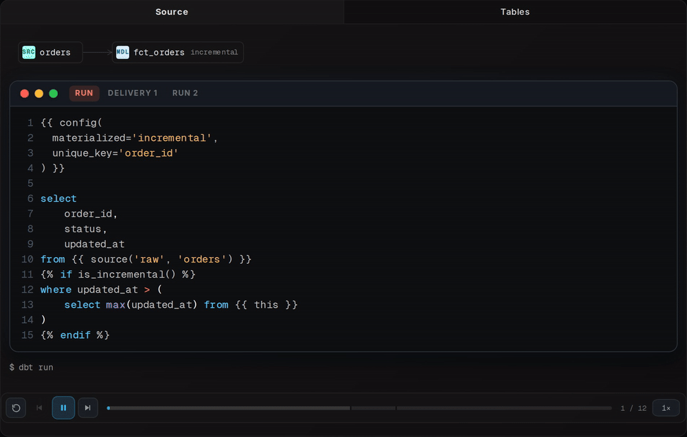

Advanced·[](https://www.getdbt.com/)·20 min · 6 challenges

# Incremental Models: Advanced

A Spotify analyst flags that stream counts for March 5 to 13 are low. The model that counts plays over 30 seconds had a wrong threshold, fixed on March 15, and the incremental build keeps the bad rows. A full refresh would reprocess every day since January 1. This lesson is about rebuilding those 9 days alone, and knowing the result matches a rebuild.


<br>

---

## Microbatch Models

### One query per slice of time

Every incremental model you have built so far sends one query per run. The `is_incremental()` block appends a filter, the warehouse returns every row past the high-water mark, and one merge or delete+insert lands them together. That single query is also the model's unit of failure: when it dies after 40 minutes, nothing has landed, and the next run starts the same 40 minutes again.

The microbatch strategy cuts that query along time. You name the column holding each row's event time, a batch size and a start date, and dbt sends one query per batch. Each query covers one slice of time and writes only the rows whose event time falls inside it.

```sql
{{
    config(
        materialized='incremental',
        incremental_strategy='microbatch',
        event_time='played_at',
        begin='2025-01-01',
        batch_size='day',
        lookback=1
    )
}}

select
    play_id,
    user_id,
    track_id,
    played_at,
    ms_played
from {{ ref('stg_plays') }}
where ms_played >= 30000
```

Compared with every incremental model before it, that file has no `is_incremental()` block, because dbt writes the time filter itself. It has no `unique_key`, because a batch replaces a time range rather than matching rows by key. And it has no `where played_at >= ...`, because the filter lives inside the `ref()`: dbt wraps the upstream relation in a subquery bounded by the batch's start and end. For that wrapping to happen, the upstream model must declare which of its columns holds the event time.

```sql
models:
  - name: stg_plays
    config:
      event_time: played_at
```

Here is the query dbt sends for the batch covering 2025-03-14. The inner filter is dbt's, the outer `where` is yours, and the literals are the batch's bounds, with the end excluded so that 2 neighbouring batches never share a row.

```sql
SELECT
  play_id,
  user_id,
  track_id,
  played_at,
  ms_played
FROM (
  SELECT
    *
  FROM analytics.stg_plays
  WHERE played_at >= '2025-03-14 00:00:00+00:00'
    AND played_at < '2025-03-15 00:00:00+00:00'
)
WHERE ms_played >= 30000
```


<br>

### Which batches a run sends

The first run, and any run with `--full-refresh`, sends a batch for every slice from `begin` up to the current time, in date order. Every later run sends the current batch plus `lookback` earlier ones, 1 by default, so rows that arrived late for yesterday are picked up today. The lookback counts back from the clock, never from the last run, so a model nobody ran for 3 days does not catch up on its own.

| run | batches sent | why |
| --- | --- | --- |
| first run, on 2025-03-14 | 73 batches, 2025-01-01 through 2025-03-14 | nothing exists yet, so every slice from `begin` to today |
| run on 2025-03-15 | 2025-03-14 and 2025-03-15 | today plus 1 batch of lookback |
| run on 2025-03-18 after 2 missed runs | 2025-03-17 and 2025-03-18 | lookback counts from the clock; 03-16 is never built, and 03-15 keeps only the rows its own run saw |
| run with `--full-refresh` on 2025-03-18 | 77 batches, 2025-01-01 through 2025-03-18 | every slice again, with the current code |


<br>

### What a batch writes

Each batch's result replaces the target rows in its own time range. dbt deletes from the target `where played_at >= start and played_at < end`, then inserts the batch's rows, or swaps the partition where the warehouse stores the table partitioned by `played_at`. Running the same batch twice leaves the table as it was after the first time, and the rest of this lesson depends on that: a slice can be rebuilt as often as you like. The time range does the job a `unique_key` does in a merge, which is why the config has none.

Because every batch is its own statement, a failure stays inside its slice. On a first run of 73 batches, batch 41, the one for 2025-02-10, can fail on a malformed timestamp while batches 1 to 40 and 42 to 73 are written and kept. dbt reports the model's status as partial success and names the batch that failed. The range flags in section 4 rebuild that batch alone: a start of 2025-02-10 and an end of 2025-02-11 cover exactly 1 day.

> Config a microbatch model needs
>
> - `event_time` on the model, naming a timestamp column every row carries
> - `event_time` on every upstream it should filter; an upstream without one is read whole, once per batch
> - `begin`, the date a full refresh starts from; rows before it never enter the model
> - `batch_size` of `hour`, `day`, `month` or `year`
> - No `unique_key` and no `is_incremental()` block

> **TIP**
>
> Joining to a dimension with no `event_time` reads the whole dimension in every batch, and that is the right behaviour: `dim_tracks` has no play time to filter on, and each batch needs all of its rows.


<br>

---

## Incremental Equals Full

### The claim every incremental model makes

An incremental model makes one claim: after any sequence of runs, the table it holds equals the table a single full refresh would build from the same source. The full refresh is the reference and the increment is the shortcut, and a shortcut that arrives somewhere else is a bug. The claim is a statement about 2 tables, so it can be tested as a query.


<br>

### A reference to compare the model with

For a fact model that keeps 1 row per source row, the reference already exists: the staging model it reads. Whatever `fct_orders` holds after 90 incremental runs should be what `stg_orders` holds now, column for column. A singular test states that as 2 set differences, rows in staging that the fact lacks and rows in the fact that staging lacks. Either half returning a row fails the test.

```sql
(
    select
        order_id,
        status,
        order_total
    from {{ ref('stg_orders') }}
    except
    select
        order_id,
        status,
        order_total
    from {{ ref('fct_orders') }}
)
union all
(
    select
        order_id,
        status,
        order_total
    from {{ ref('fct_orders') }}
    except
    select
        order_id,
        status,
        order_total
    from {{ ref('stg_orders') }}
)
```

A model that aggregates has no ready-made reference, so you build one: a second model with the same SELECT and `materialized='table'`, which is exactly what a full refresh of the incremental would produce. `dbt_utils.equality` then compares the 2 relations. The reference costs a full build every time it runs, so give it a run of its own rather than attaching it to the hourly one. A weekly comparison catches drift within a week, which leaves the backfill small.

```sql
models:
  - name: fct_daily_revenue_full
    description: Full rebuild of fct_daily_revenue, built only to check it
    data_tests:
      - dbt_utils.equality:
          compare_model: ref('fct_daily_revenue')
```


<br>

### What breaks the claim

When the comparison returns rows, the rows name the assumption that broke. Each line below is a way a per-batch query answers differently from a whole-table one.

| pattern in the model | the increment holds | a full refresh holds |
| --- | --- | --- |
| `row_number()` to mark a customer's first order | the rank within the batch the row arrived in | the rank across every order the customer placed |
| join to a dimension whose values change | the dimension's value on the day the row was inserted | the dimension's value today |
| `sum()` per day, merged on a day key, with one day split across 2 batches | the second batch's partial sum, which overwrote the first | the whole day's sum |
| filter on `max(updated_at)` with rows that arrive late | none of the late rows | all of them |

Every one of those has the same shape: an output row depends on something outside the batch that produced it. The rule that keeps the claim true is that each row the model writes is a function of source rows inside its own batch, plus inputs that read the same whether read today or at a full refresh. A day's aggregate can be incremental when a batch always holds the whole day, which `batch_size='day'` guarantees and a merge keyed on `updated_at` does not. A rank across a customer's history cannot be incremental at all: compute it in a view downstream, or let the fact carry the rank as of arrival and say so in its description.

The dimension join needs a decision more than a fix. If the fact should hold the dimension as it stood when the row was written, the increment is right and the full refresh is the one that lies; snapshot the dimension and join to the version valid at the row's time, so both builds agree. If the fact should hold the current value, move the join out of the incremental model into a view on top of it.


<br>

### A unit test cannot check accumulated runs

A unit test on the incremental model can override `is_incremental()` to true and hand `this` a fixture, so it checks one batch's rows against expected output. It runs the compiled query once over fixed rows. The claim here is about what 90 runs accumulate to, and only real runs over real data accumulate anything, so the comparison has to be a data test over built tables.

| ✓ Do | ✗ Don't |
| --- | --- |
| • Compare the incremental to its source or to a full-build twin on a schedule of its own<br><br>• Keep every output row a function of rows inside its own batch<br><br>• Make batches hold whole aggregation grains, a full day for a daily sum | • Rank or window across history inside an incremental model<br><br>• Trust a passing unit test as proof the runs add up<br><br>• Attach the full-build twin to the hourly run and pay for it every time |


<br>

---

## Deletes the Increment Misses

### A deleted row sends nothing

The incremental filter asks the source for rows with `updated_at` later than the mark. A row deleted at the source has no `updated_at` any more; it has nothing. It arrives in no batch and matches nothing in the merge, and the merge touches no target row absent from the batch. The target keeps the row at its last known values for as long as the model exists, and `count(*)` on the fact runs ahead of the source by 1 for every deletion. Section 1's comparison is what notices: its second half, rows in the fact that staging lacks, returns every deleted order.



*$ dbt run*

The animation holds 3 orders. Between the runs, order 2 is cancelled and order 3 is deleted at the source. The second run merges the cancellation and never hears about the deletion, so the incremental table keeps order 3 while a full refresh of the same source holds 2 rows. The row the 2 builds disagree on is marked.


<br>

### 4 ways to let the deletion through

#### Soft deletes at the source

The cleanest fix happens before dbt: the extraction writes a `deleted_at` timestamp instead of removing the row, and bumps `updated_at` when it does. The deletion now arrives as an update, the merge sets `deleted_at`, and the model carries every row it ever saw. Marts filter `where deleted_at is null` in a view on top. The fact grows by its deletions, which for most sources is a small share of rows.

#### A snapshot that records the disappearance

When you cannot change the extraction, a snapshot can watch the source for you. With `hard_deletes: new_record`, a snapshot that no longer sees a key inserts a fresh record for it with `dbt_is_deleted` set to `'True'` and `dbt_valid_from` set to the snapshot's time. Point the incremental model at the snapshot's current rows, and the deletion becomes a row that arrives.

```sql
snapshots:
  - name: snap_orders
    relation: source('shop', 'orders')
    config:
      unique_key: order_id
      strategy: timestamp
      updated_at: updated_at
      hard_deletes: new_record
```

```sql
{{
    config(
        materialized='incremental',
        unique_key='order_id'
    )
}}

select
    order_id,
    status,
    order_total,
    dbt_is_deleted = 'True' as is_deleted,
    dbt_valid_from as changed_at
from {{ ref('snap_orders') }}
where dbt_valid_to is null

  and dbt_valid_from > (
    select max(changed_at) from {{ this }}
  )

```

The high-water mark moved from `updated_at` to `dbt_valid_from`. With the timestamp strategy, an ordinary change gets a `dbt_valid_from` equal to the source row's `updated_at`, so for updates the 2 columns agree. The record that marks a deletion is the exception: it copies the row's last `updated_at`, which is old, and takes the snapshot's run time as its `dbt_valid_from`. A filter on `updated_at` would skip the very row this was built to catch. A filter on `dbt_valid_from` sees it, because the run time that dates the deletion is later than every change recorded before it.

#### A post-hook that deletes the orphans

A hook after the model runs can remove any key the source no longer has. It costs a scan of the source's key column every run, which is a narrow column and a cheap read when the source already sits in the warehouse. It is the wrong tool when the source is a window of the full table, because every row outside that window reads as deleted.

```sql
{{
    config(
        materialized='incremental',
        unique_key='order_id',
        post_hook="delete from {{ this }} where order_id not in (select order_id from {{ ref('stg_orders') }})"
    )
}}

select
    order_id,
    status,
    order_total,
    updated_at
from {{ ref('stg_orders') }}

where updated_at > (
    select max(updated_at) from {{ this }}
)

```

#### Rebuilding the window

A delete+insert keyed on a date, or a microbatch model, refills whole slices of time from the source. Any row deleted inside a rebuilt slice is gone after the run, because the slice was emptied and refilled from what the source holds now. Deletions older than the slices a run rebuilds stay, so this works when deletions happen soon after a row is created, inside the lookback, and older rows are in practice frozen.

| remedy | what the deletion becomes | use it when |
| --- | --- | --- |
| soft delete at the source | an update that sets `deleted_at` | you can change the extraction |
| snapshot with `hard_deletes: new_record` | a new record flagged `dbt_is_deleted` | the source is in the warehouse and you want the deletion's time |
| post-hook anti-join | a `delete` from the target after each run | the source is complete and its key column is cheap to scan |
| rebuilt window | an absence in the refilled slice | deletions happen inside the lookback window |

*Every remedy except the soft delete adds a read of the source beyond the increment: a snapshot scan, a key-column scan, or a slice refill.*


<br>

---

## Merging Less of the Target

### A merge reads the whole target

A merge with `unique_key='order_id'` compiles to a statement that joins the batch to the whole target on the key. The batch is 50,000 rows and the target is 4 billion, but the join condition says nothing about where in the target the matches might sit, so the warehouse reads every partition of the target to find them. The merge's cost is set by the target's size, and the target only grows.

```sql
merge into analytics.fct_orders as DBT_INTERNAL_DEST
using analytics.fct_orders__dbt_tmp as DBT_INTERNAL_SOURCE
on (
    DBT_INTERNAL_SOURCE.order_id = DBT_INTERNAL_DEST.order_id
)
when matched then update set
    order_id = DBT_INTERNAL_SOURCE.order_id,
    status = DBT_INTERNAL_SOURCE.status,
    order_total = DBT_INTERNAL_SOURCE.order_total,
    updated_at = DBT_INTERNAL_SOURCE.updated_at
when not matched then insert (
    order_id,
    status,
    order_total,
    updated_at
)
values (
    DBT_INTERNAL_SOURCE.order_id,
    DBT_INTERNAL_SOURCE.status,
    DBT_INTERNAL_SOURCE.order_total,
    DBT_INTERNAL_SOURCE.updated_at
)
```

`DBT_INTERNAL_DEST` is the target and `DBT_INTERNAL_SOURCE` is the temporary table holding the batch. Both names are dbt's and stable across runs, which is what lets you write conditions that refer to them.


<br>

### Telling the merge where to look

`incremental_predicates` takes a list of conditions that dbt adds to the ON clause. A condition on `DBT_INTERNAL_DEST` tells the warehouse which part of the target can hold matches, and a warehouse that partitions or clusters the target by that column reads only that part.

```sql
{{
    config(
        materialized='incremental',
        incremental_strategy='merge',
        unique_key='order_id',
        incremental_predicates=[
            "DBT_INTERNAL_DEST.order_date >= date_add('day', -7, current_date)"
        ]
    )
}}

select
    order_id,
    order_date,
    status,
    order_total,
    updated_at
from {{ ref('stg_orders') }}

where updated_at > (
    select max(updated_at) from {{ this }}
)

```

*date_add('day', -7, current_date) is date arithmetic in one warehouse's SQL, and dbt pastes the predicate into the merge as text without translating it. On a warehouse whose date function is named differently or takes its arguments in another order, write the predicate in that warehouse's own syntax, or the merge fails as a database error.*

| ✓ ON clause without predicates | ✗ ON clause with the predicate |
| --- | --- |
| • DBT_INTERNAL_SOURCE.order_id = DBT_INTERNAL_DEST.order_id<br><br>• every partition of the target is read to find matches | • DBT_INTERNAL_DEST.order_date >= date_add('day', -7, current_date)<br><br>• and DBT_INTERNAL_SOURCE.order_id = DBT_INTERNAL_DEST.order_id<br><br>• 7 days of partitions are read; the rest of the target is never opened |


<br>

### The row the predicate cannot see

The predicate hides part of the target from the merge, and a hidden row cannot be matched. Order 8812 was placed 30 days ago and refunded this morning. Its `updated_at` is today, so the batch carries it. Its target row has an `order_date` 30 days back, outside the 7-day predicate, so the merge finds no match and the `when not matched` branch inserts a second row for order 8812. The `unique` test on `order_id` fails on the next build, after the duplicate exists.

The predicate's window must contain every target row the batch can touch. If a refund can land up to 90 days after an order, the predicate reads 90 days, and the saving shrinks to whatever 90 days is out of the table's whole history. The other way round is to narrow the batch to the predicate, filtering the source on `order_date` as well as `updated_at`, and to route older changes elsewhere: a separate model for late refunds, or a monthly full refresh that catches what the predicate excluded.

| refund arrives | predicate window | what the merge does |
| --- | --- | --- |
| 3 days after the order | 7 days | matches and updates the row |
| 30 days after the order | 7 days | inserts a duplicate of the order |
| 30 days after the order | 90 days | matches and updates the row |
| 30 days after the order | 7 days, with the batch also filtered to 7 days of `order_date` | the refund never enters this model |


<br>

### Writing fewer columns

The other half of a merge's cost is the update itself. By default every column in the batch is written on a match, including ones that never change: `order_id`, `customer_id`, `inserted_at`. `merge_exclude_columns` lists the columns to leave out of the `update set`, and `merge_update_columns` lists the only ones to include; a model uses one or the other.

```sql
{{
    config(
        materialized='incremental',
        unique_key='customer_id',
        merge_exclude_columns=['first_seen_at']
    )
}}

select
    customer_id,
    email,
    plan,
    updated_at as first_seen_at,
    updated_at
from {{ ref('stg_customers') }}

where updated_at > (
    select max(updated_at) from {{ this }}
)

```

With that config the compiled `update set` carries `customer_id`, `email`, `plan` and `updated_at`, and the `insert` branch still carries every column, because a new row needs all of them. `first_seen_at` keeps the value from the row's first arrival; a plain merge would overwrite it with the latest `updated_at` on every change, and the column would mean the same thing as `updated_at`.

> **TIP**
>
> You can also write a predicate that compares `DBT_INTERNAL_DEST` to a literal date computed in Jinja, so a var sets the window for a backfill instead of a fixed 7 days.


<br>

---

## Backfilling in Batches

### 9 wrong days

The plays model from section 0 keeps rows with `ms_played >= 30000`. A typo merged on the evening of 2025-03-05 changed it to `> 300000`, and the fix landed before the run on 2025-03-15. Every run in between rebuilt today and yesterday with the bad filter, so batches 2025-03-05 to 2025-03-14 were written with about a tenth of their rows. The 03-15 run, fixed and with its lookback of 1, rebuilt 03-14 and 03-15 correctly. That leaves 9 batches, 2025-03-05 to 2025-03-13, wrong for good unless something rebuilds them.

A full refresh would rebuild every batch since `begin`, 74 of them on 2025-03-15 and 365 by year end, to repair 9. A microbatch model lets you name the range instead: `dbt run --event-time-start 2025-03-05 --event-time-end 2025-03-14`. The end is excluded, as every batch boundary is, so the range covers 03-05 through 03-13, 9 batches.

| batch | rows before | rows after | what the backfill did |
| --- | --- | --- | --- |
| 2025-03-04 | 412,880 | 412,880 | outside the range, never read or written |
| 2025-03-05 | 41,210 | 409,955 | emptied and refilled with the fixed filter |
| 2025-03-06 to 2025-03-12 | about 41,000 each | about 410,000 each | emptied and refilled with the fixed filter |
| 2025-03-13 | 40,998 | 411,302 | emptied and refilled with the fixed filter |
| 2025-03-14 | 414,117 | 414,117 | outside the range; the fixed daily run already built it |

Each batch in the range compiles with the current model code, so the fix applies to it, and each replaces exactly its own slice. The flags apply to every microbatch model in the run, each over the same range, in DAG order: an upstream microbatch model rebuilds its 9 days before the downstream one reads them, which is the order you want, since the downstream's 03-07 batch reads the upstream's 03-07 rows. Models on other strategies run as they always do.


<br>

### Catching up after missed runs

The same flags cover the runs missed in section 0. Lookback counts batches back from the clock, so the run on 03-18 rebuilt 03-17 and 03-18 and nothing earlier: 03-16 was never built, and 03-15 holds only the rows that existed when its own run sent it. `--event-time-start 2025-03-15 --event-time-end 2025-03-17` sends those 2 batches. Nothing else in the project has to know a backfill happened: the slices are the same shape as the ones the daily run writes, and section 1's comparison passes again once the last wrong batch is replaced, which makes that comparison the signal that a backfill is finished.


<br>

### Backfilling a model that merges

A model on the merge strategy has no batches to name, but a high-water mark is a value you can override. A var supplies the start when one is given, and the filter falls back to `max(updated_at)` otherwise.

```sql
{{
    config(
        materialized='incremental',
        unique_key='order_id'
    )
}}

select
    order_id,
    status,
    order_total,
    updated_at
from {{ ref('stg_orders') }}

    
where updated_at >= '{{ var("backfill_from") }}'
    
where updated_at > (
    select max(updated_at) from {{ this }}
)
    

```

`dbt run --vars '{"backfill_from": "2025-03-05"}'` re-merges every row updated since that date; the merge matches by key, so the rerun updates existing rows and inserts none twice. Because the window selects on `updated_at`, an order placed on 03-02 and refunded on 03-08 is inside it, while an order placed on 03-02 and never touched since is outside it, even when a fix to how `order_total` is computed should reach it. The deletions from section 2 stay missed too, because a backfill re-merges what the source has and says nothing about what it no longer has.


<br>

### Running batches side by side

A backfill of 9 batches is 9 independent statements. When the model's SQL never reads `{{ this }}`, dbt can send them at the same time rather than one after another, and the time for 9 days becomes roughly the time for the slowest day. The `concurrent_batches` config sets that per model. A model that reads `{{ this }}` runs its batches one at a time, because a batch reading the target mid-write would see other batches half landed.

|  | full refresh | backfill of a range |
| --- | --- | --- |
| batches sent | every batch since `begin` | the batches in the range |
| rows written | the whole table | the range only |
| code applied | the current code, to all history | the current code, to the range; older batches keep what older code wrote |
| the right choice when | `begin` moved earlier, the `event_time` column changed, or a column was added that old batches must carry | a bug with known dates, or runs that were missed |

*A table whose old batches were written by old code and new batches by new code is consistent only if the change was a bug fix that does not alter correct rows. A change in meaning, a new column or a new grain, is a full refresh.*


<br>

---

## Putting It All Together

A ride-hailing marketplace keeps a trips fact of 5 billion rows, built hourly from the trips service. Fares can be adjusted for up to 30 days after a ride, cancelled rides are deleted from the service, and a pricing bug in the fare calculation shipped on a Tuesday and was caught the following Monday.

- The fact is a merge model keyed on the trip and fed from a snapshot of the trips service, so the pricing fix is backfilled by a var that sets its high-water mark back to the Tuesday: every trip changed since then is re-merged with the fixed fare, and none is inserted twice.
- Fare adjustments arrive up to 30 days after a ride, so the merge's incremental_predicates cover 31 days of pickup dates in the target; the rest of the 5 billion rows is never read, and a 7-day window would have inserted a duplicate for every adjustment older than a week.
- Cancelled rides vanish from the service and would linger in the fact; the snapshot's hard_deletes set to new_record turns each disappearance into a flagged row the merge applies, with dbt_valid_from as the high-water mark so the deletion is not skipped.
- A weekly set-difference test between the fact's undeleted trips and the staging model is what proved the Monday repair complete: it failed while 6 days of fares were wrong and passed once the re-merge finished.


<br>

---

## Key Takeaways

- A microbatch model sends one query per time slice; the slice replaces its own range, so any batch can be rerun and the table ends up the same.
- An incremental model claims to equal a full refresh of the same source; a set-difference test against the source, or an equality test against a full-build twin, checks the claim.
- The claim holds only when each output row depends on rows inside its own batch; ranks across history and joins to changing dimensions break it.
- A row deleted at the source never arrives, so the increment keeps it; soft deletes, a snapshot with hard_deletes, a post-hook anti-join or a refilled window let the deletion through.
- incremental_predicates tell the merge which part of the target can hold matches, and must cover every target row the batch can touch, or the merge inserts duplicates.
- A backfill names a range with --event-time-start and --event-time-end and rebuilds only those batches with the current code; a merge model backfills through a var that overrides its high-water mark.

[](https://www.getdbt.com/)

Official dbt resources

"dbt enables data analysts and engineers to transform their data using the same practices that software engineers use to build applications." [github.com/dbt-labs/dbt-core](https://github.com/dbt-labs/dbt-core)

[Documentation](https://docs.getdbt.com/)[Get started](https://docs.getdbt.com/docs/get-started-dbt)[Source](https://github.com/dbt-labs/dbt-core)

dbt and the dbt logo are trademarks of dbt Labs, LLC.
