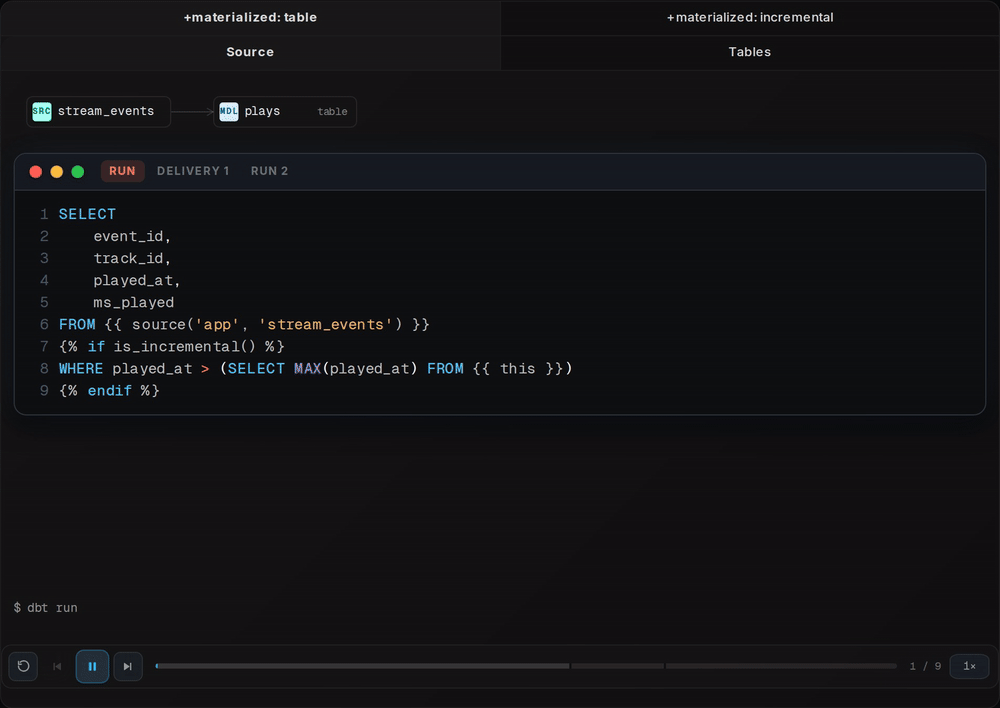
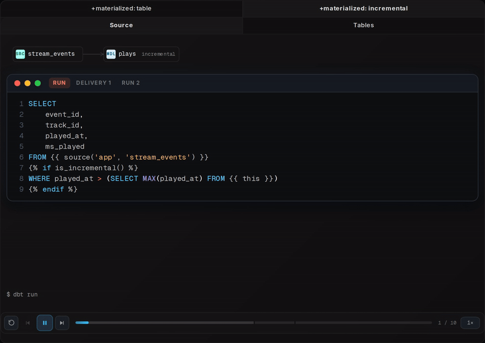
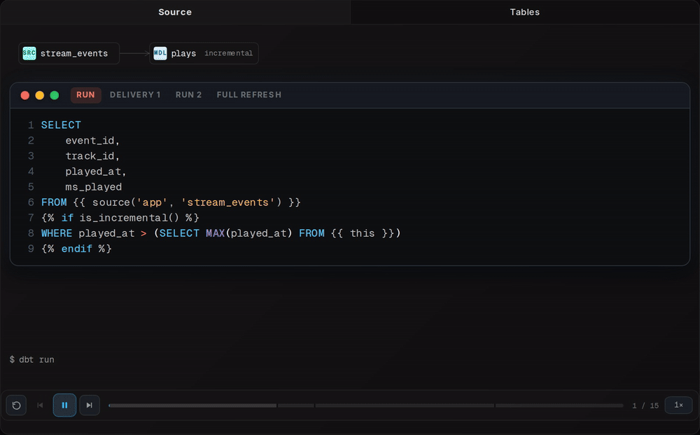

Beginner·[](https://www.getdbt.com/)·20 min · 10 challenges

# Incremental Models: Beginner

Spotify Wrapped lands each December and turns a year of a listener's streams into top songs, top artists and minutes listened. A plays table feeding it, 1 row per stream, rebuilt every night from the first stream ever recorded to add 1 day, would finish later each night as history grows. The fix is a model that writes only the plays it has not seen.


<br>

---

## Rebuild or Increment

A table model sends the same statement on every build: drop the table that exists, create a new one from the SELECT. The SELECT reads every row of its source each time, whether that row arrived an hour ago or was already read on the build before. For a source that gains rows every day, the rebuild on day 400 reads 400 days of rows to add 1.


<br>

### The arithmetic of a nightly rebuild

Take a source of stream events, 1 row per play, holding 90,000,000 rows and gaining 300,000 a night. A table model reads all of them to add the 300,000 that arrived since the last run. The table below follows 4 nights of that source under both materializations, counting the rows each run reads.

| Night | Rows in source | Rows a table rebuild reads | Rows an incremental run reads |
| --- | --- | --- | --- |
| 1 | 90,000,000 | 90,000,000 | 90,000,000 |
| 2 | 90,300,000 | 90,300,000 | 300,000 |
| 3 | 90,600,000 | 90,600,000 | 300,000 |
| 4 | 90,900,000 | 90,900,000 | 300,000 |

Night 1 reads every row under both, because no earlier table exists to add to. From night 2 the incremental run reads the rows that arrived since the night before and nothing else, while the rebuild reads the whole source again, and the gap widens every night the source grows.

- **301x** — rebuild reads per incremental read
- **99.7%** — of a night 2 rebuild is repeated work


<br>

### What incremental changes

materialized='incremental' is the third value the materialized config accepts, beside view and table. On its first build the model creates its table from the SELECT, as a table model does. On every later build it runs the SELECT and inserts the rows that come back into the table that already exists. Nothing is dropped, and a row the table already holds is never read again or rewritten.

The model saves work because it trusts the rows it already holds, which suits sources whose rows stay as written: plays, page views, sensor readings, log lines, ledger entries. A row that changes after it lands keeps its old values in the incremental table until someone rebuilds the table from the start.


<br>

### The running example

The lesson follows 1 source table, app.stream_events, with 1 row per play and 4 columns: event_id, handed out in order as the app records plays, track_id, played_at, and ms_played, the milliseconds the listener heard. On the first night it holds 3 rows.

| event_id | track_id | played_at | ms_played |
| --- | --- | --- | --- |
| 1 | trk_41 | 2026-03-01 08:12:00 | 214000 |
| 2 | trk_09 | 2026-03-01 09:40:00 | 9000 |
| 3 | trk_41 | 2026-03-01 21:05:00 | 198000 |

By the second night 2 more plays have arrived, events 4 and 5. A table model named plays reads 5 rows and writes 5. An incremental model named plays reads 2 and inserts them beside the 3 it wrote the night before. Both tables hold the same 5 rows afterward; the difference is the statement sent and the rows read to produce it.

- ref('plays') works the same in every model that reads it, whichever materialization plays uses
- The tests declared on plays run after it, over every row the table holds, old and new
- The table has the same columns, in the same types, as the table version would
- A failing test on plays still holds back its children in dbt build


<br>

### Choosing

| ✓ Increment it | ✗ Rebuild it |
| --- | --- |
| • Rows are events that never change after they are written<br><br>• A column grows with every new row: a created timestamp or a counting id<br><br>• The source is large enough that reading all of it costs real time or money<br><br>• The SELECT keeps 1 row per source row, or groups rows that arrive together | • Rows are edited after they land: an order's status, a user's plan<br><br>• The SELECT computes totals over all history: lifetime plays per track<br><br>• The source is small: a lookup of 200 categories rebuilds in a second<br><br>• No column tells old rows from new ones |

The SELECT matters as much as the source. A model that counts lifetime plays per track has 1 row per track, and a new play changes a row that already exists, so appending can't express it. A model with 1 row per source row, or 1 row per batch that arrives whole, is the shape that append fits.

> 3 questions before a model goes incremental
>
> - Do source rows change after they are written? If yes, the appended copy goes stale.
> - Which column marks a row as newer than every row loaded before it?
> - Would the rebuild cost matter if the source were 10 times larger next year?

Put the 3 questions to 2 models over the same source: plays, and a model of lifetime plays per track.

| Question | plays | Lifetime plays per track |
| --- | --- | --- |
| Do rows change after they are written? | No: a play is recorded once | Yes: every new play changes a track's total |
| Which column marks a row as newer? | `event_id`, or `played_at` while plays arrive in order | None: a track's row has no arrival time |
| Would the rebuild cost matter at 10 times the size? | Yes: 900,000,000 rows read a night | Yes, but append cannot change a total it already wrote |
| Verdict | Incremental | Table |

> **TIP**
>
> Start a model as a table, and switch it to incremental when the build log shows the rebuild taking longer than the rows it adds are worth. Filtering Only New Rows covers the column the switch depends on.


<br>

---

## is_incremental() and this

An incremental model needs 1 SELECT that behaves 2 ways: read everything when there is no table, read only the new rows when there is. Jinja renders before any SQL reaches the warehouse, so the model wraps its filter in an if block and lets dbt decide, at render time, whether the filter is there at all.

```sql
{{ config(materialized='incremental') }}

SELECT
    event_id,
    track_id,
    played_at,
    ms_played
FROM {{ source('app', 'stream_events') }}

WHERE played_at > (SELECT MAX(played_at) FROM {{ this }})

```

The file has 3 new parts: the config value incremental on the first line, the macro is_incremental() inside the if tag, and this inside the subquery. The rest is a SELECT over a source with each column named, the same shape as every model so far.


<br>

### What is_incremental() checks

is_incremental() is a macro that ships with dbt, and it returns true only when all 3 of these hold at the moment the model renders:

- The model is configured with materialized='incremental'
- A table with the model's name already exists in the target schema
- The command was run without the --full-refresh flag

When any 1 of them fails it returns false, and Jinja drops everything between the if and the endif, so the SQL dbt sends has no WHERE in it at all. To settle the second condition the macro asks the warehouse whether the table exists, which is why the result changes from run to run with no edit to the file.

Here are the 3 conditions checked in 4 situations the plays model can meet:

| Situation | Configured incremental | Table exists | --full-refresh | is_incremental() |
| --- | --- | --- | --- | --- |
| First build | yes | no | no | false |
| Second build | yes | yes | no | true |
| Second build with the flag | yes | yes | yes | false |
| Config set to table | no | yes | no | false |


<br>

### 1 file, 2 renderings

Compiled SQL is what dbt writes under target/compiled/ and sends to the warehouse. With the plays table present and no flag, the block stays, source() and this resolve to names, and the warehouse receives this statement:

```sql
SELECT
  event_id,
  track_id,
  played_at,
  ms_played
FROM app.stream_events
WHERE played_at > (
  SELECT
    MAX(played_at)
  FROM analytics.plays
)
```

With the table absent, or the flag set, the same file renders to the SELECT alone:

```sql
SELECT
  event_id,
  track_id,
  played_at,
  ms_played
FROM app.stream_events
```


<br>

### this names the model's own table

this is a variable dbt sets while rendering each model, holding the relation the model writes to: schema and name. For plays built into the analytics schema it renders to analytics.plays. It renders to that name whether the table exists, because this is a name and nothing more; whether the name points at a table is the warehouse's business when the statement runs.

ref() can't do this job. ref('plays') inside plays would tell dbt that plays depends on plays, and dbt refuses the edge, since no node can be built before itself. this adds no edge: it names the table, dbt consults nothing in the DAG, and the subquery reads whatever sits under that name when the statement executes.

| ✓ {{ this }} | ✗ {{ ref('plays') }} |
| --- | --- |
| • Renders to the current model's own relation<br><br>• Adds no node or edge to the DAG<br><br>• Used inside the model to read what it already holds<br><br>• Renders to the same name on every run | • Renders to another model's relation<br><br>• Adds an edge: that model builds first<br><br>• Used in a different model that reads plays<br><br>• Refused inside plays itself as a cycle |

> **TIP**
>
> Whatever the if block holds must leave valid SQL behind when it is dropped. A WHERE that lives inside the block vanishes whole, which is fine; an AND inside the block needs a WHERE outside it to attach to, or the first run sends a statement the warehouse rejects.


<br>

### Same file, 2 materializations

The animation builds plays from the same 3 rows, then adds 2 rows and builds again. Here the materialization comes from dbt_project.yml, so the model file is identical in both versions and only +materialized changes. Switch between them: the lineage, the rows and the columns match after both runs. Under table the if block renders away on both runs, because is_incremental() returns false for any model not configured incremental, and run 2 rewrites all 5 rows. Under incremental the block renders away on run 1 and stays on run 2, which inserts 2.

**+materialized: table**



**+materialized: incremental**



*$ dbt run*


<br>

---

## Filtering Only New Rows

is_incremental() decides whether a filter exists; the filter decides what counts as new. dbt keeps no record of which source rows it has loaded. On every run the model's own SQL has to look at the table it holds, find the newest row there, and ask the source for rows newer than it.


<br>

### A watermark column

The subquery inside the if block returns 1 value, the latest played_at the table holds, and the outer WHERE keeps the source rows past it. That value is a watermark: the line the last run reached. For the filter to be right the column has to grow with every new row, so that a row arriving later always carries a larger value than every row already loaded.

Columns of 3 kinds can do that, and they're not equally safe. An id handed out in order as rows are written, such as event_id, grows with arrival by construction. So does a load timestamp, a time the source stamps on the row when it writes it. played_at is an event time: when the listener pressed play. It grows with arrival only while plays reach the source in the order they happened, and the end of this section shows a play that does not. A column like updated_at, which a later edit pushes upward, sends old rows back through the filter, and append writes them a second time.


<br>

### The second night, row by row

After the first night plays holds events 1 to 3, and MAX(played_at) over it is 2026-03-01 21:05:00. The source now holds 5 rows. The filter compares each of them against that value:

| event_id | played_at | played_at > 2026-03-01 21:05:00 | Inserted |
| --- | --- | --- | --- |
| 1 | 2026-03-01 08:12:00 | no | no |
| 2 | 2026-03-01 09:40:00 | no | no |
| 3 | 2026-03-01 21:05:00 | no, the values are equal | no |
| 4 | 2026-03-02 07:30:00 | yes | yes |
| 5 | 2026-03-02 12:15:00 | yes | yes |

Row 3 sits on the watermark itself. With > it stays out, which is right, because the table already holds it. The 2 rows past the line are inserted, and the table ends the night with 5 rows and a watermark of 2026-03-02 12:15:00, which the third night's subquery will return.

plays before the second run

| event_id | played_at |
| --- | --- |
| 1 | 2026-03-01 08:12:00 |
| 2 | 2026-03-01 09:40:00 |
| 3 | 2026-03-01 21:05:00 |

plays after the second run

| event_id | played_at |
| --- | --- |
| 1 | 2026-03-01 08:12:00 |
| 2 | 2026-03-01 09:40:00 |
| 3 | 2026-03-01 21:05:00 |
| 4 | 2026-03-02 07:30:00 |
| 5 | 2026-03-02 12:15:00 |


<br>

### Why > and not >=

Change the comparison to >= and row 3 passes on night 2, since its played_at equals the watermark. Append inserts it, and plays holds event 3 twice. On night 3 the newest row of night 2 passes the same way, so every run adds 1 duplicate, and a unique test on event_id fails from the second run on. Equality at the boundary belongs to the row that is already loaded.

| Night | New plays in source | Inserted with > | Inserted with >= | Duplicate rows in plays |
| --- | --- | --- | --- | --- |
| 2 | 2 | 2 | 3 | 1 |
| 3 | 1 | 1 | 2 | 2 |
| 4 | 3 | 3 | 4 | 3 |


<br>

### Filtering on an id instead

Swapping the column changes 1 line: WHERE event_id > (SELECT MAX(event_id) FROM {{ this }}) inside the same if block. An id works when the source hands ids out in arrival order, and it has 1 advantage over a timestamp: an integer comparison has no time zone and no fractional second to get wrong. A timestamp is the choice when no such id exists, or when the source is a union of feeds whose ids overlap.


<br>

### What the filter cannot see

The watermark assumes rows arrive in order. A play recorded at 20:00 on March 1 that reaches the source on March 2, after the run that moved the watermark to 21:05, never passes the filter: its played_at sits below the line, and no later run looks there. This lesson's model accepts that gap and counts on the source to deliver in order; widening the filter to catch rows that arrive late comes at the next tier.

Suppose a play from 2026-03-01 20:00:00, made on a phone that was offline, lands in the source after night 2's run, and the source hands it the next id, 6. Night 3's run judges it under each filter:

| Filter | Night 3 watermark | Row 6's value | Inserted |
| --- | --- | --- | --- |
| `played_at > MAX(played_at)` | 2026-03-02 12:15:00 | 2026-03-01 20:00:00 | no, on this run or any later one |
| `event_id > MAX(event_id)` | 5 | 6 | yes |

The id filter catches the late play because the source numbered it on arrival, while the event-time filter loses it for good. That holds only when the source hands out ids, or load timestamps, as rows land, so check how a source assigns them before trusting one as a watermark.

> **TIP**
>
> Keep the watermark column in the SELECT. The subquery reads it from the model's own table, so a model that filters on played_at but leaves played_at out of its columns has nothing to read on the second run, and the warehouse returns a column-not-found error.


<br>

---

## The First Run Builds It All

The first time dbt runs an incremental model, no table of its name exists in the target schema. is_incremental() finds the table missing, returns false, and Jinja drops the if block before rendering finishes. The SQL sent is the plain SELECT with no WHERE, and dbt wraps it in a CREATE TABLE AS:

```sql
CREATE TABLE analytics.plays AS
SELECT
    event_id,
    track_id,
    played_at,
    ms_played
FROM app.stream_events
```

This is the statement a table model with the same SELECT sends on every run. Whatever the if block holds, however narrow its filter, plays no part in the first build, because the block never reaches the warehouse. The first run reads every source row, and the table starts complete.


<br>

### Why the block has to go

Suppose the block rendered anyway. The statement would contain SELECT MAX(played_at) FROM analytics.plays, a query over a table that does not exist. Rendering would finish without complaint, because to Jinja the name is a string, and the warehouse would answer with a database error: table not found. dbt returns false for a missing table so that the SQL it sends never names what is not there, and the model file doesn't have to know which run it is on.

An empty table shows the other half of the reason. If a script had created plays with its 4 columns and no rows before dbt ever ran, the table would exist, the block would render, and MAX over 0 rows would return NULL. Every comparison with NULL is unknown, no source row passes, and each run inserts 0 rows for as long as the table stays empty. Reading everything the first time is what gives the second run a watermark to read.

| Piece of the second run | On a plays table with 0 rows |
| --- | --- |
| `MAX(played_at)` from `this` | NULL |
| `played_at > NULL` for each source row | unknown, so the row is filtered out |
| Rows inserted | 0 |
| Watermark for the run after | still NULL |

Each run repeats that table: the filter renders, every source row is compared against NULL, nothing is inserted, and the watermark never moves off NULL.

| ✓ First run | ✗ Every later run |
| --- | --- |
| • No table under the model's name<br><br>• is_incremental() returns false<br><br>• CREATE TABLE AS over the whole source<br><br>• Columns and types fixed from the SELECT | • The table from the run before<br><br>• is_incremental() returns true<br><br>• INSERT INTO of the rows past the watermark<br><br>• Rows must fit the columns the table already has |


<br>

### What the first run costs

The first build reads every source row, so it costs what 1 table rebuild costs, in time and in rows scanned. The saving starts on the second run. A team converting the 90,000,000-row table model to incremental should expect the conversion run to take as long as the rebuild it replaces, and schedule it for an hour when nothing waits on the table.

| Run | Table exists before | is_incremental() | Statement | Rows read |
| --- | --- | --- | --- | --- |
| 1 | no | false | CREATE TABLE AS | 90,000,000 |
| 2 | yes | true | INSERT INTO | 300,000 |
| 3 | yes | true | INSERT INTO | 300,000 |


<br>

### Later runs insert

From the second run on, dbt runs the rendered SELECT into a temporary table, inserts that table's rows into plays with an INSERT INTO followed by a SELECT, and drops the temporary table. The columns are matched by name, so the SELECT has to produce the column names plays already has, in types the warehouse can insert.

```sql
INSERT INTO analytics.plays (
    event_id,
    track_id,
    played_at,
    ms_played
)
SELECT
    event_id,
    track_id,
    played_at,
    ms_played
FROM analytics.plays__dbt_tmp
```

The first run also fixes the table's shape: CREATE TABLE AS takes the columns and their types from the SELECT, and every later insert works inside that shape. Under dbt's default setting the insert lists the columns the table already has. A column added to the SELECT later is left out of every insert without an error, so the table never holds it. A column removed from the SELECT leaves the insert asking for a column the temporary table lacks, and the run fails. Settle the columns before the first run; changing them mid-life is a later lesson.


<br>

### When a run becomes a first run again

- Someone dropped the table by hand in the warehouse: the next run creates it from scratch
- The model file was renamed: the new name has no table, and the old table stays behind unused
- The command carried --full-refresh: the next section
- An error stopped the first run before CREATE finished: the next run attempts the whole build again

*dbt tells a first run from a later run by looking for the table, never by remembering. Nothing in the project records that a model has run before.*


<br>

---

## Full Refresh

dbt run --full-refresh tells dbt to treat every incremental model in the run as though its table did not exist. is_incremental() returns false, the if block is dropped, and dbt drops the existing table and creates it again from the full SELECT, reading every source row. dbt build --full-refresh does the same and runs the tests after.

| Situation | is_incremental() | Statement sent | plays afterward |
| --- | --- | --- | --- |
| Table absent, plain run | false | CREATE TABLE AS | every source row |
| Table present, plain run | true | INSERT INTO | old rows plus rows past the watermark |
| Table present, --full-refresh | false | drop, then CREATE TABLE AS | every source row |


<br>

### Reason 1: the SELECT changed

Spotify counts a stream once a track has played for 30 seconds, a rule it publishes for artists and royalties. Suppose plays has run for 30 nights keeping every event, and the team adds a WHERE on ms_played to apply the rule. A plain run applies the rule to tonight's rows and to nothing else: the 30 nights already in the table keep their short plays, because append never reads them again.

```sql
{{ config(materialized='incremental') }}

SELECT
    event_id,
    track_id,
    played_at,
    ms_played
FROM {{ source('app', 'stream_events') }}
WHERE ms_played >= 30000

  AND played_at > (SELECT MAX(played_at) FROM {{ this }})

```

On the running example, say the rule lands between night 1 and night 2. Night 2's plain run judges events 4 and 5 under the rule and leaves events 1 to 3 as they were loaded:

| event_id | ms_played | Loaded | After a plain run | After --full-refresh |
| --- | --- | --- | --- | --- |
| 1 | 214000 | night 1, before the rule | kept | kept |
| 2 | 9000 | night 1, before the rule | kept, against the rule | dropped |
| 3 | 198000 | night 1, before the rule | kept | kept |
| 4 | 45000 | night 2, under the rule | inserted | kept |
| 5 | 12000 | night 2, under the rule | not inserted | not present |

After the plain run the table holds 2 rules at once, and nobody reading it can tell which rows were loaded under which. One full refresh rebuilds every row under the SELECT as it now stands, drops event 2, and the table means 1 thing again. Any edit to the SELECT that changes what old rows would hold calls for the same treatment: a fixed calculation, a renamed value, a filter added or removed.


<br>

### Reason 2: the source rewrote old rows

Event 2 was recorded with 9,000 ms played. The next day the app re-sends it with 186,000 ms, and the source team updates the row in place rather than adding one. The watermark filter looks only past 2026-03-01 21:05:00, and event 2 sits before it, so the row in plays keeps 9,000 under every plain run from now on. A full refresh reads the corrected value, because it reads everything.

A plain run has no way to find that row. Its filter looks only past the watermark, and dbt keeps no list of the source rows that changed, so the repair for a rewrite behind the line is to read everything again.



*$ dbt run*


<br>

### What a full refresh costs

A full refresh is night 1 again: every source row read and the whole table written. For the stream events source on night 2 it reads 90,300,000 rows against a normal night's 300,000, which is 301 times the rows read. The flag applies to every incremental model in the command, so a project with 12 incremental models pays 12 rebuilds in 1 run unless some of them refuse the flag.

> **TIP**
>
> A model can refuse the flag: {{ config(materialized='incremental', full_refresh=false) }} keeps that model appending even when the run carries --full-refresh. It fits a model whose source no longer holds its oldest rows, where a rebuild would lose that history for good.

| ✓ Do | ✗ Don't |
| --- | --- |
| • Refresh after any edit to the SELECT that changes what old rows would hold<br><br>• Refresh when the source rewrote rows behind the watermark<br><br>• Batch SELECT changes and pay for 1 rebuild instead of several<br><br>• Run it through dbt build so the tests check the rebuilt table | • Expect a plain run to repair rows the table already holds<br><br>• Leave 2 versions of a rule living in 1 table<br><br>• Refresh a model whose source has dropped its oldest history<br><br>• Pass --full-refresh on a schedule; each one is a decision someone makes |


<br>

---

## Putting It All Together

A ride-hailing company's analytics team keeps a trips table with 1 row per completed ride, built nightly from an events source that gains millions of rows a day. They convert it to incremental, filtered on an event id that counts up, and the nightly run drops from an hour to 2 minutes. A month later a fare rule changes in the SELECT, and the next scheduled run is replaced by a full refresh.

- Rebuild or Increment: completed rides are events that do not change after they end, and the source grows every minute, so the model qualifies for append.
- is_incremental() and this: the second night's run finds the table, keeps the filter, and reads the watermark from the table through this.
- Filtering Only New Rows: the event id grows with every ride, so > MAX(event_id) selects 1 night's rows and nothing already loaded.
- The First Run Builds It All: the conversion run reads the whole source once and takes the old hour; the 2-minute runs start the night after.
- Full Refresh: the fare rule changes what every row means, so the team pays 1 rebuild rather than keeping 2 rules in 1 table.


<br>

---

## Key Takeaways

- An incremental model creates its table on the first build and inserts into it on every later build; rows already there are never read again or rewritten.
- is_incremental() returns true only when the model is configured incremental, its table exists in the target schema, and the run has no --full-refresh flag.
- this renders to the model's own relation without adding a DAG edge, which ref() of the model's own name would be refused for.
- The filter compares a watermark column against MAX of that column in this, with > so the row on the boundary stays out.
- The first run renders the filter away and reads every source row, costing the same as a table build; the saving starts on the second run.
- A changed SELECT or a corrected old source row calls for --full-refresh, which rebuilds the table from the start at night 1's cost.

[](https://www.getdbt.com/)

Official dbt resources

"dbt enables data analysts and engineers to transform their data using the same practices that software engineers use to build applications." [github.com/dbt-labs/dbt-core](https://github.com/dbt-labs/dbt-core)

[Documentation](https://docs.getdbt.com/)[Get started](https://docs.getdbt.com/docs/get-started-dbt)[Source](https://github.com/dbt-labs/dbt-core)

dbt and the dbt logo are trademarks of dbt Labs, LLC.
